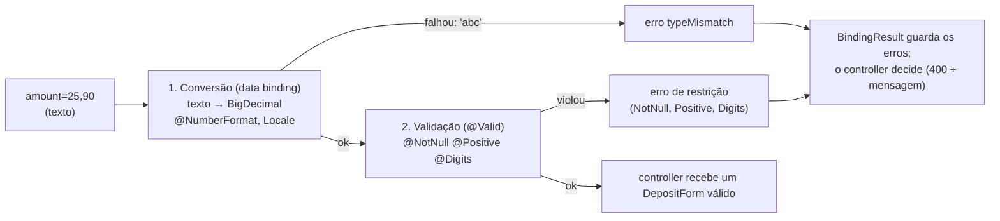

# J5.13 — Bean Validation

> ⏱️ ~1h30 · 🟢 Júnior · Pré-requisitos: J5.05 (`@ConfigurationProperties`), J5.06 (controllers, formulários, 400), J5.07 (entidades), J5.11 (serviços), J4.01 (validação nativa do navegador e "o servidor sempre revalida")

> ✅ **Validação final (2026-11-24):** este módulo foi executado no PayFlow reconstruído; o resultado e o que continua não executado estão no [README do módulo](README.md). Os avisos "não executado" / "por leitura" abaixo descrevem a escrita original.

## 🎯 Objetivos
Ao final desta aula você consegue:
- Explicar o que é **Bean Validation** (Jakarta Validation), qual a sua **implementação** (Hibernate Validator) e onde ele roda no Spring (formulários, `@ConfigurationProperties`, entidades).
- Declarar regras com **`@NotNull`, `@NotBlank`, `@Positive`, `@Digits`, `@Size`, `@Email`, `@Min`/`@Max`** e usar **`@Valid` + `BindingResult`** em um controller.
- Converter **dinheiro digitado em pt-BR** ("25,90") para `BigDecimal` com `@NumberFormat` e entender por que o **`Locale` precisa ser fixo**.
- Escrever **mensagens de erro** em um arquivo (`messages.properties`) e entender a diferença entre **erro de conversão** e **violação de regra**.
- Aplicar o princípio **"valide na entrada, proteja no domínio e confirme no banco"** (defesa em profundidade) no PayFlow.

## 🤔 Por que isso importa
**Nunca confie na entrada.** O navegador valida (J4.01), mas um `curl` ignora o navegador. Se o servidor não valida, um depósito de `1000000000000000000000` chega ao banco e estoura o `NUMERIC(19,2)`: **testamos** e o resultado, antes desta aula, seria um **erro 500** com `ERROR: numeric field overflow`. Validar bem é segurança (entrada maliciosa, J8), qualidade (mensagens claras) e economia (não gastar uma ida ao banco com um dado sabidamente inválido).

## 💡 Intuição (explicação simples)
Uma **portaria de prédio** com três barreiras: o **porteiro** confere o documento na entrada (**validação na borda**: formato e limites: "é um CPF válido? é um valor positivo?"); o **elevador só abre no andar autorizado** (**regras do domínio**: "a conta está ativa? tem saldo?"); e, no apartamento, a **fechadura** é a última barreira (**o banco**: `CHECK`, `NOT NULL`, `UNIQUE`). Cada barreira pega erros diferentes e **nenhuma substitui as outras**. O Bean Validation é o **porteiro**: regras escritas como **anotações** nos campos, em vez de `if` espalhados.

## 🔬 Como funciona por dentro

### 1. O que é e quem faz
- **Jakarta Bean Validation** é uma **especificação** (pacote `jakarta.validation.*`): define anotações como `@NotNull` e a API `Validator`.
- **Hibernate Validator** é a **implementação** (de nome parecido, mas **não** tem relação com o Hibernate ORM); o starter `spring-boot-starter-validation` o traz (versão 9.1.5.Final no Boot 4.1.2).
- O Spring Boot cria um bean `Validator` (autoconfiguração, J5.04) e o usa em **três lugares**:
  1. **Controllers**: parâmetros com `@Valid` (formulários e JSON).
  2. **`@ConfigurationProperties` com `@Validated`**: a aplicação não sobe com configuração inválida (J5.05).
  3. **Entidades JPA**: o Hibernate ORM valida as restrições **antes do INSERT/UPDATE** (modo `AUTO`).
Também há validação em **métodos** (`@Validated` na classe + `@Min` nos parâmetros), que não usamos aqui.

### 2. As restrições mais usadas
| Anotação | Regra | Observação |
|---|---|---|
| `@NotNull` | Não pode ser `null` | Aceita texto vazio |
| `@NotBlank` | Texto com pelo menos um caractere **que não é espaço** | Só para `String` |
| `@NotEmpty` | Texto/coleção não vazio | `" "` passa |
| `@Size(min, max)` | Tamanho de texto/coleção | |
| `@Min`, `@Max` | Limites inclusivos | Números inteiros e `BigDecimal` |
| `@Positive`, `@PositiveOrZero` | > 0, >= 0 | |
| `@Digits(integer, fraction)` | Máximo de dígitos inteiros e decimais | Para dinheiro: `@Digits(integer = 17, fraction = 2)` combina com `NUMERIC(19,2)` |
| `@Email` | Formato de e-mail (simples) | |
| `@Pattern(regexp)` | Casa com a expressão regular | |
| `@Past`, `@Future` | Datas no passado/futuro | |
**`null` e as restrições:** a maioria considera `null` **válido** (só `@NotNull`/`@NotBlank` o recusam). Por isso o `DepositForm` tem `@NotNull` **e** `@Positive`.

### 3. `@Valid` e `BindingResult`: erro de conversão × violação de regra
O formulário chega como **texto**. O Spring MVC faz duas coisas **em ordem**:

- **Sem** `BindingResult` logo depois do `@Valid`, o Spring **lança uma exceção** (`MethodArgumentNotValidException`/`HandlerMethodValidationException`) e a requisição cai no `@ControllerAdvice` (J5.06). **Com** `BindingResult`, o controller recebe os erros e **decide** o que mostrar (aqui, reexibir o formulário com **400**).
- A **conversão** ("abc" → `BigDecimal`) acontece **antes** e gera o erro `typeMismatch` (não é uma violação de `@Positive`).

### 4. Dinheiro digitado e o `Locale`
No Brasil escrevemos `25,90`. Um `BigDecimal` do Java só entende `25.90`. O `@NumberFormat` faz o Spring converter **conforme o `Locale`** da requisição. **Armadilha (testada):** por padrão o `Locale` vem do cabeçalho `Accept-Language` do **navegador**. Com `spring.web.locale-resolver=accept-header` e `curl -H "Accept-Language: en-US" --data-urlencode amount=25,90 ...`, a resposta foi **303 (sucesso!)** e o saldo da conta subiu **R$ 2.590,00**, não R$ 25,90: no padrão americano a vírgula é separador de **milhar** e `25,90` vira `2590`. Com `Accept-Language: pt-BR` o mesmo pedido depositou R$ 25,90. **Dinheiro nunca pode depender do idioma do navegador.** O PayFlow fixa o `Locale`: `spring.web.locale-resolver: fixed` (com `spring.web.locale: pt-BR`).

### 5. As mensagens
As mensagens de erro ficam em **`messages.properties`** (o `MessageSource` do Spring, J5.06 mostrou o `Content-Language`). Uma restrição pode referenciar uma chave com `{...}`: `@Positive(message = "{deposit.amount.invalid}")`. O Boot usa o `MessageSource` para interpolar as chaves. O erro de **conversão** tem uma chave própria por convenção: `typeMismatch.<objeto>.<campo>`.

## 🛠️ Exemplo prático
> Testado com **JDK 25.0.5**, **Spring Boot 4.1.2** (Hibernate Validator 9.1.5.Final, Jakarta Validation 3.1.1), PostgreSQL 18.6.

### 1. Dependência e configuração
```xml
<dependency>
  <groupId>org.springframework.boot</groupId>
  <artifactId>spring-boot-starter-validation</artifactId>
</dependency>
```
`application.yml` (em `spring.web`):
```yaml
spring:
  web:
    locale: pt-BR                          # Content-Language e formatação padrão
    locale-resolver: fixed                 # sempre pt-BR, ignorando o idioma do navegador (vírgula decimal)
```
`src/main/resources/messages.properties` (o arquivo-base, em UTF-8, sem sufixo de idioma, porque o PayFlow é só em português):
```properties
deposit.amount.invalid=Informe um valor positivo com até 2 casas decimais, como 25,90.
typeMismatch.depositForm.amount=Informe um valor positivo com até 2 casas decimais, como 25,90.
```

### 2. O formulário com regras
`src/main/java/com/payflow/web/DepositForm.java`
```java
package com.payflow.web;

import jakarta.validation.constraints.Digits;
import jakarta.validation.constraints.NotNull;
import jakarta.validation.constraints.Positive;
import java.math.BigDecimal;
import org.springframework.format.annotation.NumberFormat;

/** O formulário de depósito: o que o navegador manda (campo "amount") e as regras de entrada. */
public record DepositForm(
        @NumberFormat                                              // "25,90" (pt-BR) -> 25.90
        @NotNull(message = "{deposit.amount.invalid}")
        @Positive(message = "{deposit.amount.invalid}")
        @Digits(integer = 17, fraction = 2, message = "{deposit.amount.invalid}")   // cabe em NUMERIC(19,2)
        BigDecimal amount) { }
```
- Um `record` como "objeto de formulário": o Spring MVC o **preenche pelo construtor** com os campos do corpo (`amount=25,90`).
- `@Digits(integer = 17, fraction = 2)` é **exatamente** a capacidade de `NUMERIC(19, 2)` (19 dígitos no total, 2 decimais → 17 inteiros): um valor que não cabe no banco **nem chega a ele**.
- As **três** regras usam a **mesma** mensagem, de propósito (o usuário não precisa saber qual regra foi violada, só o que fazer).

### 3. O controller
`AccountPagesController.deposit` (injete também um `MessageSource` e `import jakarta.validation.Valid`, `org.springframework.validation.BindingResult`, `org.springframework.context.MessageSource`, `org.springframework.context.i18n.LocaleContextHolder`):
```java
@PostMapping("/accounts/{id}/deposit")
public ModelAndView deposit(@RequestAttribute(AuthInterceptor.USER) CurrentUser user,
                            @PathVariable UUID id,
                            @Valid DepositForm form, BindingResult errors) {
    if (ownedAccount(user, id).isEmpty()) {
        return statementPage(user, id, 0, null, HttpStatus.OK);     // vira a página 404
    }
    if (errors.hasErrors()) {                                        // entrada inválida: 400
        String message = messages.getMessage(errors.getFieldError("amount"), LocaleContextHolder.getLocale());
        return statementPage(user, id, 0, message, HttpStatus.BAD_REQUEST);
    }
    try {
        accountService.deposit(id, form.amount());
        return Pages.redirect("/accounts/" + id);                    // Post/Redirect/Get
    } catch (AccountUnavailableException e) {
        return statementPage(user, id, 0, "Esta conta não aceita depósitos agora.", HttpStatus.UNPROCESSABLE_ENTITY);
    }
}
```
- Sumiram o `trim().replace(',', '.')` e o `new BigDecimal(raw)` com `try/catch`: a **conversão** é do `@NumberFormat` e a **validação**, das anotações.
- `messages.getMessage(fieldError, locale)` resolve a mensagem **do erro**: para a **violação** de restrição devolve a mensagem já interpolada; para o **`typeMismatch`** procura as chaves por convenção (`typeMismatch.depositForm.amount`...) em `messages.properties`. **Primeira tentativa (bug real):** usamos `errors.getFieldError("amount").getDefaultMessage()` e, para `abc`, a tela mostrou `Failed to convert value of type 'java.lang.String' to required type 'java.math.BigDecimal'...`: o `getDefaultMessage()` **não** consulta o `messages.properties`. Corrigido com o `MessageSource`.
- **Ordem das regras:** o `statementPage` (J5.06) continua devolvendo **400**. As regras de **estado** (conta ativa, saldo) seguem no domínio (`Account.deposit`, J5.11), que **também** valida o valor (`Amounts`): **defesa em profundidade**; nunca presuma que a camada de cima validou.

Resultado real (execução com perfil `dev`, depósitos na conta da Ana; cada linha é um `curl --data-urlencode 'amount=...'`):
```
'abc'                    -> [400]  Informe um valor positivo com até 2 casas decimais, como 25,90.
'-5'                     -> [400]  Informe um valor positivo com até 2 casas decimais, como 25,90.
'0'                      -> [400]  idem
'1,234'                  -> [400]  idem            (3 casas decimais: @Digits)
''                       -> [400]  idem            (@NotNull)
'25,90'                  -> [303]                  (Post/Redirect/Get)
'1000000000000000000000' -> [400]  idem            (ANTES desta aula: 500, numeric field overflow)
'1.234,50'               -> [303]                  (o ponto de milhar também é aceito: 1234.50)
```
Os 10 testes do `PayflowWebTest` continuam verdes (os 5 valores inválidos do teste `invalidDepositShowsAnErrorAndChangesNothing` devolvem 400 e a mesma mensagem). O teste só passou **depois** de usar o `MessageSource`, por causa do bug acima.

### 4. Validando entidades e propriedades
Na `User`, restrições nos campos (o Hibernate ORM as confere antes do `INSERT`/`UPDATE`):
```java
@NotBlank @Email @Size(max = 255)
@Column(nullable = false, unique = true, length = 255)
private String email;

@NotBlank @Size(max = 120)
@Column(name = "full_name", nullable = false, length = 120)
private String fullName;
```
(Imports `jakarta.validation.constraints.*`.) **As anotações do banco (`@Column(nullable = false, length = ...)`) e as de validação (`@NotBlank`, `@Size`) dizem coisas parecidas e fazem coisas diferentes:** `@Column` só informa o Hibernate sobre o esquema (e o gerador de DDL, que não usamos); **`@NotBlank` realmente bloqueia** antes de ir ao banco, com uma mensagem melhor.

Na `PayflowProperties` (J5.05), o construtor compacto com `if` vira **anotações**, e a classe ganha `@Validated`:
```java
package com.payflow.config;

import jakarta.validation.Valid;
import jakarta.validation.constraints.Max;
import jakarta.validation.constraints.Min;
import jakarta.validation.constraints.NotBlank;
import org.springframework.boot.context.properties.ConfigurationProperties;
import org.springframework.boot.context.properties.bind.DefaultValue;
import org.springframework.validation.annotation.Validated;

/**
 * Configuração tipada do PayFlow: tudo que começa com "payflow." no application.yml, nas variáveis
 * de ambiente (PAYFLOW_STATEMENT_PAGE_SIZE) ou nos argumentos (--payflow.statement.page-size=10).
 */
@Validated
@ConfigurationProperties(prefix = "payflow")
public record PayflowProperties(@Valid @DefaultValue Statement statement, @Valid @DefaultValue Session session) {

    /** Extrato: tamanho da página e a última página aceita (proteção contra OFFSET gigante). */
    public record Statement(@DefaultValue("5") @Min(1) @Max(100) int pageSize,
                            @DefaultValue("10000") @Min(0) int maxPage) { }

    /** Sessão provisória (J4) até a J8. */
    public record Session(@DefaultValue("PAYFLOW_SESSION") @NotBlank String cookieName) { }
}
```
A falha mudou de forma (testada com `--payflow.statement.page-size=0`): em vez de uma `IllegalArgumentException` escrita por você, o Boot mostra a violação de restrição:
```
Binding validation errors on payflow
   - Field error in object 'payflow' on field 'statement.pageSize': rejected value [0]; codes [Min.payflow.statement.pageSize, ...]; ... default message [must be greater than or equal to 1]
```

### 5. O laboratório: o `Validator` sozinho
`src/test/java/com/payflow/web/ValidationLabTest.java`
```java
package com.payflow.web;

import static org.assertj.core.api.Assertions.assertThat;
import static org.assertj.core.api.Assertions.assertThatThrownBy;

import com.payflow.domain.User;
import com.payflow.repository.UserRepository;
import com.payflow.support.ResetDatabase;
import jakarta.validation.ConstraintViolation;
import jakarta.validation.Validator;
import java.math.BigDecimal;
import java.util.Set;
import java.util.stream.Collectors;
import org.junit.jupiter.api.Test;
import org.junit.jupiter.api.extension.ExtendWith;
import org.springframework.beans.factory.annotation.Autowired;
import org.springframework.boot.test.context.SpringBootTest;
import org.springframework.test.context.ActiveProfiles;

/** Laboratório da J5.13: o Bean Validation (Hibernate Validator) sem o Spring MVC, direto no Validator. */
@ExtendWith(ResetDatabase.class)
@SpringBootTest
@ActiveProfiles("test")
class ValidationLabTest {

    @Autowired Validator validator;
    @Autowired UserRepository users;

    private String check(BigDecimal amount) {
        Set<ConstraintViolation<DepositForm>> violations = validator.validate(new DepositForm(amount));
        return violations.isEmpty() ? "válido"
                : violations.stream().map(v -> v.getPropertyPath() + ": " + v.getMessage()).sorted().collect(Collectors.joining(" | "));
    }

    @Test
    void depositFormRules() {
        for (String value : new String[] {null, "-5", "0", "25.90", "1.234", "0.005", "99999999999999999.99", "100000000000000000.00"}) {
            BigDecimal amount = value == null ? null : new BigDecimal(value);
            System.out.printf("%-26s -> %s%n", value, check(amount));
        }
        assertThat(check(new BigDecimal("25.90"))).isEqualTo("válido");
        assertThat(check(new BigDecimal("1.234"))).isNotEqualTo("válido");
    }

    @Test
    void entityConstraintsAreCheckedByHibernateBeforeTheInsert() {
        assertThatThrownBy(() -> users.saveAndFlush(new User("not-an-email", "Bia Lima", "hash")))
                .satisfies(e -> {
                    System.out.println("ENTITY: " + e.getClass().getName());
                    System.out.println("mensagem: " + e.getMessage().replace('\n', ' '));
                });
    }
}
```
```bash
mvn test -Dtest=ValidationLabTest
```
Saída real:
```
null                       -> amount: Informe um valor positivo com até 2 casas decimais, como 25,90.
-5                         -> amount: Informe um valor positivo com até 2 casas decimais, como 25,90.
0                          -> amount: Informe um valor positivo com até 2 casas decimais, como 25,90.
25.90                      -> válido
1.234                      -> amount: Informe um valor positivo com até 2 casas decimais, como 25,90.
0.005                      -> amount: Informe um valor positivo com até 2 casas decimais, como 25,90.
99999999999999999.99       -> válido
100000000000000000.00      -> amount: Informe um valor positivo com até 2 casas decimais, como 25,90.
ENTITY: jakarta.validation.ConstraintViolationException
mensagem: Validation failed for classes [com.payflow.domain.User] during persist time for groups [jakarta.validation.groups.Default, ] List of constraint violations:[ ConstraintViolationImpl{interpolatedMessage='must be a well-formed email address', propertyPath=email, rootBeanClass=class com.payflow.domain.User, messageTemplate='{jakarta.validation.constraints.Email.message}'} ]
```
- `99999999999999999.99` (17 inteiros + 2 decimais) é o **maior** valor aceito; `100000000000000000.00` (18 inteiros) é recusado: a fronteira bate com o `NUMERIC(19,2)`.
- O `@Email` na entidade fez o Hibernate **recusar o `INSERT`** (`during persist time`) com `ConstraintViolationException`, antes de chegar ao banco. (A mensagem aparece em inglês **no teste** porque o `Locale` padrão da JVM é o do sistema; nas requisições web o `Locale` é o fixo, pt-BR. Para o texto sair em português fora das requisições, configure o `Locale` da JVM ou a interpolação de mensagens.)

## 🧠 Pausa para lógica
**Enunciado:** implemente `isValid(String cpf)` para o **CPF brasileiro**: aceita `529.982.247-25` e `52998224725`, exige **11 dígitos**, recusa os **repetidos** (`111.111.111-11`) e confere os **dois dígitos verificadores** (módulo 11): o 10º dígito é calculado sobre os 9 primeiros com pesos 10 a 2; o 11º, sobre os 10 primeiros com pesos 11 a 2; em ambos, `resto = soma % 11` e o dígito é `0` se `resto < 2`, senão `11 - resto`.

<details><summary>Dica</summary>Remova <code>.</code>, <code>-</code> e espaços; valide com <code>matches("\\d{11}")</code> e com <code>chars().distinct().count() == 1</code> (todos iguais). Escreva <b>uma</b> função <code>checkDigit(digits, length)</code> e chame-a com 9 e com 10. O peso do dígito <code>i</code> é <code>length + 1 - i</code>.</details>
<details><summary>Solução (testada com JDK 25.0.5)</summary>

```java
/** Validação de CPF: 11 dígitos, dois dígitos verificadores (módulo 11) e sem os "falsos" repetidos (111.111.111-11). */
public class Cpf {

    static boolean isValid(String input) {
        if (input == null) {
            return false;
        }
        String digits = input.replaceAll("[.\\-\\s]", "");              // aceita 529.982.247-25 e 52998224725
        if (!digits.matches("\\d{11}") || digits.chars().distinct().count() == 1) {
            return false;                                                 // tamanho errado, letras ou todos iguais
        }
        return digits.charAt(9) - '0' == checkDigit(digits, 9)
                && digits.charAt(10) - '0' == checkDigit(digits, 10);
    }

    /** Soma ponderada dos primeiros {@code length} dígitos (pesos length+1 ... 2), resto da divisão por 11. */
    private static int checkDigit(String digits, int length) {
        int sum = 0;
        for (int i = 0; i < length; i++) {
            sum += (digits.charAt(i) - '0') * (length + 1 - i);
        }
        int remainder = sum % 11;
        return remainder < 2 ? 0 : 11 - remainder;
    }

    public static void main(String[] args) {
        for (String cpf : new String[] {"529.982.247-25", "52998224725", "529.982.247-26", "111.111.111-11",
                "123", "abc.def.ghi-jk", null}) {
            System.out.printf("%-18s -> %s%n", cpf, isValid(cpf));
        }
    }
}
```
Saída real:
```
529.982.247-25     -> true
52998224725        -> true
529.982.247-26     -> false
111.111.111-11     -> false
123                -> false
abc.def.ghi-jk     -> false
null               -> false
```
Isso é exatamente o que um **validador customizado** do Bean Validation faria: o `isValid` desta classe seria chamado por um `ConstraintValidator<Cpf, String>` ligado a uma anotação `@Cpf` (desafio abaixo). Repare em duas decisões: **`null` → `false` aqui** (para o Bean Validation, o costume é `null → true` e deixar o `@NotNull` cuidar da obrigatoriedade) e a **regra dos dígitos repetidos**, que passam na conta mas não são CPFs válidos.
</details>

**Variação mais difícil:** valide também **CNPJ** (14 dígitos, pesos `5,4,3,2,9,8,7,6,5,4,3,2` e `6,5,4,3,2,9,8,7,6,5,4,3,2`) e faça um teste de propriedade com milhares de CPFs gerados que alterem **um** dígito: nenhum deve ser válido.

## ⚠️ Erros comuns e boas práticas de produção
- **Validar só no navegador.** Qualquer cliente HTTP ignora o HTML5. O servidor **sempre** valida (J4.01).
- **`@Valid` sem `BindingResult` e sem tratamento global:** a exceção de validação vira uma página de erro genérica. Escolha: `BindingResult` no método (formulários) ou `@ExceptionHandler` no `@ControllerAdvice` (APIs; J6 usa Problem Details).
- **`getDefaultMessage()` no lugar do `MessageSource`:** o erro de conversão sai em inglês técnico (reproduzido acima).
- **`@NotNull` esquecido** em campo que aceita `null` nas outras regras (`@Positive` considera `null` válido).
- **`@NotBlank` em número** ou `@NotNull` em `String` que pode vir vazia: use a anotação do tipo certo.
- **Validar dinheiro como `double`** ou aceitar vírgula/ponto conforme o idioma do navegador (`Accept-Language`): fixe o `Locale` e use `BigDecimal`.
- **Regra de negócio dentro da anotação** (consultar o banco para ver se o e-mail já existe): lento e propenso a corrida (duas requisições passam). A unicidade é **do banco** (`UNIQUE`, J3.02); o Bean Validation é para regras **locais** ao objeto.
- **Mensagens com dados sensíveis** ou detalhes internos: a mensagem vai para a tela.
- **Confiar só no Bean Validation:** ele **não** substitui as invariantes do domínio (`Account.withdraw` valida) nem as constraints do banco: são três camadas.
- **Entidade JPA como formulário/DTO** (`@Valid User user` no controller): mistura camadas e abre **mass assignment** (o cliente preenche `role=ADMIN`). Use um objeto de formulário próprio (como o `DepositForm`).

## 🧩 Exercícios
1. **Fixação:** (a) qual a diferença entre Jakarta Validation e Hibernate Validator? (b) por que `@Positive` sozinho aceita `null`? (c) o que acontece sem `BindingResult` depois do `@Valid`? (d) por que o `Locale` do PayFlow é fixo? (e) por que `@Digits(integer = 17, fraction = 2)` para dinheiro?
2. **Aplicação no PayFlow:** validação em três camadas.
   - [ ] `spring-boot-starter-validation`, `locale-resolver: fixed`, `messages.properties` e `DepositForm`; `AccountPagesController.deposit` com `@Valid` + `BindingResult` + `MessageSource`.
   - [ ] Os 10 testes do `PayflowWebTest` verdes; você rodou os `curl` da seção 3 e colou o resultado em `docs/spring-lab/validation.md`, **incluindo** o depósito de `1000000000000000000000` (400) e o `abc` (mensagem em português).
   - [ ] **Reproduza o bug** do `getDefaultMessage()`: troque pelo `MessageSource`, veja a mensagem em inglês técnico para `abc` e desfaça.
   - [ ] **Reproduza o `Locale`:** com `--spring.web.locale-resolver=accept-header`, faça `curl -H 'Accept-Language: en-US' --data-urlencode 'amount=25,90' ...` e confira o saldo (deve ter subido 2590,00); depois volte ao `fixed` e repita (deve subir 25,90).
   - [ ] `@NotBlank @Email @Size` na `User`; um teste que tenta salvar `"not-an-email"` e vê a `ConstraintViolationException`.
   - [ ] `PayflowProperties` com `@Validated`, `@Min`/`@Max`/`@NotBlank`; `PayflowPropertiesTest` (4) verde; você viu a mensagem de `Field error ... must be greater than or equal to 1`.
   - [ ] `ValidationLabTest` (2) verde.
   - [ ] Commit: `feat(validation): validate deposit input with Bean Validation`.
3. **Desafio (opcional):** crie a anotação `@Cpf` (`@Constraint(validatedBy = CpfValidator.class)`) com um `ConstraintValidator<Cpf, String>` que usa o `isValid` da pausa de lógica, e um teste com o `Validator` (um `record` com `@Cpf String document`). Trate `null` como válido. (Não há campo de CPF no PayFlow; é exercício de extensão.)

<details><summary>Soluções de referência</summary>

1. (a) Jakarta Validation é a especificação (anotações e API); Hibernate Validator é a implementação de referência (sem relação com o Hibernate ORM). (b) Pela especificação, a maioria das restrições considera `null` válido; para proibir `null` use `@NotNull`. (c) O Spring lança uma exceção de validação e a requisição cai no tratamento global (`@ControllerAdvice`). (d) Para que `25,90` seja sempre lido da mesma forma, independente do idioma do navegador. (e) Porque `NUMERIC(19, 2)` tem 19 dígitos, 2 decimais e, portanto, 17 inteiros: o valor aceito sempre cabe no banco.
2. Os valores esperados estão na seção 3 e 5.
3. Esboço (não executado): `@Target(FIELD) @Retention(RUNTIME) @Constraint(validatedBy = CpfValidator.class) @interface Cpf { String message() default "CPF inválido"; Class<?>[] groups() default {}; Class<? extends Payload>[] payload() default {}; }` e `isValid(String v, ConstraintValidatorContext c) { return v == null || Cpf.isValid(v); }`.
</details>

## 🎤 Na entrevista
- **O que é Bean Validation e como usa no Spring?** Especificação de validação declarativa por anotações (`jakarta.validation`), implementada pelo Hibernate Validator; no Spring, `@Valid`/`@Validated` em parâmetros de controller, em `@ConfigurationProperties` e em métodos, e o Hibernate ORM valida entidades antes de persistir.
- **Qual a diferença entre `@NotNull`, `@NotEmpty` e `@NotBlank`?** `@NotNull`: não nulo; `@NotEmpty`: não nulo e com tamanho > 0; `@NotBlank`: texto com pelo menos um caractere não branco.
- **Como tratar os erros de validação em uma API REST?** Capturar `MethodArgumentNotValidException` (ou `HandlerMethodValidationException`) em um `@RestControllerAdvice` e devolver **400** com os campos e as mensagens (Problem Details, J6).
- **Onde validar: controller, serviço, banco?** Em todos, com papéis diferentes: formato e limites na borda (Bean Validation), invariantes no domínio, integridade no banco (constraints). Nunca confie em uma camada só.
- **Como validar dinheiro?** `BigDecimal`, `@Positive`, `@Digits`; conversão com `Locale` fixo; nunca `double`.

## 📚 Para ir além
- 📄 [Jakarta Bean Validation](https://jakarta.ee/specifications/bean-validation/) e [beanvalidation.org](https://beanvalidation.org/): a especificação e o guia.
- 📄 [Hibernate Validator 9.1 — Reference Guide](https://docs.hibernate.org/validator/9.1/reference/en-US/html_single/): todas as restrições, validadores customizados e interpolação de mensagens.
- 📄 [Spring Boot — Validation](https://docs.spring.io/spring-boot/reference/io/validation.html): a autoconfiguração do `Validator`.
- 📄 [Spring Framework — Java Bean Validation](https://docs.spring.io/spring-framework/reference/core/validation/beanvalidation.html): integração com o `Validator` e o `MessageSource`.
- 📄 [Spring Framework — Formatting (`@NumberFormat`)](https://docs.spring.io/spring-framework/reference/core/validation/format.html): conversão e formatação por `Locale`.
- 📄 [Spring MVC — `@ModelAttribute`, `@Valid` e `BindingResult`](https://docs.spring.io/spring-framework/reference/web/webmvc/mvc-controller/ann-methods/modelattrib-method-args.html): os argumentos de formulário.
- 🎥 ⚠️ Nenhum vídeo verificado nesta execução.

## ✅ Checklist da aula
- [ ] O `DepositForm` valida com `@NotNull`, `@Positive` e `@Digits`; o controller usa `@Valid` + `BindingResult`.
- [ ] "25,90" funciona em qualquer navegador (Locale fixo) e valores gigantes recebem **400**, não 500.
- [ ] Sei a diferença entre erro de **conversão** e violação de **regra**, e uso `MessageSource` para as mensagens.
- [ ] A `User` e a `PayflowProperties` têm validação; os testes cobrem.
- [ ] Sei por que são três camadas (borda, domínio, banco).
