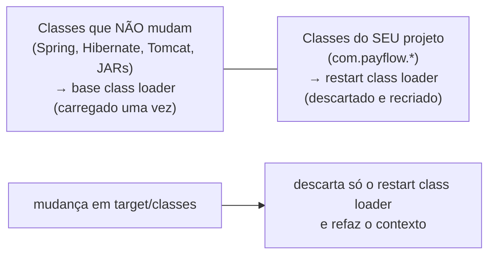

# J5.15 — DevTools e Actuator (básico)

> ⏱️ ~1h30 · 🟢 Júnior · Pré-requisitos: J5.02 (JAR executável, `spring-boot:run`), J5.04 (relatório de condições), J5.05 (perfis), J5.14 (logging, níveis), J3.03 (o container `payflow-pg`)

## 🎯 Objetivos
Ao final desta aula você consegue:
- Usar o **Spring Boot DevTools** para **reiniciar a aplicação automaticamente** quando o código muda, e saber que ele **não** vai para o JAR de produção.
- Adicionar o **Spring Boot Actuator** e usar `/actuator/health`, `info`, `metrics`, `loggers`, `mappings`, `conditions` e `flyway`.
- Decidir **quais endpoints expor e onde**: o mínimo em produção, mais detalhes só no perfil `dev`.
- Ler o **health check** (banco parado = **503 DOWN**) e explicar **liveness × readiness**.
- **Mudar o nível de log em execução**, sem reiniciar, pelo Actuator.
- Acrescentar informação própria ao `/actuator/info` (build e um `InfoContributor`).

## 🤔 Por que isso importa
**DevTools** economiza horas por semana: sem ele, cada mudança exige parar e subir a aplicação. **Actuator** é o que faz uma aplicação ser **operável**: o orquestrador (Kubernetes, load balancer, J9/P7) precisa de um endereço para perguntar "você está viva? está pronta para receber tráfego?"; a equipe de plantão precisa ver métricas e mudar o nível de log sem *deploy*; e você precisa saber **qual versão** está rodando. Quase toda vaga Java com Spring em produção exige familiaridade com `/actuator/health`.

## 💡 Intuição (explicação simples)
**DevTools** é uma **cozinha experimental com fogão que religa sozinho**: você troca um ingrediente e o prato é refeito na hora, em vez de apagar tudo e acender o fogão do zero. O **Actuator** é o **painel de instrumentos do carro**: luz de combustível, temperatura, velocidade, hodômetro (as **métricas**), e a **luz de "motor OK"** (o *health check*). Dá para ver tudo isso **sem abrir o capô**. Mas um painel que mostra **tudo a qualquer um** (a chave do carro, o endereço da garagem) é um risco: em produção, só se mostram as luzes essenciais.

## 🔬 Como funciona por dentro

### 1. DevTools: reinício rápido
`spring-boot-devtools` (J5.02: um starter do ecossistema) observa o **classpath**: quando um `.class` ou recurso muda em `target/classes` (depois de você compilar, ou de a IDE compilar), ele **reinicia o contexto**. Por que é mais rápido que subir do zero?

**Medido neste curso** (perfil `dev`, mesma máquina): a **primeira** subida levou **3,114 s** e o **reinício** pelo DevTools, **0,45 s**. As outras vantagens: valores padrão de desenvolvimento (por exemplo, o cache do Thymeleaf desligado, que você já tinha configurado na J5.06) e o reinício também para mudanças em arquivos de `resources`.

Pontos que importam:
- **Só vale para quem roda a partir do classpath** (`mvn spring-boot:run`, `main` na IDE). Em um **JAR empacotado** o DevTools é **desativado**, e o plugin do Maven **não o inclui** no JAR por padrão (testado: `jar tf payflow-0.1.0-SNAPSHOT.jar | grep -c devtools` → `0`). Por isso a dependência é `runtime` + `optional`.
- **Não funciona nos testes** (o contexto de teste não reinicia).
- O **LiveReload** (recarregar o navegador sozinho) vem **desligado** por padrão (`spring.devtools.livereload.enabled=false`, conferido nos metadados do módulo) e a [documentação](https://docs.spring.io/spring-boot/reference/using/devtools.html) o declara **obsoleto desde o Spring Boot 4.1.0**, sem substituto. Não conte com ele.
- **Quem compila?** O DevTools só enxerga o resultado da compilação. Rodando por `mvn spring-boot:run`, compile em outro terminal (`mvn -q compile`, o que fizemos). Nas IDEs, o reinício automático depende de a IDE compilar sozinha (**não testamos IDEs**; veja a documentação da sua).

### 2. Actuator: os endpoints
O Actuator adiciona endpoints HTTP (e JMX) de **operação**. Em `/actuator` está a lista. Os principais:
| Endpoint | Para quê | Sensível? |
|---|---|---|
| **`health`** | O app está saudável? (banco, disco, estado do app) | Baixo (sem detalhes) |
| **`info`** | Quem sou eu: nome, versão do build, o que você acrescentar | Baixo |
| **`metrics`** | Medidas (memória, CPU, pool de conexões, requisições HTTP), via **Micrometer** | Médio |
| **`loggers`** | Ver e **mudar** o nível de log em execução | **Alto** (mudança) |
| `mappings` | Todas as rotas HTTP | Médio |
| `conditions` | O relatório de condições da autoconfiguração (J5.04) | Médio |
| `flyway` | As migrações aplicadas | Médio |
| `env`, `beans`, `configprops`, `heapdump`, `threaddump` | Configuração, beans, *dump* de memória... | **Muito alto** |
Por **segurança**, **só o `health`** é exposto por HTTP por padrão ([documentação](https://docs.spring.io/spring-boot/reference/actuator/endpoints.html)). Você escolhe o que expor com `management.endpoints.web.exposure.include`.

### 3. Health: liveness × readiness
O `/actuator/health` agrega vários **indicadores** (`db`, `diskSpace`, `ping`, `ssl`, os estados do app) e responde **HTTP 200** (`UP`) ou **503** (`DOWN`). Quem consome é o orquestrador. O Spring Boot tem dois **grupos** (J5.15 só apresenta; P6/P7 detalham):
- **Liveness** (`/actuator/health/liveness`): "o **processo** está vivo?". Se `DOWN`, a plataforma **reinicia** o container. **Não** deve depender de serviços externos (reiniciar por causa do banco não conserta o banco).
- **Readiness** (`/actuator/health/readiness`): "**pronto** para receber tráfego?". Se `DOWN`, o balanceador **para de mandar** requisições, **sem reiniciar**.
O status geral é o **pior** dos componentes (um `DOWN` derruba o resultado: a pausa de lógica implementa isso).

### 4. Métricas e o Micrometer
O Actuator usa o **Micrometer** (uma fachada de métricas, como o SLF4J é para logs) e já publica dezenas de medidas **sem você escrever nada**: neste projeto, **65** nomes em `/actuator/metrics`, incluindo `jvm.memory.used`, `http.server.requests` (tempo e contagem por rota e status), `hikaricp.connections.active/max/idle` (o pool de conexões!), `jdbc.connections.active`. Em P6 elas vão para o Prometheus/Grafana; aqui você as **lê** à mão.

## 🛠️ Exemplo prático
> Testado com **JDK 25.0.5**, **Spring Boot 4.1.2** (Micrometer 1.17.2, Tomcat 11.0.27) e PostgreSQL 18.6.

### 1. Dependências
No `pom.xml`:
```xml
<dependency>
  <groupId>org.springframework.boot</groupId>
  <artifactId>spring-boot-starter-actuator</artifactId>
</dependency>
<dependency>
  <groupId>org.springframework.boot</groupId>
  <artifactId>spring-boot-devtools</artifactId>
  <scope>runtime</scope>
  <optional>true</optional>
</dependency>
```
E, no `spring-boot-maven-plugin`, o objetivo `build-info` (gera o `META-INF/build-info.properties`, que o `/actuator/info` mostra):
```xml
<plugin>
  <groupId>org.springframework.boot</groupId>
  <artifactId>spring-boot-maven-plugin</artifactId>
  <executions>
    <execution>
      <goals>
        <goal>build-info</goal>            <!-- gera META-INF/build-info.properties (nome, versão, hora do build) -->
      </goals>
    </execution>
  </executions>
</plugin>
```
`target/classes/META-INF/build-info.properties` (real):
```
build.artifact=payflow
build.group=com.payflow
build.name=payflow
build.time=2026-11-13T15\:12\:11.128Z
build.version=0.1.0-SNAPSHOT
```

### 2. Configuração: o mínimo em produção, mais no `dev`
`application.yml` (base = o que vale em produção):
```yaml
management:
  endpoints:
    web:
      exposure:
        include: health,info              # só o necessário (os outros mostram detalhes internos)
  info:
    env:
      enabled: true                       # expõe as propriedades "info.*" em /actuator/info

info:
  app:
    name: PayFlow
    description: Carteira digital simplificada (projeto de estudo)
```
`application-dev.yml` (acrescente):
```yaml
management:
  endpoints:
    web:
      exposure:
        include: health,info,metrics,loggers,mappings,conditions,flyway   # só em desenvolvimento
  endpoint:
    health:
      show-details: always
```
- `show-details: always` mostra o detalhe de cada indicador (banco, disco). O padrão (`never`) mostra só `UP`/`DOWN`: em produção, **detalhes dão pistas a um atacante** (versão do banco, caminho de disco). Quando houver autenticação (J8), `when-authorized` mostra só a quem pode.
- **Antes da J8 não há controle de acesso no PayFlow**: qualquer um que alcance o servidor veria o que estiver exposto. Por isso a lista `include` de produção é **só `health` e `info`**, e o `loggers`, que **altera** o sistema, fica **só no `dev`**.

Remova o `PingController` da J5.02: o `/actuator/health` é o endereço correto para "você está viva?".

### 3. Explorando (perfil `dev`; saídas reais)
```bash
bash scripts/run-dev.sh      # ou: java -jar target/payflow-0.1.0-SNAPSHOT.jar com SPRING_PROFILES_ACTIVE=dev
curl -s localhost:8080/actuator | python3 -c "import json,sys; print(sorted(json.load(sys.stdin)['_links']))"
# ['conditions', 'flyway', 'health', 'health-path', 'info', 'loggers', 'loggers-name', 'mappings', 'metrics', 'metrics-requiredMetricName', 'self']
```
**health** (com `show-details: always`):
```json
{
  "components": {
    "db":        { "status": "UP", "details": { "database": "PostgreSQL", "validationQuery": "isValid()" } },
    "diskSpace": { "status": "UP", "details": { "total": 10059448320, "free": 4467662848, "threshold": 10485760, "path": "...", "exists": true } },
    "livenessState":  { "status": "UP" },
    "ping":           { "status": "UP" },
    "readinessState": { "status": "UP" },
    "ssl": { "status": "UP", "details": { "expiringChains": [], "invalidChains": [], "validChains": [] } }
  },
  "groups": ["liveness", "readiness"],
  "status": "UP"
}
```
**info** (o `build` vem do `build-info`, o `app` das propriedades `info.app.*`):
```json
{"app":{"name":"PayFlow","description":"Carteira digital simplificada (projeto de estudo)"},"build":{"artifact":"payflow","name":"payflow","time":"2026-11-13T15:12:11.128Z","version":"0.1.0-SNAPSHOT","group":"com.payflow"}}
```
**metrics**: `GET /actuator/metrics` lista os 65 nomes, entre eles `hikaricp.connections`, `hikaricp.connections.active`, `hikaricp.connections.max`, `http.server.requests`, `jdbc.connections.active` e `jvm.memory.used`. Para um valor, `GET /actuator/metrics/hikaricp.connections.max` (devolve `measurements`).
**flyway** (as migrações da J3.12, vistas pelo Actuator): `1 create users`, `2 create accounts`, `3 create transfers and ledger entries`, `4 create indexes` e `dev seed`, todas `SUCCESS`.
**mappings**: as rotas dos controllers (24 entradas no total, incluindo as de recursos estáticos e erro), por exemplo `GET /login`, `POST /login`, `GET /api/accounts/{id}/statement`.

**Mudar o nível de log em execução** (J5.14), pelo endpoint `loggers`:
```bash
curl -s localhost:8080/actuator/loggers/com.payflow
# {"configuredLevel":"DEBUG","effectiveLevel":"DEBUG"}
curl -s -X POST -H 'Content-Type: application/json' -d '{"configuredLevel":"TRACE"}' -w ' [%{http_code}]\n' localhost:8080/actuator/loggers/com.payflow
#  [204]
curl -s localhost:8080/actuator/loggers/com.payflow
# {"configuredLevel":"TRACE","effectiveLevel":"TRACE"}
curl -s -X POST -H 'Content-Type: application/json' -d '{"configuredLevel":null}' localhost:8080/actuator/loggers/com.payflow   # volta ao padrão
```
Sem reiniciar. É a ferramenta de investigar um problema **em produção**: liga `DEBUG` por um tempo, reproduz, desliga. (Só funciona se o `loggers` estiver exposto **e protegido**: em produção, atrás de autenticação, J8.)

### 4. Health com o banco parado
O teste mais instrutivo: pare o PostgreSQL e peça o *health*.
```bash
docker stop payflow-pg
curl -s -o /dev/null -w 'HTTP %{http_code}\n' localhost:8080/actuator/health        # HTTP 503
# {"status":"DOWN", "components": { "db": {"status":"DOWN", "details": {"error":"org.springframework.jdbc.CannotGetJdbcConnectionException: Failed to obtain JDBC Connection"}}, ...
#   "livenessState": {"status":"UP"}, "readinessState": {"status":"UP"} }
docker start payflow-pg                                                              # depois de alguns segundos:
curl -s -o /dev/null -w 'HTTP %{http_code}\n' localhost:8080/actuator/health        # HTTP 200 (o pool se recupera sozinho)
```
O resultado: **`503` com `db: DOWN`**; o **liveness** continua `UP` (reiniciar a aplicação não consertaria o banco) e, **com a configuração padrão**, o **readiness também continua `UP`**: o `db` **não** faz parte do grupo `readiness` a menos que você o inclua (`management.endpoint.health.group.readiness.include=readinessState,db`, assunto do P6/P7). Quando o banco voltou, o pool de conexões se recuperou **sem reiniciar** a aplicação.

### 5. Um `InfoContributor` próprio
Para o plantão, um sinal barato: **o seed de desenvolvimento está ligado?** (a preocupação da J3.12 e da J5.05, agora **visível** em `/actuator/info`).

`src/main/java/com/payflow/config/PayflowInfoContributor.java`
```java
package com.payflow.config;

import java.util.LinkedHashMap;
import java.util.Map;
import org.springframework.boot.actuate.info.Info;
import org.springframework.boot.actuate.info.InfoContributor;
import org.springframework.core.env.Environment;
import org.springframework.stereotype.Component;

/** Acrescenta ao /actuator/info o que ajuda a operar o PayFlow (sem nenhum segredo). */
@Component
public class PayflowInfoContributor implements InfoContributor {

    private final PayflowProperties properties;
    private final Environment environment;

    public PayflowInfoContributor(PayflowProperties properties, Environment environment) {
        this.properties = properties;
        this.environment = environment;
    }

    @Override
    public void contribute(Info.Builder builder) {
        Map<String, Object> details = new LinkedHashMap<>();
        details.put("statementPageSize", properties.statement().pageSize());
        // Um alarme barato: o seed de desenvolvimento NÃO deve estar ligado em produção.
        String locations = environment.getProperty("spring.flyway.locations", "");
        details.put("devSeedEnabled", locations.contains("db/seed"));
        details.put("activeProfiles", String.join(",", environment.getActiveProfiles()));
        builder.withDetail("payflow", details);
    }
}
```
`src/test/java/com/payflow/web/ActuatorTest.java`
```java
package com.payflow.web;

import static org.assertj.core.api.Assertions.assertThat;

import java.net.URI;
import java.net.http.HttpClient;
import java.net.http.HttpRequest;
import java.net.http.HttpResponse;
import org.junit.jupiter.api.Test;
import org.springframework.boot.test.context.SpringBootTest;
import org.springframework.boot.test.web.server.LocalServerPort;
import org.springframework.test.context.ActiveProfiles;

/** O que o Actuator mostra (e o que NÃO mostra) com a configuração de produção/teste. */
@SpringBootTest(webEnvironment = SpringBootTest.WebEnvironment.RANDOM_PORT)
@ActiveProfiles("test")
class ActuatorTest {

    @LocalServerPort int port;

    private HttpResponse<String> get(String path) throws Exception {
        return HttpClient.newHttpClient().send(
                HttpRequest.newBuilder(URI.create("http://localhost:" + port + path)).build(),
                HttpResponse.BodyHandlers.ofString());
    }

    @Test
    void healthIsUpAndHidesTheDetails() throws Exception {
        var response = get("/actuator/health");
        assertThat(response.statusCode()).isEqualTo(200);
        assertThat(response.body()).contains("\"status\":\"UP\"").doesNotContain("PostgreSQL").doesNotContain("diskSpace");
    }

    @Test
    void infoShowsTheApplicationTheBuildAndOurContributor() throws Exception {
        String body = get("/actuator/info").body();
        System.out.println("INFO: " + body);
        assertThat(body).contains("\"name\":\"PayFlow\"", "\"version\":\"0.1.0-SNAPSHOT\"",
                "\"statementPageSize\":5", "\"devSeedEnabled\":true");
    }

    @Test
    void sensitiveEndpointsAreNotExposed() throws Exception {
        for (String endpoint : new String[] {"env", "beans", "loggers", "metrics", "mappings", "conditions", "heapdump"}) {
            assertThat(get("/actuator/" + endpoint).statusCode()).as(endpoint).isEqualTo(404);
        }
    }
}
```
```bash
mvn test -Dtest=ActuatorTest
# Tests run: 3, Failures: 0
```
Saída real de `/actuator/info` no teste (perfil `test`):
```
{"app":{"name":"PayFlow","description":"Carteira digital simplificada (projeto de estudo)"},"build":{...,"version":"0.1.0-SNAPSHOT"},"payflow":{"statementPageSize":5,"devSeedEnabled":true,"activeProfiles":"test"}}
```
O teste garante o que importa: o `health` mostra `UP` **sem detalhes**, e **`env`, `beans`, `loggers`, `metrics`, `mappings`, `conditions` e `heapdump` respondem 404** (não estão expostos) com a configuração de produção. Quem acrescentar um endpoint por engano a quebra.

### 6. DevTools: o reinício, na prática
```bash
bash scripts/run-dev.sh                       # perfil dev, com o DevTools no classpath
# Started PayflowApplication in 3.114 seconds (thread restartedMain)
```
Em outro terminal, edite uma mensagem (por exemplo, o texto de 404 do `WebErrors`) e **compile**: `mvn -q compile`. O log mostra um **novo** `Started PayflowApplication in 0.45 seconds`, e o `curl localhost:8080/nada` já devolve o texto novo (testado: "O endereço pedido não existe (v2)."). **Repare no nome da thread:** `restartedMain` (e não `main`): a aplicação roda no *restart class loader*.

## 🧠 Pausa para lógica
**Enunciado:** implemente o **agregador de saúde**: cada componente tem um status (`UP`, `DOWN`, `OUT_OF_SERVICE`, `UNKNOWN`) e o **status geral é o pior** deles (ordem: `DOWN`, `OUT_OF_SERVICE`, `UP`, `UNKNOWN`), mapeado para HTTP (`DOWN`/`OUT_OF_SERVICE` → 503; o resto → 200). Implemente também **grupos** (liveness × readiness), que consideram só alguns componentes. Mostre o caso do **banco caído**.

<details><summary>Dica</summary>Declare o <code>enum Status</code> <b>já na ordem de gravidade</b> e use <code>Collections.min</code>/<code>stream().min(Status::compareTo)</code> (o <code>compareTo</code> do <code>enum</code> compara a posição). Para os grupos, filtre o mapa pelos nomes do grupo e agregue o subconjunto. Pense em um mapa vazio.</details>
<details><summary>Solução (testada com JDK 25.0.5)</summary>

```java
import java.util.LinkedHashMap;
import java.util.List;
import java.util.Map;

/** Agrega os "indicadores de saúde" em um status geral, como o /actuator/health (e seus grupos liveness/readiness). */
public class HealthAggregator {

    /** Do PIOR para o melhor: o status geral é o pior de todos (ordem padrão do Spring Boot). */
    enum Status {
        DOWN(503), OUT_OF_SERVICE(503), UP(200), UNKNOWN(200);

        final int httpStatus;

        Status(int httpStatus) { this.httpStatus = httpStatus; }
    }

    record Result(Status status, Map<String, Status> components) {
        int httpStatus() { return status.httpStatus; }
    }

    /** O pior status vence: um único DOWN derruba o geral. Sem componentes = UNKNOWN. */
    static Result aggregate(Map<String, Status> components) {
        Status worst = components.values().stream().min(Status::compareTo).orElse(Status.UNKNOWN);
        return new Result(worst, components);
    }

    /** Um GRUPO considera só alguns componentes (ex.: liveness = processo vivo; readiness = pronto para tráfego). */
    static Result group(Map<String, Status> all, List<String> members) {
        Map<String, Status> subset = new LinkedHashMap<>();
        for (String name : members) {
            if (all.containsKey(name)) subset.put(name, all.get(name));
        }
        return aggregate(subset);
    }

    public static void main(String[] args) {
        Map<String, Status> healthy = new LinkedHashMap<>();
        healthy.put("db", Status.UP);
        healthy.put("diskSpace", Status.UP);
        healthy.put("livenessState", Status.UP);
        healthy.put("readinessState", Status.UP);

        Result ok = aggregate(healthy);
        System.out.println("tudo bem:        " + ok.status() + " -> HTTP " + ok.httpStatus());

        Map<String, Status> dbDown = new LinkedHashMap<>(healthy);
        dbDown.put("db", Status.DOWN);
        Result down = aggregate(dbDown);
        System.out.println("banco caiu:      " + down.status() + " -> HTTP " + down.httpStatus());
        System.out.println("  liveness:      " + group(dbDown, List.of("livenessState")).status()
                + "  (o processo está vivo: NÃO reiniciar por causa do banco)");
        System.out.println("  readiness:     " + group(dbDown, List.of("readinessState", "db")).status()
                + "  (se readiness incluísse o db: tirar do balanceador)");

        System.out.println("só UP e UNKNOWN: " + aggregate(Map.of("a", Status.UP, "b", Status.UNKNOWN)).status());
        System.out.println("vazio:           " + aggregate(Map.of()).status());
    }
}
```
Saída real:
```
tudo bem:        UP -> HTTP 200
banco caiu:      DOWN -> HTTP 503
  liveness:      UP  (o processo está vivo: NÃO reiniciar por causa do banco)
  readiness:     DOWN  (se readiness incluísse o db: tirar do balanceador)
só UP e UNKNOWN: UP
vazio:           UNKNOWN
```
Duas decisões de projeto: (1) **"o pior vence"**: um único componente `DOWN` torna o geral `DOWN` (é o que fez o 503 do experimento); (2) **grupos diferentes para perguntas diferentes**: com o `db` fora do liveness, a plataforma **não** reinicia a aplicação por causa do banco; com o `db` dentro do readiness, ela **tira do balanceador** a instância que não alcança o banco. É por isso que **o que entra em cada grupo é uma decisão de arquitetura**, não um detalhe.
</details>

**Variação mais difícil:** acrescente **severidade configurável** (por exemplo, `diskSpace` DOWN só **avisa** e não derruba o geral) e um *timeout* por componente: um indicador lento conta como `DOWN`.

## ⚠️ Erros comuns e boas práticas de produção
- **Expor tudo** (`management.endpoints.web.exposure.include: "*"`): revela configuração, beans e permite *heap dump*. Liste só o que precisa; proteja com autenticação (J8) e, preferencialmente, em **outra porta** (`management.server.port`) acessível só pela rede interna.
- **Detalhes do `health` abertos** em produção (`show-details: always`): vazam versões e caminhos.
- **`loggers` exposto sem proteção:** qualquer um liga `TRACE` e enche o disco (ou lê dados).
- **Liveness dependendo do banco:** o orquestrador reinicia **todas as instâncias** quando o banco cai, piorando a queda. O liveness diz só "o processo está vivo".
- **Checks pesados no health** (consultas lentas, chamadas externas): o orquestrador chama o *health* a cada poucos segundos; um indicador caro vira o próprio problema. Meça com algo barato (`isValid()` da conexão).
- **DevTools no JAR de produção:** o plugin o exclui, mas confira (`jar tf ... | grep -c devtools`). Nunca o habilite em produção.
- **Esperar que o DevTools reinicie sem compilar:** ele reage ao `target/classes`; sem compilar, nada muda.
- **Cache de dados do Thymeleaf** em dev: já desligado no `dev` (J5.06).
- **Métricas com alta cardinalidade** (um rótulo por usuário/ID): enche a memória do coletor (P6).
- **Esquecer a versão** (`build-info`): quando alguém pergunta "que versão está em produção?", o `/actuator/info` responde.

## 🧩 Exercícios
1. **Fixação:** (a) por que o DevTools reinicia mais rápido que uma subida normal, e por que não existe no JAR de produção? (b) quais endpoints o Actuator expõe por padrão e por que? (c) qual a diferença entre liveness e readiness, e o que acontece se o liveness depender do banco? (d) como mudar o nível de log em execução e por que é perigoso expor esse endpoint? (e) o que o `build-info` adiciona ao `/actuator/info`?
2. **Aplicação no PayFlow:** operável e seguro.
   - [ ] `spring-boot-starter-actuator`, `spring-boot-devtools` (`runtime`, `optional`) e `build-info` no `pom.xml`; `management.*` e `info.*` no `application.yml`; endpoints extras só no `application-dev.yml`; `PingController` removido.
   - [ ] `PayflowInfoContributor` e `ActuatorTest` (3) verdes.
   - [ ] **Banco parado:** repita o experimento da seção 4 e cole em `docs/spring-lab/actuator.md` o HTTP, o corpo e o `liveness`/`readiness`; explique em duas frases por que o readiness continuou `UP`.
   - [ ] **Troca de log em execução:** com o perfil `dev`, mude `com.payflow` para `TRACE` pelo `loggers`, faça um depósito e veja a diferença no log; depois **volte** ao nível padrão. Cole o antes/depois em `docs/spring-lab/actuator.md`.
   - [ ] **DevTools:** meça o tempo da primeira subida e do reinício e cole os dois `Started PayflowApplication in ...` em `docs/spring-lab/actuator.md`.
   - [ ] `jar tf target/payflow-*.jar | grep -c devtools` devolve `0`.
   - [ ] **Prova de exposição:** com o perfil **padrão de produção** (sem `dev`), `curl /actuator` lista só `health` e `info`, e `env`/`loggers`/`metrics` dão 404 (cole os códigos).
   - [ ] Commit: `feat(ops): add Actuator, build info and DevTools`.
3. **Desafio (opcional):** escreva um `HealthIndicator` próprio (`@Component` que implementa `HealthIndicator`, com `Health.up()`/`Health.down()`) que verifique se existe **pelo menos uma migração Flyway aplicada** (use o bean `Flyway`) e apareça em `/actuator/health` como `flyway`. Pesquise o pacote do `HealthIndicator` na sua versão do Boot **antes** de escrever o `import` (ele **mudou** no Boot 4: o módulo de *health* é separado).

<details><summary>Soluções de referência</summary>

1. (a) Só o código do projeto é recarregado (*restart class loader*); as bibliotecas ficam no *base class loader*. Ele é só para desenvolvimento: o plugin do Maven o exclui do JAR executável e ele se desativa em aplicação empacotada. (b) Só o `health`, por segurança: os outros revelam detalhes internos. (c) Liveness: "o processo está vivo" (falha = reiniciar); readiness: "pronto para tráfego" (falha = tirar do balanceador). Se o liveness depender do banco, a queda do banco faz o orquestrador reiniciar todas as instâncias. (d) `POST /actuator/loggers/{logger}` com `{"configuredLevel":"DEBUG"}`; é perigoso porque altera o sistema em execução e pode encher o disco ou vazar dados. (e) O bloco `build` (artefato, grupo, nome, versão e hora do build).
2. Os valores esperados estão nas seções 3 a 6.
3. Esboço (não executado): `@Component class FlywayHealthIndicator implements HealthIndicator { public Health health() { return flyway.info().applied().length > 0 ? Health.up().build() : Health.down().withDetail("reason", "no migration applied").build(); } }`. O pacote de `HealthIndicator`/`Health` no Boot 4.1.2 é `org.springframework.boot.health.contributor` (módulo `spring-boot-health`); confirme no seu `pom` antes de usar.
</details>

## 🎤 Na entrevista
- **O que é o Spring Boot Actuator?** Um módulo que expõe endpoints de operação (saúde, métricas, informações, loggers, mappings...) por HTTP e JMX, com integração ao Micrometer para métricas.
- **O que é o health check e como é usado no Kubernetes?** `/actuator/health` agrega indicadores e devolve 200/503. Os grupos `liveness` e `readiness` alimentam as *probes* do Kubernetes: reiniciar o pod × tirar do serviço.
- **Que endpoints você exporia em produção e como protege?** O mínimo (`health`, `info`, talvez `metrics`/`prometheus`), com `show-details` restrito, autenticação (Spring Security), e em porta de gerenciamento separada, acessível só pela rede interna.
- **Para que serve o DevTools e por que não vai para produção?** Reinício automático rápido, valores padrão de desenvolvimento; é excluído do JAR executável e desativado em aplicação empacotada.
- **Como trocar o nível de log sem reiniciar?** Pelo endpoint `loggers` do Actuator (ou configuração externa recarregável), por pacote; depois reverter.

## 📚 Para ir além
- 📄 [Spring Boot — Actuator](https://docs.spring.io/spring-boot/reference/actuator/index.html) e [Endpoints](https://docs.spring.io/spring-boot/reference/actuator/endpoints.html): exposição, health, probes e segurança.
- 📄 [Spring Boot — Actuator API (REST)](https://docs.spring.io/spring-boot/api/rest/actuator/index.html): o contrato de cada endpoint ([`health`](https://docs.spring.io/spring-boot/api/rest/actuator/health.html), [`info`](https://docs.spring.io/spring-boot/api/rest/actuator/info.html), [`loggers`](https://docs.spring.io/spring-boot/api/rest/actuator/loggers.html)).
- 📄 [Spring Boot — Metrics (Micrometer)](https://docs.spring.io/spring-boot/reference/actuator/metrics.html) e [Micrometer](https://micrometer.io/docs): as métricas e como exportá-las.
- 📄 [Spring Boot — Developer Tools](https://docs.spring.io/spring-boot/reference/using/devtools.html): reinício, propriedades padrão, o que é desativado em produção (e a nota sobre o LiveReload).
- 🎥 ⚠️ Nenhum vídeo verificado nesta execução.

## ✅ Checklist da aula
- [ ] O DevTools reinicia a aplicação ao compilar, e o JAR **não** o contém.
- [ ] `/actuator/health` e `/actuator/info` funcionam; em produção só esses dois estão expostos.
- [ ] Vi o `503 DOWN` com o banco parado e sei explicar liveness × readiness.
- [ ] Mudei o nível de log em execução pelo `loggers` e o desfiz.
- [ ] `PingController` removido; `PayflowInfoContributor` e `ActuatorTest` no projeto.
