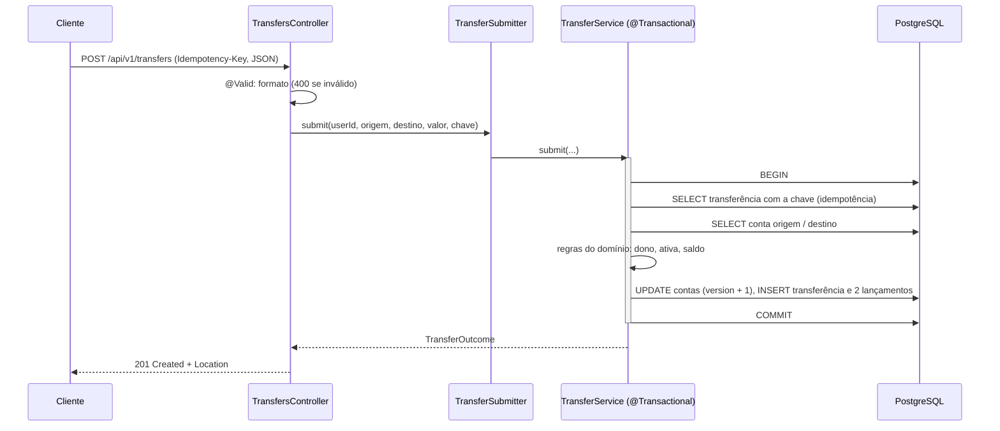

# J6.03 — Transferência entre contas: transação ACID na API

> ⏱️ ~1h30 · 🟢 Júnior · Pré-requisitos: J3.10 (transações e ACID), J5.08 (`@Version`, locking otimista), J5.11 (`@Transactional`, `TransferService`), J6.01 e J6.02 (contrato, DTOs, `201` + `Location`)

## 🎯 Objetivos
Ao final desta aula você consegue:
- Expor uma operação **transacional** (débito + crédito + lançamentos) como `POST /api/v1/transfers` mantendo a **fronteira da transação no serviço**, nunca no controller.
- **Traduzir** cada desfecho do caso de uso (sucesso, regra de negócio violada, conta alheia, conflito de concorrência) no **status HTTP** certo.
- Provar com testes que uma transferência recusada **não deixa rastro** (atomicidade) e que 6 pedidos simultâneos contra a mesma conta **não criam nem perdem dinheiro**.
- Escrever um teste de **invariantes** (conservação do dinheiro e *saldo = soma do livro-razão*) sobre centenas de operações aleatórias.

## 🤔 Por que isso importa
Transferir dinheiro é o caso que justifica tudo o que você aprendeu em banco de dados: se o débito acontece e o crédito não, **o dinheiro some**; se o pedido é processado duas vezes, **sai em dobro**; se dois pedidos correm juntos, o saldo pode **negativar**. Na API, soma-se um problema novo: o cliente **só vê o status HTTP**. Se o status mente (200 para uma transferência que falhou) ou se o erro vaza detalhes, o cliente toma a decisão errada: tenta de novo uma operação que já aconteceu, ou desiste de uma que poderia repetir. Esta aula liga as duas pontas: o **ACID** da J3/J5 e o **contrato HTTP** da J6.

## 💡 Intuição (explicação simples)
Imagine um **caixa eletrônico** que recebe a ordem "passe R$ 100 da conta A para a B". Ele não pode devolver ao cliente um recibo antes de ter terminado **tudo**: tirar de A, colocar em B, anotar os dois lançamentos no caderno. Se a B estiver bloqueada, ele **desfaz** o que já fez em A e entrega ao cliente um papel dizendo **por que** não deu. O **balcão** (o controller) só recebe a ordem e entrega o papel; quem **faz** a operação inteira de uma vez é o **caixa** (o serviço transacional). Se o balcão fizesse parte do trabalho e o caixa o resto, não haveria como desfazer.

## 🔬 Como funciona por dentro

### 1. Onde fica a fronteira da transação

- **O `@Transactional` está em `TransferService.submit`** (decisão 35): **uma transação por caso de uso**. Se qualquer `throw` acontece no meio, o Spring faz `ROLLBACK`: nada foi gravado.
- **O controller não abre transação.** Ele valida o **formato** (Bean Validation), chama o serviço e **traduz** o resultado para HTTP. Uma transação que vazasse para o controller seguraria conexão do banco enquanto o Jackson serializa a resposta.
- **A transação termina antes da resposta**: o cliente só recebe o `201` depois do `COMMIT`. Se o `COMMIT` falha (a restrição do banco, uma colisão de versão), a exceção sai **do proxy**, depois do corpo do método: por isso o `TransferSubmitter` (J6.06) fica **fora** da transação.

### 2. As três camadas de validação, agora com HTTP
| Camada | Valida | Falha vira |
|---|---|---|
| **Borda** (Bean Validation no DTO) | `@NotNull` na origem/destino, `@Positive` e `@Digits(17, 2)` no valor, cabeçalho `Idempotency-Key` presente | `400` |
| **Serviço/domínio** | origem ≠ destino, **dono da origem é quem pede**, contas ativas, saldo suficiente | `422` |
| **Banco** | `CHECK (balance >= 0)`, `UNIQUE (idempotency_key)`, `FK` | rede de segurança: se chegar aqui, é bug ou corrida |

### 3. Traduzindo desfechos em status
| Desfecho | Exceção do serviço | Status | `type` do problema (J6.04) |
|---|---|---|---|
| Criou | — | `201` + `Location` | — |
| Repetiu a mesma chave com o mesmo corpo | — (`replayed`) | `200` | — |
| Corpo inválido / cabeçalho ausente | `MethodArgumentNotValidException`, `MissingRequestHeaderException` | `400` | `validation-failed` |
| Saldo insuficiente | `InsufficientFundsException` | `422` | `insufficient-funds` |
| Conta inexistente, bloqueada ou **que não é sua** (origem) | `AccountUnavailableException` | `422` | `account-unavailable` |
| Origem = destino | `InvalidTransferException` | `422` | `invalid-transfer` |
| Chave reutilizada com outro corpo | `IdempotencyKeyReuseException` | `422` | `idempotency-key-reused` |
| Outra requisição alterou a conta ao mesmo tempo | `ObjectOptimisticLockingFailureException` | `409` | `concurrent-update` |

Duas decisões que merecem justificativa:
- **A origem é uma conta no *corpo*, não no caminho.** Em `GET /accounts/{id}` a conta alheia responde **404** (o recurso está na URL: "esse endereço não existe para você"). No corpo, a conta alheia responde **422 `account-unavailable`**, **igual** à conta que não existe: o cliente não consegue **descobrir** quais ids de conta existem testando transferências. A mensagem é a mesma nos três casos (inexistente, bloqueada, de terceiros).
- **`409` e não `500` para a colisão de versão.** Dois pedidos leem a mesma conta (versão 7), ambos tentam gravar a 8; o segundo falha (`@Version`, J5.11 cenário H). É um erro **do momento**, não do pedido: o cliente pode **tentar de novo** com a mesma chave. Retentativa automática no servidor e *locking* pessimista ficam para a P2.

## 🛠️ Exemplo prático

### 1. O caso de uso no serviço
`TransferService` ganha `submit` (o `transfer` antigo da J5.11 continua, os testes dele também). O método é o coração da aula; leia cada passo:

```java
    /**
     * Caso de uso da API: transferência pedida por um usuário, com chave de idempotência do CLIENTE.
     * A chave é guardada com o id do usuário na frente ("userId:chave"): duas pessoas podem usar a mesma chave.
     */
    @Transactional
    public TransferOutcome submit(UUID requesterId, UUID sourceId, UUID targetId, BigDecimal rawAmount, String clientKey) {
        BigDecimal amount = Amounts.normalize(rawAmount);
        if (sourceId.equals(targetId)) {
            throw new InvalidTransferException("source and target accounts must differ");
        }
        String key = requesterId + ":" + clientKey;
        var existing = transfers.findByIdempotencyKey(key);
        if (existing.isPresent()) {                                      // regra 4: repetição -> a mesma transferência
            Transfer t = existing.get();
            boolean same = t.getSource().getId().equals(sourceId) && t.getTarget().getId().equals(targetId)
                    && t.getAmount().compareTo(amount) == 0;
            if (!same) {
                throw new IdempotencyKeyReuseException("Idempotency-Key already used with a different request");
            }
            return new TransferOutcome(t, true);
        }
        Account source = load(sourceId);
        if (!source.getOwner().getId().equals(requesterId)) {           // conta de outro usuário = "não existe"
            throw new AccountUnavailableException("Source account not found: " + sourceId);
        }
        return new TransferOutcome(execute(sourceId, targetId, amount, key), false);
    }
```

Pontos:
1. **`Amounts.normalize(rawAmount)`**: valida (positivo, no máximo 2 casas) e **normaliza** para 2 casas (J6.02).
2. **Chave com o id do usuário na frente** (`userId:chave`): duas pessoas podem usar a mesma chave de cliente sem se esbarrar (e ninguém descobre transferências alheias por uma chave igual). O limite de **63** caracteres para a chave do cliente vem de `37 + 63 = 100`, o tamanho da coluna `idempotency_key` (J6.06).
3. **Repetição**: se já existe uma transferência com a chave, e é a **mesma** (origem, destino, valor), devolve-a com `replayed = true`; se é **outra**, `IdempotencyKeyReuseException`.
4. **Dono da origem**: a conta de outro usuário é tratada como `AccountUnavailableException` (a mesma resposta da conta inexistente).
5. **`execute(...)`** é o da J5.11: `withdraw` e `deposit` no domínio (regras 1 e bloqueio), `Transfer`, dois `LedgerEntry` com o **mesmo instante** do `Clock`, tudo na mesma transação.

O resultado do serviço:
```java
package com.payflow.service;

import com.payflow.domain.Transfer;

/** O resultado de pedir uma transferência: a transferência e se ela já existia (repetição da mesma chave). */
public record TransferOutcome(Transfer transfer, boolean replayed) { }
```

E uma consulta com **autorização embutida**: só o dono da origem ou do destino enxerga a transferência (terceiros recebem 404):
```java

    /** Busca uma transferência em que o usuário é dono da origem ou do destino. */
    @Transactional(readOnly = true)
    public java.util.Optional<Transfer> findVisibleTo(UUID requesterId, UUID transferId) {
        return transfers.findById(transferId)
                .filter(t -> t.getSource().getOwner().getId().equals(requesterId)
                        || t.getTarget().getOwner().getId().equals(requesterId));
    }

    private Transfer execute(UUID sourceId, UUID targetId, BigDecimal amount, String key) {
```

### 2. O controller (só traduz)
```java
package com.payflow.web.api.dto;

import jakarta.validation.constraints.Digits;
import jakarta.validation.constraints.NotNull;
import jakarta.validation.constraints.Positive;
import java.math.BigDecimal;
import java.util.UUID;

public record CreateTransferRequest(
        @NotNull UUID sourceAccountId,
        @NotNull UUID targetAccountId,
        @NotNull @Positive @Digits(integer = 17, fraction = 2)
        BigDecimal amount) { }
```

```java
package com.payflow.web.api;

import com.payflow.domain.NotFoundException;
import com.payflow.service.TransferOutcome;
import com.payflow.service.TransferService;
import com.payflow.service.TransferSubmitter;
import com.payflow.web.AuthInterceptor;
import com.payflow.web.CurrentUser;
import com.payflow.web.api.dto.CreateTransferRequest;
import com.payflow.web.api.dto.TransferResponse;
import jakarta.validation.Valid;
import java.net.URI;
import java.util.UUID;
import org.springframework.http.HttpStatus;
import org.springframework.http.ResponseEntity;
import org.springframework.web.bind.annotation.GetMapping;
import org.springframework.web.bind.annotation.PathVariable;
import org.springframework.web.bind.annotation.PostMapping;
import org.springframework.web.bind.annotation.RequestAttribute;
import org.springframework.web.bind.annotation.RequestBody;
import org.springframework.web.bind.annotation.RequestHeader;
import org.springframework.web.bind.annotation.RequestMapping;
import org.springframework.web.bind.annotation.RestController;

@RestController
@RequestMapping(path = "/api/v1/transfers", version = "v1", produces = "application/json")
public class TransfersController {

    private final TransferSubmitter submitter;
    private final TransferService transfers;
    private final ApiMapper mapper;

    public TransfersController(TransferSubmitter submitter, TransferService transfers, ApiMapper mapper) {
        this.submitter = submitter;
        this.transfers = transfers;
        this.mapper = mapper;
    }

    @PostMapping
    public ResponseEntity<TransferResponse> create(@RequestAttribute(AuthInterceptor.USER) CurrentUser user,
                                                   
                                                   @RequestHeader("Idempotency-Key") String idempotencyKey,
                                                   @Valid @RequestBody CreateTransferRequest request) {
        TransferOutcome outcome = submitter.submit(user.id(), request.sourceAccountId(), request.targetAccountId(),
                request.amount(), IdempotencyKeys.normalize(idempotencyKey));
        URI location = URI.create("/api/v1/transfers/" + outcome.transfer().getId());
        TransferResponse body = mapper.toResponse(outcome.transfer());
        // Primeira vez: 201 Created. Repetição da mesma chave: 200 OK com a MESMA transferência.
        return outcome.replayed() ? ResponseEntity.ok().location(location).body(body)
                : ResponseEntity.status(HttpStatus.CREATED).location(location).body(body);
    }

    @GetMapping("/{id}")
    public TransferResponse get(@RequestAttribute(AuthInterceptor.USER) CurrentUser user, @PathVariable UUID id) {
        return transfers.findVisibleTo(user.id(), id).map(mapper::toResponse)
                .orElseThrow(() -> new NotFoundException("Transfer not found: " + id));
    }
}
```

- `@RequestHeader("Idempotency-Key")` é **obrigatório** por padrão: sem o cabeçalho, o Spring lança `MissingRequestHeaderException` e a resposta é **400**.
- `ResponseEntity` porque o **status** muda (`201`/`200`) e há um **cabeçalho** (`Location`).
- `IdempotencyKeys.normalize` (J6.06) valida o tamanho da chave.
- O controller **não** tem `try/catch`: as exceções do serviço viram status no `ApiErrors` (J6.04). Nesta aula, até a J6.04 você pode usar um `@ExceptionHandler` provisório por exceção; o que importa agora é a **tabela** da seção 3.

### 3. Rodando
```bash
curl -s -i -b jar.txt -H 'Content-Type: application/json' -H 'Idempotency-Key: demo-001' \
  -d '{"sourceAccountId":"20000000-0000-0000-0000-000000000001","targetAccountId":"20000000-0000-0000-0000-000000000002","amount":"100.00"}' \
  http://localhost:8080/api/v1/transfers
```
Resposta real (teste `transferMovesMoneyAndReturns201WithLocation`):
```text
HTTP/1.1 201
Location: /api/v1/transfers/01a1d5b4-0e47-7cff-b57e-f1e27d6c556b
Content-Type: application/json

{"id":"01a1d5b4-0e47-7cff-b57e-f1e27d6c556b","sourceAccountId":"20000000-0000-0000-0000-000000000001","targetAccountId":"20000000-0000-0000-0000-000000000002","amount":"100.00","status":"COMPLETED","createdAt":"2026-11-13T16:18:29.572139Z"}
```

A mesma transferência com **saldo insuficiente** (`"amount":"5000.00"`) e com a **conta de destino bloqueada** (a de Carla, `BLOCKED` no seed):
```text
saldo insuficiente (422):
{"detail":"The source account does not have enough balance for this transfer.","instance":"/api/v1/transfers","status":422,"title":"Insufficient funds","type":"urn:payflow:problem:insufficient-funds"}

destino bloqueado (422):
{"detail":"One of the accounts does not exist or cannot receive or send money now.","instance":"/api/v1/transfers","status":422,"title":"Account unavailable","type":"urn:payflow:problem:account-unavailable"}
```

E o essencial: depois do `422` do destino bloqueado, **o saldo da Ana continua 830,00**. O débito que o serviço chegou a fazer em memória **nunca foi gravado**: o `deposit` do destino lançou, a exceção atravessou a fronteira `@Transactional` e o Spring fez `ROLLBACK`. O teste `businessErrorsAre422AndNothingChanges` confere.

### 4. Seis pedidos ao mesmo tempo
O teste `concurrentDifferentTransfersFromTheSameAccountNeverLoseMoney` dispara **6 threads** (cada uma com seu cliente HTTP e sua chave) transferindo `100.00` da mesma conta, que tem `830.00`. Resultado real em 6 execuções seguidas:

```text
statuses: [409, 201, 409, 409, 409, 409]  saldo da origem = 730.00
statuses: [409, 409, 409, 409, 201, 409]  saldo da origem = 730.00
statuses: [409, 409, 409, 409, 201, 409]  saldo da origem = 730.00
statuses: [409, 201, 409, 409, 409, 409]  saldo da origem = 730.00
statuses: [409, 201, 409, 409, 409, 409]  saldo da origem = 730.00
statuses: [201, 409, 409, 409, 409, 409]  saldo da origem = 730.00
```

**Exatamente uma** passou; **cinco** receberam `409`; o saldo ficou `730.00` (830 − 100), **não** 230. Todos leram a versão 0 da conta; o primeiro `COMMIT` subiu a versão para 1; os outros cinco encontraram `UPDATE ... WHERE version = 0` sem linha afetada e o Hibernate lançou `ObjectOptimisticLockingFailureException` → `409`. **Dinheiro nenhum nasceu nem sumiu.** O preço é que a concorrência alta vira *tempestade de 409*: um cliente real **repete** com *backoff*. É um bom motivo para olhar o *locking* pessimista e as filas na P2 (e para a chave de idempotência: repetir é seguro).

### 5. Testes da aula
```java
    String body(String from, String to, String amount) {
        return "{\"sourceAccountId\":\"" + from + "\",\"targetAccountId\":\"" + to + "\",\"amount\":\"" + amount + "\"}";
    }

    HttpResponse<String> transfer(ApiClient who, String key, String from, String to, String amount) throws Exception {
        return who.post("/api/v1/transfers", body(from, to, amount), key == null ? Map.of() : Map.of("Idempotency-Key", key));
    }

    String balance(ApiClient who, String id) throws Exception {
        return JsonPath.read(who.get("/api/v1/accounts/" + id).body(), "$.balance");
    }

    @Test
    void transferMovesMoneyAndReturns201WithLocation() throws Exception {
        var r = transfer(ana, "k-1", ANA_1, BRUNO, "100.00");
        assertThat(r.statusCode()).isEqualTo(201);
        assertThat(balance(ana, ANA_1)).isEqualTo("730.00");
        var again = ana.get(r.headers().firstValue("Location").orElseThrow());
        assertThat(again.statusCode()).isEqualTo(200);
        assertThat((String) JsonPath.read(again.body(), "$.status")).isEqualTo("COMPLETED");
        var bruno = new ApiClient(port).login("bruno@payflow.dev");
        assertThat(balance(bruno, BRUNO)).isEqualTo("674.50");
        assertThat(bruno.get(r.headers().firstValue("Location").orElseThrow()).statusCode()).isEqualTo(200);   // destinatário também vê
        var carla = new ApiClient(port).login("carla@payflow.dev");
        assertThat(carla.get(r.headers().firstValue("Location").orElseThrow()).statusCode()).isEqualTo(404);  // terceiros não
    }

    @Test
    void businessErrorsAre422AndNothingChanges() throws Exception {
        var funds = transfer(ana, "k-4", ANA_1, BRUNO, "5000.00");
        assertThat(funds.statusCode()).isEqualTo(422);
```

(O restante da `TransfersApiTest`, 9 testes no total, está em `checkpoint.md` e nas aulas J6.04 e J6.06.)

## 🧠 Pausa para lógica
**Enunciado:** como saber que **centenas** de transferências aleatórias (algumas aceitas, outras recusadas por saldo, por conta bloqueada ou por origem = destino) não corromperam nada? Escreva um teste de **invariantes**: (1) a **soma** de todos os saldos antes e depois é a mesma (dinheiro não nasce nem morre dentro do sistema); (2) para **cada** conta, o saldo é igual à soma dos lançamentos do livro-razão (regra 3); (3) nenhum saldo é negativo (regra 1). Use uma semente fixa para o teste ser reproduzível.

<details><summary>Dica</summary>Gere <code>Random(42)</code>, sorteie quem pede, a origem (sempre uma conta do solicitante), o destino (qualquer conta, inclusive a bloqueada) e um valor em centavos. Capture as exceções de negócio (<code>InsufficientFundsException</code>, <code>AccountUnavailableException</code>, <code>InvalidTransferException</code>): recusar faz parte do jogo. No fim, some <code>accounts.findAll()</code> e compare com <code>ledgerBalance(id)</code> de cada conta (a consulta JPQL da J5.10).</details>
<details><summary>Solução (testada, JDK 25.0.5, PostgreSQL 18.6)</summary>

`src/test/java/com/payflow/service/LedgerInvariantTest.java`
```java
package com.payflow.service;

import static org.assertj.core.api.Assertions.assertThat;

import com.payflow.domain.AccountUnavailableException;
import com.payflow.domain.InsufficientFundsException;
import com.payflow.domain.InvalidTransferException;
import com.payflow.repository.AccountRepository;
import com.payflow.repository.LedgerEntryRepository;
import com.payflow.support.ResetDatabase;
import java.math.BigDecimal;
import java.util.List;
import java.util.Random;
import java.util.UUID;
import org.junit.jupiter.api.Test;
import org.junit.jupiter.api.extension.ExtendWith;
import org.springframework.beans.factory.annotation.Autowired;
import org.springframework.boot.test.context.SpringBootTest;
import org.springframework.test.context.ActiveProfiles;

/** Pausa de lógica da J6.03: depois de MUITAS transferências, o dinheiro se conserva e o livro-razão fecha com o saldo. */
@ExtendWith(ResetDatabase.class)
@SpringBootTest
@ActiveProfiles("test")
class LedgerInvariantTest {

    static final UUID ANA = UUID.fromString("10000000-0000-0000-0000-000000000001");
    static final UUID BRUNO = UUID.fromString("10000000-0000-0000-0000-000000000002");
    static final UUID CARLA = UUID.fromString("10000000-0000-0000-0000-000000000003");
    static final UUID A1 = UUID.fromString("20000000-0000-0000-0000-000000000001");
    static final UUID A2 = UUID.fromString("20000000-0000-0000-0000-000000000002");
    static final UUID A3 = UUID.fromString("20000000-0000-0000-0000-000000000003");   // BLOCKED no seed
    static final UUID A4 = UUID.fromString("20000000-0000-0000-0000-000000000004");

    @Autowired TransferSubmitter submitter;
    @Autowired AccountRepository accounts;
    @Autowired LedgerEntryRepository ledger;

    @Test
    void moneyIsConservedAndTheLedgerMatchesEveryBalance() {
        var random = new Random(42);                                          // semente fixa: o teste é reproduzível
        List<UUID> owners = List.of(ANA, BRUNO, ANA);                          // quem pede: dono de A1, A2 e A4
        List<UUID> sources = List.of(A1, A2, A4);
        List<UUID> all = List.of(A1, A2, A3, A4);
        int ok = 0, refused = 0;
        for (int i = 0; i < 300; i++) {
            int s = random.nextInt(3);
            UUID target = all.get(random.nextInt(4));
            BigDecimal amount = BigDecimal.valueOf(random.nextInt(25_000), 2).add(new BigDecimal("0.01"));
            try {
                submitter.submit(owners.get(s), sources.get(s), target, amount, "k-" + i);
                ok++;
            } catch (InsufficientFundsException | AccountUnavailableException | InvalidTransferException e) {
                refused++;                                                      // recusada: não pode ter mudado nada
            }
        }
        BigDecimal total = accounts.findAll().stream().map(a -> a.getBalance()).reduce(BigDecimal.ZERO, BigDecimal::add);
        System.out.println("INVARIANT ok=" + ok + " refused=" + refused + " total=" + total);
        assertThat(total).isEqualByComparingTo("1700.00");                      // 830 + 574.50 + 295.50 + 0
        for (var account : accounts.findAll()) {
            assertThat(ledger.ledgerBalance(account.getId())).as("ledger of %s", account.getId())
                    .isEqualByComparingTo(account.getBalance());                // regra 3: saldo = soma dos lançamentos
            assertThat(account.getBalance().signum()).isGreaterThanOrEqualTo(0);   // regra 1
        }
    }
}
```

Saída (semente 42): 110 aceitas, 190 recusadas, `total = 1700.00` (830,00 + 574,50 + 295,50 + 0,00) e todas as contas com o livro-razão batendo com o saldo. Mude a semente: os números mudam, as invariantes **não**. Para provar que o teste **protege** algo, quebre de propósito: comente o `target.deposit(amount)` em `TransferService.execute` e rode: o `total` despenca (no nosso teste caiu para `304.04`, pois cada débito ficou sem crédito) e o teste **falha**; descomente e ele volta a passar.
</details>

**Variação mais difícil:** rode a mesma verificação com **threads** (várias transferências em paralelo, como na seção 4) e some também as transferências que falharam por `409`: o que muda nas contagens e o que **não** pode mudar?

## ⚖️ Trade-offs e quando NÃO usar
- **Transação no serviço × orquestração no controller**: se o controller chamasse `debit(...)` e depois `credit(...)` em duas transações, a falha do segundo deixaria o primeiro gravado. Fronteira transacional **só** na camada de serviço.
- **Otimista (`@Version`) × pessoal (`SELECT ... FOR UPDATE`)**: com pouca disputa por conta (o normal), o otimista é barato (sem bloqueio) e o `409` é raro. Em contas **muito disputadas** (uma conta de comerciante), a tempestade de `409` pede *locking* pessimista ou serialização por conta: P2.
- **`422` × `409` × `400`**: não há regra única, mas a convenção do mercado é: `400` = o pedido **não faz sentido** (formato); `422` = faz sentido, mas **viola uma regra**; `409` = faz sentido e é válido, mas **conflita com o estado atual** e pode dar certo depois.

## ⚠️ Erros comuns e boas práticas de produção
- **`@Transactional` no controller** ou em um método privado/auto-chamado (J5.11): sem proxy, sem transação.
- **Capturar a exceção no serviço e devolver `null`** para "tratar" o erro: o Spring só faz *rollback* quando a exceção **sai** do método.
- **Devolver `200` com `"status":"FAILED"`**: o cliente precisa abrir o corpo para saber. Falha de regra é `4xx`.
- **Mensagens diferentes para "conta não existe" e "conta é de outro"**: permitem enumerar contas. Use a mesma resposta.
- **Log com dados pessoais** (nome, e-mail) no caminho de erro: log **ids**, não pessoas (decisão 38). O `ApiErrors` da J6.04 só loga a **causa de negócio**.
- **Deixar o `409` sem orientação**: documente no contrato (J6.07) que o cliente deve **repetir com a mesma chave**.

## 🧩 Exercícios
1. **Fixação:** (a) por que a transação não pode ficar no controller? (b) qual status para saldo insuficiente, conta de outro usuário como **origem** e colisão de versão? (c) por que a conta alheia dá `404` em `GET /accounts/{id}` e `422` no corpo do `POST /transfers`? (d) por que 6 pedidos simultâneos dão 1 sucesso e 5 `409`, e não 6 sucessos? (e) o que garante que um `422` não deixa débito pela metade?
2. **Aplicação no PayFlow:** o endpoint de transferência.
   - [ ] `TransferService.submit` (e `TransferOutcome`), `findVisibleTo`; `CreateTransferRequest`; `TransfersController` com `POST` e `GET /{id}`.
   - [ ] Status conforme a tabela da seção 3 (use `@ExceptionHandler` provisórios até a J6.04).
   - [ ] Testes: criação (`201` + `Location`, saldos da origem e do destino, destinatário vê a transferência e terceiro não), recusas (`422` × 3 com saldo inalterado), 400 de corpo inválido e de cabeçalho ausente.
   - [ ] `LedgerInvariantTest` verde; você **quebrou** o `deposit` de propósito e viu o teste falhar; desfez.
   - [ ] O teste das 6 threads: **1** `201` e **5** `409` (a ordem varia), saldo `730.00`.
   - [ ] Commit: `feat(api): add transfers endpoint`.
3. **Desafio (opcional):** o `409` é correto, mas incômodo. Implemente, **no cliente de teste**, uma retentativa com *backoff* exponencial (3 tentativas) **reusando a mesma chave**, e meça quantas das 6 threads terminam com `201` ao final. Por que reusar a chave importa?

<details><summary>Soluções de referência</summary>

1. (a) Porque a transação precisa cobrir **todo** o caso de uso e terminar **antes** de a resposta ser escrita; no controller ela cobriria a serialização e dividiria a regra entre camadas. (b) `422`, `422` (`account-unavailable`) e `409`. (c) No caminho, o recurso "não existe para você" (`404`); no corpo, a resposta uniforme evita enumerar contas. (d) Todos leram a mesma versão da conta; só o primeiro `UPDATE ... WHERE version = ?` encontra a linha. (e) O `ROLLBACK`: o `withdraw` só alterou a entidade em memória; o `UPDATE` só vai ao banco no *flush* do `COMMIT`, que não acontece quando uma exceção sai do método.
2. Os valores esperados estão nas seções 3 e 4.
3. Esboço (não executado): em um laço de até 3 tentativas, repita a chamada **com a mesma `Idempotency-Key`** quando o status for `409`, esperando `100 ms × 2^n` mais um *jitter* aleatório. Reusar a chave garante que, se a primeira tentativa **chegou a gravar** e só a resposta se perdeu, a repetição devolve a mesma transferência em vez de transferir duas vezes.
</details>

## 🎤 Na entrevista
- **Como garantir atomicidade em uma transferência exposta por API?** Uma transação no serviço cobrindo débito, crédito e lançamentos; exceção não verificada ou `rollbackFor` faz o *rollback*; o controller só traduz o resultado para HTTP.
- **Dois pedidos simultâneos sacando da mesma conta: o que acontece?** Com `@Version` (otimista) um deles falha com `ObjectOptimisticLockingFailureException` e a API devolve `409`; o cliente tenta de novo. Com *locking* pessimista (`FOR UPDATE`) o segundo **espera**. Em ambos, o saldo não fica negativo (há também o `CHECK` no banco).
- **Quando usar `422` em vez de `400`?** `400` para pedido malformado (JSON quebrado, campo faltando, tipo errado); `422` para pedido **bem formado** que viola uma regra de negócio.
- **Por que não devolver a mensagem da exceção ao cliente?** Pode vazar detalhes internos (nomes de tabela, ids) e acopla o cliente ao texto; devolva um `type` estável e uma mensagem **escrita para humanos** (J6.04).

## 📚 Para ir além
- 📄 [Spring Framework — Transaction Management (declarative, `@Transactional`)](https://docs.spring.io/spring-framework/reference/data-access/transaction/declarative.html): proxy, *rollback* e onde a fronteira pode (e não pode) ficar.
- 📄 [Hibernate ORM 7.4 — User Guide: Locking (optimistic)](https://docs.jboss.org/hibernate/orm/7.4/userguide/html_single/Hibernate_User_Guide.html#locking): `@Version` e o `UPDATE ... WHERE version = ?`.
- 📄 [RFC 9110 — 15.5.10 `409 Conflict` e 15.5.21 `422 Unprocessable Content`](https://www.rfc-editor.org/rfc/rfc9110.html#name-409-conflict): a definição dos dois status.
- 📄 [PostgreSQL 18 — Transaction Isolation](https://www.postgresql.org/docs/18/transaction-iso.html): o que o banco garante por baixo (J3.10).
- 🎥 ⚠️ Nenhum vídeo verificado nesta execução.

## ✅ Checklist da aula
- [ ] `TransferService.submit` é a **única** transação do caso de uso; o controller não tem `try/catch` nem `@Transactional`.
- [ ] Sei traduzir cada desfecho em status (`201`, `200`, `400`, `422`, `409`) e justificar `404` × `422` para conta alheia.
- [ ] Uma transferência recusada deixa **saldos inalterados** (testei).
- [ ] 6 pedidos simultâneos: 1 sucesso, 5 `409`, saldo correto.
- [ ] `LedgerInvariantTest` passa e **falha** quando quebro o crédito de propósito.
