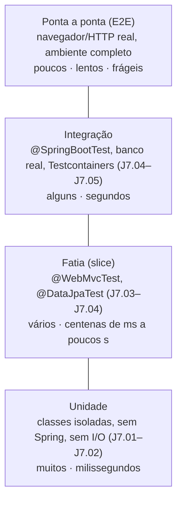

# J7.01 — Pirâmide de testes, AssertJ e testes de unidade

> ⏱️ ~1h30 · 🟢 Júnior · Pré-requisitos: J1.16 (JUnit 6 e AssertJ), J5.11 (`Account`, `@Transactional`), J6 (API v1)

> ⚠️ **Estado de verificação deste módulo (J7):** por decisão do aluno, os exemplos de J7 foram **revisados por leitura** contra o código e a documentação das aulas anteriores, **mas não foram executados** (a bateria prática é feita no fim do treinamento). Onde uma aula mostra "saída esperada", ela vem do raciocínio sobre o código, **não** de uma execução. Cada aula repete esse aviso na seção de exemplos.

## 🎯 Objetivos
Ao final desta aula você consegue:
1. **Classificar** um teste como de unidade, de fatia ou de integração e dizer o que ele custa e o que ele protege.
2. **Escrever** testes de unidade rápidos (sem Spring, sem banco) no formato *Arrange–Act–Assert*.
3. **Usar** o AssertJ para afirmar valores, coleções e exceções, inclusive `BigDecimal` do jeito certo.
4. **Cobrir** casos de borda com `@ParameterizedTest` e agrupar cenários com `@Nested`.
5. **Aplicar** partição de equivalência e valores-limite para escolher *quais* casos testar.

## 🤔 Por que isso importa
O PayFlow já tem **130 testes** (87 da J5 + 43 da J6). Quase todos são **testes de integração**: sobem o contexto do Spring, falam com o PostgreSQL real e recriam o banco a cada teste (`ResetDatabase`, decisão 40). Eles são valiosos (provam commit, rollback, SQL, HTTP), mas são **lentos e grossos**: quando um falha, o defeito pode estar em qualquer camada.

No trabalho de um júnior, a pergunta diária é "como eu sei que minha mudança não quebrou nada?". A resposta é uma **suíte com muitos testes pequenos e rápidos** (que apontam a linha com defeito em milissegundos) e **poucos testes grandes** (que provam que as peças funcionam juntas). Esta aula monta a base dessa suíte: o domínio (`Amounts`, `Account`) testado sem nenhuma infraestrutura.

## 💡 Intuição (explicação simples)
Pense na revisão de um carro. Você pode **medir cada parafuso** (barato, rápido, aponta exatamente a peça ruim) ou **dar uma volta de teste** (caro, lento, mas prova que tudo funciona junto). Uma oficina séria faz **muitas medições e poucas voltas**. Se só fizesse voltas, cada defeito viraria uma investigação ("o barulho vem de onde?"); se só medisse parafusos, entregaria um carro que nunca andou.

## 🔬 Como funciona por dentro

### 1. A pirâmide de testes

A forma importa: **quanto mais abaixo, mais barato e mais preciso**; quanto mais acima, mais realista e mais caro. O artigo de Martin Fowler sobre a [pirâmide de testes](https://martinfowler.com/bliki/TestPyramid.html) e o [guia prático](https://martinfowler.com/articles/practical-test-pyramid.html) descrevem a ideia e os erros comuns (o "sorvete invertido": muito E2E, pouca unidade).

No PayFlow, o mapa fica assim:

| Camada | O que testa | Exemplo no PayFlow | Aula |
|---|---|---|---|
| Unidade | uma classe, dependências substituídas | `Account.withdraw`, `Amounts`, `TransferService` com repositórios falsos | J7.01, J7.02 |
| Fatia | uma parte do contexto do Spring | controller com `MockMvc`; repositório com `@DataJpaTest` | J7.03, J7.04 |
| Integração | a aplicação inteira + banco real | `TransferServiceTest`, `TransfersApiTest` (J5/J6) | J7.04, J7.05 |
| E2E | sistema implantado, de fora | `scripts/api-smoke.sh` (J6), CI/nuvem (J10) | J10 |

### 2. O que é um bom teste de unidade
Os critérios **F.I.R.S.T.**: **F**ast (rápido), **I**solated (isolado: não depende de outro teste nem da ordem), **R**epeatable (mesmo resultado sempre, sem depender de relógio, rede ou sorte), **S**elf-validating (passa ou falha sozinho, sem alguém ler um log), **T**imely (escrito junto do código, não meses depois).

Cada teste segue **Arrange–Act–Assert** (também chamado *Given–When–Then*, [Fowler](https://martinfowler.com/bliki/GivenWhenThen.html)):
```java
@Test
void withdrawSubtractsFromTheBalance() {
    Account account = accountWith("100.00");          // Arrange: o cenário
    account.withdraw(new BigDecimal("30.50"));        // Act: a ação (UMA)
    assertThat(account.getBalance()).isEqualByComparingTo("69.50");   // Assert: o resultado
}
```
Regras práticas: **um comportamento por teste** (se o nome precisa de "e", são dois testes); o **nome diz o comportamento**, não o método (`withdrawBelowZeroIsRejected`, não `testWithdraw2`); nada de `if`/laço dentro do teste; o teste **não repete a lógica** do código (calcular o esperado com a mesma fórmula só prova que a fórmula é igual a ela mesma).

### 3. AssertJ: afirmações que se leem como frases
O AssertJ (3.27.7 no BOM do Boot 4.1.2, [documentação](https://assertj.github.io/doc/)) começa sempre por `assertThat(valorReal)` e encadeia. As que o PayFlow mais usa:

| Necessidade | Código | Observação |
|---|---|---|
| Igualdade | `assertThat(x).isEqualTo(y)` | usa `equals` |
| **`BigDecimal`** | `assertThat(balance).isEqualByComparingTo("69.50")` | usa `compareTo`; `isEqualTo` compara **escala também** (`69.5` ≠ `69.50`) |
| Exceção | `assertThatThrownBy(() -> account.withdraw(x)).isInstanceOf(InsufficientFundsException.class).hasMessageContaining("Insufficient")` | a exceção é o resultado esperado |
| Exceção sem lambda de captura | `assertThatExceptionOfType(X.class).isThrownBy(() -> ...)` | equivalente, mais verboso |
| Coleção | `assertThat(list).containsExactly("a", "b")` | mesma ordem; `containsExactlyInAnyOrder` ignora a ordem |
| Extrair campo | `assertThat(entries).extracting(LedgerEntry::getType).containsExactly(DEBIT, CREDIT)` | testa uma propriedade de cada elemento |
| Várias afirmações juntas | `assertSoftly(softly -> { softly.assertThat(...)...; })` | **todas** as falhas aparecem de uma vez, não só a primeira |
| Mensagem de falha | `assertThat(x).as("conta %s", id).isEqualTo(y)` | contexto quando falha |

**Por que `isEqualByComparingTo` para dinheiro?** `new BigDecimal("69.5").equals(new BigDecimal("69.50"))` é `false` (escalas diferentes, J1.15); `compareTo` devolve 0. O código do PayFlow mantém escala 2 (decisão 4), mas o `BigDecimal.ZERO` inicial da `Account` tem escala **0**, e um teste que compare com `isEqualTo("0.00")` falharia por um motivo que não é um defeito.

### 4. JUnit 6: parametrizar e agrupar
Já vistos em J1.16, agora com propósito: `@ParameterizedTest` + `@ValueSource`/`@CsvSource` roda **o mesmo teste com vários dados** (cada linha é uma execução separada no relatório), ideal para **valores-limite**; `@Nested` agrupa cenários de uma classe em **classes internas** (`class Deposit`, `class Withdraw`), e o relatório mostra a hierarquia; `@DisplayName` troca o nome exibido (opcional). A [documentação do JUnit](https://docs.junit.org/current/user-guide/#writing-tests-parameterized-tests) lista todas as fontes de argumentos.

### 5. Escolher *quais* casos testar
Testar tudo é impossível; testar ao acaso é desperdício. Duas técnicas simples:
- **Partição de equivalência:** divida as entradas em **classes que o código trata do mesmo jeito** e teste **um representante** de cada. Para `Amounts.requireValid`: positivos com até 2 casas (válidos), zero/negativos (inválidos), mais de 2 casas (inválidos).
- **Valores-limite:** os defeitos moram nas **fronteiras**. Teste o valor exatamente **na** fronteira e **ao lado** dela: `0.01` (menor válido), `0.00` e `-0.01` (zero e logo abaixo), `1.00` e `1.005` (2 casas e logo acima).

## 🛠️ Exemplo prático
> ⚠️ **Não executado nesta geração** (ver o aviso no topo). A saída abaixo é a **esperada** pela leitura do código; confira ao rodar.

Estes dois testes **não usam Spring, banco nem `ResetDatabase`**: são Java puro com JUnit e AssertJ, que já vêm no `spring-boot-starter-test` do `pom.xml` (J5.02). Nada a acrescentar no `pom.xml`.

`src/test/java/com/payflow/domain/AmountsTest.java`
```java
package com.payflow.domain;

import static org.assertj.core.api.Assertions.assertThatCode;
import static org.assertj.core.api.Assertions.assertThatThrownBy;

import java.math.BigDecimal;
import org.junit.jupiter.api.Test;
import org.junit.jupiter.params.ParameterizedTest;
import org.junit.jupiter.params.provider.ValueSource;

/** Regras de valor monetário (decisão 4 e 18): positivo, no máximo 2 casas. Teste de unidade puro. */
class AmountsTest {

    @ParameterizedTest
    @ValueSource(strings = {"0.01", "1", "100.00", "999999999999999.99", "1E+2"})
    void acceptsPositiveAmountsWithUpToTwoDecimals(String text) {
        assertThatCode(() -> Amounts.requireValid(new BigDecimal(text))).doesNotThrowAnyException();
    }

    @ParameterizedTest
    @ValueSource(strings = {"0", "0.00", "-0.01", "-100"})
    void rejectsZeroAndNegativeAmounts(String text) {
        assertThatThrownBy(() -> Amounts.requireValid(new BigDecimal(text)))
                .isInstanceOf(IllegalArgumentException.class)
                .hasMessageContaining("positive");
    }

    @ParameterizedTest
    @ValueSource(strings = {"10.005", "0.001", "1.234"})
    void rejectsMoreThanTwoDecimalPlaces(String text) {
        assertThatThrownBy(() -> Amounts.requireValid(new BigDecimal(text)))
                .isInstanceOf(IllegalArgumentException.class)
                .hasMessageContaining("at most 2 decimal places");
    }
}
```
Pontos:
- A classe fica em `com.payflow.domain` (o mesmo pacote de `Amounts`), então funciona mesmo que `requireValid` não seja `public`.
- As mensagens (`"amount must be positive"`, `"amount must have at most 2 decimal places: ..."`) são as da J3.11. Se você alterou o texto, ajuste o teste: **testar a mensagem acopla o teste ao texto**; aqui ela distingue os dois motivos da recusa, por isso vale. Para o resto do código, prefira testar o **tipo** da exceção.
- `"1E+2"` é um `BigDecimal` com **escala −2** (valor 100). O teste afirma que ele é **aceito** porque `scale() > 2` é falso; é o tipo de caso que você só enxerga procurando fronteiras (veja a Pausa para lógica).

`src/test/java/com/payflow/domain/AccountTest.java`
```java
package com.payflow.domain;

import static org.assertj.core.api.Assertions.assertThat;
import static org.assertj.core.api.Assertions.assertThatThrownBy;

import java.math.BigDecimal;
import org.junit.jupiter.api.Nested;
import org.junit.jupiter.api.Test;
import org.junit.jupiter.params.ParameterizedTest;
import org.junit.jupiter.params.provider.ValueSource;

/** As regras de negócio da conta (regra 1: saldo nunca negativo), sem Spring e sem banco. */
class AccountTest {

    /** Uma conta ativa com o saldo informado (o saldo inicial de uma conta nova é zero). */
    private static Account accountWith(String balance) {
        Account account = new Account(new User("ana@payflow.dev", "Ana Souza", "hash"));
        if (new BigDecimal(balance).signum() > 0) {
            account.deposit(new BigDecimal(balance));
        }
        return account;
    }

    @Test
    void newAccountIsActiveWithZeroBalance() {
        Account account = new Account(new User("ana@payflow.dev", "Ana Souza", "hash"));

        assertThat(account.getStatus()).isEqualTo(AccountStatus.ACTIVE);
        assertThat(account.getBalance()).isEqualByComparingTo("0.00");
    }

    @Nested
    class Deposit {

        @Test
        void addsToTheBalance() {
            Account account = accountWith("100.00");

            account.deposit(new BigDecimal("0.05"));

            assertThat(account.getBalance()).isEqualByComparingTo("100.05");
        }

        @Test
        void accumulatesSuccessiveDeposits() {
            Account account = accountWith("0.00");

            account.deposit(new BigDecimal("10.00"));
            account.deposit(new BigDecimal("0.05"));

            assertThat(account.getBalance()).isEqualByComparingTo("10.05");
        }

        @ParameterizedTest
        @ValueSource(strings = {"0", "-5.00", "1.005"})
        void rejectsInvalidAmountsAndKeepsTheBalance(String text) {
            Account account = accountWith("50.00");

            assertThatThrownBy(() -> account.deposit(new BigDecimal(text)))
                    .isInstanceOf(IllegalArgumentException.class);

            assertThat(account.getBalance()).isEqualByComparingTo("50.00");
        }
    }

    @Nested
    class Withdraw {

        @Test
        void subtractsFromTheBalance() {
            Account account = accountWith("100.00");

            account.withdraw(new BigDecimal("30.50"));

            assertThat(account.getBalance()).isEqualByComparingTo("69.50");
        }

        @Test
        void allowsWithdrawingTheWholeBalance() {            // valor-limite: saldo == valor
            Account account = accountWith("100.00");

            account.withdraw(new BigDecimal("100.00"));

            assertThat(account.getBalance()).isEqualByComparingTo("0.00");
        }

        @Test
        void rejectsAmountAboveTheBalanceAndKeepsTheBalance() {   // valor-limite: um centavo acima
            Account account = accountWith("100.00");

            assertThatThrownBy(() -> account.withdraw(new BigDecimal("100.01")))
                    .isInstanceOf(InsufficientFundsException.class);

            assertThat(account.getBalance()).isEqualByComparingTo("100.00");
        }
    }

    @Nested
    class WhenBlocked {

        @Test
        void rejectsDeposits() {
            Account account = accountWith("100.00");
            account.block();

            assertThatThrownBy(() -> account.deposit(new BigDecimal("10.00")))
                    .isInstanceOf(AccountUnavailableException.class);
        }

        @Test
        void rejectsWithdrawals() {
            Account account = accountWith("100.00");
            account.block();

            assertThatThrownBy(() -> account.withdraw(new BigDecimal("10.00")))
                    .isInstanceOf(AccountUnavailableException.class);
            assertThat(account.getBalance()).isEqualByComparingTo("100.00");
        }

        @Test
        void worksAgainAfterActivation() {
            Account account = accountWith("100.00");
            account.block();
            account.activate();

            account.withdraw(new BigDecimal("40.00"));

            assertThat(account.getBalance()).isEqualByComparingTo("60.00");
        }
    }
}
```
Pontos:
- `new User(email, fullName, passwordHash)` e `new Account(User)` são os construtores da J5.08. `getId()` é `null` (o id nasce no `persist`, J5.07), e nada neste teste precisa dele.
- `accountWith` é um **método auxiliar** (*test data builder* mínimo): esconde o cenário repetitivo e deixa cada teste com uma linha de *Arrange*.
- Cada `@Nested` é uma classe interna **não estática**; o JUnit cria uma instância da classe externa para cada teste.
- Em `rejects...AndKeepsTheBalance` há **duas** afirmações (a exceção e o saldo intacto): é **um** comportamento ("operação recusada não muda o estado"), por isso cabe no mesmo teste.

Rodar (da raiz do `payflow`; o `mvn` precisa do JDK 25, J0.02):
```bash
export JAVA_HOME=/usr/lib/jvm/java-25-openjdk-amd64
mvn test -Dtest='AmountsTest,AccountTest*'
```
Saída **esperada** (resumo; o `AccountTest*` inclui as classes internas `AccountTest$Deposit`, `$Withdraw` e `$WhenBlocked`):
```text
[INFO] Tests run: 12, Failures: 0, Errors: 0, Skipped: 0     (AmountsTest: 5 + 4 + 3)
[INFO] Tests run: 12, Failures: 0, Errors: 0, Skipped: 0     (AccountTest e internas: 1 + 5 + 3 + 3)
[INFO] BUILD SUCCESS
```
Repare em **duas coisas que não aparecem**: nenhuma linha do Spring (banner, `Started PayflowApplication`) e nenhum acesso ao banco. É isso que torna o teste de unidade rápido.

**Veja o teste falhar de propósito** (hábito essencial: um teste que nunca falhou não prova nada). Em `Account.withdraw`, troque `balance.compareTo(amount) < 0` por `<= 0` e rode `AccountTest*`: o esperado é que `allowsWithdrawingTheWholeBalance` falhe com `InsufficientFundsException`. Desfaça a troca depois.

## 🧠 Pausa para lógica
**Enunciado:** `Amounts.requireValid` recusa `amount.signum() <= 0` e `amount.scale() > 2`. Liste as **classes de equivalência** e os **valores-limite** de cada condição. Depois responda: o valor `new BigDecimal("1E+2")` passa? E `new BigDecimal("0E+3")`? Por quê?

<details><summary>Dica</summary>Escreva a condição como intervalo: positivo = <code>signum() == 1</code>; casas válidas = <code>scale() &lt;= 2</code>. Para cada uma, o valor logo antes e logo depois da fronteira. Lembre que <code>scale</code> pode ser <b>negativo</b>.</details>
<details><summary>Solução</summary>

| Condição | Fronteira | Valores a testar | Resultado |
|---|---|---|---|
| positivo | `signum()` 0 → 1 | `-0.01` (rejeita), `0.00` (rejeita), `0.01` (aceita) | o limite é o **menor valor positivo**, 1 centavo |
| casas | `scale()` 2 → 3 | `1.00` e `1` (aceitam), `1.005` e `0.001` (rejeitam) | com mais de 2 casas o valor é **recusado**, não arredondado (ADR 0004) |
| escala negativa | `scale() < 0` | `1E+2` (= 100, escala −2) | `-2 > 2` é falso, **passa**; é positivo, **passa** |

`0E+3` é zero com escala −3: `signum() == 0`, logo **rejeita** pelo motivo "positivo" (a escala nem é olhada, porque a primeira condição falha antes). O caso `1E+2` revela que a validação aceita escalas negativas; isso é inofensivo porque `Amounts.normalize` (J6.02) leva o valor a 2 casas, mas **só um teste de fronteira mostra isso**.
</details>

**Variação mais difícil:** em vez de listar casos à mão, descreva **uma propriedade** que vale para *qualquer* valor válido (por exemplo, "depositar `x` e depois sacar `x` devolve o saldo original") e escreva um teste que a verifica com 1000 valores gerados por `java.util.Random` com semente fixa. (Essa ideia se chama *property-based testing*; bibliotecas como jqwik a automatizam, mas **não** fazem parte do curso.)

## ⚖️ Trade-offs e quando NÃO usar
(Seção obrigatória só do pleno e do sênior; resumo para o júnior.) Teste de unidade **não** prova que as peças funcionam juntas: `Account` perfeita não garante que o `UPDATE ... where version = ?` está certo (isso é J7.04/J7.05). E testar **getters, construtores triviais e código do framework** só gera manutenção. Teste onde há **decisão** (regra, `if`, cálculo, borda).

## ⚠️ Erros comuns e boas práticas de produção
- **Comparar `BigDecimal` com `isEqualTo`.** Falha com `Expecting actual: 69.5 to be equal to: 69.50` mesmo com o valor certo. Use `isEqualByComparingTo`.
- **Teste que depende de outro** (ordem, estado estático, arquivo deixado no disco): quebra "às vezes". Cada teste monta o próprio cenário (o JUnit cria uma **nova instância** da classe por teste, de propósito).
- **`assertThat` esquecido:** `assertThat(x);` sem a afirmação **não verifica nada** e passa (o IntelliJ avisa). Termine sempre com uma afirmação (`isEqualTo`, `isTrue`...).
- **`assertThatThrownBy` com mais de uma linha capaz de lançar:** o teste passa por causa da linha errada. Deixe **só a chamada sob teste** dentro do lambda e monte o cenário antes.
- **Teste que repete a implementação** (`expected = a.add(b)` no teste e no código): quando o código está errado, o teste também está. Use **valores literais** conhecidos.
- **`@Disabled` "temporário":** vira esquecimento. Se o teste não serve, apague; se está quebrado, conserte ou abra uma tarefa com número.

## 🧩 Exercícios
1. **Fixação.** (a) Por que o teste de unidade da `Account` não precisa de `@SpringBootTest`? (b) Qual a diferença entre `isEqualTo` e `isEqualByComparingTo`? (c) Em que `@Nested` ajuda? (d) Dê um exemplo de teste que **não** é F.I.R.S.T. e diga qual letra viola.
2. **Aplicação no PayFlow.** Crie `AmountsTest` e `AccountTest` como acima e acrescente os casos que faltam:
   - [ ] `AmountsTest` e `AccountTest` criados em `src/test/java/com/payflow/domain/`, com os nomes e valores-limite da aula.
   - [ ] Um teste para `Amounts.normalize` (J6.02): `"10"` → `10.00` e `"10.5"` → `10.50` (usando `isEqualTo(new BigDecimal("10.00"))` **de propósito**, para ver a escala) e um valor com 3 casas recusado.
   - [ ] Você viu um teste **falhar** de propósito (troca de `<` por `<=`) e desfez a troca.
   - [ ] `mvn test -Dtest='AmountsTest,AccountTest*'` verde, sem iniciar o Spring (nenhum `Started PayflowApplication` na saída).
3. **Desafio (opcional).** Escreva `LedgerEntryTest` para o construtor de `LedgerEntry`: todos os campos informados são devolvidos pelos getters, e `getTransfer()` é `null` em um depósito (ADR 0001). Pense: esse teste tem valor, ou é teste de getter trivial? Justifique.

<details><summary>Soluções de referência (esboço, não executado)</summary>

1. (a) Ela não depende de contêiner, proxy, banco nem configuração: é um objeto Java com regras; criá-la com `new` basta. (b) `isEqualTo` usa `equals` (compara valor **e escala**); `isEqualByComparingTo` usa `compareTo` (só o valor). (c) Agrupa cenários ("quando bloqueada") e deixa o relatório hierárquico; cada grupo pode ter o próprio `@BeforeEach`. (d) Um teste que lê a hora do sistema e espera "depois das 18h" viola **R**epeatable; um que depende de o teste anterior ter criado a conta viola **I**solated.
2. `normalize`: `assertThat(Amounts.normalize(new BigDecimal("10"))).isEqualTo(new BigDecimal("10.00"));` passa **porque** `normalize` ajusta a escala para 2 (se `isEqualTo` falhar, o motivo é a escala: bom lembrete de por que usar `isEqualByComparingTo` para valores que *não* passaram por `normalize`).
3. Valor baixo: só confirma o construtor. Vale mais testar o **comportamento** (o saldo da conta, o lançamento gerado por uma transferência, J7.02), não o getter.
</details>

## 🎤 Na entrevista
1. **O que é a pirâmide de testes e por que ela tem essa forma?**
   *Resposta-modelo:* muitos testes de unidade na base (rápidos, baratos, apontam o defeito), alguns de integração no meio, poucos de ponta a ponta no topo (lentos, frágeis, caros). A forma reflete **custo e velocidade de feedback**. O anti-padrão é o sorvete invertido (quase tudo E2E).
2. **Como você escolhe quais casos testar?**
   *Resposta-modelo:* divido as entradas em classes de equivalência, testo um representante de cada e **os valores-limite** (na fronteira e ao lado), mais os caminhos de erro; priorizo onde há regra de negócio e risco (dinheiro, concorrência).
3. **Por que não usar `==`/`equals` para comparar `BigDecimal` em teste?**
   *Resposta-modelo:* `equals` considera a escala (`2.0` ≠ `2.00`); `compareTo` compara só o valor. No teste uso `isEqualByComparingTo` quando a escala não faz parte da regra; quando faz (saída da API), comparo a **string** (`"69.50"`).

## 📚 Para ir além
- 📄 **AssertJ — guia e Javadoc:** https://assertj.github.io/doc/ — a seção de `assertThat` para coleções e exceções cobre 90% do uso.
- 📄 **JUnit — guia do usuário (testes parametrizados):** https://docs.junit.org/current/user-guide/#writing-tests-parameterized-tests — todas as fontes de argumentos.
- 📑 **Martin Fowler — Test Pyramid:** https://martinfowler.com/bliki/TestPyramid.html — a ideia em uma página.
- 📑 **Martin Fowler — The Practical Test Pyramid:** https://martinfowler.com/articles/practical-test-pyramid.html — exemplos com Spring Boot (versão antiga do framework; as **ideias** valem, os pacotes mudaram no Boot 4).
- 📑 **Martin Fowler — Unit Test:** https://martinfowler.com/bliki/UnitTest.html — o que "unidade" significa (e por que há escolas diferentes).
- 🎥 Vídeo: ⚠️ nenhum vídeo verificado nesta execução (política do treinamento: não citar vídeo sem conferir).

## ✅ Checklist da aula
- [ ] Sei dizer onde cada teste do PayFlow fica na pirâmide e por que.
- [ ] `AmountsTest` e `AccountTest` criados; nenhum deles usa Spring ou banco.
- [ ] Uso `isEqualByComparingTo` para `BigDecimal` e sei por quê.
- [ ] Testei valores-limite (`0.01`, `100.00` × `100.01`, `1.005`).
- [ ] Vi um teste falhar de propósito e desfiz a alteração.
