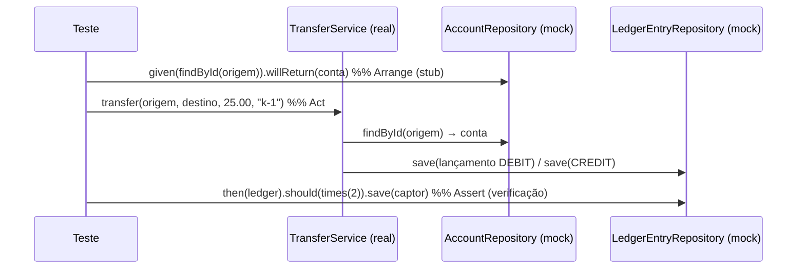

# J7.02 — Mockito e testes de services

> ⏱️ ~1h30 · 🟢 Júnior · Pré-requisitos: J7.01, J5.03 (injeção por construtor), J5.11 (`TransferService`), J6.03 (`submit`)

> ⚠️ **Não executado nesta geração.** Exemplos revisados por leitura contra as aulas J5/J6 e a documentação do Mockito; a bateria prática fica para o fim do treinamento. Saídas mostradas são **esperadas**, não coladas de uma execução.

## 🎯 Objetivos
Ao final desta aula você consegue:
1. **Distinguir** dummy, stub, fake, spy e mock, e escolher o dublê certo para cada colaborador.
2. **Escrever** um teste de unidade de *service* com `MockitoExtension`, `@Mock`, `given(...)` e `then(...).should(...)`.
3. **Capturar** o que foi passado a um colaborador com `ArgumentCaptor`.
4. **Explicar** o que são *strict stubs* e por que `UnnecessaryStubbingException` é um aliado.
5. **Decidir** o que **não** mockar e o que um teste com mocks **não consegue** provar.

## 🤔 Por que isso importa
O `TransferService` depende de três repositórios e de um `Clock`. Testá-lo só com o banco (como `TransferServiceTest`, J5.11) é essencial para provar commit e rollback, mas é um jeito caro de verificar **as regras de decisão** do método: "chave repetida devolve a transferência existente", "conta de outro usuário é indistinguível de inexistente", "mesma chave com valor diferente é recusada". Essas decisões podem ser testadas em milissegundos, **sem banco**, trocando os repositórios por **dublês**. É o que o júnior faz todo dia ao mexer em um *service*.

## 💡 Intuição (explicação simples)
Ensaio de teatro: antes da estreia, o ator principal contracena com **substitutos** (um boneco no lugar do parceiro de cena, alguém lendo as falas do outro lado). Serve para treinar **a sua parte** sem depender de todo o elenco, do cenário e da luz. O ensaio geral, com todo mundo, vem depois (e ele é insubstituível). Os dublês de teste são esses substitutos: deixam você ensaiar **a lógica do service** sem o banco, e o teste de integração faz o ensaio geral.

## 🔬 Como funciona por dentro

### 1. Os cinco tipos de dublê
Vocabulário de [Martin Fowler (TestDouble)](https://martinfowler.com/bliki/TestDouble.html) e [Mocks Aren't Stubs](https://martinfowler.com/articles/mocksArentStubs.html):

| Dublê | O que faz | Exemplo no PayFlow |
|---|---|---|
| **Dummy** | só preenche um parâmetro; nunca é usado | um `Clock` passado a um construtor cujo caminho do teste não o chama |
| **Stub** | devolve respostas **prontas** | `accounts.findById(id)` devolvendo uma `Account` de teste; `Clock.fixed(...)` |
| **Fake** | implementação **simples e funcional** | o servidor HTTP falso das taxas de câmbio (J6.08); um repositório em `HashMap` |
| **Spy** | objeto **real** que registra as chamadas | `@MockitoSpyBean` (citado na J7.03) sobre um bean |
| **Mock** | stub + **verificação** de que foi chamado como esperado | `then(ledger).should(times(2)).save(...)` |

O **Mockito** cria stubs, mocks e spies em tempo de execução (por *bytecode*, sem você escrever a classe). Versão **5.23.0** no BOM do Boot 4.1.2; `mockito-junit-jupiter` já vem no `spring-boot-starter-test`.

### 2. Anatomia de um teste com Mockito

- **`@ExtendWith(MockitoExtension.class)`** cria os `@Mock` antes de cada teste e **valida o uso** ao fim (próximo item).
- **`given(chamada).willReturn(valor)`** (BDDMockito, na mesma linguagem de *Given–When–Then*; `when(...).thenReturn(...)` é o equivalente clássico) **programa** a resposta do dublê.
- **`then(mock).should(...)`** **verifica** a interação; `never()`, `times(n)`, `shouldHaveNoInteractions()` expressam "não chamou" e "n vezes".
- **`ArgumentCaptor<T>`** guarda o argumento passado, para você inspecioná-lo depois.
- **O service é criado com `new`**, passando os dublês no construtor (decisão 30, injeção só por construtor). O `@InjectMocks` do Mockito faz isso por reflexão, mas **esconde** quando o construtor muda; o `new` explícito quebra a compilação e mostra o que mudou.

### 3. *Strict stubs*: o Mockito fiscaliza o teste
Com `MockitoExtension`, a estratégia padrão é **estrita**: um stub **que o teste não usou** vira `UnnecessaryStubbingException`, e chamar um método stubado **com argumentos diferentes** do programado vira `PotentialStubbingProblem`. Parece rigor excessivo, mas pega dois defeitos reais: **stub sobrando** (o código não passa mais por ali e o teste não percebeu) e **argumento errado** (o teste verde estava testando outro caminho). Só desligue (`@MockitoSettings(strictness = LENIENT)`) com justificativa escrita.

### 4. Limites do que um teste com mocks prova
Um teste com repositórios falsos prova que **o service toma as decisões certas e chama os colaboradores certos**. Ele **não** prova:
- que a **transação** desfaz o débito quando o crédito falha (não há transação aqui: o objeto `Account` mantém o débito na memória);
- que o **SQL** da consulta derivada está certo, que o `UNIQUE` barra a corrida, que o `@Version` detecta o *lost update*.

Essas garantias continuam com os testes de integração (J5.11, J6.03) e com os de fatia e Testcontainers (J7.04, J7.05). Mocks e integração **se completam**.

### 5. O que não mockar
- **Objetos de valor e entidades** (`Account`, `User`, `BigDecimal`): use os **reais**; eles são baratos e têm as regras que você quer exercitar (por isso `Account.withdraw` roda de verdade no teste abaixo).
- **Tipos que você não controla** (por exemplo, `RestClient`): prefira um **fake** de verdade (o servidor HTTP falso da J6.08) a mockar uma API cheia de métodos encadeados.
- **O próprio objeto sob teste** (nunca `spy` do service só para "ajudar").
- **Verificar tudo**: `verifyNoMoreInteractions` em tudo cola o teste na implementação; verifique **resultados** primeiro e interações só quando a interação **é** o requisito (aqui: "não gravou nada").

## 🛠️ Exemplo prático
> ⚠️ **Não executado nesta geração.** Raciocínio sobre o código: `TransferService.transfer` chama `Amounts.requireValid`, rejeita origem = destino, consulta `findByIdempotencyKey`, carrega as duas contas, faz `withdraw` e `deposit`, cria a `Transfer`, chama `complete()`, grava a transferência e dois lançamentos com **um** `clock.instant()` (J5.11). `Transfer.complete()` é a correção pendente da J5 (ver `progresso.md`): **este código precisa dela**.

### 1. Dados de teste: ids que o banco geraria
Entidades novas têm `id == null` (ele nasce no `persist`, J5.07), mas `submit` compara ids de dono. Em teste de unidade não há banco, então um auxiliar atribui os ids por reflexão (`ReflectionTestUtils`, do `spring-test`):

`src/test/java/com/payflow/support/TestEntities.java`
```java
package com.payflow.support;

import com.payflow.domain.Account;
import com.payflow.domain.User;
import java.math.BigDecimal;
import java.util.UUID;
import org.springframework.test.util.ReflectionTestUtils;

/** Fábrica de entidades para testes de unidade (sem banco): atribui o id que o banco geraria. */
public final class TestEntities {

    private TestEntities() {
    }

    public static User user(UUID id, String email) {
        User user = new User(email, "Test User", "hash");
        ReflectionTestUtils.setField(user, "id", id);
        return user;
    }

    /** Conta ativa com o saldo informado (via depósito, que é como o saldo nasce de verdade). */
    public static Account account(UUID id, User owner, String balance) {
        Account account = new Account(owner);
        ReflectionTestUtils.setField(account, "id", id);
        if (new BigDecimal(balance).signum() > 0) {
            account.deposit(new BigDecimal(balance));
        }
        return account;
    }
}
```
**Custo consciente:** `ReflectionTestUtils.setField(..., "id", ...)` depende do **nome do campo**; renomear `id` na entidade quebra os testes em tempo de execução (não de compilação). Aceitável no teste, **nunca** no código de produção.

### 2. O teste do `TransferService`
`src/test/java/com/payflow/service/TransferServiceUnitTest.java`
```java
package com.payflow.service;

import static org.assertj.core.api.Assertions.assertThat;
import static org.assertj.core.api.Assertions.assertThatThrownBy;
import static org.mockito.ArgumentMatchers.any;
import static org.mockito.BDDMockito.given;
import static org.mockito.BDDMockito.then;
import static org.mockito.Mockito.never;
import static org.mockito.Mockito.times;

import com.payflow.domain.Account;
import com.payflow.domain.AccountUnavailableException;
import com.payflow.domain.EntryType;
import com.payflow.domain.IdempotencyKeyReuseException;
import com.payflow.domain.InsufficientFundsException;
import com.payflow.domain.LedgerEntry;
import com.payflow.domain.Transfer;
import com.payflow.domain.TransferStatus;
import com.payflow.domain.User;
import com.payflow.repository.AccountRepository;
import com.payflow.repository.LedgerEntryRepository;
import com.payflow.repository.TransferRepository;
import com.payflow.support.TestEntities;
import java.math.BigDecimal;
import java.time.Clock;
import java.time.Instant;
import java.time.ZoneOffset;
import java.util.Optional;
import java.util.UUID;
import org.junit.jupiter.api.BeforeEach;
import org.junit.jupiter.api.Test;
import org.junit.jupiter.api.extension.ExtendWith;
import org.mockito.ArgumentCaptor;
import org.mockito.Mock;
import org.mockito.junit.jupiter.MockitoExtension;

/** Decisões do TransferService, com os repositórios substituídos por dublês. Não prova transação nem SQL. */
@ExtendWith(MockitoExtension.class)
class TransferServiceUnitTest {

    static final UUID ANA_ID = UUID.fromString("10000000-0000-0000-0000-000000000001");
    static final UUID BRUNO_ID = UUID.fromString("10000000-0000-0000-0000-000000000002");
    static final UUID SOURCE_ID = UUID.fromString("20000000-0000-0000-0000-000000000001");
    static final UUID TARGET_ID = UUID.fromString("20000000-0000-0000-0000-000000000002");
    static final Instant NOW = Instant.parse("2026-11-13T12:00:00Z");

    @Mock AccountRepository accounts;
    @Mock TransferRepository transfers;
    @Mock LedgerEntryRepository ledger;

    TransferService service;
    Account source;
    Account target;

    @BeforeEach
    void setUp() {
        // Injeção por construtor, explícita: se o construtor mudar, este teste deixa de compilar (e mostra o que mudou).
        service = new TransferService(accounts, transfers, ledger, Clock.fixed(NOW, ZoneOffset.UTC));
        User ana = TestEntities.user(ANA_ID, "ana@payflow.dev");
        User bruno = TestEntities.user(BRUNO_ID, "bruno@payflow.dev");
        source = TestEntities.account(SOURCE_ID, ana, "100.00");
        target = TestEntities.account(TARGET_ID, bruno, "10.00");
    }

    // ---------- transfer(...) ----------

    @Test
    void transferMovesMoneyAndRecordsDebitAndCreditAtTheSameInstant() {
        given(transfers.findByIdempotencyKey("k-1")).willReturn(Optional.empty());
        given(accounts.findById(SOURCE_ID)).willReturn(Optional.of(source));
        given(accounts.findById(TARGET_ID)).willReturn(Optional.of(target));

        Transfer result = service.transfer(SOURCE_ID, TARGET_ID, new BigDecimal("25.00"), "k-1");

        assertThat(result.getStatus()).isEqualTo(TransferStatus.COMPLETED);
        assertThat(source.getBalance()).isEqualByComparingTo("75.00");
        assertThat(target.getBalance()).isEqualByComparingTo("35.00");

        ArgumentCaptor<LedgerEntry> entries = ArgumentCaptor.forClass(LedgerEntry.class);
        then(ledger).should(times(2)).save(entries.capture());
        assertThat(entries.getAllValues())
                .extracting(LedgerEntry::getType)
                .containsExactly(EntryType.DEBIT, EntryType.CREDIT);
        assertThat(entries.getAllValues())
                .extracting(LedgerEntry::getAmount)
                .allSatisfy(amount -> assertThat(amount).isEqualByComparingTo("25.00"));
        assertThat(entries.getAllValues())
                .extracting(LedgerEntry::getCreatedAt)
                .containsOnly(NOW);
        then(transfers).should().save(result);
    }

    @Test
    void insufficientFundsStopsBeforeAnythingIsSaved() {
        given(transfers.findByIdempotencyKey("k-2")).willReturn(Optional.empty());
        given(accounts.findById(SOURCE_ID)).willReturn(Optional.of(source));
        given(accounts.findById(TARGET_ID)).willReturn(Optional.of(target));

        assertThatThrownBy(() -> service.transfer(SOURCE_ID, TARGET_ID, new BigDecimal("100.01"), "k-2"))
                .isInstanceOf(InsufficientFundsException.class);

        then(transfers).should(never()).save(any());
        then(ledger).shouldHaveNoInteractions();
        assertThat(target.getBalance()).isEqualByComparingTo("10.00");   // o crédito nem chegou a ser tentado
    }

    @Test
    void sameIdempotencyKeyReturnsTheStoredTransferWithoutMovingMoney() {
        Transfer stored = new Transfer(source, target, new BigDecimal("25.00"), "k-3");
        given(transfers.findByIdempotencyKey("k-3")).willReturn(Optional.of(stored));

        Transfer result = service.transfer(SOURCE_ID, TARGET_ID, new BigDecimal("25.00"), "k-3");

        assertThat(result).isSameAs(stored);
        then(accounts).shouldHaveNoInteractions();
        then(ledger).shouldHaveNoInteractions();
        assertThat(source.getBalance()).isEqualByComparingTo("100.00");
    }

    @Test
    void sourceAndTargetMustDiffer() {
        assertThatThrownBy(() -> service.transfer(SOURCE_ID, SOURCE_ID, new BigDecimal("10.00"), "k-4"))
                .isInstanceOf(IllegalArgumentException.class)
                .hasMessageContaining("must differ");

        then(transfers).shouldHaveNoInteractions();
    }

    @Test
    void unknownSourceAccountIsUnavailable() {
        given(transfers.findByIdempotencyKey("k-5")).willReturn(Optional.empty());
        given(accounts.findById(SOURCE_ID)).willReturn(Optional.empty());

        assertThatThrownBy(() -> service.transfer(SOURCE_ID, TARGET_ID, new BigDecimal("10.00"), "k-5"))
                .isInstanceOf(AccountUnavailableException.class)
                .hasMessageContaining("not found");
    }

    // ---------- submit(...) : o caso de uso da API (J6.03) ----------

    @Test
    void submitTreatsAnotherUsersSourceAccountAsUnavailable() {
        // Bruno tenta debitar a conta da Ana: de fora, é o mesmo que "não existe" (decisão 43).
        String key = BRUNO_ID + ":k-6";
        given(transfers.findByIdempotencyKey(key)).willReturn(Optional.empty());
        given(accounts.findById(SOURCE_ID)).willReturn(Optional.of(source));

        assertThatThrownBy(() -> service.submit(BRUNO_ID, SOURCE_ID, TARGET_ID, new BigDecimal("10.00"), "k-6"))
                .isInstanceOf(AccountUnavailableException.class);

        assertThat(source.getBalance()).isEqualByComparingTo("100.00");
        then(ledger).shouldHaveNoInteractions();
    }

    @Test
    void submitRejectsTheSameKeyWithADifferentAmount() {
        String key = ANA_ID + ":k-7";
        Transfer stored = new Transfer(source, target, new BigDecimal("10.00"), key);
        given(transfers.findByIdempotencyKey(key)).willReturn(Optional.of(stored));

        assertThatThrownBy(() -> service.submit(ANA_ID, SOURCE_ID, TARGET_ID, new BigDecimal("20.00"), "k-7"))
                .isInstanceOf(IdempotencyKeyReuseException.class);
    }

    @Test
    void submitFlagsAnIdenticalRepetitionAsReplayed() {
        String key = ANA_ID + ":k-8";
        Transfer stored = new Transfer(source, target, new BigDecimal("10.00"), key);
        given(transfers.findByIdempotencyKey(key)).willReturn(Optional.of(stored));

        TransferOutcome outcome = service.submit(ANA_ID, SOURCE_ID, TARGET_ID, new BigDecimal("10.00"), "k-8");

        assertThat(outcome.replayed()).isTrue();
        assertThat(outcome.transfer()).isSameAs(stored);
    }
}
```
Pontos de leitura:
- **Estado e interação, cada um onde cabe.** Saldos e status são **estado** (`assertThat`); "não gravou nada" e "gravou duas vezes" são **interação** (`then(...)`). Nenhum `verifyNoMoreInteractions` global.
- **`Account` é real**: o `withdraw` e o `deposit` do domínio rodam de verdade (os saldos mudam), e a recusa `InsufficientFundsException` vem da regra 1, não de um mock.
- **Strict stubs em ação:** em `insufficientFundsStopsBeforeAnythingIsSaved` o stub de `accounts.findById(TARGET_ID)` **é usado** porque `execute` carrega as **duas** contas antes de debitar (J5.11: `load(sourceId); load(targetId); source.withdraw(...)`). Se um dia o código passar a carregar o destino só depois do débito, o Mockito acusa `UnnecessaryStubbingException` e **mostra** que o comportamento mudou.
- **O que o teste de `unknownSourceAccount...` ensina:** a mensagem `"Account not found: ..."` vem do `load` (J5.11); testar `hasMessageContaining("not found")` acopla ao texto, só aceitável porque distingue o motivo.
- **Limite que você deve notar:** nenhum teste aqui afirma "rollback". O `Account` de origem **fica debitado na memória** se o crédito falhar depois; desfazer isso é trabalho da **transação**, provado por `failureAfterTheDebitUndoesTheDebit` (J5.11, contra o banco).

Rodar:
```bash
mvn test -Dtest=TransferServiceUnitTest
```
Saída **esperada**:
```text
[INFO] Running com.payflow.service.TransferServiceUnitTest
[INFO] Tests run: 8, Failures: 0, Errors: 0, Skipped: 0
[INFO] BUILD SUCCESS
```

### 3. O aviso do agente do Mockito no JDK 21+
O Mockito 5 cria dublês de classes (e de `final`) com um **agente Java** que se carrega **sozinho** na primeira vez. A partir do JDK 21 o próprio JDK imprime um aviso quando um agente é carregado dinamicamente (JEP 451) e avisa que isso será proibido por padrão no futuro. A mensagem típica tem este formato (⚠️ não capturada nesta execução):
```text
WARNING: A Java agent has been loaded dynamically (.../byte-buddy-agent-....jar)
WARNING: If a serviceability tool is in use, please run with -XX:+EnableDynamicAgentLoading to hide this warning
WARNING: Dynamic loading of agents will be disallowed by default in a future release
```
Hoje é só um aviso, mas a **correção recomendada** é carregar o agente **na partida da JVM de teste**, sem esperar a proibição. No `pom.xml` (o `spring-boot-dependencies-4.1.2.pom` gerencia `maven-dependency-plugin` **3.10.0** e `maven-surefire-plugin` **3.5.6**, conferido no Maven Central; por isso não há `<version>` abaixo):
```xml
<properties>
    <!-- Vazio por padrão; o JaCoCo (J7.06) acrescenta o dele aqui. O @{argLine} abaixo depende disto existir. -->
    <argLine></argLine>
</properties>

<build>
  <plugins>
    <plugin>
      <groupId>org.apache.maven.plugins</groupId>
      <artifactId>maven-dependency-plugin</artifactId>
      <executions>
        <execution>
          <goals><goal>properties</goal></goals>   <!-- cria ${org.mockito:mockito-core:jar} -->
        </execution>
      </executions>
    </plugin>
    <plugin>
      <groupId>org.apache.maven.plugins</groupId>
      <artifactId>maven-surefire-plugin</artifactId>
      <configuration>
        <argLine>@{argLine} -javaagent:${org.mockito:mockito-core:jar}</argLine>
      </configuration>
    </plugin>
  </plugins>
</build>
```
`@{argLine}` (com `@`, não `$`) é a sintaxe do Surefire que **reaproveita** o valor da propriedade `argLine` no momento da execução (é assim que o JaCoCo e o Mockito convivem, J7.06). Esta é a recomendação da documentação do Mockito sobre o uso como agente Java (seção "Mockito as Java agent" do [Javadoc](https://javadoc.io/doc/org.mockito/mockito-core/latest/org.mockito/org/mockito/Mockito.html)). ⚠️ Não executado: se o `${org.mockito:mockito-core:jar}` aparecer literalmente no erro da JVM, o `dependency:properties` não rodou antes do Surefire; confira a fase da execução.

## 🧠 Pausa para lógica
**Enunciado:** o `execute` do `TransferService` chama `clock.instant()` **uma vez** e usa o mesmo instante nos dois lançamentos (J5.11). Como escrever um teste que **falharia** se alguém trocasse por duas chamadas a `clock.instant()`? (Dica: o `Clock.fixed` do teste acima **não** detecta isso. Por quê?)

<details><summary>Dica</summary>Com <code>Clock.fixed</code>, duas chamadas devolvem o <b>mesmo</b> valor, então o defeito fica invisível. Você precisa de um relógio que <b>avança a cada chamada</b>: um <i>fake</i> de <code>Clock</code>.</details>
<details><summary>Solução (esboço, não executado)</summary>

```java
/** Um relógio que avança 1 segundo a cada chamada a instant(): expõe quem consulta o relógio mais de uma vez. */
static final class TickingClock extends Clock {
    private Instant next;
    TickingClock(Instant start) { this.next = start; }
    @Override public ZoneOffset getZone() { return ZoneOffset.UTC; }
    @Override public Clock withZone(java.time.ZoneId zone) { return this; }
    @Override public Instant instant() { Instant now = next; next = next.plusSeconds(1); return now; }
}
```
`Clock.getZone()` é declarado como `ZoneId getZone()`; devolver `ZoneOffset` (subtipo) é permitido (retorno covariante). No teste, monte o `TransferService` com `new TickingClock(NOW)`, faça a transferência de `transferMoves...` e afirme `extracting(LedgerEntry::getCreatedAt).containsOnly(NOW)`: com **uma** chamada, os dois lançamentos têm `NOW`; com duas, o segundo teria `NOW + 1s` e o `containsOnly` falharia.
</details>

**Variação mais difícil:** acrescente ao `TickingClock` um contador de chamadas e afirme que `instant()` foi chamado **exatamente uma vez** pela transferência. Discuta: isso é testar comportamento ou implementação?

## ⚖️ Trade-offs e quando NÃO usar
- **Muitos mocks = teste frágil.** Se um refactor sem mudança de comportamento (extrair um método, trocar a ordem de duas consultas) quebra o teste, o teste está acoplado à implementação. Reduza as verificações de interação ao que é requisito.
- **Mockar o repositório não testa a consulta.** `findByIdempotencyKey` é um nome de método que o Spring Data interpreta; um mock devolve o que você mandou, **mesmo que a consulta real esteja errada**. Cubra-a em `@DataJpaTest` (J7.04).
- **Prefira fake a mock quando o colaborador é simples e muito usado** (um `Clock`, um repositório em memória): o teste fica sobre **estado**, não sobre chamadas.

## ⚠️ Erros comuns e boas práticas de produção
- `org.mockito.exceptions.misusing.UnnecessaryStubbingException: Unnecessary stubbings detected. Clean & maintain your test code...` → um `given(...)` não foi usado. Remova-o ou descubra por que o código não passa mais ali.
- `org.mockito.exceptions.misusing.PotentialStubbingProblem: Strict stubbing argument mismatch. Please check: - this invocation of 'findByIdempotencyKey' method ... - has following stubbing(s) with different arguments` → você stubou com `"k-1"` e o código chamou com `"userId:k-1"` (`submit` prefixa o id do usuário!). O erro **ensina** que a chave real é outra.
- `NullPointerException` ao usar um dublê: o Mockito devolve `null` (e `Optional.empty()` para `Optional`, lista vazia para `List`) para o que você **não** stubou; saiba o que seu código faz com isso.
- **`@InjectMocks` com construtor com dois parâmetros do mesmo tipo:** injeta o dublê errado em silêncio. Use `new`.
- **Mockar entidades JPA** (`mock(Account.class)`): você perde as regras do domínio. Use objetos reais.
- **`when(mock.metodoVoid())`** não compila (retorno `void`): use `willThrow(...)`/`doThrow(...)`.

## 🧩 Exercícios
1. **Fixação.** (a) Diferença entre stub e mock. (b) Por que `new TransferService(...)` em vez de `@InjectMocks`? (c) O que a *strict stubbing* pega? (d) Cite duas garantias que o teste com mocks **não** dá.
2. **Aplicação no PayFlow.** Complete a suíte de unidade do service:
   - [ ] `TestEntities` e `TransferServiceUnitTest` criados como na aula (8 testes).
   - [ ] Um teste novo: transferência para uma conta **bloqueada** (`target.block()`) lança `AccountUnavailableException` e **não** chama `transfers.save`.
   - [ ] Um teste novo de `submit` em que `amount` é `10.5` e o lançamento registrado tem `10.50` (a normalização de `Amounts.normalize`, J6.02), usando `ArgumentCaptor<LedgerEntry>`.
   - [ ] Você provocou um `UnnecessaryStubbingException` de propósito (stub sobrando) e leu a mensagem.
   - [ ] Configuração do agente do Mockito no `pom.xml` aplicada **ou** decisão anotada em `docs/testing-notes.md` de conviver com o aviso.
3. **Desafio (opcional).** Escreva `InMemoryAccountRepository` (um *fake* com `HashMap`) só com `findById` e `save`. Qual o problema de implementar a interface `AccountRepository` inteira? (Dica: ela estende `JpaRepository`.) O que isso sugere sobre **definir interfaces pequenas** no seu código?

<details><summary>Soluções de referência (esboço, não executado)</summary>

1. (a) Stub **devolve** respostas prontas e o teste verifica o **resultado**; mock também **verifica interações** (que foi chamado, quantas vezes). (b) O `new` torna a dependência explícita e quebra a compilação se o construtor mudar. (c) Stub sobrando e chamada com argumentos diferentes do stub. (d) Atomicidade da transação e correção do SQL/da consulta derivada; também a corrida pelo `UNIQUE`.
2. Conta bloqueada: `target.block();` antes; esperar `AccountUnavailableException` (o `deposit` da conta de destino chama `requireActive`, J5.11) e `then(transfers).should(never()).save(any())`; note que o **débito já ocorreu em memória** (comente isso no teste). Normalização: `service.submit(ANA_ID, SOURCE_ID, TARGET_ID, new BigDecimal("10.5"), "k-9")` com os stubs de `findByIdempotencyKey(ANA_ID + ":k-9")` vazio e as duas contas; capture os lançamentos e afirme `isEqualTo(new BigDecimal("10.50"))` (aqui a **escala** importa, porque é a saída normalizada).
3. A interface herda dezenas de métodos de `JpaRepository`; um fake teria de implementá-los (ou lançar `UnsupportedOperationException`). Interfaces pequenas, definidas por quem **usa** (por exemplo `interface Accounts { Optional<Account> findById(UUID id); }`), facilitam fakes; é um tema de arquitetura (P4, portas e adaptadores).
</details>

## 🎤 Na entrevista
1. **Mock, stub, fake e spy: qual a diferença?**
   *Resposta-modelo:* stub devolve respostas prontas; mock é um dublê **programado e verificado** (confere chamadas); fake é uma implementação simplificada que realmente funciona (repositório em memória); spy envolve um objeto real e registra as chamadas. Escolho pelo que preciso afirmar: estado → stub/fake; interação que é requisito → mock.
2. **Quando você não usaria Mockito?**
   *Resposta-modelo:* para entidades e objetos de valor (uso os reais); para provar SQL, transação ou concorrência (isso exige banco real); para tipos que não controlo, quando um fake de verdade é mais simples (servidor HTTP falso); e quando o teste vira um espelho do código (muitas verificações de interação).
3. **O que é `UnnecessaryStubbingException` e por que ele é útil?**
   *Resposta-modelo:* o Mockito, em modo estrito, falha quando um stub não foi usado. É útil porque um stub sobrando indica que o código mudou de caminho e o teste pode estar verde por acidente.

## 📚 Para ir além
- 📄 **Mockito — Javadoc (a classe `Mockito`, com todas as funcionalidades numeradas):** https://javadoc.io/doc/org.mockito/mockito-core/latest/org.mockito/org/mockito/Mockito.html — leia "Strict stubs" e "Mockito as Java agent".
- 📄 **Spring Framework — `@MockitoBean` e `@MockitoSpyBean`:** https://docs.spring.io/spring-framework/reference/testing/annotations/integration-spring/annotation-mockitobean.html — o equivalente para beans do Spring (J7.03).
- 📑 **Martin Fowler — Test Double:** https://martinfowler.com/bliki/TestDouble.html — os cinco tipos em uma página.
- 📑 **Martin Fowler — Mocks Aren't Stubs:** https://martinfowler.com/articles/mocksArentStubs.html — "estado vs. interação" (escolas clássica e *mockist*).
- 🎥 Vídeo: ⚠️ nenhum vídeo verificado.

## ✅ Checklist da aula
- [ ] Sei dizer qual dublê usar (dummy, stub, fake, spy, mock) em cada caso.
- [ ] `TransferServiceUnitTest` criado (8 testes) e `TestEntities` em `src/test/java/com/payflow/support/`.
- [ ] Entendo `UnnecessaryStubbingException` e `PotentialStubbingProblem` e provoquei um deles.
- [ ] Sei o que o teste com mocks **não** prova (transação, SQL, corrida).
- [ ] Decidi sobre o aviso do agente do Mockito (configurar ou conviver) e anotei em `docs/testing-notes.md`.
