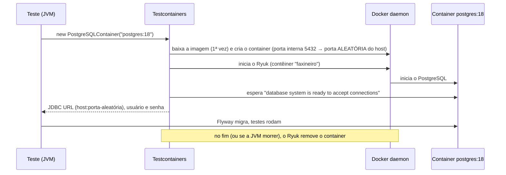

# J7.05 — Testcontainers com PostgreSQL real

> ⏱️ ~1h30 · 🟢 Júnior · Pré-requisitos: J7.04, J3.03 (Docker e PostgreSQL), J5.07 (`ResetDatabase`), decisões 5, 20 e 40

> ⚠️ **Não executado nesta geração.** Exemplos revisados por leitura contra a documentação do Spring Boot 4.1.2 e do Testcontainers, e contra o **conteúdo dos JARs** (classe `org.testcontainers.postgresql.PostgreSQLContainer` e fábricas de `@ServiceConnection`, conferidas com `javap`/listagem de arquivos, não por execução). **Este módulo mexe em todos os testes de banco**: faça a migração em um *branch* e rode a suíte inteira antes do merge.

## 🎯 Objetivos
Ao final desta aula você consegue:
1. **Explicar** o problema que o Testcontainers resolve e como ele funciona (Docker, porta aleatória, Ryuk).
2. **Subir** um PostgreSQL 18 descartável para os testes e **ligá-lo** à aplicação com `@ServiceConnection`, sem copiar URL nem senha.
3. **Migrar** os testes do `payflow_test` local para o container com uma anotação composta (`@PayflowTest`).
4. **Prever** o custo (quantos containers a suíte cria) a partir do cache de contexto da J7.04.
5. **Diagnosticar** as falhas típicas (Docker parado, imagem, contexto sem banco).

## 🤔 Por que isso importa
Até aqui, os testes de banco dependem de **um PostgreSQL que o aluno sobe à mão** (`scripts/db-up.sh`, banco `payflow_test` na porta 5432). Funciona na sua máquina e falha em todo lugar onde alguém esqueceu o passo: o colega novo, o servidor de CI (J10), a segunda cópia do projeto. E o banco é **compartilhado**: dois processos de teste ao mesmo tempo se atropelam, e a sujeira de uma execução vira o bug "só acontece na minha máquina".

O Testcontainers inverte a lógica: **o próprio teste pede ao Docker um PostgreSQL novo**, na versão exata (`postgres:18`), numa porta livre, e o destrói no fim. Quem clona o projeto só precisa de Docker. É o padrão de mercado para testar persistência com o banco de verdade (e foi decidido desde a J3: "passam a Testcontainers na J7", decisão 20).

## 💡 Intuição (explicação simples)
Em vez de reservar **um laboratório fixo** que todo mundo divide e ninguém limpa, cada teste **aluga uma bancada nova**, usa e **devolve limpa**. Se a bancada precisa de um equipamento específico (PostgreSQL 18), ela já vem com ele. O custo é alguns segundos para "montar a bancada"; o ganho é nunca mais ouvir "mas na minha máquina funciona".

## 🔬 Como funciona por dentro

### 1. O que o Testcontainers faz

Três detalhes que valem entender:
- **Porta aleatória:** nada de `5432` fixo; duas execuções simultâneas não colidem. A URL vem do objeto (`getJdbcUrl()`).
- **Espera de prontidão:** "container iniciado" não é "banco pronto". O Testcontainers espera um sinal (para o PostgreSQL, a mensagem de prontidão no log) antes de devolver o controle.
- **Ryuk:** um container auxiliar que remove os containers do teste mesmo se a JVM for morta (Ctrl+C, falha). É por isso que não sobram containers órfãos.

Versão: **Testcontainers 2.0.5**, gerenciada pelo BOM do Boot 4.1.2 (`testcontainers.version`, conferido no `spring-boot-dependencies-4.1.2.pom`). Na série 2, o módulo do PostgreSQL é o artefato `org.testcontainers:testcontainers-postgresql` e a classe é **`org.testcontainers.postgresql.PostgreSQLContainer`** (não genérica; existe uma `org.testcontainers.containers.PostgreSQLContainer` antiga no mesmo JAR: **não use** a antiga).

### 2. `@ServiceConnection`: a aplicação descobre o banco sozinha
Em vez de copiar URL, usuário e senha para propriedades, anote o container (`@Bean`) com **`@ServiceConnection`** (pacote `org.springframework.boot.testcontainers.service.connection`, módulo `spring-boot-testcontainers`). O Boot cria os **detalhes de conexão** (`JdbcConnectionDetails`) a partir do container, e eles **têm precedência sobre as propriedades** `spring.datasource.*` (a [documentação](https://docs.spring.io/spring-boot/reference/testing/testcontainers.html) diz: "the connection details take precedence over any connection-related configuration properties"). O **Flyway** também usa essa conexão (existe uma fábrica específica no módulo `spring-boot-flyway`). A alternativa antiga, `@DynamicPropertySource`, ainda existe, mas é mais verbosa.

### 3. Quem cuida do ciclo de vida do container
O guia do Boot recomenda **declarar o container como bean do Spring**: ele é criado e iniciado **antes dos outros beans** e parado **depois** de todos serem destruídos, **uma vez por contexto**. A alternativa (anotações `@Testcontainers`/`@Container` do JUnit) **encerra** o container **ao fim da classe**, e o cache de contexto da J7.04 pode manter um contexto vivo **depois** disso: o próximo teste usa um banco que já morreu. Por isso o PayFlow usa o **bean**.

Consequência (ligando à J7.04): **um container por contexto distinto**. Cada contexto novo = mais um PostgreSQL subindo. Reduzir contextos é reduzir containers.

## 🛠️ Exemplo prático
> ⚠️ **Não executado nesta geração.** Pré-requisitos do aluno: Docker em execução (`docker ps` responde); a imagem `postgres:18` é baixada na primeira execução (o `docker pull` demora uma vez).

### 1. Dependências
`pom.xml` (teste, sem `<version>`: o BOM do Boot gerencia ambas):
```xml
<dependency>
    <groupId>org.springframework.boot</groupId>
    <artifactId>spring-boot-testcontainers</artifactId>
    <scope>test</scope>
</dependency>
<dependency>
    <groupId>org.testcontainers</groupId>
    <artifactId>testcontainers-postgresql</artifactId>
    <scope>test</scope>
</dependency>
```
(O `testcontainers-junit-jupiter` só seria necessário com `@Testcontainers`/`@Container`, que **não** usamos.)

### 2. O container como bean
`src/test/java/com/payflow/support/PostgresContainerConfig.java`
```java
package com.payflow.support;

import org.springframework.boot.test.context.TestConfiguration;
import org.springframework.boot.testcontainers.service.connection.ServiceConnection;
import org.springframework.context.annotation.Bean;
import org.testcontainers.postgresql.PostgreSQLContainer;

/** O PostgreSQL dos testes: a mesma versão da produção e do Docker local (decisão 5), descartável. */
@TestConfiguration(proxyBeanMethods = false)
public class PostgresContainerConfig {

    @Bean
    @ServiceConnection                       // JdbcConnectionDetails a partir do container; o Flyway usa o mesmo
    PostgreSQLContainer postgres() {
        return new PostgreSQLContainer("postgres:18");
    }
}
```
- `postgres:18` **fixa a versão**: o `V1__create_users.sql` usa `uuidv7()`, que só existe no PostgreSQL 18 (decisão 14). Não use `latest`.
- Banco, usuário e senha são os padrões do Testcontainers (nome `test`); ninguém precisa conhecê-los, porque o `@ServiceConnection` os entrega.
- O ciclo de vida é do Spring (seção 3 acima).

### 3. Uma anotação para todos os testes de banco
Hoje cada classe repete três anotações (`@ExtendWith(ResetDatabase.class)`, `@SpringBootTest`, `@ActiveProfiles("test")`). Com o container, seriam quatro. Agrupe-as:

`src/test/java/com/payflow/support/PayflowTest.java`
```java
package com.payflow.support;

import java.lang.annotation.Documented;
import java.lang.annotation.ElementType;
import java.lang.annotation.Retention;
import java.lang.annotation.RetentionPolicy;
import java.lang.annotation.Target;
import org.junit.jupiter.api.extension.ExtendWith;
import org.springframework.boot.test.context.SpringBootTest;
import org.springframework.context.annotation.Import;
import org.springframework.core.annotation.AliasFor;
import org.springframework.test.context.ActiveProfiles;

/**
 * Teste de integração do PayFlow: contexto completo + PostgreSQL 18 em container + banco recriado a cada teste.
 * Substitui o trio @ExtendWith(ResetDatabase.class) + @SpringBootTest + @ActiveProfiles("test") (J5).
 */
@Target(ElementType.TYPE)
@Retention(RetentionPolicy.RUNTIME)
@Documented
@ExtendWith(ResetDatabase.class)                 // ANTES do @SpringBootTest (que traz a SpringExtension), como na J5.11
@SpringBootTest
@ActiveProfiles("test")
@Import(PostgresContainerConfig.class)
public @interface PayflowTest {

    @AliasFor(annotation = SpringBootTest.class, attribute = "webEnvironment")
    SpringBootTest.WebEnvironment webEnvironment() default SpringBootTest.WebEnvironment.MOCK;

    @AliasFor(annotation = SpringBootTest.class, attribute = "properties")
    String[] properties() default {};
}
```
- Uma **anotação composta** (meta-anotação) herda tudo que está sobre ela. Os dois `@AliasFor` deixam passar `webEnvironment` e `properties`, os dois parâmetros que os testes da J5/J6 usam.
- `@Import(PostgresContainerConfig.class)` funciona dentro de uma anotação composta (o Boot procura `@Import` nas meta-anotações).
- **Cuidado com a regra do cache (J7.04):** o container é um bean; contextos diferentes (propriedades, `@MockitoBean`) criam **containers diferentes**.

### 4. Aposentar o `payflow_test` local
`src/main/resources/application-test.yml` perde a URL do banco (a conexão agora vem do container):
```yaml
# Perfil de testes: a conexão com o banco vem do Testcontainers (@ServiceConnection, J7.05).
# Sem datasource aqui DE PROPÓSITO: um teste que esquecer o container falha alto em vez de usar o banco local.
spring:
  flyway:
    locations: classpath:db/migration,classpath:db/seed
    clean-disabled: false
```
O `ResetDatabase` (Flyway `clean` + `migrate`) **continua valendo**: o container é por **contexto**, e a limpeza por **teste** (decisão 40).

### 5. Migrar os testes existentes
O que muda em cada classe de teste que usa o banco (é mecânico):
```java
// ANTES (J5/J6)                                         // DEPOIS (J7.05)
@ExtendWith(ResetDatabase.class)                         @PayflowTest
@SpringBootTest                                          class TransferServiceTest { ... }
@ActiveProfiles("test")
class TransferServiceTest { ... }
// com parâmetros:  @SpringBootTest(webEnvironment = RANDOM_PORT)  →  @PayflowTest(webEnvironment = RANDOM_PORT)
```
Um *script* que faz o grosso (⚠️ **não executado**: rode **em um branch**, leia o `git diff` inteiro, e trate à mão o que sobrar):

`scripts/migrate-tests-to-testcontainers.sh`
```bash
#!/usr/bin/env bash
# Troca o trio de anotações por @PayflowTest nas classes que usam ResetDatabase. Revise com `git diff`.
set -euo pipefail
cd "$(dirname "$0")/.."

for f in $(grep -rl "ResetDatabase.class" src/test/java --include='*.java'); do
  perl -0pi -e '
    s/^\@ExtendWith\(ResetDatabase\.class\)[ \t]*\n//mg;
    s/^\@ActiveProfiles\("test"\)[ \t]*\n//mg;
    s/^\@SpringBootTest\b/\@PayflowTest/mg;
    s/^import com\.payflow\.support\.ResetDatabase;\n/import com.payflow.support.PayflowTest;\n/m;
  ' "$f"
done

echo "Arquivos que ainda citam ResetDatabase (exceto a extensão e a anotação): precisam de ajuste manual:"
grep -rln "ResetDatabase" src/test/java | grep -v "/support/" || echo "(nenhum)"
```
Depois do script, no IntelliJ: **Optimize imports** na pasta `src/test` (remove `ExtendWith`, `ActiveProfiles` e `SpringBootTest` que ficaram sem uso, e **mantém** `SpringBootTest` onde `webEnvironment = SpringBootTest.WebEnvironment...` ainda o referencia). Os testes `@DataJpaTest` (J7.04) **não** usam o `@PayflowTest`: acrescente a eles uma linha `@Import(PostgresContainerConfig.class)`.

### 6. Um teste que prova que é o container
`src/test/java/com/payflow/support/PostgresContainerTest.java`
```java
package com.payflow.support;

import static org.assertj.core.api.Assertions.assertThat;

import org.flywaydb.core.Flyway;
import org.junit.jupiter.api.Test;
import org.springframework.beans.factory.annotation.Autowired;
import org.springframework.jdbc.core.JdbcTemplate;

/** Garante que a suíte fala com o PostgreSQL 18 do container, e não com um banco local qualquer. */
@PayflowTest
class PostgresContainerTest {

    @Autowired JdbcTemplate jdbc;
    @Autowired Flyway flyway;

    @Test
    void runsAgainstPostgres18() {
        String version = jdbc.queryForObject("select version()", String.class);
        assertThat(version).startsWith("PostgreSQL 18");
    }

    @Test
    void usesTheContainerDatabaseNotTheLocalOne() {
        String database = jdbc.queryForObject("select current_database()", String.class);
        assertThat(database).isEqualTo("test").isNotEqualTo("payflow_test");   // "test" é o padrão do Testcontainers
    }

    @Test
    void allMigrationsAreApplied() {
        assertThat(flyway.info().pending()).isEmpty();
        assertThat(flyway.info().applied()).isNotEmpty();
    }
}
```
Rodar (Docker precisa estar no ar; **pode parar o `payflow-pg` local**: os testes não dependem mais dele):
```bash
export JAVA_HOME=/usr/lib/jvm/java-25-openjdk-amd64
mvn test -Dtest=PostgresContainerTest
```
Saída **esperada** (resumo): na primeira vez, o Docker baixa `postgres:18`; nos logs aparecem linhas do Testcontainers (a imagem `postgres:18`, o container do Ryuk, a espera de prontidão) e depois
```text
[INFO] Tests run: 3, Failures: 0, Errors: 0, Skipped: 0
[INFO] BUILD SUCCESS
```
Com `docker ps` **durante** o teste (em outro terminal) você deve ver um `postgres:18` em uma porta alta aleatória e um container `testcontainers/ryuk`; **depois** do teste, nenhum dos dois.

## 🧠 Pausa para lógica
**Enunciado:** a suíte do PayFlow, depois da migração, tem **4 contextos distintos** (J7.04). Duas classes usam `@DirtiesContext` (cada uma **fecha** o contexto ao terminar). Quantos containers o `mvn test` cria? Calcule também o tempo de *startup* extra se subir um PostgreSQL leva `s` segundos, e diga quando valeria a pena trocar o "container por contexto" por **um container compartilhado para a JVM inteira**.

<details><summary>Dica</summary>Container por contexto: cada <code>ApplicationContext</code> criado inicia um container. <code>@DirtiesContext</code> faz o Spring <b>descartar</b> o contexto (e parar o container) e <b>recriar</b> outro quando a próxima classe precisar.</details>
<details><summary>Solução</summary>

Cada contexto criado = 1 container: 4 contextos = 4 containers. Cada `@DirtiesContext` faz o contexto ser **recriado** quando a próxima classe com a mesma configuração rodar: 2 usos = até **+2** contextos, logo até **6 containers**. Custo extra de *startup* ≈ **6 × s** segundos (em vez de 1 × s). Compartilhar **um** container para a JVM (o padrão "container singleton" da [documentação do Testcontainers](https://java.testcontainers.org/test_framework_integration/manual_lifecycle_control/): iniciar em um bloco `static` e deixar o **Ryuk** encerrá-lo ao fim) compensa quando `contextos × s` já incomoda; o preço é abrir mão de o Spring controlar o ciclo de vida (o container sobreviverá aos contextos, e quem fecha um contexto não pode encerrá-lo). A **primeira** medida, porém, é reduzir contextos (J7.04): é de graça.
</details>

**Variação mais difícil:** por que o `Flyway clean` do `ResetDatabase` **não** substitui o container (por que ainda queremos um banco novo por contexto, e não só limpar o mesmo)? Pense em versão do PostgreSQL, extensões e estado fora do esquema (roles, configuração).

## ⚖️ Trade-offs e quando NÃO usar
- **Custo de startup e dependência de Docker.** Cada contêiner novo leva segundos; o CI precisa de Docker (J10). O ganho é a fidelidade e o isolamento. Para regras de domínio e de service (J7.01/J7.02), **não** use banco: teste de unidade.
- **Teste verde com H2 não prova o PostgreSQL.** O PayFlow usa `uuidv7()`, `NUMERIC(19,2)`, `ON CONFLICT`, índices de expressão: nada disso é fiel no H2. É a razão de a decisão 5 proibir H2.
- **Não teste o Docker nem o PostgreSQL.** Um teste do tipo "o container sobe" (como `PostgresContainerTest`) vale **uma vez** como alarme de configuração; não multiplique.
- **Containers e paralelismo:** executar classes de teste em paralelo exige um banco por thread ou isolamento por esquema; o PayFlow roda em série (o `ResetDatabase` limpa o banco inteiro).

## ⚠️ Erros comuns e boas práticas de produção
- `java.lang.IllegalStateException: Could not find a valid Docker environment. Please see logs and check configuration` → ⚠️ mensagem típica quando o Docker não está rodando ou o usuário não tem permissão no socket. Teste `docker ps` no mesmo terminal. No Linux, o usuário precisa estar no grupo `docker` (J3.03).
- **Primeira execução "travada":** o `docker pull` da imagem pode demorar (rede). Rode `docker pull postgres:18` antes.
- `Failed to determine a suitable driver class` / `Failed to configure a DataSource: 'url' attribute is not specified` num teste de integração → a classe **não** foi migrada (falta `@PayflowTest` ou o `@Import` do container) e o `application-test.yml` já não tem o datasource: é o **comportamento desejado** (falhar alto).
- `ERROR: function uuidv7() does not exist` → a imagem do container não é a 18: confira `new PostgreSQLContainer("postgres:18")`.
- **Erro de versão da API do Docker** (algo como "client version ... is too old"): ⚠️ não verificado aqui; atualize o Testcontainers para a versão mais recente da série 2 e confira as notas de release no GitHub do projeto.
- **Container que ficou órfão** (execução interrompida de forma brusca): `docker ps -a`; o Ryuk costuma limpar, mas `docker rm -f <id>` resolve.
- **Segredos:** o usuário/senha do Testcontainers são descartáveis; **nunca** copie para o container de teste uma senha real de produção.
- **`latest` na imagem:** teste que passa hoje e quebra amanhã quando a imagem muda. Fixe a versão.

## 🧩 Exercícios
1. **Fixação.** (a) Por que o Testcontainers usa porta aleatória? (b) O que o Ryuk faz? (c) Qual a vantagem de declarar o container como **bean** em vez de `@Container`? (d) O que `@ServiceConnection` substitui?
2. **Aplicação no PayFlow.**
   - [ ] `spring-boot-testcontainers` e `testcontainers-postgresql` no `pom.xml`; `PostgresContainerConfig`, `PayflowTest` e `PostgresContainerTest` criados em `src/test/java/com/payflow/support/`.
   - [ ] `application-test.yml` sem `spring.datasource`; o container **local** `payflow-pg` **parado** (`docker stop payflow-pg`) e a suíte inteira verde (`mvn test`).
   - [ ] Todas as classes que usavam `ResetDatabase` migradas para `@PayflowTest`; `RepositoriesJpaTest` com `@Import(PostgresContainerConfig.class)`; `mvn test` sem `Failed to configure a DataSource`.
   - [ ] Você viu o container aparecer e sumir com `docker ps` durante um teste.
   - [ ] Em `docs/testing-notes.md`: quantos containers a suíte cria (contagem pelos logs do Testcontainers) e uma decisão: manter "container por contexto" ou adotar o singleton.
3. **Desafio (opcional).** Faça o `@DataJpaTest` ficar **sem** `@Import` repetido: crie uma anotação composta `@PayflowJpaTest` (as quatro anotações de `RepositoriesJpaTest`). Quais atributos de `@DataJpaTest` valeria expor com `@AliasFor`?

<details><summary>Soluções de referência (esboço, não executado)</summary>

1. (a) Evita colisão (duas execuções, outro serviço usando a 5432) e deixa a URL ser descoberta pelo objeto. (b) Remove containers do teste ao fim ou se a JVM morrer. (c) O Spring cria e encerra o container junto do contexto (antes/depois dos beans que o usam), mesmo com o cache de contexto reaproveitando-o entre classes; com `@Container` o container é encerrado ao fim da classe e o contexto cacheado fica com uma conexão morta. (d) As propriedades `spring.datasource.url/username/password` (e a duplicação delas no Flyway).
2. Para contar os containers: `mvn test 2>&1 | grep -c "Container postgres:18 started"` (⚠️ o texto exato do log pode variar; confira uma execução e ajuste o padrão).
3. `@PayflowJpaTest = @ExtendWith(ResetDatabase.class) @DataJpaTest @AutoConfigureTestDatabase(replace = NONE) @ActiveProfiles("test") @Import(PostgresContainerConfig.class)`. Valeria expor `properties` (pelo mesmo motivo do `@PayflowTest`) e, no máximo, `showSql`.
</details>

## 🎤 Na entrevista
1. **Por que usar Testcontainers em vez de H2 para testes de integração?**
   *Resposta-modelo:* H2 simula o banco, mas tem dialeto, tipos e comportamentos próprios; um teste verde no H2 pode falhar no PostgreSQL de produção. Com Testcontainers eu testo contra **o mesmo banco e a mesma versão**, em um container descartável, sem exigir instalação na máquina nem no CI (só Docker).
2. **Como você liga a aplicação ao container no Spring Boot?**
   *Resposta-modelo:* declaro o container como `@Bean` anotado com `@ServiceConnection`; o Boot cria os detalhes de conexão a partir dele e eles têm precedência sobre as propriedades. Antes disso, usava `@DynamicPropertySource` para copiar URL/usuário/senha.
3. **Qual o custo e como você o controla?**
   *Resposta-modelo:* subir um container leva segundos e o Spring cria um por contexto. Controlo reduzindo contextos distintos (propriedades e `@MockitoBean` padronizados), evitando `@DirtiesContext` e, se necessário, usando um container compartilhado para a JVM. Para o que não precisa de banco, uso teste de unidade.

## 📚 Para ir além
- 📄 **Spring Boot — Testcontainers:** https://docs.spring.io/spring-boot/reference/testing/testcontainers.html — beans, `@ServiceConnection`, ciclo de vida dos containers e o que cada fábrica de conexão suporta.
- 📄 **Testcontainers para Java — site oficial:** https://java.testcontainers.org/ — módulos de banco, requisitos de Docker e configuração.
- 📄 **Testcontainers — controle manual do ciclo de vida (container singleton):** https://java.testcontainers.org/test_framework_integration/manual_lifecycle_control/ — o padrão de um container por JVM.
- 📄 **Testcontainers — guia "Getting started" (Java):** https://testcontainers.com/guides/getting-started-with-testcontainers-for-java/ — o primeiro teste passo a passo.
- 🎥 Vídeo: ⚠️ nenhum vídeo verificado.

## ✅ Checklist da aula
- [ ] Docker no ar; imagem `postgres:18` baixada.
- [ ] `PostgresContainerConfig`, `PayflowTest` e `PostgresContainerTest` criados; `application-test.yml` sem datasource.
- [ ] Todos os testes de banco migrados; o container local parado e a suíte ainda verde.
- [ ] Sei quantos contêineres a suíte cria e por quê.
- [ ] Sei ler o erro "Could not find a valid Docker environment" e o "Failed to configure a DataSource".
