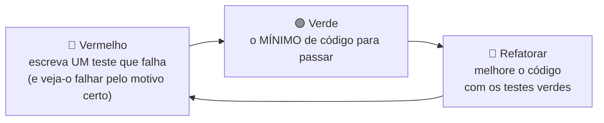

# J7.06 — Cobertura com JaCoCo e introdução a TDD

> ⏱️ ~1h30 · 🟢 Júnior · Pré-requisitos: J7.01–J7.05, J0.02 (ciclo de vida do Maven)

> ✅ **Validação final (2026-11-24):** este módulo foi executado no PayFlow reconstruído; o resultado e o que continua não executado estão no [README do módulo](README.md). Os avisos "não executado" / "por leitura" abaixo descrevem a escrita original.

> ⚠️ **Não executado nesta geração**, com **uma exceção**: a lógica pura de `Masking` (Java sem dependências) e o *script* `coverage-summary.sh` foram exercitados em um diretório temporário (veja "Estado de verificação" no fim). A configuração do JaCoCo no `pom.xml` e os testes JUnit foram **revisados por leitura** contra a documentação oficial; a bateria prática fica para o fim do treinamento.

## 🎯 Objetivos
Ao final desta aula você consegue:
1. **Configurar** o JaCoCo no Maven (agente, relatório e *quality gate*) e **ler** o relatório HTML.
2. **Distinguir** cobertura de linhas, de *branches* e de complexidade, e dizer o que cada número **não** garante.
3. **Escolher** um piso de cobertura com base em uma **medição**, não em um número mágico.
4. **Praticar** o ciclo TDD (vermelho, verde, refatorar) em uma regra pequena do PayFlow.
5. **Explicar** quando TDD ajuda e quando é só ritual.

## 🤔 Por que isso importa
Depois de 130 testes antigos e dezenas novos, a pergunta natural é: **o que ainda não está testado?** O JaCoCo responde com fatos (quais linhas e quais decisões **nenhum teste executou**), e isso orienta onde escrever o próximo teste. Mas cobertura é uma **ferramenta de busca de buracos**, não um atestado de qualidade: 100% de cobertura com testes sem `assertThat` não protege nada. Saber ler o relatório (e saber desconfiar dele) é o que um time espera de quem escreve testes.

TDD, por sua vez, é o hábito de escrever o teste **antes** do código. Para o júnior, o ganho concreto é projetar a API pelo uso, ter prova de que o teste **falha** quando deveria e ganhar coragem para refatorar.

## 💡 Intuição (explicação simples)
Cobertura é um **mapa de calor das pegadas** em uma casa: ele mostra por onde os testes **passaram** e quais cômodos **ninguém visitou**. Cômodo visitado não significa cômodo inspecionado (alguém pode ter passado correndo sem olhar nada). TDD é **desenhar a planta com um exemplo de uso antes de construir a parede**: você descobre cedo que a porta ficou no lugar errado.

## 🔬 Como funciona por dentro

### 1. Como o JaCoCo mede
O JaCoCo ([documentação](https://www.jacoco.org/jacoco/trunk/doc/)) injeta um **agente Java** na JVM dos testes, que **registra quais trechos do *bytecode* executaram** e grava em `target/jacoco.exec`. Depois, o goal `report` cruza esse arquivo com as classes compiladas e gera o HTML. Não altera o seu código-fonte.

Os contadores ([documentação](https://www.jacoco.org/jacoco/trunk/doc/counters.html)):

| Contador | Mede | Cuidado |
|---|---|---|
| **Instruções** | instruções de *bytecode* executadas | a base de todos os outros |
| **Linhas** | linhas com ao menos uma instrução executada | uma linha com `? :` é "coberta" mesmo com um dos lados nunca testado |
| **Branches** | desvios de cada `if`, `?:`, `switch`, `&&`, `||` | o que revela a decisão não testada |
| **Complexidade** | caminhos independentes (McCabe) | quantos testes, no mínimo, para cobrir o método |
| **Métodos / classes** | executados ao menos uma vez | grosso demais |

No relatório HTML, uma linha **verde** foi totalmente coberta, **amarela** parcialmente (um desvio nunca tomado) e **vermelha** nunca executada. As linhas **amarelas** são as mais úteis: mostram a decisão que o seu teste não exercita.

### 2. Compatibilidade com o JDK 25
O JaCoCo **0.8.14** passou a suportar oficialmente o Java 25, e a **0.8.16** (24/10/2026) suporta até o Java 27 (conferido na [página de mudanças](https://www.jacoco.org/jacoco/trunk/doc/changes.html)). O PayFlow usa a 0.8.16.

### 3. O que a cobertura **não** diz
- **Cobertura não é qualidade:** executar a linha não é verificar o resultado. Um teste sem asserção "cobre" o código e não protege nada. Quem conta as **asserções que importam** é o teste, ou a *mutation testing* (ferramentas como o [PIT](https://pitest.org/) alteram o código e veem se algum teste falha), **fora do escopo do curso**.
- **Uma meta alta vira o alvo (Lei de Goodhart):** "80% ou o *build* quebra" produz testes escritos para subir o número. Use o piso para **não deixar a cobertura cair**, não como objetivo.
- **O que excluir:** classe `main`, código **gerado** (o `ApiMapperImpl` do MapStruct), configuração trivial. Excluir **à vista e justificado**, nunca para "limpar" o número.

### 4. TDD: vermelho, verde, refatorar

Regras do ciclo: **(1)** só escreva código de produção para fazer um teste que falha passar; **(2)** escreva **só o teste suficiente para falhar** (inclusive "não compila" conta como falha); **(3)** escreva **só o código suficiente para passar**. Duas técnicas clássicas: **"fake it"** (devolver a constante do teste e deixar o **segundo** exemplo forçar a generalização, a *triangulação*) e **refatorar só no verde**. Visão de [Martin Fowler sobre TDD](https://martinfowler.com/bliki/TestDrivenDevelopment.html).

TDD **não** é obrigatório e **não** serve para tudo: brilha em regras com entradas e saídas bem definidas (cálculo, validação, formatação), e atrapalha em exploração (você ainda não sabe o que quer) e em código de integração com muita configuração. A pergunta honesta é: "eu consigo escrever o exemplo de uso agora?" Se sim, escreva-o primeiro.

## 🛠️ Exemplo prático
> ⚠️ **Não executado nesta geração** (exceto a lógica pura de `Masking`, ver o fim da aula). Valores de cobertura **não** são mostrados porque dependem da sua suíte: você vai **medir** o seu.

### 1. Configurar o JaCoCo
`pom.xml`: a propriedade `argLine` (que o JaCoCo preenche e o Surefire consome com `@{argLine}`, J7.02) e o plugin:
```xml
<properties>
    <!-- argLine vazio: o JaCoCo acrescenta o agente dele; o Surefire (J7.02) lê com @{argLine}. -->
    <argLine></argLine>
</properties>

<build>
  <plugins>
    <plugin>
      <groupId>org.jacoco</groupId>
      <artifactId>jacoco-maven-plugin</artifactId>
      <version>0.8.16</version>
      <executions>
        <execution>
          <id>prepare-agent</id>
          <goals><goal>prepare-agent</goal></goals>        <!-- fase initialize: põe o agente em ${argLine} -->
        </execution>
        <execution>
          <id>report</id>
          <phase>verify</phase>
          <goals><goal>report</goal></goals>
          <configuration>
            <excludes>
              <exclude>com/payflow/PayflowApplication.class</exclude>
              <exclude>**/*MapperImpl.class</exclude>        <!-- código gerado pelo MapStruct (J6.02) -->
            </excludes>
          </configuration>
        </execution>
        <execution>
          <id>check</id>
          <phase>verify</phase>
          <goals><goal>check</goal></goals>
          <configuration>
            <excludes>
              <exclude>com/payflow/PayflowApplication.class</exclude>
              <exclude>**/*MapperImpl.class</exclude>
            </excludes>
            <rules>
              <rule>
                <element>BUNDLE</element>
                <limits>
                  <limit>
                    <counter>LINE</counter>
                    <value>COVEREDRATIO</value>
                    <minimum>0.70</minimum>               <!-- PONTO DE PARTIDA: veja "Escolher o piso" abaixo -->
                  </limit>
                </limits>
              </rule>
            </rules>
          </configuration>
        </execution>
      </executions>
    </plugin>
  </plugins>
</build>
```
Notas: o `<version>` aqui é **obrigatório** (o JaCoCo **não** é gerenciado pelo Boot 4.1.2, conferido no `spring-boot-starter-parent` e no `spring-boot-dependencies`; versão conferida no Maven Central: 0.8.16). `prepare-agent` roda cedo e define `argLine`; `report` e `check` rodam em `verify`, depois dos testes. As `excludes` do `report`/`check` são **padrões de arquivos `.class`** (relativos a `target/classes`). A propriedade `argLine` é o ponto de encontro entre o JaCoCo e o agente do Mockito (J7.02): os dois escrevem nela, e o Surefire lê o resultado com `@{argLine}`.

### 2. Gerar, ler e resumir
```bash
export JAVA_HOME=/usr/lib/jvm/java-25-openjdk-amd64
mvn verify                       # roda os testes (com o agente) e depois report + check
```
- Relatório HTML: `target/site/jacoco/index.html` (abra no navegador; navegue pacote → classe → linhas coloridas).
- Dados tabulares: `target/site/jacoco/jacoco.csv` (e `jacoco.xml`).
- Se o piso não for atingido, o `check` falha o *build* com uma mensagem do tipo (⚠️ formato típico, texto exato a conferir): `Rule violated for bundle payflow: lines covered ratio is 0.65, but expected minimum is 0.70`.

Um resumo no terminal, para o dia a dia (`scripts/coverage-summary.sh`; usa as colunas documentadas do CSV do JaCoCo: `GROUP,PACKAGE,CLASS,INSTRUCTION_MISSED,INSTRUCTION_COVERED,BRANCH_MISSED,BRANCH_COVERED,LINE_MISSED,LINE_COVERED,...`):
```bash
#!/usr/bin/env bash
# Resume o jacoco.csv: linhas e branches por pacote e as 5 classes com mais linhas NÃO cobertas.
set -euo pipefail
csv="${1:-target/site/jacoco/jacoco.csv}"

awk -F, 'NR > 1 { lm[$2] += $8; lc[$2] += $9; bm[$2] += $6; bc[$2] += $7 }
END {
  for (p in lm) {
    lt = lm[p] + lc[p]; bt = bm[p] + bc[p]
    printf "%-34s linhas %5.1f%% (%d/%d)  branches %5.1f%% (%d/%d)\n", p, lt ? 100 * lc[p] / lt : 0, lc[p], lt, bt ? 100 * bc[p] / bt : 0, bc[p], bt
  }
}' "$csv" | sort

echo "--- 5 classes com mais linhas NÃO cobertas ---"
awk -F, 'NR > 1 && $8 > 0 { printf "%5d  %s.%s\n", $8, $2, $3 }' "$csv" | sort -rn | head -5
```

### 3. Escolher o piso (com dados, não com palpite)
1. Rode `mvn verify` **sem** o `check` (ou com `<minimum>0.00</minimum>`), e anote o número de **linhas** e de **branches** do `BUNDLE`.
2. Defina o piso **dois a três pontos percentuais abaixo** do medido, para absorver oscilações e **não** deixar a cobertura cair.
3. Registre o número medido, a data e o piso em `docs/testing-notes.md`. **Suba o piso** quando a cobertura subir por mérito (testes novos), nunca por exclusão de código difícil.
4. Olhe os **branches** (amarelos) das classes com regra (`Account`, `TransferService`, `ApiErrors`) antes de olhar as linhas vermelhas de configuração.

O valor `0.70` do `pom.xml` acima é **só um ponto de partida** de exemplo: **não** foi medido no PayFlow.

### 4. TDD na prática: mascarar e-mails para log
A decisão 38 (J5.14) proíbe dado pessoal em log. Uma peça pequena e útil, ideal para TDD: mascarar um e-mail (`ana@payflow.dev` → `a**@payflow.dev`). Siga o ciclo; **faça cada passo no seu editor** antes de ler o próximo.

**Ciclo 1 🔴 (nem compila).** `src/test/java/com/payflow/web/MaskingTest.java`:
```java
package com.payflow.web;

import static org.assertj.core.api.Assertions.assertThat;

import org.junit.jupiter.api.Test;

class MaskingTest {

    @Test
    void masksTheLocalPartKeepingTheFirstLetter() {
        assertThat(Masking.email("ana@payflow.dev")).isEqualTo("a**@payflow.dev");
    }
}
```
Rode: **falha de compilação** (`cannot find symbol: class Masking`). É o vermelho: o teste definiu a **API** (`Masking.email(String)`) antes da implementação. No IntelliJ, `Alt+Enter` sobre `Masking` oferece criar a classe.

**Ciclo 1 🟢 ("fake it").** O **mínimo** para passar:
```java
package com.payflow.web;

public final class Masking {

    private Masking() {
    }

    public static String email(String email) {
        return "a**@payflow.dev";            // de propósito: o único exemplo ainda não obriga a generalizar
    }
}
```
Verde. Parece trapaça, e é uma técnica: o código só vai ficar "de verdade" quando um **segundo exemplo** exigir.

**Ciclo 2 🔴 (triangulação).** Troque o teste por um parametrizado com três exemplos:
```java
@ParameterizedTest
@CsvSource({
    "ana@payflow.dev,           a**@payflow.dev",
    "bruno@payflow.dev,         b****@payflow.dev",
    "x.y+tag@mail.example.org,  x******@mail.example.org"
})
void masksTheLocalPartKeepingTheFirstLetterAndTheDomain(String email, String expected) {
    assertThat(Masking.email(email)).isEqualTo(expected);
}
```
(Imports: `org.junit.jupiter.params.ParameterizedTest` e `org.junit.jupiter.params.provider.CsvSource`.) Os dois últimos exemplos **falham**: a constante não serve mais.

**Ciclo 2 🟢.** Agora generalize:
```java
public static String email(String email) {
    int at = email.indexOf('@');
    return email.charAt(0) + "*".repeat(at - 1) + email.substring(at);
}
```
Verde nos três. (Ainda quebra com entrada ruim: é o próximo ciclo.)

**Ciclo 3 🔴🟢 (uma decisão de design).** Parte local de **1 caractere** não pode revelar a letra: `a@x.com` → `*@x.com`. Teste:
```java
@Test
void hidesAOneLetterLocalPartCompletely() {
    assertThat(Masking.email("a@x.com")).isEqualTo("*@x.com");
}
```
Falha (a implementação devolve `a@x.com`). Verde: `if (at == 1) { return "*" + email.substring(at); }` antes do `return` anterior.

**Ciclo 4 🔴🟢 (entradas inválidas).**
```java
@ParameterizedTest
@NullAndEmptySource
@ValueSource(strings = {" ", "no-at-sign", "@payflow.dev"})
void rejectsAnythingThatIsNotAnEmailAddress(String input) {
    assertThatThrownBy(() -> Masking.email(input)).isInstanceOf(IllegalArgumentException.class);
}

@Test
void theErrorMessageNeverEchoesTheInput() {            // a mensagem pode ir para o log: não pode conter o valor
    assertThatThrownBy(() -> Masking.email("secret-without-at"))
            .hasMessageNotContaining("secret");
}
```
(Imports: `NullAndEmptySource`, `ValueSource`, `assertThatThrownBy`.) Falham (`NullPointerException`, `StringIndexOutOfBounds`...). Verde:
```java
if (email == null || email.isBlank()) {
    throw new IllegalArgumentException("email must not be blank");
}
int at = email.indexOf('@');
if (at < 1) {
    throw new IllegalArgumentException("not an email address");    // sem eco do valor (decisão 38)
}
```

**🔵 Refatorar (com tudo verde).** A versão final, com a constante extraída e um comentário que explica o **porquê**:

`src/main/java/com/payflow/web/Masking.java`
```java
package com.payflow.web;

/** Mascara dados pessoais para log e mensagens (decisão 38: nenhum dado pessoal em log). */
public final class Masking {

    private static final String MASK = "*";

    private Masking() {
    }

    /**
     * "ana@payflow.dev" vira "a**@payflow.dev". Uma parte local de um caractere é mascarada por inteiro
     * ("a@x.com" vira "*@x.com"), porque mostrar a única letra revelaria o dado inteiro.
     * As mensagens de erro NÃO repetem o valor recebido: elas podem acabar em um log.
     */
    public static String email(String email) {
        if (email == null || email.isBlank()) {
            throw new IllegalArgumentException("email must not be blank");
        }
        int at = email.indexOf('@');
        if (at < 1) {
            throw new IllegalArgumentException("not an email address");
        }
        String domain = email.substring(at);
        if (at == 1) {
            return MASK + domain;
        }
        return email.charAt(0) + MASK.repeat(at - 1) + domain;
    }
}
```
A suíte final, `MaskingTest`, tem **4 métodos** (10 execuções: 3 + 1 + 5 + 1). Rodar: `mvn test -Dtest=MaskingTest`; saída **esperada**: `Tests run: 10, Failures: 0`.

O que o ciclo mostrou: o teste **projetou** a API (`Masking.email`), a triangulação **forçou** a generalização, uma decisão de design (parte de 1 letra) apareceu como **teste**, e o refactor foi seguro porque havia testes verdes. Também: veja os **branches** de `Masking` no relatório do JaCoCo (cada `if` com os dois lados exercitados): é o caso raro em que o resultado é 100% **e** significativo.

## 🧠 Pausa para lógica
**Enunciado:** observe o método e o único teste.
```java
static String label(BigDecimal balance) {
    return balance.signum() < 0 ? "OVERDRAWN" : "OK";
}

@Test
void positiveBalanceIsOk() { assertThat(label(new BigDecimal("10.00"))).isEqualTo("OK"); }
```
(a) Qual a cobertura de **linhas** do método? (b) E de **branches**? (c) Quantos testes, no mínimo, para 100% de *branches*? (d) E para `if (a && b)`: quantos *branches* o JaCoCo conta e qual o número mínimo de testes para cobrir todos?

<details><summary>Dica</summary>O operador `? :` e o `&&` geram <b>saltos</b> no <i>bytecode</i>; cada salto tem dois lados (tomado/não tomado). A linha executa inteira mesmo tomando um lado só.</details>
<details><summary>Solução</summary>

(a) **100%**: a única linha foi executada. (b) **50%**: o JaCoCo conta **2 branches** (`signum() < 0` verdadeiro/falso) e só o falso foi tomado; no HTML a linha aparece **amarela**. (c) **2** testes (um saldo negativo, um não negativo). (d) `a && b` gera **dois** saltos condicionais (um para `a`, um para `b`) = **4 branches**; o mínimo é **3** testes: `a=false`; `a=true, b=false`; `a=true, b=true` (o lado "`a` verdadeiro" é coberto pelos dois últimos, e o "`b` falso/verdadeiro" cada um por um). Este é o mesmo número da **complexidade ciclomática** (3), que é o que o contador de complexidade mostra: o mínimo de testes para exercitar todos os caminhos independentes.
</details>

**Variação mais difícil:** no `Masking.email`, existe uma entrada com `@` duplicado (`a@b@c`). Qual é o resultado atual (a lógica pura foi executada: `*@b@c`, porque o primeiro `@` está na posição 1)? Escreva **primeiro** o teste que fixa o comportamento que você **quer** (rejeitar? mascarar só a parte antes do primeiro `@`?) e depois ajuste o código. Que decisão você tomou e por quê?

## ⚖️ Trade-offs e quando NÃO usar
- **Meta de cobertura como alvo.** Quando vira meta de gestão, os times escrevem testes sem asserção. Prefira "a cobertura **não pode cair**" e revisão humana dos *branches* críticos.
- **Cobertura de integração infla o número:** um `@SpringBootTest` que passa por tudo "cobre" muita linha sem verificar quase nada. Olhe também a cobertura por **tipo de teste** (J7.01) quando for decidir onde falta teste de unidade.
- **TDD estrito em tudo** custa mais do que entrega: em código de configuração e integração, escreva o teste **depois** (ou só o de integração). Em regras de domínio, TDD costuma valer.
- **Código gerado e `main`** devem ser excluídos **explicitamente** (e registrados), não ignorados em silêncio.

## ⚠️ Erros comuns e boas práticas de produção
- **`argLine` não aplicado:** o relatório sai **vazio** (0%) porque o Surefire ignorou o agente. Sintoma: `Skipping JaCoCo execution due to missing execution data file`. Confira a propriedade `<argLine></argLine>` e o `@{argLine}` do Surefire (J7.02): o `@` (e não `$`) é o que lê o valor **na hora da execução**.
- **Agentes em conflito:** `-javaagent` duplicado ou `argLine` sobrescrito (por exemplo, `<argLine>-Xmx512m</argLine>` no Surefire **sem** `@{argLine}`) desliga o JaCoCo: sempre inclua `@{argLine}` no início.
- **Cobertura do código gerado derruba o número:** exclua o `ApiMapperImpl` (e documente).
- **Medir só `mvn test`:** o `report`/`check` rodam em `verify`; `mvn test` não gera relatório.
- **Piso copiado de blog:** "80%" sem relação com o seu código. Meça primeiro.
- **TDD sem ver o vermelho:** se o teste novo **passa de primeira**, ele não testa nada novo (ou o código já existia). Veja-o falhar **pelo motivo certo** (a mensagem da asserção, não um erro de compilação ou NPE).
- **Comentar teste vermelho "para depois":** o vermelho é o ponto de partida do ciclo; commit com teste quebrado quebra o CI (J10).

## 🧩 Exercícios
1. **Fixação.** (a) Diferença entre cobertura de linhas e de *branches*. (b) Por que 100% de cobertura não prova ausência de bugs? (c) O que é "fake it" no TDD e por que existe? (d) Quando você **não** usaria TDD?
2. **Aplicação no PayFlow.**
   - [ ] JaCoCo 0.8.16 no `pom.xml`; `mvn verify` gera `target/site/jacoco/index.html`; `scripts/coverage-summary.sh` criado com `chmod +x`.
   - [ ] **Medição registrada** em `docs/testing-notes.md`: linhas e *branches* do `BUNDLE`, data, e o **piso** escolhido (2 a 3 pontos abaixo do medido, não o `0.70` do exemplo).
   - [ ] `Masking` e `MaskingTest` criados **pelo ciclo TDD** (você viu o vermelho em cada passo; anote os 4 vermelhos).
   - [ ] Você abriu uma classe com **linhas amarelas** (por exemplo `ApiErrors` ou `TransferService`), escreveu **um** teste que cobre um *branch* faltando e viu a linha ficar verde.
   - [ ] `ApiMapperImpl` e `PayflowApplication` excluídos, com a justificativa em `docs/testing-notes.md`.
3. **Desafio (opcional).** Faça o `check` também falhar se a cobertura de **branches** do pacote `com.payflow.domain` (regras de negócio) cair abaixo de um piso que **você mediu**: crie uma segunda `rule` com `<element>PACKAGE</element>` e `<includes>`. Consulte a [documentação do goal `check`](https://www.jacoco.org/jacoco/trunk/doc/check-mojo.html) para as chaves exatas.

<details><summary>Soluções de referência (esboço, não executado)</summary>

1. (a) Linha: executou ao menos uma instrução da linha; *branch*: cada lado de cada decisão (`if`, `?:`, `&&`...); uma linha pode estar 100% "coberta" com 50% dos desvios. (b) Cobertura mede **execução**, não **verificação**: um teste sem asserção executa o código e não falha nunca; também não cobre entradas e combinações não testadas. (c) Devolver a constante do teste para passar; existe para fazer o **próximo exemplo** (triangulação) forçar a generalização em vez de você supor o algoritmo. (d) Exploração/protótipo, código de configuração/integração pesado e UI; ali um teste de integração escrito depois tem mais retorno.
2. Para o `ApiErrors`, procure os *branches* amarelos nos `if`/`switch` das exceções de domínio e escreva um teste de fatia (J7.03) para o que falta. Para `TransferService`, use os testes de unidade da J7.02.
3. Esboço: `<rule><element>PACKAGE</element><includes><include>com.payflow.domain</include></includes><limits><limit><counter>BRANCH</counter><value>COVEREDRATIO</value><minimum>X</minimum></limit></limits></rule>` com X medido por você. ⚠️ Confira nomes e sintaxe na documentação antes de usar.
</details>

## 🎤 Na entrevista
1. **O que a cobertura de código mede e o que ela não mede?**
   *Resposta-modelo:* mede quais linhas/decisões foram **executadas** pelos testes, não se o resultado foi **verificado**. Serve para achar código não testado; não atesta qualidade. Linhas amarelas (branches não tomados) são mais úteis que o percentual global.
2. **Qual cobertura mínima você exigiria no CI?**
   *Resposta-modelo:* nenhum número mágico: medir a atual e travar "não pode cair" (um piso levemente abaixo do medido), com exclusões documentadas (código gerado, `main`), e revisar *branches* de regra de negócio. Meta alta como objetivo estimula teste sem asserção.
3. **O que é TDD e quando você usa?**
   *Resposta-modelo:* ciclo vermelho (teste que falha), verde (mínimo para passar), refatorar. Uso em regras bem definidas (cálculo, validação, formatação) porque projeta a API pelo uso e dá segurança para refatorar; não uso em exploração nem em configuração/integração pesada.

## 📚 Para ir além
- 📄 **JaCoCo — documentação oficial:** https://www.jacoco.org/jacoco/trunk/doc/ — visão geral, uso com Maven e relatórios.
- 📄 **JaCoCo — goal `check` (regras de cobertura):** https://www.jacoco.org/jacoco/trunk/doc/check-mojo.html — `element`, `counter`, `value`, `minimum`.
- 📄 **JaCoCo — contadores (linhas, branches, complexidade):** https://www.jacoco.org/jacoco/trunk/doc/counters.html — exatamente como cada número é calculado.
- 📑 **Martin Fowler — Test Coverage:** https://martinfowler.com/bliki/TestCoverage.html — por que cobertura é ferramenta de busca, não de garantia.
- 📑 **Martin Fowler — Test Driven Development:** https://martinfowler.com/bliki/TestDrivenDevelopment.html — o ciclo em uma página.
- 📄 **PIT (mutation testing), para saber que existe:** https://pitest.org/ — fora do escopo do curso.
- 🎥 Vídeo: ⚠️ nenhum vídeo verificado.

## ✅ Checklist da aula
- [ ] JaCoCo configurado; `mvn verify` gera o relatório; `coverage-summary.sh` funciona.
- [ ] Medi a cobertura atual e **registrei** o número e o piso em `docs/testing-notes.md`.
- [ ] Fiz o ciclo TDD de `Masking` vendo o vermelho em cada passo.
- [ ] Li um branch **amarelo** e o cobri com um teste.
- [ ] Sei o que a cobertura **não** diz e por que meta alta é perigosa.

## Estado de verificação desta aula
- ✅ **Executado** em diretório temporário (JDK 25, sem JUnit): a lógica de `Masking.email` com os 10 casos do `MaskingTest` e o *script* `coverage-summary.sh` sobre um CSV sintético com o cabeçalho do JaCoCo.
- ⚠️ **Não executado:** a configuração do JaCoCo no `pom.xml`, o relatório sobre o PayFlow, o `check`, o `MaskingTest` com o JUnit.
