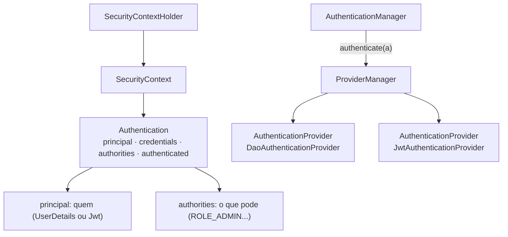

# J8.01 — Autenticação vs autorização e a cadeia de filtros do Spring Security

> ⏱️ ~1h30 · 🟢 Júnior · Pré-requisitos: J2 (HTTP, cookies, status 401/403), J5.03 (beans), J5.06 (Spring MVC, interceptor), J7.03 (testes de fatia web)

> ⚠️ **Estado de verificação do módulo J8 (leia antes de estudar):** por decisão do aluno, os testes práticos do PayFlow ficam para o **fim do treinamento**. Foi **executado de verdade** (Linux, OpenJDK 25.0.5, Maven 3.9.12, Spring Boot 4.1.2 com **Spring Security 7.1.2**): os laboratórios `lab/default-security-lab` (8 testes), `lab/security-lab` (**81 testes**, que reproduzem a configuração de segurança do PayFlow com usuários em memória), `lab/PasswordLab.java` e `lab/InjectionLab.java`. **Não executado:** o repositório `payflow` do aluno (não existe em disco aqui): o código que toca nas classes dele (controllers, `UserRepository`, seed, testes antigos) foi **revisado por leitura** contra as aulas J3 a J7. Toda saída colada nesta aula vem dos laboratórios e está marcada. A lista do que validar no fim está em `00-guia/progresso.md` ("Correções pendentes").

## 🎯 Objetivos
Ao final desta aula você consegue:
- **Distinguir** autenticação, autorização, `401` e `403`, e dizer qual deles o PayFlow tem hoje.
- **Descrever** o caminho de uma requisição pelo Tomcat até o controller, e onde o Spring Security entra.
- **Ler** a lista de filtros de uma cadeia (`SecurityFilterChain`) e dizer o que cada filtro importante faz.
- **Prever** o que o Spring Boot faz sozinho quando só a dependência é adicionada.
- **Adicionar** o Spring Security ao PayFlow sem quebrar o que já funciona (uma "ponte" temporária).

## 🤔 Por que isso importa
O PayFlow guarda dinheiro. Hoje, o login dele é "informe só o e-mail" (decisão 24, provisória desde a J4): **qualquer pessoa que saiba o e-mail da Ana entra como a Ana**. É uma dívida que prometemos pagar na J8. Mas o login é só o começo. Faça um diagnóstico honesto do que o PayFlow tem agora:

| Falha | Onde aparece hoje | Categoria OWASP Top 10:2025 |
|---|---|---|
| Login sem senha | `LoginController` (J4/J5.06) | A07 Falhas de autenticação |
| Proteção **permitida por padrão**: só `/accounts/**` e `/api/**` passam pelo `AuthInterceptor`; uma rota nova fica aberta se alguém esquecer o `addPathPatterns` | `WebConfig` (J5.06) | A01 Controle de acesso quebrado |
| `POST` sem prova de que o usuário quis mesmo enviar (sem CSRF) | formulário de depósito (J4/J5) | A01 (CWE-352) |
| Sessão própria, sem expiração, cookie sem `Secure` | `Sessions`, `SessionCookies` (J4/J5.06) | A07 / A02 Configuração incorreta |
| Papéis (`USER`/`ADMIN`) existem no banco mas **nada os usa** | coluna `users.role` (J3.04) | A01 |
| Nenhuma defesa no navegador (CSP, `X-Frame-Options`...) | respostas HTML (J4) | A02 / A05 |
| Segredos e logs de segurança | configuração (J5.05), `SecurityAudit` inexistente | A04, A09 |

A [OWASP Top 10:2025](https://top10.owasp.org/2025/) é a lista de riscos mais comuns em aplicações web, mantida pela OWASP: usaremos os códigos (A01, A05, A07...) como vocabulário comum. Neste módulo você fecha **cada linha da tabela**. O Spring Security é o *framework* que a maioria das vagas Java pede para isso: saber só "colocar `@PreAuthorize`" não basta; entender **a cadeia de filtros** é o que permite depurar um `403` inesperado às 18h de uma sexta.

## 💡 Intuição (explicação simples)
Pense em um prédio comercial:
- **Autenticação** é a **portaria**: "quem é você?". Você mostra um crachá (senha, token) e o porteiro confere.
- **Autorização** é a **catraca de cada andar**: "você, que já sei quem é, pode entrar no 5º andar?".
- `401` é "**não sei quem você é**" (falta crachá, ou ele é falso). `403` é "**sei quem você é, mas não pode**".
- A **cadeia de filtros** é o corredor de entrada com vários guardas em fila: um confere o crachá, outro anota o horário, outro barra quem não tem permissão. A ordem importa: não adianta checar o andar de quem ainda não mostrou o crachá.

## 🔬 Como funciona por dentro

### 1. Onde o Spring Security entra
Na J5.06 você viu o caminho da requisição: Tomcat → `DispatcherServlet` → `HandlerMapping` → **interceptors** → controller. O `AuthInterceptor` da J5 está **dentro** do Spring MVC: só enxerga o que o MVC resolve para um controller. O Spring Security fica **antes**, no mundo dos *servlet filters* (o `Filter` do Jakarta Servlet, J2): ele protege até o que o MVC nem conhece (arquivos estáticos, o redirecionamento interno para `/error`).

```mermaid
flowchart LR
    C[Navegador / curl] --> T[Tomcat]
    T --> D["DelegatingFilterProxy<br/>springSecurityFilterChain"]
    D --> F[FilterChainProxy]
    F -->|"a PRIMEIRA cadeia cujo<br/>securityMatcher casa"| S[SecurityFilterChain]
    S --> F1[filtro 1] --> F2[filtro 2] --> Fn[... AuthorizationFilter]
    Fn --> DS[DispatcherServlet] --> I[interceptors] --> CT[Controller]
```


- O **`DelegatingFilterProxy`** é a ponte entre o ciclo de vida do contêiner de servlets e os beans do Spring ([documentação](https://docs.spring.io/spring-security/reference/servlet/architecture.html)): o Tomcat o instancia, ele busca um bean `Filter` no `ApplicationContext` e delega o trabalho. O Spring Boot o registra sozinho (autoconfiguração `SecurityFilterAutoConfiguration`).
- O bean para o qual ele delega é o **`FilterChainProxy`**, que guarda **uma ou mais `SecurityFilterChain`** e, para cada requisição, usa **a primeira cadeia que casa** com ela. O PayFlow terá duas (a API e o painel): é por isso que a **ordem** (`@Order`) das cadeias importa.
- Cada `SecurityFilterChain` é uma lista de `Filter`s. A lista **não é escrita à mão**: o `HttpSecurity` a monta conforme o que você liga (`formLogin`, `csrf`, `oauth2ResourceServer`...).

### 2. A cadeia de verdade (saída real do laboratório)
Esta é a lista das duas cadeias que o PayFlow terá ao fim da J8.03 (`FilterChainLabTest`, executado):
```text
[cadeia 1]  /api/v1/**  (a API, 14 filtros)         [cadeia 2]  o resto  (o painel, 12 filtros)
   1. DisableEncodeUrlFilter                           1. DisableEncodeUrlFilter
   2. WebAsyncManagerIntegrationFilter                 2. WebAsyncManagerIntegrationFilter
   3. SecurityContextHolderFilter                      3. SecurityContextHolderFilter
   4. HeaderWriterFilter                               4. HeaderWriterFilter
   5. CorsFilter                                       5. CsrfFilter
   6. LogoutFilter                                     6. LogoutFilter
   7. OAuth2ProtectedResourceMetadataFilter            7. UsernamePasswordAuthenticationFilter
   8. BearerTokenAuthenticationFilter                  8. RequestCacheAwareFilter
   9. RequestCacheAwareFilter                          9. SecurityContextHolderAwareRequestFilter
  10. SecurityContextHolderAwareRequestFilter         10. AnonymousAuthenticationFilter
  11. AnonymousAuthenticationFilter                   11. ExceptionTranslationFilter
  12. SessionManagementFilter                         12. AuthorizationFilter
  13. ExceptionTranslationFilter
  14. AuthorizationFilter
```
Os que você precisa saber (os demais são encanamento):

| Filtro | O que faz |
|---|---|
| `SecurityContextHolderFilter` | carrega o `SecurityContext` (quem está logado) no início e o disponibiliza para o resto da requisição |
| `HeaderWriterFilter` | escreve os cabeçalhos de segurança da resposta (J8.05) |
| `CorsFilter` | responde ao *preflight* de CORS **antes** da autenticação (só na API) |
| `CsrfFilter` | exige o token CSRF nos métodos que alteram estado (só no painel; J8.05) |
| `LogoutFilter` | trata o `POST /logout` |
| `UsernamePasswordAuthenticationFilter` | lê e-mail e senha do formulário e tenta autenticar (J8.03) |
| `BearerTokenAuthenticationFilter` | lê o `Authorization: Bearer ...` e valida o JWT (J8.03) |
| `AnonymousAuthenticationFilter` | se ninguém se autenticou, coloca uma autenticação "anônima" (assim `authenticated()` falha de forma uniforme) |
| `ExceptionTranslationFilter` | traduz `AuthenticationException` em `401`/redirecionamento e `AccessDeniedException` em `403` |
| `AuthorizationFilter` | o **último**: confere a regra do `authorizeHttpRequests` para aquele caminho |

> O `OAuth2ProtectedResourceMetadataFilter` aparece na saída real acima: ele serve metadados do recurso protegido ([RFC 9728](https://www.rfc-editor.org/rfc/rfc9728)). Não precisamos dele; na mesma versão (7.1.2), o `WWW-Authenticate` da API passou a trazer um parâmetro `resource_metadata` (J8.03).

### 3. Os tipos centrais (o vocabulário)

- **`Authentication`**: o objeto que representa "uma tentativa" (ainda não confirmada: `username`+`password`) e, depois de aceita, "o usuário autenticado" (principal + autoridades). O mesmo tipo serve aos dois momentos.
- **`AuthenticationManager.authenticate(...)`**: recebe a tentativa e devolve a autenticação confirmada ou lança `AuthenticationException`. A implementação padrão, o **`ProviderManager`**, pergunta a uma lista de **`AuthenticationProvider`s**; cada um sabe tratar um tipo de credencial (senha → `DaoAuthenticationProvider`; JWT → `JwtAuthenticationProvider`).
- **`SecurityContextHolder`**: guarda o `SecurityContext` da **thread** da requisição (J5.03: nada de estado compartilhado entre requisições). É de lá que `CurrentUser` sairá na J8.03.
- **`GrantedAuthority`**: uma permissão em forma de texto. Por convenção, **papéis** (*roles*) são autoridades com o prefixo `ROLE_` (`ROLE_ADMIN`); `hasRole('ADMIN')` confere `ROLE_ADMIN` ([documentação](https://docs.spring.io/spring-security/reference/servlet/authorization/authorize-http-requests.html)).

### 4. `401` × `403` e o cabeçalho `WWW-Authenticate`
`401 Unauthorized` (o nome é ruim: significa **não autenticado**) vem com `WWW-Authenticate`, que diz **como** se autenticar (`Basic`, `Bearer`...). `403 Forbidden` quer dizer **autenticado, mas sem permissão**. Há uma terceira resposta útil: **`404`** para esconder que o recurso existe (decisão 25: conta de outro usuário = 404). Na J8.06 você verá por que ela costuma ser a melhor escolha para recursos de outras pessoas.

## 🛠️ Exemplo prático

### 1. O que o Spring Boot faz sozinho (laboratório `default-security-lab`)
O projeto tem **só** `spring-boot-starter-webmvc` e `spring-boot-starter-security`, um controller `GET`/`POST /hello` e **nenhuma configuração de segurança**. Saída **real** (`mvn test`, JDK 25):
```text
[padrão] GET sem credenciais, sem Accept        -> 401  WWW-Authenticate: Basic realm="Realm", charset="UTF-8"
[padrão] GET sem credenciais, Accept text/html  -> 302  Location: http://localhost:<porta>/login
[padrão] log do Boot: 'Using generated security password: <36 caracteres, um UUID>'
[padrão] aviso do Boot: This generated password is for development use only. Your security configuration must be updated before running your application in production.
[padrão] GET com Basic user:<senha do log>      -> 200 hello
[padrão] POST com Basic e SEM token CSRF        -> 401  (esperava-se 403: o /error também exige login)
[padrão] cabeçalhos de segurança da resposta 200: [cache-control, expires, pragma, x-content-type-options, x-frame-options, x-xss-protection]
```
Leitura, linha por linha:
1. **Tudo passa a exigir login.** Só de entrar a dependência, o Boot cria uma cadeia padrão: *negar por padrão* (`anyRequest().authenticated()`). É o oposto do `AuthInterceptor`.
2. A resposta depende de **quem pergunta**: o `curl` (sem `Accept` de HTML) recebe `401` com `Basic`; um navegador (`Accept: text/html`) é **redirecionado** (`302`) para a página de login que o Spring gera.
3. O Boot **inventa** o usuário `user` e uma senha aleatória, e a imprime no log. É um aviso, não um recurso: a senha muda a cada subida e o aviso diz "só para desenvolvimento". (Esse usuário só nasce na **primeira tentativa de autenticação**. E, com o *starter* de resource server no classpath, o Boot 4 **só** o cria se você configurar `spring.security.user.*`: no laboratório completo, com JWT, a linha **não aparece**. Conferido nos dois projetos, pelo relatório de condições do Boot.)
4. Os cabeçalhos de segurança (`X-Content-Type-Options`, `X-Frame-Options`, `Cache-Control`...) já saem **de graça** (J8.05).
5. ⚠️ **A surpresa:** o `POST` sem token CSRF deveria dar `403`, e deu **`401`**. O `CsrfFilter` recusa com `403`, o contêiner faz um **redirecionamento interno** para `/error` para montar a página de erro, e **`/error` também passa pela cadeia**, que exige login: o cliente vê o `401` do passo seguinte, não o `403` original. A cura (que o PayFlow aplicará): **liberar `/error`** (e a página `/forbidden`) na cadeia.

### 2. Adicionar o Spring Security ao PayFlow, sem quebrar nada (a "ponte")
Se você só colocar a dependência, **tudo** quebra: o painel passa a pedir login do Spring, os `POST` dos testes levam `403`. Em vez de uma troca em um passo só (arriscada), faça uma **ponte**: a dependência entra com uma cadeia que **libera tudo** e **desliga o CSRF**, e o `AuthInterceptor` continua mandando. Nas aulas seguintes você troca peça por peça, sempre com os testes verdes.

`pom.xml` (sem `<version>`: o BOM do Boot gerencia, decisão 28):
```xml
<dependency>
  <groupId>org.springframework.boot</groupId>
  <artifactId>spring-boot-starter-security</artifactId>
</dependency>
<dependency>
  <groupId>org.springframework.boot</groupId>
  <artifactId>spring-boot-starter-security-test</artifactId>
  <scope>test</scope>
</dependency>
```
`src/main/java/com/payflow/security/BridgeSecurityConfig.java` (**temporário**; a J8.03 o apaga):
```java
package com.payflow.security;

import org.springframework.context.annotation.Bean;
import org.springframework.context.annotation.Configuration;
import org.springframework.security.config.annotation.web.builders.HttpSecurity;
import org.springframework.security.config.annotation.web.configuration.EnableWebSecurity;
import org.springframework.security.config.annotation.web.configurers.AbstractHttpConfigurer;
import org.springframework.security.web.SecurityFilterChain;

/** TEMPORÁRIO (J8.01 a J8.02): o Spring Security presente, mas liberando tudo; o AuthInterceptor segue protegendo. */
@Configuration
@EnableWebSecurity
public class BridgeSecurityConfig {

    @Bean
    SecurityFilterChain bridge(HttpSecurity http) throws Exception {
        http.authorizeHttpRequests(auth -> auth.anyRequest().permitAll())
                .csrf(AbstractHttpConfigurer::disable);
        return http.build();
    }
}
```
Saída **real** do laboratório com esta configuração (`BridgeChainTest`): as requisições sem credenciais **voltam a passar**, e os cabeçalhos de segurança já aparecem:
```text
[ponte] GET /hello sem credenciais -> 200 hello   | cabeçalhos: [cache-control, x-content-type-options, x-frame-options, x-xss-protection]
[ponte] POST /hello sem credenciais -> 200 posted | cabeçalhos: [cache-control, x-content-type-options, x-frame-options, x-xss-protection]
```
**Os testes de fatia da J7 quebram, e é esperado.** `@WebMvcTest` **não** carrega classes `@Configuration` (as fatias as excluem), então o `BridgeSecurityConfig` **não** entra e vale a cadeia **padrão** do Boot. Saída real do laboratório (`SliceDefaultsTest`: uma fatia que não conhecia segurança):
```text
[fatia] GET  /hello sem config de segurança -> 401
[fatia] POST /hello sem config de segurança -> 403
```
Então o `TransfersControllerWebTest` (J7.03) passa a receber `401` e `403`. Para manter a suíte verde **até a J8.04** (que importa a segurança de verdade na fatia), acrescente uma linha no `@Import` dele: `BridgeSecurityConfig.class`.

Rode o que você já tinha:
```bash
export JAVA_HOME=/usr/lib/jvm/java-25-openjdk-amd64
mvn test
```
Resultado **esperado (não executado: o repositório `payflow` não existe em disco aqui)**: a mesma contagem de testes da J7, todos verdes. Se algum teste de **integração** falhar com `403` ou `401`, a ponte não foi carregada nele: confira a classe `@SpringBootTest`.

## 🧠 Pausa para lógica
**Enunciado:** em uma cadeia, o `AuthorizationFilter` está **antes** do `UsernamePasswordAuthenticationFilter`. O que acontece com um usuário que envia e-mail e senha certos para `/login`?

<details><summary>Dica</summary>

O `AuthorizationFilter` decide com base no `Authentication` que **já está** no `SecurityContext`. Quem o preenche?
</details>

<details><summary>Solução</summary>

O `AuthorizationFilter` rodaria com o usuário **ainda anônimo** e negaria a requisição (`/login` exige estar autenticado, ou, se for liberado, o formulário nunca seria processado): a autenticação precisa vir **antes** da decisão de autorização. É por isso que a lista tem a ordem que tem, e por isso o `HttpSecurity` a monta para você: o filtro de login fica antes, e o de autorização por último.
</details>

## ⚠️ Erros comuns e boas práticas de produção
- **Adicionar a dependência e achar que "está seguro".** Sem configuração, a cadeia padrão protege *tudo com um usuário de teste*, e a senha vai para o log. O trabalho real é configurar: o resto do módulo.
- **`401` onde você esperava `403`** (ou o contrário). Antes de mexer na regra, olhe o **`/error`**: se ele não for liberado, todo erro vira `401` (observado acima).
- **`@WebMvcTest` retornando `401`/`403` depois de adicionar o Security.** A fatia não carrega a sua `@Configuration` de segurança. Importe-a (J8.04). Erro típico: `Status expected:<200> but was:<401>`.
- **Confiar só no `AuthInterceptor`.** Ele vê só o que o MVC roteia; um arquivo estático, uma rota nova esquecida no `addPathPatterns`, um `forward` interno: ficam abertos. A segurança de verdade é **negar por padrão** e liberar só o necessário (J8.03).
- **Ordem das cadeias.** Com mais de uma `SecurityFilterChain`, a **primeira** que casa vale. A cadeia genérica (sem `securityMatcher`) deve ser a **última** (`@Order` maior); do contrário engole tudo.
- **Desligar o CSRF "porque atrapalha os testes".** Aqui foi uma ponte consciente e temporária. Em produção, só se desliga o CSRF onde **não há cookie de sessão** (a API com Bearer; J8.05).

## 🧩 Exercícios
1. **Fixação.** (a) Qual a diferença entre `401` e `403`? (b) O que o `DelegatingFilterProxy` liga a quê? (c) Por que o Spring Security fica num *filter* e não num *interceptor*? (d) O que é "negar por padrão" e por que o `AuthInterceptor` não é assim? (e) Se duas `SecurityFilterChain` casam com a mesma requisição, qual vale?
2. **Aplicação no PayFlow.**
   - [ ] `spring-boot-starter-security` e `spring-boot-starter-security-test` no `pom.xml`, sem `<version>`.
   - [ ] `BridgeSecurityConfig` criada; `mvn test` com a **mesma** contagem da J7 (anote em `docs/security-notes.md`).
   - [ ] `BridgeSecurityConfig.class` no `@Import` de `TransfersControllerWebTest`; **antes** disso, rode-o e **cole as mensagens de erro reais** em `docs/security-notes.md`.
   - [ ] Em `docs/security-notes.md`, preencha a **tabela de diagnóstico** deste texto com o que você vê no **seu** repositório (qual linha do `git grep` prova cada falha). Use: `git grep -n "addPathPatterns\|permitAll\|csrf" src/main`.
   - [ ] Suba o PayFlow (`bash scripts/run-dev.sh`), abra `http://localhost:8080/login` e confira os **cabeçalhos** com `curl -sI http://localhost:8080/login`: anote quais cabeçalhos de segurança já aparecem.
3. **Desafio (opcional).** Copie o `lab/default-security-lab`, defina `spring.security.user.name=ana` e `spring.security.user.password=teste` e use `curl -u ana:teste`. Depois, **troque** a cadeia por uma que libere `GET /hello` e exija login só no `POST` (`requestMatchers(HttpMethod.POST, "/hello").authenticated()`). O que muda no `curl`?

<details><summary>Soluções de referência</summary>

1. (a) `401` = não autenticado (vem com `WWW-Authenticate`); `403` = autenticado sem permissão. (b) O contêiner de servlets ao `ApplicationContext` do Spring: ele delega a um bean `Filter` (o `FilterChainProxy`). (c) O filtro roda **antes** do `DispatcherServlet`, então protege tudo (estáticos, `/error`); o interceptor só vê o que o MVC roteia. (d) Todo caminho exige autenticação, salvo o que você libera; no `AuthInterceptor` é o contrário (só o que você lista é protegido, e o que você esquece fica aberto). (e) A **primeira**, na ordem de `@Order`.
2. Para a tabela: login sem senha → `LoginController.login` (só `email`); proteção permitida por padrão → `WebConfig.addInterceptors` com `addPathPatterns("/accounts/**", "/api/**")`; sem CSRF → nenhum `csrf` no código e o formulário de depósito sem token; papéis sem uso → nenhuma referência a `getRole()` fora da entidade; cabeçalhos: com a ponte aparecem `X-Content-Type-Options`, `X-Frame-Options`, `X-XSS-Protection`, `Cache-Control` (e **não** há `Content-Security-Policy`).
3. Com o `permitAll` só no `GET`, o `curl http://localhost/hello` volta `200` sem credenciais, e o `POST` passa a pedir `-u` (e, com CSRF ligado, um token: desligue-o no laboratório ou use `.csrf(c -> c.disable())`).
</details>

## 🎤 Na entrevista
1. **"Qual a diferença entre autenticação e autorização?"** *Resposta-modelo:* autenticação confirma **quem** é o usuário (senha, token, certificado); autorização decide **o que** ele pode fazer. A primeira falhando gera `401`; a segunda, `403`. Em Spring Security, a autenticação produz um objeto `Authentication` no `SecurityContext`, e a autorização (URL ou método) consulta as autoridades dele.
2. **"Como o Spring Security se encaixa em uma aplicação Spring MVC?"** *Resposta-modelo:* como uma cadeia de *servlet filters* (um `FilterChainProxy` registrado pelo `DelegatingFilterProxy`) que roda **antes** do `DispatcherServlet`. Cada `SecurityFilterChain` tem seu `securityMatcher`; a primeira que casa processa a requisição, e o último filtro (`AuthorizationFilter`) aplica as regras.
3. **"O que acontece se você só adicionar o starter de segurança?"** *Resposta-modelo:* o Boot cria uma cadeia padrão que exige login para tudo (formulário e HTTP Basic), com um usuário `user` e senha aleatória no log, CSRF ligado e cabeçalhos de segurança. É um padrão seguro (nega por padrão), mas não é uma configuração de produção.

## 📚 Para ir além
- 📄 [Spring Security: Architecture](https://docs.spring.io/spring-security/reference/servlet/architecture.html): `DelegatingFilterProxy`, `FilterChainProxy` e a ordem dos filtros. Leia a seção "Security Filters".
- 📄 [Spring Boot: Security](https://docs.spring.io/spring-boot/reference/web/spring-security.html): o que a autoconfiguração faz (usuário padrão, `/error`, atuator).
- 📄 [OWASP Top 10:2025](https://top10.owasp.org/2025/): leia A01 e A07 inteiras; são as que este módulo mais toca.
- 📄 [Spring Security: Java Configuration](https://docs.spring.io/spring-security/reference/servlet/configuration/java.html): como `HttpSecurity` e `SecurityFilterChain` se relacionam.
- 📑 *Spring Security in Action* (Laurențiu Spilcă): o capítulo sobre a arquitetura (citado por título, sem capítulo conferido).
- 🎥 Nenhum vídeo verificado (⚠️): busque a palestra "Spring Security Architecture" em canais oficiais (SpringDeveloper, Spring I/O) e confira data e versão antes de assistir.

## ✅ Checklist da aula
- [ ] Sei dizer a diferença entre autenticação, autorização, `401` e `403`.
- [ ] Sei desenhar o caminho Tomcat → `DelegatingFilterProxy` → `FilterChainProxy` → cadeia → `DispatcherServlet`.
- [ ] Li a lista de filtros e sei dizer o que `ExceptionTranslationFilter` e `AuthorizationFilter` fazem.
- [ ] Entendi por que `/error` precisa ser liberado.
- [ ] O PayFlow tem o Spring Security na ponte e `mvn test` continua com a mesma contagem de testes.
- [ ] Preenchi o diagnóstico em `docs/security-notes.md`.
