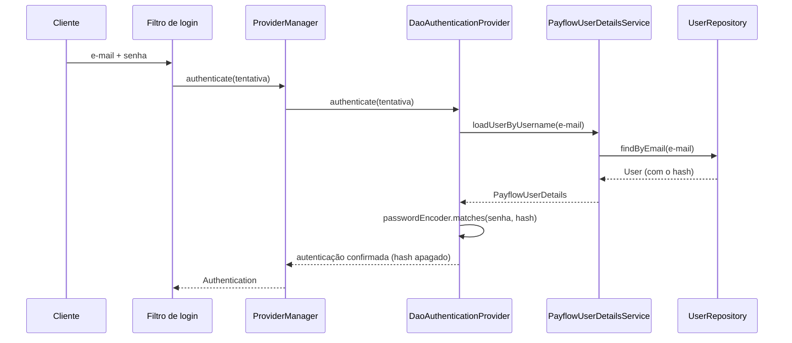

# J8.02 — `UserDetailsService` e `PasswordEncoder`

> ⏱️ ~1h30 · 🟢 Júnior · Pré-requisitos: J8.01, J3.04 (tabela `users`, `password_hash`), J5.07 e J5.09 (`User`, `UserRepository`), J7.01 e J7.04 (testes de integração com `@PayflowTest`)

> ✅ **Validação final (2026-11-24):** este módulo foi executado no PayFlow reconstruído; o resultado e o que continua não executado estão no [README do módulo](README.md). Os avisos "não executado" / "por leitura" abaixo descrevem a escrita original.

> ⚠️ **Verificação:** `lab/PasswordLab.java` e o `AuthenticationManagerTest` do `lab/security-lab` foram **executados** (Spring Security 7.1.2, JDK 25); as saídas abaixo são reais. O código que usa o `UserRepository`/`User` do PayFlow (com JPA e PostgreSQL), a edição do seed e o `AuthenticationTest` foram **revisados por leitura**, **não executados** (o repositório do aluno não existe em disco aqui).

## 🎯 Objetivos
Ao final desta aula você consegue:
- **Explicar** por que senha é guardada como *hash* com sal e custo, e por que SHA-256 não serve.
- **Gerar e conferir** hashes com `BCryptPasswordEncoder` e `DelegatingPasswordEncoder`, e ler o formato `{bcrypt}$2a$10$...`.
- **Implementar** `UserDetails` e `UserDetailsService` para o `User` do PayFlow.
- **Montar** o `AuthenticationProvider` e o `AuthenticationManager`, e **testá-los** sem HTTP.
- **Trocar** os hashes falsos do seed (J3) por hashes reais.

## 🤔 Por que isso importa
Bancos vazam. Quando o banco do PayFlow vazar (a pergunta é "quando", não "se"), o que o atacante leva depende de **como as senhas foram guardadas**: em texto puro, ele entra em todas as contas, e nas de outros sites onde as pessoas reutilizaram a senha. Com um hash lento e com sal, cada senha precisa ser **adivinhada uma a uma**, e cada tentativa custa tempo de CPU. É o risco **A04 (falhas criptográficas)** e **A07 (falhas de autenticação)** da OWASP Top 10:2025.

Na J3.04 você colocou hashes **falsos** no seed (`$2a$10$fakefake...`) com a promessa: "o hash real, com BCrypt, só aparece em J8". É agora.

## 💡 Intuição (explicação simples)
Um hash é um **liquidificador**: você coloca a senha e sai uma papa; dá para conferir que "a mesma senha gera a mesma papa", mas **não dá para desfazer a papa na fruta**. Dois cuidados:
- **Sal**: cada usuário recebe um "tempero" aleatório *antes* de bater o liquidificador. Mesmo que duas pessoas usem `123456`, as papas saem diferentes, e o atacante não pode usar uma tabela pronta de papas conhecidas (*rainbow table*).
- **Custo**: o liquidificador é **de propósito lento** (dezenas de milissegundos). Para você, um login a mais custa um piscar; para o atacante testando bilhões de palpites, é uma eternidade.

## 🔬 Como funciona por dentro

### 1. Por que não SHA-256
SHA-256 foi feito para ser **rápido** (conferir arquivos, assinar). Para senha, rápido é o defeito: uma placa de vídeo calcula bilhões por segundo. Veja a prova no laboratório (`PasswordLab`, saída real):
```text
SHA-256 (sem sal, igual para todo mundo): 1f090704b52a0bcc858c2d0086003b9d4cf9684616547cf9d70ee937d0cbd2ea
  segunda vez igual? true
```
Sem sal, a mesma senha dá **sempre** o mesmo valor: um dicionário de senhas comuns, já calculado, quebra todo mundo de uma vez.

### 2. BCrypt: sal e custo dentro do próprio hash
```text
BCrypt 1: $2a$10$qcIej8JtaxlKmADQ2U7u.eEFpM6t2T6fLz7zlMQhlibUNikQyz9Gi (tamanho 60)
BCrypt 2: $2a$10$fFdGv2oCd/IcCNTLM3Tncen2Hkvb4dITYKz/7Ebhmo15m1KuU7gdu
  hashes iguais? false | ambos conferem? true/true | senha errada? false
```
O hash de 60 caracteres tem **três partes**: `$2a$` (a versão do algoritmo), `10` (o **custo**, um expoente: 2¹⁰ rodadas) e o restante (22 caracteres de **sal** + 31 do hash). Como o sal e o custo viajam **dentro** do valor, você não guarda o sal em outra coluna: `matches(senhaDigitada, hashGuardado)` lê o sal do hash e refaz a conta. Por isso `encode` da mesma senha duas vezes dá resultados diferentes **e ambos conferem**.

O **custo** é tempo. Medido nesta máquina (seu número será outro; **meça no seu**):
```text
  custo  4:    1.1 ms por hash
  custo 10:   52.7 ms por hash
  custo 12:  208.5 ms por hash
  custo 14:  837.6 ms por hash
```
Cada +1 no custo **dobra** o trabalho. A [documentação do Spring Security](https://docs.spring.io/spring-security/reference/features/authentication/password-storage.html) sugere ajustar o custo para algo em torno de **um segundo** por verificação no seu servidor; o [Password Storage Cheat Sheet da OWASP](https://cheatsheetseries.owasp.org/cheatsheets/Password_Storage_Cheat_Sheet.html) pede **custo 10 ou mais** para BCrypt. O padrão do Spring é 10. Mais custo protege mais e **gasta CPU a cada login** (e dá a um atacante um jeito de sobrecarregar seu servidor: por isso a J8.06 limita as tentativas). O PayFlow fica no padrão (10) e revisa o custo na S2 (performance).

**Dois limites que viram erro:** o BCrypt só lê os **primeiros 72 bytes** da senha. O Spring Security 7 **recusa** a senha maior na hora de gerar o hash:
```text
73 bytes -> IllegalArgumentException: password cannot be more than 72 bytes
```
(Sem esse erro, duas senhas longas iguais nos 72 primeiros bytes valeriam a mesma, porque o resto seria ignorado.) A OWASP também manda impor o limite de 72 bytes. No PayFlow, o login limita a senha a **128 caracteres** na borda (`@Size`, J8.03) para que um corpo gigante nem chegue ao BCrypt.

### 3. O `DelegatingPasswordEncoder` e o prefixo `{bcrypt}`
Algoritmos envelhecem. Se o hash fosse só `$2a$10$...`, trocar o algoritmo um dia exigiria saber qual hash é de qual tipo. O codificador **delegante** resolve com um **prefixo**:
```text
Delegating: {bcrypt}$2a$10$vvFtmMmUShE1qLV... (tamanho 68)
  confere? true
```
Ao conferir, ele lê o `{id}`, escolhe o codificador certo e delega. Ao gerar, usa o padrão atual (**BCrypt**, conferido nesta versão). Quando você quiser migrar para Argon2id (P10/S5), os hashes antigos continuam valendo e os novos já saem no formato novo. O preço: **todo hash precisa do prefixo**. Sem ele:
```text
  hash sem prefixo -> IllegalArgumentException: Given that there is no default password encoder configured, each password must have a password encoding prefix. Please either prefix this password with '{noop}' or set a default password encoder in `DelegatingPasswordEncoder`.
```
É o erro que você vai ver se esquecer o `{bcrypt}` no seed. O PayFlow guarda **68 caracteres** em `password_hash` (a coluna tem 100, J3.04).

### 4. As peças do login por senha

- **`UserDetails`**: a visão que o Spring Security tem de um usuário: nome de usuário, **hash**, autoridades e flags (conta expirada, bloqueada...). Os métodos `isAccountNonExpired` etc. já devolvem `true` por padrão.
- **`UserDetailsService`**: uma única operação, `loadUserByUsername(String)`, "ache esse usuário". O Spring Security **não** sabe o que é o seu banco; é o seu código que responde.
- **`DaoAuthenticationProvider`**: pega o `UserDetails` e compara a senha com `PasswordEncoder.matches`. Ele já cuida de dois detalhes de segurança que você não precisa reescrever (conferido nas classes do 7.1.2 com `javap`): quando o usuário **não existe**, ele **não responde "usuário inexistente"** (a flag `hideUserNotFoundExceptions` é verdadeira por padrão: vira o mesmo `BadCredentialsException` de senha errada), e executa um *hash* de mentira para o tempo da resposta **não revelar** se o e-mail existe (`mitigateAgainstTimingAttack`).
- **`eraseCredentials`**: depois do login, o `ProviderManager` pede ao usuário para **apagar o hash** (se ele implementar `CredentialsContainer`), para o hash não ficar na sessão.

> **Observação do Spring Security 7:** depois de um login por senha, a lista de autoridades traz, além do papel, uma `FactorGrantedAuthority` (`FACTOR_PASSWORD`) que registra **qual fator** autenticou e quando (veja a saída abaixo). É a base do suporte a autenticação multifator da versão 7. Para o PayFlow é só um item a mais na lista: **não** confunda com papel.

## 🛠️ Exemplo prático

### 1. Os hashes do seed
Gere um hash real (`lab/PasswordLab.java` roda com o classpath do `lab/security-lab`; veja o comando no cabeçalho do arquivo). O valor usado no PayFlow para **todos** os usuários de desenvolvimento e teste, cuja senha é `Payflow#Dev2026` (só dev/teste: o seed não roda em produção, decisão 31):
```text
{bcrypt}$2a$10$MWgWEFRE98qgByT.vgfue.cJRks3.2y4VpIgDryvGaVIUCWbyQYCS
68 true false        ← tamanho, confere com a senha certa, não confere com outra
```
Em `src/main/resources/db/seed/R__dev_seed.sql`, troque o hash falso das **cinco** linhas de `users` por esse valor, e mude o final do `INSERT` para **atualizar** o hash de quem já existe:
```sql
INSERT INTO users (id, email, full_name, password_hash, role, created_at) VALUES
 ('10000000-0000-0000-0000-000000000001', 'ana@payflow.dev',   'Ana Silva',   '{bcrypt}$2a$10$MWgWEFRE98qgByT.vgfue.cJRks3.2y4VpIgDryvGaVIUCWbyQYCS', 'USER',  '2026-01-05 09:00:00+00'),
 ('10000000-0000-0000-0000-000000000002', 'bruno@payflow.dev', 'Bruno Costa', '{bcrypt}$2a$10$MWgWEFRE98qgByT.vgfue.cJRks3.2y4VpIgDryvGaVIUCWbyQYCS', 'USER',  '2026-01-06 10:30:00+00'),
 ('10000000-0000-0000-0000-000000000003', 'carla@payflow.dev', 'Carla Dias',  '{bcrypt}$2a$10$MWgWEFRE98qgByT.vgfue.cJRks3.2y4VpIgDryvGaVIUCWbyQYCS', 'USER',  '2026-01-07 14:15:00+00'),
 ('10000000-0000-0000-0000-000000000004', 'diego@payflow.dev', 'Diego Alves', '{bcrypt}$2a$10$MWgWEFRE98qgByT.vgfue.cJRks3.2y4VpIgDryvGaVIUCWbyQYCS', 'USER',  '2026-01-08 16:45:00+00'),
 ('10000000-0000-0000-0000-000000000005', 'admin@payflow.dev', 'Eva Admin',   '{bcrypt}$2a$10$MWgWEFRE98qgByT.vgfue.cJRks3.2y4VpIgDryvGaVIUCWbyQYCS', 'ADMIN', '2026-01-01 08:00:00+00')
ON CONFLICT (id) DO UPDATE SET password_hash = EXCLUDED.password_hash;
```
Por que o `DO UPDATE` (e não o `DO NOTHING` da J3.12)? A migração `R__` é **repetível**: o Flyway a reexecuta quando o *checksum* muda. Com `DO NOTHING`, os usuários que **já estão** no seu banco de desenvolvimento manteriam o hash falso, e o login nunca funcionaria. Com `DO UPDATE SET password_hash`, só o hash é atualizado (o e-mail, o nome e o papel não mudam). Os bancos de teste nascem do zero (`ResetDatabase`, decisão 40) e já recebem o valor novo.

> ⚠️ Um hash fixo para os cinco usuários é uma **conveniência de dev**. Em dados reais cada usuário teria o seu sal (e senhas diferentes). Nada de `Payflow#Dev2026` fora do seu computador.

### 2. `CurrentUser` serializável
O usuário logado ficará na **sessão** do contêiner (J8.03), que pode ser gravada em disco ou em um Redis (P2). Todo objeto da sessão precisa ser `Serializable`: ajuste o `record` da J5.09:
```java
public record CurrentUser(UUID id, String email, String fullName) implements Serializable { }   // import java.io.Serializable
```

### 3. `UserDetails` e `UserDetailsService`
`src/main/java/com/payflow/security/PayflowUserDetails.java`
```java
package com.payflow.security;

import com.payflow.domain.Role;
import com.payflow.domain.User;
import com.payflow.web.CurrentUser;
import java.util.Collection;
import java.util.List;
import org.springframework.security.core.CredentialsContainer;
import org.springframework.security.core.GrantedAuthority;
import org.springframework.security.core.authority.SimpleGrantedAuthority;
import org.springframework.security.core.userdetails.UserDetails;

/** O "usuário do Spring Security" do PayFlow: embrulha o CurrentUser, o papel e o hash (apagado após o login). */
public final class PayflowUserDetails implements UserDetails, CredentialsContainer {

    private static final long serialVersionUID = 1L;

    private final CurrentUser currentUser;
    private final Role role;
    private String passwordHash;

    public PayflowUserDetails(CurrentUser currentUser, Role role, String passwordHash) {
        this.currentUser = currentUser;
        this.role = role;
        this.passwordHash = passwordHash;
    }

    public static PayflowUserDetails from(User user) {
        return new PayflowUserDetails(new CurrentUser(user.getId(), user.getEmail(), user.getFullName()),
                user.getRole(), user.getPasswordHash());
    }

    public CurrentUser currentUser() {
        return currentUser;
    }

    public Role role() {
        return role;
    }

    @Override
    public Collection<? extends GrantedAuthority> getAuthorities() {
        return List.of(new SimpleGrantedAuthority("ROLE_" + role.name()));
    }

    @Override
    public String getPassword() {
        return passwordHash;
    }

    @Override
    public String getUsername() {
        return currentUser.email();
    }

    /** O ProviderManager chama isto depois do login: o hash não fica na sessão. */
    @Override
    public void eraseCredentials() {
        this.passwordHash = null;
    }
}
```

`src/main/java/com/payflow/security/PayflowUserDetailsService.java`
```java
package com.payflow.security;

import com.payflow.repository.UserRepository;
import java.util.Locale;
import org.springframework.security.core.userdetails.UserDetails;
import org.springframework.security.core.userdetails.UserDetailsService;
import org.springframework.security.core.userdetails.UsernameNotFoundException;
import org.springframework.stereotype.Service;

/** Ensina o Spring Security a achar um usuário pelo "username" (no PayFlow, o e-mail). */
@Service
public class PayflowUserDetailsService implements UserDetailsService {

    private final UserRepository users;

    public PayflowUserDetailsService(UserRepository users) {
        this.users = users;
    }

    @Override
    public UserDetails loadUserByUsername(String email) throws UsernameNotFoundException {
        String normalized = email.trim().toLowerCase(Locale.ROOT);
        return users.findByEmail(normalized)
                .map(PayflowUserDetails::from)
                .orElseThrow(() -> new UsernameNotFoundException("User not found"));    // sem o e-mail na mensagem (vai para log)
    }
}
```
- `PayflowUserDetails` **embrulha** o `CurrentUser` (id, e-mail, nome: o que o resto da aplicação usa) e acrescenta o **papel** e o **hash**. `from(User)` é o único lugar onde a entidade vira dado de segurança (a entidade **nunca** vai para a sessão, decisão 33).
- A autoridade é `ROLE_<papel>`: `Role.ADMIN` vira `ROLE_ADMIN` (J8.04).
- O serviço **normaliza** o e-mail (`trim` + minúsculas), como o antigo `LoginController`: `ANA@payflow.dev ` e `ana@payflow.dev` são a mesma pessoa. A mensagem da exceção **não leva o e-mail**: ela pode acabar em um log (decisão 38).
- `UserRepository.findByEmail` já existe desde a J5.09; o Spring Data o executa em uma transação de leitura.

### 4. `PasswordEncoder`, `AuthenticationProvider` e `AuthenticationManager`
`src/main/java/com/payflow/security/SecurityConfig.java` (**versão da J8.02**: só as peças comuns; a J8.03 acrescenta as cadeias de filtros e a J8.06 o limitador de tentativas):
```java
package com.payflow.security;

import org.springframework.context.annotation.Bean;
import org.springframework.context.annotation.Configuration;
import org.springframework.security.authentication.AuthenticationEventPublisher;
import org.springframework.security.authentication.AuthenticationManager;
import org.springframework.security.authentication.AuthenticationProvider;
import org.springframework.security.authentication.ProviderManager;
import org.springframework.security.authentication.dao.DaoAuthenticationProvider;
import org.springframework.security.core.userdetails.UserDetailsService;
import org.springframework.security.crypto.factory.PasswordEncoderFactories;
import org.springframework.security.crypto.password.PasswordEncoder;

@Configuration
public class SecurityConfig {

    @Bean
    static PasswordEncoder passwordEncoder() {
        return PasswordEncoderFactories.createDelegatingPasswordEncoder();      // grava "{bcrypt}$2a$10$..."
    }

    @Bean
    AuthenticationProvider authenticationProvider(UserDetailsService users, PasswordEncoder encoder) {
        DaoAuthenticationProvider dao = new DaoAuthenticationProvider(users);
        dao.setPasswordEncoder(encoder);
        return dao;
    }

    /** Um gerenciador só; o publicador faz os eventos de login chegarem ao SecurityAudit (J8.06). */
    @Bean
    AuthenticationManager authenticationManager(AuthenticationProvider provider, AuthenticationEventPublisher publisher) {
        ProviderManager manager = new ProviderManager(provider);
        manager.setAuthenticationEventPublisher(publisher);
        return manager;
    }
}
```
- O método do `PasswordEncoder` é **`static`**: beans de infraestrutura que outros beans de configuração precisam cedo devem ser `static`, para o Spring não precisar instanciar a classe `SecurityConfig` antes da hora (a J5.03 mostrou o ciclo de criação).
- `new DaoAuthenticationProvider(users)`: no Spring Security 7 o serviço de usuários entra pelo **construtor** (conferido com `javap`); o `PasswordEncoder` por *setter*.
- O `AuthenticationEventPublisher` é um bean que o Spring Boot já cria; sem ele, o `ProviderManager` não publicaria os eventos "login ok" e "login falhou".
- Como existe um `UserDetailsService` **e** um `AuthenticationProvider` no contexto, o Boot **não** cria o usuário `user` com senha aleatória da J8.01: o aviso do log some.

### 5. Teste: o `AuthenticationManager` sozinho (sem HTTP)
Executado no laboratório (`AuthenticationManagerTest`). Saída real:
```text
[auth] senha errada  -> BadCredentialsException: Bad credentials
[auth] e-mail ausente -> BadCredentialsException: Bad credentials
[auth] authenticated=true name=admin@payflow.dev authorities=[ROLE_ADMIN, FactorGrantedAuthority [authority=FACTOR_PASSWORD, issuedAt=2026-11-13T20:22:46.218262718Z]] hashDepoisDoLogin=null
```
Nos três casos: **mesma exceção e mesma mensagem** para senha errada e e-mail inexistente (nada de enumerar usuários), o `Authentication` traz o papel (mais o fator) e **o hash foi apagado** do principal. A versão para o PayFlow (revisada por leitura), usando o banco real e o seed:

`src/test/java/com/payflow/security/AuthenticationTest.java`
```java
package com.payflow.security;

import static org.assertj.core.api.Assertions.assertThat;
import static org.assertj.core.api.Assertions.catchThrowable;

import com.payflow.support.PayflowTest;
import org.junit.jupiter.api.Test;
import org.springframework.beans.factory.annotation.Autowired;
import org.springframework.security.authentication.AuthenticationManager;
import org.springframework.security.authentication.BadCredentialsException;
import org.springframework.security.authentication.UsernamePasswordAuthenticationToken;
import org.springframework.security.core.Authentication;
import org.springframework.security.core.GrantedAuthority;

@PayflowTest
class AuthenticationTest {

    static final String PASSWORD = "Payflow#Dev2026";

    @Autowired AuthenticationManager manager;

    Authentication attempt(String email, String password) {
        return manager.authenticate(UsernamePasswordAuthenticationToken.unauthenticated(email, password));
    }

    @Test
    void theSeedPasswordAuthenticatesTheUserWithItsRoleAndWithoutTheHash() {
        Authentication result = attempt("admin@payflow.dev", PASSWORD);
        assertThat(result.isAuthenticated()).isTrue();
        assertThat(result.getAuthorities()).extracting(GrantedAuthority::getAuthority).contains("ROLE_ADMIN");
        assertThat(((PayflowUserDetails) result.getPrincipal()).getPassword()).isNull();
    }

    @Test
    void wrongPasswordAndUnknownEmailAreIndistinguishable() {
        Throwable wrong = catchThrowable(() -> attempt("ana@payflow.dev", "wrong-wrong-wrong"));
        Throwable unknown = catchThrowable(() -> attempt("nobody@payflow.dev", "wrong-wrong-wrong"));
        assertThat(wrong).isInstanceOf(BadCredentialsException.class);
        assertThat(unknown).isInstanceOf(BadCredentialsException.class).hasMessage(wrong.getMessage());
    }

    @Test
    void theEmailIsNormalizedBeforeTheLookup() {
        assertThat(attempt("  ANA@payflow.dev ", PASSWORD).isAuthenticated()).isTrue();
    }

    @Test
    void everySeedUserHasAValidDelegatingHash() {
        for (String email : new String[] {"ana@payflow.dev", "bruno@payflow.dev", "carla@payflow.dev", "diego@payflow.dev", "admin@payflow.dev"}) {
            assertThat(attempt(email, PASSWORD).isAuthenticated()).as(email).isTrue();
        }
    }
}
```
Quatro métodos (**esperado, não executado** no PayFlow). O último é a **prova de que nenhum hash falso sobrou** no seed. Rode `mvn test -Dtest=AuthenticationTest`; saída esperada: `Tests run: 4, Failures: 0`.

## 🧠 Pausa para lógica
**Enunciado:** o seed usa o **mesmo hash** para cinco usuários. Se o atacante roubar o banco, ele quebra **uma** senha e entra em **todas** as contas do seed. Em produção, dois usuários com a **mesma senha** terão o mesmo hash? Como o atacante poderia usar isso?

<details><summary>Dica</summary>

Releia a saída `BCrypt 1`/`BCrypt 2` com a mesma senha.
</details>

<details><summary>Solução</summary>

**Não terão o mesmo hash**: cada `encode` sorteia um sal novo (a saída real mostra dois hashes diferentes para a mesma senha, e os dois conferem). Por isso o atacante **não** vê quem repete senha olhando a coluna, e uma tabela pré-calculada não serve. O seed repete o hash por conveniência: é uma **fragilidade de propósito**, restrita a dev e teste.
</details>

## ⚖️ Trade-offs e quando NÃO usar
- **BCrypt × Argon2id × scrypt × PBKDF2.** A OWASP recomenda **Argon2id** como primeira escolha (mínimo de 19 MiB de memória, 2 iterações, 1 de paralelismo) e `scrypt` se ele não estiver disponível; BCrypt é aceitável com custo **10 ou mais** e limite de 72 bytes. O Spring tem `Argon2PasswordEncoder` (que depende da biblioteca Bouncy Castle) e o delegante deixa a troca para depois. O PayFlow usa BCrypt (sem dependência extra) com prefixo, e a migração para Argon2id é um **desafio** abaixo.
- **Custo alto × CPU do servidor.** Um BCrypt a ~1 s por login (recomendação do Spring) é seguro e **caro**: 50 logins simultâneos ocupam 50 núcleos por um segundo. O limitador de tentativas (J8.06) e o dimensionamento (S2) entram na conta.
- **`{noop}` e `User.withDefaultPasswordEncoder()`:** existem **só para exemplos**; nunca em código real.

## ⚠️ Erros comuns e boas práticas de produção
- **Guardar a senha em texto, ou com SHA/MD5.** Sempre BCrypt/Argon2id.
- **Hash no seed sem o prefixo `{bcrypt}`:** `IllegalArgumentException: Given that there is no default password encoder configured, each password must have a password encoding prefix...` (texto real acima).
- **`DO NOTHING` no seed repetível** depois de trocar os hashes: o banco antigo mantém o hash falso e o login falha com `Bad credentials` para a senha certa.
- **Responder "e-mail não encontrado"** para um e-mail inexistente: revela quem é cliente. O `DaoAuthenticationProvider` já unifica; **não** o contorne.
- **Logar a senha** (ou o objeto `LoginRequest` inteiro com `toString`) ou o hash: nunca. Um `record` imprime todos os componentes no `toString`: se um dia logar um DTO de login, a senha vai junto (J8.03 e J8.07).
- **Rehash ao logar:** com o codificador delegante, o Spring pode **atualizar** o hash de quem logou quando o algoritmo ou o custo padrão mudar (`UserDetailsPasswordService`). Fica para quando você trocar o algoritmo.
- **Comparar senha com `equals`** ou criptografar com chave reversível: não existe "recuperar senha"; só **redefinir**.

## 🧩 Exercícios
1. **Fixação.** (a) Por que SHA-256 é uma péssima ideia para senhas? (b) O que são "sal" e "custo" e onde eles ficam no hash do BCrypt? (c) Por que dois `encode` da mesma senha dão valores diferentes e ambos conferem? (d) Para que serve o prefixo `{bcrypt}`? (e) Por que `loadUserByUsername` não devolve "usuário não encontrado" ao cliente?
2. **Aplicação no PayFlow.**
   - [ ] `R__dev_seed.sql` com os cinco hashes novos e `ON CONFLICT (id) DO UPDATE SET password_hash`; **registre** o `flyway_schema_history` depois de subir no `dev` (a linha `dev seed` deve ter um novo *checksum*).
   - [ ] `CurrentUser` serializável; `PayflowUserDetails`, `PayflowUserDetailsService` e `SecurityConfig` (versão J8.02) criados; **nenhum** `<version>` novo no `pom.xml`.
   - [ ] `AuthenticationTest` (4 métodos) verde; `mvn test` com a contagem anterior **+ 4**.
   - [ ] No `psql`: `SELECT email, left(password_hash, 8), length(password_hash) FROM users;` → `{bcrypt}` e `68` nas cinco linhas. Cole a saída em `docs/security-notes.md`.
   - [ ] Meça o **custo** na **sua** máquina com o `PasswordLab` e anote os tempos dos custos 10 e 12.
3. **Desafio (opcional).** Troque o codificador do PayFlow para **Argon2id** (`Argon2PasswordEncoder.defaultsForSpringSecurity_v5_8()` + a dependência `org.bouncycastle:bcprov-jdk18on`) **mantendo** o login dos usuários com hash `{bcrypt}`: monte um `DelegatingPasswordEncoder` com `argon2@SpringSecurity_v5_8` como padrão e `bcrypt` ainda reconhecido, e acrescente um `UserDetailsPasswordService` que regrave o hash no primeiro login. (O método `Argon2PasswordEncoder.defaultsForSpringSecurity_v5_8()` existe no 7.1.2, conferido com `javap`; o resto, incluindo o **id** `argon2@SpringSecurity_v5_8` e a montagem do delegante, **não** foi executado: confira na documentação.)

<details><summary>Soluções de referência</summary>

1. (a) É rápido de propósito e não tem sal: dicionários pré-calculados e GPUs quebram milhões de senhas por segundo. (b) O sal é um valor aleatório por senha que impede tabelas prontas; o custo é o número de rodadas (2^custo) que torna cada tentativa lenta; os dois ficam **dentro** do hash (`$2a$10$` = versão e custo, depois 22 caracteres de sal). (c) Porque cada `encode` sorteia um sal novo; o `matches` lê o sal do próprio hash e refaz a conta. (d) Diz qual algoritmo gerou o hash, o que permite trocar de algoritmo sem invalidar os hashes antigos. (e) Para não revelar quais e-mails têm conta; ele lança a mesma exceção de senha errada.
2. A linha do `flyway_schema_history` mostra o novo checksum porque o arquivo mudou (repetível). Custos: use o `PasswordLab` (ex.: 52,7 ms no custo 10 e 208,5 ms no 12 na máquina do autor).
3. O esqueleto: `Map<String, PasswordEncoder> encoders = Map.of("argon2@SpringSecurity_v5_8", Argon2PasswordEncoder.defaultsForSpringSecurity_v5_8(), "bcrypt", new BCryptPasswordEncoder())`; `new DelegatingPasswordEncoder("argon2@SpringSecurity_v5_8", encoders)`. Confira as assinaturas na documentação antes de usar.
</details>

## 🎤 Na entrevista
1. **"Como você guardaria a senha de um usuário?"** *Resposta-modelo:* nunca em texto; um *hash* **lento e com sal** (Argon2id, ou BCrypt com custo 10 ou mais), de preferência pelo `DelegatingPasswordEncoder` do Spring Security para poder trocar de algoritmo. O sal fica dentro do hash; a conferência é por `matches`, nunca por comparação do texto. Limito o tamanho da senha na entrada (BCrypt lê só 72 bytes).
2. **"Para que serve o `UserDetailsService`?"** *Resposta-modelo:* é o ponto em que eu ensino o Spring Security a **buscar um usuário** pelo nome de login (no meu caso, o e-mail), devolvendo um `UserDetails` com o hash e as autoridades. O `DaoAuthenticationProvider` usa isso e o `PasswordEncoder` para conferir a senha.
3. **"Por que a mensagem de login inválido é a mesma para e-mail inexistente e senha errada?"** *Resposta-modelo:* para impedir a **enumeração de usuários**: se as respostas (ou o tempo) forem diferentes, um atacante descobre quais e-mails têm conta. O Spring unifica a exceção (`hideUserNotFoundExceptions`) e equaliza o tempo com um hash de mentira.

## 📚 Para ir além
- 📄 [Spring Security: Password Storage](https://docs.spring.io/spring-security/reference/features/authentication/password-storage.html): `DelegatingPasswordEncoder`, custo e migração de hashes.
- 📄 [Spring Security: `DaoAuthenticationProvider`](https://docs.spring.io/spring-security/reference/servlet/authentication/passwords/dao-authentication-provider.html): o fluxo exato e os pontos de extensão.
- 📄 [Spring Security: `UserDetailsService`](https://docs.spring.io/spring-security/reference/servlet/authentication/passwords/user-details-service.html) e [`PasswordEncoder`](https://docs.spring.io/spring-security/reference/servlet/authentication/passwords/password-encoder.html).
- 📑 [OWASP Password Storage Cheat Sheet](https://cheatsheetseries.owasp.org/cheatsheets/Password_Storage_Cheat_Sheet.html): os parâmetros mínimos de Argon2id, scrypt e BCrypt (usados nesta aula).
- 📑 [NIST SP 800-63B-4](https://pages.nist.gov/800-63-4/sp800-63b.html): a diretriz de identidade digital (política de senhas: tamanho no lugar de regras de composição); leia a seção sobre senhas.
- 📄 [Spring Security: verificação de senhas vazadas](https://docs.spring.io/spring-security/reference/features/authentication/password-storage.html#authentication-compromised-password-check): `CompromisedPasswordChecker` (J8.06).
- 🎥 Nenhum vídeo verificado (⚠️).

## ✅ Checklist da aula
- [ ] Sei explicar sal, custo e por que SHA-256 não serve.
- [ ] Rodei o `PasswordLab` e medi o custo na minha máquina.
- [ ] O seed tem hashes `{bcrypt}` reais e o `DO UPDATE` no `ON CONFLICT`.
- [ ] `PayflowUserDetails`, `PayflowUserDetailsService` e `SecurityConfig` (J8.02) criados.
- [ ] `AuthenticationTest` (4 métodos) verde e nenhum `<version>` novo no `pom.xml`.
- [ ] Sei por que o erro de login é o mesmo para e-mail inexistente e senha errada.
