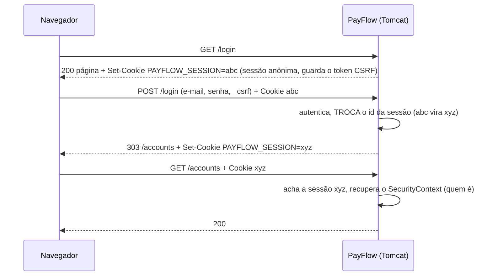
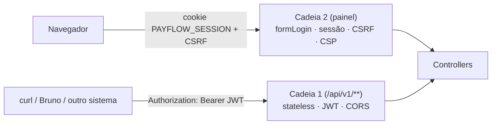

# J8.03 — Sessão vs JWT

> ⏱️ ~1h30 (a mais longa do módulo: leia primeiro, depois faça a migração com calma) · 🟢 Júnior · Pré-requisitos: J8.01, J8.02, J2 (cookies), J5.06 (`AuthInterceptor`, `LoginController`), J6.01 (`ApiClient`), J6.04 (`ApiProblems`, `ApiErrors`)

> ⚠️ **Verificação:** o `lab/security-lab` (**81 testes**, Spring Security 7.1.2, JDK 25) **executou** tudo o que é injetado abaixo e produziu as saídas coladas aqui (`SessionCookieServerTest`, `TokenAnatomyTest`, `JwtApiTest`, `WebPanelTest`). A migração das classes do PayFlow (controllers, templates, `PayflowWebTest`, `ApiClient`) foi **revisada por leitura**, **não executada**: o repositório do aluno não existe em disco aqui. Entre os passos 1 e 8 o projeto **não compila**; rode `mvn test` só no passo 9.

## 🎯 Objetivos
Ao final desta aula você consegue:
- **Comparar** sessão no servidor e JWT, e escolher cada um para o cliente certo.
- **Ler** um JWT (cabeçalho, claims, assinatura) e explicar o que a assinatura garante e o que **não** garante.
- **Configurar** duas `SecurityFilterChain`: o painel com sessão e *formLogin*, a API `/api/v1/**` com Bearer JWT.
- **Emitir e validar** o token (`JwtEncoder`/`JwtDecoder`, HS256, emissor, expiração).
- **Migrar** o PayFlow: tirar `AuthInterceptor`, `Sessions` e `SessionCookies`, e atualizar os testes.

## 🤔 Por que isso importa
O PayFlow tem **dois tipos de cliente**: o **navegador** do painel (cookies, páginas HTML, formulários) e **programas** que consomem a API REST (a J6: Bruno, `curl`, outro sistema). Cada um autentica melhor de um jeito. Escolher errado gera falhas conhecidas: JWT guardado em `localStorage` e roubado por um XSS; sessão em memória que some a cada *deploy*; API aberta a CSRF por aceitar cookie. Em entrevistas, "sessão ou JWT?" é a pergunta de segurança mais frequente do nível júnior, e a resposta certa começa com "**depende de quem é o cliente**".

## 💡 Intuição (explicação simples)
- **Sessão** é a **chapelaria**: ao entrar, você deixa o casaco e recebe um **número** (o cookie). O prédio guarda o casaco (o estado fica **no servidor**). Para saber quem você é, o prédio consulta a chapelaria. Dá para **cancelar** o número na hora (logout, bloqueio).
- **JWT** é um **documento assinado com validade**, tipo um ingresso de show: ele **carrega** seus dados e tem o carimbo do organizador. Quem confere só olha o carimbo e a data: **ninguém consulta nada**. O preço: se alguém roubar o ingresso, ele vale **até vencer**; o prédio não consegue "desligar" um ingresso já emitido.

## 🔬 Como funciona por dentro

### 1. A sessão (o painel)

O estado (o `SecurityContext`, com o `PayflowUserDetails`) mora na `HttpSession` do Tomcat; o cookie é só o **número**. Saída **real** do laboratório (`SessionCookieServerTest`, servidor Tomcat de verdade):
```text
Set-Cookie (login page): PAYFLOW_SESSION=ABD7E0FFC770CFAF2E2D47BF8513F6FC; Path=/; Secure; HttpOnly; SameSite=Lax
cookie antes do login:  PAYFLOW_SESSION=ABD7E0FFC770CF...
cookie depois do login: PAYFLOW_SESSION=14121472B54D68...
```
- **`HttpOnly`**: o JavaScript da página **não lê** o cookie; um XSS não o rouba (J8.05).
- **`Secure`**: o navegador só o envia por **HTTPS**.
- **`SameSite=Lax`**: o navegador **não** envia o cookie em requisições entre sites que não sejam navegação simples (a primeira defesa contra CSRF, J8.05). [MDN: `Set-Cookie`](https://developer.mozilla.org/en-US/docs/Web/HTTP/Reference/Headers/Set-Cookie).
- O **id mudou depois do login** (`ABD7...` → `1412...`): é a proteção contra ***session fixation*** (CWE-384, listada na categoria A07 da OWASP). Sem ela, um atacante que *planta* um id conhecido no navegador da vítima (um link, um cookie injetado) esperaria a vítima fazer login e **herdaria a sessão logada**. O Spring Security troca o id no login por padrão (`changeSessionId`).
- No **logout**, o cookie é apagado e a sessão destruída: com o cookie antigo, `/accounts` volta a redirecionar para o login (conferido). A resposta real do servidor para apagar: `PAYFLOW_SESSION=; Expires=Thu, 01 Jan 1970 00:00:10 GMT; Path=/; SameSite=Lax`.

### 2. O JWT (a API)
Um **JSON Web Token** ([RFC 7519](https://www.rfc-editor.org/rfc/rfc7519)) são **três partes** em Base64URL separadas por ponto: `cabeçalho.claims.assinatura`. Saída real do laboratório (`TokenAnatomyTest`) com um token emitido pelo `TokenService`:
```text
[jwt] partes: 3 | tamanho total: 336
[jwt] header : {"alg":"HS256"}
[jwt] payload: {"sub":"10000000-0000-0000-0000-000000000001","roles":["USER"],"iss":"payflow","name":"Ana Silva","exp":1794601604,"iat":1794600704,"jti":"7a601df8-b286-4f39-9376-f74832138ad2","email":"ana@payflow.dev"}
[jwt] assinatura (base64url, 43 caracteres): 5uVpGW6hdxOr...
```
Leitura:
- **`alg: HS256`**: a assinatura é um **HMAC-SHA256** do texto `cabeçalho.claims` com um **segredo** que só o servidor conhece. Quem não tem o segredo não consegue fabricar uma assinatura válida; quem altera uma letra do conteúdo invalida a assinatura.
- **Claims** (as "alegações"): `iss` (emissor: `payflow`), `sub` (o **id** do usuário, não o e-mail), `iat` (emitido em), `exp` (**expira em**; aqui 900 s depois de `iat`), `jti` (id único do token), mais `email`, `name` e `roles`.
- ⚠️ **O JWT é assinado, não criptografado.** Qualquer um decodifica o conteúdo (é só Base64: você acabou de ler). **Nunca** ponha senha, hash, CPF ou qualquer segredo nas claims. A assinatura garante **integridade** (ninguém mexeu) e **origem** (foi quem tem o segredo), nunca **sigilo**.
- **Como o servidor valida** a cada requisição, **sem consultar o banco**: (1) recalcula o HMAC e compara com a assinatura; (2) confere `exp` (não vencido) e `iss` (o emissor esperado); (3) lê `sub` e `roles`. Se qualquer passo falha: `401`.

**HS256 ou RS256?** HS256 usa **um segredo compartilhado**: quem valida também **poderia** assinar. Serve quando quem emite e quem valida são **a mesma aplicação** (o PayFlow monolítico). Com vários serviços que só precisam **validar**, usa-se **RS256** (par de chaves: assina com a privada, valida com a pública) e um servidor de autorização (Keycloak, P10). Mantemos HS256 e registramos a troca como evolução.

### 3. Sessão × JWT
| | Sessão (cookie) | JWT (Bearer) |
|---|---|---|
| Onde mora o estado | no **servidor** (memória, Redis) | no **token** (o cliente o carrega) |
| Quem manda o quê | o navegador manda o cookie **sozinho** | o cliente manda `Authorization: Bearer ...` **de propósito** |
| CSRF | **vulnerável** sem token CSRF (cookie vai sozinho) | **imune** (nada vai sozinho) |
| Revogar na hora | **sim** (apaga a sessão) | **não** (vale até `exp`; só com lista de revogação) |
| Escala em vários servidores | precisa de **sessão compartilhada** (Redis, P2) | **não precisa**: qualquer instância valida |
| Tamanho da requisição | pequeno (um id) | maior (o token inteiro, ~340 bytes aqui) |
| Melhor para | **navegador** + páginas | **APIs** e clientes que não são navegador |

Por isso o PayFlow usa **os dois**, cada um onde faz sentido:

A cadeia 1 casa com `/api/v1/**` (a primeira que casa vale, J8.01). O endpoint legado do painel, `/api/accounts/{id}/statement`, **não** casa: ele continua pela cadeia 2, com a **sessão** (o `statement.js` da J4 usa o cookie).

## 🛠️ Exemplo prático (a migração, em 9 passos)

### Passo 1: dependências e configuração
`pom.xml`: troque o teste da J8.01 por um que já inclui o suporte a JWT e acrescente o *starter* do *resource server* (nomes conferidos no Maven Central para o Boot 4.1.2; o nome antigo `spring-boot-starter-oauth2-resource-server` está **deprecado** em favor deste):
```xml
<dependency>
  <groupId>org.springframework.boot</groupId>
  <artifactId>spring-boot-starter-security-oauth2-resource-server</artifactId>
</dependency>
<dependency>
  <groupId>org.springframework.boot</groupId>
  <artifactId>spring-boot-starter-security-oauth2-resource-server-test</artifactId>   <!-- no lugar do security-test da J8.01 -->
  <scope>test</scope>
</dependency>
```
Versões efetivas pelo BOM: Spring Security **7.1.2**, `nimbus-jose-jwt` **10.9.1** (a biblioteca que assina e valida; vem pelo *starter*). Nenhum `<version>` (decisão 28).

**Configuração tipada.** Em `PayflowProperties` (J5.05/J6.08), **remova** o `record Session` (o cookie agora se configura no Tomcat) e acrescente `Security`. O arquivo abaixo é o do laboratório: o `Cors` é o que você já tem desde a J6.08; **copie** o `Security`:

`src/main/java/com/payflow/config/PayflowProperties.java`
```java
package com.payflow.config;

import java.time.Duration;
import java.util.List;
import org.springframework.boot.context.properties.ConfigurationProperties;
import org.springframework.boot.context.properties.bind.DefaultValue;

/** Só o que a segurança usa (no PayFlow, estes records se somam a Statement, Exchange e Cors das J5/J6). */
@ConfigurationProperties(prefix = "payflow")
public record PayflowProperties(@DefaultValue Cors cors, @DefaultValue Security security) {

    public record Cors(@DefaultValue List<String> allowedOrigins) { }

    /** Segurança (J8): JWT da API e proteção contra tentativas de senha. */
    public record Security(@DefaultValue Jwt jwt, @DefaultValue Login login) {

        /** O segredo NÃO tem valor padrão: sem ele a aplicação não sobe (decisão 31). */
        public record Jwt(String secret, @DefaultValue("payflow") String issuer, @DefaultValue("PT15M") Duration ttl) {
            public Jwt {
                if (secret == null || secret.getBytes(java.nio.charset.StandardCharsets.UTF_8).length < 32) {
                    throw new IllegalArgumentException("payflow.security.jwt.secret must have at least 32 bytes (HS256 needs a 256-bit key)");
                }
                if (issuer == null || issuer.isBlank()) {
                    throw new IllegalArgumentException("payflow.security.jwt.issuer must not be blank");
                }
                if (ttl.isNegative() || ttl.isZero() || ttl.compareTo(Duration.ofHours(1)) > 0) {
                    throw new IllegalArgumentException("payflow.security.jwt.ttl must be between 1 second and 1 hour");
                }
            }
        }

        /** Tentativas de login: depois de maxFailures erros seguidos, o e-mail fica bloqueado por lockDuration. */
        public record Login(@DefaultValue("5") int maxFailures, @DefaultValue("PT15M") Duration lockDuration) {
            public Login {
                if (maxFailures < 1) {
                    throw new IllegalArgumentException("payflow.security.login.max-failures must be >= 1");
                }
                if (lockDuration.isNegative() || lockDuration.isZero()) {
                    throw new IllegalArgumentException("payflow.security.login.lock-duration must be positive");
                }
            }
        }
    }
}
```

O construtor compacto de `Jwt` é a **falha rápida** (J5.05): um segredo curto ou ausente **impede a aplicação de subir**. Segredo mínimo de 32 bytes porque HS256 pede chave de 256 bits (testado em `PayflowPropertiesTest`).

`application.yml` (no lugar de `payflow.session.cookie-name`):
```yaml
server:
  servlet:
    session:
      timeout: 30m              # sessão do painel expira em 30 minutos sem uso
      cookie:
        name: PAYFLOW_SESSION   # o mesmo nome da J4
        http-only: true
        same-site: lax
        secure: true            # produção: só HTTPS (os perfis dev e test desligam)
```
`application-dev.yml` e `application-test.yml` (acrescente):
```yaml
server:
  servlet:
    session:
      cookie:
        secure: false           # o dev e os testes usam http://localhost; o HttpClient dos testes não envia cookie Secure por http

payflow:
  security:
    jwt:
      secret: dev-only-secret-never-use-in-production-0123456789abcdef    # no application-test.yml use outro valor, também só de teste
```
**Produção:** o segredo vem **só** do ambiente: `PAYFLOW_SECURITY_JWT_SECRET` (o Spring converte a variável em `payflow.security.jwt.secret`; sem ela a aplicação **não sobe**, decisão 31). Gere um segredo de verdade com `openssl rand -base64 48`.

### Passo 2: emitir e validar o token
`src/main/java/com/payflow/security/JwtConfig.java`
```java
package com.payflow.security;

import com.nimbusds.jose.jwk.source.ImmutableSecret;
import com.payflow.config.PayflowProperties;
import java.nio.charset.StandardCharsets;
import javax.crypto.SecretKey;
import javax.crypto.spec.SecretKeySpec;
import org.springframework.context.annotation.Bean;
import org.springframework.context.annotation.Configuration;
import org.springframework.security.oauth2.core.DelegatingOAuth2TokenValidator;
import org.springframework.security.oauth2.core.OAuth2TokenValidator;
import org.springframework.security.oauth2.jose.jws.MacAlgorithm;
import org.springframework.security.oauth2.jwt.Jwt;
import org.springframework.security.oauth2.jwt.JwtDecoder;
import org.springframework.security.oauth2.jwt.JwtEncoder;
import org.springframework.security.oauth2.jwt.JwtValidators;
import org.springframework.security.oauth2.jwt.NimbusJwtDecoder;
import org.springframework.security.oauth2.jwt.NimbusJwtEncoder;

/** Chave HS256 (um segredo compartilhado entre quem assina e quem confere: aqui, a mesma aplicação). */
@Configuration
public class JwtConfig {

    @Bean
    SecretKey jwtKey(PayflowProperties properties) {
        byte[] secret = properties.security().jwt().secret().getBytes(StandardCharsets.UTF_8);
        return new SecretKeySpec(secret, "HmacSHA256");
    }

    @Bean
    JwtEncoder jwtEncoder(SecretKey jwtKey) {
        return new NimbusJwtEncoder(new ImmutableSecret<>(jwtKey));
    }

    @Bean
    JwtDecoder jwtDecoder(SecretKey jwtKey, PayflowProperties properties) {
        NimbusJwtDecoder decoder = NimbusJwtDecoder.withSecretKey(jwtKey).macAlgorithm(MacAlgorithm.HS256).build();
        // expiração (com tolerância de 60 s de relógio) + emissor: um token de outro sistema, mesmo assinado, é recusado
        OAuth2TokenValidator<Jwt> validator = JwtValidators.createDefaultWithIssuer(properties.security().jwt().issuer());
        decoder.setJwtValidator(new DelegatingOAuth2TokenValidator<>(validator));
        return decoder;
    }
}
```

`src/main/java/com/payflow/security/TokenService.java`
```java
package com.payflow.security;

import com.payflow.config.PayflowProperties;
import java.time.Clock;
import java.time.Duration;
import java.time.Instant;
import java.util.List;
import java.util.UUID;
import org.springframework.security.oauth2.jose.jws.MacAlgorithm;
import org.springframework.security.oauth2.jwt.JwsHeader;
import org.springframework.security.oauth2.jwt.JwtClaimsSet;
import org.springframework.security.oauth2.jwt.JwtEncoder;
import org.springframework.security.oauth2.jwt.JwtEncoderParameters;
import org.springframework.stereotype.Service;

/** Emite o access token da API: curto (padrão 15 min), com o mínimo de claims e nenhum dado sensível. */
@Service
public class TokenService {

    public record IssuedToken(String value, Instant expiresAt) { }

    private final JwtEncoder encoder;
    private final Clock clock;
    private final String issuer;
    private final Duration ttl;

    public TokenService(JwtEncoder encoder, Clock clock, PayflowProperties properties) {
        this.encoder = encoder;
        this.clock = clock;
        this.issuer = properties.security().jwt().issuer();
        this.ttl = properties.security().jwt().ttl();
    }

    public Duration ttl() {
        return ttl;
    }

    public IssuedToken issue(PayflowUserDetails user) {
        Instant now = clock.instant();
        Instant expiresAt = now.plus(ttl);
        JwtClaimsSet claims = JwtClaimsSet.builder()
                .issuer(issuer)
                .subject(user.currentUser().id().toString())          // sub = id do usuário (não o e-mail)
                .issuedAt(now)
                .expiresAt(expiresAt)
                .id(UUID.randomUUID().toString())                      // jti: identifica este token (auditoria, revogação futura)
                .claim("email", user.currentUser().email())
                .claim("name", user.currentUser().fullName())
                .claim("roles", List.of(user.role().name()))
                .build();
        String value = encoder.encode(JwtEncoderParameters.from(JwsHeader.with(MacAlgorithm.HS256).build(), claims)).getTokenValue();
        return new IssuedToken(value, expiresAt);
    }
}
```
- **`jwtKey`**: a chave HMAC a partir do segredo. `ImmutableSecret` entrega a chave ao Nimbus para **assinar**; o `NimbusJwtDecoder.withSecretKey(...)` a usa para **conferir**.
- **`macAlgorithm(HS256)`**: o decodificador **só aceita HS256**. É isso que derruba o ataque `alg: none` e a confusão de algoritmos (a aula J8.06 prova com testes).
- **`createDefaultWithIssuer("payflow")`**: valida **expiração** (com tolerância de 60 s de relógio) **e o emissor**. Um token assinado com a nossa chave mas com outro `iss` é recusado.
- **`TokenService`** usa o `Clock` do PayFlow (o bean da `ClockConfig`, o mesmo de `LedgerEntry`, J5.03 e J5.11; nos testes pode ser fixo). O `ttl` padrão é **15 minutos**; a propriedade recusa mais de 1 hora. `sub` é o **id** do usuário (estável); o e-mail muda, o id não.

### Passo 3: o endpoint de login da API
`src/main/java/com/payflow/web/api/dto/LoginRequest.java`
```java
package com.payflow.web.api.dto;

import jakarta.validation.constraints.NotBlank;
import jakarta.validation.constraints.Size;

/** Limites de tamanho: um corpo gigante não deve chegar ao BCrypt (custo de CPU). */
public record LoginRequest(@NotBlank @Size(max = 255) String email, @NotBlank @Size(max = 128) String password) {

    /** O toString padrão de um record imprime TODOS os componentes: um log.info("{}", request) vazaria a senha. */
    @Override
    public String toString() {
        return "LoginRequest[password=***]";
    }
}
```

`src/main/java/com/payflow/web/api/dto/TokenResponse.java`
```java
package com.payflow.web.api.dto;

public record TokenResponse(String accessToken, String tokenType, long expiresIn) { }
```

`src/main/java/com/payflow/web/api/AuthController.java`
```java
package com.payflow.web.api;

import com.payflow.security.PayflowUserDetails;
import com.payflow.security.TokenService;
import com.payflow.web.api.dto.LoginRequest;
import com.payflow.web.api.dto.TokenResponse;
import jakarta.validation.Valid;
import java.util.Locale;
import org.springframework.security.authentication.AuthenticationManager;
import org.springframework.security.authentication.UsernamePasswordAuthenticationToken;
import org.springframework.security.core.Authentication;
import org.springframework.web.bind.annotation.PostMapping;
import org.springframework.web.bind.annotation.RequestBody;
import org.springframework.web.bind.annotation.RequestMapping;
import org.springframework.web.bind.annotation.RestController;

/** Troca e-mail e senha por um access token (JWT). A senha só passa por aqui e pelo formulário do painel. */
@RestController
@RequestMapping("/api/v1/auth")
public class AuthController {

    private final AuthenticationManager authenticationManager;
    private final TokenService tokens;

    public AuthController(AuthenticationManager authenticationManager, TokenService tokens) {
        this.authenticationManager = authenticationManager;
        this.tokens = tokens;
    }

    @PostMapping("/token")
    public TokenResponse token(@Valid @RequestBody LoginRequest request) {
        Authentication authentication = authenticationManager.authenticate(
                UsernamePasswordAuthenticationToken.unauthenticated(request.email().trim().toLowerCase(Locale.ROOT), request.password()));
        var issued = tokens.issue((PayflowUserDetails) authentication.getPrincipal());
        return new TokenResponse(issued.value(), "Bearer", tokens.ttl().toSeconds());
    }
}
```
- A senha só entra por **este** endpoint (e pelo formulário do painel); o token sai e a senha **não é guardada nem logada**. O `LoginRequest` limita o tamanho dos campos: o `@Size(max = 128)` impede um corpo gigante de chegar ao BCrypt (CPU). O `toString` sobrescrito (`LoginRequest[password=***]`) existe porque o de um `record` imprime **todos** os componentes: um `log.info("{}", request)` vazaria a senha (a J8.06 mostra a saída).
- O `AuthenticationManager` é o da J8.02. Quando a senha ou o e-mail estão errados, ele lança `BadCredentialsException`, e **sem um tratador específico o *catch-all* do `ApiErrors` (J6.04) a transformaria em `500`**. Acrescente ao `ApiErrors` (o `problem(...)` é o auxiliar que ele já tem):
```java
/** E-mail ou senha errados no POST /api/v1/auth/token: 401, e a MESMA mensagem para os dois casos (sem enumeração de usuários). */
@ExceptionHandler(BadCredentialsException.class)
ProblemDetail invalidCredentials(BadCredentialsException e) {
    return problem(HttpStatus.UNAUTHORIZED, "invalid-credentials", "Invalid credentials", "Invalid e-mail or password.");
}
```
  (import `org.springframework.security.authentication.BadCredentialsException`). A J8.04 acrescenta o tratador do `403` e a J8.06, o do `429`.

Chamada real (mesmo formato do laboratório; o token abaixo é encurtado):
```bash
curl -s -X POST http://localhost:8080/api/v1/auth/token -H 'Content-Type: application/json' \
  -d '{"email":"ana@payflow.dev","password":"Payflow#Dev2026"}'
# {"accessToken":"eyJhbGciOiJIUzI1NiJ9.eyJzdWIi...","tokenType":"Bearer","expiresIn":900}
```

### Passo 4: as duas cadeias
`src/main/java/com/payflow/security/ApiSecurityErrors.java`
```java
package com.payflow.security;

import com.payflow.web.api.ApiProblems;
import jakarta.servlet.http.HttpServletRequest;
import jakarta.servlet.http.HttpServletResponse;
import org.springframework.http.HttpStatus;
import org.springframework.security.access.AccessDeniedException;
import org.springframework.security.core.AuthenticationException;
import org.springframework.security.oauth2.server.resource.web.BearerTokenAuthenticationEntryPoint;
import org.springframework.security.web.AuthenticationEntryPoint;
import org.springframework.security.web.access.AccessDeniedHandler;
import org.springframework.stereotype.Component;

/**
 * Os erros que acontecem NO FILTRO (antes de qualquer controller): 401 e 403 da API em Problem Details.
 * O @RestControllerAdvice não alcança aqui, porque o filtro roda antes do DispatcherServlet.
 */
@Component
public class ApiSecurityErrors implements AuthenticationEntryPoint, AccessDeniedHandler {

    private final ApiProblems problems;
    private final BearerTokenAuthenticationEntryPoint bearer = new BearerTokenAuthenticationEntryPoint();

    public ApiSecurityErrors(ApiProblems problems) {
        this.problems = problems;
    }

    /** Sem token, token expirado, adulterado ou de outro emissor: 401 + o cabeçalho WWW-Authenticate: Bearer (RFC 6750). */
    @Override
    public void commence(HttpServletRequest request, HttpServletResponse response, AuthenticationException e) {
        bearer.commence(request, response, e);                      // grava o WWW-Authenticate (com error="invalid_token" quando há token)
        problems.write(response, HttpStatus.UNAUTHORIZED, "not-authenticated", "Not authenticated", "Log in to use this API.");
    }

    /** Autenticado, mas sem o papel exigido: 403. */
    @Override
    public void handle(HttpServletRequest request, HttpServletResponse response, AccessDeniedException e) {
        problems.write(response, HttpStatus.FORBIDDEN, "forbidden", "Forbidden", "You do not have permission to do this.");
    }
}
```

`src/main/java/com/payflow/security/SeeOtherRedirectStrategy.java`
```java
package com.payflow.security;

import jakarta.servlet.http.HttpServletRequest;
import jakarta.servlet.http.HttpServletResponse;
import java.io.IOException;
import org.springframework.http.HttpHeaders;
import org.springframework.http.HttpStatus;
import org.springframework.security.web.DefaultRedirectStrategy;

/** O padrão do Spring Security é 302; o PayFlow usa 303 depois de um POST (decisão 25): "agora faça um GET lá". */
public class SeeOtherRedirectStrategy extends DefaultRedirectStrategy {

    @Override
    public void sendRedirect(HttpServletRequest request, HttpServletResponse response, String url) throws IOException {
        String target = response.encodeRedirectURL(calculateRedirectUrl(request.getContextPath(), url));
        response.setStatus(HttpStatus.SEE_OTHER.value());
        response.setHeader(HttpHeaders.LOCATION, target);
    }
}
```

`src/main/java/com/payflow/security/SecurityConfig.java`
```java
package com.payflow.security;

import org.springframework.beans.factory.annotation.Value;
import org.springframework.boot.security.autoconfigure.actuate.web.servlet.EndpointRequest;
import org.springframework.context.annotation.Bean;
import org.springframework.context.annotation.Configuration;
import org.springframework.core.annotation.Order;
import org.springframework.http.HttpMethod;
import org.springframework.http.HttpStatus;
import org.springframework.security.authentication.AuthenticationEventPublisher;
import org.springframework.security.authentication.AuthenticationManager;
import org.springframework.security.authentication.AuthenticationProvider;
import org.springframework.security.authentication.LockedException;
import org.springframework.security.authentication.ProviderManager;
import org.springframework.security.authentication.dao.DaoAuthenticationProvider;
import org.springframework.security.config.Customizer;
import org.springframework.security.config.annotation.method.configuration.EnableMethodSecurity;
import org.springframework.security.config.annotation.web.builders.HttpSecurity;
import org.springframework.security.config.annotation.web.configuration.EnableWebSecurity;
import org.springframework.security.config.annotation.web.configurers.AbstractHttpConfigurer;
import org.springframework.security.config.http.SessionCreationPolicy;
import org.springframework.security.core.userdetails.UserDetailsService;
import org.springframework.security.crypto.factory.PasswordEncoderFactories;
import org.springframework.security.crypto.password.PasswordEncoder;
import org.springframework.security.oauth2.server.resource.authentication.JwtAuthenticationConverter;
import org.springframework.security.oauth2.server.resource.authentication.JwtGrantedAuthoritiesConverter;
import org.springframework.security.web.AuthenticationEntryPoint;
import org.springframework.security.web.SecurityFilterChain;
import org.springframework.security.web.authentication.AuthenticationFailureHandler;
import org.springframework.security.web.authentication.DelegatingAuthenticationEntryPoint;
import org.springframework.security.web.authentication.HttpStatusEntryPoint;
import org.springframework.security.web.authentication.LoginUrlAuthenticationEntryPoint;
import org.springframework.security.web.authentication.SavedRequestAwareAuthenticationSuccessHandler;
import org.springframework.security.web.authentication.logout.SimpleUrlLogoutSuccessHandler;

/** A segurança do PayFlow: duas cadeias de filtros (API com JWT, painel com sessão), negar por padrão. */
@Configuration
@EnableWebSecurity
@EnableMethodSecurity
public class SecurityConfig {

    static final String CSP = "default-src 'self'; script-src 'self'; style-src 'self'; img-src 'self' data:; "
            + "frame-ancestors 'none'; form-action 'self'; base-uri 'self'";

    // ---------- peças comuns ----------

    @Bean
    static PasswordEncoder passwordEncoder() {
        return PasswordEncoderFactories.createDelegatingPasswordEncoder();      // grava "{bcrypt}$2a$10$..."
    }

    @Bean
    AuthenticationProvider authenticationProvider(UserDetailsService users, PasswordEncoder encoder) {
        DaoAuthenticationProvider dao = new DaoAuthenticationProvider(users);
        dao.setPasswordEncoder(encoder);
        return dao;
    }

    /** Um gerenciador só, usado pelo formulário e pela API; o publicador faz os eventos chegarem ao SecurityAudit. */
    @Bean
    AuthenticationManager authenticationManager(AuthenticationProvider provider, AuthenticationEventPublisher publisher) {
        ProviderManager manager = new ProviderManager(provider);
        manager.setAuthenticationEventPublisher(publisher);
        return manager;
    }

    /** Papéis do token: a claim "roles" (["USER"]) vira a autoridade ROLE_USER. */
    @Bean
    JwtAuthenticationConverter jwtAuthenticationConverter() {
        JwtGrantedAuthoritiesConverter authorities = new JwtGrantedAuthoritiesConverter();
        authorities.setAuthoritiesClaimName("roles");
        authorities.setAuthorityPrefix("ROLE_");
        JwtAuthenticationConverter converter = new JwtAuthenticationConverter();
        converter.setJwtGrantedAuthoritiesConverter(authorities);
        return converter;
    }

    // ---------- cadeia 1: a API (/api/v1/**), sem estado, com JWT ----------

    @Bean
    @Order(1)
    SecurityFilterChain apiChain(HttpSecurity http, JwtAuthenticationConverter jwtConverter, ApiSecurityErrors errors) throws Exception {
        http.securityMatcher("/api/v1/**")
                .authorizeHttpRequests(auth -> auth
                        .requestMatchers(HttpMethod.POST, "/api/v1/auth/token").permitAll()
                        .requestMatchers("/api/v1/admin/**").hasRole("ADMIN")
                        .anyRequest().authenticated())
                .sessionManagement(session -> session.sessionCreationPolicy(SessionCreationPolicy.STATELESS))
                .csrf(AbstractHttpConfigurer::disable)           // sem cookie de sessão, não há o que forjar (J8.05)
                .cors(Customizer.withDefaults())                  // usa o addCorsMappings da J6.08; o preflight passa sem token
                .oauth2ResourceServer(oauth -> oauth
                        .jwt(jwt -> jwt.jwtAuthenticationConverter(jwtConverter))
                        .authenticationEntryPoint(errors)
                        .accessDeniedHandler(errors))
                .exceptionHandling(ex -> ex.authenticationEntryPoint(errors).accessDeniedHandler(errors));
        return http.build();
    }

    /**
     * Quem não está logado: fetch/XHR para /api/** (o extrato do painel) recebe 401; qualquer outra
     * requisição é mandada para /login. Montado à mão porque o padrão do formulário só redireciona
     * quando o cabeçalho Accept pede HTML (um curl sem Accept receberia 401).
     */
    private static AuthenticationEntryPoint webEntryPoint() {
        return DelegatingAuthenticationEntryPoint.builder()
                .defaultEntryPoint(new LoginUrlAuthenticationEntryPoint("/login"))
                .addEntryPointFor(new HttpStatusEntryPoint(HttpStatus.UNAUTHORIZED), request -> request.getRequestURI().startsWith("/api/"))
                .build();
    }

    // ---------- cadeia 2: o painel (tudo o mais), com sessão e CSRF ----------

    @Bean
    @Order(2)
    SecurityFilterChain webChain(HttpSecurity http, AuthenticationManager authenticationManager,
                                 @Value("${server.servlet.session.cookie.name:JSESSIONID}") String sessionCookie) throws Exception {
        SeeOtherRedirectStrategy seeOther = new SeeOtherRedirectStrategy();

        SavedRequestAwareAuthenticationSuccessHandler onSuccess = new SavedRequestAwareAuthenticationSuccessHandler();
        onSuccess.setDefaultTargetUrl("/accounts");
        onSuccess.setRedirectStrategy(seeOther);

        AuthenticationFailureHandler onFailure = (request, response, e) ->
                seeOther.sendRedirect(request, response, e instanceof LockedException ? "/login?locked" : "/login?error");

        SimpleUrlLogoutSuccessHandler onLogout = new SimpleUrlLogoutSuccessHandler();
        onLogout.setDefaultTargetUrl("/login?logout");
        onLogout.setRedirectStrategy(seeOther);

        http.authenticationManager(authenticationManager)
                .authorizeHttpRequests(auth -> auth
                        .requestMatchers("/login", "/forbidden", "/error", "/static/**").permitAll()
                        .requestMatchers(EndpointRequest.to("health", "info")).permitAll()
                        .requestMatchers(EndpointRequest.toAnyEndpoint()).hasRole("ADMIN")
                        .anyRequest().authenticated())
                .formLogin(form -> form
                        .loginPage("/login").loginProcessingUrl("/login")
                        .usernameParameter("email").passwordParameter("password")
                        .successHandler(onSuccess).failureHandler(onFailure))
                .logout(logout -> logout
                        .logoutUrl("/logout").logoutSuccessHandler(onLogout)
                        .deleteCookies(sessionCookie))
                .exceptionHandling(ex -> ex
                        .authenticationEntryPoint(webEntryPoint())
                        // 403 (inclusive CSRF inválido) com a página de erro do PayFlow, não a do Boot
                        .accessDeniedHandler((request, response, e) -> {
                            response.setStatus(HttpStatus.FORBIDDEN.value());
                            request.getRequestDispatcher("/forbidden").forward(request, response);
                        }))
                .headers(headers -> headers
                        .contentSecurityPolicy(csp -> csp.policyDirectives(CSP))
                        .referrerPolicy(referrer -> referrer.policy(
                                org.springframework.security.web.header.writers.ReferrerPolicyHeaderWriter.ReferrerPolicy.SAME_ORIGIN)));
        return http.build();
    }
}
```
Leia a configuração por partes:
- **`@Order(1)` + `securityMatcher("/api/v1/**")`**: a cadeia da API é a primeira e só casa com a API. Dentro dela: `POST /api/v1/auth/token` é público (senão ninguém conseguiria o token); `/api/v1/admin/**` exige `ADMIN` (J8.04); **o resto exige estar autenticado** (`anyRequest().authenticated()`).
- **`STATELESS`**: a API **não cria sessão** (nada de `Set-Cookie`). **`csrf` desligado** aqui, e **só aqui**: sem cookie de sessão, não há o que forjar; o token vai em um cabeçalho que o navegador não manda sozinho (J8.05).
- **`cors(withDefaults())`**: usa o `addCorsMappings` da J6.08 e **vem antes da autenticação** (o `CorsFilter` está na lista da J8.01): o *preflight* do navegador passa **sem token**. Conferido em `CorsPreflightTest`: origem permitida → `Access-Control-Allow-Origin`; outra origem → `403`.
- **`oauth2ResourceServer(jwt)`**: liga o `BearerTokenAuthenticationFilter` e o `JwtDecoder`. O `jwtAuthenticationConverter` transforma a claim `roles: ["USER"]` na autoridade `ROLE_USER`.
- **`@Order(2)`, sem `securityMatcher`**: a cadeia do painel é a **genérica** (casa com o resto). As exceções: `/login`, `/forbidden`, `/error`, `/static/**` e `health`/`info` do Actuator são **públicos**; os demais endpoints do Actuator exigem `ADMIN`; **todo o resto exige login**: é a regra *negar por padrão* que o `AuthInterceptor` não tinha.
- **`formLogin`** com `usernameParameter("email")`: o formulário envia `email` e `password`. **Sucesso e falha respondem `303`** (decisão 25: depois de um `POST`, 303), por isso o `SeeOtherRedirectStrategy` (o padrão do Spring é `302`); o sucesso volta para a página que o usuário pediu antes do login (`SavedRequest`) ou para `/accounts`. No Spring Security 7, essa volta é uma **URL absoluta com o marcador `continue`** no fim (conferido: `http://localhost/accounts?x=1&continue`): não estranhe o `&continue` na barra de endereço.
- **`logout`**: só por `POST` (com CSRF), apaga o cookie e responde `303`.
- **`webEntryPoint`**: o usuário sem login é mandado para `/login` (`302`), **exceto** para `/api/**` (o `fetch` do extrato), que recebe `401` em vez de uma página HTML. É montado à mão porque o padrão do `formLogin` só redireciona quando o `Accept` pede HTML: um `curl` receberia `401` (visto no laboratório).
- **`accessDeniedHandler`**: o `403` (inclusive **CSRF inválido**) é encaminhado (*forward*) para `/forbidden`, a página de erro do PayFlow, em vez da página padrão do Boot.
- **`headers`**: acrescenta a **CSP** e a política de *referrer* (J8.05); os demais cabeçalhos já vêm de graça.
- **`@EnableMethodSecurity`**: liga `@PreAuthorize` (J8.04).

### Passo 5: `CurrentUser` sem interceptor
O `AuthInterceptor` guardava o usuário em um atributo da requisição e os controllers o pegavam com `@RequestAttribute`. Agora quem sabe quem é o usuário é o `SecurityContext`, e um **resolvedor de argumento** entrega o `CurrentUser` a qualquer método de controller que o declare, **venha o login do formulário ou do JWT**:

`src/main/java/com/payflow/web/CurrentUserArgumentResolver.java`
```java
package com.payflow.web;

import com.payflow.security.PayflowUserDetails;
import java.util.UUID;
import org.springframework.core.MethodParameter;
import org.springframework.security.core.Authentication;
import org.springframework.security.core.context.SecurityContextHolder;
import org.springframework.security.oauth2.jwt.Jwt;
import org.springframework.security.oauth2.server.resource.authentication.JwtAuthenticationToken;
import org.springframework.web.bind.support.WebDataBinderFactory;
import org.springframework.web.context.request.NativeWebRequest;
import org.springframework.web.method.support.HandlerMethodArgumentResolver;
import org.springframework.web.method.support.ModelAndViewContainer;

/** Entrega o CurrentUser a qualquer método de controller que o declare, venha o login do formulário ou do JWT. */
public class CurrentUserArgumentResolver implements HandlerMethodArgumentResolver {

    @Override
    public boolean supportsParameter(MethodParameter parameter) {
        return CurrentUser.class.equals(parameter.getParameterType());
    }

    @Override
    public Object resolveArgument(MethodParameter parameter, ModelAndViewContainer mavContainer,
                                  NativeWebRequest webRequest, WebDataBinderFactory binderFactory) {
        Authentication authentication = SecurityContextHolder.getContext().getAuthentication();
        if (authentication != null && authentication.getPrincipal() instanceof PayflowUserDetails details) {
            return details.currentUser();                                    // login pelo formulário (sessão)
        }
        if (authentication instanceof JwtAuthenticationToken token) {
            return fromJwt(token.getToken());                                // login pela API (Bearer)
        }
        throw new IllegalStateException("No authenticated user: is this path protected by the security chain?");
    }

    static CurrentUser fromJwt(Jwt jwt) {
        return new CurrentUser(UUID.fromString(jwt.getSubject()), jwt.getClaimAsString("email"), jwt.getClaimAsString("name"));
    }
}
```

`src/main/java/com/payflow/web/WebConfig.java`
```java
package com.payflow.web;

import com.payflow.config.PayflowProperties;
import java.util.List;
import org.springframework.context.annotation.Configuration;
import org.springframework.web.method.support.HandlerMethodArgumentResolver;
import org.springframework.web.servlet.config.annotation.CorsRegistry;
import org.springframework.web.servlet.config.annotation.WebMvcConfigurer;

@Configuration
public class WebConfig implements WebMvcConfigurer {

    private final PayflowProperties properties;

    public WebConfig(PayflowProperties properties) {
        this.properties = properties;
    }

    @Override
    public void addArgumentResolvers(List<HandlerMethodArgumentResolver> resolvers) {
        resolvers.add(new CurrentUserArgumentResolver());
    }

    /** Como na J6.08: só as origens configuradas (lista vazia = nenhuma). */
    @Override
    public void addCorsMappings(CorsRegistry registry) {
        List<String> origins = properties.cors().allowedOrigins();
        if (!origins.isEmpty()) {
            registry.addMapping("/api/v1/**")
                    .allowedOrigins(origins.toArray(String[]::new))
                    .allowedMethods("GET", "POST", "OPTIONS")
                    .allowedHeaders("Authorization", "Content-Type", "Idempotency-Key")
                    .exposedHeaders("Location")
                    .maxAge(3600);
        }
    }
}
```
No `WebConfig` do PayFlow (J6.08), mude só três coisas: **tire** o `addInterceptors` (e o `AuthInterceptor` do construtor), **acrescente** o `addArgumentResolvers` acima, e confira que o `allowedHeaders` do CORS inclui `Authorization` (o navegador precisa poder enviar o token). O `addCorsMappings` é o da J6.08.

### Passo 6: os controllers
Em **todo** controller que recebia `@RequestAttribute(AuthInterceptor.USER) CurrentUser user`, o parâmetro vira só `CurrentUser user`:
```bash
git grep -n "AuthInterceptor" src                       # a lista do que muda
git grep -l "@RequestAttribute(AuthInterceptor.USER)" src | xargs sed -i 's/@RequestAttribute(AuthInterceptor.USER) //'
git grep -l "import org.springframework.web.bind.annotation.RequestAttribute;" src | xargs sed -i '/^import org.springframework.web.bind.annotation.RequestAttribute;$/d'
git grep -l "import com.payflow.web.AuthInterceptor;" src | xargs sed -i '/^import com.payflow.web.AuthInterceptor;$/d'
```
Os controllers da API (J6.07) têm `@Parameter(hidden = true) @RequestAttribute(AuthInterceptor.USER) CurrentUser user`: o `sed` deixa `@Parameter(hidden = true) CurrentUser user`, e **o `hidden` continua necessário**, para o springdoc não listar `id`, `email` e `fullName` do usuário como parâmetros da operação no OpenAPI.

Nos controllers dos **testes** de fatia da J7 (`TransfersControllerWebTest`), a autenticação por cookie some: a J8.04 mostra o novo formato.

### Passo 7: o painel (login, logout, 403)
`src/main/java/com/payflow/web/LoginController.java` (**substitui** o da J5.06; quem autentica agora é o Spring Security, aqui ficam só as páginas):
```java
package com.payflow.web;

import org.springframework.http.HttpStatus;
import org.springframework.stereotype.Controller;
import org.springframework.web.bind.annotation.GetMapping;
import org.springframework.web.bind.annotation.RequestMapping;
import org.springframework.web.bind.annotation.RequestParam;
import org.springframework.web.servlet.ModelAndView;

/** Só as páginas de entrada e o destino do 403: quem confere a senha é o Spring Security (formLogin). */
@Controller
public class LoginController {

    @GetMapping("/")
    public ModelAndView root() {
        return Pages.redirect("/accounts");
    }

    @GetMapping("/login")
    public ModelAndView form(@RequestParam(required = false) String error, @RequestParam(required = false) String locked,
                             @RequestParam(required = false) String logout) {
        String message = error != null ? "E-mail ou senha inválidos."
                : locked != null ? "Muitas tentativas. Tente de novo mais tarde."
                : logout != null ? "Você saiu." : null;
        return Pages.page("login", HttpStatus.OK, "error", message);
    }

    /** O Spring Security encaminha para cá o 403 do painel (inclusive CSRF inválido). */
    @RequestMapping("/forbidden")
    public ModelAndView forbidden() {
        return Pages.page("error", HttpStatus.FORBIDDEN, "title", "Acesso negado", "message", "Você não tem permissão para fazer isso.");
    }
}
```
Os dois `@RequestParam` do `?error` e `?locked` chegam do redirecionamento da cadeia (`/login?error`). O `/login?locked` só ocorre com o limitador da J8.06; deixe o texto pronto.

`src/main/resources/templates/login.html` (acrescenta a **senha** e troca `action` por `th:action`, o que faz o Thymeleaf **inserir o token CSRF** como campo oculto: confirmado no laboratório, a página de login traz `name="_csrf"`):
```html
<!DOCTYPE html>
<html lang="pt-BR" xmlns:th="http://www.thymeleaf.org">
<head th:replace="~{fragments :: head('Entrar')}"></head>
<body>
<a class="skip-link" href="#conteudo">Ir para o conteúdo</a>
<header th:replace="~{fragments :: header}"></header>
<main id="conteudo" class="container narrow">
  <h1>Entrar</h1>
  <form th:action="|/login|" method="post" novalidate>
    <div class="field">
      <label for="email">E-mail</label>
      <input id="email" name="email" type="email" autocomplete="username" required>
    </div>
    <div class="field">
      <label for="password">Senha</label>
      <input id="password" name="password" type="password" autocomplete="current-password" required
             th:attr="aria-describedby=${error} != null ? 'login-erro' : null, aria-invalid=${error} != null ? 'true' : null">
    </div>
    <p id="login-erro" class="error" role="alert" th:if="${error != null}" th:text="${error}">Erro</p>
    <button type="submit" class="button">Entrar</button>
  </form>
</main>
<footer th:replace="~{fragments :: footer}"></footer>
</body>
</html>
```
- O e-mail digitado **não volta** no campo depois de um erro (o redirecionamento perde o dado); é de propósito: menos coisa ecoada. `autocomplete="current-password"` deixa o gerenciador de senhas do navegador funcionar (acessibilidade e segurança).
- O erro é **uma** mensagem para os dois campos (não diz se foi o e-mail ou a senha).

`fragments.html`: o formulário de logout vira `th:action` (**sem isso, o `POST /logout` leva 403 por falta de token**) e o rodapé deixa de dizer "provisório":
```html
<form th:action="|/logout|" method="post">          <!-- era: action="/logout" -->
  <button type="submit" class="button button-quiet">Sair</button>
</form>
...
<p>PayFlow · projeto de estudo.</p>                   <!-- era: "Login provisório, sem senha, até o módulo J8." -->
```
O formulário de **depósito** (J4.06) já usa `th:action="|/accounts/${account.id}/deposit|"`: ganha o token **sozinho**.

### Passo 8: apagar o que ficou para trás
```bash
git rm src/main/java/com/payflow/web/AuthInterceptor.java src/main/java/com/payflow/web/Sessions.java \
       src/main/java/com/payflow/web/SessionCookies.java src/main/java/com/payflow/security/BridgeSecurityConfig.java
git grep -n "Sessions\|SessionCookies\|AuthInterceptor\|BridgeSecurityConfig\|payflow.session\|session().cookieName" src
```
A segunda linha deve ficar **vazia** (menos nos testes antigos, passo 9). O `PayflowProperties.Session` já saiu no passo 1; o `payflow.session.cookie-name` sai do `application.yml`.

### Passo 9: os testes
**(a)** `application-test.yml`: o `secure: false` e o segredo de teste do passo 1.

**(b)** `ApiClient` (J6.01): em vez do cookie, guarda o **token** e o envia em `Authorization`. A sobrecarga `login(email)` **mantém** as chamadas que já existem (`new ApiClient(port).login("ana@payflow.dev")`) sem mudar nenhum teste da J6:
```java
package com.payflow.support;

import com.jayway.jsonpath.JsonPath;
import java.net.URI;
import java.net.http.HttpClient;
import java.net.http.HttpRequest;
import java.net.http.HttpResponse;
import java.util.Map;

/** Cliente HTTP de teste: obtém o JWT em /api/v1/auth/token e o envia como Bearer. */
public class ApiClient {

    public static final String PASSWORD = "Payflow#Dev2026";           // a senha de todo usuário do seed (só dev/teste)

    private final String base;
    private final HttpClient client = HttpClient.newBuilder().followRedirects(HttpClient.Redirect.NEVER).build();
    private String token;

    public ApiClient(int port) {
        this.base = "http://localhost:" + port;
    }

    public ApiClient login(String email) throws Exception {
        return login(email, PASSWORD);
    }

    public ApiClient login(String email, String password) throws Exception {
        String json = "{\"email\":\"" + email + "\",\"password\":\"" + password + "\"}";
        var response = client.send(HttpRequest.newBuilder(URI.create(base + "/api/v1/auth/token"))
                .header("Content-Type", "application/json").POST(HttpRequest.BodyPublishers.ofString(json)).build(),
                HttpResponse.BodyHandlers.ofString());
        if (response.statusCode() != 200) {
            throw new IllegalStateException("login failed: " + response.statusCode());
        }
        this.token = JsonPath.read(response.body(), "$.accessToken");
        return this;
    }

    public HttpResponse<String> get(String path) throws Exception {
        return send(HttpRequest.newBuilder(URI.create(base + path)).header("Accept", "application/json"));
    }

    public HttpResponse<String> post(String path, String json, Map<String, String> headers) throws Exception {
        var builder = HttpRequest.newBuilder(URI.create(base + path)).header("Content-Type", "application/json")
                .header("Accept", "application/json").POST(HttpRequest.BodyPublishers.ofString(json));
        headers.forEach(builder::header);
        return send(builder);
    }

    public HttpResponse<String> send(HttpRequest.Builder builder) throws Exception {
        if (token != null) {
            builder.header("Authorization", "Bearer " + token);
        }
        return client.send(builder.build(), HttpResponse.BodyHandlers.ofString());
    }
}
```
**(c)** `PayflowWebTest` (J5.06, o painel): o `CookieManager` e o banco continuam; mudam os *helpers* de `POST`, porque agora **todo `POST` leva o token CSRF** (que fica em um campo oculto da página que contém o formulário) e o login leva senha:
```java
private String csrfOf(String pagePath) throws Exception {
    Matcher m = Pattern.compile("name=\"_csrf\"\\s+value=\"([^\"]+)\"").matcher(get(pagePath).body());
    assertThat(m.find()).as("campo _csrf em " + pagePath).isTrue();
    return m.group(1);
}

/** formPage = a página que tem o formulário (de onde sai o token); pairs = nome, valor, nome, valor... */
private HttpResponse<String> post(String formPage, String action, String... pairs) throws Exception {
    StringBuilder body = new StringBuilder("_csrf=" + URLEncoder.encode(csrfOf(formPage), StandardCharsets.UTF_8));
    for (int i = 0; i < pairs.length; i += 2) {
        body.append('&').append(pairs[i]).append('=').append(URLEncoder.encode(pairs[i + 1], StandardCharsets.UTF_8));
    }
    return client.send(HttpRequest.newBuilder(URI.create(base + action))
            .header("Content-Type", "application/x-www-form-urlencoded")
            .POST(BodyPublishers.ofString(body.toString())).build(), BodyHandlers.ofString());
}

private void loginAsAna() throws Exception {
    assertThat(post("/login", "/login", "email", "ana@payflow.dev", "password", "Payflow#Dev2026").statusCode()).isEqualTo(303);
}
```
E as expectativas que **mudam** (o resto do arquivo só troca a chamada de `post`):

| Teste da J5.06 | Antes | Agora |
|---|---|---|
| `pagesRequireLogin` | `303` para `/login` | **`302`** para `/login` (o redirecionamento de entrada do Spring é `302`; o `303` é para respostas a `POST`); a API legada continua **401** |
| `unknownEmailIsRejectedAndTheOutputIsEscaped` | `401` e e-mail escapado na página | login inválido é **`303` para `/login?error`** (a GET seguinte mostra "E-mail ou senha inválidos."); o e-mail **nem aparece** mais; a prova de escape passa a ser o `XssLabTest` (J8.05) |
| `depositFollowsPostRedirectGet` e demais com `POST` | `post(path, campo, valor)` | `post("/accounts/ID", "/accounts/ID/deposit", "amount", "25,90")` |

Como o `HttpClient` do teste usa `CookieManager` (ele **não** envia cookie `Secure` por `http://`), o `secure: false` do perfil `test` é obrigatório; o atributo `Secure` de **produção** é conferido pelo laboratório (`SessionCookieServerTest`, com o perfil de teste que não o desliga).

**(d)** Um teste novo da API, copiado do laboratório: `lab/security-lab/src/test/java/com/payflow/JwtApiTest.java` e `.../support/Tokens.java` para o seu `src/test`, trocando `InMemoryData.X` pelos ids do seed (são **os mesmos** UUIDs: `10000000-...01` Ana, `...02` Bruno, `...05` admin, contas `20000000-...01`/`...02`) e `@SpringBootTest` por `@PayflowTest` + `@AutoConfigureMockMvc`. O laboratório tem **15** testes, e **três ajustes** antes de copiar:
1. **Apague** `preAuthorizeAloneAlsoAnswers403NotTheCatchAll500`: ele usa o `ReportsController`, que existe **só** no laboratório (um endpoint protegido apenas por `@PreAuthorize`). O experimento equivalente no PayFlow está no exercício 2 da J8.04.
2. Copie `adminEndpointsNeedTheAdminRole` com `@Disabled("J8.04")`: ele precisa do endpoint de administrador. **Tire** o `@Disabled` na J8.04.
3. Copie `afterFiveFailuresEvenTheRightPasswordIsRefusedWith429` com `@Disabled("J8.06")`: ele precisa do limitador de tentativas. **Tire** o `@Disabled` na J8.06. (Conferido no laboratório: com a `SecurityConfig` desta aula, ou seja, **sem** o limitador, as outras 14 passam e este é o único a falhar, com `Status expected:<429> but was:<401>`.)

Ficam **14** testes na classe: **12 ativos** nesta aula e **2** `@Disabled` que você liga nas J8.04 e J8.06 (cada um com uma lição):

| Teste do laboratório | O que prova |
|---|---|
| credenciais certas → token com as claims | `iss`, `sub`, `roles`, `jti`, 15 minutos, sem senha |
| senha errada × e-mail inexistente | corpos **idênticos** (sem enumeração) |
| senha com 100 caracteres → 401; com 129 → 400 | o limite da borda; nada de 500 |
| 5 falhas → 429 (J8.06) | o limitador de tentativas |
| sem token → 401 + `WWW-Authenticate` + Problem Details | o formato do erro |
| token válido lista **só** as minhas contas | autenticação + dono |
| conta alheia ≡ conta inexistente | IDOR (J8.06) |
| `admin`: 401 sem token, 403 com `USER`, 200 com `ADMIN` | papéis (J8.04) |
| `@PreAuthorize` sozinho → 403 (não 500) | o *catch-all* (J8.04) |
| token adulterado / expirado / emissor errado / chave errada / `alg: none` | cinco formas de recusa (J8.06) |

> ✅ **Validação final (2026-11-24, PayFlow reconstruído, 256 testes verdes):** o que a migração para a J8 muda nos testes **da J6/J7** e a aula não dizia: (1) `/api/v9/**` e `/api/v2/**` **não** estão no `securityMatcher("/api/v1/**")`, caem na cadeia do painel e respondem **401**, não 404 (`VersioningApiTest`); (2) o `ErrorsApiTest.pagesStillRenderHtmlErrors` passa a ver **302** para o login; (3) o `ActuatorTest` vê **302** (não 404) para os endpoints sensíveis, como a J5.15 já avisava; (4) a cadeia do painel precisa liberar `/v3/api-docs/**` e `/swagger-ui/**` (`permitAll`), senão o `OpenApiTest` recebe 404/302; (5) o `JwtApiTest` do laboratório espera 1 conta da Ana, mas o seed tem **2** (`...01` e `...04`), e o `detail` do 404 repete o id pedido (compare o modelo da frase, não o texto inteiro).

### Resultado real: o 401 e o 403 da API
Saída do laboratório (`JwtApiTest`): sem token, a resposta é
```text
WWW-Authenticate: Bearer resource_metadata="http://localhost/.well-known/oauth-protected-resource"
corpo: {"detail":"Log in to use this API.","status":401,"title":"Not authenticated","type":"urn:payflow:problem:not-authenticated"}
```
O corpo é o **mesmo** Problem Details que o `AuthInterceptor` produzia (J6.04): os clientes não percebem a troca. O cabeçalho agora é o padrão **RFC 6750** (`Bearer`); o parâmetro `resource_metadata` é um acréscimo desta versão (RFC 9728), e o endereço que ele anuncia **não é servido** pelo PayFlow: é só uma dica do framework, sem efeito para o cliente. Para um token inválido o cabeçalho traz `error="invalid_token"` (conferido).

## 🧠 Pausa para lógica
**Enunciado:** um JWT de 15 minutos da Ana foi roubado (alguém colou o token em um chat público). Que medidas **limitam o dano**, sabendo que o PayFlow não revoga tokens? E o que mudaria se o roubo fosse do cookie de **sessão**?

<details><summary>Dica</summary>

Pense em **tempo** (quanto o token vale), **escopo** (o que ele permite) e **detecção**.
</details>

<details><summary>Solução</summary>

O dano é limitado pelo **TTL curto** (o roubo vale no máximo 15 minutos); pelo **escopo**: nenhum token permite administrar contas se a Ana não for `ADMIN`; e, se o roubo for notado, pela **troca do segredo** (invalida **todos** os tokens, ao custo de deslogar todo mundo) ou por uma **lista de revogação por `jti`** (estado no servidor: perde-se parte da vantagem do JWT). Com sessão, o servidor **apaga a sessão** na hora (o cookie roubado para de valer imediatamente): é a vantagem do estado no servidor.
</details>

## ⚖️ Trade-offs e quando NÃO usar
- **JWT para o painel?** Não: o navegador já tem cookie com `HttpOnly`/`SameSite`, e o JWT em `localStorage` fica **legível por qualquer script** (um XSS rouba). Reservamos o JWT para clientes que **não são navegador**.
- **Sessão para a API?** Funciona, mas obriga a tratar CSRF e cookies em clientes que não são navegador (que não gerenciam cookie).
- **Refresh token:** com `exp` de 15 minutos, o cliente precisaria **logar de novo**. O mundo real usa um segundo token, longo e revogável (*refresh token*), e um servidor de autorização. **Fica para a P10** (Keycloak, OAuth2/OIDC): aqui o login é só `POST /api/v1/auth/token`.
- **Revogação:** sem lista de `jti` ou troca de segredo, **não há** como desligar um token no meio da vida. É o custo do stateless.
- **Estado em memória:** a sessão do Tomcat some a cada reinício e **não** é compartilhada entre instâncias. Com mais de uma instância (P7), a sessão vai para o Redis (P2).

## ⚠️ Erros comuns e boas práticas de produção
- **O `POST /login` do painel responde 403:** o formulário não tem o token CSRF. Use `th:action` (não `action`); no `PayflowWebTest`, o `_csrf` vem da página do formulário.
- **A aplicação não sobe: segredo inválido.** `payflow.security.jwt.secret must have at least 32 bytes`: a mensagem do construtor aparece como causa raiz do erro de *binding*. Defina `PAYFLOW_SECURITY_JWT_SECRET` (produção) ou o perfil `dev`/`test`.
- **Token aceito para sempre ou nunca:** sem `exp`, o token não expira; com relógio errado, ele expira antes ou depois. O decodificador tolera **60 s** de diferença entre relógios.
- **`alg: none` e troca de algoritmo:** o decodificador só aceita HS256 (`macAlgorithm`); o laboratório recusa um token `none` com papel `ADMIN` (J8.06). Nunca aceite o algoritmo que o **token** declara.
- **Segredo curto, copiado de tutorial ou no Git:** quem o conhece **assina o que quiser**, inclusive um token de `ADMIN`. 32 bytes aleatórios, por ambiente, fora do repositório (J8.07).
- **Dados sensíveis nas claims:** o JWT é legível. Só o necessário (`sub`, `roles`, e-mail e nome para a interface).
- **Armazenar o JWT no navegador** (`localStorage`): um XSS o rouba. Para páginas, use cookie `HttpOnly`.
- **`Secure` desligado em produção** ou `SameSite=None` sem necessidade: o cookie vaza por HTTP ou entra em requisições entre sites.
- **O `statement.js` recebe HTML em vez de JSON:** é a cadeia do painel respondendo `302 /login` a um `fetch` sem sessão; o `webEntryPoint` devolve `401` para `/api/**` justamente por isso.
- **Logar o corpo do login ou o token:** o token inteiro é uma credencial. Registre só o **id** (`jti`/`sub`).

## 🧩 Exercícios
1. **Fixação.** (a) Onde fica o estado em cada mecanismo? (b) O que a assinatura do JWT garante e o que não garante? (c) Para que serve a troca do id da sessão no login? (d) Por que o CSRF é desligado só na cadeia da API? (e) Por que `sub` é o id e não o e-mail?
2. **Aplicação no PayFlow.**
   - [ ] Passos 1 a 8 aplicados; `git grep -n "AuthInterceptor\|Sessions\|SessionCookies\|payflow.session" src/main` **vazio**.
   - [ ] `curl -s -X POST localhost:8080/api/v1/auth/token ...` devolve `accessToken`, `tokenType: Bearer`, `expiresIn: 900`; **decodifique** o token (`echo '<parte2>' | base64 -d`, ou use o `TokenAnatomyTest`) e confira `sub`, `roles` e `exp`.
   - [ ] `curl -i localhost:8080/api/v1/accounts` (sem token) → `401` com `WWW-Authenticate: Bearer...` e Problem Details; com `-H "Authorization: Bearer <token>"` → `200` com **só** as contas da Ana.
   - [ ] No navegador: entre com `ana@payflow.dev` / `Payflow#Dev2026`; confira no DevTools (Application → Cookies) `PAYFLOW_SESSION` com `HttpOnly` e `SameSite=Lax`; **anote o valor antes e depois do login** (id novo).
   - [ ] Com a sessão aberta, faça um depósito (funciona) e depois **apague** o campo `_csrf` no DevTools antes de enviar: deve aparecer a página "Acesso negado" (403).
   - [ ] `PayflowWebTest` e `ApiClient` migrados; `JwtApiTest` copiado (14 testes, 2 deles `@Disabled` até as J8.04 e J8.06, conforme os três ajustes); `mvn test` com **tudo verde** (o número é o da J7 + 4 da J8.02 + 12 ativos desta; **não executado**: contagem por leitura). Registre em `docs/security-notes.md`.
3. **Desafio (opcional).** Acrescente `GET /api/v1/auth/me` (autenticado) que devolve `{id, email, fullName}` do `CurrentUser`. Escreva um teste com `jwt()` (J8.04) e outro com o token real. Depois, faça o token carregar a claim `ver` (versão da senha) e recuse tokens antigos quando a senha mudar (qual estado você precisa guardar?).

<details><summary>Soluções de referência</summary>

1. (a) Sessão: no servidor (`HttpSession`); JWT: no próprio token, com o cliente. (b) Garante **integridade** (ninguém alterou) e **origem** (quem tem o segredo emitiu); **não** garante sigilo (o conteúdo é legível) nem que o token ainda deva valer (revogação). (c) Impede *session fixation*: um id plantado pelo atacante antes do login deixa de valer depois. (d) CSRF explora o cookie que o navegador envia sozinho; a API autentica por cabeçalho `Authorization`, que o navegador não envia sozinho; o painel usa cookie e **mantém** o CSRF. (e) O id é imutável; o e-mail pode mudar e é dado pessoal que vaza em logs e URLs.
2. `echo 'eyJzdWIi...' | base64 -d` pode reclamar de *padding* (Base64URL sem `=`): acrescente `=` até o tamanho ser múltiplo de 4 ou use o laboratório. O id novo da sessão prova a proteção contra *fixation*.
3. Estado necessário: uma coluna `password_version` (ou a data da última troca) em `users`, e o decodificador (ou um filtro) compara a claim `ver` com o valor atual: **uma consulta por requisição**, perdendo parte da vantagem stateless; por isso se prefere TTL curto + refresh token.
</details>

## 🎤 Na entrevista
1. **"Sessão ou JWT?"** *Resposta-modelo:* depende do cliente. Para **navegador**, sessão com cookie `HttpOnly`/`Secure`/`SameSite` e proteção contra CSRF (revogável na hora, sem expor o token ao JavaScript). Para **API** consumida por outros sistemas, JWT *Bearer*, curto, sem estado e sem CSRF; o custo é não poder revogar antes de expirar. No meu projeto uso os dois, em duas cadeias de filtros.
2. **"O que é um JWT e é seguro colocar dados nele?"** *Resposta-modelo:* três partes Base64URL (cabeçalho, claims, assinatura). É **assinado, não criptografado**: qualquer um lê as claims, então nada sensível. A assinatura impede alteração; o servidor valida assinatura, `exp` e emissor.
3. **"O que é *session fixation* e como o Spring Security previne?"** *Resposta-modelo:* o atacante fixa um id de sessão conhecido na vítima e espera o login para herdar a sessão autenticada. O Spring Security **troca o id** da sessão ao autenticar (`changeSessionId`), invalidando o id plantado. Verifiquei: o cookie antes e depois do login têm valores diferentes.
4. **"Como você revoga um JWT?"** *Resposta-modelo:* não dá, por desenho: ele vale até `exp`. Mitigações: TTL curto, *refresh token* revogável, lista de `jti` revogados (estado no servidor) ou rotação do segredo (derruba todos).

## 📚 Para ir além
- 📄 [Spring Security: OAuth 2.0 Resource Server (JWT)](https://docs.spring.io/spring-security/reference/servlet/oauth2/resource-server/jwt.html): `JwtDecoder`, validadores, conversão de autoridades.
- 📄 [Spring Security: Session Management](https://docs.spring.io/spring-security/reference/servlet/authentication/session-management.html): proteção contra *fixation*, `SessionCreationPolicy`, sessões concorrentes.
- 📄 [Spring Security: Form Login](https://docs.spring.io/spring-security/reference/servlet/authentication/passwords/form.html) e [Logout](https://docs.spring.io/spring-security/reference/servlet/authentication/logout.html).
- 📄 [RFC 7519: JSON Web Token](https://www.rfc-editor.org/rfc/rfc7519), [RFC 8725: JWT Best Current Practices](https://www.rfc-editor.org/rfc/rfc8725) (as armadilhas e as defesas) e [RFC 6750: Bearer Token](https://www.rfc-editor.org/rfc/rfc6750).
- 📑 [OWASP Session Management Cheat Sheet](https://cheatsheetseries.owasp.org/cheatsheets/Session_Management_Cheat_Sheet.html): atributos do cookie, *fixation*, expiração.
- 📄 [MDN: `Set-Cookie`](https://developer.mozilla.org/en-US/docs/Web/HTTP/Reference/Headers/Set-Cookie): `HttpOnly`, `Secure`, `SameSite`.
- 📑 [OWASP Top 10:2025, A07 Falhas de autenticação](https://top10.owasp.org/2025/A07_2025-Authentication_Failures/).
- 🎥 Nenhum vídeo verificado (⚠️).

## ✅ Checklist da aula
- [ ] Sei dizer onde mora o estado na sessão e no JWT, e quando usar cada um.
- [ ] Decodifiquei um JWT e sei por que ele não é sigiloso.
- [ ] As duas cadeias estão no ar (`/api/v1/**` com Bearer; painel com sessão e CSRF).
- [ ] `AuthInterceptor`, `Sessions`, `SessionCookies` e a ponte foram removidos; `git grep` vazio.
- [ ] O segredo JWT vem do ambiente em produção e a aplicação **não sobe** sem ele.
- [ ] `ApiClient`, `PayflowWebTest` e `JwtApiTest` migrados e verdes.
