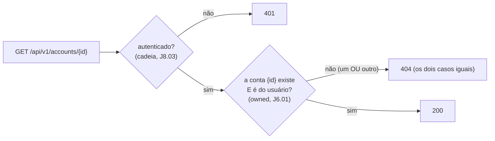

# J8.06 — OWASP Top 10 II: IDOR e falhas de autenticação

> ⏱️ ~1h30 · 🟢 Júnior · Pré-requisitos: J8.03, J8.04, J6.01 (`owned`, 404), J6.04 (Problem Details), J5.14 (logging), J7.06 (`Masking`)

> ✅ **Validação final (2026-11-24):** este módulo foi executado no PayFlow reconstruído; o resultado e o que continua não executado estão no [README do módulo](README.md). Os avisos "não executado" / "por leitura" abaixo descrevem a escrita original.

> ⚠️ **Verificação:** executados de verdade (JDK 25, Spring Security 7.1.2): o `lab/security-lab` (**81 testes**) com `LoginThrottleTest`, `JwtApiTest` (429, enumeração, 5 tokens ruins, IDOR), `SecurityAuditTest`, `PasswordPolicyTest`, `LoginRequestTest` e `MassAssignment*LabTest`. **Revisados por leitura, não executados:** o `IdorMatrixTest` e a troca na `SecurityConfig` do PayFlow (o repositório do aluno não existe em disco aqui) e a chamada real à API do Have I Been Pwned (precisa de rede).

## 🎯 Objetivos
Ao final desta aula você consegue:
- **Explicar** IDOR (acesso a objeto sem checar o dono) e **provar**, com uma matriz de testes, que cada endpoint com `{id}` o checa.
- **Decidir** entre `404` e `403` e saber por que **UUID não é autorização**.
- **Explicar** *brute force*, *credential stuffing* e enumeração de usuários, e **implementar** o limite de tentativas de login (`429`).
- **Aplicar** uma política de senha moderna (tamanho e lista de senhas ruins, sem regras de composição).
- **Registrar** eventos de segurança no log **sem** vazar dados, e **evitar** forjar linhas de log.

## 🤔 Por que isso importa
Duas categorias da [OWASP Top 10:2025](https://top10.owasp.org/2025/) aparecem em quase todo incidente real de uma API de dados pessoais:
- **A01, controle de acesso quebrado:** o caso clássico é o **IDOR** (*Insecure Direct Object Reference*, "BOLA" no jargão de APIs). O endpoint `GET /contas/123` confere que você está logado, **mas não que a conta 123 é sua**. Basta trocar `123` por `124`. A página da OWASP o lista (a CWE-639, "contorno de autorização por chave controlada pelo usuário").
- **A07, falhas de autenticação:** permitir **tentativas ilimitadas**, senhas fracas, mensagens que revelam quais contas existem, sessões que não expiram. O ataque típico é o ***credential stuffing***: o atacante tem uma lista de e-mails e senhas **vazadas de outro site** e tenta cada par no seu, esperando que alguém tenha reaproveitado a senha (A07 o cita, junto de *brute force* e *session fixation*).

E a **A09** (falhas de registro **e alerta** de segurança): sem log de quem tentou entrar e falhou, **ninguém percebe** um ataque em andamento.

## 💡 Intuição (explicação simples)
- **IDOR:** um hotel com chave-cartão. A recepção confere que você é **hóspede** (autenticação), mas o elevador abre **qualquer andar** e a porta abre **qualquer quarto** se você souber o número. A conferência que falta é **"este quarto é o seu?"**, e precisa existir em **cada** porta. E ao tentar o quarto de outro hóspede, a resposta certa é a mesma de um quarto que **não existe**.
- **Brute force:** alguém tentando todas as combinações de um cadeado. A defesa é **o cadeado travar depois de poucas tentativas**.
- **Credential stuffing:** o ladrão **testa a chave que roubou da casa A em todas as portas do bairro**. Nada de adivinhar: ele **já tem** a chave de alguns.

## 🔬 Como funciona por dentro

### 1. IDOR: onde a checagem mora

No PayFlow, o `owned(user, id)` (J6.01) é a checagem por objeto: `findById(id).filter(a -> a.getOwner().getId().equals(user.id())).orElseThrow(NotFoundException)`. **Conta alheia e conta inexistente viram o mesmo `404`.** O laboratório prova que as respostas são idênticas (`type`, `title` e `detail`; só o `instance`, que ecoa o caminho pedido, difere):
```text
anotherUsersAccountIsIndistinguishableFromANonexistentOne  ->  passa (type, title e detail iguais)
```

**Por que `404` e não `403`?** Um `403` diz "**existe**, mas não é seu": o atacante acabou de **confirmar** que a conta existe (e, varrendo ids, mapeia todas). O `404` não revela nada (decisão 25 e 43). `403` continua certo para **funções** (a rota de admin existe), `404` para **dados de outras pessoas**.

**UUID não é autorização.** Os ids do PayFlow são UUIDs v7 (ADR 0002), difíceis de adivinhar, e isso **ajuda**, mas não protege: UUID v7 é **ordenado por tempo** (parte dele é previsível), e o id **vaza** em log, URL, `Referer`, e-mail, captura de tela, histórico do navegador. Um id que vaza e um endpoint sem checagem de dono é um IDOR do mesmo jeito. Imprevisível reduz a chance; só a **checagem** elimina.

**O padrão seguro e o inseguro.** O seguro está na J6.01. O inseguro, que **só existe em teste** (decisão 19):
```java
// ❌ confia no id que o cliente mandou
@GetMapping("/{id}")
AccountResponse get(@PathVariable UUID id) {
    return mapper.toResponse(accounts.findById(id).orElseThrow(() -> new NotFoundException("...")));
}
```
Quem pede a conta `{id}` recebe a conta. O erro mais comum de IDOR **não** é esse esquecimento total, e sim as **variações sutis**:
- **Checar depois de agir** (carrega, **altera**, só então confere o dono).
- **Checar no controller A e esquecer no B** que chama o mesmo serviço (um novo endpoint, um *job*, um relatório).
- **Filtrar em memória** uma lista que veio **inteira** do banco (vaza no log, na memória e na paginação).
- **Aceitar o dono no pedido:** `?ownerId=...` ou `"userId"` no corpo. O dono vem **sempre** do token/sessão (`CurrentUser`), nunca do cliente.
- **Ids alheios dentro de um corpo válido:** `POST /transfers` com `sourceAccountId` de outra pessoa (o caso de dinheiro: a decisão 43 manda **422** "origem alheia ou indisponível", indistinguível de inexistente).

### 2. A matriz de IDOR: o único jeito de ter certeza
Revisar o código não basta (alguém acrescenta um endpoint amanhã). A defesa é uma **matriz de testes**: cada endpoint que recebe um id **de um recurso do usuário** é chamado pelo **dono** (funciona) e por **outro usuário** (`404`). O PayFlow, pelas aulas J6, tem estas rotas com `{id}`:

| Rota | Dono | Outro usuário |
|---|---|---|
| `GET /api/v1/accounts/{id}` | `200` | `404` |
| `GET /api/v1/accounts/{id}/entries` | `200` | `404` |
| `GET /api/v1/accounts/{id}/converted-balance` | `200` | `404` (antes de chamar a API de câmbio) |
| `POST /api/v1/accounts/{id}/deposits` | `201` | `404` (e **nada** é gravado) |
| `GET /api/v1/transfers/{id}` | `200` (origem ou destino) | `404` |
| `POST /api/v1/transfers` com `sourceAccountId` alheio | n/a | `422` |
| painel: `GET /accounts/{id}`, `POST /accounts/{id}/deposit`, `GET /api/accounts/{id}/statement` | `200`/`303` | `404` (J5.06, já testado em `PayflowWebTest`) |

O teste, com o `ApiClient` da J8.03 (**esperado, não executado**: o PayFlow do aluno não existe em disco aqui):
```java
package com.payflow.web.api;

import static org.assertj.core.api.Assertions.assertThat;

import com.payflow.support.ApiClient;
import com.payflow.support.PayflowTest;
import java.util.List;
import java.util.Map;
import org.junit.jupiter.api.Test;
import org.springframework.boot.test.web.server.LocalServerPort;

/** A matriz de IDOR: para cada rota com {id} de um recurso da Ana, o Bruno deve ver "não existe". */
@PayflowTest(webEnvironment = org.springframework.boot.test.context.SpringBootTest.WebEnvironment.RANDOM_PORT)
class IdorMatrixTest {

    static final String ANA_ACCOUNT = "20000000-0000-0000-0000-000000000001";
    static final String BRUNO_ACCOUNT = "20000000-0000-0000-0000-000000000002";
    static final String ANA_TO_CARLA = "30000000-0000-0000-0000-000000000003";     // Ana -> Carla: o Bruno não participa

    record Probe(String name, String method, String path, String body) { }

    static final List<Probe> PROBES = List.of(
            new Probe("conta", "GET", "/api/v1/accounts/" + ANA_ACCOUNT, null),
            new Probe("extrato", "GET", "/api/v1/accounts/" + ANA_ACCOUNT + "/entries", null),
            new Probe("saldo convertido", "GET", "/api/v1/accounts/" + ANA_ACCOUNT + "/converted-balance?currency=USD", null),
            new Probe("depósito", "POST", "/api/v1/accounts/" + ANA_ACCOUNT + "/deposits", "{\"amount\":\"10.00\"}"),
            new Probe("transferência", "GET", "/api/v1/transfers/" + ANA_TO_CARLA, null));

    @LocalServerPort int port;

    @Test
    void aForeignUserSeesEveryResourceOfAnaAsNonexistent() throws Exception {
        var bruno = new ApiClient(port).login("bruno@payflow.dev");
        for (Probe p : PROBES) {
            var response = p.method().equals("GET") ? bruno.get(p.path()) : bruno.post(p.path(), p.body(), Map.of());
            assertThat(response.statusCode()).as("%s (%s %s)", p.name(), p.method(), p.path()).isEqualTo(404);
        }
    }

    @Test
    void aForeignDepositChangedNothing() throws Exception {
        var bruno = new ApiClient(port).login("bruno@payflow.dev");
        bruno.post("/api/v1/accounts/" + ANA_ACCOUNT + "/deposits", "{\"amount\":\"10.00\"}", Map.of());
        var ana = new ApiClient(port).login("ana@payflow.dev");
        assertThat(ana.get("/api/v1/accounts/" + ANA_ACCOUNT).body()).contains("\"balance\":\"830.00\"");
    }

    @Test
    void theOwnerReachesTheSameResources() throws Exception {
        var ana = new ApiClient(port).login("ana@payflow.dev");
        assertThat(ana.get("/api/v1/accounts/" + ANA_ACCOUNT).statusCode()).isEqualTo(200);
        assertThat(ana.get("/api/v1/accounts/" + ANA_ACCOUNT + "/entries").statusCode()).isEqualTo(200);
        assertThat(ana.get("/api/v1/transfers/" + ANA_TO_CARLA).statusCode()).isEqualTo(200);
    }

    @Test
    void transferringFromAForeignSourceAccountIs422AndMovesNothing() throws Exception {
        var bruno = new ApiClient(port).login("bruno@payflow.dev");
        String body = "{\"sourceAccountId\":\"" + ANA_ACCOUNT + "\",\"targetAccountId\":\"" + BRUNO_ACCOUNT + "\",\"amount\":\"5.00\"}";
        var response = bruno.post("/api/v1/transfers", body, Map.of("Idempotency-Key", "idor-matrix-1"));
        assertThat(response.statusCode()).isEqualTo(422);
        var ana = new ApiClient(port).login("ana@payflow.dev");
        assertThat(ana.get("/api/v1/accounts/" + ANA_ACCOUNT).body()).contains("\"balance\":\"830.00\"");
    }
}
```
Quatro métodos (**esperado, não executado**). O **desafio** abaixo acrescenta o teste de **cobertura da matriz**: ele lista todas as rotas `/api/v1/**` com `{id}` e falha se uma **não estiver** em `PROBES`: a matriz não envelhece em silêncio.

**Mass assignment (atribuição em massa):** o atacante manda campos **a mais** no JSON esperando que o servidor os grave (`"role":"ADMIN"`, `"id":"..."`). O laboratório mandou um corpo de login com `role` e `id` a mais:
```text
[mass-assignment] modo Default: status 200     (os campos desconhecidos foram ignorados)
[mass-assignment] modo Strict: status 400      (com spring.jackson.deserialization.fail-on-unknown-properties=true)
```
No PayFlow, a defesa é estrutural (decisão 42): o corpo é um **DTO `record`** que **só tem** os campos permitidos; **nunca** se desserializa JSON direto na entidade `User`/`Account`. O modo estrito (`400`) é uma camada a mais, mas **não** foi ligado: a propriedade é global do `JsonMapper` do Boot, e antes de ligá-la é preciso conferir se algum **cliente HTTP** do aplicativo (como o `RestClient` da API de câmbio, J6.08) usa o mesmo mapeador: um campo novo na resposta de **terceiros** não deve virar erro. Registrado como decisão.

### 3. Brute force, credential stuffing e o limite de tentativas
O `POST /api/v1/auth/token` e o formulário aceitam e-mail e senha **sem limite**: com um *script*, são milhares de palpites por minuto. Duas defesas, as duas obrigatórias:
1. **Limitar tentativas** por conta (e, em produção, por origem). É o que você implementa agora.
2. **Tornar o palpite inútil:** hash lento (J8.02) e política de senha (seção 4).

O desenho (executado, `LoginThrottleTest` e `JwtApiTest`): um **decorador** do `AuthenticationProvider` conta os erros por e-mail normalizado e, passado o limite, **recusa antes de gastar um BCrypt**:

`src/main/java/com/payflow/security/LoginThrottle.java`
```java
package com.payflow.security;

import java.time.Clock;
import java.time.Duration;
import java.time.Instant;
import java.util.LinkedHashMap;
import java.util.Map;

/**
 * Conta erros de login por chave (o e-mail normalizado) e bloqueia depois de {@code maxFailures} erros seguidos.
 * Em memória e limitado (10 000 chaves): serve para UMA instância; com várias, o estado vai para um Redis (P2).
 */
public class LoginThrottle {

    private static final int MAX_TRACKED_KEYS = 10_000;

    private record Attempts(int failures, Instant lockedUntil) { }

    private final Clock clock;
    private final int maxFailures;
    private final Duration lockDuration;
    private final Map<String, Attempts> entries = new LinkedHashMap<>() {
        @Override
        protected boolean removeEldestEntry(Map.Entry<String, Attempts> eldest) {
            return size() > MAX_TRACKED_KEYS;           // um atacante com milhões de e-mails não esgota a memória
        }
    };

    public LoginThrottle(Clock clock, int maxFailures, Duration lockDuration) {
        this.clock = clock;
        this.maxFailures = maxFailures;
        this.lockDuration = lockDuration;
    }

    public synchronized boolean isLocked(String key) {
        Attempts entry = entries.get(key);
        if (entry == null || entry.lockedUntil() == null) {
            return false;
        }
        if (clock.instant().isBefore(entry.lockedUntil())) {
            return true;
        }
        entries.remove(key);                              // o bloqueio acabou: recomeça do zero
        return false;
    }

    public synchronized void failure(String key) {
        int failures = entries.getOrDefault(key, new Attempts(0, null)).failures() + 1;
        entries.put(key, failures >= maxFailures ? new Attempts(failures, clock.instant().plus(lockDuration)) : new Attempts(failures, null));
    }

    public synchronized void success(String key) {
        entries.remove(key);
    }
}
```

`src/main/java/com/payflow/security/ThrottledAuthenticationProvider.java`
```java
package com.payflow.security;

import java.util.Locale;
import org.springframework.security.authentication.AuthenticationProvider;
import org.springframework.security.authentication.BadCredentialsException;
import org.springframework.security.authentication.LockedException;
import org.springframework.security.core.Authentication;
import org.springframework.security.core.AuthenticationException;

/** Decorador: recusa quem errou a senha vezes demais, antes de gastar um BCrypt. Vale para o formulário e para a API. */
public class ThrottledAuthenticationProvider implements AuthenticationProvider {

    private final AuthenticationProvider delegate;
    private final LoginThrottle throttle;

    public ThrottledAuthenticationProvider(AuthenticationProvider delegate, LoginThrottle throttle) {
        this.delegate = delegate;
        this.throttle = throttle;
    }

    @Override
    public Authentication authenticate(Authentication authentication) throws AuthenticationException {
        String key = authentication.getName().trim().toLowerCase(Locale.ROOT);
        if (throttle.isLocked(key)) {
            throw new LockedException("Too many failed attempts");
        }
        try {
            Authentication result = delegate.authenticate(authentication);
            throttle.success(key);
            return result;
        } catch (BadCredentialsException e) {            // e-mail inexistente também vira BadCredentialsException (não revela quem existe)
            throttle.failure(key);
            throw e;
        }
    }

    @Override
    public boolean supports(Class<?> authentication) {
        return delegate.supports(authentication);
    }
}
```
- **Uma peça para os dois fluxos:** o formulário e a API passam pelo mesmo `AuthenticationManager` (J8.02), então uma só regra vale para ambos.
- **E-mail inexistente conta como erro.** `DaoAuthenticationProvider` o transforma em `BadCredentialsException` (J8.02), então `ghost@payflow.dev` também chega ao `429` depois de 5 erros: o **bloqueio não revela** quais e-mails têm conta (o teste usa um e-mail que **não existe**, de propósito).
- **Memória limitada:** no máximo **10 000** chaves (`LinkedHashMap` que descarta a mais antiga). Sem o limite, um atacante com milhões de e-mails inventados **esgotaria a memória** do servidor: o limitador de força bruta viraria um vetor de DoS.
- **Relógio injetável** (`Clock`): os testes avançam o tempo sem `sleep` (`MutableClock` do `LoginThrottleTest`).

Para ligar, **duas mudanças** na `SecurityConfig` da J8.03 (a versão completa é a do laboratório, injetada na J8.03 sem o limitador) e **uma** no `ApiErrors`:
```java
// 1. novo bean (precisa dos imports de Clock e PayflowProperties):
@Bean
LoginThrottle loginThrottle(Clock clock, PayflowProperties properties) {
    var login = properties.security().login();
    return new LoginThrottle(clock, login.maxFailures(), login.lockDuration());
}

// 2. o provider recebe o limitador e devolve o decorador (era: "return dao;")
@Bean
AuthenticationProvider authenticationProvider(UserDetailsService users, PasswordEncoder encoder, LoginThrottle throttle) {
    DaoAuthenticationProvider dao = new DaoAuthenticationProvider(users);
    dao.setPasswordEncoder(encoder);
    return new ThrottledAuthenticationProvider(dao, throttle);
}
```
e o tratador do `429` no `ApiErrors` (o painel já trata `?locked`, J8.03):
```java
@ExceptionHandler(LockedException.class)
ProblemDetail tooManyAttempts(LockedException e) {
    return problem(HttpStatus.TOO_MANY_REQUESTS, "too-many-attempts", "Too many attempts", "Too many failed attempts. Try again later.");
}
```
(import `org.springframework.security.authentication.LockedException`). Os parâmetros ficam no `application.yml` (os padrões já são estes):
```yaml
payflow:
  security:
    login:
      max-failures: 5          # erros seguidos antes de bloquear
      lock-duration: PT15M     # por quanto tempo (15 minutos)
```
Teste manual (os **status** reproduzem o `afterFiveFailuresEvenTheRightPasswordIsRefusedWith429` do laboratório; ajuste a porta):
```bash
for i in 1 2 3 4 5 6; do
  curl -s -o /dev/null -w "tentativa $i -> %{http_code}\n" -X POST http://localhost:8080/api/v1/auth/token \
    -H 'Content-Type: application/json' -d '{"email":"ghost@payflow.dev","password":"errada-errada-errada"}'
done
# tentativa 1..5 -> 401   tentativa 6 -> 429
```
**O preço do bloqueio:** um atacante pode **bloquear a conta de outra pessoa** de propósito: basta errar a senha da Ana 5 vezes (*account lockout DoS*). Por isso: o bloqueio é **curto** (15 minutos), e em produção a chave é **e-mail + origem** (IP), com atrasos progressivos, e a tela de login pode exigir um desafio (*CAPTCHA*) depois de algumas falhas. O PayFlow fica com a versão simples (por e-mail, em memória, **uma instância**; com mais instâncias, o contador vai para o Redis na P2) e **registra a limitação** em vez de fingir que ela é perfeita. A autenticação **multifator** (P10) é a defesa que realmente neutraliza o *credential stuffing*.

### 4. Política de senha (cadastro e troca)
O PayFlow ainda não tem tela de cadastro (**desafio**), mas qualquer fluxo que **grave** uma senha precisa de uma política. A diretriz atual do [NIST SP 800-63B-4](https://pages.nist.gov/800-63-4/sp800-63b.html), conferida no texto: **não** impor regras de composição ("uma maiúscula, um número, um símbolo"), **aceitar senhas longas** (pelo menos 64 caracteres, para frases) e **barrar senhas comuns ou vazadas** com uma lista. Código (executado, `PasswordPolicyTest`, 9 testes):

`src/main/java/com/payflow/security/PasswordPolicy.java`
```java
package com.payflow.security;

import java.nio.charset.StandardCharsets;
import java.util.ArrayList;
import java.util.List;
import java.util.Locale;
import java.util.Set;
import org.springframework.security.authentication.password.CompromisedPasswordChecker;

/**
 * Política de senha para CADASTRO e TROCA (o login não a usa). Segue o NIST SP 800-63B: o que importa é o TAMANHO e
 * a lista de senhas ruins; NADA de "uma maiúscula, um número e um símbolo". Devolve CÓDIGOS, nunca a senha.
 */
public final class PasswordPolicy {

    public static final int MIN_LENGTH = 12;      // em caracteres (code points)
    public static final int MAX_BYTES = 72;       // o limite do BCrypt; permite frases de 64 caracteres ASCII

    /** Só ilustrativa: em produção, uma lista grande (milhões) ou a verificação de vazamentos abaixo. */
    private static final Set<String> COMMON = Set.of("password1234", "123456789012", "qwertyuiop12", "payflow12345",
            "iloveyou1234", "senha1234567", "mudar1234567");

    private final CompromisedPasswordChecker compromised;

    public PasswordPolicy(CompromisedPasswordChecker compromised) {
        this.compromised = compromised;
    }

    /** @return a lista de códigos de problema (vazia = senha aceita): too-short, too-long, common, contains-email, compromised */
    public List<String> check(String password, String email) {
        List<String> problems = new ArrayList<>();
        if (password == null || password.codePointCount(0, password.length()) < MIN_LENGTH) {
            problems.add("too-short");
        }
        if (password != null && password.getBytes(StandardCharsets.UTF_8).length > MAX_BYTES) {
            problems.add("too-long");
        }
        if (password != null) {
            String lower = password.toLowerCase(Locale.ROOT);
            if (COMMON.contains(lower)) {
                problems.add("common");
            }
            String local = localPart(email);
            if (local.length() >= 3 && lower.contains(local)) {
                problems.add("contains-email");
            }
            if (problems.isEmpty() && compromised.check(password).isCompromised()) {      // a consulta de rede só roda se o resto passou
                problems.add("compromised");
            }
        }
        return problems;
    }

    private static String localPart(String email) {
        if (email == null || !email.contains("@")) {
            return "";
        }
        return email.substring(0, email.indexOf('@')).toLowerCase(Locale.ROOT);
    }
}
```

- Devolve **códigos** (`too-short`, `common`...), nunca a senha (decisão 38); a mensagem para o usuário vem de `messages.properties`.
- O limite de **72 bytes** (BCrypt, J8.02) em **bytes**, não caracteres: 37 letras `é` são 37 caracteres e **74 bytes** (testado: `too-long`). Frases ASCII de 64 caracteres passam.
- **`CompromisedPasswordChecker`** é uma interface do Spring Security (`check(String)` devolve `isCompromised()`); a implementação pronta `HaveIBeenPwnedRestApiPasswordChecker` consulta o serviço *Pwned Passwords*, que usa um modelo de ***k-anonymity***: a aplicação envia **só os 5 primeiros caracteres do SHA-1** da senha e compara o resto localmente ([documentação da API](https://haveibeenpwned.com/API/v3#PwnedPasswords)), então a senha **não sai** do seu servidor. Ela faz uma chamada de **rede**: por isso a política só a consulta **depois** que as regras locais passaram (testado: `theNetworkLookupOnlyRunsWhenEverythingElsePassed`). (⚠️ A chamada real **não** foi executada aqui; use um *stub* nos testes.)

### 5. Os ataques ao JWT, e o que os recusa
Os cinco abaixo foram **executados** (`JwtApiTest`) e todos recebem `401`:

| Ataque | Como é | Quem recusa |
|---|---|---|
| Token **adulterado** | troca uma letra do conteúdo ou da assinatura | a conferência da assinatura (HMAC): `WWW-Authenticate: ... error="invalid_token"` |
| Token **expirado** | `exp` no passado | o validador de expiração |
| Emissor errado | assinado com a **nossa** chave, mas `iss: evil-corp` | `createDefaultWithIssuer("payflow")` |
| **Chave diferente** | assinado com outro segredo | a assinatura não confere |
| **`alg: none`** | cabeçalho `{"alg":"none"}`, papel `ADMIN`, **sem assinatura** | `macAlgorithm(HS256)`: o decodificador **só** aceita HS256, não o algoritmo que o token declara |

O último é o mais famoso (a [RFC 8725](https://www.rfc-editor.org/rfc/rfc8725), as melhores práticas para JWT, o descreve): bibliotecas antigas aceitavam "sem assinatura" porque o **próprio token** dizia que não precisava. A regra: **o servidor decide o algoritmo**, nunca o cliente.

### 6. Auditoria: o que registrar (A09)
Sem trilha, um ataque de força bruta é invisível. O PayFlow registra, com o Spring Security publicando os eventos de autenticação (o `AuthenticationEventPublisher` da J8.02), **quem entrou e quem falhou**:

`src/main/java/com/payflow/security/SecurityAudit.java`
```java
package com.payflow.security;

import com.payflow.web.Masking;
import org.slf4j.Logger;
import org.slf4j.LoggerFactory;
import org.springframework.context.event.EventListener;
import org.springframework.security.authentication.UsernamePasswordAuthenticationToken;
import org.springframework.security.authentication.event.AbstractAuthenticationFailureEvent;
import org.springframework.security.authentication.event.AuthenticationSuccessEvent;
import org.springframework.stereotype.Component;

/** Trilha de auditoria de login (OWASP A09): quem entrou, quem falhou e por quê, sem senha e sem e-mail inteiro. */
@Component
public class SecurityAudit {

    private static final Logger log = LoggerFactory.getLogger(SecurityAudit.class);
    private static final int MAX_LOGGED = 80;

    @EventListener
    void onSuccess(AuthenticationSuccessEvent event) {
        if (event.getAuthentication().getPrincipal() instanceof PayflowUserDetails user) {
            log.info("Login succeeded: userId={}", user.currentUser().id());
        }
    }

    @EventListener
    void onFailure(AbstractAuthenticationFailureEvent event) {
        if (!(event.getAuthentication() instanceof UsernamePasswordAuthenticationToken)) {
            return;                                   // token Bearer inválido também gera evento; aqui só e-mail + senha
        }
        log.warn("Login failed: user={} reason={}", maskedName(event.getAuthentication().getName()),
                event.getException().getClass().getSimpleName());
    }

    /**
     * O que vai para o log vem do atacante. Mascara como e-mail e, ainda assim, neutraliza caracteres de controle
     * (uma quebra de linha no "domínio" forjaria uma linha de log falsa, CWE-117) e limita o tamanho.
     */
    static String maskedName(String name) {
        String masked;
        try {
            masked = Masking.email(name);
        } catch (IllegalArgumentException e) {
            return "(not an email)";                  // o que foi digitado pode ser lixo; nunca o repita no log
        }
        masked = masked.replaceAll("\\p{Cntrl}", "?");
        return masked.length() > MAX_LOGGED ? masked.substring(0, MAX_LOGGED) + "..." : masked;
    }
}
```
Saída **real** do log do laboratório:
```text
INFO  ... SecurityAudit : Login succeeded: userId=10000000-0000-0000-0000-000000000001
WARN  ... SecurityAudit : Login failed: user=a**@payflow.dev reason=BadCredentialsException
WARN  ... SecurityAudit : Login failed: user=g****@payflow.dev reason=LockedException
```
Regras (decisão 38 em ação):
- **Sucesso: só o id.** Falha: o e-mail **mascarado** (`Masking.email`, J7.06) e o **motivo** (o nome da exceção). **Nunca** a senha, o token ou o hash.
- **Só e-mail + senha.** Um token Bearer inválido também gera um evento de falha: na primeira versão do laboratório ele aparecia como `Login failed: user=(not an email) reason=InvalidBearerTokenException`, **ruído** que faria um alerta de "falhas de login" disparar por qualquer token expirado. O `instanceof UsernamePasswordAuthenticationToken` o filtra.
- **O que vai para o log vem do atacante** (CWE-117, *log injection*). Meu primeiro `maskedName` mascarava a **parte local** do e-mail e deixava o resto **como veio**. O teste abaixo, escrito **antes** da correção, falhou com o valor que iria ao log:
```text
[log] valor que iria ao log: a**@x.com<LF>2026-11-13 INFO  SecurityAudit : Login succeeded: userId=10000000-0000-0000-0000-000000000005
```
Uma **quebra de linha no "domínio"** do e-mail forjava uma **linha de log falsa** de "login com sucesso" do administrador. A correção (já no código acima): trocar caracteres de controle por `?` e limitar o tamanho (80). Depois: `[log] valor que iria ao log: a**@x.com?2026-11-13 INFO  SecurityAudit : Login succeeded: userId=10000000-0000...` (uma linha só, truncada).

`src/test/java/com/payflow/security/SecurityAuditTest.java`
```java
package com.payflow.security;

import static org.assertj.core.api.Assertions.assertThat;

import org.junit.jupiter.api.Test;

/** J8.06: o que vai para o log vem do atacante. Quebra de linha no "e-mail" forjaria uma linha de log falsa (CWE-117). */
class SecurityAuditTest {

    @Test
    void anOrdinaryEmailIsMasked() {
        assertThat(SecurityAudit.maskedName("ana@payflow.dev")).isEqualTo("a**@payflow.dev");
    }

    @Test
    void garbageIsNeverEchoed() {
        assertThat(SecurityAudit.maskedName("<script>alert(1)</script>")).isEqualTo("(not an email)");
    }

    @Test
    void lineBreaksInTheDomainCannotForgeALogLine() {
        String attack = "ana@x.com\n2026-11-13 INFO  SecurityAudit : Login succeeded: userId=10000000-0000-0000-0000-000000000005";
        String logged = SecurityAudit.maskedName(attack);
        System.out.println("[log] valor que iria ao log: " + logged.replace("\n", "<LF>").replace("\r", "<CR>"));
        assertThat(logged).doesNotContain("\n").doesNotContain("\r");
    }

    @Test
    void controlCharactersInTheLocalPartAreAlsoNeutralized() {
        assertThat(SecurityAudit.maskedName("a\rb@x.com")).doesNotContain("\r");
    }

    @Test
    void aHugeValueIsTruncated() {
        assertThat(SecurityAudit.maskedName("a@" + "x".repeat(5_000) + ".com").length()).isLessThanOrEqualTo(83);
    }
}
```
- **Alertar, não só registrar:** log que ninguém lê não protege (o título da A09:2025 é "falhas de registro **e alerta** de segurança"). Um pico de `Login failed` é o sinal que um alerta deve pegar (métricas e alertas: P6).
- **O `toString` de um `record` imprime a senha.** O `LoginRequest` (J8.03) tem uma senha como componente, e o `toString` padrão imprime **todos** os componentes. Saída real do laboratório:
```text
[toString] record comum : Naive[email=ana@payflow.dev, password=Payflow#Dev2026]
[toString] LoginRequest : LoginRequest[password=***]
```
Um `log.info("login {}", request)` vazaria a senha de quem entra. O `LoginRequest` sobrescreve o `toString` (o do laboratório já faz).

## 🛠️ Exemplo prático (resumo da aplicação ao PayFlow)
1. Crie `LoginThrottle` e `ThrottledAuthenticationProvider` (`security`), e faça as 3 mudanças na `SecurityConfig` e no `ApiErrors`.
2. Crie `SecurityAudit` (com o `maskedName` já sanitizado) e `SecurityAuditTest`.
3. Crie `PasswordPolicy` e `PasswordPolicyTest` (9 métodos).
4. Acrescente o `toString` ao `LoginRequest`.
5. Escreva o `IdorMatrixTest` e **tire o `@Disabled("J8.06")`** de `afterFiveFailuresEvenTheRightPasswordIsRefusedWith429` no `JwtApiTest` (J8.03).
6. Teste o limite com o `curl` em laço (acima) e **olhe o log**: você deve ver 5 `BadCredentialsException` e depois `LockedException`.

## 🧠 Pausa para lógica
**Enunciado:** o `GET /api/v1/transfers/{id}` devolve a transferência se o usuário é **origem ou destino**. Uma colega propõe responder `403` para quem não participa, "para ser mais honesto com o cliente". O que muda para um atacante?

<details><summary>Dica</summary>

Compare as respostas do atacante para um id que **existe** (de outra pessoa) e para um que **não existe**.
</details>

<details><summary>Solução</summary>

Com `403` para "existe, não é seu" e `404` para "não existe", o atacante **varre** ids e separa os que existem dos que não existem: ele aprende **quantas** transferências há, **quando** foram feitas (UUID v7 é ordenado por tempo) e quais ids valem a pena atacar por outro caminho. Com `404` nos dois casos, ele não obtém nada. O custo para o cliente legítimo é zero: quem usa o seu próprio id nunca vê o `404` de "alheia".
</details>

## ⚖️ Trade-offs e quando NÃO usar
- **Bloqueio por e-mail × por e-mail+IP.** Por e-mail protege a conta, mas permite **trancar a vítima**; por IP atrapalha usuários atrás do mesmo NAT (empresa, escola) e é contornável. O ideal combina os dois, com atrasos crescentes e *CAPTCHA*, e **MFA** (P10).
- **Em memória × Redis.** O limitador em memória some a cada reinício e vale por instância (com 3 instâncias, o atacante tem 3× as tentativas). Aceitável para um monólito de uma instância; depois, Redis (P2).
- **404 × 403.** `404` para dados de terceiros; `403` para funções que existem para todos. Para o **suporte** o `404` confunde ("a conta existe, o usuário jura"): o log com o id e o `userId` resolve.
- **Política de senha:** exigir **muito** (rotação a cada 90 dias, símbolos obrigatórios) **piora** a segurança (senhas `Mudar123!`, post-its); o NIST recomenda tamanho + lista de vazadas + MFA, e trocar a senha só em caso de suspeita.
- **Matriz de IDOR × revisão de código:** a matriz é **repetível** e pega regressão; a revisão pega o desenho. Faça os dois.

## ⚠️ Erros comuns e boas práticas de produção
- **`findById(id)` sem checar o dono** (o IDOR clássico), ou checar **depois** de alterar.
- **Dono vindo do cliente** (`?ownerId=`, `"userId"` no corpo): sempre do `CurrentUser`.
- **`403` revelando existência** de dados de terceiros.
- **Mensagens de login diferentes** ("usuário não encontrado" × "senha incorreta") ou **tempos** diferentes: enumeração de usuários. O Spring unifica; não contorne.
- **Limitador sem limite de memória, ou sem `Clock`:** vira vetor de DoS e fica impossível de testar.
- **Registrar a senha, o token ou o e-mail inteiro**; usar o `toString` de um DTO de login no log; nível `DEBUG` do Spring MVC com os detalhes da requisição ligados (`spring.mvc.log-request-details`) em produção.
- **Log forjado:** valor de atacante no log sem neutralizar `\n` e `\r`.
- **Alerta ausente:** auditar sem alertar.
- **Política de senha com regras de composição** e sem lista de senhas comuns/vazadas.
- **Aceitar o algoritmo que o token declara** (`alg`): o servidor decide.
- **Confiar que "UUID é impossível de adivinhar":** ele vaza.

## 🧩 Exercícios
1. **Fixação.** (a) O que é IDOR e qual a defesa? (b) Por que `404` em vez de `403` para a conta de outra pessoa? (c) O que é *credential stuffing* e por que "limitar tentativas" só ajuda em parte? (d) Qual o risco de bloquear a conta por e-mail? (e) Que diretrizes do NIST sobre senhas contrariam a política "uma maiúscula, um número e um símbolo"? (f) O que é *log injection* e como evitá-la?
2. **Aplicação no PayFlow.**
   - [ ] `IdorMatrixTest` (4 métodos) escrito e verde; **quebre-o de propósito**: remova o `filter(... owner ...)` de **um** endpoint, veja o teste daquela linha falhar, e desfaça.
   - [ ] `LoginThrottle`, `ThrottledAuthenticationProvider`, `loginThrottle` e o tratador `429` no lugar; o `curl` em laço dá **401 ×5 e 429**; o log mostra `BadCredentialsException` ×5 e `LockedException`.
   - [ ] Teste de integração (`@PayflowTest`): 5 erros do **bruno** (e-mail que existe) seguidos de **senha certa** → `429` (use um `Clock` fixo ou uma propriedade de `lock-duration` curta para não esperar 15 minutos). **Cuidado:** isso trava o Bruno nos outros testes se o contexto for compartilhado; use e-mail dedicado ou `@DirtiesContext`.
   - [ ] `SecurityAudit` com o `maskedName` sanitizado e `SecurityAuditTest` (5) verdes; **tente** forjar uma linha com `\r\n` e confirme.
   - [ ] `PasswordPolicy` e `PasswordPolicyTest` (9) verdes; `LoginRequest.toString` sem a senha.
   - [ ] Registre em `docs/security-notes.md`: quais rotas entram na matriz e por quê, e **o que a limitação em memória não cobre**.
3. **Desafio (opcional).** (a) **Cadastro:** `POST /api/v1/users` (público) que valida com a `PasswordPolicy`, grava o hash (`PasswordEncoder`) e cria uma conta; devolve `201`; **sem** revelar se o e-mail já existe (a mesma resposta nos dois casos, e e-mail de confirmação em um sistema real). (b) **Cobertura da matriz:** um teste que lista as rotas `/api/v1/**` com `{id}` (via `RequestMappingHandlerMapping`) e falha se alguma não está nas `PROBES`. (c) Troque o contador em memória por um repositório com expiração (Redis, P2).

<details><summary>Soluções de referência</summary>

1. (a) Acessar um objeto por um id que o cliente mandou sem conferir que ele pertence ao usuário; a defesa é a **checagem por objeto** em **todo** endpoint (consulta com o dono ou verificação explícita) e uma matriz de testes. (b) `403` confirma que o recurso existe; `404` não revela nada. (c) Testar pares de e-mail e senha vazados de **outros** sites; limitar tentativas **por conta** não ajuda se o atacante tenta **uma** senha em **muitas** contas (por isso também por origem, MFA e lista de vazadas). (d) O atacante pode trancar a vítima errando a senha dela de propósito (DoS de conta); mitigar com bloqueio curto, chave e-mail+IP e CAPTCHA. (e) Não impor composição; aceitar senhas longas (≥64); barrar comuns e vazadas; exigir troca só sob suspeita. (f) Escrever no log texto controlado pelo atacante que contém quebras de linha e forja entradas; neutralizar caracteres de controle e limitar o tamanho (e nunca logar o dado se não for preciso).
2. O teste de bloqueio com `Clock` fixo exige o `Clock` injetável (já é a `ClockConfig`); sem ele, reduza `payflow.security.login.lock-duration` no perfil de teste.
3. (b) Esqueleto: `mapping.getHandlerMethods().keySet()`, para cada `RequestMappingInfo` com padrão que comece por `/api/v1/` e contenha `{id}`, normalize as `PROBES` trocando os UUIDs por `{id}` e confira a inclusão.
</details>

## 🎤 Na entrevista
1. **"O que é IDOR e como você previne?"** *Resposta-modelo:* acessar um recurso por um identificador que o cliente fornece sem verificar se o usuário pode acessá-lo (trocar `/contas/1` por `/contas/2`). Previno com autorização **por objeto** em todo endpoint (a consulta já filtra pelo dono, ou há checagem explícita), o dono sempre vindo do token e nunca do cliente, `404` para recursos alheios, e uma **matriz de testes** que roda um usuário contra os recursos de outro.
2. **"Por que 404 e não 403?"** *Resposta-modelo:* para não confirmar a existência do recurso a quem não tem direito: com 403 o atacante varre ids e distingue o que existe. O 403 fica para funções, não para dados.
3. **"Como você protege o login contra força bruta e *credential stuffing*?"** *Resposta-modelo:* hash lento (BCrypt/Argon2id), limite de tentativas por conta e por origem com bloqueio curto (atento ao DoS de conta), mensagem e tempo iguais para e-mail inexistente e senha errada, senhas verificadas contra listas de vazamento, MFA, e log com alerta de picos de falha.
4. **"O que você registra no log de segurança e o que nunca registra?"** *Resposta-modelo:* registro logins com sucesso (id), falhas (e-mail mascarado e motivo), acessos negados e ações administrativas (quem, o quê, qual id). Nunca senha, token, hash ou e-mail inteiro; e neutralizo quebras de linha do que vem do usuário para evitar log forjado.

## 📚 Para ir além
- 📑 [OWASP Top 10:2025, A01 Controle de acesso quebrado](https://top10.owasp.org/2025/A01_2025-Broken_Access_Control/), [A07 Falhas de autenticação](https://top10.owasp.org/2025/A07_2025-Authentication_Failures/) e [A09 Falhas de registro e alerta](https://top10.owasp.org/2025/A09_2025-Security_Logging_and_Alerting_Failures/).
- 📑 [OWASP IDOR Prevention Cheat Sheet](https://cheatsheetseries.owasp.org/cheatsheets/Insecure_Direct_Object_Reference_Prevention_Cheat_Sheet.html) e [Authorization Cheat Sheet](https://cheatsheetseries.owasp.org/cheatsheets/Authorization_Cheat_Sheet.html).
- 📑 [OWASP Authentication Cheat Sheet](https://cheatsheetseries.owasp.org/cheatsheets/Authentication_Cheat_Sheet.html) (mensagens genéricas, limite de tentativas, MFA) e [Logging Cheat Sheet](https://cheatsheetseries.owasp.org/cheatsheets/Logging_Cheat_Sheet.html) (o que registrar e como evitar log forjado).
- 📑 [OWASP Mass Assignment Cheat Sheet](https://cheatsheetseries.owasp.org/cheatsheets/Mass_Assignment_Cheat_Sheet.html).
- 📄 [NIST SP 800-63B-4](https://pages.nist.gov/800-63-4/sp800-63b.html) (senhas) e [RFC 8725: JWT Best Current Practices](https://www.rfc-editor.org/rfc/rfc8725).
- 📄 [Spring Security: verificação de senhas vazadas](https://docs.spring.io/spring-security/reference/features/authentication/password-storage.html#authentication-compromised-password-check) e [Have I Been Pwned: API de senhas](https://haveibeenpwned.com/API/v3#PwnedPasswords).
- 📑 [PortSwigger: IDOR](https://portswigger.net/web-security/access-control/idor): explicação com laboratório gratuito.
- 🎥 Nenhum vídeo verificado (⚠️).

## ✅ Checklist da aula
- [ ] Sei explicar IDOR e escrever a matriz de testes para as rotas com `{id}`.
- [ ] Sei por que `404` para dados alheios e por que UUID não é autorização.
- [ ] O limite de tentativas funciona (`401` ×5, depois `429`) e sei o seu custo (DoS de conta).
- [ ] A política de senha segue o NIST (tamanho, lista, sem composição).
- [ ] O log registra quem entrou e quem falhou, **sem** senha e **sem** linhas forjadas.
- [ ] O `LoginRequest` não imprime a senha no `toString`.
