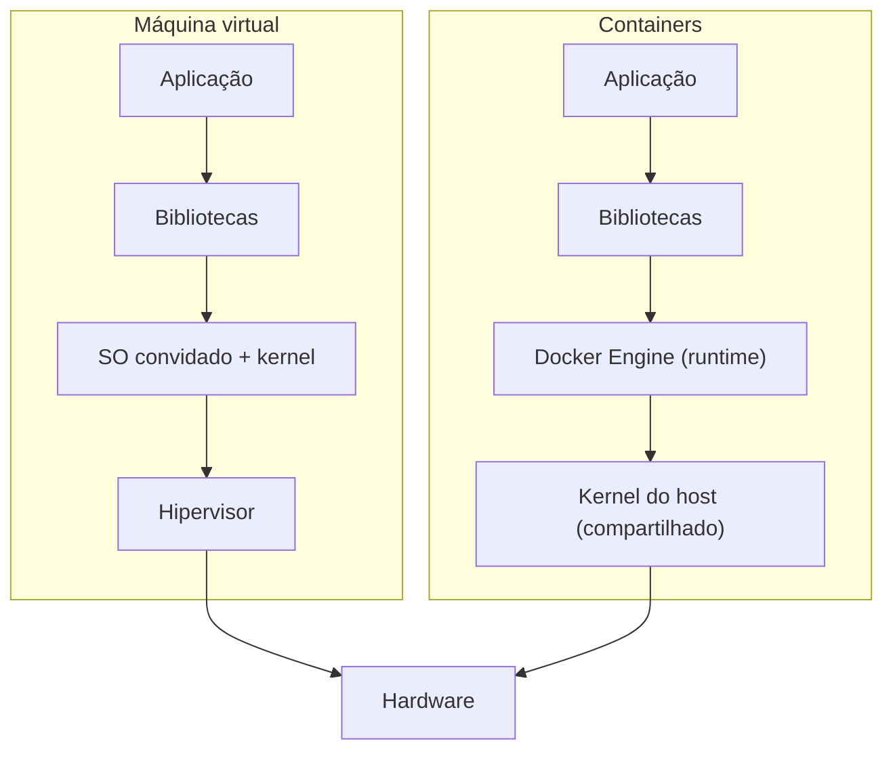
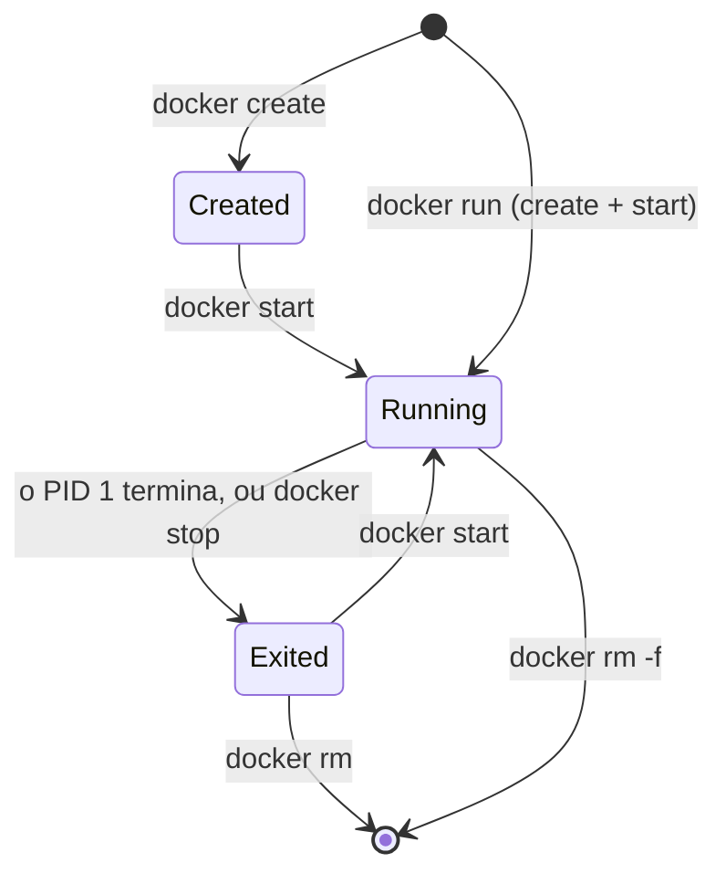
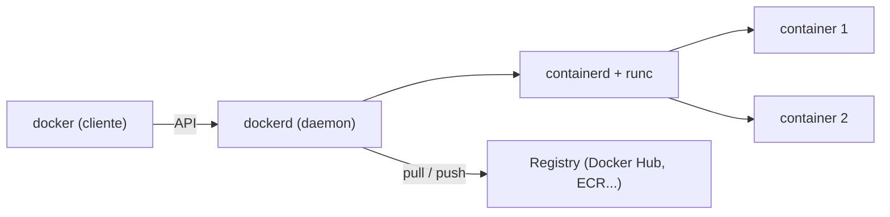

# J9.01 — Imagem vs container e comandos básicos

> ⏱️ ~1h30 · 🟢 Júnior · Pré-requisitos: J0.01 (terminal), J2.01 (portas e `localhost`), J3.03 (você já rodou `docker run` do PostgreSQL), J5.02 (JAR executável)

> ⚠️ **Verificação:** os comandos e as saídas desta aula foram **executados de verdade** (Linux, kernel 7.0.0-42, Docker Engine 29.9.2, imagens `alpine:3.22`, `eclipse-temurin:25-jre-alpine` e `postgres:18`). **Não executado:** Docker Desktop (Windows e macOS), onde o Docker roda dentro de uma máquina virtual Linux (as diferenças estão em "Erros comuns"). O PayFlow ainda **não** é tocado nesta aula: ela só dá as ferramentas.

## 🎯 Objetivos
Ao final desta aula você consegue:
- **Explicar** que problema o Docker resolve e **diferenciar** container de máquina virtual.
- **Diferenciar** imagem (receita imutável em camadas) de container (processo em execução, com um sistema de arquivos descartável).
- **Usar** o ciclo de vida: `pull`, `run`, `ps`, `logs`, `exec`, `stop`, `start`, `rm`, `images`, `rmi`.
- **Publicar portas** (`-p`), passar **variáveis** (`-e`), montar **volumes** (`-v`) e **limitar recursos** (`--memory`, `--cpus`).
- **Prever** o que se perde quando um container é removido.

## 🤔 Por que isso importa
"Na minha máquina funciona." Java 17 aqui, Java 25 no servidor; PostgreSQL 16 no notebook, 18 em produção; uma variável de ambiente que só existe no seu terminal. Cada diferença é um bug que só aparece na hora errada.

O container resolve isso **empacotando a aplicação com tudo o que ela precisa para rodar** (JRE, bibliotecas, arquivos) em uma unidade que roda **igual** no seu notebook, no CI (J10) e na nuvem. Todo emprego Java de hoje usa isso: o time espera que você saiba **construir** uma imagem, **subir** a aplicação com o banco e **ler os logs** quando algo falha. É o assunto das quatro aulas do módulo.

## 💡 Intuição (explicação simples)
- **Imagem = a planta e os materiais de uma casa pré-fabricada; container = a casa montada num terreno.** Da mesma planta saem dez casas idênticas. Se uma pegar fogo, as outras e a planta não sofrem.
- Para quem programa: **imagem é a classe, container é o objeto** (instância). Uma imagem, vários containers.
- **Container × máquina virtual:** a VM é um **prédio inteiro** com fundação e encanamento próprios (um sistema operacional completo por cima de um hipervisor). O container é um **apartamento**: divide a fundação e o encanamento (o **kernel** do Linux) com os vizinhos, mas tem **portas trancadas** e **cotas de luz e água**.

## 🔬 Como funciona por dentro

### 1. O container não é uma "mini-VM": é um processo isolado
Um container é um **processo comum do Linux** que o kernel **isola** e **limita**. Duas funções do kernel fazem isso (as páginas do manual estão em "Para ir além"):
- **Namespaces** dão uma **visão própria** do sistema: lista de processos (PID), rede, sistema de arquivos (mount), nome da máquina (UTS), usuários.
- **cgroups** (*control groups*) **limitam e medem** recursos: memória, CPU, número de processos.

Executado nesta máquina, na mesma saída de terminal:
```text
$ uname -r                      # kernel do host
7.0.0-42-generic
$ docker run --rm alpine:3.22 sh -c 'uname -r; hostname; id -un; ps -o pid,args'
7.0.0-42-generic                # o MESMO kernel: o container não tem kernel próprio
7b3bcdce3a66                    # hostname = id do container (namespace UTS)
root                            # "root" DENTRO do container (veja J9.02: não é o root do host, mas ainda é perigoso)
PID   COMMAND
    1 sh -c uname -r; hostname; id -un; ps -o pid,args     # o comando é o PID 1 (namespace PID)
   10 ps -o pid,args
```
E o **limite de memória** de um container é só um arquivo do cgroup:
```text
$ docker run --rm --memory 256m alpine:3.22 cat /sys/fs/cgroup/memory.max
268435456                       # 256 × 1024 × 1024 bytes
```

| | Máquina virtual | Container |
|---|---|---|
| Kernel | **um por VM** (sistema operacional completo) | **compartilha o do host** |
| Tamanho típico | gigabytes | de megabytes (Alpine) a centenas de megabytes (com JRE) |
| Início | dezenas de segundos | **menos de um segundo** (o processo só começa) |
| Isolamento | forte (hardware virtualizado) | **mais fraco** (o kernel é compartilhado: uma falha do kernel afeta todos) |
| Roda | outro sistema operacional | só o **mesmo tipo de kernel** (container Linux precisa de kernel Linux) |



### 2. Imagem: camadas imutáveis
Uma **imagem** é um **pacote só de leitura** com o sistema de arquivos e os metadados (qual comando rodar, qual usuário, quais portas). Ela é feita de **camadas** (*layers*): cada instrução do Dockerfile (J9.02) acrescenta uma camada com o que **mudou**. As camadas são **compartilhadas** entre imagens: duas imagens que partem do mesmo Alpine guardam o Alpine **uma vez**.

```text
$ docker image inspect postgres:18 --format 'layers={{len .RootFS.Layers}} size={{.Size}}'
layers=13 size=644210918
```
Treze camadas, ~644 MB. Quando você baixa `postgres:18` e depois `postgres:17`, só baixa as camadas que **diferem**.

**Nomes.** `registry/namespace/repositório:tag`. `postgres:18` é, por extenso, `docker.io/library/postgres:18` (Docker Hub, conjunto `library` de **imagens oficiais**).
- A **tag** (`18`) é um **rótulo que pode mudar de lugar**: hoje `postgres:18` aponta para a versão 18.6, mês que vem para a 18.7. Por isso **nunca `latest`** (decisão 50: imagem sempre versionada).
- O **digest** é a **identidade imutável** (hash do conteúdo): `postgres@sha256:e3d24f69...`. Só ele garante **exatamente** os mesmos bytes. Para estudo basta a tag da versão maior; para produção, fixar o digest é um nível a mais (P8).
- Um **registry** é o servidor que guarda imagens (Docker Hub, GitHub Container Registry, Amazon ECR). `docker pull` baixa; `docker push` envia.

### 3. Container: a imagem em execução, mais uma camada gravável
Ao rodar, o Docker empilha uma **camada de escrita fina** sobre as camadas da imagem (técnica *copy-on-write*): o que o processo grava vai **só para essa camada**, e a imagem não muda. Quando o **container é removido**, a camada some junto. Isso é o comportamento certo (container **descartável**) e a causa do erro nº 1 de quem começa: **dados gravados dentro do container desaparecem** (a seção 5 prova; os *volumes*, abaixo, são a saída).

O container **vive enquanto o processo principal (PID 1) vive**. Quando o comando termina, o container **sai**.


### 4. A arquitetura: cliente, daemon, registry

O comando `docker` é só um **cliente**; quem trabalha é o **daemon** (`dockerd`), que usa o `containerd` e o `runc` para criar os processos isolados. Por isso há "versão do cliente" e "versão do servidor":
```text
$ docker version --format 'client={{.Client.Version}} server={{.Server.Version}} os/arch={{.Server.Os}}/{{.Server.Arch}}'
client=29.9.2 server=29.9.2 os/arch=linux/amd64
```
Se o daemon não está rodando, o cliente responde `Cannot connect to the Docker daemon at unix:///var/run/docker.sock. Is the docker daemon running?`.

### 5. A prova de que o container é descartável
```bash
docker run --name efemero alpine:3.22 sh -c 'echo ola > /dados.txt; cat /dados.txt'   # imprime: ola
docker rm efemero
docker run --rm alpine:3.22 cat /dados.txt
# cat: can't open '/dados.txt': No such file or directory
```
O arquivo existia **naquele** container. Um container **novo**, da mesma imagem, começa limpo.

## 🛠️ Exemplo prático
> Testado com Docker 29.9.2 (Linux). Tudo abaixo é descartável: no fim há a limpeza.

### Passo 1: o ciclo de vida completo com o PostgreSQL
Você já usou isto na J3.03; agora cada opção tem nome:
```bash
docker run -d --name demo-pg \
  -e POSTGRES_PASSWORD=demo \
  -p 127.0.0.1:55432:5432 \
  postgres:18
```
| Opção | O que faz |
|---|---|
| `-d` | *detached*: roda **em segundo plano** (sem ele, o terminal fica preso ao log) |
| `--name demo-pg` | nome para os próximos comandos (sem ele, o Docker inventa um, como `inspiring_turing`) |
| `-e VARIAVEL=valor` | **variável de ambiente** dentro do container (é assim que se configura quase tudo) |
| `-p 127.0.0.1:55432:5432` | **publica a porta**: `host:container`. O tráfego que chega à porta 55432 **da sua máquina** vai para a 5432 **do container** |
| `postgres:18` | a imagem (e a tag) |

**Por que `127.0.0.1:` na frente?** Sem ele (`-p 55432:5432`), a porta é publicada em **todas as interfaces** (`0.0.0.0`): **qualquer máquina da sua rede** alcança o banco. Pior: o Docker escreve as próprias regras de firewall e **passa por cima** de ferramentas como o `ufw` (veja a página de *packet filtering* em "Para ir além"). Em desenvolvimento, **publique sempre em `127.0.0.1`**. O `docker ps` mostra a diferença: `127.0.0.1:55432->5432/tcp` (só local) × `0.0.0.0:55432->5432/tcp` (aberto).

```bash
docker ps --format 'table {{.ID}}\t{{.Image}}\t{{.Status}}\t{{.Ports}}\t{{.Names}}'
# CONTAINER ID   IMAGE         STATUS         PORTS                       NAMES
# 3ace8fbf0378   postgres:18   Up 5 seconds   127.0.0.1:55432->5432/tcp   demo-pg

docker logs --tail 3 demo-pg
# ... LOG:  listening on Unix socket "/var/run/postgresql/.s.PGSQL.5432"
# ... LOG:  database system was shut down at 2026-11-13 21:13:02 UTC
# ... LOG:  database system is ready to accept connections

docker exec demo-pg psql -U postgres -tAc 'select version()'
# PostgreSQL 18.6 (Debian 18.6-1.pgdg13+2) on x86_64-pc-linux-gnu, compiled by gcc (Debian 1...

docker exec demo-pg sh -c 'ps -eo pid,user,args | head -4'
#     PID USER     COMMAND
#       1 postgres postgres            <- o servidor é o PID 1: se ele sair, o container sai
#      68 postgres postgres: io worker 1
#      69 postgres postgres: io worker 0
```
- **`docker ps`** lista os containers **em execução** (`-a` inclui os parados). `--format` com *Go template* deixa a saída do jeito que você quer.
- **`docker logs`** mostra o que o processo escreveu em **stdout/stderr** (`-f` acompanha, `--tail N` limita; mais na J9.04). **É por isso que aplicações em container logam no console, não em arquivo** (J9.04).
- **`docker exec`** roda **outro** comando **dentro de um container que já está rodando** (aqui, `psql`). Com `-it` abre um terminal interativo (`docker exec -it demo-pg sh`).

```bash
docker stop demo-pg          # envia SIGTERM, espera até 10 s, depois SIGKILL (J9.02 explica por quê importa)
docker ps -a --filter name=demo-pg --format 'table {{.Names}}\t{{.Status}}'
# NAMES     STATUS
# demo-pg   Exited (0) Less than a second ago
docker start demo-pg         # volta (o container PARADO ainda existe, com a camada de escrita)
docker stop demo-pg && docker rm demo-pg   # rm APAGA o container e a camada de escrita
```

### Passo 2: imagens
```bash
docker images                       # (ou: docker image ls) imagens baixadas/construídas
docker pull alpine:3.22             # baixa sem rodar
docker image inspect postgres:18 --format '{{index .RepoDigests 0}}'
# postgres@sha256:e3d24f6906d0760bf4da0dae872415391ededefad23fd471c47dc53b0ddf3c42
docker rmi alpine:3.22              # remove a imagem (falha se algum container, mesmo parado, a usa)
docker system df                    # quanto espaço imagens, containers, volumes e cache usam
```
```text
TYPE            TOTAL     ACTIVE    SIZE      RECLAIMABLE
Images          44        7         22.59GB   11.02GB (48%)
Containers      7         1         143.4kB   73.73kB (51%)
Local Volumes   41        3         20.45GB   3.808GB (18%)
Build Cache     322       0         17.91GB   13.93GB
```
(Saída da máquina do autor, que usa Docker há muito tempo: o seu `system df` será bem menor. O recado é: **imagens, volumes e cache crescem em silêncio**; `docker system prune` limpa o que não está em uso, mas **leia o aviso antes de confirmar**, e **nunca** use `--volumes` sem ter certeza: volumes guardam **dados**.)

### Passo 3: um Java dentro de um container
```bash
docker run --rm eclipse-temurin:25-jre-alpine java -version
# openjdk version "25.0.5" 2026-10-20 LTS
# OpenJDK Runtime Environment Temurin-25.0.5+8 (build 25.0.5+8-LTS)
# OpenJDK 64-Bit Server VM Temurin-25.0.5+8 (build 25.0.5+8-LTS, mixed mode, sharing)
```
Sem instalar Java nenhum. `--rm` remove o container **ao terminar** (use sempre em comandos de uma vez só, para não acumular containers parados). `eclipse-temurin` é a imagem do JDK/JRE do projeto Eclipse Temurin (Adoptium); a J9.02 compara as variantes.

### Passo 4: volumes (a saída para "os dados somem")
Há dois jeitos de guardar dados **fora** do container:
```bash
# (1) volume NOMEADO: o Docker guarda e gerencia
docker run -d --name demo-pg -e POSTGRES_PASSWORD=demo -v demo-pgdata:/var/lib/postgresql postgres:18
# (2) bind mount: uma pasta SUA dentro do container (o exemplo não precisa ser executado)
#     docker run ... -v "$PWD/dados:/dados" ...
```
- **Volume nomeado** (`demo-pgdata`): vive em `/var/lib/docker/volumes/...`, **sobrevive** a `docker rm`, é a escolha para **dados de banco**. `docker volume ls`, `docker volume inspect demo-pgdata`, `docker volume rm demo-pgdata`.
- **Bind mount** (`-v "$PWD/dados:/dados"`): **o mesmo diretório** do seu disco aparece no container: ótimo para **código e configuração** em desenvolvimento, mas expõe o container ao seu sistema de arquivos e depende de **permissões** (o usuário do container precisa conseguir ler e escrever: a J9.03 mostra o erro real).
- No **PostgreSQL 18**, o volume vai em **`/var/lib/postgresql`** (decisão 20; o caminho antigo `/var/lib/postgresql/data` faz o container sair com erro).

Teste a diferença: grave dados, `docker rm -f demo-pg`, suba de novo com o **mesmo** `-v`: os dados estão lá. Suba sem `-v`: banco vazio.

### Passo 5: limites de recursos
```bash
docker run -d --name demo-limit --memory 256m --cpus 1 alpine:3.22 sleep 300
docker stats --no-stream --format 'table {{.Name}}\t{{.CPUPerc}}\t{{.MemUsage}}\t{{.PIDs}}'
# NAME         CPU %   MEM USAGE / LIMIT   PIDS
# demo-limit   0.00%   1.496MiB / 256MiB   1
docker inspect demo-limit --format 'mem={{.HostConfig.Memory}} nanocpus={{.HostConfig.NanoCpus}}'
# mem=268435456 nanocpus=1000000000
docker rm -f demo-limit
```
`--memory` é um **teto duro**: se o processo ultrapassar, o kernel o **mata** (o container sai com código **137** e `docker inspect` mostra `OOMKilled=true`; ⚠️ o estouro em si não foi provocado aqui). Para uma JVM isso pede cuidado (a J9.02 mostra como o Java enxerga o limite).

### Limpeza
```bash
docker rm -f demo-pg 2>/dev/null; docker volume rm demo-pgdata 2>/dev/null; docker ps -a   # confira que não sobrou nada
```

## 🧠 Pausa para lógica
**Enunciado:** você roda `docker run --name db -e POSTGRES_PASSWORD=x postgres:18`, cria tabelas, e na semana seguinte faz `docker rm -f db` e `docker run --name db -e POSTGRES_PASSWORD=x postgres:18` de novo. As tabelas sumiram. Explique **por quê** e corrija o comando.

<details><summary>Dica</summary>

Onde o PostgreSQL grava os arquivos de dados, e o que acontece com a camada de escrita quando o container é **removido**?
</details>

<details><summary>Solução</summary>

Sem `-v`, os dados ficaram na **camada de escrita do container**; `docker rm` a apagou. O segundo `run` criou um container novo, da mesma imagem, **vazio**. Correção: um **volume nomeado** no diretório de dados: `-v payflow-pgdata:/var/lib/postgresql` (no PostgreSQL 18). Observação: o PostgreSQL só usa `POSTGRES_PASSWORD` (e `POSTGRES_USER`, `POSTGRES_DB`) **quando o diretório de dados está vazio**; com um volume antigo, trocar a senha no `-e` **não** muda a senha do banco (a J9.03 reproduz esse erro).
</details>

## ⚖️ Trade-offs e quando NÃO usar
(Resumo de nível júnior; o aprofundamento é P7.)
- **Container × instalar direto na máquina:** container ganha em **reprodutibilidade** e isolamento; perde em **depuração** um pouco mais indireta (`docker exec`, `docker logs`) e em desempenho de disco no Windows/macOS.
- **Container × VM:** quando o isolamento precisa ser **forte** (código de terceiros não confiável) ou o sistema operacional é outro, a VM é melhor.
- **Banco em container:** ótimo para **desenvolvimento e testes**; em produção, a prática comum é um banco **gerenciado** (RDS, J10): backup, alta disponibilidade e *patches* viram problema de outra pessoa. Se for rodar em container, o volume e os backups são **seus**.

## ⚠️ Erros comuns e boas práticas de produção
- **`docker: Cannot connect to the Docker daemon ... Is the docker daemon running?`** O daemon não está de pé (`sudo systemctl start docker`; no Windows/macOS, abra o Docker Desktop).
- **`permission denied while trying to connect to the Docker daemon socket`** (Linux): seu usuário não está no grupo `docker` (`sudo usermod -aG docker $USER` e sair e entrar da sessão; entenda que isso **equivale a dar root** ao usuário: veja "Para ir além").
- **`Bind for 0.0.0.0:5432 failed: port is already allocated`** (ou `address already in use`): a porta do host está ocupada (talvez pelo `payflow-pg` da J3.03). Use outra porta do host (`-p 127.0.0.1:55432:5432`) ou pare o outro container.
- **`Conflict. The container name "/demo-pg" is already in use`**: já existe um container (talvez **parado**, veja `docker ps -a`) com esse nome. `docker rm` antes, ou nome diferente.
- **`Unable to find image 'x' locally` e depois `pull access denied` / `manifest unknown`:** nome ou tag errados (`docker pull` mostra o que falhou).
- **Esperar que o container "continue rodando":** sem processo em primeiro plano ele **sai** (`Exited (0)`); use `-d` para serviços e `docker logs` para ver por que saiu.
- **`latest` em tudo:** não reproduzível (decisão 50). **Dados no container:** somem. **`-p` sem `127.0.0.1`:** expõe o serviço. **Segredo no `-e` de um comando colado em documentação:** fica no histórico do shell e no `docker inspect` (a J9.03 mostra a alternativa).
- **Windows e macOS:** o Docker Desktop roda os containers dentro de uma **VM Linux**; bind mounts atravessam essa VM e são **mais lentos**, e "o kernel do host" é o da VM. Tudo o mais é igual.
- **Imagens e volumes acumulando:** `docker system df` de vez em quando; `docker image prune` e `docker container prune` limpam o que ficou sem uso.

## 🧩 Exercícios
1. **Fixação.** (a) Imagem × container, em uma frase para cada. (b) O que container e VM compartilham e o que **não** compartilham? (c) O que `-p 127.0.0.1:8080:80` significa e por que o `127.0.0.1`? (d) O que acontece com os dados gravados dentro de um container quando ele é **parado**? E quando é **removido**? (e) Para que serve `docker exec` e em que difere de `docker run`? (f) Por que `postgres:18` e não `postgres:latest`?
2. **Aplicação no PayFlow.** (O PayFlow ainda não vira imagem; o foco é o banco.)
   - [ ] Pare o `payflow-pg` da J3.03 (`docker stop payflow-pg`) e suba **outro** PostgreSQL 18, `payflow-pg2`, em `127.0.0.1:55432`, com **volume nomeado** `payflow-pg2-data`; crie uma tabela, `docker rm -f`, suba de novo com o mesmo volume e **mostre que a tabela continua lá**.
   - [ ] Repita **sem** o volume e **mostre** que a tabela some. Anote as duas saídas em `docs/docker-notes.md` (arquivo novo).
   - [ ] Rode `docker stats --no-stream` e `docker inspect payflow-pg2 --format '{{.HostConfig.Memory}}'` com `--memory 512m` e registre o que cada um mostra.
   - [ ] Remova `payflow-pg2` e o volume; deixe `payflow-pg` como estava (`docker start payflow-pg`).
3. **Desafio (opcional).** Descubra **onde** está o volume no disco (`docker volume inspect`) e **liste** os arquivos do PostgreSQL ali (precisa de `sudo`). Em seguida, **explique** por que **copiar esses arquivos com o banco rodando** não é um backup confiável (use `pg_dump`, J3).

<details><summary>Soluções de referência</summary>

1. (a) **Imagem:** pacote imutável, em camadas, com o sistema de arquivos e a configuração para rodar; **container:** uma execução dessa imagem (um processo isolado) com uma camada de escrita descartável. (b) Compartilham o **kernel** do host; **não** compartilham processos, rede, sistema de arquivos e usuários (namespaces), e cada um tem seus limites (cgroups). A VM **não** compartilha nem o kernel. (c) Publica a porta 8080 **só na interface local** e a liga à porta 80 do container; sem o `127.0.0.1`, a porta fica aberta para a rede inteira (e o Docker contorna o `ufw`). (d) **Parado:** o container e a camada de escrita **continuam** (`docker start` os traz de volta); **removido:** tudo se perde. (e) `exec` roda um comando **adicional** em um container **que já roda**; `run` **cria** um container novo a partir da imagem. (f) A tag `latest` muda sem aviso (de versão maior inclusive) e o volume de dados de uma versão maior pode **não** ser compatível com a nova; a tag fixa dá reprodutibilidade.
2. Esqueleto: `docker run -d --name payflow-pg2 -e POSTGRES_USER=payflow -e POSTGRES_PASSWORD=payflow -e POSTGRES_DB=payflow -p 127.0.0.1:55432:5432 -v payflow-pg2-data:/var/lib/postgresql --memory 512m postgres:18`; `docker exec payflow-pg2 psql -U payflow -c 'create table t(x int)'`; `docker rm -f payflow-pg2` e o mesmo `run`; `docker exec payflow-pg2 psql -U payflow -c '\dt'` mostra `t`. `HostConfig.Memory` = `536870912`. Sem `-v`, o `\dt` responde `Did not find any tables.` (saída conferida)
3. Os arquivos ficam em `/var/lib/docker/volumes/<nome>/_data` (o diretório de versão `18/docker/` fica dentro). Copiar com o banco em escrita captura páginas em estados diferentes (arquivos de dados e WAL fora de sincronia): a cópia pode **não abrir**. `pg_dump` (ou `pg_basebackup`) usa o mecanismo do próprio banco para um instantâneo consistente.
</details>

## 🎤 Na entrevista
1. **"Qual a diferença entre container e máquina virtual?"** *Resposta-modelo:* a VM virtualiza o **hardware** e roda um sistema operacional completo com o próprio kernel; o container é um **processo isolado** (namespaces) e **limitado** (cgroups) que **compartilha o kernel do host**. Por isso o container é menor e inicia em segundos, mas o isolamento é mais fraco e ele só roda o mesmo tipo de kernel.
2. **"Qual a diferença entre imagem e container?"** *Resposta-modelo:* a imagem é o artefato **imutável**, em camadas, que descreve o que rodar; o container é uma **instância em execução** dela, com uma camada de escrita efêmera. Posso rodar vários containers da mesma imagem.
3. **"Onde guardo os dados de um banco rodando em container?"** *Resposta-modelo:* em um **volume** (nomeado, ou um disco gerenciado em produção), nunca na camada de escrita do container, porque ela some quando o container é removido. E em produção, normalmente um banco gerenciado, com backup.
4. **"Por que não usar a tag `latest`?"** *Resposta-modelo:* porque ela é mutável: o mesmo `docker pull` entrega coisas diferentes em datas diferentes, o que quebra a reprodutibilidade e pode trocar a versão maior sem aviso. Uso a versão fixa (e, em produção, às vezes o digest).

## 📚 Para ir além
- 📄 [Docker: visão geral](https://docs.docker.com/get-started/docker-overview/) e os três conceitos básicos: [o que é um container](https://docs.docker.com/get-started/docker-concepts/the-basics/what-is-a-container/), [o que é uma imagem](https://docs.docker.com/get-started/docker-concepts/the-basics/what-is-an-image/) e [o que é um registry](https://docs.docker.com/get-started/docker-concepts/the-basics/what-is-a-registry/).
- 📄 [`docker container run`](https://docs.docker.com/reference/cli/docker/container/run/): referência de **todas** as opções (`-p`, `-e`, `-v`, `--memory`, `--rm`).
- 📄 [Volumes](https://docs.docker.com/engine/storage/volumes/) e [bind mounts](https://docs.docker.com/engine/storage/bind-mounts/): quando usar cada um.
- 📄 [Limites de recursos](https://docs.docker.com/engine/containers/resource_constraints/) (`--memory`, `--cpus`) e [`docker system df`](https://docs.docker.com/reference/cli/docker/system/df/).
- 📄 [Packet filtering e firewalls no Docker](https://docs.docker.com/engine/network/packet-filtering-firewalls/): por que a porta publicada atravessa o `ufw`. E [pós-instalação no Linux](https://docs.docker.com/engine/install/linux-postinstall/) (grupo `docker` e o aviso de que ele equivale a root).
- 📑 [namespaces(7)](https://man7.org/linux/man-pages/man7/namespaces.7.html) e [cgroups(7)](https://man7.org/linux/man-pages/man7/cgroups.7.html): as páginas do manual do Linux por trás do container.
- 📑 [The Twelve-Factor App: config](https://12factor.net/config) (configuração no ambiente) e [processos descartáveis](https://12factor.net/disposability).
- 📄 [Imagens oficiais no Docker Hub: postgres](https://hub.docker.com/_/postgres) (variáveis, volume, `docker-entrypoint-initdb.d`) e [eclipse-temurin](https://hub.docker.com/_/eclipse-temurin) (variantes de JDK/JRE).
- 🎥 Nenhum vídeo verificado (⚠️).

## ✅ Checklist da aula
- [ ] Sei explicar o que o Docker resolve e por que container não é uma VM (kernel compartilhado, namespaces, cgroups).
- [ ] Diferencio imagem (camadas imutáveis) de container (processo + camada de escrita descartável) e sei os nomes `registry/repositório:tag` e o digest.
- [ ] Domino `run`, `ps`, `logs`, `exec`, `stop`, `start`, `rm`, `images`, `rmi` e as opções `-d`, `--name`, `-e`, `-p`, `-v`, `--rm`, `--memory`.
- [ ] Publico portas em `127.0.0.1` e sei por que.
- [ ] Sei que dados no container somem e uso **volume** para o banco (`/var/lib/postgresql` no 18).
- [ ] Deixei a máquina limpa (`docker ps -a`, `docker volume ls`).
