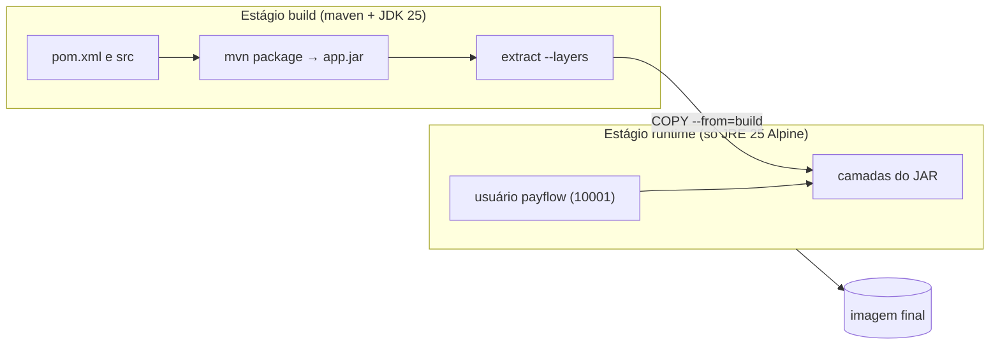

# J9.02 — Dockerfile multi-stage, imagem enxuta e usuário não root

> ⏱️ ~1h30 · 🟢 Júnior · Pré-requisitos: J9.01 (imagem, camadas, container), J5.02 (JAR executável do Spring Boot), J5.05 (variáveis de ambiente e perfis), J8.07 (segredos fora da imagem)

> ⚠️ **Verificação:** o `Dockerfile` desta aula foi **executado de verdade** (Docker 29.9.2, Linux; Spring Boot 4.1.2, Temurin 25.0.5) sobre o **laboratório** `lab/docker-lab` (o "PayFlow Lite": Spring Boot + Flyway + PostgreSQL + Actuator + segredo obrigatório). **Todas as saídas e medidas abaixo vêm dele.** O `Dockerfile` do **PayFlow do aluno** é **o mesmo** (só muda o nome do JAR e um `-D`) e foi **revisado por leitura**, **não executado** (o repositório do aluno não existe em disco; os testes práticos ficam para o fim do treinamento).

## 🎯 Objetivos
Ao final desta aula você consegue:
- **Escrever** um `Dockerfile` e explicar cada instrução (`FROM`, `WORKDIR`, `COPY`, `RUN`, `USER`, `EXPOSE`, `ENV`, `ENTRYPOINT`).
- **Montar** uma imagem **multi-stage** (build com JDK e Maven, execução só com JRE) e **ordenar as camadas** para o cache funcionar.
- **Reduzir** a imagem (JRE em vez de JDK, Alpine, JAR em camadas) e **medir** o ganho.
- **Rodar sem root** e explicar por que isso importa.
- **Escolher** `ENTRYPOINT` na forma *exec* e explicar o que acontece com o `SIGTERM` e o *graceful shutdown*; **configurar** a memória da JVM no container.

## 🤔 Por que isso importa
A imagem é o **artefato de entrega**: o que você constrói uma vez, testa e leva igual para o CI, o servidor e a nuvem (J10, P7, P9). Um `Dockerfile` ruim vira problema real de três jeitos:
- **Tamanho e tempo:** uma imagem de 640 MB que reconstrói **tudo** a cada mudança de uma linha custa minutos de CI e dinheiro de banda e de registry.
- **Segurança:** a imagem roda como **root** por padrão, carrega ferramentas de compilação que um atacante adora e, se alguém copia o projeto inteiro, **segredos**. Entra em **A02 (configuração incorreta)** da OWASP Top 10:2025 (J8.07 já avisou: "segredo na imagem" é vazamento).
- **Operação:** se o processo não recebe o `SIGTERM`, o `docker stop` espera 10 s e **mata** a aplicação no meio de requisições. Você vai **medir** isso aqui.

## 💡 Intuição (explicação simples)
- **Multi-stage** é a **obra e a casa pronta**. Na obra há betoneira, andaime e entulho (JDK, Maven, código-fonte); o morador recebe só a casa e as chaves (JRE e o JAR). Você **não entrega a betoneira junto**.
- **Cache de camadas** é a **lista de compras**: se você já tem arroz e feijão (as dependências), só compra o que mudou (o código). Se escrever "arroz" **no fim** da lista, mudar uma linha de cima obriga a comprar **tudo** de novo.
- **Usuário não root** é dar ao funcionário **a chave do próprio setor**, não a chave-mestra do prédio.

## 🔬 Como funciona por dentro

### 1. O Dockerfile: uma receita de camadas
O `Dockerfile` é um arquivo de texto com instruções; **cada instrução que muda o sistema de arquivos cria uma camada**. O Docker guarda cada camada em cache e **reaproveita** a camada enquanto a instrução e tudo que veio **antes** dela não mudaram. Quando uma camada muda, **todas as seguintes** são refeitas.

| Instrução | O que faz | Observação |
|---|---|---|
| `FROM imagem:tag [AS nome]` | imagem base (e nomeia o estágio) | sempre **com tag de versão** (decisão 50) |
| `WORKDIR /app` | diretório de trabalho (cria se não existir) | prefira a `RUN cd` |
| `COPY origem destino` | copia do **contexto de build** para a imagem | `COPY --from=estágio` copia de outro estágio; `--chown` define o dono |
| `RUN comando` | executa **durante o build** e grava o resultado como camada | junte comandos relacionados com `&&` |
| `USER nome` | quem executa o que vem depois (e o container) | o padrão é **root** |
| `EXPOSE 8080` | **documenta** a porta; **não publica** nada (isso é o `-p`) | |
| `ENV CHAVE=valor` | variável de ambiente, **gravada na imagem** | **nunca** segredo (aparece no `docker history` e no `inspect`) |
| `ARG nome` | variável **só do build** | também visível no histórico: **nunca** segredo |
| `ENTRYPOINT [...]` | o comando que o container executa | forma *exec* (lista JSON): veja a seção 5 |
| `CMD [...]` | argumentos **padrão** do `ENTRYPOINT` (ou comando padrão) | o `docker run imagem outro-comando` o substitui |

O **contexto de build** é a pasta que o `docker build .` envia ao daemon: só o que está nela pode ser copiado (e o que **não** devia estar nela é a J9.04).

### 2. Multi-stage: build e execução em estágios separados
Um **estágio** (`FROM ... AS nome`) é uma imagem temporária. Só o **último** estágio vira a imagem final; os anteriores **somem**, e o que interessa é levado com `COPY --from=`.

O estágio `build` tem o **Maven, o JDK e o código-fonte** (centenas de MB de ferramentas). Nada disso vai para produção.

### 3. O JAR "em camadas" (a economia de cache que o Spring Boot oferece)
O JAR gordo do Boot (J5.02) tem **59 bibliotecas** (27 MB) que **quase nunca mudam** e **14 KB** do seu código que **mudam o tempo todo**. Se a imagem guarda tudo em **uma camada** (`COPY app.jar`), cada mudança de uma linha **reenvia 27 MB**. O Boot sabe separar o JAR em camadas, da que menos muda para a que mais muda:
```bash
java -Djarmode=tools -jar app.jar extract --layers --destination extracted
ls extracted/
# application  dependencies  snapshot-dependencies  spring-boot-loader
```
- `dependencies`: as bibliotecas de versão fixa (as 59 do laboratório: 27,2 MB, a camada que quase nunca é reenviada);
- `spring-boot-loader`: o carregador do Boot;
- `snapshot-dependencies`: bibliotecas `-SNAPSHOT` (vazia aqui);
- `application`: **o seu código** e recursos (24,6 kB no laboratório).
O `Dockerfile` copia **nessa ordem**. Medido: ao mudar um `.java`, só a última camada é refeita (veja a seção "Exemplo prático"). O comando `-Djarmode=tools` é o do Spring Boot 4 (a [documentação](https://docs.spring.io/spring-boot/reference/packaging/container-images/efficient-images.html) o descreve); executado com o JAR do Boot 4.1.2, **funcionou**.

### 4. JDK × JRE, e qual imagem base
- **JDK** = compilador e ferramentas (`javac`, `jcmd`, `jstack`...); **JRE** = só para **executar**. Em produção, **JRE**: menos tamanho e menos superfície de ataque.
- As variantes do **Eclipse Temurin 25** (conferido em `docker manifest inspect` e executado): `25-jdk`, `25-jre` (Ubuntu), `25-jre-alpine` (Alpine Linux).

| Base | Tamanho da imagem do PayFlow Lite | Notas (medidas) |
|---|---|---|
| `eclipse-temurin:25-jdk` + JAR único, **root** (o "ingênuo") | **639 MB** | tem `javac`, `jcmd`, `jstack`...; roda como root |
| multi-stage + `25-jre` (Ubuntu), não root, camadas | **527 MB** | **sem** `curl` nem `wget`; **sem** `jcmd`/`jstack` (só `java`, `jfr`, `keytool`...) |
| multi-stage + `25-jre-alpine`, não root, camadas | **357 MB** | tem o `wget` do BusyBox (serve para o *healthcheck* da J9.03) |

- **Alpine** usa **musl** (e não a glibc) e o *shell* `ash` do BusyBox. Para uma aplicação Spring Boot comum funciona sem ajustes (rodou aqui); o risco aparece com **bibliotecas nativas** (JNI) compiladas para glibc. Se um dia aparecer um erro estranho de biblioteca nativa, a variante Ubuntu é o primeiro teste.
- Ainda menores existem (imagens *distroless*, `jlink` para um JRE sob medida, imagens nativas com GraalVM): ficam para "Para ir além" e para a P7. **Ajuste de tamanho sem medir é superstição**: meça com `docker images`.

### 5. `ENTRYPOINT` em forma *exec*, `SIGTERM` e *graceful shutdown*
Há duas formas de escrever o comando:
```dockerfile
ENTRYPOINT ["java", "-jar", "app.jar"]     # exec: o java é o PID 1, recebe os sinais
ENTRYPOINT java -jar app.jar               # shell: vira  /bin/sh -c "java -jar app.jar"
```
O `docker stop` envia **`SIGTERM`** ao **PID 1** do container e, se ele não sair em **10 s**, envia **`SIGKILL`** (que não pode ser tratado). O Spring Boot, ao receber `SIGTERM`, faz o **desligamento gracioso** (`server.shutdown: graceful`; segundo a [documentação do 4.1.2](https://docs.spring.io/spring-boot/reference/web/graceful-shutdown.html) esse já é o padrão e, para desligar, usa-se `immediate`. O laboratório o declara **explicitamente**, junto com `spring.lifecycle.timeout-per-shutdown-phase: 20s`, e o PayFlow fará o mesmo no exercício: o que importa é visível no arquivo, não no padrão): para de aceitar conexões novas, **termina as requisições em andamento**, fecha o pool do banco e sai.

O problema é quando o PID 1 **não é a JVM**: um `sh -c "java ...; echo fim"` (ou um *script* de inicialização que **não** usa `exec java ...`) é o PID 1, **não repassa o sinal**, e o Docker espera os 10 s e mata. **Medido** (as duas variantes, mesma imagem, PostgreSQL ligado):
```text
ENTRYPOINT ["java", "-jar", "app.jar"]                       →  docker stop: 0,15 s   exit=143   log: "Commencing graceful shutdown ... complete"
ENTRYPOINT ["sh","-c","java -jar app.jar; echo fim"]         →  docker stop: 10,19 s  exit=137   log: (sem "graceful shutdown")
  PID  COMMAND
    1  sh -c java -jar payflow-lite-0.1.0-SNAPSHOT.jar; echo fim      ← o shell é o PID 1
    7  java -jar payflow-lite-0.1.0-SNAPSHOT.jar                       ← a JVM nunca viu o SIGTERM
```
- **143 = 128 + 15** (terminou por `SIGTERM`, o esperado); **137 = 128 + 9** (morto por `SIGKILL`: ou o `docker stop` perdeu a paciência, ou o kernel matou por falta de memória, *OOM*).
- A forma *shell* **nem sempre** quebra: no Alpine (BusyBox), `ENTRYPOINT java -jar app.jar` (sem nada depois) o `sh` se **substituiu** pelo `java` e funcionou; em outras combinações não. **Não dependa de sorte: use a forma exec** (e `exec java ...` em qualquer script). O próprio Docker avisa: o `docker build --check` aponta a regra `JSONArgsRecommended` ("JSON arguments recommended for ENTRYPOINT to prevent unintended behavior related to OS signals").

### 6. Usuário não root
Por padrão o container roda como **root** (`uid=0`). Em um container o root está **limitado** (namespaces e *capabilities* reduzidas), mas **ainda é root**: se uma falha da aplicação permitir executar comandos, ou se um volume do host for montado, o estrago é **muito** maior do que com um usuário comum. A defesa barata é **criar um usuário sem privilégios** e usar `USER`. No laboratório:
```text
$ docker compose exec app id
uid=10001(payflow) gid=10001(payflow) groups=10001(payflow)
```
- O **uid fixo** (`10001`, acima de 10000 para não colidir com usuários do sistema) importa para **permissões de volume** e para plataformas como o Kubernetes, que podem exigir `runAsNonRoot` com um número (P7).
- Arquivos da aplicação: `COPY --chown=payflow:payflow` (o usuário lê; **não precisa escrever** no código). O que a aplicação precisa **gravar** (se precisar) vai para um volume ou `/tmp`.
- `--no-create-home` e `--shell /sbin/nologin`: o usuário **não faz login**.

### 7. A JVM dentro de um container (memória e CPUs)
A JVM moderna **enxerga os limites do container** (cgroups, J9.01) e dimensiona o *heap* a partir deles. Medido com o endpoint `/api/v1/runtime` do laboratório (`Runtime.maxMemory()` e `availableProcessors()`):
```text
sem limites            →  {"maxHeapMb":14392,"cpus":12, ...}     (a máquina do autor: ~19 GB e 12 CPUs; 75% da memória)
--memory 512m --cpus 2 →  {"maxHeapMb":371,"cpus":2, ...}
$ docker stats --no-stream      (com 512 MiB)
NAME      CPU %   MEM USAGE / LIMIT   MEM %    PIDS
lab-app   0.06%   167.8MiB / 512MiB   32.78%   31
```
- O **padrão** da JVM usa **25%** da memória como *heap* máximo. A imagem define `ENV JAVA_TOOL_OPTIONS="-XX:MaxRAMPercentage=75"` (a JVM imprime `Picked up JAVA_TOOL_OPTIONS: ...` na subida); 371 MB de *heap* em 512 MB mostra o efeito: sobra o resto para *metaspace*, pilhas das *threads* e memória nativa. **Não** coloque 100%: o container sai por **OOM (137)** e `docker inspect` mostra `OOMKilled: true`.
- **Sempre** defina um limite de memória no container em produção (Compose/Kubernetes); sem limite, a JVM acha que tem a máquina toda.
- Escolher o percentual e o tamanho certos é **ajuste de desempenho** (P1/S2); aqui o importante é saber que o container e a JVM **conversam** pelos cgroups.

## 🛠️ Exemplo prático
> **Laboratório executado:** `lab/docker-lab` (Docker 29.9.2, `maven:3.9.12-eclipse-temurin-25`, `eclipse-temurin:25-jre-alpine`). Para o **PayFlow**, use o mesmo arquivo trocando as marcas `← PayFlow`.

### Passo 1: o Dockerfile completo (multi-stage, camadas, não root)
`Dockerfile` (na raiz do projeto):
```dockerfile
# syntax=docker/dockerfile:1

# ---- Estagio 1: build (JDK + Maven). Nada daqui vai para a imagem final. ----
FROM maven:3.9.12-eclipse-temurin-25 AS build
WORKDIR /workspace

# 1) So o pom primeiro: a camada com as dependencias so e refeita quando o pom muda.
COPY pom.xml .
RUN --mount=type=cache,target=/root/.m2 mvn -B -q dependency:resolve dependency:resolve-plugins

# 2) Depois o codigo. Testes ficam para o CI (precisam de Docker, entao nao rodam dentro do build).
COPY src ./src
RUN --mount=type=cache,target=/root/.m2 mvn -B -q -DskipTests package \
 && mv target/payflow-lite-*.jar target/app.jar \
 && java -Djarmode=tools -jar target/app.jar extract --layers --destination target/extracted

# ---- Estagio 2: execucao (so o JRE) ----
FROM eclipse-temurin:25-jre-alpine AS runtime
WORKDIR /app

# Usuario sem privilegios (uid fixo, sem shell de login)
RUN addgroup -S -g 10001 payflow \
 && adduser -S -u 10001 -G payflow -H -s /sbin/nologin payflow

# Da camada que menos muda para a que mais muda
COPY --from=build --chown=payflow:payflow /workspace/target/extracted/dependencies/ ./
COPY --from=build --chown=payflow:payflow /workspace/target/extracted/spring-boot-loader/ ./
COPY --from=build --chown=payflow:payflow /workspace/target/extracted/snapshot-dependencies/ ./
COPY --from=build --chown=payflow:payflow /workspace/target/extracted/application/ ./

USER payflow
EXPOSE 8080
ENV JAVA_TOOL_OPTIONS="-XX:MaxRAMPercentage=75"
ENTRYPOINT ["java", "-jar", "app.jar"]
```

> ✅ **Validação final (2026-11-24), no PayFlow com a J7 aplicada:** o `COPY pom.xml` + `COPY src` **não basta**. O `maven-checkstyle-plugin` da J7.08 roda na fase `validate` e lê `config/checkstyle/checkstyle.xml`; sem a pasta no estágio de build o `mvn package` falha com `Unable to find configuration file at location: config/checkstyle/checkstyle.xml`. No PayFlow acrescente `COPY config ./config` **antes** de `COPY src ./src` (a pasta `config/` não está no `.dockerignore`). O laboratório `lab/docker-lab` não tem Checkstyle, por isso não mostrou o erro.
Linha a linha, o que não é óbvio:
- **`# syntax=docker/dockerfile:1`** habilita a versão atual da sintaxe (necessária para `RUN --mount`).
- **Duas etapas de `COPY` no build.** Copiar o `pom.xml` **antes** do `src` faz a resolução das dependências ficar em uma camada **que só muda quando o `pom.xml` muda**. Mudar um `.java` não toca nela.
- **`RUN --mount=type=cache,target=/root/.m2`**: um **cache persistente do BuildKit** para o repositório local do Maven. Mesmo quando a camada é refeita (você mexeu no `pom.xml`), o Maven **não baixa tudo de novo** (medido: o passo caiu para 2,1 s com o cache quente). O cache **não** entra na imagem.
- **`-DskipTests`:** os testes do PayFlow usam **Testcontainers (J7.05)** e precisam de um Docker **dentro** do build, que não existe. Testar é função do **CI (J10)**, antes de construir a imagem. (`mvn package` não roda o `verify`, onde moram o JaCoCo `check` e o SpotBugs.)
- **`mv target/payflow-lite-*.jar target/app.jar`:** dá ao JAR um nome **fixo**, assim o `ENTRYPOINT` não repete a versão do projeto.
- **`adduser -S -u 10001 ...`** é a sintaxe do **BusyBox/Alpine**. Na variante Ubuntu seria `groupadd --system --gid 10001 payflow && useradd --system --uid 10001 --gid payflow --no-create-home --shell /usr/sbin/nologin payflow` (os dois foram executados).
- **Para o PayFlow** (`← PayFlow`): troque `payflow-lite-*.jar` por `payflow-*.jar` e use `mvn -B -q -DskipTests -Dcheckstyle.skip=true package`: o Checkstyle (J7.08) roda na fase `validate` e **falha com avisos** (decisão 54); ele é um portão do **CI**, não da imagem.

### Passo 2: construir, medir e rodar
```bash
docker build -t payflow-lite:1 .
docker images payflow-lite
docker history payflow-lite:1 --format '{{.Size}}\t{{.CreatedBy}}' | head -8
```
Tempos medidos (Docker 29.9.2, máquina do autor): **primeiro build** (com download das imagens base e das dependências): **48 s**; **sem mudar nada:** **1,4 s** (tudo `CACHED`); **mudando só um `.java`:** **3,7 s**. No segundo caso, os passos `COPY pom.xml`, `dependency:resolve`, a camada `dependencies` (a de 27 MB), o `spring-boot-loader` e o usuário ficaram `CACHED`; só a camada `application` (24,6 kB) e o `package` foram refeitos. **Era esse o objetivo.**

Tamanhos finais (`docker images`): `payflow-lite:alpine` **357 MB** (a base `eclipse-temurin:25-jre-alpine` tem 306 MB: o seu código e as bibliotecas somam ~51 MB), contra os **639 MB** do ingênuo e os **527 MB** da variante Ubuntu.

⚠️ **Do container, `localhost` é o próprio container**, não a sua máquina nem o container do banco. Por isso a J9.03 coloca os dois em uma **rede do Compose**, onde o banco é alcançado pelo **nome do serviço** (`db`). Rodar a aplicação **sem o banco** só mostra a falha rápida:

### Passo 3: a falha rápida (e o código de saída)
Sem o segredo do JWT (J8.07), a aplicação **não sobe** e o container **sai com código 1**:
```text
$ docker run --rm --network lab-net -e SPRING_DATASOURCE_URL=... payflow-lite:1      # sem PAYFLOW_SECURITY_JWT_SECRET
...
APPLICATION FAILED TO START
    Reason: java.lang.IllegalArgumentException: payflow.security.jwt.secret must have at least 32 bytes (HS256 needs a 256-bit key)
$ echo $?
1
```
**Lição do laboratório (um erro que só aparece rodando):** na primeira versão a classe de propriedades não tinha `@DefaultValue` nos *records* aninhados (`Security`, `Jwt`). Sem nenhuma propriedade `payflow.*` no ambiente, o Boot **não cria o objeto aninhado** (fica `null`), o construtor que valida o segredo **nunca roda** e a aplicação **subiu sem segredo**. O PayFlow da J8 já usa `@DefaultValue` (`@DefaultValue Security security`, `@DefaultValue Jwt jwt`); sem isso, a "falha rápida" é só uma intenção. **Teste a falha**, não só o caminho feliz.

### Passo 4: usuário, ferramentas e o que há dentro
```bash
docker run --rm --entrypoint sh payflow-lite:1 -c 'id; ls -la /app | head -5; which wget curl'
# uid=10001(payflow) gid=10001(payflow) groups=10001(payflow)
# ... lib  app.jar
# /usr/bin/wget          (curl não existe; o BusyBox traz wget)
```
`--entrypoint sh` **substitui** o `ENTRYPOINT` só nesta execução: é o jeito de "entrar" numa imagem para inspecionar. No Alpine/JRE **não há `jcmd` nem `jstack`**; a J9.04 mostra como tirar um *thread dump* assim mesmo (`kill -3`, ou `docker kill --signal=QUIT`).

### Passo 5: pedir ao Docker para criticar o Dockerfile
```bash
docker build --check .
# Check complete, no warnings found.
```
Para ver o que ele acusa, um arquivo ruim (`copy` em minúsculas, `ENTRYPOINT` na forma *shell*):
```text
WARNING: JSONArgsRecommended - https://docs.docker.com/go/dockerfile/rule/json-args-recommended/
JSON arguments recommended for ENTRYPOINT to prevent unintended behavior related to OS signals
Dockerfile:4
```
(As regras estão listadas na [referência de *build checks*](https://docs.docker.com/reference/build-checks/). O **Hadolint** é um verificador de terceiros muito usado no CI: ⚠️ não executado aqui.)

## 🧠 Pausa para lógica
**Enunciado:** um colega escreve o `Dockerfile` assim e reclama que "todo `docker build` leva 3 minutos, mesmo mudando um comentário":
```dockerfile
FROM maven:3.9.12-eclipse-temurin-25
WORKDIR /app
COPY . .
RUN mvn -DskipTests package
ENTRYPOINT java -jar target/app.jar
```
Liste **pelo menos cinco** problemas e a ordem em que você os corrigiria.

<details><summary>Dica</summary>

Pense em: cache, tamanho, segurança, sinais e o que o `COPY . .` leva para dentro.
</details>

<details><summary>Solução</summary>

1. **`COPY . .` antes de resolver as dependências:** qualquer mudança (até um comentário) invalida a camada e o Maven baixa **tudo** de novo. Correção: `COPY pom.xml` + `dependency:resolve`, depois `COPY src`. 2. **Imagem final = imagem de build** (Maven, JDK, código-fonte, repositório `.m2` de centenas de MB): use **multi-stage** com JRE no final. 3. **Roda como root:** `USER` não root com uid fixo. 4. **`ENTRYPOINT` na forma *shell*:** risco de o `SIGTERM` não chegar à JVM (10 s e `SIGKILL`): forma *exec*. 5. **`COPY . .` leva tudo do diretório:** `.git`, `target/`, **segredos** e `.env` (a J9.04 resolve com `.dockerignore`). 6. **Sem limite/percentual de memória da JVM** (`MaxRAMPercentage`). 7. **Sem tag fixa de runtime** (aqui há tag; se fosse `latest`, também seria erro). 8. **JAR único em uma camada:** o JAR em camadas reduz o reenvio. A ordem de maior ganho: 1 (tempo), 2 (tamanho), 5 (segurança), 3 e 4.
</details>

## ⚖️ Trade-offs e quando NÃO usar
- **Alpine × Ubuntu (glibc):** Alpine é menor (357 × 527 MB) e tem o `wget`; Ubuntu tem a glibc (compatibilidade com bibliotecas nativas) e mais ferramentas de depuração (que **você não precisa** em produção). Para o PayFlow, Alpine; se um dia uma biblioteca nativa reclamar, troque a base e meça.
- **JRE × JDK na imagem final:** o JRE não tem `jcmd`/`jstack`/`jmap`: depurar fica mais difícil (a J9.04 mostra os atalhos). Alguns times mantêm uma imagem de **depuração** com JDK separada.
- **Build **dentro** do Docker × build no CI e copiar o JAR:** dentro do Docker é **reprodutível** (qualquer máquina, o mesmo Maven e o mesmo JDK) e dispensa Java local; mas o build é mais lento sem cache e **não roda os testes** que dependem de Docker. Muitos times constroem e testam o JAR no CI e usam um `Dockerfile` mais simples só com o `COPY` do JAR; a J10 mostra o caminho.
- **JAR em camadas × `COPY app.jar`:** as camadas poupam banda e tempo de *push*/*pull* a cada deploy; para um projeto pequeno, o JAR único é aceitável. Meça o seu caso.
- **`MaxRAMPercentage=75`:** é um ponto de partida, não uma lei: com muito *thread* ou memória nativa, 75% pode ser demais; com pouco container (256 MB), pode ser pouco. P1/S2 medem de verdade.
- **Imagens de buildpack (`spring-boot:build-image`, Paketo):** geram a imagem **sem Dockerfile**. São práticas e seguras por padrão; aqui você aprende o `Dockerfile` porque **todo** time precisa lê-lo e depurá-lo. (⚠️ não executado aqui.)

## ⚠️ Erros comuns e boas práticas de produção
- **`failed to compute cache key: failed to calculate checksum of ref ...: "/arquivo": not found`** (a mensagem do BuildKit atual, conferida): o caminho do `COPY` está errado, **ou** o `.dockerignore` (J9.04) excluiu o arquivo: a mensagem **não** cita o `.dockerignore`.
- **`mvn: command not found` / `java: not found` no estágio errado:** o Maven só existe no estágio `build`; o `runtime` só tem o JRE.
- **`Error: Unable to access jarfile app.jar`:** o `WORKDIR` ou o nome do JAR no `ENTRYPOINT` não batem com o que foi copiado. Entre na imagem (`--entrypoint sh`) e veja `ls /app`.
- **`Permission denied` ao gravar:** o usuário não root não escreve no diretório da aplicação (que é do `payflow` só para leitura de fato). Grave em um volume ou `/tmp`.
- **Pacote/`apk add` esquecido:** o *healthcheck* e as ferramentas só existem se a base as traz.
- **Segredo em `ENV`, `ARG` ou `COPY`:** fica na imagem **para sempre** (`docker history` mostra `ENV` e `ARG`; o `COPY` guarda o arquivo numa camada). Segredo entra **em tempo de execução** (J9.03).
- **Container que sai com 137:** `SIGKILL`: `docker stop` impaciente (a JVM não é o PID 1) **ou** falta de memória (`docker inspect --format '{{.State.OOMKilled}}'`).
- **Usar `latest`** na base (ou em qualquer lugar): não reproduzível.
- **Rodar `apt-get update` e `apt-get install` em `RUN` separados** (versão Ubuntu): o cache pode servir uma lista antiga. Junte em um `RUN` e limpe `/var/lib/apt/lists`.
- **Esquecer que a imagem é pública** se você der `docker push` para um registry público: tudo o que está nela é de todos.
- **A imagem "funciona" mas o build do CI falha:** é o cache. O cache local engana; o CI começa **do zero**. Teste com `docker build --no-cache` de vez em quando.

## 🧩 Exercícios
1. **Fixação.** (a) Diferencie `ENTRYPOINT` de `CMD` e `ENV` de `ARG`. (b) Por que o `COPY pom.xml` vem **antes** do `COPY src`? (c) O que `EXPOSE 8080` faz e **não** faz? (d) Por que a forma *exec* e o que são os códigos de saída 143 e 137? (e) Qual a diferença entre `JAVA_TOOL_OPTIONS` e passar a opção na linha do `java`?
2. **Aplicação no PayFlow.**
   - [ ] `Dockerfile` na raiz do `payflow` como o do Passo 1, com as duas marcas `← PayFlow` (nome do JAR e `-Dcheckstyle.skip=true`).
   - [ ] `docker build -t payflow:J9 .` conclui; mude **uma linha** de um controller e **reconstrua**: confira no log que `COPY pom.xml`, `dependency:resolve` e a camada `dependencies` ficaram `CACHED`. Anote os dois tempos em `docs/docker-notes.md`.
   - [ ] `docker run --rm --entrypoint sh payflow:J9 -c id` mostra `uid=10001(payflow)`; `docker images payflow` mostra o tamanho (anote).
   - [ ] `docker build --check .` **sem avisos**.
   - [ ] No `application.yml` do PayFlow (base), declare `server.shutdown: graceful` e `spring.lifecycle.timeout-per-shutdown-phase: 20s` (como no laboratório) e confirme nos logs, com o container parado por `docker stop`, as linhas `Commencing graceful shutdown` e `Graceful shutdown complete`.
   - [ ] Construa uma variante **só com o `ENTRYPOINT` na forma *shell* + `; echo fim`** e **meça o `docker stop`** (≈10 s e exit 137): anote e **apague** a variante.
3. **Desafio (opcional).** (a) Construa a mesma imagem com a base **`25-jre` (Ubuntu)** e compare tamanho e tempo. (b) Descubra com `docker history` qual **camada** é a maior e por quê. (c) Rode com `--memory 256m` e veja se a aplicação sobe e qual o `maxHeapMb`; depois com `--memory 128m` e **explique** o que acontece (compare com a conta `75% × limite`). (d) Pesquise `spring-boot:build-image` e compare o tamanho com o do seu Dockerfile.

<details><summary>Soluções de referência</summary>

1. (a) `ENTRYPOINT` define **o executável** do container; `CMD` define **argumentos padrão** (ou o comando padrão) que o `docker run imagem args` substitui. `ENV` fica na imagem **e** no container em execução; `ARG` só existe **durante o build**. Nenhum dos dois é lugar de segredo. (b) Para que a camada das dependências só seja refeita quando o `pom.xml` muda; o código muda muito mais. (c) **Documenta** a porta que a aplicação escuta; **não** a publica (`-p` ou `ports:` do Compose publicam). (d) A forma exec faz da JVM o PID 1, que recebe o `SIGTERM` e faz o desligamento gracioso; 143 = 128 + 15 (`SIGTERM`), 137 = 128 + 9 (`SIGKILL`: `docker stop` sem resposta em 10 s, ou OOM). (e) `JAVA_TOOL_OPTIONS` é lida por **qualquer** JVM do ambiente (inclusive ferramentas), vem de variável de ambiente (dá para mudar no `docker run -e` sem refazer a imagem) e a JVM avisa com `Picked up ...`; a opção na linha vale só para aquele comando.
2. O `docker build --check` do laboratório respondeu `Check complete, no warnings found.`. Medidas do laboratório (a sua máquina varia): cold 48 s, sem mudar 1,4 s, mudando um `.java` 3,7 s; o `docker stop` da variante shell ficou em 10,19 s com exit 137.
3. (a) Medido no laboratório: 527 MB (Ubuntu) × 357 MB (Alpine). (b) A camada da própria base (o JRE: 201 MB na variante Ubuntu, ver `docker history`) e, das suas, a `dependencies` (27 MB). (c) A conta é 75% × o limite (192 MB e 96 MB de *heap*); **medido** só o caso de 512 MB (371 MB de *heap*, 167,8 MiB em uso). Para 256 MB e 128 MB, ⚠️ **não medido aqui**: a aplicação pode subir e morrer por OOM (137) sob carga, ou falhar na subida; registre o que você observar. (d) ⚠️ não executado aqui; o buildpack tende a gerar imagem **maior** (inclui um JRE completo e ferramentas), mas com padrões de segurança e de memória bem definidos.
</details>

## 🎤 Na entrevista
1. **"O que é um build multi-stage e por que usar?"** *Resposta-modelo:* é um `Dockerfile` com vários `FROM`. Compilo no primeiro estágio (JDK, Maven, código) e levo **só o artefato** para o último (JRE). A imagem final fica menor, mais rápida de transferir e com **menos superfície de ataque**, porque não carrega compilador, código-fonte nem cache.
2. **"Como você faz o cache de camadas funcionar para uma aplicação Maven?"** *Resposta-modelo:* copio o `pom.xml` e resolvo as dependências **antes** de copiar o código, para essa camada só mudar quando o `pom` muda; uso um *cache mount* do BuildKit para o `.m2`; e separo o JAR do Spring Boot em camadas (`jarmode=tools extract --layers`) para as bibliotecas não serem reenviadas a cada deploy.
3. **"Por que não rodar o container como root?"** *Resposta-modelo:* o root do container ainda é um processo privilegiado: se a aplicação for comprometida ou houver volume do host montado, o dano é maior e plataformas como o Kubernetes costumam recusar. Crio um usuário com uid fixo e uso `USER`.
4. **"A aplicação demora 10 segundos para parar no `docker stop`. Por quê?"** *Resposta-modelo:* o `SIGTERM` provavelmente não chega à JVM: o `ENTRYPOINT` está na forma *shell* (ou um *script* sem `exec`), o `sh` é o PID 1 e não repassa o sinal; passados 10 s o Docker envia `SIGKILL`. Corrijo com a forma exec (ou `exec java ...` no script) e confirmo o log de *graceful shutdown*.

## 📚 Para ir além
- 📄 [Referência do Dockerfile](https://docs.docker.com/reference/dockerfile/) (todas as instruções) e as [boas práticas de build](https://docs.docker.com/build/building/best-practices/) (tags fixas, multi-stage, ordem das camadas).
- 📄 [Multi-stage builds](https://docs.docker.com/build/building/multi-stage/), [cache de build](https://docs.docker.com/build/cache/) e [otimizando o cache](https://docs.docker.com/build/cache/optimize/) (inclui `--mount=type=cache`).
- 📄 [Build checks](https://docs.docker.com/reference/build-checks/): as regras do `docker build --check` (como `JSONArgsRecommended`).
- 📄 [Spring Boot: imagens de container](https://docs.spring.io/spring-boot/reference/packaging/container-images/index.html), [Dockerfiles](https://docs.spring.io/spring-boot/reference/packaging/container-images/dockerfiles.html) e [imagens eficientes (camadas)](https://docs.spring.io/spring-boot/reference/packaging/container-images/efficient-images.html).
- 📄 [Spring Boot: desligamento gracioso](https://docs.spring.io/spring-boot/reference/web/graceful-shutdown.html).
- 📄 [Eclipse Temurin no Docker Hub](https://hub.docker.com/_/eclipse-temurin) (variantes `jdk`, `jre`, `alpine`), [Maven no Docker Hub](https://hub.docker.com/_/maven) e [o site do Adoptium](https://adoptium.net/).
- 📄 [JEP 444: Virtual Threads](https://openjdk.org/jeps/444) (relevante para dimensionar *threads* e memória em P1; **não** é pré-requisito).
- 📄 [Imagens *distroless*](https://github.com/GoogleContainerTools/distroless) e o [Hadolint](https://github.com/hadolint/hadolint) (verificador de Dockerfile) e o [dive](https://github.com/wagoodman/dive) (inspeção de camadas): ferramentas citadas, **não executadas aqui**.
- 📄 [Rootless mode do Docker](https://docs.docker.com/engine/security/rootless/): rodar o **próprio daemon** sem root (assunto de segurança do host, complementar ao `USER` do container).
- 📑 [The Twelve-Factor App: processos descartáveis](https://12factor.net/disposability) (início rápido, desligamento gracioso).
- 🎥 Nenhum vídeo verificado (⚠️).

## ✅ Checklist da aula
- [ ] Sei explicar cada instrução do `Dockerfile` e a diferença entre `ENTRYPOINT`/`CMD` e `ENV`/`ARG`.
- [ ] Meu build é multi-stage (JDK+Maven → só JRE), com `pom.xml` copiado **antes** do `src` e `--mount=type=cache`.
- [ ] Usei o JAR em camadas e **vi** o cache funcionar (só a camada `application` é refeita).
- [ ] A imagem roda com **uid 10001** e eu sei por quê.
- [ ] `ENTRYPOINT` na forma exec; medi o `docker stop` (0,15 s × 10 s) e sei o que são 143 e 137.
- [ ] Defini `MaxRAMPercentage` e sei que a JVM lê os limites do container.
- [ ] `docker build --check` sem avisos; nenhum segredo em `ENV`, `ARG` ou `COPY`.
