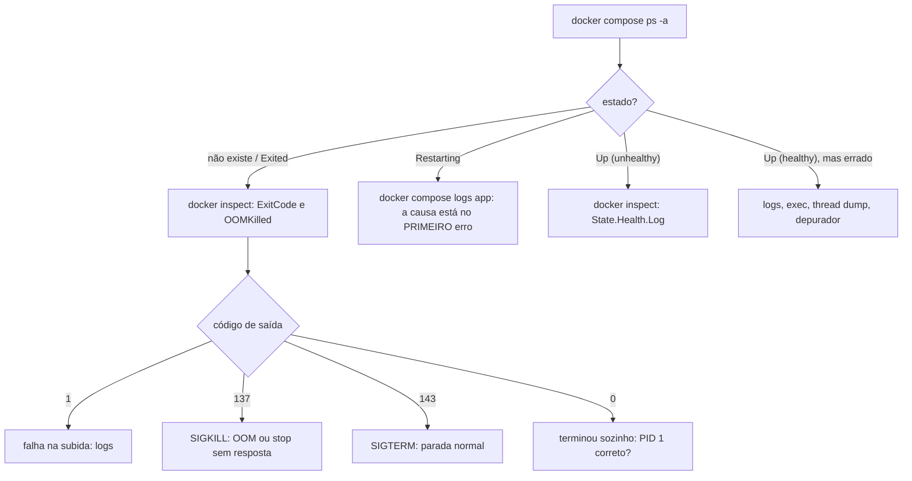

# J9.04 — Logs, depuração e `.dockerignore`

> ⏱️ ~1h30 · 🟢 Júnior · Pré-requisitos: J9.01 a J9.03, J5.14 (logging com SLF4J/Logback e `requestId`), J8.07 (segredos fora da imagem)

> ✅ **Validação final (2026-11-24):** este módulo foi executado no PayFlow reconstruído; o resultado e o que continua não executado estão no [README do módulo](README.md). Os avisos "não executado" / "por leitura" abaixo descrevem a escrita original.

> ⚠️ **Verificação:** os comandos desta aula foram **executados de verdade** (Docker 29.9.2, Compose v5.6.1, Linux) no **laboratório** `lab/docker-lab` (PayFlow Lite, Spring Boot 4.1.2, PostgreSQL 18.6): `logs`, `inspect`, `stats`, `top`, `exec`, o *thread dump* por `SIGQUIT`, a depuração remota com `jdb` e o experimento do `.dockerignore` (contexto de build **com e sem** o arquivo). O `.dockerignore` e o `compose.debug.yaml` do **PayFlow do aluno** são os mesmos (revisados por leitura, **não executados**). Não executado: `docker scout`/varredura de imagem, Docker Desktop (Windows/macOS) e uma IDE conectada ao JDWP (usei o `jdb` do JDK).

## 🎯 Objetivos
Ao final desta aula você consegue:
- **Ler** logs de containers (`docker logs`, `docker compose logs`), **limitar** o tamanho e explicar por que a aplicação loga no **console**.
- **Diagnosticar** um container que não sobe ou que cai: estado, **código de saída** (0, 1, 137, 143), `OOMKilled`, *healthcheck* e laço de reinício.
- **Entrar** no container, **inspecionar** processos e recursos e **tirar um *thread dump*** mesmo em uma imagem só com JRE.
- **Depurar** a aplicação em container com um depurador remoto (JDWP) e saber **por que isso nunca vai para produção**.
- **Escrever** um `.dockerignore` e **provar** que ele reduz o contexto de build e **impede vazar segredos** para a imagem.

## 🤔 Por que isso importa
Quando algo falha em um container, você **não** tem o IDE, o debugger nem o arquivo de log "ali do lado": tem um terminal e meia dúzia de comandos. Quem domina `logs`, `inspect` e `exec` resolve em minutos o que levaria uma tarde (o PayFlow subiu e caiu em laço? o container saiu com 137? a senha do banco mudou?). E o `.dockerignore`, uma lista de **dez linhas**, evita dois problemas caros: **enviar centenas de MB** ao daemon a cada build e, pior, **copiar segredos e o histórico do Git para dentro de uma imagem** que depois vai para um registry (A02 da OWASP Top 10:2025; J8.07). Você vai **ver o segredo dentro da imagem**.

## 💡 Intuição (explicação simples)
- **Log em container** é o **painel do carro**: o carro (o container) mostra no painel (`stdout`); quem está de fora (o Docker) lê o painel. A aplicação **não precisa** de um caderninho (arquivo de log) no porta-malas.
- **Depurar um container** é a **consulta médica**: primeiro os sinais vitais (`ps`, `stats`, `inspect`: está vivo? febre? por que parou?), depois os exames (`logs`, `exec`, *thread dump*).
- **`.dockerignore`** é a **revista na mala antes de embarcar**: o que não é para viajar fica de fora, antes de entrar no avião (a imagem).

## 🔬 Como funciona por dentro

### 1. Logs: `stdout` e `stderr`
O Docker captura **tudo o que o processo principal escreve em `stdout` e `stderr`** e o entrega por um **driver de log** (o padrão é o `json-file`: um arquivo JSON por container no host). É o que `docker logs` e `docker compose logs` leem. Por isso, em container, a regra é a do **[Twelve-Factor App](https://12factor.net/logs)**: **a aplicação escreve no console e não gerencia arquivos de log**. O Spring Boot **já** loga no console por padrão (J5.14); **não** configure `logging.file.name` na imagem: o arquivo ficaria na camada de escrita do container (some quando ele é removido, J9.01) e **ninguém** o leria.

```bash
docker compose logs -f app                     # acompanha (Ctrl+C sai; o container continua)
docker compose logs --tail 50 app              # só as últimas 50 linhas
docker compose logs --since 10m --timestamps app
docker compose logs --no-log-prefix app        # sem o prefixo "app-1  | " (bom para copiar e colar)
docker logs payflow-app-1                      # o equivalente sem Compose (pelo nome do container)
```
Medido (a opção `--timestamps` acrescenta a hora do **Docker** antes da linha, que é diferente da hora que o Logback já imprime):
```text
app-1  | 2026-11-13T21:12:07.769528603Z Picked up JAVA_TOOL_OPTIONS: -XX:MaxRAMPercentage=75
app-1  | 2026-11-13T21:12:08.227349167Z
```
O `requestId` (J5.14) continua no padrão do log (`%5p [%X{requestId:-}]`): **é a chave** para achar todas as linhas de uma requisição com `docker compose logs app | grep <id>`.

**O arquivo de log do container cresce sem fim.** O padrão do `json-file` **não tem limite**: um serviço falante enche o disco do host. Defina a **rotação** no serviço (medido com `docker inspect`):
```yaml
    logging:
      driver: json-file
      options:
        max-size: "10m"          # cada arquivo até 10 MB...
        max-file: "3"            # ...e no máximo 3 (o mais antigo é descartado)
```
```text
$ docker inspect payflow-app-1 --format '{{.HostConfig.LogConfig.Type}} {{.HostConfig.LogConfig.Config}}'
json-file map[max-file:3 max-size:10m]
```
(O arquivo físico fica em `/var/lib/docker/containers/<id>/<id>-json.log`, **só legível pelo root do host**: medido, `ls -l` sem `sudo` falha com `cannot open file`.) Em produção (J10, P6) os logs não ficam no host: um agente os envia a um sistema central (CloudWatch, Loki, ELK) e a aplicação passa a emitir **JSON estruturado** (P6). Os **cuidados da J8/J5.14 continuam**: nada de senha, token ou dado pessoal no log (decisões 38 e 65).

### 2. O fluxograma da depuração: quatro perguntas

**1) Em que estado está?** `docker compose ps -a` (o `-a` mostra também os que **saíram**).
**2) Se saiu, com qual código?**
```bash
docker inspect payflow-app-1 --format 'exit={{.State.ExitCode}} oom={{.State.OOMKilled}} restarts={{.RestartCount}}'
```
| Código | Significado | Medido neste módulo |
|---|---|---|
| `0` | terminou sozinho, sem erro | (um container "de uma vez só") |
| `1` | erro genérico: **a aplicação falhou na subida** (`APPLICATION FAILED TO START`) | segredo do JWT ausente (J9.02): `exit=1` |
| `137` | `128 + 9`: **`SIGKILL`**: o `docker stop` perdeu a paciência (J9.02), ou o **kernel matou por falta de memória** | `ENTRYPOINT` em forma shell + `echo`: `exit=137` em 10,19 s |
| `143` | `128 + 15`: **`SIGTERM`**: parada **normal** com `docker stop` | `docker stop`: `exit=143` em 0,15 s, com *graceful shutdown* |
`OOMKilled=true` confirma a **falta de memória** (o limite do container, J9.01/J9.02). Sem isso, 137 é o `stop` impaciente.

**3) A causa está no log: na PRIMEIRA falha e na `Caused by` mais interna.** Um container em laço de reinício repete o mesmo erro dezenas de vezes: leia a **primeira** tentativa (não a trigésima) e, dentro dela, a **última** linha `Caused by` da pilha (a **causa raiz**; as de cima são as camadas que o Spring acrescenta). Se o Boot tem um *analisador de falhas* para o caso, o bloco `APPLICATION FAILED TO START` traz `Reason`/`Action` já mastigados (foi o que apareceu com o segredo curto). Medido: o `AccessDeniedException: /run/secrets/spring.datasource.password` (J9.03) aparecia em **cada** tentativa, enterrado em uma pilha de `UnsatisfiedDependencyException` e `BeanCreationException` (o Spring envolve a causa em várias camadas). Filtre: `docker compose logs app 2>&1 | grep -E 'Caused by|APPLICATION FAILED|Reason|Action'`.

**4) *Healthcheck* `unhealthy`:** o Docker guarda as últimas execuções do comando de saúde:
```bash
docker inspect payflow-app-1 --format '{{json .State.Health.Status}}'
# "healthy"
docker inspect payflow-app-1 --format '{{(index .State.Health.Log 0).ExitCode}} {{(index .State.Health.Log 0).Output}}'
# 0                                  <- saída do wget (vazia) e código 0: saudável
```
Em um serviço `unhealthy`, esse `Output` mostra o que o comando disse (ex.: `wget: server returned error: HTTP/1.1 503`).

### 3. Entrar no container e olhar por dentro
```bash
docker compose exec app sh              # shell no container EM EXECUÇÃO (Alpine: "sh" do BusyBox; não há bash)
docker compose top app                  # processos do container, vistos do HOST
docker stats --no-stream                # CPU, memória, processos de todos os containers
docker compose exec -T app id           # -T desliga o terminal (necessário em scripts e CI)
```
Medido:
```text
$ docker compose top app
SERVICE  #   UID    PID      PPID     C   STIME  TTY  TIME      CMD
app      1   10001  1984612  1984588  99  18:06  ?    00:00:07  java -jar app.jar          <- UID 10001: o usuário não root (J9.02)
$ docker stats --no-stream --format 'table {{.Name}}\t{{.CPUPerc}}\t{{.MemUsage}}\t{{.PIDs}}'
NAME      CPU %   MEM USAGE / LIMIT   PIDS
lab-app   0.06%   167.8MiB / 512MiB   31
```
- O `top` mostra o `PID` **do host** (1984612) e o `PPID`; dentro do container o mesmo processo é o **PID 1**. É o namespace de PID (J9.01).
- **Depurar a imagem de um container que não sobe:** `docker run --rm -it --entrypoint sh payflow:J9` abre um shell **na imagem**, sem rodar a aplicação (como fizemos para ver o `id` na J9.02).
- **`docker cp`** copia arquivos entre o container e o host: `docker cp hello.txt app:/tmp/hello.txt` (conferido: `docker exec ... cat` leu `ola`). **Armadilha medida:** `docker cp app:/etc/os-release .` copiou o **link simbólico**, não o arquivo (no Alpine, `/etc/os-release` é um *symlink* para `../usr/lib/os-release`; no host ele ficou **quebrado**). Copie o arquivo **real** (ou use `-L` para seguir o link: ⚠️ não testado aqui).
- **`docker diff <container>`** lista o que **mudou** na camada de escrita (J9.01): medido, `A /tmp/novo` e `C /tmp`. Útil para descobrir **onde a aplicação escreve** (e se grava onde não devia).

### 4. *Thread dump* em uma imagem só com JRE
A imagem de produção é **JRE** (J9.02): **não tem** `jcmd` nem `jstack`. Mas a JVM responde ao sinal **`SIGQUIT`** (`kill -3`) imprimindo o *thread dump* **no `stdout`**, ou seja, no `docker logs`:
```bash
docker kill --signal=QUIT payflow-app-1         # NÃO mata: só envia o sinal (o nome do comando engana)
docker logs payflow-app-1 2>&1 | grep -A3 'Full thread dump'
# Full thread dump OpenJDK 64-Bit Server VM (25.0.5+8-LTS mixed mode, sharing)
# "http-nio-8080-exec-1" #26 [28] daemon prio=5 os_prio=0 cpu=64.05ms elapsed=1.60s ... waiting on condition
```
Executado, a JVM **continuou rodando** e o *dump* apareceu no log. É o que você usa para investigar uma aplicação **travada** (threads bloqueadas, *deadlock*): quem espera por quem. (Para um diagnóstico mais completo, P1 e S2 usam `jcmd`, JFR e *heap dumps*.)

### 5. Depuração remota (JDWP) e por que nunca em produção
A JVM pode **aceitar um depurador remoto** (IntelliJ, VS Code, `jdb`) por um protocolo chamado **JDWP**. Você o liga com uma opção da JVM; como a `JAVA_TOOL_OPTIONS` já existe, um **arquivo de sobreposição** do Compose a substitui **só para depurar**:
```yaml
# compose.debug.yaml: docker compose -f compose.yaml -f compose.debug.yaml up -d --wait
services:
  app:
    environment:
      JAVA_TOOL_OPTIONS: "-XX:MaxRAMPercentage=75 -agentlib:jdwp=transport=dt_socket,server=y,suspend=n,address=*:5005"
    ports:
      - "127.0.0.1:5005:5005"
```
O log confirma: `Listening for transport dt_socket at address: 5005`. Conectei com o `jdb` do JDK (a IDE faz o mesmo: *Run → Attach to process / Remote JVM Debug*, host `localhost`, porta `5005`):
```text
$ jdb -attach 127.0.0.1:5005
> threads
Group main:
  (org.apache.tomcat.util.threads.TaskThread)9888   Catalina-utility-1   cond. waiting
  ...
```
Para voltar ao normal, `docker compose up -d --wait` **sem** o segundo `-f` recria o container sem a porta (medido: a porta 5005 sumiu do `docker compose ps`).
- `suspend=n` deixa a aplicação subir sem esperar o depurador (`suspend=y` a **trava** até alguém conectar: útil para depurar a subida).
- **⚠️ JDWP é execução remota de código por design:** quem alcança a porta **executa o que quiser** na JVM. Por isso: **só** `127.0.0.1`, **só** em desenvolvimento, em um **arquivo separado** (`compose.debug.yaml`) que **nunca** é usado em produção e **nunca** entra na imagem (por isso a opção **não** está no `Dockerfile`). O `address=*:5005` escuta em todas as interfaces **do container**; a proteção é o `127.0.0.1:` no `ports`. Em Java 9+ o JDWP, sem o `*`, escuta só no `localhost` **do container**, e a porta publicada não funcionaria (⚠️ regra conhecida do JDK, **não testada** aqui).

### 6. `.dockerignore`: o que **não** entra no contexto
Quando você roda `docker build .`, o cliente **empacota a pasta inteira** (o *contexto de build*) e a envia ao daemon. O `.dockerignore` (ao lado do `Dockerfile`) lista o que **fica de fora**, com a sintaxe parecida com a do `.gitignore`. **Dois efeitos**, medidos em um experimento com um projeto do PayFlow Lite mais um `target/`, um `secrets/`, um `.git`, um `app.log` e um `dump.sql` de 20 MB, e um `Dockerfile` que faz `COPY . /ctx`:

| | Sem `.dockerignore` | Com `.dockerignore` |
|---|---|---|
| Contexto enviado ao daemon | **47,38 MB** | **1,08 kB** |
| Conteúdo de `/ctx` na imagem | `Dockerfile app.log compose.yaml dump.sql pom.xml secrets src target` (e o `.git`, que o `ls` simples não mostra) | `pom.xml src` |
| `secrets/jwt_secret` dentro da imagem | **sim** (`docker run ... cat /ctx/secrets/jwt_secret` imprimiu o segredo) | não existe |

1. **Desempenho:** 47 MB × 1 kB **a cada build** (e, no CI, a cada commit).
2. **Segurança (o mais importante):** um `COPY . .` (o atalho que **todo** tutorial usa) leva **tudo**: `secrets/`, `.env`, chaves, o `.git` (com **todo o histórico**, inclusive segredos que "já foram apagados"). A imagem **guarda tudo isso em camadas**, e quem tem a imagem (um registry, um colega, a internet, se for público) **extrai os arquivos**. Medido: o segredo estava **legível** dentro da imagem.

O arquivo do laboratório (e do PayFlow):
```gitignore
# Controle de versao e IDE
.git
.gitignore
.idea
.vscode
*.iml

# Saida de build (o build acontece dentro da imagem)
target/

# Segredos e configuracao local: NUNCA entram no contexto
secrets/
.env
.env.*
*.pem
*.key

# Logs, dumps e temporarios
*.log
*.sql
dump*
tmp/

# O que nao faz parte da imagem
compose*.yaml
Dockerfile*
.dockerignore
README.md
docs/
scripts/
```
- **`Dockerfile*` e `.dockerignore` dentro do próprio `.dockerignore`:** o daemon **ainda os lê** para construir; só não os copia para o contexto que o `COPY` enxerga. O laboratório constrói normalmente assim (testado).
- **Atenção ao `*.sql`:** no laboratório não há SQL fora de `src/` (as migrações ficam em `src/main/resources/db/`, e a regra `*.sql` do **nível raiz** do `.dockerignore` **não** casa com arquivos de subpastas: o padrão vale a partir da raiz do contexto). Se o `.dockerignore` tivesse `**/*.sql`, as **migrações do Flyway** sairiam do contexto e a aplicação subiria **sem esquema**. **Teste o build depois de mexer no `.dockerignore`.**
- **No PayFlow não exclua `src/test`:** o `mvn -DskipTests package` **compila** os testes (só não os executa), então sem eles o build falha. (`-Dmaven.test.skip=true` pularia a compilação também, mas muda o comportamento de plugins do `pom.xml` que o PayFlow não revisou: **não** usado.)
- **Exceções com `!`:** `*.md` e depois `!README.md` mantém o README (a última regra que casa vence).
- Quando o `COPY` aponta para um arquivo que o `.dockerignore` removeu, o BuildKit atual responde (**conferido**): `ERROR: failed to build: failed to solve: failed to compute cache key: failed to calculate checksum of ref ...: "/segredo.txt": not found`. **Não menciona o `.dockerignore`**: quando um arquivo "some" do build, **olhe o `.dockerignore`** primeiro. (A mensagem `COPY failed: file not found in build context or excluded by .dockerignore` é do construtor **antigo**.)

## 🛠️ Exemplo prático
> **Laboratório executado:** `lab/docker-lab`. Para o PayFlow, copie `.dockerignore` e `compose.debug.yaml` e acrescente o bloco `logging` ao serviço `app`.

### Passo 1: o `.dockerignore` e a prova
Crie o `.dockerignore` acima na raiz do `payflow`. Para **ver** o efeito, faça o experimento do laboratório em uma pasta temporária:
```bash
REPO=$PWD; D=$(mktemp -d); cp -r src pom.xml "$D"/; mkdir "$D/secrets"; echo "segredo-de-teste" > "$D/secrets/jwt_secret"
head -c 20000000 /dev/zero > "$D/dump.sql"
printf 'FROM alpine:3.22\nCOPY . /ctx\n' > "$D/Dockerfile"
cd "$D" && docker build --no-cache --progress=plain -t ctx:sem . 2>&1 | grep 'transferring context'      # sem .dockerignore
docker run --rm ctx:sem cat /ctx/secrets/jwt_secret                                                       # o segredo ESTÁ na imagem
cp "$REPO/.dockerignore" "$D"/ && docker build --no-cache --progress=plain -t ctx:com . 2>&1 | grep 'transferring context'
docker run --rm ctx:com ls -A /ctx                                                                         # só pom.xml e src
docker rmi ctx:sem ctx:com
```
Anote os dois tamanhos de contexto em `docs/docker-notes.md`.

### Passo 2: a rotação de logs e a leitura
Acrescente ao serviço `app` do `compose.yaml` (J9.03) o bloco `logging` da seção 1 e recrie: `docker compose up -d --wait`. Confira com `docker inspect` (saída acima). Treine as quatro formas de ler: `-f`, `--tail`, `--since 5m --timestamps`, `--no-log-prefix`.

### Passo 3: um diagnóstico de verdade (três falhas provocadas)
Provoque, uma de cada vez, e **diagnostique com o fluxograma** (não olhe a causa antes!), registrando **estado, código de saída e a linha do log que revela a causa**:
1. **Segredo curto:** `docker compose run --rm --no-deps -e PAYFLOW_SECURITY_JWT_SECRET=curto app` → `exit=1`, `Reason: java.lang.IllegalArgumentException: payflow.security.jwt.secret must have at least 32 bytes ...` (conferido no laboratório).
2. **Permissão do segredo** (J9.03): `chmod 600 secrets/*` e `docker compose up -d --wait` → `Restarting (1)`, causa `AccessDeniedException`.
3. **Memória:** `docker update --memory 64m --memory-swap 64m payflow-app-1` e acompanhe: se for morto, `exit=137` e `OOMKilled=true`. ⚠️ **Não executado aqui** (a JVM pode falhar na subida em vez de ser morta depois): registre o que acontecer.
Desfaça tudo (`chmod 644 secrets/*`, `docker compose up -d --wait`).

### Passo 4: *thread dump* e depurador
`docker kill --signal=QUIT payflow-app-1` e `docker logs payflow-app-1 2>&1 | grep -A3 'Full thread dump'`. Depois `docker compose -f compose.yaml -f compose.debug.yaml up -d --wait`, conecte a IDE (ou `jdb -attach 127.0.0.1:5005`), **pare** em um *breakpoint* de um controller, chame o endpoint com `curl` e veja a pilha. **Volte** ao normal com `docker compose up -d --wait`.

## 🧠 Pausa para lógica
**Enunciado:** o PayFlow em container "funciona", mas **uma vez por dia** o disco do servidor enche e o time apaga logs à mão. O `docker system df` não mostra imagens grandes. Onde está o problema e qual a correção em **uma** configuração?

<details><summary>Dica</summary>

Onde o Docker guarda a saída de um container e qual é o limite padrão do driver `json-file`?
</details>

<details><summary>Solução</summary>

O driver de log padrão (`json-file`) guarda **toda** a saída de `stdout`/`stderr` em `/var/lib/docker/containers/<id>/<id>-json.log` e **não tem limite** (o `docker system df` não conta esse arquivo como imagem ou volume). Um serviço que loga muito (ou um laço de erro) enche o disco. Correção: `logging: driver: json-file, options: max-size: "10m", max-file: "3"` em **cada** serviço (ou no `daemon.json` como padrão do host). A solução definitiva é enviar os logs para um sistema central e reduzir o ruído (J5.14, P6).
</details>

## ⚖️ Trade-offs e quando NÃO usar
- **Log no console × arquivo:** console é o padrão em container (o Docker/orquestrador coleta, rotaciona e encaminha); arquivo só faz sentido com um **volume** e um *sidecar* de coleta: complexidade que o júnior quase nunca precisa.
- **`json-file` com rotação × driver remoto (`fluentd`, `awslogs`, `gelf`):** `json-file` mantém `docker logs` funcionando; drivers remotos enviam direto, **mas alguns desativam o `docker logs`** (para a leitura local, ⚠️ verifique o driver escolhido na documentação). Em produção na nuvem (J10/P9), o agente da plataforma resolve.
- **Depurador remoto × logs × *thread dump*:** o depurador é o mais poderoso e o mais **perigoso** (abre execução remota de código) e **pausa** a aplicação nos *breakpoints*; só em dev. Logs e *dump* servem em produção.
- **`docker exec` em produção:** entrar no container "para consertar" muda uma instância que **será substituída**; o conserto some. Use para **diagnosticar**; a correção vai no código, na imagem ou na configuração (P7: *containers imutáveis*).
- **`.dockerignore` agressivo × quebrar o build:** cada exclusão é uma chance de o `COPY` falhar ou de faltar um recurso em silêncio (as migrações do Flyway!). Teste o build e **suba a aplicação** depois de mexer.
- **Varredura de imagem (Docker Scout, Trivy, Grype):** o `.dockerignore` e o `USER` reduzem a superfície; as ferramentas de varredura medem **CVEs** na base e nas bibliotecas (mesma ideia do Dependency-Check da J8.07, aplicada à imagem). São assunto da J10/P8: ⚠️ **não executadas aqui**.

## ⚠️ Erros comuns e boas práticas de produção
- **`docker logs` vazio:** o processo não escreve em `stdout`/`stderr` (grava em arquivo) ou o container saiu antes de logar; veja `docker ps -a` e o código de saída.
- **Parar em `BeanCreationException`:** o Spring empilha exceções; a causa raiz é a **última** `Caused by` da pilha (a mais interna), na **primeira** tentativa do laço de reinício.
- **`exec ... bash: executable file not found`:** a imagem (Alpine) só tem `sh`. Use `sh`.
- **`the input device is not a TTY`:** `docker exec -it` em script/CI; use `-T` (Compose) ou tire o `-t`.
- **`docker logs` de um container removido:** não existe (o log some com o container). Em produção, **centralize**.
- **Container "Up" mas a aplicação não responde:** `Up` só diz que o processo **vive**; o `healthcheck` diz se ele **funciona**. Sem `healthcheck`, ninguém sabe.
- **Depurador deixado ligado:** `JAVA_TOOL_OPTIONS` com `jdwp` no `Dockerfile` ou no `compose.yaml` de produção = porta de execução remota. Só no arquivo `compose.debug.yaml`.
- **`COPY . .` sem `.dockerignore`:** vaza `secrets/`, `.env`, `.git` e infla o contexto. Esta aula mostrou o segredo **dentro** da imagem.
- **`docker cp` de um symlink:** copia o link, não o destino.
- **`docker system prune -a --volumes` por reflexo:** apaga imagens não usadas **e volumes** (dados!) sem perguntar o que são. Leia o aviso, use `docker system df` antes e prefira `docker image prune` e `docker container prune`.
- **Imagens "dangling" acumuladas** de builds sucessivos: `docker image prune` as remove.
- **Cache de build do BuildKit crescendo** (`Build Cache` no `docker system df`): `docker builder prune` quando precisar do espaço.

## 🧩 Exercícios
1. **Fixação.** (a) Por que a aplicação em container loga no console? (b) O que significam os códigos de saída 0, 1, 137 e 143? Como distinguir 137 de OOM de 137 do `docker stop`? (c) Para que serve `docker compose top` e por que o PID difere do que a aplicação vê? (d) Como tirar um *thread dump* sem `jstack`? (e) Por que o JDWP não pode ir para produção? (f) O que o `.dockerignore` evita (dois efeitos) e por que `COPY . .` é perigoso sem ele?
2. **Aplicação no PayFlow.**
   - [ ] `.dockerignore` no `payflow` como o do laboratório, **sem** excluir `src/test`, e `docker build` ainda conclui; anote o tamanho do contexto **antes e depois** (`transferring context`).
   - [ ] Bloco `logging` com rotação no serviço `app`; `docker inspect` mostra `json-file map[max-file:3 max-size:10m]`.
   - [ ] `compose.debug.yaml` e a conexão do depurador da IDE com um *breakpoint* em um controller; **volte** ao normal.
   - [ ] As **três falhas** do Passo 3 diagnosticadas com o fluxograma, cada uma com (estado, código de saída, linha do log) em `docs/docker-notes.md`.
   - [ ] *Thread dump* por `SIGQUIT` registrado (cole as 3 primeiras linhas).
   - [ ] `docs/docker-notes.md` fechado com as seções: persistência, segredos/permissões, contexto de build, códigos de saída, depuração.
3. **Desafio (opcional).** (a) Escreva `scripts/smoke-compose.sh` que sobe com `--wait`, testa `/actuator/health` e o `POST /api/v1/auth/token`, imprime `OK`/`FALHOU` e **sempre** derruba (`down -v`) no final (`trap`). (b) Use `docker diff` no container do PayFlow depois de algumas requisições e descubra **onde** ele escreve; faria sentido um volume para esse caminho? (c) Pesquise o `docker debug` (Docker Desktop) ou *ephemeral containers* do Kubernetes (P7) e explique que problema resolvem para imagens sem shell.

<details><summary>Soluções de referência</summary>

1. (a) O Docker coleta `stdout/stderr` e o orquestrador encaminha; arquivo de log ficaria na camada de escrita descartável e sem coleta (12-factor). (b) 0 = terminou sozinho; 1 = erro (falha na subida); 137 = `SIGKILL`; 143 = `SIGTERM`. `docker inspect --format '{{.State.OOMKilled}}'` é `true` no OOM; no `stop` impaciente é `false` (e o tempo do `stop` ≈ 10 s). (c) Mostra os processos do container vistos do host: o PID do host difere do PID 1 interno por causa do namespace de PID. (d) `docker kill --signal=QUIT <container>` e ler o `docker logs` (a JVM imprime o dump no `stdout`). (e) Aceita comandos de quem alcançar a porta: execução remota de código. (f) Reduz o contexto (47 MB × 1 kB no experimento) e impede copiar segredos, `.env` e o `.git` para dentro da imagem.
2. As medidas do laboratório: contexto de 47,38 MB × 1,08 kB; `json-file map[max-file:3 max-size:10m]`; exit=1 para o segredo curto.
3. (a) Esqueleto: `set -euo pipefail; trap 'docker compose down -v' EXIT; docker compose up -d --build --wait; curl -fsS localhost:8080/actuator/health | grep -q UP; ...`. (b) No laboratório, `docker diff` mostrou só `/tmp` (o Tomcat grava arquivos temporários); se o PayFlow só escreve em `/tmp`, **não** precisa de volume, e dá para rodar com `read_only: true` + `tmpfs: /tmp` (um endurecimento a mais, P10). (c) Imagens mínimas (sem shell) não permitem `docker exec ... sh`; essas ferramentas anexam um container de depuração ao mesmo namespace do alvo. ⚠️ não executado aqui.
</details>

## 🎤 Na entrevista
1. **"Um container sai logo depois de subir. Como você investiga?"** *Resposta-modelo:* `docker ps -a` para ver o estado, `docker inspect` para o **código de saída** (1 = falha na aplicação, 137 = `SIGKILL`/OOM, 143 = `SIGTERM`) e o `OOMKilled`, e `docker logs` para a **causa raiz** (o primeiro `Caused by`). Se for laço de reinício, olho `RestartCount`. Para uma imagem sem shell no `run`, abro `--entrypoint sh` e inspeciono o conteúdo.
2. **"Por que aplicações em container logam no console?"** *Resposta-modelo:* porque o contêiner é efêmero e a plataforma coleta `stdout/stderr` (Docker, Kubernetes, agentes de log); a aplicação não gerencia arquivo nem rotação, e o mesmo código funciona em qualquer ambiente (12-factor). Defino a rotação do driver e, em produção, envio a um sistema central.
3. **"Como você depura uma aplicação Java em container?"** *Resposta-modelo:* logs e `requestId` primeiro; *thread dump* por `kill -3`/`SIGQUIT` quando está travada; e, em desenvolvimento, o depurador remoto (JDWP) em uma sobreposição do Compose, publicado só em `127.0.0.1`, porque o JDWP permite executar código remotamente e nunca vai para produção.
4. **"Para que serve o `.dockerignore`?"** *Resposta-modelo:* controla o que entra no contexto de build: acelera o build e, principalmente, impede que `.git`, `.env`, chaves e `secrets/` sejam copiados por um `COPY . .` para dentro da imagem, de onde qualquer um que tenha a imagem os extrai.

## 📚 Para ir além
- 📄 [`docker container logs`](https://docs.docker.com/reference/cli/docker/container/logs/), [`docker compose logs`](https://docs.docker.com/reference/cli/docker/compose/logs/), [configurar o log dos containers](https://docs.docker.com/engine/logging/configure/) e [o driver `json-file`](https://docs.docker.com/engine/logging/drivers/json-file/).
- 📄 [`docker container exec`](https://docs.docker.com/reference/cli/docker/container/exec/), [`inspect`](https://docs.docker.com/reference/cli/docker/container/inspect/), [`stats`](https://docs.docker.com/reference/cli/docker/container/stats/) e [métricas de execução](https://docs.docker.com/engine/containers/runmetrics/).
- 📄 [Contexto de build](https://docs.docker.com/build/concepts/context/) (inclui a sintaxe do `.dockerignore`) e as [boas práticas de build](https://docs.docker.com/build/building/best-practices/).
- 📄 [Spring Boot: logging](https://docs.spring.io/spring-boot/reference/features/logging.html) (console por padrão, formatos) e [Actuator: endpoints](https://docs.spring.io/spring-boot/reference/actuator/endpoints.html).
- 📄 [Guia de solução de problemas do JDK 25 (Oracle)](https://docs.oracle.com/en/java/javase/25/troubleshoot/) (*thread dumps*, `jcmd`, JFR) e a [especificação do comando `java`](https://docs.oracle.com/en/java/javase/25/docs/specs/man/java.html) (`-agentlib:jdwp`, `-XX:MaxRAMPercentage`).
- 📑 [The Twelve-Factor App: logs](https://12factor.net/logs).
- 📄 [Códigos de saída e sinais no Linux](https://man7.org/linux/man-pages/man7/signal.7.html) (`SIGTERM`, `SIGKILL`, `SIGQUIT`).
- 📄 [Segurança do Docker: a superfície de ataque do daemon](https://docs.docker.com/engine/security/) (o grupo `docker` e root).
- 🎥 Nenhum vídeo verificado (⚠️).

## ✅ Checklist da aula
- [ ] Leio logs com `-f`, `--tail`, `--since`, `--timestamps` e sei que a causa raiz é a `Caused by` mais interna.
- [ ] O serviço `app` tem rotação de log (`json-file`, 10m × 3).
- [ ] Sigo o fluxograma: `ps -a` → `inspect` (código de saída e `OOMKilled`) → `logs` → `exec`/`top`/`stats`.
- [ ] Sei o que são 0, 1, 137 e 143 e distingo OOM de `stop` impaciente.
- [ ] Tirei um *thread dump* com `SIGQUIT` e conectei um depurador por `compose.debug.yaml` (e voltei ao normal).
- [ ] `.dockerignore` no repositório; medi o contexto antes e depois e **vi** o segredo dentro de uma imagem sem ele.
- [ ] Não excluí `src/test` nem as migrações do Flyway no `.dockerignore`; o build e a subida continuam funcionando.
- [ ] `docs/docker-notes.md` completo.
