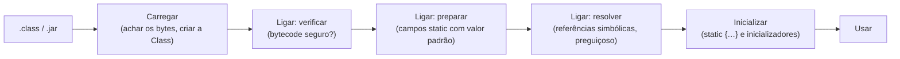
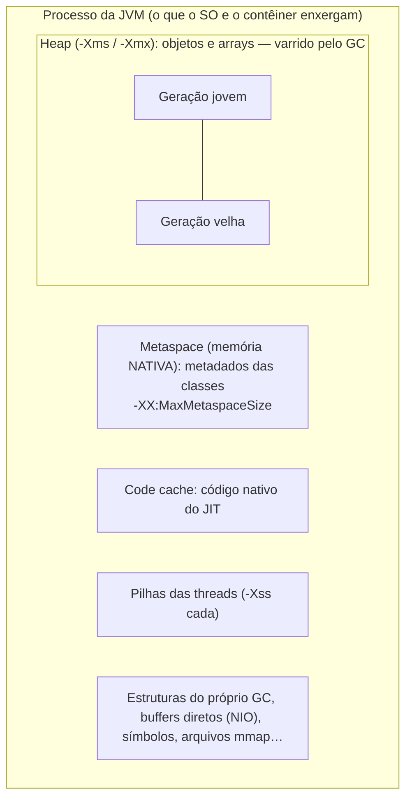

# P1.01 — Classloading e áreas de memória (heap, stack, metaspace)

> ⏱️ ~1h30 · 🔵 Pleno · Pré-requisitos: J1.01 (primitivos × referência), J1.05 (classes, `static`), J1.09 (exceções e *stack trace*), J9.01 a J9.04 (JVM em container, `MaxRAMPercentage`, código de saída 137)

> ⚠️ **Verificação:** todos os experimentos abaixo foram **executados de verdade** em `lab/jvm-lab/MemoryAreas.java` (JDK 25.0.5, OpenJDK do Ubuntu, Linux, 12 núcleos). Os **números** (profundidade de pilha, MiB, nº de classes) variam por máquina e por *flag*: o que vale é a **ordem de grandeza** e o raciocínio. Nada do PayFlow foi compilado (decisão do aluno: testes práticos no fim do treinamento).

## 🎯 Objetivos
Ao final desta aula você consegue:
- **Descrever** o caminho de uma classe até virar código executando (carregar, ligar, inicializar) e **dizer quem** a carrega (*bootstrap*, *platform*, *application*).
- **Distinguir** heap, pilha (*stack*), *metaspace* e memória nativa, e **associar** cada uma a um erro real (`StackOverflowError`, `OutOfMemoryError: Java heap space`, `OutOfMemoryError: Metaspace`).
- **Calcular** o custo aproximado de um objeto (cabeçalho, alinhamento) e **medir** o consumo com `MemoryMXBean`, `jcmd` e o *Native Memory Tracking*.
- **Escolher** `-Xmx`, `-Xss`, `-XX:MaxMetaspaceSize` e `MaxRAMPercentage` com um motivo.

## 🤔 Por que isso importa
No Júnior você tratou a JVM como uma caixa preta que "roda o `.jar`". No Pleno, a primeira pergunta de um incidente é **"qual memória acabou?"**. A resposta muda tudo: *heap* cheio pede achar quem retém objetos; pilha estourada é recursão sem fim; *metaspace* estourado é *classloader* que vazou; o contêiner morto com código **137** (J9, decisão 73) pode nem ter sido heap, e sim memória **nativa** que a JVM usa fora do `-Xmx`. Quem não sabe separar essas áreas "aumenta o `-Xmx`" e o problema volta.

## 💡 Intuição (explicação simples)
A JVM é um **escritório**.
- O **classloader** é a recepção: quando alguém pede um procedimento (uma classe), a recepção vai ao arquivo, confere se o documento é legítimo e entrega, **só na primeira vez**.
- O **metaspace** é o arquivo de manuais: guarda o que cada classe *é* (campos, métodos), não as pessoas.
- O **heap** é o depósito comum: todos os objetos moram lá e o serviço de limpeza (GC, próximas aulas) passa recolhendo o que ninguém usa.
- A **pilha** é a mesa de cada funcionário (*thread*): cada chamada de método empilha uma folha de rascunho (*frame*) com as variáveis locais; ao retornar, a folha sai. Mesa pequena demais = pilha de folhas que cai.
- O **code cache** é o caderno de atalhos que o JIT (P1.02) escreve.

## 🔬 Como funciona por dentro

### 1. Do `.class` ao código rodando

- **Carregar** acontece **sob demanda**, na primeira referência. **Inicializar** é ainda mais tarde: só quando a classe é *usada de verdade* (criar instância, chamar método estático, ler/gravar campo estático **não constante**). Constantes de compilação (`static final int X = 42`) são copiadas para quem as usa e **não** disparam a inicialização (provado abaixo).
- **Delegação "pai primeiro":** antes de carregar, um *classloader* pergunta ao pai. Cadeia padrão: **bootstrap** (classes do `java.base`; aparece como `null`) → **platform** (módulos como `java.sql`) → **application** (seu classpath). Por isso você não consegue "substituir" `java.lang.String`.
- Um `ClassLoader` **customizado** (servidores de aplicação, *plugins*, Spring DevTools, J5) cria **outro espaço de nomes**: a mesma classe carregada por dois *loaders* são **dois tipos diferentes** (`ClassCastException` entre "iguais").

### 2. As áreas de memória

| Área | O que guarda | Limite | Erro quando acaba |
|---|---|---|---|
| **Heap** | objetos, arrays, `String`s | `-Xmx` (padrão: 1/4 da RAM; em contêiner, 1/4 do limite, ver J9) | `OutOfMemoryError: Java heap space` |
| **Pilha** (por thread) | *frames*: variáveis locais, operandos, endereço de retorno | `-Xss` por thread (padrão típico de 1 MiB no Linux x64) | `StackOverflowError` |
| **Metaspace** | metadados de classes (substituiu a *PermGen* no Java 8) | ilimitado por padrão (memória nativa!); `MaxMetaspaceSize` | `OutOfMemoryError: Metaspace` |
| **Code cache** | código compilado pelo JIT | `-XX:ReservedCodeCacheSize` | aviso `CodeCache is full` e o JIT para |
| **Memória nativa fora do heap** | GC, pilhas, *direct buffers*, bibliotecas | só o limite do SO/contêiner | processo **morto** pelo SO (137, `OOMKilled`) |

- **Heap ≠ processo.** `-Xmx512m` **não** significa 512 MiB de RSS: some o metaspace, o code cache, as pilhas de cada thread (1 MiB × N threads), o GC e o que a aplicação alocar nativamente. Por isso a J9 usa `MaxRAMPercentage=75` e **não** 100 (sobra para o resto, senão o contêiner morre com 137 sem nenhum `OutOfMemoryError` no log).

### 3. Quanto pesa um objeto
Em um objeto Java há um **cabeçalho** (*mark word* de 8 bytes com *hash*, *lock*, idade do GC + ponteiro da classe), os campos e **preenchimento** até múltiplo de 8 bytes. Com ponteiros comprimidos (*compressed oops*, padrão com heap < ~32 GiB) o cabeçalho típico é de **12 bytes**, então um `new Object()` ocupa **16 bytes**. O **JEP 519** (*Compact Object Headers*, entregue como recurso de produto no Java 25) reduz o cabeçalho a 8 bytes: medido abaixo, `new Object()` cai de **16 para 8 bytes**.

## 🛠️ Exemplo prático
> Tudo em `lab/jvm-lab/MemoryAreas.java`. Rode da pasta `lab/jvm-lab/` com `JAVA_HOME=/usr/lib/jvm/java-25-openjdk-amd64` (o `java` padrão do shell pode ser o 17: J0). Para a parte de *classloaders*, **compile antes**: no modo `java MemoryAreas.java` o código roda num *loader* especial do lançador de fontes, o que atrapalha a leitura.

### A. Quem carrega o quê
```bash
mkdir -p /tmp/p101 && javac -d /tmp/p101 MemoryAreas.java && java -cp /tmp/p101 MemoryAreas loaders
```
```text
String      -> null
java.sql    -> jdk.internal.loader.ClassLoaders$PlatformClassLoader@58644d46
esta classe -> jdk.internal.loader.ClassLoaders$AppClassLoader@341d43cd
  cadeia: app (jdk.internal.loader.ClassLoaders$AppClassLoader)
  cadeia: platform (jdk.internal.loader.ClassLoaders$PlatformClassLoader)
  cadeia: bootstrap (null)
```
`String` vem do *bootstrap* (`null`: não existe um objeto `ClassLoader` para ele); `java.sql.Driver` do *platform*; a sua classe do *application*.

### B. Carregar não é inicializar
```java
Class<?> c = Class.forName("MemoryAreas$Lazy", false, loader);   // false = NÃO inicializar
System.out.println(Lazy.CONSTANT);   // constante de compilação
System.out.println(Lazy.counter);    // campo estático comum
```
```text
1) Class.forName(..., false, ...): carrega, não inicializa
  carregada: MemoryAreas$Lazy
2) ler uma constante de compilação:
  CONSTANT = 42
3) ler um campo estático comum:
  [Lazy] inicialização estática executada
  counter = 1
```
O `static { … }` só rodou no passo 3. É por isso que um `static` pesado (abrir conexão, ler arquivo) numa classe "só referenciada" **atrasa a primeira requisição** e não a subida.

### C. A pilha: quantas chamadas cabem
```java
static int depth = 0;
static void recurse() { depth++; recurse(); }
```
```text
java MemoryAreas.java stack               -> StackOverflowError após 16840 chamadas
java -Xss256k MemoryAreas.java stack      -> StackOverflowError após 1779 chamadas
java -Xss4m   MemoryAreas.java stack      -> StackOverflowError após 95429 chamadas
```
A profundidade é **proporcional ao `-Xss`** e depende do tamanho do *frame* (e do JIT: o número muda de uma execução para outra, 16 840 aqui foi a primeira, ainda em modo interpretado). Regra prática: algumas **milhares a dezenas de milhares** de chamadas. Isso vale **para cada thread**: 200 threads × 1 MiB = 200 MiB **fora do heap**.

### D. O heap acaba
```bash
java -Xmx32m MemoryAreas.java heap
```
```text
OutOfMemoryError: Java heap space (após 14 MiB retidos)
```
Só 14 MiB de `byte[]` retidos, num teto de 32 MiB: o resto é o próprio programa, o compilador do modo *source launcher* e a fragmentação em regiões do G1 (P1.03). Para investigar **depois** que acontece, peça à JVM um *heap dump*:
```bash
java -Xmx32m -XX:+HeapDumpOnOutOfMemoryError -XX:HeapDumpPath=/dumps/ -XX:+ExitOnOutOfMemoryError MemoryAreas.java heap
```
```text
java.lang.OutOfMemoryError: Java heap space
Dumping heap to /tmp/tmp.Anq0pAz9NE/java_pid2095466.hprof ...
Heap dump file created [23579124 bytes in 0.017 secs]
Terminating due to java.lang.OutOfMemoryError: Java heap space
```
`ExitOnOutOfMemoryError` derruba o processo: em contêiner/Kubernetes isso é **desejável** (o orquestrador reinicia; uma JVM com OOM fica doente e imprevisível). O arquivo `.hprof` abre no Eclipse MAT ou no VisualVM (análise de *leaks*: S2).

### E. O metaspace acaba
Geramos classes novas em tempo de execução com a **Class-File API** (`java.lang.classfile`, final no Java 24, JEP 484), cada uma em seu próprio *loader* que mantemos vivo:
```bash
java -XX:MaxMetaspaceSize=16m MemoryAreas.java metaspace
```
```text
Parou depois de 963 classes: java.lang.OutOfMemoryError: Metaspace
```
É o mesmo cenário dos vazamentos reais: *redeploy* de aplicação em servidor, DevTools, *proxies*/*bytecode generation* (Hibernate, Spring AOP, Mockito) criando classes sem parar, ou um `ClassLoader` retido por uma `ThreadLocal`/cache estático. Sintoma: `Metaspace` sobe sem voltar nunca.

> 🪤 Aprendizado do laboratório: a primeira versão deste exemplo **falhou por causa do `OutOfMemoryError` do metaspace dentro da concatenação de strings** (`"Gen" + n` usa `invokedynamic`, que precisa carregar classes — ou seja, **de metaspace**). Quem trata um OOM **não pode alocar** no mesmo recurso que acabou: o *handler* também cai. Por isso o código pré-calcula as `String`s e usa `Integer.toString`.

### F. Números ao vivo
```bash
java -Xmx256m MemoryAreas.java numbers
```
```text
heap      usado=39 MiB  comprometido=256 MiB  máximo=256 MiB
non-heap  usado=16 MiB  comprometido=19 MiB
  CodeHeap 'non-nmethods'        non-heap usado=1398 KiB
  Metaspace                      non-heap usado=10858 KiB
  CodeHeap 'profiled nmethods'   non-heap usado=2824 KiB
  Compressed Class Space         non-heap usado=1333 KiB
  G1 Eden Space                  heap     usado=38912 KiB
  G1 Old Gen                     heap     usado=1156 KiB
  G1 Survivor Space              heap     usado=0 KiB
  CodeHeap 'non-profiled nmethods' non-heap usado=578 KiB
processadores=12
```
(`comprometido=256` no heap: o tamanho inicial padrão é 1/64 da RAM, ≈ 300 MiB nesta máquina, maior que o máximo; então a JVM já começa com o máximo. *Comprometido* é o que a JVM já pediu ao SO.)

### G. O que o `-Xmx` não conta: *Native Memory Tracking*
```bash
java -Xmx256m -XX:NativeMemoryTracking=summary GcLoad.java 6 &
jcmd <PID> VM.native_memory summary
```
```text
Total: reserved=1740587KB, committed=370199KB
-                 Java Heap (reserved=262144KB, committed=262144KB)
-                     Class (reserved=1048793KB, committed=1625KB)
-                    Thread (reserved=25682KB, committed=1094KB)
-                      Code (reserved=249038KB, committed=9150KB)
-                        GC (reserved=59211KB, committed=59211KB)
-                    Symbol (reserved=2695KB, committed=2695KB)
```
Com **256 MiB de heap**, o processo **comprometeu 370 MiB** (e *reservou* 1,7 GiB de espaço de endereços). A diferença (≈ 108 MiB aqui) é **só da JVM**: o **GC** sozinho usa 59 MiB de estruturas auxiliares (≈ 23% do heap: conjuntos de lembrança do G1). O NMT tem custo de desempenho (a documentação do `jcmd` o descreve): ligue **para investigar**, não por padrão.

### H. O custo de um objeto
```java
// lab/jvm-lab/ObjectSize.java: heap usado depois de alocar 2 milhões de `new Object()` retidos, menos 4 B da referência de cada um
```
```text
java -Xmx512m ObjectSize.java                                -> bytes por new Object() ~ 12.0   (+4 da referência = 16 B)
java -Xmx512m -XX:+UseCompactObjectHeaders ObjectSize.java   -> bytes por new Object() ~ 4.0    (+4 da referência = 8 B)
```
Um `Transfer` do PayFlow (J5: `UUID id`, duas referências de conta, `BigDecimal amount`, `status`, `Instant`) são **muitos objetos pequenos** (o `BigDecimal` tem `BigInteger`, o `UUID` tem dois `long`…): milhões deles custam centenas de MiB. É por isso que a P2 fala de **projeções** em vez de carregar entidades.

## 🧠 Pausa para lógica
**Enunciado:** o extrato do PayFlow carrega 1 milhão de lançamentos (`LedgerEntry`) em uma `List` para exportar um CSV. Cada `LedgerEntry` tem `UUID` (24 B de objeto, 16 B úteis), `UUID` da conta, `String type` (curta, compartilhada), `BigDecimal amount` (~ 40 B com o `BigInteger` interno quando passa de `long`; ~ 24 B no caso compacto) e `Instant` (24 B). Estime se cabe em `-Xmx256m` e proponha uma alternativa que **não** precise de heap proporcional ao total.

<details><summary>Dica</summary>Some os objetos por lançamento (o próprio objeto + o que ele aponta), multiplique por 10⁶ e compare com 256 MiB. Depois pense em **fluxo**: ler uma linha, escrever uma linha.</details>

<details><summary>Solução</summary>

Por lançamento, contando só o que **não** é compartilhado: objeto `LedgerEntry` (~ 40 B: cabeçalho 12 + 5 referências de 4 B + alinhamento) + `UUID` (24 B) × 2 + `BigDecimal` (~ 40 B) + `Instant` (24 B) ≈ **150 B**. Para 10⁶: ≈ **150 MiB** de objetos **vivos ao mesmo tempo**, mais o `ArrayList` (4 MiB). Em `-Xmx256m` "cabe", mas o GC fica sem folga (P1.03: a coleta fica frequente e longa) e uma requisição simultânea derruba o serviço. Alternativa: **stream** (JPA `Stream<LedgerEntry>` ou JDBC com `fetchSize`, J3/J5/P2) escrevendo cada linha na resposta: heap **constante**, independente do total. É o mesmo princípio da `Slice` do extrato (J5.10).
</details>

**Variação:** repita a conta com `-XX:+UseCompactObjectHeaders` e diga **quanto** economiza (dica: 4 B por objeto, ~ 5 objetos por lançamento).

## ⚖️ Trade-offs e quando NÃO usar
- **Heap grande demais:** menos coletas, mas cada uma pode demorar mais (P1.03) e o contêiner precisa de RAM para o resto; **heap pequeno demais:** GC frequente e `OutOfMemoryError`. Em contêiner, prefira `-XX:MaxRAMPercentage` (J9) a `-Xmx` fixo: acompanha o limite do *pod*.
- **`-Xss` maior** resolve recursão profunda, mas multiplica por **cada** thread; o certo costuma ser **eliminar a recursão** (laço ou pilha explícita), não aumentar a pilha.
- **`MaxMetaspaceSize`:** sem limite, um *leak* de classes consome a máquina inteira; com limite baixo demais, a aplicação legítima cai. Defina um teto **folgado** (ex.: 256 MiB para um Spring Boot médio, **medido**) para transformar um vazamento em erro **cedo** e visível.
- **`-XX:+UseCompactObjectHeaders`:** economiza memória e melhora cache, mas é um recurso **novo** (entregue no Java 25): meça com a sua carga antes de ligar em produção.

## ⚠️ Erros comuns e boas práticas de produção
- **"Dobrei o `-Xmx` e ainda morre com 137":** o limite do contêiner conta **tudo**, não só o heap (seção G). Veja `docker stats`/`kubectl top` (RSS) **e** o NMT, não só o gráfico de heap.
- **`java.lang.OutOfMemoryError: unable to create native thread`:** faltou memória nativa (ou limite de processos) para a **pilha** de uma nova thread; sintoma de **criar thread sem controle** (P1.05, P1.10).
- **`OutOfMemoryError: GC overhead limit exceeded`:** o GC gasta quase todo o tempo e recupera quase nada; é *heap* pequeno ou *leak*.
- **`OutOfMemoryError: Direct buffer memory`:** buffers NIO fora do heap (`-XX:MaxDirectMemorySize`).
- **Tratar OOM como exceção comum** (`catch (Throwable)` e seguir): o estado do programa é duvidoso. Prefira **morrer e reiniciar** (`ExitOnOutOfMemoryError`) com *heap dump* para a análise.
- **Static pesado em classe "inocente"** atrasa a primeira requisição (seção B). **Coleção `static` que só cresce** é o *leak* mais comum de heap.

## 🧩 Exercícios
1. **Fixação:** rode `MemoryAreas` com `-Xss512k`, `-Xss1m` e `-Xss2m` e anote a profundidade; confira se é **linear** no `-Xss`.
2. **Aplicação no PayFlow:**
   - [ ] Suba o PayFlow pelo Compose (J9) com `JAVA_TOOL_OPTIONS=-XX:NativeMemoryTracking=summary` e rode `docker compose exec app …`: a imagem é JRE (J9, decisão 74: sem `jcmd`). **Qual alternativa você usaria?** (dica: um *sidecar* com JDK no mesmo PID *namespace*, ou o Actuator `/actuator/metrics/jvm.memory.used` com as áreas por `area` e `id`). Registre a decisão em `docs/jvm-notes.md`.
   - [ ] Em `docs/jvm-notes.md`, escreva a tabela **limite do contêiner × `MaxRAMPercentage` × heap resultante × sobra para o resto** para `--memory 512m`, `768m` e `1g` (use os números da J9: com 512 MiB o heap ficou em ≈ 371 MB).
   - [ ] Acrescente `-XX:+HeapDumpOnOutOfMemoryError -XX:HeapDumpPath=/tmp -XX:+ExitOnOutOfMemoryError` ao `JAVA_TOOL_OPTIONS` e **anote** por que o diretório do dump precisa de volume (o *filesystem* do contêiner some quando ele morre).
3. **Desafio (opcional):** reproduza um *leak* de *classloader*: carregue a mesma classe em 1 000 `URLClassLoader`s, solte as referências e veja o `Metaspace` **cair** depois de `System.gc()` (as classes só saem quando o *loader* é coletado). Depois guarde os *loaders* numa `ThreadLocal` estática e veja que **não cai**.

<details><summary>Solução de referência (exercício 2, tabela)</summary>

| `--memory` | `MaxRAMPercentage` | heap máximo | sobra p/ o resto |
|---|---|---|---|
| 512 MiB | 75 | ≈ 384 MiB (a J9 mediu **371 MB**; a JVM arredonda) | ≈ 128 MiB: metaspace + code cache + pilhas + GC + buffers |
| 768 MiB | 75 | ≈ 576 MiB | ≈ 192 MiB |
| 1 GiB | 75 | ≈ 768 MiB | ≈ 256 MiB |

Com Spring Boot + Hibernate o "resto" costuma passar de 150 MiB: **512 MiB é apertado**; meça o RSS real (NMT) antes de fixar o limite.
</details>

## 🎤 Na entrevista
- **Qual a diferença entre heap e stack?** Heap: objetos, compartilhado entre threads, coletado pelo GC. Pilha: uma por thread, guarda *frames* de chamada (locais e retorno), liberada ao retornar; estoura com `StackOverflowError`. Referências vivem na pilha, o objeto apontado vive no heap.
- **O que é o *metaspace* e o que mudou do Java 7 para o 8?** Memória **nativa** com os metadados das classes; substituiu a *PermGen* (dentro do heap, de tamanho fixo). Cresce sob demanda; limite por `MaxMetaspaceSize`. `OutOfMemoryError: Metaspace` indica *leak* de classes/*classloaders*.
- **Por que dois *classloaders* podem carregar a "mesma" classe e dar `ClassCastException`?** Identidade de tipo = nome + *loader*. Cada *loader* customizado cria um espaço de nomes próprio.
- **O contêiner morreu com 137 e o heap estava abaixo do `-Xmx`. Por quê?** O processo usa mais que o heap (metaspace, code cache, pilhas, GC, buffers diretos); o *cgroup* mata pelo total. Medir com NMT e deixar folga (`MaxRAMPercentage` < 100).

## 📚 Para ir além
- 📄 [JVM Specification (SE 25): carregamento, ligação e inicialização](https://docs.oracle.com/javase/specs/jvms/se25/html/index.html): a fonte primária dos capítulos 5 (carregar/ligar/inicializar) e 2 (áreas de dados de execução).
- 📄 [`java` (comando) — opções `-Xmx`, `-Xss`, `-XX`](https://docs.oracle.com/en/java/javase/25/docs/specs/man/java.html): lista oficial das *flags* e do *Unified Logging* (`-Xlog`).
- 📄 [`jcmd`](https://docs.oracle.com/en/java/javase/25/docs/specs/man/jcmd.html): `VM.native_memory`, `GC.heap_info`, `Thread.print`, `GC.heap_dump`.
- 📄 [JEP 519: Compact Object Headers](https://openjdk.org/jeps/519) e [JEP 484: Class-File API](https://openjdk.org/jeps/484): as duas peças usadas nos experimentos.
- 📑 Livro: *Java Performance* (Scott Oaks) — memória nativa e ferramentas; *Effective Java* (Bloch), itens sobre *leaks* (item 7).

## ✅ Checklist da aula
- [ ] Rodei os experimentos A a F e anotei os números da **minha** máquina.
- [ ] Sei dizer qual área acabou a partir do nome do erro.
- [ ] Sei por que `-Xmx` ≠ RSS e como medir a diferença (NMT).
- [ ] `docs/jvm-notes.md` do PayFlow com a tabela de memória por limite de contêiner (**não executado**, só por leitura).
