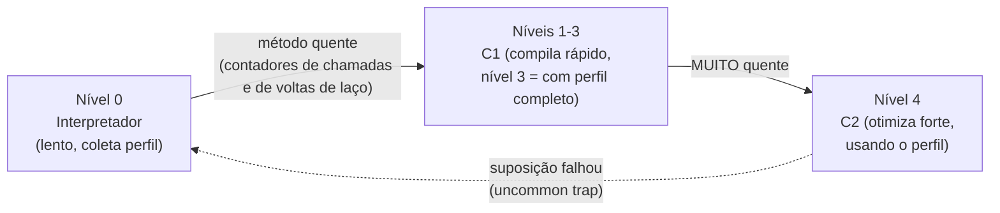

# P1.02 — JIT e aquecimento

> ⏱️ ~1h30 · 🔵 Pleno · Pré-requisitos: P1.01, J1.13 (lambdas e *streams*), J1.15 (`BigDecimal`), J1.16 (Big-O, medir)

> ⚠️ **Verificação:** executado de verdade em `lab/jvm-lab/Warmup.java` (JDK 25.0.5, Linux, 12 núcleos, **máquina com outras cargas rodando**: os milissegundos oscilam de uma execução para a outra). O que vale é a **forma** da curva e a **ordem de grandeza**, não o número exato. Não é um *benchmark* sério: para isso existe o JMH (S2). O PayFlow não foi compilado.

## 🎯 Objetivos
Ao final desta aula você consegue:
- **Explicar** por que a mesma chamada leva 1 400 ns no começo e 20 ns depois (interpretador → C1 → C2).
- **Ler** uma linha de `-XX:+PrintCompilation` (nível, OSR, *made not entrant*).
- **Descrever** inlining, *OSR*, desotimização (*uncommon trap*) e por que chamadas **polimórficas** custam mais.
- **Desconfiar** de um "benchmark" feito com `System.nanoTime()` em um `main` e **dizer** o que ele erra.
- **Planejar** o aquecimento do PayFlow (primeiras requisições lentas, *readiness*, cache AOT).

## 🤔 Por que isso importa
Todo deploy do PayFlow começa **frio**: as primeiras requisições passam por código **interpretado**. Num *pod* novo (P7) ou numa instância nova (J10) isso aparece como **p99 alto logo após o deploy**, *timeouts* no primeiro minuto e "o teste de carga foi bom na segunda rodada, ruim na primeira". Também é a raiz de *benchmarks* mentirosos: medir antes de a JVM ter se aquecido compara o interpretador, não o seu código.

## 💡 Intuição (explicação simples)
Um **garçom novo** que anota o pedido de cada mesa **lendo o manual inteiro** (interpretador). Depois de atender cem vezes a mesma mesa, ele **decora** o fluxo (compilação rápida, C1) e, nas mesas que mais lotam, **ensaia a versão otimizada** com base no que viu (C2: "esta mesa nunca pede X, então pulo essa pergunta"). Se um dia um cliente pede X, ele **volta ao manual** para aquela mesa (desotimização) e reaprende. A JVM faz o mesmo com os seus métodos.

## 🔬 Como funciona por dentro

- **Compilação em camadas (*tiered*)**, padrão desde o Java 8. Cada método tem **contadores** (chamadas e voltas de laço). Passou do limite → entra numa fila de compilação, que roda em **threads de compilador** em segundo plano (consomem CPU: por isso o primeiro minuto de uma JVM é caro).
- **C1** gera código rápido de produzir, com pouca otimização, e (no nível 3) instrumenta para **coletar perfil**: que ramos foram tomados, que tipos apareceram em cada chamada virtual.
- **C2** usa o perfil para **otimizações especulativas**: *inlining* (copiar o corpo do método chamado para dentro do chamador, o que abre outras otimizações), eliminação de código morto, análise de escape (objeto que não "foge" do método pode nem ir ao heap), *loop unrolling*, vetorização.
- **OSR (*on-stack replacement*):** um `main` com um laço enorme **nunca retorna**, então não poderia trocar para o código novo; o OSR troca **no meio do laço**. É a linha com `%` no `PrintCompilation`.
- **Desotimização (*uncommon trap*):** o C2 compilou supondo "aqui só aparece o tipo `A`". Chega um `B`: a suposição quebra, o código compilado é **descartado** ("made not entrant") e o método **volta ao interpretador** até recompilar. Não é erro, é o custo da especulação.
- **Chamadas virtuais:** com **1** implementação vista (*monomórfica*), o C2 faz *inlining* direto; com **2** (*bimórfica*), inlining com um teste de tipo; com **3 ou mais** (*megamórfica*), usa chamada virtual por tabela, sem *inlining*. Interfaces com muitas implementações no caminho quente custam mais.
- **Code cache:** onde mora o código compilado (P1.01); se encher, o JIT para.

## 🛠️ Exemplo prático
> `lab/jvm-lab/Warmup.java`. O "trabalho" imita o PayFlow: a tarifa de 1,5% sobre um valor em centavos, `BigDecimal` com `HALF_EVEN` (decisão 4).

```java
static long fee(long cents) {
    BigDecimal v = BigDecimal.valueOf(cents, 2).multiply(new BigDecimal("0.015")).setScale(2, RoundingMode.HALF_EVEN);
    return v.unscaledValue().longValue();
}
static long sink;     // consumir o resultado impede que o JIT elimine o cálculo (dead-code elimination)
```
Lotes de 200 000 chamadas, cronometrados um a um:

### A. A curva de aquecimento
```bash
java Warmup.java batches
```
```text
lote  1:   42.3 ms  (  212 ns/chamada)
lote  2:    4.7 ms  (   24 ns/chamada)
lote  3:    7.5 ms  (   38 ns/chamada)
lote  4:    7.7 ms  (   38 ns/chamada)
lote  5:    7.1 ms  (   36 ns/chamada)
lote  6:    6.9 ms  (   35 ns/chamada)
lote  7:    8.0 ms  (   40 ns/chamada)
lote  8:    8.9 ms  (   44 ns/chamada)
lote  9:    3.5 ms  (   18 ns/chamada)
lote 10:    3.3 ms  (   16 ns/chamada)
lote 11:    3.7 ms  (   18 ns/chamada)
lote 12:    4.0 ms  (   20 ns/chamada)
```
O primeiro lote custou **~10×** o de regime. A subida entre os lotes 3 e 8 e a queda no 9 são o C1 (com perfil) virando C2. Veja o que acontece **sem** compilador e **só com C1**:
```bash
java -Xint Warmup.java batches                    # só interpretador
java -XX:TieredStopAtLevel=1 Warmup.java batches  # só C1
```
```text
-Xint:   lote 1: 283.0 ms (1415 ns/chamada) ... lote 12: 246.1 ms (1230 ns/chamada)   <- nunca melhora
C1 só:   lote 1:  30.1 ms ( 151 ns/chamada) ... lote 12:  11.8 ms (  59 ns/chamada)
padrão:  lote 1:  42.3 ms ( 212 ns/chamada) ... lote 12:   4.0 ms (  20 ns/chamada)
```
O interpretador é **~60×** mais lento que o regime do C2 neste trabalho. C1 sozinho chega a ~3× do C2. (`-Xint` e `TieredStopAtLevel=1` são **ferramentas de diagnóstico**, não de produção; `TieredStopAtLevel=1` é às vezes usado para subir mais rápido em contêineres minúsculos, à custa de pico de desempenho.)

### B. Vendo o JIT trabalhar
```bash
java -XX:+PrintCompilation Warmup.java batches | grep -E "Warmup::(fee|batches)"
```
```text
343 1724       3       Warmup::fee (33 bytes)
360 1765 %     3       Warmup::batches @ 21 (132 bytes)
360 1766       3       Warmup::batches (132 bytes)
370 1753       4       Warmup::fee (33 bytes)
375 1724       3       Warmup::fee (33 bytes)   made not entrant: not used
375 1767 %     4       Warmup::batches @ 21 (132 bytes)
385 1765 %     3       Warmup::batches @ 21 (132 bytes)   made not entrant: OSR invalidation of lower level
443 1767 %     4       Warmup::batches @ 21 (132 bytes)   made not entrant: uncommon trap
```
Colunas: **tempo (ms desde o início)**, **id da compilação**, **flags** (`%` = OSR, `s` sincronizado, `!` tem tratamento de exceção, `n` nativo), **nível (0–4)**, **método** (e `@ 21` = índice do bytecode onde o OSR entra), **tamanho em bytes de bytecode**. Leia a história:
1. `fee` sobe para o **nível 3** (C1 com perfil) aos 343 ms e para o **nível 4** (C2) aos 370 ms; a versão nível 3 vira "not used".
2. O laço de `batches` (que nunca retorna) é trocado **no meio** por OSR: `%` nível 3, depois nível 4.
3. Aos 443 ms o OSR de nível 4 **cai por "uncommon trap"**: a especulação falhou (o fim do laço, por exemplo) e o código volta a ser recompilado. **É normal.**

Sem camadas (`-XX:-TieredCompilation`) só aparece o C2, e bem depois (`505  576  Warmup::fee`): é por isso que o *tiered* é o padrão: **rápido no começo e ótimo no fim**.

### C. Polimorfismo e *inlining*
```java
interface Rate { long apply(long x); }
record A() implements Rate { … }  record B() implements Rate { … }  record C() implements Rate { … }
```
```bash
java Warmup.java poly
```
```text
round 3, 1 implementação(ões):   68.6 ms
round 3, 2 implementação(ões):   83.9 ms
round 3, 3 implementação(ões):   94.1 ms
```
50 milhões de chamadas: **~69 ms** com 1 implementação (inlining total), **~84** com 2 e **~94** com 3 (chamada virtual real): **+37%** do monomórfico ao megamórfico **neste exemplo**. A diferença é real, porém **moderada**: não troque `interface` por `if` por causa disso. Mas num caminho **muito** quente (um laço de milhões de itens) vale saber.

### D. O que um cronômetro ingênuo erra
- **Aquecimento:** medir o lote 1 compara o interpretador. Descarte as primeiras iterações e **repita**.
- **Código morto:** se o resultado não é usado, o C2 **apaga** o cálculo (por isso o `sink`). Um "benchmark" que roda em 0,1 ns/op está medindo **nada**.
- **Um só `main`:** o perfil do laço de medição **contamina** a otimização (só um tipo, só um ramo).
- **Ruído do ambiente:** GC, outros processos, frequência da CPU.
Por isso existe o **JMH** (*Java Microbenchmark Harness*), que controla aquecimento, *forks*, *blackholes*: voltaremos a ele na S2. Regra do Pleno: **nunca decida desempenho com um `nanoTime()` solto.**

### E. Aquecimento em serviço: o que fazer
1. **Não mande tráfego a um *pod* frio:** o *readiness probe* (P6/P7) só deve liberar depois de **exercitar** os caminhos principais (uma rodada de requisições sintéticas internas, no `ApplicationRunner`).
2. **Implantação gradual** (*rolling*, *canary*, P8): a instância nova recebe **pouco** tráfego no começo.
3. **Cache AOT (Java 25):** os JEPs 514 e 515 permitem gravar, num treino, as classes carregadas/ligadas **e os perfis de execução** para acelerar a **partida e o aquecimento** seguintes:
```bash
java -XX:AOTCacheOutput=app.aot -jar app.jar     # execução de treino: cria o cache (arquivo de ~12 MiB aqui)
java -XX:AOTCache=app.aot -jar app.jar           # execuções seguintes usam o cache
```
Testado só em um programa minúsculo (`Warmup`, de `0,14 s` para `0,12 s` de tempo total): o ganho **real** aparece em aplicações grandes (Spring Boot, milhares de classes) e **não foi medido no PayFlow**. Detalhe do laboratório: o cache **recusa diretório de classes** (`Cannot have non-empty directory in paths`): precisa de **JAR**.
4. **Alternativas mais radicais** (S2): CRaC (*checkpoint/restore*) e GraalVM *native image*, que trocam o JIT por compilação antecipada, com restrições.

## 🧠 Pausa para lógica
**Enunciado:** o `fee()` acima rodou 12 lotes de 200 000 chamadas. Usando só os números da seção A, **estime** em quanto tempo o PayFlow "amadurece" se ele fizer 2 000 cálculos de tarifa por segundo. Depois diga **o que mais** além de `fee()` está aquecendo (dica: pense em Hibernate, Jackson, Spring MVC).

<details><summary>Dica</summary>O C2 só dispara depois de dezenas de milhares de chamadas/voltas. Divida o total de chamadas até a compilação final (≈ 1,6 milhão no lote 9) pela taxa.</details>
<details><summary>Solução</summary>

Até o lote 9 já se passaram ≈ 8 × 200 000 = **1,6 milhão** de chamadas; a 2 000/s isso levaria **~13 minutos** para esse método chegar ao regime. Na prática o PayFlow tem **milhares** de métodos, cada um com seu contador: os mais quentes (serialização JSON, mapeamento Hibernate, filtros de segurança) esquentam em **segundos a minutos** porque a **soma** das chamadas é grande, mas os caminhos raros ficam interpretados por muito tempo. E o que aquece junto: Jackson (reflexão e serializadores gerados), Hibernate (contexto de persistência, *proxies*), BCrypt (J8, `LoginThrottle`), o *pool* de conexões (P2) e o próprio carregamento de classes (P1.01).
</details>

**Variação:** rode o `batches` com `-XX:CICompilerCount=2` (menos threads de compilador) e compare o lote 1.

## ⚖️ Trade-offs e quando NÃO usar
- **JIT × AOT/native:** o JIT otimiza com **dados reais** (perfil) e chega ao melhor pico, ao custo de **partida lenta e memória extra** (code cache, perfil). Compilação antecipada (cache AOT do Java 25, CRaC, native image) **reduz a partida**, mas pode perder pico e exige cuidado (reflexão, S2). Para um serviço que roda dias, o pico importa; para *serverless* (P9) a partida manda.
- **Menos ou mais núcleos:** com 1 CPU no contêiner, as threads de compilação **disputam** com a aplicação: o aquecimento fica **lento** e a latência sobe. Dê pelo menos 2 vCPU a quem importa (J9 já mostrou `availableProcessors` seguindo o limite).
- **`-Xint`/`TieredStopAtLevel=1`:** só para diagnóstico ou casos específicos medidos; **não** são "otimizações".

## ⚠️ Erros comuns e boas práticas de produção
- **"O teste de carga passou na 2ª rodada":** a 1ª rodada mediu o aquecimento. Em teste de carga, **descarte** o aquecimento (ou meça-o **separadamente**: ele é o que o usuário vê após o deploy).
- **`CodeCache is full. Compiler has been disabled.`** (aviso do JVM): o code cache encheu e o JIT **parou**; o desempenho desaba. Aumente `-XX:ReservedCodeCacheSize` e investigue por que gerou tanto código.
- **Tratar `made not entrant` como bug:** é o funcionamento normal. Preocupe-se com **ciclos** de compilar/desotimizar o **mesmo** método (`-XX:+PrintCompilation` mostrando-o repetidamente).
- **Escrever "código para o JIT"** (inlinar à mão, evitar interface): quase sempre pior. Escreva claro; meça; só então otimize o ponto quente.
- **Medir com `System.currentTimeMillis()`** em vez de `nanoTime()` (relógio de parede pode saltar, J1.15).

## 🧩 Exercícios
1. **Fixação:** rode `batches` com `-Xint`, `-XX:TieredStopAtLevel=1` e o padrão; preencha uma tabela com `ns/chamada` do lote 1 e do 12 e **explique** cada coluna com o diagrama.
2. **Aplicação no PayFlow:**
   - [ ] Crie `WarmupRunner` (`ApplicationRunner`, ativo só com `payflow.warmup.enabled=true`) que, **antes** de a aplicação ficar *ready*, chama internamente os serviços de **leitura** (extrato, saldo) 200 vezes com dados de seed (J3.12). Use **só leitura**: o warmup **nunca** pode criar dinheiro (regra 5).
   - [ ] Registre em `docs/jvm-notes.md` o **tempo de subida** e o p99 das 50 primeiras requisições **com e sem** warmup (medidas com `curl -w "%{time_total}"` em laço; **não executado**).
   - [ ] Anote, **por leitura**, se o `healthcheck` do Compose (J9) deve esperar o warmup (`start_period`).
3. **Desafio (opcional):** reescreva `Warmup.batches` com **JMH** (dependência `org.openjdk.jmh:jmh-core` e *annotation processor*) e compare o resultado com o do laboratório. O que ficou diferente e por quê?

<details><summary>Solução de referência (exercício 1, leitura)</summary>

| Modo | lote 1 | lote 12 | Por que |
|---|---|---|---|
| `-Xint` | 1415 ns | 1230 ns | Só interpretador: nunca otimiza; o ruído é o único movimento. |
| `TieredStopAtLevel=1` | 151 ns | 59 ns | C1 compila rápido, sem otimizações agressivas e sem C2. |
| padrão | 212 ns | 20 ns | começa mais lento que o C1 (o nível 3 instrumenta) e termina ~3× melhor (C2 com perfil). |
</details>

## 🎤 Na entrevista
- **O que é o JIT e por que a primeira requisição é mais lenta?** A JVM interpreta o bytecode no começo e compila para código nativo os métodos **quentes**, em camadas (C1 rápido, C2 otimizado com perfil). Código frio roda interpretado e as threads de compilação consomem CPU: a latência é maior logo após a subida.
- **Quais otimizações o C2 faz?** *Inlining*, análise de escape, eliminação de código morto e de verificações redundantes, desenrolar de laços, vetorização — todas **especulativas**, baseadas em perfil, com **desotimização** se a hipótese cair.
- **Como você faria um *benchmark* confiável em Java?** JMH: aquecimento, várias iterações, *forks*, `Blackhole` para consumir resultados, e sempre reportar distribuição, não um só número.
- **O que é desotimização?** Quando uma suposição do código compilado deixa de valer (um tipo novo na chamada, um ramo nunca visto), a JVM descarta o código e volta ao interpretador para recompilar com o perfil novo.

## 📚 Para ir além
- 📄 [Java SE 25 — opções do `java` (`-XX:+PrintCompilation`, `-XX:TieredStopAtLevel`, `-Xint`)](https://docs.oracle.com/en/java/javase/25/docs/specs/man/java.html): catálogo oficial das opções (use a busca da página).
- 📄 [JEP 514: Ahead-of-Time Command-Line Ergonomics](https://openjdk.org/jeps/514) e [JEP 515: Ahead-of-Time Method Profiling](https://openjdk.org/jeps/515): o cache AOT do Java 25.
- 📄 [Aleksey Shipilëv — JVM Anatomy Quarks](https://shipilev.net/jvm/anatomy-quarks/): artigos curtos e precisos sobre o que a JVM realmente faz (inlining, escape analysis, etc.).
- 💻 [JMH no GitHub (OpenJDK)](https://github.com/openjdk/jmh): o *harness* oficial de microbenchmarks, com exemplos.
- 📑 Livro: *Java Performance* (Scott Oaks), capítulos de JIT e de *benchmark*.

## ✅ Checklist da aula
- [ ] Reproduzi a curva de aquecimento e os modos `-Xint` e C1.
- [ ] Sei ler uma linha de `PrintCompilation`.
- [ ] Sei por que um `nanoTime()` solto não é *benchmark*.
- [ ] `WarmupRunner` e `docs/jvm-notes.md` escritos (**não executado**).
