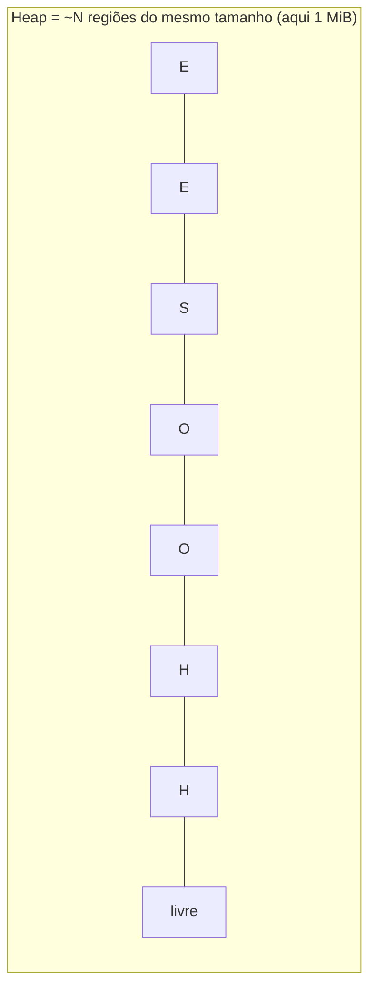

# P1.03 — Garbage collectors I: G1 e Parallel

> ⏱️ ~1h30 · 🔵 Pleno · Pré-requisitos: P1.01, P1.02, J1.11 (`Map`, `LinkedHashMap` como cache LRU), J9.03 (JVM em contêiner)

> ⚠️ **Verificação:** os quatro coletores foram **executados de verdade** com a mesma carga (`lab/jvm-lab/GcLoad.java`, `-Xmx512m`, 8 s cada, JDK 25.0.5, 12 núcleos, máquina compartilhada). É **uma execução por coletor**: a ordem de grandeza e o formato dos logs valem; a diferença fina entre eles, não. A carga é **sintética** (imita um serviço), **não** o PayFlow.

## 🎯 Objetivos
Ao final desta aula você consegue:
- **Explicar** a hipótese geracional e por que "criar lixo curto é barato".
- **Descrever** como o **G1** (regiões, coleta jovem, ciclo concorrente, coleta mista, objetos *humongous*) e o **Parallel** funcionam.
- **Ler** o log de GC (`-Xlog:gc`) de ambos e **dizer** o que cada linha significa.
- **Escolher** entre G1 e Parallel (e Serial) por **vazão × latência × memória**, e **saber** qual a JVM escolhe sozinha.
- **Provocar** e **reconhecer** um *Full GC* e uma alocação *humongous*.

## 🤔 Por que isso importa
O GC é a principal razão de **picos de latência** em serviços Java e de **CPU "desperdiçada"**. O PayFlow aloca muito lixo curto (DTOs, `String`s de log, `BigDecimal`s) e algumas coisas longas (cache, *pool*, sessões). Quando o p99 do extrato sobe sem explicação, a primeira checagem é o log de GC. E "trocar de coletor" é uma *flag*: saber **quando** e **por quê** evita tanto o folclore ("ZGC é sempre melhor") quanto o desespero.

## 💡 Intuição (explicação simples)
O GC é o **serviço de limpeza de um prédio de escritórios**.
- **Hipótese geracional:** a maior parte do lixo vem de coisas que duram **minutos** (copos, papéis do dia), pouca de coisas que duram **anos** (móveis). Então a equipe limpa **todo dia só o andar das mesas** (geração jovem, barato) e **raramente** o prédio inteiro (geração velha, caro).
- **Parallel:** fecha o andar, põe **todos os faxineiros** de uma vez e termina o mais rápido possível: **máxima vazão**, mas o andar fica fechado (pausa).
- **G1:** divide o prédio em **salas de tamanho igual** (regiões), limpa **as que têm mais lixo primeiro** (*Garbage First*), em **pausas curtas e previsíveis**, e faz a parte de "descobrir o que ainda é usado" **com o prédio aberto** (concorrente).

## 🔬 Como funciona por dentro

### 1. Conceitos comuns
- **Alcançabilidade:** um objeto é "vivo" se há um caminho de referências a partir das **raízes** (variáveis locais nas pilhas, `static`, JNI). O resto é lixo.
- **Stop-the-world (STW):** durante parte do trabalho **todas as threads da aplicação param** (*safepoint*). É a "pausa" que você vê na latência.
- **Geracional:** o heap tem geração **jovem** (*eden* + dois *survivors*) e **velha** (*old*). Objetos nascem no eden; sobrevivem a coletas jovens (a idade sobe); passado um limite, são **promovidos** para a velha.
- **Compactação/cópia:** coletar jovem **copia** os vivos para outro lugar (por isso custa **o que está vivo**, não o tamanho do lixo: lixo é grátis).
- **Barreiras:** o GC precisa saber quando a aplicação muda uma referência (*write barrier*); coletores concorrentes têm barreiras mais caras (custo de vazão).

### 2. Parallel (`-XX:+UseParallelGC`)
Coleta **jovem** e **velha** em STW, usando **várias threads** (`ParallelGCThreads`, 10 nesta máquina de 12 núcleos). Mira **vazão** (`GCTimeRatio=99`: no máximo ~1% do tempo em GC como meta). Sem fase concorrente: simples, **barato em memória e CPU**, mas a pausa da coleta velha cresce **com o tamanho do heap vivo**. Foi o padrão até o Java 8.

### 3. G1 (`-XX:+UseG1GC`, o **padrão** desde o Java 9, JEP 248, em máquinas com 2+ CPUs)

E = eden, S = *survivor*, O = velha, H = *humongous*. Em vez de duas gerações contíguas, o heap é um **tabuleiro de regiões** que mudam de papel.
- **Coleta jovem (STW):** copia os vivos do eden/survivors para regiões novas. Usa o **alvo de pausa** `-XX:MaxGCPauseMillis` (**200 ms** por padrão: é um **alvo**, não uma garantia) para decidir **quantas regiões** coletar por vez.
- **Ciclo concorrente de marcação:** quando a ocupação passa de `InitiatingHeapOccupancyPercent` (45%), o G1 **marca** quais objetos da velha estão vivos **com a aplicação rodando** (poucos pontos STW curtos: *Remark*, *Cleanup*).
- **Coletas mistas (*mixed*):** depois da marcação, as próximas coletas jovens também incluem **algumas regiões velhas** com mais lixo (daí *Garbage First*), espalhando o trabalho em várias pausas.
- **Objetos *humongous*:** objeto ≥ **metade de uma região** (1 MiB aqui → ≥ 512 KiB) ocupa regiões **contíguas** na velha, direto: custoso e **fragmenta**. Alocar arrays grandes (CSV, *buffers*) em laço é uma causa clássica de problema no G1.
- **Full GC:** se a coleta não acompanha (heap apertado, fragmentação), o G1 cai num **STW de heap inteiro** e **compacta**: **a pior pausa**. Em G1 saudável não aparece.

> Em contêiner com **1 CPU**, a JVM **escolhe o Serial** sozinha (verificado: `-XX:ActiveProcessorCount=1` → `UseSerialGC=true`; com 2 CPUs, `UseG1GC=true`, mesmo com `-XX:MaxRAM=1g`). É por isso que um *pod* com `cpu: 500m` ou 1 vCPU roda Serial **sem você pedir** (J9: `docker run --cpus`; P7: *requests/limits*). Veja a *flag* resultante com `-XX:+PrintFlagsFinal`.

## 🛠️ Exemplo prático
> `lab/jvm-lab/GcLoad.java`: carga que imita um serviço: por "requisição" cria `StringBuilder`/`String`/`byte[2048]` (lixo curto); 1/3 das requisições grava num **cache LRU** (`LinkedHashMap` com `removeEldestEntry`, J1.11) de 60 000 entradas de ~1 KiB (≈ 66 MiB **vivos**, vida longa); opcionalmente aloca de vez em quando um `byte[4 MiB]` (*humongous*).

### A. Os quatro coletores, mesma carga
```bash
for gc in G1 Parallel Serial Z; do
  java -Xmx512m -XX:+Use${gc}GC -Xlog:gc:file=$gc.log GcLoad.java 8
done
```
Resumo impresso pelo programa + pausas extraídas do log (`Pause … Nms`):

| Coletor | ops/s | pior latência de **uma** operação | nº de pausas | pausa média | pausa p99 | pausa máx. | soma das pausas |
|---|---|---|---|---|---|---|---|
| **G1** | 1 187 857 | **14 ms** | 188 | 7,0 ms | 10,8 ms | 13,8 ms | 1 314 ms |
| **Parallel** | 1 148 833 | 32 ms | 221 | 7,4 ms | 29,7 ms | 31,5 ms | 1 635 ms |
| **Serial** | 861 134 | 89 ms | 205 | 14,3 ms | 81,0 ms | 89,1 ms | 2 937 ms |
| **ZGC** (P1.04) | 1 044 393 | 7 ms | (ver P1.04) | 0,01 ms | 0,03 ms | 0,16 ms | — |

Leitura (com humildade: **uma** execução de 8 s cada):
- **G1** teve a melhor vazão **e** pausas curtas e regulares (média 7 ms, máx. 14 ms, **abaixo** do alvo de 200 ms: o G1 só pausa o necessário).
- **Parallel**: vazão parecida (diferença dentro do ruído), mas as pausas **da coleta velha** chegam a **30 ms** (p99): é o preço de coletar tudo de uma vez.
- **Serial**: uma só thread; **~25% menos vazão** e pausas de até 89 ms **com um heap vivo de apenas ~70 MiB**. Cresce linear com o heap vivo.
- Em **vazão** os três primeiros estão próximos; a diferença está na **cauda** (p99 e máximo), que é o que o usuário sente.

### B. Lendo o log do G1
```text
[0.002s][info][gc] Using G1
[0.375s][info][gc] GC(0) Pause Young (Normal) (G1 Evacuation Pause) 48M->4M(302M) 3.862ms
[0.442s][info][gc] GC(1) Pause Young (Normal) (G1 Evacuation Pause) 135M->19M(302M) 5.281ms
[0.499s][info][gc] GC(2) Pause Young (Normal) (G1 Evacuation Pause) 182M->38M(302M) 8.038ms
...
[0.932s][info][gc] GC(12) Pause Young (Concurrent Start) (G1 Evacuation Pause) 329M->212M(367M) 7.212ms
[0.932s][info][gc] GC(13) Concurrent Mark Cycle
[0.951s][info][gc] GC(13) Concurrent Mark Cycle 18.750ms
```
Como ler `GC(0) Pause Young (Normal) (G1 Evacuation Pause) 48M->4M(302M) 3.862ms`:
- `[0.375s]` tempo desde o início da JVM; `GC(0)` número da coleta (sequencial);
- `Pause Young (Normal)` coleta **jovem**, STW; `(G1 Evacuation Pause)` motivo: eden cheio, o G1 **evacua** (copia) os vivos;
- `48M->4M(302M)` ocupação do heap **antes → depois** (e o tamanho **comprometido**): de 48 MiB para 4 MiB: **44 MiB de lixo** recolhidos;
- `3.862ms` duração da pausa.
Padrões que contam história:
- Os "depois" **sobem** (4 → 19 → 38 → 56 → 74 M…): o cache LRU **enchendo** (vida longa sendo promovida). Estabiliza quando o cache enche (60 000 entradas).
- `Pause Young (Concurrent Start)`: essa coleta jovem também **inicia** o ciclo de marcação (ocupação passou de 45%). Em seguida, `Concurrent Mark Cycle` (18,7 ms, **sem pausar a aplicação**).
- Depois vêm as `Pause Young (Mixed)`, que incluem regiões velhas.

### C. Objetos *humongous*
```bash
java -Xmx512m -XX:+UseG1GC -Xlog:gc:file=G1h.log GcLoad.java 5 humongous     # um byte[4 MiB] a cada 2000 operações
```
```text
[0.652s][info][gc] GC(4) Pause Young (Concurrent Start) (G1 Humongous Allocation) 368M->77M(410M) 9.058ms
[0.717s][info][gc] GC(6) Pause Young (Concurrent Start) (G1 Humongous Allocation) 364M->95M(410M) 8.116ms
[0.766s][info][gc] GC(8) Pause Young (Concurrent Start) (G1 Humongous Allocation) 335M->110M(426M) 7.635ms
```
**208 linhas** com `Humongous` em 5 s. O motivo da coleta virou `G1 Humongous Allocation`: cada array de 4 MiB (4 regiões contíguas) **força um ciclo de marcação**, e a vazão caiu de ~1,19 M para **0,79 M ops/s**, com pior latência de 31 ms. **Correção típica:** não alocar arrays gigantes por requisição (use *streaming*, P1.01), reutilize *buffers*, ou aumente `-XX:G1HeapRegionSize` (potência de 2 de 1 a 32 MiB) **se for inevitável**.

### D. Heap apertado e *Full GC*
```bash
java -Xmx96m -XX:+UseG1GC -Xlog:gc:file=G1s.log GcLoad.java 5
```
```text
[0.647s][info][gc] GC(25) Pause Full (G1 Compaction Pause) 95M->67M(96M) 31.989ms
[0.797s][info][gc] GC(65) Pause Full (G1 Compaction Pause) 95M->71M(96M) 37.015ms
```
Em 5 s: **41 Full GCs** (e 1 467 coletas no total), vazão de **~0,49 M ops/s** (menos da metade). O sinal: `95M->67M(96M)`: o heap está **no teto (96M)** e **a coleta só libera 28 MiB**, porque ~67–71 MiB são **vivos** (o cache). Aumentar o heap (ou reduzir o cache) resolve; **mudar de coletor não**. Este é o desenho do "GC thrashing", que antecede o `OutOfMemoryError: GC overhead limit exceeded` (P1.01).

### E. Olhar uma JVM viva
```bash
jcmd <PID> GC.heap_info
jstat -gcutil <PID> 500 3
```
```text
garbage-first heap   total reserved 524288K, committed 512000K, used 380540K [...]
 region size 1024K, 146 young (149504K), 26 survivors (26624K)

  S0     S1     E      O      M     CCS    YGC     YGCT     FGC    FGCT     CGC    CGCT       GCT
   -  100.00  43.54  80.53  97.43  90.83     59     0.511     0     0.000    14     0.007     0.518
   -  100.00  74.79  75.26  97.43  90.83     67     0.588     0     0.000    16     0.008     0.596
```
`jstat -gcutil`: `E` eden %, `O` velha %, `M` metaspace %, `YGC/YGCT` nº e tempo total (s) das coletas jovens, `FGC` *Full GCs* (**0** = saudável), `CGC/CGCT` ciclos concorrentes. É a forma mais rápida de ver "o GC está bem?" sem reiniciar com *flags*.

## 🧠 Pausa para lógica
**Enunciado:** no log da seção B, as ocupações **depois** da coleta jovem foram 4M, 19M, 38M, 56M, 74M, 92M… Se cada coleta ocorre a cada ~50 ms e o cache LRU tem teto de 60 000 entradas de ~1 KiB, **quando** o crescimento deve parar e **que valor** esperar? Depois: o que aconteceria se o cache **não** tivesse teto (`removeEldestEntry` ausente)?

<details><summary>Dica</summary>O teto são ≈ 60 000 × (1 KiB do `byte[]` + cabeçalho + `Entry` + chave + nó do `LinkedHashMap`).</details>
<details><summary>Solução</summary>

Cada entrada custa ≈ 1 KiB (`byte[1024]`) + `Entry` (~ 24 B) + `String` da chave (~ 56 B com o `byte[]` interno) + nó do mapa (~ 40 B) ≈ **1,15 KiB** → 60 000 ≈ **67 MiB**, mais o *overhead* do G1. O crescimento do "depois" para por volta de **70–110 MiB** quando o cache enche (as chaves se repetem em 200 000 valores possíveis: leva alguns segundos). Sem teto, o cache cresce até **200 000 chaves × 1,15 KiB ≈ 230 MiB** e só então sobrescreve; com chaves ilimitadas cresceria **sem parar**: coletas mistas cada vez maiores, *Full GC*, `OutOfMemoryError`. Cache sem limite é o *leak* nº 1 em Java (P2 traz Redis e `maximumSize`/TTL).
</details>

**Variação:** repita a seção A com `-Xmx2g` e compare o tamanho das pausas do Parallel e do G1 (heap maior favorece quem?).

## ⚖️ Trade-offs e quando NÃO usar
| | **Parallel** | **G1** | (Serial) |
|---|---|---|---|
| Foco | **vazão** (batch, ETL, testes) | **equilíbrio** vazão/latência (**padrão**) | heap < 100 MiB, 1 CPU, ferramentas de linha de comando |
| Pausa | cresce com o heap vivo (30 ms aqui) | alvo de 200 ms, **7–14 ms** aqui | cresce (89 ms aqui) |
| Memória extra | pouca | **mais** (conjuntos de lembrança, ~23% do heap no P1.01) | mínima |
| Quando **não** usar | APIs com SLO de latência | muitos *humongous* (arrays gigantes por requisição) | qualquer serviço multi-thread com latência |
- **Não troque de coletor "por esporte".** Primeiro: **o que dói?** pausa alta → olhe o log; vazão baixa → CPU de GC (`jstat`); memória → NMT. Muitas vezes o problema é **a aplicação** (alocar demais, reter demais), e nenhum coletor conserta.
- **Não microajuste.** `-Xmx` e `-Xlog` bastam para 95% dos casos; `MaxGCPauseMillis` muito baixo faz o G1 coletar **menos regiões por vez** e **mais vezes**, reduzindo vazão. Deixe o padrão até ter um log que justifique.

## ⚠️ Erros comuns e boas práticas de produção
- **Sem log de GC em produção.** Deixe sempre `-Xlog:gc*:file=/var/log/gc.log:time,uptime,level,tags:filecount=5,filesize=20m` (rotação): o custo é desprezível e é o que se pede **depois** do incidente. Em contêiner, `-Xlog:gc` para **stdout** (J9: logar no console).
- **Confundir `-Xms` e `-Xmx`:** `-Xms` igual a `-Xmx` evita redimensionar (e pausa por isso) mas **reserva** a RAM toda; em contêiner, ajuste junto com `MaxRAMPercentage`/`InitialRAMPercentage`.
- **`System.gc()` no código** (ou `-XX:+ExplicitGCInvokesConcurrent` ausente): força um *Full GC* sem necessidade. Procure no código e em bibliotecas.
- **Escolher pelo cheiro:** "troquei para o ZGC e melhorou" pode ter sido só o **heap maior** que veio junto. Mude **uma** coisa por vez e **meça**.
- **Ler "pausa" como "latência do usuário":** a pausa para **todas** as threads, mas a latência de uma requisição inclui fila, rede e banco (P6).
- **`OutOfMemoryError` com o heap "com sobra":** pode ser *humongous* **fragmentado** (não há regiões contíguas livres) ou memória **nativa**. Veja o log, não só o gráfico.

## 🧩 Exercícios
1. **Fixação:** com `GcLoad` e G1, varie `-Xmx` (128m, 256m, 512m, 2g) e **anote** número de coletas, pausa média e quantidade de *Full GC*. Em que `-Xmx` o *Full GC* some?
2. **Aplicação no PayFlow:**
   - [ ] Acrescente ao `compose.yaml` (J9) `JAVA_TOOL_OPTIONS=-XX:MaxRAMPercentage=75 -Xlog:gc:stdout:time,uptime,level,tags` e **anote** por que `stdout` e não arquivo (decisão 74: log só no console).
   - [ ] Em `docs/jvm-notes.md`, registre o **coletor que a JVM escolhe** no contêiner com `--cpus 1`, `--cpus 2` (use `-XX:+PrintFlagsFinal -version` dentro de um `docker run … eclipse-temurin:25-jre-alpine`). **Não executado:** só por leitura; confira no fim do treinamento.
   - [ ] Escreva a **regra do time**: "p99 do extrato acima de X ms → primeiro `jstat -gcutil` e o log de GC, depois a consulta SQL (P2)".
3. **Desafio (opcional):** reproduza o *humongous* e **conserte**: troque `new byte[4 MiB]` por um *buffer* reutilizado (`ThreadLocal<byte[]>`, ou um *pool*) e meça o efeito nas pausas e na vazão.

<details><summary>Solução de referência (exercício 1, expectativa: confirme na sua máquina)</summary>

Medido: `-Xmx96m` → **41 Full GCs** em 5 s; `-Xmx512m` → **188 coletas jovens e nenhum Full** em 8 s. Esperado para os valores do meio (**não medidos**): `128m` ainda perto do limite (o cache de ~70 MiB vivo ocupa mais da metade); `256m` já com folga; `2g` com poucas coletas, cada uma com eden maior. A lição: **mais heap = menos coletas**, **não** necessariamente menos pausa por coleta (depende do que está **vivo**, não do tamanho).
</details>

## 🎤 Na entrevista
- **Como funciona um GC geracional e por que ele é eficiente?** Parte da hipótese de que a maioria dos objetos morre jovem: coleta a geração jovem com frequência (custo proporcional ao que **sobrevive**, copiando os vivos) e a velha raramente. Lixo curto é praticamente de graça.
- **O que significa *Garbage First*?** O G1 divide o heap em regiões, estima quanto lixo há em cada uma e coleta **primeiro as que mais liberam** respeitando o alvo de pausa. A marcação é concorrente e as coletas velhas são **mistas**, espalhadas em várias pausas curtas.
- **Quando você usaria Parallel em vez de G1?** Cargas em lote/batch em que a **vazão total** importa mais que a latência individual e há pouca memória extra.
- **O que é um objeto *humongous* e por que é problema?** No G1, objeto ≥ metade de uma região, alocado em regiões contíguas direto na geração velha; custa caro, fragmenta e pode forçar ciclos concorrentes. Evitar arrays gigantes por requisição ou aumentar o tamanho da região.
- **Como você diagnostica "o serviço trava por alguns segundos"?** Log de GC (`Pause Full`? pausa longa?), `jstat -gcutil`, e correlacionar o horário com métricas de aplicação; depois, causa: *leak*, heap pequeno, *humongous*, ou algo **fora** do GC (*safepoint* por outro motivo, IO).

## 📚 Para ir além
- 📄 [Garbage-First (G1) Garbage Collector — Java SE 25 HotSpot GC Tuning Guide](https://docs.oracle.com/en/java/javase/25/gctuning/garbage-first-g1-garbage-collector1.html): o guia oficial (regiões, ciclo concorrente, *humongous*).
- 📄 [The Parallel Collector](https://docs.oracle.com/en/java/javase/25/gctuning/parallel-collector1.html): o guia oficial do Parallel e da meta de vazão (`GCTimeRatio`).
- 📄 [Ergonomics](https://docs.oracle.com/en/java/javase/25/gctuning/ergonomics.html): como a JVM escolhe o coletor e os tamanhos (e quando cai no Serial).
- 📄 [JEP 248: Make G1 the Default Garbage Collector](https://openjdk.org/jeps/248) (Java 9).
- 📄 [`jstat`](https://docs.oracle.com/en/java/javase/25/docs/specs/man/jstat.html): significado de cada coluna do `-gcutil`.
- 📑 Livros: *Java Performance* (Scott Oaks) e *Optimizing Cloud Native Java* (Ben Evans), capítulos de GC.

## ✅ Checklist da aula
- [ ] Rodei a carga com os quatro coletores e preenchi a minha tabela.
- [ ] Sei ler uma linha de `Pause Young` e reconhecer `Pause Full`.
- [ ] Reproduzi *humongous* e *Full GC* e expliquei o log.
- [ ] `docs/jvm-notes.md` com coletor por número de CPUs e a regra de diagnóstico (**não executado**).
