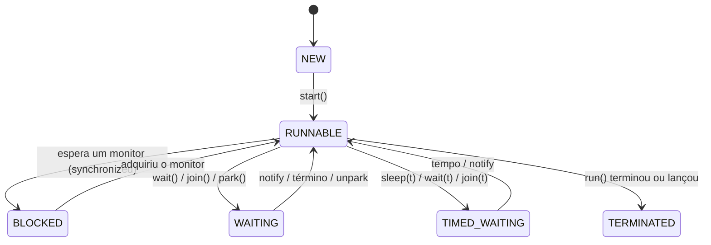

# P1.05 — Threads e `ExecutorService`

> ⏱️ ~1h30 · 🔵 Pleno · Pré-requisitos: P1.01 (pilha por *thread*), J1.09 (exceções), J1.13 (lambdas), J5.11 (`@Transactional` e a transação **presa à thread**), J6.08 (`RestClient` com *timeout*)

> ✅ **Validação final (2026-11-24):** módulo executado no PayFlow reconstruído; resultado e o que continua não executado no [README do módulo](README.md). Os avisos "não executado" / "por leitura" abaixo descrevem a escrita original.

> ⚠️ **Verificação:** executado de verdade em `lab/jvm-lab/Threads.java` (JDK 25.0.5, Linux, 12 núcleos). As saídas abaixo são as reais; tempos oscilam ±10 ms. O PayFlow não foi compilado.

## 🎯 Objetivos
Ao final desta aula você consegue:
- **Criar** e **encerrar** threads corretamente (`Thread`, `join`, **interrupção cooperativa**) e **ler** os estados (`NEW`, `RUNNABLE`, `BLOCKED`, `WAITING`, `TIMED_WAITING`, `TERMINATED`).
- **Usar** `ExecutorService` (e `try-with-resources`) em vez de criar threads à mão, e **explicar** `Future`, `invokeAll` e o ciclo de vida do pool.
- **Dimensionar** um pool (CPU-bound × I/O-bound) e **configurar** `ThreadPoolExecutor` com fila **limitada** e política de rejeição.
- **Reconhecer** onde exceções "somem" (`submit` × `execute`) e **ler** um *thread dump* (`jcmd Thread.print`).

## 🤔 Por que isso importa
Seu servidor web (Tomcat, J2/J5) **já é multi-thread**: cada requisição roda em uma thread de um pool. Tudo o que você escreve no PayFlow (serviços, caches, o `LoginThrottle` da J8) é executado **por várias threads ao mesmo tempo**, mesmo que você nunca tenha escrito `new Thread`. Entender threads e pools é pré-requisito para entender **por que** o `@Transactional` não "pula" de thread, por que um *timeout* ausente derruba o serviço inteiro e por que um pool mal dimensionado vira **fila escondida**.

## 💡 Intuição (explicação simples)
Uma **cozinha de restaurante**. Cada **cozinheiro** é uma *thread*; o **pedido** é uma tarefa. Contratar um cozinheiro novo para cada pedido (`new Thread`) é caro e, em hora de pico, enche a cozinha até ninguém andar. O **pool** é uma **equipe fixa**: os pedidos entram numa **fila** (comanda) e cada cozinheiro pega o próximo quando fica livre. Se a fila tem **tamanho infinito**, a comanda cresce até o papel acabar (memória); se é **limitada**, o garçom precisa decidir o que fazer com o pedido que não coube (recusar, esperar, ele mesmo cozinhar).

## 🔬 Como funciona por dentro
- **Thread de plataforma = thread do SO** (1:1). Tem **pilha própria** (`-Xss`, P1.01), é **agendada pelo SO** e custa memória e troca de contexto. Daí a regra de ouro: **não crie milhares**. (P1.10: *virtual threads* mudam isso.)
- **Estados** (`Thread.State`):

- **Interrupção é cooperativa.** `thread.interrupt()` **não mata**: levanta uma **flag**. Métodos bloqueantes (`sleep`, `wait`, `join`, `BlockingQueue.take`…) a observam e lançam `InterruptedException` (**limpando** a flag). Um laço de CPU precisa **consultar** `isInterrupted()`. Regra: **nunca engula** `InterruptedException`; ou propague, ou **restaure** a flag (`Thread.currentThread().interrupt()`).
- **`ExecutorService`** separa **o que** executar (`Runnable`/`Callable`) de **como** (threads, fila). Fábricas em `Executors`: `newFixedThreadPool(n)`, `newCachedThreadPool()`, `newSingleThreadExecutor()`, `newScheduledThreadPool(n)`, `newVirtualThreadPerTaskExecutor()` (P1.10). Todas, exceto a última, são `ThreadPoolExecutor` configurado.
- **`ThreadPoolExecutor`** tem 4 botões: **`corePoolSize`** (threads sempre vivas), **`maximumPoolSize`**, **`workQueue`** e **`RejectedExecutionHandler`**. Ordem de decisão ao submeter: (1) abaixo do *core* → cria thread; (2) senão → coloca na **fila**; (3) fila cheia **e** abaixo do *max* → cria thread extra; (4) senão → **rejeita**. Consequência importante: com **fila ilimitada** o passo 3 **nunca** acontece (o pool nunca passa do *core*), e a fila cresce sem limite.
- **Armadilhas das fábricas:** `newFixedThreadPool` e `newSingleThreadExecutor` usam fila **ilimitada**; `newCachedThreadPool` aceita threads **ilimitadas**. Os dois extremos são perigosos em produção: configure `ThreadPoolExecutor` **explicitamente**.
- **`Future<T>`**: promessa de resultado: `get()` bloqueia; `get(timeout)`; `cancel(mayInterrupt)`. Uma exceção lançada na tarefa fica **guardada** e reaparece como `ExecutionException` no `get()`.
- **Dimensionamento (regra de partida, **não** lei):** tarefa **CPU-bound** → ~ nº de núcleos (+1). Tarefa **I/O-bound** (espera banco/rede) → núcleos × (1 + tempo de espera / tempo de CPU). Na dúvida, **meça** (P6).

## 🛠️ Exemplo prático
> `lab/jvm-lab/Threads.java`; cada modo é um experimento: `java Threads.java <states|interrupt|errors|pool|reject|dump>`.

### A. Estados de uma thread
```java
Thread t = new Thread(() -> {
    try { Thread.sleep(300); } catch (InterruptedException e) { return; }
    synchronized (lock) { }                                        // só entra quando o main soltar
    synchronized (lock) { try { lock.wait(); } catch (InterruptedException e) { } }
}, "worker-1");
```
```text
antes do start:        NEW
dentro do sleep:       TIMED_WAITING
esperando o monitor:   BLOCKED
dentro do wait():      WAITING
depois do join:        TERMINATED
```
Quatro dos seis estados em 20 linhas. `BLOCKED` (esperando um **monitor**) é **diferente** de `WAITING` (esperando um **evento**): num *thread dump* o primeiro sugere **contenção de lock**, o segundo, thread ociosa (ou pool parado).

### B. Interromper com educação
```java
catch (InterruptedException e) {
    // a flag já foi LIMPA ao lançar; restaure para quem estiver acima
    Thread.currentThread().interrupt();
}
```
```text
main: interrompendo
  worker: InterruptedException; flag agora = false
  worker: flag restaurada = true
  busy: parei após consultar a flag
```
`worker` estava dormindo (10 s), recebeu a interrupção, a flag **foi limpa**, e foi **restaurada** manualmente. `busy` é um laço de CPU: só parou porque **consultou** `isInterrupted()`. Quem implementa tarefas longas (exportação de extrato!) **precisa** de pontos de verificação.

### C. Para onde vai uma exceção
```text
1) exceção em Thread comum: vai para o UncaughtExceptionHandler
  handler(t-crash): java.lang.IllegalStateException: falhou na thread
2) submit(): a exceção fica guardada no Future
  isDone=true (ninguém viu o erro até agora)
  get(): java.util.concurrent.ExecutionException: java.lang.IllegalStateException: falhou no submit
  causa: java.lang.IllegalStateException: falhou no submit
3) execute(): a exceção chega ao handler da thread do pool
Exception in thread "pool-1-thread-2" java.lang.IllegalStateException: falhou no execute
	at Threads.lambda$errors$3(Threads.java:70)
	at java.base/java.util.concurrent.ThreadPoolExecutor.runWorker(ThreadPoolExecutor.java:1090)
```
**A armadilha:** com `submit()` e **sem** chamar `get()`, a exceção **desaparece em silêncio** (`isDone=true`, ninguém sabe). Em produção isso vira "o e-mail de confirmação nunca saiu e não há erro no log". Regra: **guarde o `Future`** e trate o resultado, **ou** capture dentro da tarefa (`try/catch` com log), **ou** use `execute()` com um `UncaughtExceptionHandler` no `ThreadFactory`.

### D. Pool e `try-with-resources`
```java
try (ExecutorService ex = Executors.newFixedThreadPool(3, tf)) {          // close() espera as tarefas (Java 19+)
    for (Future<String> f : ex.invokeAll(tasks)) System.out.println("  " + f.get());
}
```
```text
  tarefa 1 em payflow-pool-1
  tarefa 2 em payflow-pool-2
  tarefa 3 em payflow-pool-3
  tarefa 4 em payflow-pool-3
  tarefa 5 em payflow-pool-2
  tarefa 6 em payflow-pool-1
6 tarefas de 100 ms em 3 threads: 205 ms
pool encerrado
```
6 tarefas de 100 ms em 3 threads = **2 "ondas" = ~200 ms** (medido: 205). Quatro coisas para lembrar: (1) **nomeie as threads** com um `ThreadFactory` (nos *thread dumps* e logs, `pool-1-thread-2` não diz nada; `payflow-pool-2` sim); (2) `invokeAll` espera todas; (3) `close()` (Java 19+) faz `shutdown()` + espera, e **interrompe** se for interrompido; (4) **um pool não encerrado mantém a JVM viva** (threads não-daemon).

### E. Fila limitada e rejeição
```java
var pool = new ThreadPoolExecutor(1, 1, 0, TimeUnit.SECONDS, new ArrayBlockingQueue<>(2));   // AbortPolicy (padrão)
```
```text
tarefa 1: aceita
tarefa 2: aceita
tarefa 3: aceita
tarefa 4: RECUSADA -> RejectedExecutionException
tarefa 5: RECUSADA -> RejectedExecutionException
```
1 thread (a tarefa 1) + 2 na fila (2 e 3) = **3 aceitas**; as outras são **recusadas explicitamente**. Isso é **bom**: é **contrapressão** (*backpressure*): o sistema diz "estou cheio" em vez de crescer até morrer. Outras políticas:
```java
new ThreadPoolExecutor.CallerRunsPolicy()      // quem submeteu executa a tarefa: freia o produtor
```
```text
tarefa 3 rodou em main
tarefa 1 rodou em pool-2-thread-1
tarefa 2 rodou em pool-2-thread-1
tarefa 4 rodou em pool-2-thread-1
```
A tarefa 3 não coube e **rodou na thread `main`** (o chamador). `DiscardPolicy`/`DiscardOldestPolicy` **descartam em silêncio**: quase nunca o que você quer num sistema de pagamentos.

### F. *Thread dump* de uma JVM viva
```bash
java Threads.java dump &        # duas threads: "holder" segura um lock dormindo; "waiter" espera o mesmo lock
jcmd <PID> Thread.print
```
```text
"holder" #25 [2026707] daemon prio=5 ... waiting on condition
   java.lang.Thread.State: TIMED_WAITING (sleeping)
	at java.lang.Thread.sleepNanos0(...)
	at Threads.lambda$dump$0(Threads.java:110)
	- locked <0x00000006e41fa6e8> (a java.lang.Object)

"waiter" #26 [2026708] daemon prio=5 ... waiting for monitor entry
   java.lang.Thread.State: BLOCKED (on object monitor)
	at Threads.lambda$dump$1(Threads.java:111)
	- waiting to lock <0x00000006e41fa6e8> (a java.lang.Object)
```
**Como ler:** o **mesmo endereço** (`0x…e8`) aparece como `locked` em uma thread e `waiting to lock` na outra: **quem trava quem**. Receita de incidente: `jcmd <PID> Thread.print` **3 vezes, com 5 s de intervalo**; threads que aparecem sempre no **mesmo ponto** são suspeitas. Em contêiner **sem JDK** (J9, decisão 74) use `docker kill --signal=QUIT <container>` e leia o *stdout*.

## 🧠 Pausa para lógica
**Enunciado:** o PayFlow exporta o extrato de uma conta em CSV. Cada conta é exportada por uma tarefa que leva ~2 s (consulta + escrita), e **80%** desse tempo é espera do banco. O servidor tem 4 núcleos. (a) Quantas threads você coloca no pool? (b) Se chegam 100 pedidos de uma vez, quanto tempo leva o último? (c) E se o banco só aguenta **10 conexões**?

<details><summary>Dica</summary>Núcleos × (1 + espera/CPU). E o pool de conexões (HikariCP, P2) é **outro** limite: o menor dos dois manda.</details>
<details><summary>Solução</summary>

(a) CPU = 20% de 2 s = 0,4 s; espera = 1,6 s; razão = 4 → `4 × (1 + 4) = 20` threads. (b) 100 tarefas / 20 threads = 5 ondas × 2 s = **~10 s** para a última. (c) Com **10 conexões**, só 10 tarefas fazem consulta por vez: as outras 10 threads **ficam esperando uma conexão** (e consomem memória à toa). O limite efetivo é **10** → 10 ondas × 2 s = **~20 s**. Dimensione o pool **junto** com o pool de conexões e o **timeout** de espera por conexão (P2).
</details>

**Variação:** com `ArrayBlockingQueue(20)` e 20 threads, o que acontece com os 100 pedidos? (Resposta: 20 em execução + 20 na fila; **60 são rejeitados**.)

## ⚖️ Trade-offs e quando NÃO usar
- **Pool fixo × fila ilimitada × rejeição:** fila ilimitada **esconde** a sobrecarga (a latência cresce, a memória sobe, ninguém é avisado); rejeição **expõe** a sobrecarga (e o cliente pode tentar de novo). Para APIs, prefira **limitar e rejeitar com `429`/`503`**.
- **`CallerRunsPolicy`:** freia sozinho, mas **trava a thread do chamador** (no Tomcat, a thread da requisição faz o trabalho do pool e perde a janela de resposta). Use com consciência.
- **Threads de plataforma × virtuais (P1.10):** pools servem para **limitar** concorrência e reaproveitar threads **caras**. Com threads virtuais (baratas) você **não** faz pool delas: limita o **recurso escasso** (semáforo, P1.07).
- **Não use threads** quando um **comando de banco** resolve (um `UPDATE` atômico) ou quando o trabalho é trivial: concorrência é **complexidade** (P1.08 e P1.09 mostram o preço).

## ⚠️ Erros comuns e boas práticas de produção
- **`new Thread()` solto** em código de aplicação: sem nome, sem controle, sem encerramento. Use pool nomeado.
- **Esquecer `shutdown()`** (ou `close()`): a JVM **não sai** (threads não-daemon vivas). Em Spring, use `@Bean(destroyMethod = "shutdown")` ou `ThreadPoolTaskExecutor` (que integra ao ciclo de vida).
- **`Executors.newFixedThreadPool` / `newCachedThreadPool` com carga variável:** fila **sem limite** ou threads **sem limite** (as duas vias para `OutOfMemoryError: unable to create native thread` ou heap cheio).
- **Engolir `InterruptedException`** (`catch (InterruptedException e) {}`): a thread **não para** mais quando o pool é desligado.
- **Tarefa que **bloqueia sem *timeout*** (chamada HTTP, `Future.get()` sem prazo): uma tarefa travada **ocupa uma thread para sempre**; com N tarefas travadas, o pool inteiro para (**exaustão do pool**): o serviço parece "morto" com CPU em 0%. Sempre `get(timeout)`, `connectTimeout`/`readTimeout` (J6.08).
- **`ThreadLocal` e pool:** a thread é **reutilizada**: dado do usuário A pode vazar para o B se você esquecer de `remove()` (J8: `SecurityContext` é limpo pelo filtro).
- **Transação não atravessa threads:** o `@Transactional` (J5.11) é **da thread**; uma tarefa enviada a outro pool roda **fora** da transação e **sem** o `SecurityContext`. Passe **dados** (ids), não entidades JPA.

## 🧩 Exercícios
1. **Fixação:** rode `reject` com `ArrayBlockingQueue(5)` e 8 submissões; **preveja** quantas serão aceitas e quantas recusadas **antes** de rodar.
2. **Aplicação no PayFlow:**
   - [ ] Crie `ExecutorConfig` com **um** `ThreadPoolTaskExecutor` nomeado `payflow-export` (core 4, max 4, **fila 50**, `AbortPolicy`, `threadNamePrefix`) para a exportação de extrato. O endpoint de exportação responde **`202 Accepted`** quando a tarefa entra e **`429`/`503`** (Problem Details, J6) quando é recusada. **Não executado** (só por leitura).
   - [ ] Guarde o `Future`/trate o erro **dentro** da tarefa (log `WARN`, J5/decisão 38, **sem dado pessoal**) para que exceções não desapareçam.
   - [ ] Em `docs/concurrency-notes.md`, registre o **dimensionamento** (conta da pausa para lógica com os números do **seu** banco) e a política de rejeição escolhida.
3. **Desafio (opcional):** implemente um **pool que nunca rejeita, mas limita memória**: `CallerRunsPolicy` com fila de 1; meça (com `GcLoad` do P1.03 como carga de fundo) o que acontece com a latência do produtor.

<details><summary>Solução de referência (exercício 1)</summary>

Com **1 thread** (core=max=1) e fila de 5: a 1ª tarefa vai para a thread, **5** entram na fila → **6 aceitas, 2 recusadas** (de 8). (Em `reject()` do laboratório: fila de 2 → 3 aceitas e 2 recusadas, de 5.)
</details>

## 🎤 Na entrevista
- **Diferença entre `Thread`, `Runnable` e `ExecutorService`?** `Runnable` é a **tarefa**; `Thread` é o **executor primitivo** (1:1 com o SO); `ExecutorService` abstrai threads e fila, com ciclo de vida e `Future`.
- **O que acontece quando a fila de um `ThreadPoolExecutor` enche?** Se há folga até `maximumPoolSize`, cria threads extras; senão, aplica o `RejectedExecutionHandler` (padrão: lança `RejectedExecutionException`). Com fila **ilimitada**, nunca passa do *core* e a fila cresce sem fim.
- **Por que `submit` pode "engolir" exceções?** Porque a exceção é guardada no `Future`; se ninguém chama `get()`, ela nunca é vista. Com `execute`, vai para o `UncaughtExceptionHandler`.
- **Como interromper uma thread?** `interrupt()` levanta uma flag; a tarefa precisa cooperar (tratar `InterruptedException` ou consultar `isInterrupted()`); `stop()` está obsoleto e é inseguro.
- **Como você dimensiona um pool?** CPU-bound ≈ núcleos; I/O-bound ≈ núcleos × (1 + espera/CPU); sempre limitado pelo recurso mais escasso (conexões do banco) e **medido** sob carga.

## 📚 Para ir além
- 📄 [`ExecutorService` (Java SE 25)](https://docs.oracle.com/en/java/javase/25/docs/api/java.base/java/util/concurrent/ExecutorService.html): ciclo de vida, `close()` e exemplos de `shutdown` correto.
- 📄 [`ThreadPoolExecutor` (Java SE 25)](https://docs.oracle.com/en/java/javase/25/docs/api/java.base/java/util/concurrent/ThreadPoolExecutor.html): a regra *core / fila / max / rejeição* explicada na própria documentação.
- 📄 [`Thread` (Java SE 25)](https://docs.oracle.com/en/java/javase/25/docs/api/java.base/java/lang/Thread.html): estados, interrupção, `ofPlatform()`/`ofVirtual()`.
- 📄 [`jcmd` — `Thread.print`](https://docs.oracle.com/en/java/javase/25/docs/specs/man/jcmd.html): como tirar *thread dumps*.
- 📄 [Spring Framework — Task Execution and Scheduling](https://docs.spring.io/spring-framework/reference/integration/scheduling.html): `TaskExecutor`, `ThreadPoolTaskExecutor`, `@Async`, `@Scheduled`.
- 📑 Livro: *Java Concurrency in Practice* (Goetz et al.), caps. 6 (execução de tarefas), 7 (cancelamento) e 8 (pools).

## ✅ Checklist da aula
- [ ] Reproduzi os quatro estados, a interrupção e o "erro que some" do `submit`.
- [ ] Vi uma recusa de `ThreadPoolExecutor` e a `CallerRunsPolicy`.
- [ ] Li um `Thread.print` e achei quem trava quem.
- [ ] `ExecutorConfig` e `docs/concurrency-notes.md` escritos (**não executado**).
