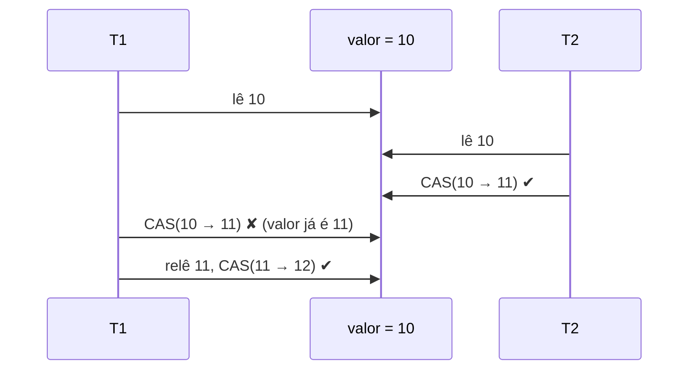

# P1.07 — `java.util.concurrent`: locks, atômicos e coleções concorrentes

> ⏱️ ~1h30 · 🔵 Pleno · Pré-requisitos: P1.05, P1.06, J1.10/J1.11 (coleções), J8.06 (`LoginThrottle` com `synchronized`)

> ✅ **Validação final (2026-11-24):** módulo executado no PayFlow reconstruído; resultado e o que continua não executado no [README do módulo](README.md). Os avisos "não executado" / "por leitura" abaixo descrevem a escrita original.

> ⚠️ **Verificação:** executado de verdade em `lab/jvm-lab/Concurrent.java` (JDK 25.0.5, 12 núcleos, 8 threads). Os **tempos** dependem da máquina e da contenção (aqui, 8 threads brigando pelo mesmo contador); o que vale é a **proporção**. O PayFlow não foi compilado.

## 🎯 Objetivos
Ao final desta aula você consegue:
- **Escolher** entre `synchronized`, `ReentrantLock`, `ReadWriteLock`, atômicos e `LongAdder`, e **justificar** pelo uso (contenção, leitura × escrita, necessidade de *timeout*).
- **Explicar** o CAS (*compare-and-set*) e o **problema ABA**.
- **Usar** `ConcurrentHashMap` corretamente (`merge`, `compute`, `computeIfAbsent`) e **mostrar** por que "ler e depois escrever" perde atualizações mesmo numa coleção "thread-safe".
- **Usar** filas bloqueantes (`BlockingQueue`) para produtor/consumidor com **contrapressão** e `Semaphore` para limitar acesso a um recurso.

## 🤔 Por que isso importa
A maioria dos bugs de concorrência **não** está em `Thread`: está em **estado compartilhado** (um mapa, um contador, um cache) mexido por várias requisições. O JDK traz `java.util.concurrent` justamente para isso, e **escolher a ferramenta certa** decide entre código correto e rápido ou um serviço que perde atualizações, trava ou vira gargalo. No PayFlow isso aparece em: `LoginThrottle` (J8, mapa em memória), contadores de métricas, cache de cotação, limitação de chamadas ao provedor de câmbio.

## 💡 Intuição (explicação simples)
Um **banheiro de escritório** com uma só chave. `synchronized` é a chave pendurada na porta: quem chega **espera** em fila (e ninguém pode desistir). `ReentrantLock` é a **mesma chave, mas com regras extras**: "tento por 200 ms e, se não der, vou embora" (`tryLock`), "aceito ser chamado para outra tarefa enquanto espero" (`lockInterruptibly`). Um **placar** que todos atualizam (`AtomicLong`) é uma lousa onde cada um **só escreve se o número ainda for o que viu** (CAS); se mudou, **relê e tenta de novo** (sem fila). `LongAdder` dá **uma lousa por pessoa** e soma tudo só quando alguém **pergunta o total**: ninguém espera ninguém.

## 🔬 Como funciona por dentro

### 1. Locks
- **`synchronized`:** monitor embutido em **todo** objeto. Simples, **reentrante** (a mesma thread entra de novo), libera sozinho ao sair (inclusive por exceção). Não permite *timeout*, nem interrupção durante a espera, nem várias condições.
- **`ReentrantLock`:** mesma exclusão mútua + `tryLock()`/`tryLock(timeout)`, `lockInterruptibly()`, **justiça** opcional (`new ReentrantLock(true)`: FIFO, mais lento), várias `Condition` (`await`/`signal`). **Custo:** você **precisa** liberar: `lock(); try { … } finally { unlock(); }` (sem o `finally`, uma exceção deixa o lock preso para sempre).
- **`ReadWriteLock` (`ReentrantReadWriteLock`):** **vários leitores** simultâneos **ou** **um** escritor. Só compensa com **muito mais leitura que escrita** e seção crítica **longa**; tem custo próprio e risco de *starvation*.
- **`StampedLock`:** leitura **otimista** (lê sem travar e **valida** depois); mais rápido, mais difícil, **não reentrante**. Ferramenta de especialista.
- **Memória:** liberar um lock e adquiri-lo depois cria a relação ***happens-before*** (P1.08): o que a thread A escreveu antes de `unlock()` **fica visível** para a thread B depois de `lock()`.

### 2. Atômicos e CAS

- **CAS (*compare-and-set*):** instrução do **processador** ("troque para N **se e só se** o valor atual for V") — **atômica e sem lock**. `AtomicInteger/Long/Boolean/Reference` a expõem: `incrementAndGet`, `compareAndSet`, `updateAndGet(f)` (que **repete** `f` até conseguir: `f` tem de ser **pura**, sem efeito colateral).
- **ABA:** o valor mudou de A→B→A; o CAS vê "ainda é A" e **acha que nada mudou**. Em contadores é inofensivo; em estruturas com ponteiros pode corromper. Solução: um **carimbo de versão** (`AtomicStampedReference`).
- **`LongAdder`/`LongAccumulator`:** sob **alta contenção**, 8 threads no mesmo `AtomicLong` brigam pela mesma linha de cache. O `LongAdder` mantém **várias células** e soma na leitura (`sum()`): **escritas escalam**, a leitura é "quase" consistente (não atômica com as escritas). Para **estatística/contador**, não para gerar **IDs** ou limites exatos.

### 3. `ConcurrentHashMap` (CHM)
Mapa de **alta concorrência**: leituras **sem lock**; escritas travam só o **balde** afetado (CAS no 1º nó, `synchronized` no resto). Regras:
- **Cada operação é atômica; uma *sequência* não é.** `get` seguido de `put` perde atualizações (provado abaixo). Use as operações **compostas atômicas por chave**: `putIfAbsent`, `computeIfAbsent`, `compute`, `merge`, `replace(k, old, new)`.
- As funções de `compute*`/`merge` rodam **sob o lock do balde**: **curtas, sem I/O, sem mexer no mesmo mapa** (risco de *deadlock*/`IllegalStateException: Recursive update`).
- **Não aceita `null`** (chave ou valor): evita a ambiguidade "ausente ou nulo?".
- `size()`, `isEmpty()` e iteradores são **consistentes fracos** (refletem um instante aproximado, **não** congelam o mapa; não lançam `ConcurrentModificationException`).

### 4. Coleções concorrentes e sincronizadores
- **`CopyOnWriteArrayList`/`Set`:** cada **escrita copia** o array inteiro; leituras e iteração **sem lock** sobre um **retrato**. Excelente para **listas pequenas lidas muito e alteradas raramente** (lista de *listeners*); péssimo para escrita frequente.
- **`BlockingQueue`:** `put` **espera** se cheia, `take` **espera** se vazia. `ArrayBlockingQueue` (**limitada**), `LinkedBlockingQueue` (ilimitada por padrão: **cuidado**), `SynchronousQueue` (sem armazenamento), `PriorityBlockingQueue`, `DelayQueue`. Fila **limitada** = **contrapressão** (o produtor desacelera).
- **Sincronizadores:** `CountDownLatch` (espera N eventos, uso único), `CyclicBarrier` (N threads se encontram, reutilizável), `Semaphore` (N **permissões**: limita concorrência num recurso), `Phaser` (barreira por fases), `Exchanger`.

## 🛠️ Exemplo prático
> `lab/jvm-lab/Concurrent.java`: `java Concurrent.java <locks|counters|maps|lists|queue|semaphore>`. O utilitário `inParallel(n, task)` larga **n threads ao mesmo tempo** (com `CountDownLatch`) e devolve o tempo.

### A. `ReentrantLock` faz o que `synchronized` não faz
Uma thread `holder` segura o lock por 800 ms.
```text
tryLock() imediato:        false
tryLock(200 ms):           false  (synchronized não permite desistir)
isLocked / quem espera:    true / false
  waiter: interrompido enquanto esperava o lock
reentrante, holdCount =    2
2 leitores ao mesmo tempo:  ok; escritor consegue agora? false
sem leitores, escritor?     true
```
`tryLock` devolve `false` em vez de **travar a thread** (útil para evitar *deadlock*, P1.09); `lockInterruptibly` permite **cancelar** a espera; o `ReadWriteLock` deixa 2 leitores juntos mas **bloqueia o escritor** enquanto há leitores.

### B. Contadores: errado, trancado, atômico, somador
8 threads × 2 000 000 incrementos = 16 000 000 esperados:
```text
long comum:       2,995,668 (esperado 16,000,000)  40 ms  <- perdeu incrementos
synchronized:     16,000,000  1206 ms
AtomicLong:       16,000,000  211 ms
LongAdder:        16,000,000  32 ms
CAS manual:       800,000 (esperado 800,000)
ABA: valor mudou e voltou; compareAndSet(10, 11) = true
com carimbo:      compareAndSet(10, 11, carimbo 0) = false
```
- O `long` comum **perdeu 81% dos incrementos** (`x++` são **três passos**: ler, somar, escrever: P1.09). Foi "rápido" (40 ms) porque estava **errado**.
- `synchronized` correto, mas **1 206 ms**: as 8 threads viram **fila**. `AtomicLong` (CAS) **211 ms**: ~6× melhor, sem fila (tenta de novo). `LongAdder` **32 ms**: ~37× melhor que o `synchronized`, porque **cada thread escreve na sua célula**.
- **CAS manual:** o laço `do { cur = get(); } while (!compareAndSet(cur, cur + 1))` é exatamente o que `incrementAndGet` faz; deu 800 000 certinho.
- **ABA:** `compareAndSet(10, 11)` **funcionou** mesmo com o valor tendo passado por 99; o **carimbo** (`AtomicStampedReference`) **detecta** (`false`).

### C. `HashMap` × `ConcurrentHashMap`
8 threads × 50 000 `merge`/`get+put` em 100 chaves (esperado 400 000):
```text
HashMap + merge:                 soma=49,979 (esperado 400,000) chaves=196 (esperado 100) threads que lançaram exceção=7
ConcurrentHashMap get+put:       soma=391,659 (esperado 400,000)  <- cada operação é segura, a sequência não
ConcurrentHashMap merge:         soma=400,000 (esperado 400,000)
computeIfAbsent: 10 chaves, 8 threads x 1000 acessos -> carregou 10 vezes
put(x, null) -> NullPointerException
```
- **`HashMap` concorrente corrompe:** soma **errada**, **196 chaves** onde só existem 100 (estrutura interna quebrada) e **7 threads** morreram com `ConcurrentModificationException` (o `HashMap.merge` detecta parte da bagunça). **Nunca** compartilhe `HashMap` escrito por várias threads. (Em outras execuções: 102 chaves, 4 exceções — o resultado **muda**: é característica de condição de corrida.)
- **`CHM` com `get`+`put`:** cada chamada é segura, mas a **sequência** não: **perdeu ~9 000 atualizações** (varia por execução). **`merge`** resolve: **400 000 exatos**.
- **`computeIfAbsent`:** a função de carga rodou **uma vez por chave** (10), mesmo com 8 threads — é o jeito certo de fazer *cache* em memória (mas a função é executada **sob lock**: não chame o banco lá dentro).

### D. Listas
```text
ArrayList alterada no for-each: ConcurrentModificationException
CopyOnWriteArrayList alterada no for-each: sem erro, lista agora = [1, 2, 3, 99] (o laço viu o retrato antigo)
30 000 adds: CopyOnWrite 282 ms  x  synchronizedList 2 ms
```
O `ArrayList` falha rápido (*fail-fast*) mesmo em **uma** thread; o `CopyOnWrite` itera sobre um **retrato**. O preço: **282 ms vs 2 ms** para 30 000 inserções — **140× mais lento** em escrita. Só para **muita leitura e pouca escrita**.

### E. `BlockingQueue` e contrapressão
Fila `ArrayBlockingQueue(3)`, consumidor lento (150 ms/item), produtor rápido:
```text
produziu evento-1 (a fila tinha espaço após 0 ms)
produziu evento-2 (a fila tinha espaço após 5 ms)
produziu evento-3 (a fila tinha espaço após 5 ms)
produziu evento-4 (a fila tinha espaço após 5 ms)
  consumiu evento-1
produziu evento-5 (a fila tinha espaço após 152 ms)
  consumiu evento-2
produziu evento-6 (a fila tinha espaço após 302 ms)
...
  consumidor: recebeu o veneno, saindo
offer() em fila cheia devolve false: false
```
Os 4 primeiros entram em 5 ms (3 na fila + 1 já em poder do consumidor); o 5º **espera 150 ms** e o 6º, 300 ms: o **produtor foi freado** pelo consumidor (**contrapressão**). O **veneno** (*poison pill*) é o jeito simples de avisar "acabou". `offer()` **não espera** (devolve `false` se cheia), `put()` espera, `offer(e, timeout)` espera até um prazo.

### F. `Semaphore`: limitar o recurso escasso
```text
10 chamadas, no máximo 3 por vez: pico observado = 3, tempo = 402 ms (4 "ondas" de 100 ms)
```
10 tarefas de 100 ms com 3 permissões = 4 ondas = ~400 ms; o **pico observado foi 3**. É a ferramenta certa para "no máximo N chamadas simultâneas ao provedor de câmbio / ao banco / ao disco".

## 🧠 Pausa para lógica
**Enunciado:** o `LoginThrottle` (J8.06) usa um `LinkedHashMap` com todos os métodos `synchronized`. Reescreva `failure(key)` com `ConcurrentHashMap` **sem** `synchronized`, mantendo o contador de falhas **correto sob concorrência** e o teto de 10 000 chaves. Dica: o que `merge`/`compute` garantem? E o que fazer com o limite de tamanho?

<details><summary>Dica</summary>`failures.merge(key, 1, Integer::sum)` incrementa de forma atômica. O limite de 10 000 chaves e a expiração do bloqueio **são difíceis** de manter sem lock: pense se vale a pena.</details>
<details><summary>Solução (trecho ilustrativo, <b>não compilado</b>)</summary>

```java
private final ConcurrentHashMap<String, Attempts> entries = new ConcurrentHashMap<>();

void failure(String key) {
    entries.compute(key, (k, cur) -> {                       // atômico por chave
        int failures = (cur == null ? 0 : cur.failures()) + 1;
        return failures >= maxFailures ? new Attempts(failures, clock.instant().plus(lockDuration)) : new Attempts(failures, null);
    });
    // o teto de chaves (MAX_TRACKED_KEYS) precisa de uma política à parte: removeEldestEntry NÃO existe no CHM
}
```
Funciona para o **contador**, mas o CHM **não** tem `removeEldestEntry`: o limite de 10 000 chaves (defesa contra um atacante com milhões de e-mails) teria de ser reimplementado (por exemplo, com **Caffeine**, uma biblioteca de cache com tamanho máximo e expiração, ou uma limpeza periódica). **Conclusão honesta:** o `synchronized` + `LinkedHashMap` da J8 é **simples e correto** (a seção crítica é curta); trocar por CHM **só** compensa com contenção alta **medida**. O defeito real do `LoginThrottle` **não** é a falta de CHM, e sim o **verifica-e-age** entre `isLocked()` e `failure()` (P1.09).
</details>

**Variação:** troque o contador por `LongAdder` e diga em que **caso** isso **não** serve (dica: limites **exatos**, como "no máximo 5 tentativas").

## ⚖️ Trade-offs e quando NÃO usar
| Ferramenta | Use quando | Evite quando |
|---|---|---|
| `synchronized` | seção crítica **curta**, sem *timeout*, simplicidade (o `LoginThrottle` da J8) | precisa de `tryLock`, interrupção ou várias condições |
| `ReentrantLock` | `tryLock`/`timeout`, `Condition`, interromper a espera | você esquece o `finally`; ou `synchronized` já basta |
| `ReadWriteLock` | **muita leitura**, escrita rara, seção **longa** | seção curta (o custo do RW supera o ganho) |
| `AtomicLong` | contador/estado **simples**, contenção moderada | invariantes entre **vários** campos (CAS só protege **um** valor) |
| `LongAdder` | **estatística** com alta contenção | limite **exato** ou ID sequencial |
| `ConcurrentHashMap` | cache/mapa compartilhado com `merge`/`compute` | você precisa de **atomicidade entre chaves** (use um lock) |
| `CopyOnWrite*` | lista **pequena**, muita leitura, escrita **rara** | escrita frequente |
| `BlockingQueue` limitada | produtor/consumidor com contrapressão | você quer **nunca** bloquear o produtor (então decida: descartar? rejeitar?) |
- **Antes de tudo: o dado precisa ser compartilhado?** **Imutabilidade** (J1: `record`, `final`) e **confinamento à thread** eliminam a necessidade de sincronizar. O melhor lock é o que você não precisa.
- **Nenhuma coleção concorrente protege uma regra de negócio composta** ("saldo ≥ valor, **depois** debitar"): isso é **check-then-act**, e exige **uma** operação atômica (um lock, um `compute`, um `UPDATE` com condição no banco: P1.09, P2).

## ⚠️ Erros comuns e boas práticas de produção
- **`lock()` sem `try/finally`:** uma exceção deixa o lock preso e o serviço **trava** em silêncio (CPU 0%). Sempre `try { … } finally { lock.unlock(); }`.
- **`synchronized` em objeto que muda ou é compartilhado** (`synchronized(this.lista)` onde a lista é reatribuída; `synchronized("literal")` ou `Integer`): travas **diferentes** onde você achava que era a mesma, ou **a mesma** onde não devia (literais são *internados*, J1.01). Trave em um `private final Object lock = new Object()`.
- **Chamar código externo ("alien method") com lock seguro:** `listener.onEvent()` dentro do `synchronized` → *deadlock* e latência imprevisível (JCIP cap. 10).
- **I/O ou chamada de rede dentro de `compute`/`merge`/`synchronized`:** segura o lock por centenas de ms. Faça o I/O **fora**, e só **publique** o resultado dentro.
- **`size()` de `ConcurrentHashMap` para decidir algo exato:** é aproximado sob concorrência.
- **`CopyOnWriteArrayList` com `add` em laço quente:** O(n) por inserção (**282 ms** × 2 ms, seção D).
- **`Collections.synchronizedMap`/`Hashtable`:** travam o mapa **inteiro** a cada operação e **não** protegem iteração nem sequências; prefira `ConcurrentHashMap`.
- **`LinkedBlockingQueue` sem capacidade:** fila **ilimitada** esconde sobrecarga (P1.05): dê `capacity`.

## 🧩 Exercícios
1. **Fixação:** rode `counters` e `maps` **3 vezes** e **anote** a variação do `long` comum e do `HashMap`; explique por que "às vezes dá certo" **não** é prova de correção.
2. **Aplicação no PayFlow:**
   - [ ] Em `docs/concurrency-notes.md`, faça o **inventário de estado compartilhado mutável** do PayFlow (J1–J10) com a tabela **estado × quem escreve × proteção atual × risco**: `LoginThrottle` (`synchronized`), sessão do painel (memória do contêiner, decisão 59), `RateLimiter`/cache de cotação (se existir), `Clock`, contadores de Actuator/Micrometer. **Por leitura.**
   - [ ] Crie `FxCallLimiter` (um `Semaphore(5)`) em volta do `ExchangeClient` (J6.08) com `tryAcquire(200, MILLISECONDS)`: se **não** conseguir a permissão, devolva **503** (Problem Details) em vez de enfileirar. **Não executado.**
   - [ ] Escreva `ExchangeRateCache` com `ConcurrentHashMap<String, Quote>` e `computeIfAbsent` **sem chamar a rede dentro da função** (a função só **cria um `CompletableFuture`**; quem chama espera **fora**).
3. **Desafio (opcional):** implemente um **limitador de taxa** (*token bucket*) por conta com `AtomicLong` + CAS (tokens e horário do último reabastecimento num **único** `long` compactado, ou numa `AtomicReference<State>` imutável), e prove com 8 threads que **nunca** libera mais que o permitido.

<details><summary>Solução de referência (exercício 3, esqueleto <b>não compilado</b>; <code>refill</code> fica por sua conta)</summary>

```java
record State(long tokens, long lastRefillNanos) {}
private final AtomicReference<State> state = new AtomicReference<>(new State(capacity, System.nanoTime()));

boolean tryAcquire() {
    while (true) {
        State s = state.get(), n = refill(s, System.nanoTime());          // função PURA: recalcula tokens pelo tempo
        if (n.tokens() < 1) return false;
        if (state.compareAndSet(s, new State(n.tokens() - 1, n.lastRefillNanos()))) return true;   // CAS: se outra thread mudou, repete
    }
}
```
O estado é **imutável** e trocado de uma vez (`AtomicReference` + CAS): os dois campos mudam **juntos**, sem lock.
</details>

## 🎤 Na entrevista
- **Diferença entre `synchronized` e `ReentrantLock`?** Ambos exclusão mútua reentrante; o `ReentrantLock` acrescenta `tryLock`/*timeout*, espera interruptível, justiça e várias `Condition`, mas exige `unlock()` no `finally`. `synchronized` é mais simples e libera sozinho.
- **O que é CAS e o que é o problema ABA?** *Compare-and-set* é uma instrução atômica sem lock ("troque se ainda for V"). ABA: o valor mudou e **voltou**, então o CAS não percebe; resolve-se com carimbo de versão (`AtomicStampedReference`).
- **Quando `LongAdder` em vez de `AtomicLong`?** Muitas threads escrevendo o mesmo contador (alta contenção) e só a **soma** importa (métricas). Não serve para limites exatos nem IDs.
- **`ConcurrentHashMap` é thread-safe; por que meu `if (!map.containsKey(k)) map.put(k, v)` falha?** Porque são **duas** operações; entre elas outra thread pode inserir. Use `putIfAbsent`/`computeIfAbsent`/`merge`.
- **Quando usar `CopyOnWriteArrayList`?** Poucas escritas e muitas leituras/iterações simultâneas em listas pequenas (ex.: *listeners*); cada escrita copia o array.

## 📚 Para ir além
- 📄 [Pacote `java.util.concurrent` (Java SE 25)](https://docs.oracle.com/en/java/javase/25/docs/api/java.base/java/util/concurrent/package-summary.html): a visão geral oficial (*executors*, filas, sincronizadores, coleções, atômicos) com as garantias de memória.
- 📄 [`ReentrantLock`](https://docs.oracle.com/en/java/javase/25/docs/api/java.base/java/util/concurrent/locks/ReentrantLock.html), [`ReentrantReadWriteLock`](https://docs.oracle.com/en/java/javase/25/docs/api/java.base/java/util/concurrent/locks/ReentrantReadWriteLock.html), [`StampedLock`](https://docs.oracle.com/en/java/javase/25/docs/api/java.base/java/util/concurrent/locks/StampedLock.html): idiomas de uso corretos.
- 📄 [`LongAdder`](https://docs.oracle.com/en/java/javase/25/docs/api/java.base/java/util/concurrent/atomic/LongAdder.html) e [`AtomicStampedReference`](https://docs.oracle.com/en/java/javase/25/docs/api/java.base/java/util/concurrent/atomic/AtomicStampedReference.html): quando usar e o aviso sobre `sum()`.
- 📄 [`ConcurrentHashMap`](https://docs.oracle.com/en/java/javase/25/docs/api/java.base/java/util/concurrent/ConcurrentHashMap.html), [`CopyOnWriteArrayList`](https://docs.oracle.com/en/java/javase/25/docs/api/java.base/java/util/concurrent/CopyOnWriteArrayList.html), [`ArrayBlockingQueue`](https://docs.oracle.com/en/java/javase/25/docs/api/java.base/java/util/concurrent/ArrayBlockingQueue.html), [`Semaphore`](https://docs.oracle.com/en/java/javase/25/docs/api/java.base/java/util/concurrent/Semaphore.html): a documentação de cada peça usada.
- 📑 Livro: *Java Concurrency in Practice* (Goetz et al.), caps. 5 (blocos de construção), 13 (locks explícitos) e 15 (atômicos e não bloqueantes).

## ✅ Checklist da aula
- [ ] Reproduzi o `long` perdendo incrementos e o `HashMap` corrompendo.
- [ ] Comparei `synchronized`, `AtomicLong` e `LongAdder` na minha máquina.
- [ ] Sei explicar por que `get`+`put` no CHM perde atualizações e por que `merge` não.
- [ ] Inventário de estado compartilhado do PayFlow em `docs/concurrency-notes.md` (**por leitura**).
