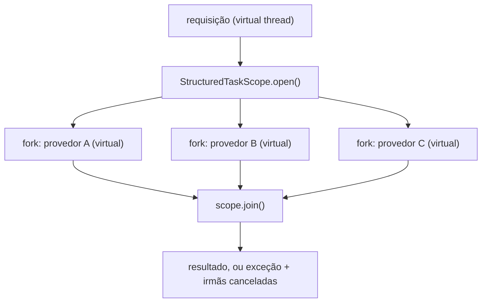

# P1.10 — Virtual threads e *structured concurrency*

> ⏱️ ~1h30 · 🔵 Pleno · Pré-requisitos: P1.05, P1.06, P1.07 (`Semaphore`), P1.08

> ⚠️ **Verificação:** executado de verdade em `lab/jvm-lab/Virtual.java`, `Pinning.java` e `Structured.java` (JDK 25.0.5; o `Pinning` também no JDK 21.0.x, ambos do Ubuntu; 12 núcleos). **A *structured concurrency* é API de PRÉ-VISUALIZAÇÃO no Java 25** (JEP 505, 5ª *preview*): exige `--enable-preview`, e **a API mudou entre as versões 21 e 25** (o `ShutdownOnFailure` que aparece em tutoriais antigos **não existe mais**: veja a seção D). O `ScopedValue` é **definitivo** no 25 (JEP 506). O PayFlow não foi compilado.

## 🎯 Objetivos
Ao final desta aula você consegue:
- **Explicar** o que é uma *virtual thread* (escalonada pela JVM sobre poucas *carrier threads*) e **por que** ela torna barato o estilo "uma thread por requisição".
- **Decidir** quando virtuais **ajudam** (muito I/O bloqueante) e quando **não** (CPU, ou recurso escasso sem limite).
- **Dizer** o que mudou no *pinning* entre o Java 21 e o 25 (**provado** com a mesma classe nas duas JVMs).
- **Usar** `ScopedValue` no lugar de `ThreadLocal` e a **structured concurrency** (`StructuredTaskScope`) para "disparar N tarefas, juntar e cancelar as irmãs".
- **Ligar** threads virtuais no Spring Boot (`spring.threads.virtual.enabled`) sabendo o que isso muda.

## 🤔 Por que isso importa
O PayFlow, como quase todo serviço web, passa **a maior parte do tempo esperando** (banco, câmbio, rede). Com threads de plataforma, o limite de requisições simultâneas é o **tamanho do pool** (centenas); para ir além, o código ficava **assíncrono** (callbacks, `CompletableFuture`, reativo): mais difícil de escrever, ler e depurar. As *virtual threads* (Java 21, JEP 444) devolvem o **código sequencial e simples** com a escalabilidade do assíncrono: milhares a milhões de "threads" baratas. É a **mudança de modelo de concorrência mais importante do Java em 20 anos**, e hoje é uma *flag* no Spring Boot.

## 💡 Intuição (explicação simples)
No restaurante (P1.05), o cozinheiro de plataforma é **funcionário contratado**: caro, poucos cabem. Se cada um **para de cozinhar** esperando o forno (I/O), a cozinha trava. Uma *virtual thread* é uma **comanda com anotação de "onde parei"**: quando o pedido precisa esperar o forno, **a comanda é guardada de lado** e o cozinheiro (a *carrier thread*) **pega outra comanda**; quando o forno apita, a comanda volta à fila e **qualquer** cozinheiro a retoma de onde parou. Você escreve a receita **como se tivesse um cozinheiro só para ela** (código bloqueante simples), e a JVM faz o rodízio. Mas **a cozinha continua com poucos fogões**: se todos os pedidos precisarem de **CPU**, não adianta ter mais comandas.

## 🔬 Como funciona por dentro
- **Virtual thread** = objeto `Thread` **gerenciado pela JVM** (não pelo SO). Quando executa, é **montada** em uma *carrier thread* (uma thread de plataforma de um `ForkJoinPool` interno; por padrão **uma por núcleo**, ver `-Djdk.virtualThreadScheduler.parallelism`). Ao **bloquear** em I/O, `sleep`, `lock` do `java.util.concurrent`, fila bloqueante etc., ela é **desmontada** (sua pilha vai para o **heap**) e a *carrier* fica livre. Quando o evento ocorre, é **remontada** em qualquer *carrier*.
- **Custo:** poucas centenas de bytes a alguns KiB (a pilha cresce no heap); criá-las é **quase de graça** (provado abaixo: 100 000 em ~0,6 s).
- **API (Java 21+):** `Thread.ofVirtual().name(...).start(r)`, `Thread.startVirtualThread(r)`, e **`Executors.newVirtualThreadPerTaskExecutor()`** (**uma thread nova por tarefa**, sem pool). São **daemon** (não seguram a JVM viva), têm **nome vazio** por padrão, prioridade fixa.
- **Regra nova:** **não faça *pool* de threads virtuais.** Pool serve para **limitar** um recurso caro; thread virtual é barata: **crie uma por tarefa**. Para limitar concorrência, limite o **recurso escasso** (`Semaphore`, P1.07; pool de conexões, P2).
- ***Pinning* (fixação):** em certas situações a virtual **não consegue ser desmontada** e **prende** a *carrier* enquanto bloqueada. No **Java 21**, **`synchronized`** fixava (bloquear **dentro** de um `synchronized` prendia a *carrier*). No **Java 24+** (**JEP 491**, "Synchronize Virtual Threads without Pinning") isso foi **resolvido**: provado abaixo. Ainda fixam: a execução de **métodos nativos** e de **funções estrangeiras** (FFM), segundo o guia oficial do Java 25 (que diz que isso não torna a aplicação incorreta, mas pode prejudicar a escalabilidade).
- **`ThreadLocal` funciona**, mas com **milhões** de threads cada uma teria sua cópia (memória) e o valor **não é herdado** pelo executor. A alternativa moderna é **`ScopedValue`** (**final no Java 25**, JEP 506): valor **imutável, vinculado a um escopo de execução**, herdado por tarefas filhas da *structured concurrency*, **sem** o risco de vazar entre usos (nada de `remove()`).
- **Structured concurrency:** trata um grupo de tarefas concorrentes como **uma unidade**: o bloco que as inicia **só termina quando todas terminam**; se uma **falha**, as **irmãs são canceladas**; nada "vaza" além do escopo. Como o escopo de vida é **léxico** (um `try`), erros e cancelamento ficam **corretos por construção** (o que `CompletableFuture` não garante: P1.06, `cancel` não interrompe; tarefa "esquecida" continua).


## 🛠️ Exemplo prático
> Rode da pasta `lab/jvm-lab/` (JDK 25). `Virtual.java`: `java Virtual.java <basics|scale|cpu|threadlocal|scoped|semaphore>`; `Pinning.java`; `Structured.java` (precisa de `--enable-preview --source 25`).

### A. Uma thread virtual
```text
isVirtual=true daemon=true nome=meu-vt grupo=VirtualThreads
toString: VirtualThread[#26,meu-vt]/runnable@ForkJoinPool-1-worker-1
nome vazio por padrão: ''
plataforma: isVirtual=false
```
O `toString` mostra a **thread virtual** `#26` rodando **montada** na *carrier* `ForkJoinPool-1-worker-1`.

### B. Escala: 2 000 tarefas que "esperam I/O" por 500 ms
```text
pool de 100 threads de plataforma, 2000 tarefas de 500 ms: 10016 ms
uma thread virtual por tarefa,     2000 tarefas de 500 ms: 514 ms
uma thread virtual por tarefa,   100000 tarefas de 500 ms: 597 ms
```
- Pool de 100: 2 000 / 100 = **20 ondas** × 500 ms = **10 s** (medido: 10 016 ms).
- Virtuais: **todas esperam em paralelo**: **514 ms** (≈ o tempo de **uma** espera). **100 000** tarefas: **597 ms**. Teria sido **impossível** com threads de plataforma (100 000 threads × 1 MiB de pilha = 100 GiB).
É o ganho: **vazão limitada pela espera, não pelo número de threads**.

### C. Virtuais **não** aceleram CPU
48 tarefas **só de CPU** (um laço de 400 milhões de operações cada) em 12 núcleos:
```text
virtuais, 48 tarefas de CPU em 12 núcleos: 1512 ms
pool de 12 threads de plataforma, as mesmas tarefas: 1527 ms  (virtual não acelera CPU)
```
**Mesmo tempo.** Com CPU, o limite são os **núcleos** (12 *carriers*). Threads virtuais ajudam quando a thread **espera**; se calcula, não ajudam (e uma virtual de CPU longa **monopoliza** a *carrier*: não há preempção por *quantum* como no SO).

### D. *Pinning*: `synchronized` no Java 21 × no Java 25
`Pinning.java`: com **uma única** *carrier* (`-Djdk.virtualThreadScheduler.parallelism=1 -Djdk.virtualThreadScheduler.maxPoolSize=1`), a thread virtual A dorme 500 ms **dentro** de um `synchronized`; depois de 100 ms, a virtual B quer rodar. Se A **prende** a única *carrier*, B espera os 500 ms.
```text
Java 21: B começou 506 ms depois do início (A dorme 500 ms dentro de um synchronized): B FICOU esperando (carrier fixado)
Java 25: B começou 104 ms depois do início (A dorme 500 ms dentro de um synchronized): B NÃO ficou esperando
```
A **mesma classe**, duas JVMs: no **21** o `synchronized` **fixava**; no **25** não. Consequência prática: **o conselho antigo "troque `synchronized` por `ReentrantLock` para usar virtual threads" deixou de ser necessário no Java 24+** (mas continua válido se você roda em Java 21). Fique atento à **versão do Java** do seu ambiente.

### E. `ThreadLocal` × `ScopedValue`
```text
ThreadLocal na virtual: null
InheritableThreadLocal copiado para a virtual: herdado
```
O `ThreadLocal` do `main` **não** aparece numa virtual criada pelo executor (`null`); o `InheritableThreadLocal` **copia** (custo por thread). O `ScopedValue`:
```java
static final ScopedValue<String> REQUEST_ID = ScopedValue.newInstance();
ScopedValue.where(REQUEST_ID, "req-42").run(() -> {
    System.out.println("dentro do escopo: " + REQUEST_ID.get());
    ScopedValue.where(REQUEST_ID, "req-interno").run(() -> System.out.println("rebind aninhado:   " + REQUEST_ID.get()));
    System.out.println("voltou do aninhado: " + REQUEST_ID.get());
});
```
```text
dentro do escopo: req-42  isBound=true
rebind aninhado:   req-interno
voltou do aninhado: req-42
fora do escopo:    isBound=false
get() fora do escopo -> NoSuchElementException
call() devolve valor: REQ-7
```
O valor existe **só dentro** do `run`/`call`, o *rebind* aninhado **não** altera o externo, e ao sair o vínculo **some sozinho**: **impossível esquecer o `remove()`** (o vazamento clássico do `ThreadLocal` em pool, P1.05).

### F. Limitar o recurso escasso com `Semaphore`
```text
1000 tarefas virtuais, no máximo 10 no "banco": pico = 10, tempo = 2058 ms (1000/10 × 20 ms = 2000 ms)
```
1 000 tarefas virtuais, mas só 10 por vez no "banco": o pico foi **10** e o tempo ≈ teórico (2 000 ms). **A concorrência é limitada pelo `Semaphore`**, não pela quantidade de threads.

### G. *Structured concurrency* (**preview** no Java 25)
```bash
java --enable-preview --source 25 Structured.java all      # all | first | fail | timeout
```
**Esperar todas** (padrão: `Joiner.awaitAllSuccessfulOrThrow()`):
```java
try (var scope = StructuredTaskScope.open()) {
    Subtask<BigDecimal> a = scope.fork(() -> rate("ecb", 300, false));
    Subtask<BigDecimal> b = scope.fork(() -> rate("bcb", 500, false));
    scope.join();                                    // espera o bloco todo
    System.out.printf("a=%s b=%s ...", a.get(), b.get());
}
```
```text
a=5.13 b=5.13 em 506 ms (estado: SUCCESS/SUCCESS)
```
**A primeira que der certo vence** (`Joiner.anySuccessfulResultOrThrow()`; as outras são **canceladas**):
```java
try (var scope = StructuredTaskScope.open(Joiner.<BigDecimal>anySuccessfulResultOrThrow())) {
    scope.fork(() -> rate("lento", 800, false));
    scope.fork(() -> rate("rapido", 200, false));
    scope.fork(() -> rate("quebrado", 50, true));              // a falha de UM não derruba o "qualquer sucesso"
    System.out.printf("vencedor: %s ...", scope.join());
}
```
```text
vencedor: 5.16 em 217 ms
```
**Falha rápida:** uma tarefa quebra em 100 ms enquanto a outra levaria 2 000 ms:
```text
FailedException após 107 ms (a tarefa lenta foi cancelada, não esperamos 2000 ms): causa = java.lang.IllegalStateException: quebrado fora do ar
```
Compare com o `allOf` (P1.06): ele **espera todas**, mesmo com falha. Aqui a falha **cancela as irmãs** (interrompe a thread da tarefa lenta) e a `join()` lança **`StructuredTaskScope.FailedException`** com a causa. **Prazo no escopo todo:**
```java
StructuredTaskScope.open(Joiner.<BigDecimal>awaitAllSuccessfulOrThrow(), cf -> cf.withTimeout(Duration.ofMillis(300)))
```
```text
TimeoutException após 304 ms
```
> 🪤 **A API mudou:** os tutoriais de 2023 mostram `new StructuredTaskScope.ShutdownOnFailure()` e `.throwIfFailed()`; **no Java 25 isso não existe** (compilar com a API antiga dá `cannot find symbol`). Lá: `StructuredTaskScope.open(...)` + *joiners* (`awaitAllSuccessfulOrThrow`, `allSuccessfulOrThrow`, `anySuccessfulResultOrThrow`, `awaitAll`, `allUntil`). **Sem `--enable-preview` não compila** (`StructuredTaskScope is a preview API and is disabled by default`). **Por ser *preview*, não use em produção** e espere mudanças até a versão final.

### H. No Spring Boot
A propriedade `spring.threads.virtual.enabled` (descrição oficial: *"Whether to use virtual threads"*, **padrão `false`**) faz o Spring Boot 4.1 configurar o executor das tarefas assíncronas e o agendador como `SimpleAsyncTaskExecutor`/`SimpleAsyncTaskScheduler` **virtuais** (documentado em *Task Execution and Scheduling*; exige Java 21+). Que o **servidor web embutido** (Tomcat/Jetty) também passa a atender as requisições em threads virtuais é a **expectativa** e o motivo de a *flag* ser popular, mas **não verifiquei essa parte** na documentação do 4.1: confira no capítulo *Web* antes de contar com isso. Em `application.yml`:
```yaml
spring:
  threads:
    virtual:
      enabled: true
```
**Não testado no PayFlow** (por decisão do aluno). O que **muda** (se o servidor web adotar virtuais): cada requisição passa a ser uma virtual; o **pool do Tomcat deixa de limitar** a concorrência; **o `HikariCP`** (pool de conexões, P2) **vira** o novo gargalo (e o limitador natural): com 200 requisições esperando 10 conexões, 190 virtuais ficam **estacionadas** (baratas) em vez de 190 threads de plataforma bloqueadas. O que **não** muda: o **banco** continua com o mesmo limite, e a **CPU** também.

## 🧠 Pausa para lógica
**Enunciado:** o PayFlow roda com virtuais habilitadas, **Hikari com 10 conexões** (J9/P2) e um endpoint que, por requisição, faz **3 consultas de ~20 ms** em sequência. Chegam **1 000 requisições simultâneas**. (a) Qual o **tempo total mínimo** até a última terminar? (b) O que acontece se a consulta for **40 ms** (o dobro)? (c) E se o endpoint passar a **segurar uma conexão durante uma chamada externa de 300 ms**?

<details><summary>Dica</summary>O gargalo é o **tempo de conexão ocupada por requisição** × nº de requisições ÷ 10 conexões.</details>
<details><summary>Solução</summary>

(a) Cada requisição ocupa a conexão **60 ms** (3 × 20), se **segurar a mesma** durante as três. 1 000 × 60 ms / 10 conexões = **6 000 ms**. A concorrência de threads não ajuda: o limite é o banco/pool. (b) Dobra para **12 000 ms**. (c) Se a conexão for mantida **durante** os 300 ms da chamada externa (transação aberta, J5.11!), cada requisição ocupa **360 ms**: 1 000 × 360 / 10 = **36 000 ms** (36 s). **Lição:** com virtuais, o gargalo se **desloca** para o recurso escasso. **Nunca** faça chamada de rede com conexão/transação aberta (P1.06: `@Transactional` não envolve I/O externo). Virtuais tornam fácil **criar** concorrência; **o recurso escasso precisa ser dimensionado e protegido** (P2, P5: *bulkhead*).
</details>

**Variação:** repita (a) com **50** conexões: quanto cai? E o que passa a ser o limite do **PostgreSQL** (`max_connections`)? (P2)

## ⚖️ Trade-offs e quando NÃO usar
| | **Threads de plataforma + pool** | **Virtuais** | **Reativo (WebFlux, P3)** |
|---|---|---|---|
| Estilo de código | bloqueante, simples | **bloqueante, simples** | assíncrono/encadeado (mais difícil) |
| Escala em I/O | limitada pelo pool (centenas) | **milhares a milhões** | **alta** (sem thread por requisição) |
| CPU-bound | igual | **igual** (não ajuda) | igual |
| Depuração/stack trace | clara | **clara** (pilha completa) | difícil (pilha fragmentada) |
| Maturidade | máxima | **alta** (Java 21+; `synchronized` sem *pinning* no 24+) | alta, com ecossistema próprio |
- **Use virtuais** em serviços **web com muito I/O bloqueante** (a maioria): ligar a *flag* é a **primeira** otimização de vazão a avaliar.
- **Não use** para **CPU-bound** (cálculo, criptografia pesada, compressão): fique com um pool do tamanho dos núcleos (P1.05).
- **Não faça *pool* de virtuais**, **nem** use `ThreadLocal` pesado (com milhares de threads, memória por *thread local*).
- **Cuidado com bibliotecas** que ainda **fixam** (métodos nativos, funções estrangeiras) ou que dependem de `ThreadLocal` caro. Para **diagnosticar** *pinning*, o guia oficial indica o evento do JFR **`jdk.VirtualThreadPinned`** (ligado por padrão, limiar de 20 ms); `jcmd <PID> Thread.dump_to_file -format=text` mostra também as threads virtuais (S2 aprofunda).
- **Structured concurrency:** use **quando** o problema é "disparar N tarefas, juntar e cancelar as irmãs"; **ainda é *preview*** no 25: **não** em produção.

## ⚠️ Erros comuns e boas práticas de produção
- **Achar que virtual = mais rápido:** só reduz **espera por thread**, não o trabalho em si (seção C).
- **Manter o pool de threads do Tomcat "para limitar":** se o servidor web passar a usar virtuais (confira, seção H), isso **não** vale; limite com **Semaphore** / **`HikariCP.maximumPoolSize`** / **rate limit**.
- **Esquecer que o recurso escasso agora é o gargalo:** 10 000 virtuais abrindo 10 000 conexões **derrubam o banco** (P2).
- **`synchronized` longo em Java 21:** ainda **fixa**; no 21, use `ReentrantLock` se bloquear dentro. No 25 não é mais problema.
- **Código "assíncrono por hábito"** (`CompletableFuture.supplyAsync` em tudo): com virtuais, **escreva sequencial** e crie a concorrência **onde há independência real** (structured concurrency).
- **Depender de `Thread.getName()`/prioridade/grupo:** virtuais têm nome vazio, prioridade fixa e `ThreadGroup` especial.
- **Pools de virtuais `Executors.newThreadPerTaskExecutor(factory)` mal usados:** crie **uma por tarefa**, **feche** o executor (`try-with-resources`) para esperar as tarefas.
- **Usar API *preview* em produção sem perceber:** exige `--enable-preview` também **em runtime**; atualize para a versão final quando sair.

## 🧩 Exercícios
1. **Fixação:** rode `scale` com 5 000 e 1 000 000 de virtuais (cuidado: o último usa muita memória; vá aumentando) e **anote** o tempo e o uso de memória (`jcmd GC.heap_info`). Onde começa a pesar?
2. **Aplicação no PayFlow:**
   - [ ] Em `docs/jvm-notes.md`, escreva a **decisão** "habilitar `spring.threads.virtual.enabled`?" com os **pré-requisitos**: Java 25 (OK, decisão 2), Hikari dimensionado (P2), `Semaphore` no `ExchangeClient` (P1.07), **nenhuma** chamada de rede dentro de `@Transactional`, e **como medir** (p99 e conexões ativas antes/depois, P6). **Não executado.**
   - [ ] Aplique a **pausa para lógica** com os números do **seu** Hikari e do `max_connections` do PostgreSQL (padrão **100**; confira em P2) e registre o **tempo mínimo** da rajada.
   - [ ] Reescreva, **só no papel/laboratório**, o `convertedBalance` da P1.06 com `StructuredTaskScope` e `anySuccessfulResultOrThrow` e compare a clareza com o `CompletableFuture`.
3. **Desafio (opcional):** use `ScopedValue` para carregar o `requestId` (J5.11, MDC) por toda uma requisição **e por suas subtarefas** do `StructuredTaskScope`, e mostre que as subtarefas **herdam** o valor sem `ThreadLocal`.

<details><summary>Solução de referência (exercício 3, indício)</summary>

`ScopedValue.where(REQUEST_ID, id).run(() -> { try (var scope = StructuredTaskScope.open()) { scope.fork(() -> REQUEST_ID.get() /* herdado */); scope.join(); } })`. Uma subtarefa criada **dentro** do escopo (por `fork`) **enxerga** o valor vinculado; uma thread criada **fora** do `StructuredTaskScope` (por exemplo `new Thread`) **não**.
</details>

## 🎤 Na entrevista
- **O que é uma *virtual thread* e como difere de uma thread de plataforma?** Uma thread gerenciada pela JVM, baratíssima (pilha no heap), montada sobre poucas *carrier threads*; ao bloquear em I/O ou locks do `java.util.concurrent` é desmontada e libera a *carrier*. A de plataforma é 1:1 com o SO, cara e limitada.
- **Quando virtual threads **não** ajudam?** Em tarefas **CPU-bound** (o limite são os núcleos) e quando o **recurso escasso** (conexões do banco) já é o gargalo: elas só deslocam a fila.
- **O que é *pinning* e o que mudou no Java 24?** Quando a virtual prende a *carrier* durante o bloqueio, perdendo o ganho. Até o Java 21, `synchronized` fixava; no Java 24+ (JEP 491) não fixa mais. Ainda fixam métodos nativos e funções estrangeiras.
- **Por que `ScopedValue` em vez de `ThreadLocal`?** É imutável, vinculado a um escopo (liberado automaticamente), eficiente com muitas threads e herdado por subtarefas estruturadas; o `ThreadLocal` é mutável, vaza em pools e custa memória por thread.
- **O que é *structured concurrency*?** Tratar tarefas concorrentes como uma unidade com tempo de vida léxico: o bloco só termina quando todas terminam; falha ou *timeout* cancela as irmãs; nada vaza. No Java 25 é *preview* (`StructuredTaskScope.open` + *joiners*).

## 📚 Para ir além
- 📄 [Java SE 25 — Virtual Threads (guia oficial)](https://docs.oracle.com/en/java/javase/25/core/virtual-threads.html): modelo, *pinning*, *thread-local*, boas práticas e o que **não** fazer.
- 📄 [Java SE 25 — Structured Concurrency (guia oficial)](https://docs.oracle.com/en/java/javase/25/core/structured-concurrency.html) e [`StructuredTaskScope` (API)](https://docs.oracle.com/en/java/javase/25/docs/api/java.base/java/util/concurrent/StructuredTaskScope.html): a API **desta** versão (*preview*).
- 📄 [`ScopedValue` (API)](https://docs.oracle.com/en/java/javase/25/docs/api/java.base/java/lang/ScopedValue.html).
- 📄 JEPs: [444 Virtual Threads](https://openjdk.org/jeps/444) (Java 21), [491 Synchronize Virtual Threads without Pinning](https://openjdk.org/jeps/491) (Java 24), [506 Scoped Values](https://openjdk.org/jeps/506) (Java 25, final) e [505 Structured Concurrency (Fifth Preview)](https://openjdk.org/jeps/505) (Java 25).
- 📄 [Spring Boot — Task Execution and Scheduling](https://docs.spring.io/spring-boot/reference/features/task-execution-and-scheduling.html) e o [apêndice de propriedades](https://docs.spring.io/spring-boot/appendix/application-properties/index.html): `spring.threads.virtual.enabled` e o que ele troca.
- 📑 Livro: *Java Concurrency in Practice* continua valendo para o **modelo** (HB, locks); para virtuais, os JEPs e o guia oficial acima são a fonte.

## ✅ Checklist da aula
- [ ] Rodei `scale` e `cpu` e expliquei por que o segundo **não** melhorou.
- [ ] Reproduzi o *pinning* no Java 21 e a sua ausência no 25 (**a mesma classe**).
- [ ] Usei `ScopedValue` e os quatro modos do `StructuredTaskScope` (com `--enable-preview`).
- [ ] Decisão sobre `spring.threads.virtual.enabled` escrita em `docs/jvm-notes.md` (**não executado**).
