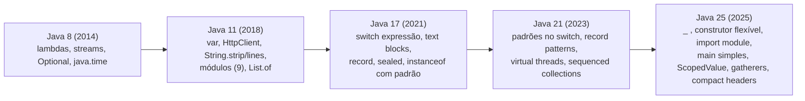

# P1.11 — Recursos modernos de Java 8 até 25

> ⏱️ ~1h30 · 🔵 Pleno · Pré-requisitos: J1.13 (lambdas e *streams*), J1.14 (`record`, `enum`, `sealed`, `Optional`), J1.15 (`java.time`, `BigDecimal`), P1.10 (para as referências a threads virtuais)

> ⚠️ **Verificação:** o programa `lab/jvm-lab/Modern.java` (e `Hello25.java`) foi **executado de verdade** no JDK 25.0.5 e cada trecho abaixo vem dele. Os **números de JEP e de versão** dos recursos de **22 a 25** foram **conferidos** em `openjdk.org/jeps/N`. As versões de entrada dos recursos **antigos** (9–21) são de conhecimento geral e **não** foram reverificadas uma a uma: use a linha do tempo como mapa e confirme em `dev.java/learn/new-features` quando precisar de precisão. Recursos em *preview* no 25 foram **apenas citados**, sem uso. O PayFlow não foi compilado.

## 🎯 Objetivos
Ao final desta aula você consegue:
- **Situar** cada recurso moderno na linha do tempo das LTS (8 → 11 → 17 → 21 → 25) e **dizer** o que mudou para **ler código antigo** e **escrever código novo**.
- **Modelar** um domínio fechado com `sealed` + `record` e **processá-lo** com `switch` por padrões **exaustivo** (o compilador acusa o caso esquecido).
- **Usar** os recursos do **Java 22–25** (`_`, construtor flexível, `import module`, arquivo-fonte compacto, *gatherers*, `ScopedValue`).
- **Distinguir** o que é **definitivo** do que ainda é **preview** no Java 25.

## 🤔 Por que isso importa
O PayFlow é escrito em Java 25, mas **o mercado está espalhado**: você vai ler código Java 8 (laços e `Date`), 11 (`var`, `HttpClient`), 17 (`record`, `sealed`) e 21 (padrões). Saber **o que mudou entre as LTS** é pré-requisito para **migrar** (S7: modernização de legado) e para **não escrever Java 8 em 2026**. Também é assunto certo de entrevista: "o que mudou do Java 8 para o 17/21?".

## 💡 Intuição (explicação simples)
Java ficou **mais enxuto e mais seguro** ao longo de 12 anos, em três movimentos: (1) **menos cerimônia** (`var`, `record`, *text blocks*: o compilador escreve o que era boilerplate); (2) **modelar o domínio com tipos**, deixando o compilador **provar** que você tratou todos os casos (`sealed` + `switch`); (3) **concorrência barata** (virtuais, P1.10). É como trocar a **máquina de escrever** por um processador de texto com **corretor ortográfico**: mesma língua, menos erro.

## 🔬 Como funciona por dentro

### Linha do tempo (o que cada LTS trouxe)

| Faixa | Recurso | Para que serve / exemplo do PayFlow |
|---|---|---|
| **8** | lambdas, `Stream`, `Optional`, `java.time`, `CompletableFuture` | você já usa (J1.13–J1.15, P1.06) |
| **9–11** | `List.of`/`Map.of` imutáveis, `var`, `String.strip/isBlank/lines/repeat`, `HttpClient`, `Optional.or/stream`, `takeWhile` | menos verbosidade; cliente HTTP nativo |
| **12–15** | `Collectors.teeing`, *switch expressions*, *text blocks*, `String.formatted` | JSON e SQL em bloco de texto; `switch` que devolve valor |
| **16–17** | `record`, `sealed`, `instanceof` com padrão, `Stream.toList`, `mapMulti` | `Money`, eventos de pagamento |
| **18–21** | *pattern matching* no `switch` (JEP 441) e *record patterns* (JEP 440), *sequenced collections*, `Math.clamp`, **virtual threads** (JEP 444) | processar eventos com `switch` exaustivo |
| **22–25** | variáveis `_` (JEP 456, 22), *Stream Gatherers* (JEP 485, 24) e **Class-File API** (JEP 484, 24), construtor flexível (JEP 513, 25), `import module` (JEP 511, 25), arquivo compacto/`main` de instância (JEP 512, 25), `ScopedValue` (JEP 506, 25), **Compact Object Headers** (JEP 519, 25), cache AOT (JEP 514/515, 25) | menos cerimônia; menos memória |

> **Preview no Java 25** (`--enable-preview`, **não** use em produção): *Structured Concurrency* (JEP 505, 5ª preview, P1.10), *Primitive Types in Patterns* (JEP 507, 3ª preview) e *Stable Values* (JEP 502). Não usados nesta aula (exceto o primeiro, em P1.10).

## 🛠️ Exemplo prático
> `lab/jvm-lab/Modern.java` (`java Modern.java`): o programa tem **uma seção por faixa**, com o domínio do PayFlow. Abaixo, os trechos-chave e a **saída real**.

### A. `record` com validação e `sealed` (16–17)
```java
record Money(BigDecimal amount) {
    Money {                                              // construtor compacto: valida e normaliza (decisão 4: 2 casas, HALF_EVEN)
        Objects.requireNonNull(amount);
        amount = amount.setScale(2, RoundingMode.HALF_EVEN);
    }
    Money plus(Money o) { return new Money(amount.add(o.amount)); }
    static Money of(String s) { return new Money(new BigDecimal(s)); }
}

sealed interface PaymentEvent permits Deposited, Transferred, Failed {}
record Deposited(String account, Money amount) implements PaymentEvent {}
record Transferred(String from, String to, Money amount) implements PaymentEvent {}
record Failed(String reason, int code) implements PaymentEvent {}
```
```text
[Money[amount=10.00], Money[amount=20.02], Money[amount=1.10]] soma=Money[amount=31.12]
record: equals=true hashCode igual=true toString=Money[amount=1.00]
```
`Money.of("10.005")` virou `10.00` e `Money.of("20.015")`, `20.02`: **`HALF_EVEN`** arredonda para o **par** mais próximo (decisão 4). O `record` já traz `equals`/`hashCode`/`toString` (`Money.of("1.00")` **é igual** a `Money.of("1")` porque o construtor normaliza para 2 casas: J1.14). `sealed ... permits` **fecha** a hierarquia: só esses três tipos existem.

### B. `switch` por padrões, exaustivo (21) e `_` (22)
```java
static String describe(PaymentEvent e) {
    return switch (e) {
        case Deposited(var acc, var m) when m.amount().compareTo(new BigDecimal("1000")) > 0 -> "depósito GRANDE em " + acc + ": " + m.amount();
        case Deposited(var acc, var m) -> "depósito em " + acc + ": " + m.amount();
        case Transferred(var from, var to, var m) -> from + " -> " + to + ": " + m.amount();
        case Failed(var reason, _) -> "falhou: " + reason;       // `_` = componente que não me interessa
    };                                                           // sem `default`: o compilador prova a exaustividade
}
```
```text
depósito GRANDE em A: 2500.00
depósito em B: 5.00
A -> B: 10.00
falhou: saldo insuficiente
```
- **Record pattern** (`Deposited(var acc, var m)`) **desmonta** o `record` e vincula os componentes; **guarda** `when` refina o caso; **ordem importa** (o caso mais específico primeiro).
- **Sem `default`** é de propósito: se amanhã alguém acrescentar `Refunded` ao `permits`, **este `switch` deixa de compilar**. Experimento real (acrescentei um terceiro tipo `C` e omiti o caso):
```text
Ex.java:6: error: the switch expression does not cover all possible input values
    static String f(Ev e) { return switch (e) { case A a -> "a"; case B b -> "b"; }; }
                                   ^
```
O **compilador lista os lugares a corrigir**: isso substitui o `default -> throw …` que só falha em **produção**. **Regra:** em hierarquia `sealed`, **não** escreva `default`.

### C. Construtor flexível (JEP 513, Java 25: definitivo)
```java
static class Derived extends Base {
    Derived(String rawId) {
        String id = rawId.strip().toLowerCase();                 // validar/normalizar ANTES de chamar o super
        if (id.isEmpty()) throw new IllegalArgumentException("id vazio");
        super(id);
    }
}
```
```text
  Base recebeu id normalizado = abc-1
  construtor flexível validou antes do super: id vazio
```
Até o Java 24 o `super(...)` precisava ser a **primeira** instrução (a validação virava método estático auxiliar). Agora você pode ter **código que não toca em `this`** antes. Útil para **invariantes** (decisão 4: validar o valor **antes** de construir o objeto base).

### D. `import module` e arquivo compacto (JEP 511 e 512, Java 25)
```java
import module java.base;              // importa TODOS os pacotes exportados de java.base (List, Map, Stream, BigDecimal, Duration...)
import module java.net.http;          // HttpClient mora em OUTRO módulo: não vem junto
```
Sem o segundo `import module`, o `HttpClient` **não compila** (`cannot find symbol ... variable HttpClient`): erro real que apareceu ao escrever o laboratório. O **arquivo-fonte compacto** (`Hello25.java`):
```java
// sem classe, sem `public static void main(String[])`
String greeting() { return "PayFlow no Java " + Runtime.version().feature(); }

void main() {
    IO.println(greeting());                  // java.lang.IO: println/readln sem System.out
}
```
```text
$ java Hello25.java
PayFlow no Java 25
```
Para **scripts, ensino e protótipos**, não para o código do PayFlow (que continua com classes, pacotes e Spring). `IO.println` é de `java.lang.IO`.

### E. *Streams* modernos e *Gatherers* (24)
```java
Stream.of(1, 2, 3, 10, 4).takeWhile(i -> i < 5).toList()                          // [1, 2, 3]
Stream.of("a,b", "c").<String>mapMulti((s, sink) -> { for (String p : s.split(",")) sink.accept(p); }).toList()   // [a, b, c]
Stream.of(10, 20, 30).collect(Collectors.teeing(Collectors.counting(), Collectors.summingInt(i -> i), (n, s) -> "n=" + n + " soma=" + s))   // n=3 soma=60
Stream.of(1, 2, 3, 4, 5).gather(Gatherers.windowSliding(3)).toList()              // [[1, 2, 3], [2, 3, 4], [3, 4, 5]]
Stream.of(1, 2, 3, 4, 5).gather(Gatherers.windowFixed(2)).toList()                // [[1, 2], [3, 4], [5]]
Stream.of(1, 2, 3).gather(Gatherers.fold(() -> 0, (a, b) -> a + b)).findFirst().get()   // 6
```
`Stream.gather(...)` (JEP 485) acrescenta **operações intermediárias customizáveis** (janelas, agrupamentos, etc.), antes impossíveis sem coletar tudo. `windowSliding(3)` é, por exemplo, a **média móvel** de 3 lançamentos. `teeing` roda **dois** coletores num só passe.

### F. Sequenced collections, `Math.clamp`, `_` e API pequena (21+)
```text
first=1 last=3 reversed=[3, 2, 1] LinkedHashSet.reversed=[3, 2, 1] clamp=100
  `_` em for: não preciso do nome da variável
  `_` em try-with-resources
HexFormat: cafe | ... | padrão | tx-007
```
`getFirst()`/`getLast()`/`reversed()` em `List`, `Deque`, `LinkedHashSet`, `LinkedHashMap` (JEP 431, Java 21, conferido; **chega de `list.get(list.size() - 1)`**). `Math.clamp(150, 0, 100)` = 100. `_` marca **variável intencionalmente ignorada** (laço, `try-with-resources`, `catch`, *lambda*, padrão). `HexFormat`, `"%s-%03d".formatted(...)`, `Objects.requireNonNullElse`, `Optional.or/stream`, `List.of` (imutável: `UnsupportedOperationException`).

### G. `var`, *text blocks* e `switch` expressão (10–15)
```java
var text = "  PayFlow \n ";                      // var: tipo inferido, NÃO é tipagem dinâmica
String nome = switch (dia) { case 1, 7 -> "fim de semana"; case 2, 3, 4, 5, 6 -> { String t = "útil"; yield t; } default -> throw new IllegalArgumentException(); };
String json = """
        {"balance":"110.00",
         "currency":"BRL"}""";                    // text block: indentação comum é removida
```
```text
strip='PayFlow' isBlank=true repeat=ababab lines=3
útil | {"balance":"110.00", "currency":"BRL"}
```
Boas práticas: `var` **só** quando o tipo é **óbvio** pela direita (`var users = new ArrayList<User>()`), nunca em `var x = service.process()` (o leitor **precisa** saber o tipo); *text blocks* para **SQL, JSON, HTML** em testes e migrações; `switch` como **expressão** (devolve valor, sem `break`).

### H. Memória: *Compact Object Headers* (JEP 519) e cache AOT (JEP 514/515)
Já medidos: P1.01 (`new Object()` de **16 → 8 bytes**) e P1.02 (cache AOT). Ligue com:
```bash
java -XX:+UseCompactObjectHeaders -jar app.jar
```
Como é **recurso novo**, **meça** com a sua carga antes de ligar em produção (P1.01).

## 🧠 Pausa para lógica
**Enunciado:** modele o **resultado de uma transferência** com `sealed`: `Completed(UUID id)`, `InsufficientFunds(Money missing)`, `AccountBlocked(UUID account)`, `Duplicate(UUID original)`. Escreva `httpStatus(TransferResult r)` com `switch` **exaustivo** que devolve `201`, `422`, `422` e `200` (J6.03: a repetição da mesma `idempotency_key` devolve a **original**). Depois acrescente `RateLimited(Duration retryAfter)` e diga **o que o compilador faz**.

<details><summary>Dica</summary>`record` para cada caso, `sealed interface TransferResult permits …`, `switch` **sem** `default`.</details>
<details><summary>Solução</summary>

```java
sealed interface TransferResult permits Completed, InsufficientFunds, AccountBlocked, Duplicate {}
record Completed(UUID id) implements TransferResult {}
record InsufficientFunds(Money missing) implements TransferResult {}
record AccountBlocked(UUID account) implements TransferResult {}
record Duplicate(UUID original) implements TransferResult {}

static int httpStatus(TransferResult r) {
    return switch (r) {
        case Completed _ -> 201;
        case InsufficientFunds _, AccountBlocked _ -> 422;
        case Duplicate _ -> 200;
    };
}
```
Ao acrescentar `RateLimited` ao `permits`, o `switch` **deixa de compilar** (`the switch expression does not cover all possible input values`): o compilador mostra **onde** tratar (e o status seria `429`). Dois padrões no mesmo `case` (`case InsufficientFunds _, AccountBlocked _`) são permitidos **porque nenhum vincula variável** (o `_`). Este trecho **foi compilado e executado** (`lab/jvm-lab/TransferResultDemo.java`: saída `201 422 422 200`); o erro de exaustividade foi provado separadamente em um `Ex.java` temporário (saída na seção B).
</details>

**Variação:** reescreva `describe` (seção B) como método **do próprio `PaymentEvent`** (polimorfismo) e discuta quando **`switch` por padrões** é melhor que **método virtual** (dica: quando o **comportamento** não pertence ao tipo, ou o tipo vem de **biblioteca**/é **dado puro**).

## ⚖️ Trade-offs e quando NÃO usar
- **`sealed` + `switch` × polimorfismo (`interface` com método):** polimorfismo quando você **controla** os tipos e o comportamento **pertence** a eles (extensível por **adição** de tipos); `sealed` + `switch` quando a hierarquia é **fechada** e as operações são **muitas** e externas (extensível por **adição de operações**). É o clássico *expression problem*.
- **`record` não serve** para **entidades JPA** (J5.07: a entidade precisa de construtor sem argumentos e de uma classe que o Hibernate possa estender em *proxies* **LAZY**, além de campos **mutáveis**; não verifiquei o que o Hibernate 7 aceita como `record`, então **não** use `record` como entidade sem consultar a documentação). Use `record` para **DTOs**, **valores** (`Money`), **eventos** e **projeções**.
- **`var`:** corta ruído, mas **esconde** o tipo; em revisão de código (J7.09), exija tipo **evidente**.
- **Recursos de preview:** só em **laboratório** (`--enable-preview` em **compilação e execução**; o *bytecode* só roda na mesma versão da JVM).
- **Migrar por migrar:** reescrever código **estável** com `record`/`switch` novo **sem ganho** é risco; modernize **o que você tocar** e onde houver **ganho de segurança** (exaustividade, imutabilidade).

## ⚠️ Erros comuns e boas práticas de produção
- **`default` em `switch` sobre `sealed`:** apaga a verificação de exaustividade (seção B).
- **`record` com campo mutável** (`List` exposta): o `record` é **raso** na imutabilidade. Use `List.copyOf` no construtor compacto.
- **`record` como chave de `HashMap` com `double`/arrays:** o `equals` de `double` usa `Double.compare`; arrays comparam por **identidade**.
- **Esquecer `-Dfile.encoding`/`UTF-8`:** o padrão passou a ser **UTF-8** no Java 18 (JEP 400, conferido); em código antigo, `getBytes()` sem *charset* mudou de comportamento ao migrar de 8/11.
- **Misturar `Date`/`Calendar`/`SimpleDateFormat`** (não *thread-safe*, P1.08) com `java.time` (imutável): use `java.time` sempre (J1.15), e `Instant` no banco (decisão 6/J5).
- **Usar `import module` em código de produção** sem equipe alinhada: esconde **de onde** vem cada tipo, e dois módulos podem exportar o **mesmo** nome simples (ambiguidade em tempo de compilação).
- **Aposentar o **JDK 8/11** sem plano:** as LTS têm **fim de suporte** diferente por distribuidor (Temurin, Corretto, Oracle): confira o **calendário do fornecedor**, não use "as 8" por inércia.

## 🧩 Exercícios
1. **Fixação:** reescreva em estilo **Java 8** o `describe` da seção B (com `instanceof` e *casts*) e compare o **número de linhas** e os **riscos** (esquecer um caso, *cast* errado).
2. **Aplicação no PayFlow:**
   - [ ] Transforme o **resultado da transferência** em `sealed interface TransferResult` + `record`s (pausa para lógica) no `TransferService` (J5.11/J6.03) e **simplifique** o `ApiErrors` (J6.04) para um `switch` exaustivo. **Não executado** (por leitura); cuidado para **não** mudar o contrato HTTP (J6/decisão 43).
   - [ ] Em `docs/java-modern-notes.md`, escreva a **tabela "feature × aonde usar no PayFlow × aonde NÃO usar"** (ao menos 6 linhas: `record`, `sealed`, `switch` por padrões, `var`, *text block*, `import module`).
   - [ ] Acrescente à **checklist de code review** (J7.09): "`switch` sobre `sealed` sem `default`?", "`var` com tipo evidente?".
3. **Desafio (opcional):** escreva um *gatherer* **customizado** (`Gatherer.ofSequential`) que agrupa lançamentos consecutivos **da mesma conta** e some os valores; compare com `groupingBy` (qual **preserva a ordem**?).

<details><summary>Solução de referência (exercício 1, estilo Java 8)</summary>

```java
static String describe8(PaymentEvent e) {
    if (e instanceof Deposited) {
        Deposited d = (Deposited) e;
        return d.amount().amount().compareTo(new BigDecimal("1000")) > 0 ? "depósito GRANDE em " + d.account() + ": " + d.amount().amount() : "depósito em " + d.account() + ": " + d.amount().amount();
    } else if (e instanceof Transferred) {
        Transferred t = (Transferred) e;
        return t.from() + " -> " + t.to() + ": " + t.amount().amount();
    } else if (e instanceof Failed) {
        return "falhou: " + ((Failed) e).reason();
    }
    throw new IllegalStateException("tipo desconhecido");     // o compilador NÃO avisa se aparecer um novo tipo
}
```
Mais longo, com **casts** manuais e um `throw` final que **só** falha em produção quando surge um tipo novo.
</details>

## 🎤 Na entrevista
- **O que mudou do Java 8 para o 17?** `var`, *text blocks*, *switch expressions*, `record`, `sealed`, `instanceof` com padrão, `HttpClient`, `List.of`, módulos, `String` novos; menos *boilerplate* e mais segurança de tipos.
- **O que é `sealed` e por que combina com `switch`?** Restringe quem pode estender/implementar um tipo; com isso o compilador sabe **todos** os subtipos e valida a **exaustividade** do `switch` por padrões, dispensando `default`.
- **Quando usar `record`? Quando não?** Para dados imutáveis (DTOs, valores, eventos): traz construtor, acessores, `equals`/`hashCode`/`toString`. Não para entidades JPA (precisam de mutabilidade/construtor sem argumentos) nem quando precisa de herança de classe.
- **Quais as versões LTS recentes e por que migrar?** 8, 11, 17, 21 e 25 (com 25 de setembro de 2025). Migrar traz desempenho (GC, JIT), segurança (patches), recursos de linguagem e virtual threads; versões antigas perdem suporte.
- **Diferença entre `ScopedValue` e `ThreadLocal`; entre *structured concurrency* e `CompletableFuture`?** (P1.10) Imutável e com escopo × mutável e persistente; unidade de trabalho com cancelamento das irmãs × composição sem cancelamento automático.

## 📚 Para ir além
- 📄 [dev.java — *What's New*](https://dev.java/learn/new-features/): o guia oficial de recursos por versão.
- 📄 [OpenJDK — JDK 25 (lista de JEPs)](https://openjdk.org/projects/jdk/25/) e [JEPs desde o JDK 21](https://openjdk.org/projects/jdk/25/jeps-since-jdk-21): a lista oficial, com *status* de cada um.
- 📄 JEPs usados aqui: [441 (padrões no `switch`)](https://openjdk.org/jeps/441), [440 (*record patterns*)](https://openjdk.org/jeps/440), [456 (`_`)](https://openjdk.org/jeps/456), [485 (*Gatherers*)](https://openjdk.org/jeps/485), [513 (construtor flexível)](https://openjdk.org/jeps/513), [511 (`import module`)](https://openjdk.org/jeps/511), [512 (arquivo compacto)](https://openjdk.org/jeps/512), [519 (*compact headers*)](https://openjdk.org/jeps/519).
- 📄 [`Gatherers` (API)](https://docs.oracle.com/en/java/javase/25/docs/api/java.base/java/util/stream/Gatherers.html): os *gatherers* prontos (`windowFixed`, `windowSliding`, `fold`, `scan`, `mapConcurrent`).
- 📄 [Guia de migração do JDK 25](https://docs.oracle.com/en/java/javase/25/migrate/index.html): o que quebra ao subir de versão (útil para S7: modernização).
- 📑 Livros: *Modern Java in Action* (Urma et al.) e *Effective Java* (Bloch, 3ª ed., Java 9) — itens sobre `Optional`, *streams*, imutabilidade e *lambdas*.

## ✅ Checklist da aula
- [ ] Rodei `Modern.java` e `Hello25.java` e li cada seção.
- [ ] Provoquei o erro de exaustividade do `switch` e vi o compilador reclamar.
- [ ] Sei dizer o que é **definitivo** e o que é **preview** no Java 25.
- [ ] `TransferResult` sealed e `docs/java-modern-notes.md` escritos (**por leitura**).
