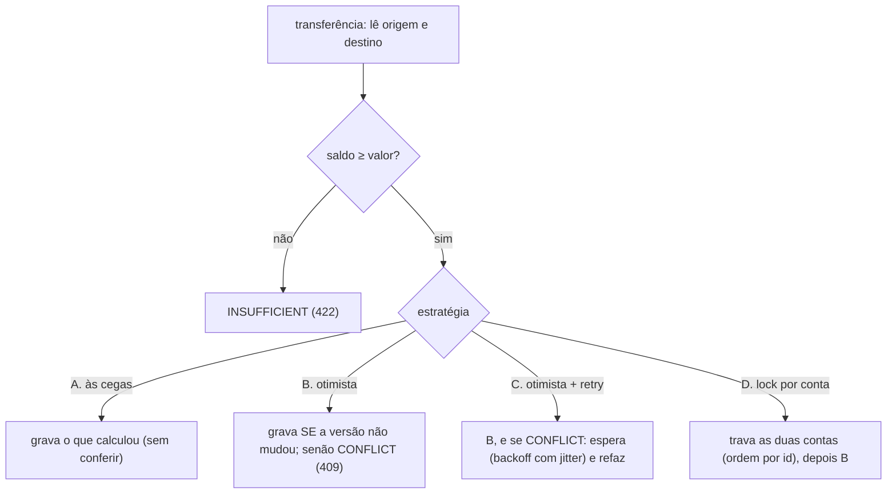

# P1.13 — 🏗️ Estudo de caso: o saldo que não bate

> ⏱️ ~1h30 · 🔵 Pleno · Pré-requisitos: P1.05, P1.07, P1.08, P1.09, J3.10 (ACID), J5.08/J5.11 (`@Version`, `TransferService`), J6.03 (idempotência e `409`), J8.06 (`LoginThrottle`)

> ✅ **Validação final (2026-11-24):** módulo executado no PayFlow reconstruído; resultado e o que continua não executado no [README do módulo](README.md). Os avisos "não executado" / "por leitura" abaixo descrevem a escrita original.

> ⚠️ **Verificação:** o **laboratório `lab/jvm-lab/StudyCase.java`** (um PayFlow em miniatura, **só em memória**) foi **executado de verdade** (JDK 25.0.5, 12 núcleos). Ele **modela** o contrato do PayFlow (linhas versionadas, `UPDATE … WHERE version = ?`, lançamentos imutáveis) mas **não é o PayFlow nem um banco**: **os números mostram o comportamento do *modelo*, não o desempenho do PostgreSQL**. O teste equivalente **no PayFlow real** (JUnit + Testcontainers) está escrito na seção "Exercícios" e **não foi executado** (decisão do aluno).

## 🎯 Objetivos
Ao final desta aula você consegue:
- **Diagnosticar** um "saldo que não bate" a partir dos **invariantes** do domínio (regras 1, 2, 3 e 4 do PayFlow).
- **Reproduzir** a corrida com um *harness* de carga concorrente e **provar** que o conserto funciona com os **mesmos** invariantes.
- **Comparar** quatro estratégias (às cegas, otimista, otimista + *retry*, lock em memória) e **explicar** por que o lock em memória **não** serve para produção multi-instância.
- **Registrar** a decisão como um **ADR** e **encaminhar** o que a P2 vai aprofundar.

## 🤔 Por que isso importa
Este é o **estudo de caso-síntese** do módulo: junta memória (P1.01), JIT (P1.02), pools (P1.05), *check-then-act* (P1.07/P1.09) e visibilidade (P1.08) em um incidente que **todo sistema de pagamentos** tem. Em entrevista de pleno/sênior, "como você garante que dois saques simultâneos não estourem o saldo?" é pergunta **eliminatória**.

## 💡 Intuição (explicação simples)
Imagine o caixa de um banco com **vários guichês** (threads) que atendem **a mesma conta** ao mesmo tempo, cada um anotando num **caderno próprio** e só no fim copiando para o **livro-razão**. Se dois guichês leem "R$ 100", cada um tira R$ 100 e escreve "R$ 0", o banco **pagou R$ 200** e o livro diz que sobrou **R$ 0**. Nenhum guichê errou **sozinho**. As soluções são: (1) **uma fila** por conta (lock); (2) **conferir o carimbo de versão** do livro ao anotar e, se mudou, **refazer** (otimista); (3) **um funcionário só** por conta (serialização). E, acima de tudo: o **livro-razão** é quem manda (o **banco de dados**), não o caderno de cada guichê.

## 🔬 Como funciona por dentro

### 1. O incidente (o "chamado")
> **Sexta, 17h02.** A conciliação noturna acusa: **a soma dos saldos das contas é R$ 47 mil maior** que a soma dos lançamentos. Três contas têm saldo **negativo** (regra 1). O time suspeita de "um bug nas transferências" e propõe **reiniciar tudo** e "ver se melhora".

**Sintomas** (invariantes do `projeto-central.md` violados):
| Regra | Enunciado | Sintoma |
|---|---|---|
| 1 | Saldo nunca fica negativo | 3 contas com saldo < 0 |
| 2 | Transferência é atômica | dinheiro "no ar" (débito sem crédito) |
| 3 | Saldo = soma dos lançamentos | contas com `saldo ≠ Σ lançamentos` |
| 4 | Mesma `idempotency_key` não repete | transferências duplicadas |

### 2. O modelo do laboratório
`StudyCase.java` imita as peças do PayFlow:
```java
record Row(UUID id, long cents, long version) {}                    // uma linha de `accounts` (com `version`, J5)
record Entry(UUID account, String type, long cents, UUID transfer) {} // um lançamento do livro-razão (regra 5: imutável)

class Store {            // "o banco"
    Row read(UUID id) {…}                                            // devolve uma CÓPIA da linha (como o Hibernate)
    boolean commitVersioned(List<Change> changes, List<Entry> entries) {   // UPDATE … WHERE id=? AND version=?, tudo-ou-nada
        synchronized (commitLock) {
            for (Change c : changes) if (rows.get(c.before().id()).version() != c.before().version()) return false;   // alguém mudou
            apply(changes, entries); return true;
        }
    }
    void commitBlind(…) { … }                                         // sem verificar versão: o último a gravar vence
}
```
`commitVersioned` imita a **transação do banco**: aplica **tudo ou nada** e **recusa** se a **versão** de qualquer linha mudou desde a leitura (o `@Version` da J5.08). A carga: **10 contas** (`100 000` centavos cada), **16 threads × 4 000 transferências** com valores de 1 a 50 e contas aleatórias. Depois, um verificador confere os invariantes: **total conservado**, **nenhuma conta negativa** e **cada saldo = soma dos lançamentos**.

### 3. As quatro estratégias

- **A (às cegas):** o equivalente a `UPDATE accounts SET balance = ?` com o valor calculado em memória a partir de uma **leitura velha**. É o que o código da J3 **evitava** com `balance = balance + ?` (atômico no banco) e o que a J5 **deixou de ter** ao passar para "ler → alterar → gravar" (a **própria** J5.11 avisa a mudança, e protege com `@Version`).
- **B (otimista):** o `@Version` real: o segundo a gravar leva `ObjectOptimisticLockingFailureException`, a API devolve **409** (J6.03).
- **C:** B + retentativa com *backoff* exponencial e **jitter** (o "cliente educado" que J6.03 recomendava).
- **D:** lock em memória por conta com **ordem global por `id`** (P1.09) **e** o commit versionado como rede de segurança.

## 🛠️ Exemplo prático
> `java StudyCase.java all` (carga espalhada) e `java StudyCase.java all hot` (**conta quente**: toda transferência sai da conta 0, com saldo alto, para provocar disputa pela versão).

### A. Contas espalhadas (disputa baixa)
```text
A ingênua (às cegas)       OK=57622  saldo-insuf.=0     409=0         101 ms | total=967293 (esperado 1000000) negativas=0 contas_com_saldo≠lançamentos=10
B otimista (@Version)      OK=29643  saldo-insuf.=0     409=27966      35 ms | total=1000000 (esperado 1000000) negativas=0 contas_com_saldo≠lançamentos=0
C otimista + retry/jitter  OK=55042  saldo-insuf.=2454  409=0          46 ms | total=1000000 (esperado 1000000) negativas=0 contas_com_saldo≠lançamentos=0
D lock por conta (JVM)     OK=55255  saldo-insuf.=2454  409=0          95 ms | total=1000000 (esperado 1000000) negativas=0 contas_com_saldo≠lançamentos=0
```
**Leitura:**
- **A**: **R$ 327,07** (32 707 centavos) **sumiram** (`967 293` de `1 000 000`) e **as 10 contas** violam a regra 3. **Todas** as 57 622 transferências "deram certo" (`OK`): **nenhum erro, nenhum log**. É o pior cenário: **corrupção silenciosa**.
- **B**: **total exato**, regra 3 ok. Mas **48% das tentativas** (27 966 de 57 609) viraram `409`: com 16 threads em 10 contas, **colidir é comum**. O **dinheiro está certo; a experiência, nem tanto**: o cliente precisa repetir.
- **C**: o *retry* faz **quase todas** passarem (55 042 OK; as 2 454 "saldo insuficiente" são **legítimas**: o saldo de verdade acabou), 0 `409` e **total exato**.
- **D**: mesmo resultado correto, **2× mais lento** que C neste modelo (95 vs 46 ms): serializar por conta custa.

### B. Conta quente (disputa alta)
```text
A ingênua (às cegas)       OK=64000  saldo-insuf.=0     409=0          97 ms | total=100508481 (esperado 100000000) negativas=0 contas_com_saldo≠lançamentos=10
B otimista (@Version)      OK=19290  saldo-insuf.=0     409=44710      37 ms | total=100000000 (esperado 100000000) negativas=0 contas_com_saldo≠lançamentos=0
C otimista + retry/jitter  OK=64000  saldo-insuf.=0     409=0          46 ms | total=100000000 (esperado 100000000) negativas=0 contas_com_saldo≠lançamentos=0
D lock por conta (JVM)     OK=64000  saldo-insuf.=0     409=0          48 ms | total=100000000 (esperado 100000000) negativas=0 contas_com_saldo≠lançamentos=0
```
- **A** agora **criou** dinheiro: `100 508 481` > `100 000 000` (**R$ 5 084,81 a mais**). Na outra execução, o mesmo sentido (`100 427 360`). Com a conta quente (todas as threads leem/gravam a conta 0), a corrida de **perda de atualização** (P1.09-A) vira **geração de dinheiro**: o débito lido de um valor velho **sobrescreve** débitos anteriores.
- **B**: **70% de `409`** (44 710 de 64 000), **só 19 290** passaram: **tempestade de `409`**. O banco continua **correto**, mas **a conta quente vira gargalo de vazão**, e um cliente sem *retry* percebe **falha**.
- **C** e **D**: todas as 64 000 passam, total exato. O *backoff com jitter* (C) fez **o trabalho de um lock** sem lock.
(Os tempos em ms são do **modelo em memória**, **não** preveem o PostgreSQL: lá o commit tem latência de rede e disco.)

### C. Idempotência: o clique duplo
8 requisições simultâneas com a **mesma** `idempotency_key`:
```text
verifica-e-age:      8 transferências criadas para a mesma chave
putIfAbsent/UNIQUE:  1 transferência criada para a mesma chave
```
`if (find(key) == null) { …cria… }` deixou **as 8** passarem (*check-then-act*, P1.09); `putIfAbsent` (o análogo do `UNIQUE (idempotency_key)` do banco, J6.03) deixou **uma**. **Regra 4 só vale com a restrição no banco.**

### D. Por que o lock em memória (D) **não** é a resposta
O D funciona **dentro de um processo**. O PayFlow vai rodar **mais de uma instância** (J10: um `t3.small` hoje, mas P7: Kubernetes com várias réplicas; **rolling deploy** já mantém **duas** instâncias vivas durante uns instantes). **Dois processos não compartilham `ReentrantLock`**: cada um acha que a conta está livre. O **árbitro único** é o **banco**. Por isso a estratégia certa para produção é **B/C (versão no banco)** e, quando houver muita disputa na mesma linha, o **locking pessimista** (`SELECT … FOR UPDATE`, **sempre em ordem de `id`**: P1.09) ou um `UPDATE` **condicional** (`SET balance = balance - ? WHERE id = ? AND balance >= ?`), assuntos da **P2**.

## 🧠 Pausa para lógica
**Enunciado:** no cenário B (conta quente), um cliente **sem retry** recebeu `409` em 70% das chamadas. A proposta do time: "**tire o `@Version`** e a taxa de erro cai para zero". Use os números da seção **B** para **explicar por que isso é desastroso** e proponha **duas** alternativas melhores.

<details><summary>Dica</summary>Compare a linha **A** e a linha **B** da conta quente: o que "zerar os 409" realmente fez? E o que o **cliente** pode fazer ao receber 409?</details>
<details><summary>Solução</summary>

Tirar o `@Version` **é** a estratégia A: a taxa de erro cai a zero **e o dinheiro passa a ser criado ou destruído em silêncio** (R$ 5 084,81 criados, 10 contas com a regra 3 violada). O `409` **não é o defeito**: é o **sintoma honesto** de que duas operações disputaram a mesma conta. **Alternativas:** (1) **retry com backoff e jitter**, no cliente **ou** dentro do serviço (estratégia C: 100% de sucesso, total exato); (2) **reduzir a disputa**: `UPDATE` condicional atômico no banco (`balance = balance - ? WHERE … AND balance >= ?`) ou `SELECT … FOR UPDATE` (P2), que **serializa no banco** em vez de repetir; (3) **mudar o modelo** se uma conta recebe milhares de operações por segundo (conta "quente": particionar o saldo em subcontas ou tratar a **fila** de lançamentos, S1/S3).
</details>

**Variação:** o que o verificador de invariantes **não** pegaria se a corrida estivesse **só** na leitura do extrato (um relatório que soma **durante** uma transferência)? (Dica: P1.09-B3, "dinheiro no ar".)

## ⚖️ Trade-offs e quando NÃO usar
| Estratégia | Corretude | Experiência | Escala (multi-instância) | Complexidade | Use quando |
|---|---|---|---|---|---|
| A. às cegas | **quebra** (perda/criação silenciosa) | "tudo OK" (falso) | — | mínima | **nunca** para dinheiro |
| B. otimista (`@Version`) | correta | **409** sob disputa | **sim** (o banco arbitra) | baixa | disputa **rara** por conta |
| C. B + retry/jitter | correta | **quase sempre 201** | **sim** | média (limite de tentativas, idempotência!) | disputa **moderada** |
| D. lock em memória | correta **só em 1 instância** | sem 409 | **não** | média (ordem de locks, *deadlock*) | **nunca** como única proteção |
| (P2) `FOR UPDATE`/`UPDATE` condicional | correta | sem 409, **espera** | **sim** | média | disputa **alta** na mesma linha |
- **Retry exige idempotência:** repetir uma transferência **sem** `idempotency_key` pode **duplicar** (regra 4). O *retry* seguro **reusa a mesma chave**.
- **Retry tem limite:** sem teto (`12` tentativas no modelo) e *backoff*, uma conta quente transforma **cada cliente** em martelo; use também **limite de taxa** (P1.07: `Semaphore`/token bucket) e **`Retry-After`**.
- **Não "conserte" com `Thread.sleep`**, com **menos threads** nem com **`synchronized` no controller**: nada disso vale com **2 instâncias**.

## ⚠️ Erros comuns e boas práticas de produção
- **Verificar invariantes só no teste de unidade:** o bug aparece sob **carga concorrente**. Tenha um **teste de invariantes sob carga** (exercício 2) no CI noturno e **uma conciliação** em produção (regra 3: `saldo = Σ lançamentos`, uma consulta SQL que alerta).
- **Considerar `OK=57622` como sucesso:** na estratégia A, "OK" é **mentira**. **Sucesso = invariantes verdadeiros**, não ausência de exceção.
- **Reiniciar e "ver se melhora":** não conserta dinheiro já corrompido. Primeiro **parar a sangria** (desligar a operação ou travar as contas afetadas), **depois** corrigir com **lançamentos de ajuste** (regra 5: lançamentos **nunca** são editados) e **só então** consertar a causa.
- **Retry em loop sem teto:** *retry storm* derruba o serviço **e** o banco (P5 aprofunda com *circuit breaker* e *bulkhead*).
- **Confundir `409` com erro de servidor:** `409` é **erro do momento** (J6.03): o **cliente** deve repetir; **não** alarme como `5xx`.
- **Esquecer a idempotência do *consumidor* de eventos** quando o PayFlow ganhar mensageria (P3): o mesmo problema, em outra camada.

## 🧩 Exercícios
1. **Fixação:** rode `StudyCase.java all` e `all hot` **três vezes** cada. Anote: a variação do total na estratégia A; a taxa de `409` de B nos dois cenários; e **em qual** cenário o D fica mais lento que o C.
2. **Aplicação no PayFlow** (**por leitura**: não executado, decisão do aluno):
   - [ ] **J5.11 (a lição de casa deixada para a P1):** escreva `ConcurrentDepositsTest` que dispara **N depósitos simultâneos** na mesma conta com `ExecutorService` + `CountDownLatch` e **conta** quantos falham com `ObjectOptimisticLockingFailureException` (J5) e **por que isso é melhor** que perder um depósito. Invariante: `saldo final = saldo inicial + (depósitos que deram certo × valor)`.
   - [ ] Escreva `ConcurrentTransfersInvariantsTest` (JUnit 6, `@PayflowTest`/Testcontainers, J7.05): **10 contas** do seed, **16 threads**, transferências aleatórias **com retry** (uma retentativa limitada com *backoff* e jitter **reutilizando a mesma `idempotency_key`**, J6.03), e ao fim **assertive os invariantes**: `Σ saldos` constante; nenhum saldo `< 0`; `saldo = Σ lançamentos` por conta (consulta SQL na `ledger_entries`); **nenhuma** `idempotency_key` repetida. **Prove que o teste falha** quando você **remove temporariamente** o `@Version` e a verificação de saldo (um teste que nunca falhou não prova nada, J8).
   - [ ] **Corrija o `LoginThrottle`** (P1.09-F) e escreva o teste `LoginThrottleConcurrencyTest` (60 threads, ≤ 5 tentativas realmente testadas).
   - [ ] **Revise o ADR 0013** (`projeto/adrs/0013-concorrencia-do-saldo.md`, já redigido com os números do laboratório; o modelo está abaixo), **preencha as medidas do seu PayFlow** quando os testes práticos forem feitos e escreva o **runbook** "saldo não bate" (conciliação SQL + parar a sangria + ajuste por lançamento) em `docs/concurrency-notes.md`.
   - [ ] **Registre** em `docs/concurrency-notes.md` o que ficou para a P2: `FOR UPDATE` ordenado por `id`, `UPDATE` condicional, *pool* de conexões e isolamento.
3. **Desafio (opcional):** acrescente ao `StudyCase` a estratégia **E**: *lock pessimista simulado no "banco"* (um lock por linha dentro do `Store`, ordem por `id`), e meça se ele se comporta como D **mas** valendo para "duas instâncias" (simule duas instâncias com dois `Store`-clientes compartilhando as mesmas linhas).

<details><summary>Solução de referência: esqueleto do teste de invariantes (por leitura, não compilado)</summary>

```java
@PayflowTest
class ConcurrentTransfersInvariantsTest {
    @Autowired TransferService transfers;  @Autowired JdbcTemplate jdbc;

    @Test
    void invariantsHoldUnderConcurrentLoad() throws Exception {
        List<UUID> accounts = seedTenAccountsWith("1000.00");
        BigDecimal before = totalBalance();
        try (ExecutorService ex = Executors.newFixedThreadPool(16)) {
            CountDownLatch go = new CountDownLatch(1);
            List<Future<?>> fs = new ArrayList<>();
            for (int t = 0; t < 16; t++) fs.add(ex.submit(() -> {
                go.await();
                for (int i = 0; i < 200; i++) transferWithRetry(randomPair(accounts), randomAmount(), UUID.randomUUID().toString());
                return null;
            }));
            go.countDown();
            for (var f : fs) f.get();
        }
        assertThat(totalBalance()).isEqualByComparingTo(before);                                   // regra 2/3: nada nasce nem some
        assertThat(jdbc.queryForObject("select count(*) from accounts where balance < 0", Integer.class)).isZero();   // regra 1
        assertThat(jdbc.queryForObject("""
            select count(*) from accounts a
            where a.balance <> coalesce((select sum(case when l.type = 'CREDIT' then l.amount else -l.amount end)
                                         from ledger_entries l where l.account_id = a.id), 0)""", Integer.class)).isZero();   // regra 3
        assertThat(jdbc.queryForObject("select count(*) from (select idempotency_key from transfers group by 1 having count(*) > 1) d", Integer.class)).isZero();   // regra 4
    }
}
```
`transferWithRetry` repete só diante de `ObjectOptimisticLockingFailureException`, com *backoff* e **a mesma** chave, no máximo 8 vezes. Nomes de métodos auxiliares (`seedTenAccountsWith`, `randomPair`, `totalBalance`) ficam por sua conta: **não** foram compilados.
</details>

### Modelo do ADR 0013 (a versão completa está em `projeto/adrs/0013-concorrencia-do-saldo.md`)
```markdown
# ADR 0013 — Concorrência do saldo (P1)
Status: proposto · Data: <hoje>
## Contexto
Invariantes (regras 1–4) violáveis por corrida; evidência do laboratório (A: total 967 293 ≠ 1 000 000; conta quente A: +R$ 5 084,81).
## Opções
A às cegas · B @Version · C @Version + retry/jitter · D lock em memória · (P2) FOR UPDATE / UPDATE condicional
## Decisão
B+C: @Version (já existe, J5) + retry com backoff/jitter e idempotency_key reutilizada; lock em memória REJEITADO (não vale com 2 instâncias).
## Consequências
409 sob disputa; necessidade de retry e de limite de tentativas; conciliação noturna (regra 3); P2 avalia FOR UPDATE e UPDATE condicional.
```

## 🎤 Na entrevista
- **Dois saques simultâneos de uma conta com saldo para um só: como evitar o saldo negativo?** Tornar **verificar+debitar** atômico **no banco**: `UPDATE … SET balance = balance - ? WHERE id = ? AND balance >= ?` (e checar `rowCount`), ou locking otimista (`@Version`) com *retry*, ou pessimista (`SELECT … FOR UPDATE`). Locks em memória não bastam com mais de uma instância.
- **O que é uma *lost update* e como o `@Version` a evita?** Duas transações leem o mesmo estado e a segunda sobrescreve a primeira. Com `@Version`, o `UPDATE` inclui `WHERE version = ?`; se a linha mudou, afeta 0 linhas e o ORM lança exceção (409), forçando refazer a leitura.
- **`409` sob carga: o que fazer?** Repetir com *backoff* exponencial e *jitter*, **reutilizando a mesma `idempotency_key`**, com limite de tentativas; reduzir a disputa (`UPDATE` condicional, `FOR UPDATE` ordenado) se a conta for "quente".
- **Como você prova que o sistema está correto sob concorrência?** Testes de carga que verificam **invariantes** (conservação do total, não-negatividade, saldo = soma dos lançamentos, unicidade da chave) + conciliação em produção; e **prova de que o teste falha** quando a proteção é removida.
- **Por que `synchronized`/`ReentrantLock` não resolve em produção?** Só protegem dentro de um processo; com várias instâncias, cada uma tem o seu lock. O árbitro compartilhado é o banco.

## 📚 Para ir além
- 📄 [`ConcurrentHashMap.merge`, `putIfAbsent`](https://docs.oracle.com/en/java/javase/25/docs/api/java.base/java/util/concurrent/ConcurrentHashMap.html) (o análogo em memória da restrição `UNIQUE`) e [pacote `java.util.concurrent`](https://docs.oracle.com/en/java/javase/25/docs/api/java.base/java/util/concurrent/package-summary.html).
- 📑 Livro: *Designing Data-Intensive Applications* (Kleppmann), cap. 7 (*lost updates*, *write skew*, isolamento) — **o mapa** do que a P2 vai explorar no PostgreSQL.
- 📑 Livros: *Java Concurrency in Practice* (Goetz et al.), cap. 2 e 15; *Release It!* (Nygard), padrões de estabilidade (*timeouts*, *retry*, *bulkhead*) — P5.
- 📄 Nos próprios arquivos do curso: [J6.03 (409 e idempotência)](../../1-junior/J6-apis-rest/J6.03-transferencia-transacao-acid-na-api.md), [J5.11 (`@Transactional`, `@Version`)](../../1-junior/J5-spring-boot/J5.11-transactional-na-pratica.md), [P1.09](P1.09-condicoes-de-corrida-e-deadlocks-que-falham-de-verdade.md).

## ✅ Checklist da aula
- [ ] Rodei o `StudyCase` nos dois cenários e entendi cada linha da tabela.
- [ ] Sei explicar por que **A** corrompe **em silêncio** e por que **D** não serve para produção.
- [ ] Escrevi (por leitura) o teste de invariantes, o teste do `LoginThrottle` e o runbook "saldo não bate"; li o ADR 0013.
- [ ] Deixei registrado o que a P2 vai aprofundar.
