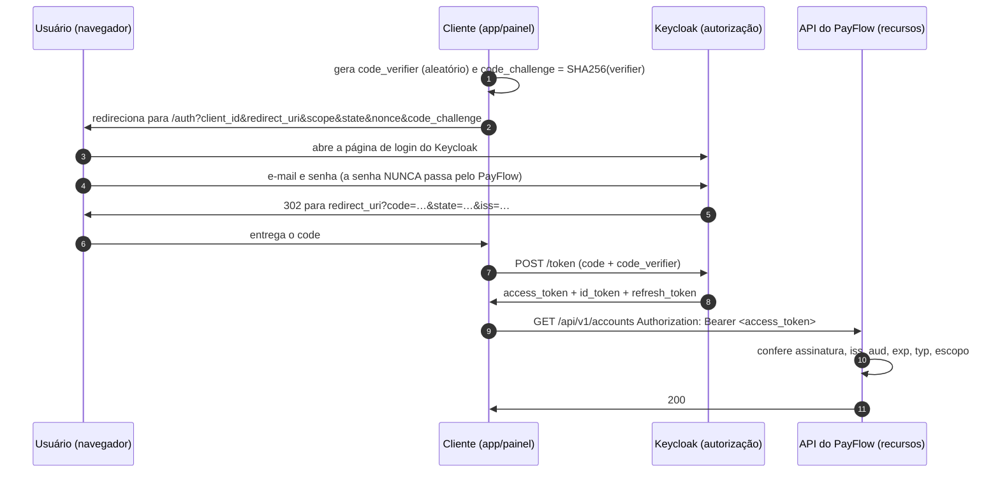

# P10.01 — OAuth 2.0 e OpenID Connect: fluxos, tokens e escopos

> ⏱️ ~1h30 · 🔵 Pleno · Pré-requisitos: J2.04 (HTTP, cookies e redirecionamentos), J8.03 (sessão × JWT; o JWT HS256 do PayFlow), J8.06 (falhas de autenticação), P5.05 (gateway valida o JWT em cada serviço)

> ⚠️ **Verificação:** os fluxos desta aula foram **executados de verdade** contra um **Keycloak 26.8.2** em contêiner (`quay.io/keycloak/keycloak:26.8.2`; Docker 29.9.2, JDK 25.0.5, Spring Boot 4.1.2, Spring Security 7.1.2). As saídas são **as reais** (`lab/identity-lab/out-T01.txt`, `out-T05.txt`). **Não executado:** o PayFlow do aluno (revisado por leitura; os testes práticos ficam para o fim do treinamento), o fluxo de dispositivo (*device code*), a troca de token e qualquer provedor que não seja o Keycloak. Os números de seção dos RFC foram conferidos no texto (`curl` em 2026-11-14).

## 🎯 Objetivos
Ao final desta aula você consegue:
- **Nomear** os quatro papéis do OAuth 2.0 (dono do recurso, cliente, servidor de autorização, servidor de recursos) e **dizer qual deles é o PayFlow** em cada situação.
- **Diferenciar** *access token*, *ID token* e *refresh token* (para quem cada um é escrito) e **explicar** por que um não pode ser usado no lugar do outro.
- **Percorrer** o fluxo **Authorization Code + PKCE** passo a passo e **dizer qual ataque cada parâmetro** (`state`, `nonce`, `code_challenge`, `redirect_uri`, `iss`) impede.
- **Distinguir** escopo, papel e audiência, e **escolher** onde cada decisão de autorização mora.
- **Ler** um JWT real emitido pelo Keycloak (cabeçalho, *claims*) e **dizer o que a API precisa conferir** antes de confiar nele.

## 🤔 Por que isso importa
Na J8 o PayFlow **emitia os próprios tokens**: um `POST /api/v1/auth/token` conferia e-mail e senha, assinava um JWT **HS256** com um segredo compartilhado e o devolvia por 15 minutos. Funcionou, e o **ADR 0010** registrou o custo: **sem *refresh token*, sem revogação, uma chave que assina e confere (quem consegue conferir consegue forjar)** e a aplicação **guardando senhas** — o ativo mais perigoso de guardar. Isso é um **servidor de autorização escondido dentro da API**.

No trabalho de um pleno isso aparece como: "o app móvel precisa de login", "o parceiro quer chamar a API sem usar a senha de ninguém", "o serviço de relatórios precisa falar com a API", "o auditor perguntou como a gente derruba o acesso de um funcionário desligado". Todas essas perguntas têm a **mesma resposta de mercado**: **OAuth 2.0 + OpenID Connect**, com um **servidor de identidade** (Keycloak, Cognito, Entra ID, Auth0…) **separado** da API. A API só **confere** tokens; quem sabe senhas, MFA, bloqueio e sessões é outro sistema.

## 💡 Intuição (explicação simples)
Um **hotel**. Você (o **dono do recurso**) não entrega a chave-mestra do quarto para o entregador de pizza (o **cliente**). Você vai à **recepção** (o **servidor de autorização**), prova quem é **uma vez**, e a recepção entrega um **cartão** (o *access token*) que só abre **a porta do seu quarto** (*audiência*), **só por algumas horas** (*expiração*) e **só no que você autorizou** (*escopo*). A porta (o **servidor de recursos**) **não conhece você**: ela só sabe **conferir se o cartão é autêntico, vale para ela e não venceu**. Se o entregador perde o cartão, o estrago é limitado; se perdesse a chave-mestra, não.

O **OpenID Connect (OIDC)** acrescenta uma coisa que o OAuth 2.0 **não** tem: o **crachá de identificação** (o *ID token*), que diz **quem fez o login** — para o **aplicativo**, não para a porta.

## 🔬 Como funciona por dentro

### Os quatro papéis (e o PayFlow em cada um)
| Papel (RFC 6749) | Quem é | No PayFlow |
|---|---|---|
| **Dono do recurso** | a pessoa (ou sistema) dona dos dados | Alice, dona da conta `aaaaaaaa-…` |
| **Cliente** | o aplicativo que quer acessar em nome dela | o painel/app (`payflow-web`) **e** o serviço de notificações (`payflow-notifications`) |
| **Servidor de autorização** | autentica e **emite** os tokens | **Keycloak** (P10.02) |
| **Servidor de recursos** | a API protegida, que **confere** tokens | **a API do PayFlow** (P10.03) — **e** o endpoint `/internal` |

Um mesmo software pode ocupar **dois** papéis: o PayFlow é **servidor de recursos** para o app e **cliente** quando chama o serviço de notificações (P10.04).

### Três tokens, três destinatários
| Token | Para quem é escrito | Quem o lê | Vida | Pode ir no `Authorization: Bearer`? |
|---|---|---|---|---|
| **Access token** | a **API** (audiência `payflow-api`) | a API | curta (5 min no realm do laboratório) | **sim** |
| **ID token** (OIDC) | o **aplicativo** cliente (audiência = id do cliente) | o app, para saber **quem logou** | curta | **não** |
| **Refresh token** | o **servidor de autorização** | só o servidor de autorização | longa (30 min de ociosidade no laboratório) | **não** |

A confusão clássica é **mandar o ID token para a API**: ele é um JWT assinado pela **mesma chave**, então a assinatura confere. Quem salva a API é **conferir o tipo e a audiência** (medimos isso: seção "Exemplo prático").

### O JWT real que o Keycloak emitiu
Um *access token* de usuário, decodificado (os números `exp`/`iat` mudam a cada execução):
```
header={"alg":"RS256","typ":"JWT","kid":"MXEZ_ZZBueLs5lVPUPSMsOYJSs_1UA307rYMsTzU7EI"}
claims={"exp":1794685017,"iat":1794684717,"jti":"onrtro:5f73cba0-…","iss":"http://127.0.0.1:8180/realms/payflow",
        "aud":"payflow-api","sub":"11111111-1111-4111-8111-111111111111","typ":"Bearer","azp":"payflow-lab-direct",
        "sid":"3Jw8TXqOOKEWmg324Q0y8YBy","realm_access":{"roles":["USER"]},"scope":"openid profile transfers:read email",
        "email_verified":true,"name":"Alice Silva","preferred_username":"alice@example.com","email":"alice@example.com"}
```
| Campo | Significa | A API usa para |
|---|---|---|
| `alg`, `kid` (cabeçalho) | algoritmo e **qual chave** assinou | escolher a chave pública no **JWKS** (e **recusar** o que não for RS256) |
| `iss` | **quem emitiu** (o realm) | conferir que é **o nosso** servidor de autorização |
| `aud` | **para quem** o token vale | conferir que é **`payflow-api`** (um token do mesmo Keycloak para **outra** API é recusado) |
| `sub` | quem é o **usuário** (id estável, UUID) | o **dono** no caso de uso (IDOR, J8.06): nunca o que vem no corpo |
| `exp`, `iat`, `jti` | validade, emissão, id do token | recusar vencido (com tolerância de relógio) |
| `typ` | `Bearer` (access), `ID`, `Refresh` | **só aceitar `Bearer`** |
| `azp` | o **cliente** que pediu o token | saber **quem chamou** (serviço × app) |
| `scope` | o que o **cliente** foi autorizado a fazer em nome do usuário | `SCOPE_transfers:read`… |
| `realm_access.roles` | o que o **usuário** é (papéis) | `ROLE_ADMIN`… |

**Assinatura assimétrica (RS256):** o Keycloak assina com a chave **privada** (que nunca sai dele) e publica as **públicas** no **JWKS** (`jwks_uri`). A API só **confere**; **quem consegue conferir não consegue forjar** — a diferença central para o HS256 da J8.

### Authorization Code + PKCE (o fluxo para quem tem um navegador)

O **código** é um bilhete de uso único que passa **pelo navegador** (um lugar exposto: histórico, extensões, *logs* de proxy). Por isso **sozinho ele não vale nada**: o cliente precisa provar que **é o mesmo** que iniciou o fluxo, apresentando o `code_verifier` cujo *hash* foi enviado no começo (**PKCE**, RFC 7636). O ataque que o PKCE impede: alguém copia o `code` da barra de endereço ou de um *log* e tenta trocá-lo por tokens.

| Parâmetro | Ataque que impede | Quem confere |
|---|---|---|
| `code_challenge` / `code_verifier` | **código roubado** trocado por tokens | o Keycloak, na troca |
| `redirect_uri` (correspondência **exata**) | desviar o código para o servidor do atacante | o Keycloak, **antes** de mostrar o login |
| `state` | **CSRF no fluxo** (o cliente receberia o código de **outro** login) | o **cliente**, ao receber o redirecionamento |
| `nonce` | **repetição do ID token** (um ID token antigo reaproveitado) | o **cliente**, dentro do ID token |
| `iss` na resposta (RFC 9207) | **confusão de servidor** (o cliente fala com mais de um emissor) | o **cliente** |

### Outros fluxos (e o que o mercado faz com cada um)
| Fluxo (*grant*) | Para que serve | Situação |
|---|---|---|
| **Authorization Code + PKCE** | apps com usuário (web, móvel, SPA) | **o padrão**; PKCE até para clientes confidenciais |
| **Client Credentials** | **máquina para máquina**, sem usuário | **P10.04** |
| **Refresh Token** | renovar o *access token* sem novo login | com **rotação** (abaixo) |
| **Device Code** | TV, CLI, equipamento sem navegador | existe; **não** usado no PayFlow |
| **Implicit** (token na URL) | era para SPAs | **evitar**: o BCP (RFC 9700) o desaconselha |
| **Password** (o app recebe a senha) | "login rápido" | **proibido**: a RFC 9700 §2.4 diz que **"MUST NOT be used"** |

O Keycloak 26.8.2 **ainda anuncia** `implicit` e `password` no documento de descoberta (medimos): o servidor **suporta**; **você** decide quais clientes podem usá-los. No laboratório existe **um** cliente com senha direta (`payflow-lab-direct`), **só** para os testes automatizados obterem tokens sem um navegador — e o nome diz isso.

> O **OAuth 2.1** consolida essas recomendações (PKCE obrigatório, sem implicit e sem *password*); ainda é um *draft* do IETF (conferir o estado em [oauth.net/2.1](https://oauth.net/2.1/)).

### Escopo × papel × audiência (três perguntas diferentes)
| Pergunta | Mecanismo | Quem decide | Exemplo |
|---|---|---|---|
| **O que este aplicativo pode fazer em meu nome?** | **escopo** (`scope`) | o usuário/administrador, ao autorizar o **cliente** | `transfers:read` ≠ `transfers:write` |
| **O que esta pessoa é?** | **papel** (`roles`) | o administrador do realm | `ADMIN` |
| **Para qual API este token vale?** | **audiência** (`aud`) | o servidor de autorização | `payflow-api` |
| **De quem é este objeto?** | **dono** (`sub` × `owner_id`) | o **caso de uso** da API | conta da Alice × do Bob |

As quatro precisam passar. **Um escopo não substitui o dono**: com `transfers:read`, o Bob ainda **não** lê a conta da Alice (testamos: 404).

### Refresh token com rotação
Cada uso do *refresh token* devolve um **novo** (o antigo morre). Se **o antigo aparece de novo**, alguém o copiou: o servidor **trata como roubo** e derruba a sessão.

## 🛠️ Exemplo prático

### 1. O que o servidor publica: o documento de descoberta
`KeycloakRealmIT` (executado) lê `/.well-known/openid-configuration`:
```
issuer=http://127.0.0.1:8180/realms/payflow
jwks_uri=http://127.0.0.1:8180/realms/payflow/protocol/openid-connect/certs
pkce=["plain","S256"]
grants=["authorization_code","client_credentials","implicit","password","refresh_token","urn:ietf:params:oauth:grant-type:device_code","urn:ietf:params:oauth:grant-type:jwt-bearer","urn:ietf:params:oauth:grant-type:token-exchange", …]
```
A API **só precisa do `issuer`**: de lá ela descobre o `jwks_uri`. O `plain` aparece por compatibilidade (RFC 7636); **o cliente `payflow-web` exige `S256`** (P10.02).

### 2. O fluxo inteiro com um "navegador" de 30 linhas
`AuthorizationCodePkceIT` faz, **contra o Keycloak real**, o que o navegador faz: abre `/auth` com o desafio PKCE, lê o formulário de login, envia e-mail e senha, recebe o `302` com o código e troca por tokens. Saída (executada):
```
callback params=[state, session_state, iss, code]
code length=98 expires_in=300 refresh_expires_in=1800
access azp=payflow-web scope=openid profile transfers:read email aud="payflow-api"
id nonce matches=true aud="payflow-web"
```
O **access token** tem `aud = payflow-api` (para a API); o **ID token** tem `aud = payflow-web` (para o app) — e o `nonce` voltou igual.

### 3. Cada defesa, quebrada de propósito (todas executadas)
| Teste | O que o atacante faz | Resposta real do Keycloak |
|---|---|---|
| `stolenCodeIsUselessWithoutTheVerifier` | vê o `code`, mas **não** o `verifier` | `400 invalid_grant` — `PKCE verification failed: Code mismatch` |
| `codeIsSingleUse` | troca o mesmo `code` **duas vezes** | `400 invalid_grant` — `Code not valid` |
| `theClientRequiresPkce_…` | inicia o fluxo **sem** `code_challenge` | `302` para o `redirect_uri` com `error=invalid_request&error_description=Missing parameter: code_challenge_method` |
| `redirectUriMustMatchExactly_…` | `redirect_uri=http://evil.example/callback` | **`400` e nenhuma página de login** |
| `wrongPassword_…` | senha errada **e** usuário inexistente | **a mesma mensagem** (`Invalid username or password`): não revela se o e-mail existe |
| `thePasswordNeverTravelsToThePayFlow_…` | — | o login acontece em **outra origem** (porta 8180); o redirecionamento final **não** carrega a senha |

> 🔎 **Surpresa de ambiente (medida):** o `java.net.CookieManager` **não devolve** cookies marcados `Secure` por HTTP, e o Keycloak marca `KC_RESTART` assim **mesmo em `http://127.0.0.1`**: o login do meu "navegador" deu **`400`** até eu guardar os cookies **à mão**. Um navegador de verdade trata `localhost` como contexto seguro; o `HttpClient` do Java **não**.

### 4. Refresh com rotação (executado)
`RefreshTokenRotationIT`:
```
refresh #1 ok; new refresh token differs=true access token expires_in=300
replay of the spent refresh token -> 400 {"error":"invalid_grant","error_description":"Maximum allowed refresh token reuse exceeded"}
the legitimate newest refresh token after the replay -> 400 {"error":"invalid_grant","error_description":"Session doesn't have required client"}
```
Reusar o *refresh token* gasto foi recusado — e o **token legítimo mais novo também parou de funcionar** (o Keycloak **derrubou a sessão**). Isso é o desejado contra roubo, e o **custo** é real: um cliente com **duas abas** que renovam ao mesmo tempo pode derrubar o **próprio** usuário. (`revokeRefreshToken: true` e `refreshTokenMaxReuse: 0` no realm.)

### 5. O PayFlow da J8 × o PayFlow da P10
| | J8 (HS256 próprio) | P10 (OIDC) |
|---|---|---|
| Quem guarda a senha | **o PayFlow** (`users.password_hash`, BCrypt) | **o Keycloak** |
| Quem emite o token | `TokenService` (`POST /api/v1/auth/token`) | **Keycloak** |
| Algoritmo | HS256 (segredo compartilhado) | **RS256** (chave privada só no Keycloak) |
| Quem consegue forjar | **quem conferir** (tem o segredo) | **só o Keycloak** |
| Vida / renovação | 15 min, **sem** refresh | 5 min + **refresh com rotação** |
| Revogação | **nenhuma** | refresh e sessão revogáveis (o *access token* vale até `exp`: P10.03) |
| `LoginThrottle`, política de senha, MFA | **código nosso** | **configuração do realm** (P10.02) |
| Segredo da aplicação | `PAYFLOW_SECURITY_JWT_SECRET` (a exceção da decisão 169) | **nenhum**: a API só tem **chaves públicas** |

## 🏗️ Estudo de caso: o token de 15 minutos que não dava para derrubar
**Situação.** Uma funcionária do suporte é desligada numa sexta, 18h. O RH desativa o usuário. **O token HS256 dela vale até 18h15**, e o PayFlow **não tem** como derrubá-lo antes (sem lista de revogação, decisão 58). Pior: o segredo que **assina** é o mesmo que **confere**; se um *dump* de configuração vazar, **qualquer pessoa emite tokens de ADMIN**.

**Opções.** (A) **lista de tokens revogados** no PayFlow (estado compartilhado em toda leitura: o que o JWT queria evitar); (B) **encurtar** o token para 1 minuto (mais carga no servidor de autorização, mais renovações); (C) **separar** quem emite de quem confere (RS256) e **limitar** o dano pelo prazo curto **mais** revogar a **sessão/refresh** no servidor de autorização; (D) **token opaco** com introspecção a cada chamada (revogação imediata; **uma ida ao Keycloak por requisição**).

**Decisão (ADR 0022).** **C**: RS256, *access token* de **5 minutos**, *refresh* com rotação, logout que **revoga a sessão**; o intervalo restante (≤ 5 min) é um **risco aceito e registrado**. **D** fica para endpoints de **maior risco** se um dia for preciso. O que o laboratório **mediu** sobre esse intervalo está na **P10.03** (o token **continua válido** depois do logout; a introspecção já diz `active:false`).

## ⚖️ Trade-offs e quando NÃO usar
- **Servidor de identidade próprio** (Keycloak) **vira peça crítica**: se ele cai, **ninguém faz login** (e quem tem refresh vencido não renova). É mais uma coisa para **operar, atualizar e vigiar** (P10.02). Alternativa gerenciada (Cognito, Entra ID): menos operação, **menos controle** e **custo por usuário**.
- **OIDC para um sistema pequeno, com um só cliente e sem parceiros**, pode ser exagero: a sessão com cookie da J8.03 resolve. Vale quando há **mais de um cliente**, **API pública**, **SSO**, **MFA/bloqueio** centralizados, ou **serviços** que precisam se identificar.
- **JWT autocontido** (a API não consulta ninguém) é **rápido e escalável**, mas **não é revogável de imediato**. **Opaco + introspecção** inverte isso.
- **PKCE sempre**: o custo é uma linha; **não há** motivo para omitir.

## ⚠️ Erros comuns e boas práticas de produção
- **Usar o ID token como token de API.** A assinatura confere; só o `typ`/`aud` te salva (`The aud claim is not valid`: executado).
- **Confiar no token sem conferir `aud`.** Um token do **mesmo** Keycloak, emitido para **outra** API, passa.
- **`redirect_uri` com curinga** (`https://app.example.com/*`): vira **redirecionamento aberto** que entrega o código a quem hospedar uma página ali. Use endereços **exatos**.
- **Guardar token em `localStorage`** de uma SPA: qualquer XSS o lê (J8.05). Prefira **cookie `HttpOnly` por um *backend for frontend*** (P10.03, painel).
- **Colocar dado pessoal demais no token** (J8.07): o JWT é só **codificado**, não cifrado; qualquer um que o tenha lê o e-mail.
- **Misturar escopo e papel** ("`transfers:write` vale para admin"): cada um responde a **uma** pergunta.
- Mensagem real quando o token é rejeitado: `WWW-Authenticate: Bearer error="invalid_token", error_description="An error occurred while attempting to decode the Jwt: The aud claim is not valid"` (P10.03).

## 🧩 Exercícios
1. **Fixação.** Para cada afirmação, diga **verdadeiro ou falso** e por quê: (a) "O ID token pode ir no cabeçalho `Authorization`"; (b) "PKCE só é necessário para apps móveis"; (c) "O `state` protege contra o roubo do código"; (d) "Um token com `scope=transfers:read` pode ler a conta de qualquer usuário".
2. **Aplicação no PayFlow.** Em `docs/identity.md` (novo), escreva: (a) a tabela dos **papéis OAuth do PayFlow** (quem é cliente, quem é servidor de recursos, em quais situações); (b) a lista de **claims** que a API usa e **para quê**; (c) a decisão **"o que mora no token e o que não mora"** (e-mail e nome só se a interface precisar: J8.07). Critérios de pronto:
   - [ ] cada *claim* da API aparece **com** a conferência correspondente (`iss`, `aud`, `exp`, `typ`, `sub`, `scope`, `roles`);
   - [ ] está dito que **a senha nunca passa pelo PayFlow**;
   - [ ] o ADR 0010 (J8) está referenciado como a decisão **superada**.
3. **Desafio.** Escreva (ou execute, se tiver o laboratório) um teste que prove que **um `code` gerado para o `redirect_uri` A não é aceito na troca com `redirect_uri` B**. Em qual RFC essa regra aparece?

<details><summary>Soluções de referência</summary>

**1.** (a) **Falso**: o ID token é para o **cliente**; a API o recusa por `typ`/`aud`. (b) **Falso**: PKCE vale para **todo** cliente (a RFC 9700 o recomenda também para clientes confidenciais). (c) **Falso**: quem impede a troca do código roubado é o **PKCE**; o `state` protege o **cliente** de receber o código de **outro** fluxo (CSRF). (d) **Falso**: o escopo diz o que o **app** pode; o **dono** do objeto é conferido pela API com o `sub`.

**2.** O `docs/identity.md` deve ter a tabela dos papéis (Alice = dono; `payflow-web` = cliente; Keycloak = autorização; API = recursos; `payflow-notifications` = cliente quando chama `/internal`).

**3.** Troque o `code` com outro `redirect_uri` no `POST /token`: o Keycloak devolve `invalid_grant`. A regra é da **RFC 6749 §4.1.3** (o `redirect_uri` da troca tem de ser idêntico ao da autorização). ⚠️ Não executei esse caso específico: confira no seu Keycloak.
</details>

## 🎤 Na entrevista
- **"Qual a diferença entre OAuth 2.0 e OpenID Connect?"** — OAuth 2.0 é **autorização delegada**: dá a um **cliente** um token para acessar uma **API** em nome do usuário. OIDC é uma camada **de autenticação** em cima dele: acrescenta o **ID token** (quem fez login, para o **app**), o *endpoint* `userinfo` e o documento de descoberta. O *access token* diz "pode chamar a API"; o ID token diz "esta pessoa se autenticou".
- **"Por que Authorization Code com PKCE e não o *implicit*?"** — No *implicit* o token vem **na URL** (histórico, *logs*, *referrer*). No *code*, o que passa pelo navegador é um **bilhete de uso único** que só vale com o **`code_verifier`** que ficou no cliente: roubar o código não basta. O BCP (RFC 9700) desaconselha o *implicit* e proíbe o *password*.
- **"O JWT é seguro porque é assinado?"** — A assinatura garante **integridade e origem**, **não sigilo** (qualquer um lê o conteúdo). E exige conferir **`iss`, `aud`, `exp`, algoritmo e tipo**, senão um token **válido de outro lugar** passa. E **não se revoga** antes de `exp` sem consultar alguém.
- **"Como derrubar o acesso de um usuário desligado?"** — Desativar no servidor de identidade **revoga a sessão e o refresh**; o *access token* já emitido vale até expirar (por isso **vida curta**) ou se usa **introspecção** onde o risco justificar.

## 📚 Para ir além
- 📄 [RFC 6749 — The OAuth 2.0 Authorization Framework](https://www.rfc-editor.org/rfc/rfc6749): a base (papéis e fluxos). Leia as seções 1 e 4.1.
- 📄 [RFC 7636 — PKCE](https://www.rfc-editor.org/rfc/rfc7636): curta; mostra o ataque do código interceptado.
- 📄 [RFC 9700 — Best Current Practice for OAuth 2.0 Security](https://www.rfc-editor.org/rfc/rfc9700) (janeiro de 2025): o que **evitar** (§2.4 *password*; §2.1.2 *implicit*) e por quê.
- 📄 [RFC 6750 — Bearer Token Usage](https://www.rfc-editor.org/rfc/rfc6750): `WWW-Authenticate`, `invalid_token`, `insufficient_scope` (P10.03).
- 📄 [RFC 7519 — JWT](https://www.rfc-editor.org/rfc/rfc7519) e [RFC 8725 — JWT Best Current Practices](https://www.rfc-editor.org/rfc/rfc8725): o formato e as armadilhas (algoritmo `none`, confusão de chaves).
- 📄 [RFC 9068 — JWT Profile for OAuth 2.0 Access Tokens](https://www.rfc-editor.org/rfc/rfc9068): `typ`, `aud`, `scope` como **convenção** (o Keycloak 26.8.2 usa `typ: Bearer`, medido, **não** `at+jwt`).
- 📄 [RFC 9207 — `iss` na resposta de autorização](https://www.rfc-editor.org/rfc/rfc9207): o parâmetro que o laboratório recebeu.
- 📄 [OpenID Connect Core 1.0](https://openid.net/specs/openid-connect-core-1_0.html): ID token, `nonce`, `userinfo`.
- 📄 [OWASP — OAuth 2.0 Cheat Sheet](https://cheatsheetseries.owasp.org/cheatsheets/OAuth2_Cheat_Sheet.html): lista de verificação objetiva.
- 🎥 Nenhum vídeo verificado nesta aula.
- 📑 Livro (⚠️ título e autores de memória): *OAuth 2 in Action* (Justin Richer e Antonio Sanso).
- 💻 `lab/identity-lab/src/test/java/com/payflow/keycloak/AuthorizationCodePkceIT.java`: o fluxo inteiro, passo a passo, para ler e quebrar.

## ✅ Checklist da aula
- [ ] Sei dizer **quem é cada papel** do OAuth 2.0 no PayFlow, inclusive quando ele é **cliente**.
- [ ] Diferencio **access**, **ID** e **refresh token** e sei por que o ID token **não** vai para a API.
- [ ] Explico **o que cada parâmetro** (`state`, `nonce`, `code_challenge`, `redirect_uri`, `iss`) impede.
- [ ] Distingo **escopo, papel, audiência e dono** e sei onde cada um é decidido.
- [ ] Leio um JWT e digo **o que a API deve conferir** antes de confiar nele.
- [ ] Sei por que o **HS256 da J8** foi trocado e o que **continua** sendo risco (vida do *access token*).
