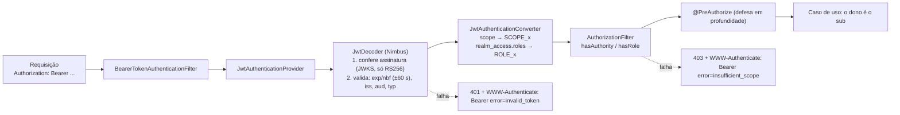

# P10.03 — Spring Security como Resource Server

> ⏱️ ~1h30 · 🔵 Pleno · Pré-requisitos: P10.01 (tokens e *claims*), P10.02 (Keycloak e o realm), J8.01 (cadeia de filtros), J8.04 (papéis, `@PreAuthorize`), J8.06 (IDOR), P5.05 (JWT validado em cada serviço)

> ⚠️ **Verificação:** o Resource Server desta aula **foi compilado e executado** (Spring Boot 4.1.2, Spring Security 7.1.2, JDK 25.0.5, Nimbus JOSE+JWT 10.9.1) em `lab/identity-lab`: **54 testes verdes** (mais o `outage.sh`, a API com o Keycloak indisponível) (23 sem Keycloak, com chaves RSA de teste e um JWKS local; 31 contra o **Keycloak 26.8.2** e o **PostgreSQL 18** reais) e **8 mutantes** (6 reprovados, **2 sobreviveram — explicados abaixo**). O laboratório é uma **versão mínima** da API do PayFlow (contas e transferências **em memória**, sem banco), **não** o repositório do aluno. **Não executado:** a **migração do PayFlow do aluno** (as mudanças da seção "O PayFlow depois da P10" são **revisão por leitura** e os testes práticos ficam para o fim do treinamento), o **painel com `oauth2Login`**, a **provisão automática** de usuários e a **migração das senhas** da J8. Saídas em `lab/identity-lab/out-suite.txt`, `out-T03.txt`, `out-mutants.txt`.

## 🎯 Objetivos
Ao final desta aula você consegue:
- **Configurar** a API como *Resource Server* (emissor, audiência, algoritmo) **e explicar** o que o Spring confere em cada requisição.
- **Converter** as *claims* do Keycloak em autoridades do Spring (**escopo** → `SCOPE_x`, **papel** → `ROLE_x`) e **decidir** onde cada regra mora.
- **Distinguir** `401` de `403` e **ler** o cabeçalho `WWW-Authenticate` que o Spring devolve.
- **Testar** a validação de tokens **sem** o Keycloak (chaves de teste e JWKS local) e **com** ele, e **provar** que cada regra importa com **mutantes**.
- **Dizer o que um JWT autocontido não faz** (revogação) usando uma medição.

## 🤔 Por que isso importa
O Resource Server é **a última linha de defesa**: o gateway, o balanceador e o app podem falhar; a API **tem de recusar** o que não for um token legítimo, **emitido para ela**, **para aquela operação**. Quase todos os incidentes de autenticação por JWT vêm de **uma conferência que faltou**: `aud` não conferida, algoritmo aceito demais, ID token tratado como access token, escopo ignorado, ou o `sub` substituído por um dado do corpo da requisição.

No trabalho de um pleno você **escreve e revisa** essa configuração, e responde "e se o Keycloak girar a chave?", "por que esta chamada deu 403 e aquela 401?" e "o usuário saiu e o token ainda funciona: é bug?".

## 💡 Intuição (explicação simples)
A API é um **porteiro de show** com uma lista de regras para o **ingresso** (o token): (1) é **autêntico**? (confere o holograma: assinatura com a chave pública do emissor); (2) é **deste evento**? (`aud`); (3) **não venceu**? (`exp`); (4) é **ingresso**, não o **programa** do show? (`typ`); (5) vale para **esta área**? (escopo e papel); (6) e **este lugar é seu**? (o dono do objeto). Falhou em qualquer uma: **recusa**, e a mensagem diz **qual** das duas portas foi fechada: "ingresso inválido" (**401**) ou "ingresso válido, mas não para cá" (**403**).

## 🔬 Como funciona por dentro



- **JWKS preguiçoso e em cache.** O decodificador **não** consulta o Keycloak na subida (medido: a API sobe com ele fora do ar): busca o JWKS **na primeira requisição** e **guarda em cache**. Se chega um token com um `kid` **desconhecido**, ele **busca de novo** (é assim que a rotação de chaves funciona **sem reiniciar**: testamos).
- **Validadores.** O padrão confere **tempo** (com tolerância de relógio: o padrão do Spring é de **60 s**; **medido:** um token vencido há 30 s passa, um vencido há 90 s não), e **emissor** quando você configura `issuer-uri`. **Audiência** e **tipo** você acrescenta.
- **Algoritmo.** O decodificador criado por `jwk-set-uri` **só aceita RS256** por padrão; `alg: none` e HS256 com a chave pública (o ataque de **confusão de algoritmo**) caem aqui.

## 🛠️ Exemplo prático

### 1. A configuração (`application.yml`)
```yaml
spring:
  security:
    oauth2:
      resourceserver:
        jwt:
          issuer-uri: ${PAYFLOW_OIDC_ISSUER:http://127.0.0.1:8180/realms/payflow}   # busca o JWKS no discovery, na 1ª requisição
          audiences: payflow-api                  # o token precisa ter aud = payflow-api
          jws-algorithms: RS256                   # só RS256 (nunca "none", nunca HS256 com a chave pública)
```
O Boot 4.1.2 expõe estas propriedades de `spring.security.oauth2.resourceserver.jwt.*` (lidas dos metadados do `spring-boot-security-oauth2-resource-server`): `issuer-uri`, `jwk-set-uri`, `audiences`, `jws-algorithms`, `public-key-location`, `principal-claim-name`, `authority-prefix`, `authorities-claim-name`, `authorities-claim-expressions`.

> 🔎 **Duas propriedades interessantes:** com **`jwk-set-uri` e `issuer-uri` juntos**, o Boot usa o JWKS dado e **ainda valida o emissor** — é o que os testes sem Keycloak fazem (o JWKS vem de um servidor local; o emissor continua `http://127.0.0.1:8180/realms/payflow`). E com **só `issuer-uri`** o Boot faz a descoberta (`/.well-known/openid-configuration`) **de forma preguiçosa** (**medido:** a aplicação sobe com o Keycloak **fora do ar**; ver a seção 9 para o que isso custa).

### 2. O tipo do token e as autoridades (código próprio, ~40 linhas)
```java
/** Só aceita token de ACESSO: a claim "typ" é "Bearer" no access token, "ID" no ID token e "Refresh" no refresh token. */
public class TokenTypeValidator implements OAuth2TokenValidator<Jwt> {
    private static final OAuth2Error WRONG_TYPE = new OAuth2Error("invalid_token", "The token is not an access token", null);
    @Override
    public OAuth2TokenValidatorResult validate(Jwt jwt) {
        return "Bearer".equals(jwt.getClaimAsString("typ"))
                ? OAuth2TokenValidatorResult.success() : OAuth2TokenValidatorResult.failure(WRONG_TYPE);
    }
}

/** Escopo (o que o CLIENTE pode) vira SCOPE_x; papel (o que o USUÁRIO é) vira ROLE_x. */
public class KeycloakAuthoritiesConverter implements Converter<Jwt, Collection<GrantedAuthority>> {
    private final JwtGrantedAuthoritiesConverter scopes = new JwtGrantedAuthoritiesConverter();   // "scope" → SCOPE_x
    @Override
    public Collection<GrantedAuthority> convert(Jwt jwt) {
        List<GrantedAuthority> authorities = new ArrayList<>(scopes.convert(jwt));
        if (jwt.getClaim("realm_access") instanceof Map<?, ?> realm && realm.get("roles") instanceof Collection<?> roles) {
            for (Object role : roles) {
                if (role instanceof String name) authorities.add(new SimpleGrantedAuthority("ROLE_" + name));
            }
        }
        return authorities;
    }
}
```
O Boot **encontra** um `@Bean OAuth2TokenValidator<Jwt>` e o **soma** aos validadores do `issuer-uri`/`audiences` (confirmado: o mutante que o remove reprova o teste do ID token). **É este conversor o "adaptador" do provedor**: trocar de Keycloak para Cognito muda o **nome da claim** (e a presença de `aud`), não a API.

### 3. As regras de acesso (`SecurityConfig`)
```java
@Bean @Order(2)
SecurityFilterChain apiChain(HttpSecurity http, JwtAuthenticationConverter converter) throws Exception {
    http.securityMatcher("/api/v1/**")
        .authorizeHttpRequests(auth -> auth
            .requestMatchers("/api/v1/admin/**").hasRole("ADMIN")
            .requestMatchers(HttpMethod.GET, "/api/v1/accounts/**").hasAuthority("SCOPE_transfers:read")
            .requestMatchers(HttpMethod.POST, "/api/v1/transfers").hasAuthority("SCOPE_transfers:write")
            .anyRequest().denyAll())
        .sessionManagement(s -> s.sessionCreationPolicy(SessionCreationPolicy.STATELESS))
        .csrf(AbstractHttpConfigurer::disable)           // sem cookie, não há o que forjar (J8.05)
        .oauth2ResourceServer(oauth -> oauth
            .jwt(jwt -> jwt.jwtAuthenticationConverter(converter))
            .authenticationEntryPoint(new BearerTokenAuthenticationEntryPoint())
            .accessDeniedHandler(new BearerTokenAccessDeniedHandler()));
    return http.build();
}
```
- **`anyRequest().denyAll()`**: rota nova **nasce fechada**; quem abre é quem escreve a regra (J8.01: negar por padrão).
- Uma **terceira cadeia** (`@Order(3)`) nega todo o resto (`/`, `/actuator/**`): sem ela o Boot abriria o formulário de login padrão.
- O `AdminController` mantém o `@PreAuthorize("hasRole('ADMIN')")` (decisão 60: **duas barreiras**).
- **O dono continua no caso de uso**: `CurrentUser.from(jwt)` lê o `sub` (UUID) e a conta só é devolvida se `ownerId == sub`; **404** para conta alheia (decisões 25 e 43).

### 4. `401` × `403` e o `WWW-Authenticate` (executado contra o Keycloak real)
```
no transfers:read -> 403 WWW-Authenticate=Bearer error="insufficient_scope", error_description="The request requires higher privileges than provided by the access token.", error_uri="https://tools.ietf.org/html/rfc6750#section-3.1"
id_token as bearer -> 401 WWW-Authenticate=Bearer error="invalid_token", error_description="An error occurred while attempting to decode the Jwt: The aud claim is not valid", error_uri="https://tools.ietf.org/html/rfc6750#section-3.1", resource_metadata="http://127.0.0.1:36725/.well-known/oauth-protected-resource"
```
| Situação | Resposta | Por quê |
|---|---|---|
| Sem token / expirado / adulterado / outro emissor / outra audiência | **401** + `invalid_token` | **não sei quem você é** (ou o token não presta) |
| Token válido, **sem o escopo** ou **sem o papel** | **403** + `insufficient_scope` | **sei quem você é, mas não pode** |
| Conta de outro usuário | **404** | não confirmo que **existe** (IDOR, J8.06) |

> 🔎 **Surpresa do Spring Security 7 (medida):** minha primeira expectativa era `WWW-Authenticate: Bearer` **puro** no `401` sem token. Veio `Bearer resource_metadata="http://localhost/.well-known/oauth-protected-resource"`. É a **RFC 9728** (*OAuth 2.0 Protected Resource Metadata*): o servidor de recursos **anuncia onde descreve a si mesmo**. Se você compara o cabeçalho com `equals`, **quebra**; compare com `startsWith("Bearer")`. ⚠️ O endereço anunciado **não é servido** pela configuração do laboratório (não testei o que ele devolve).

### 5. Os testes **sem** Keycloak (23, ~2,8 s): o que o servidor de bolso permite
O `OfflineResourceServerTest` sobe a aplicação **com a configuração real** e muda **só a origem das chaves**: um servidor HTTP local (`JwksServer`) publica a chave pública de teste, e o `TestTokens` assina tokens com a privada, **com as claims no formato do Keycloak** (medidas na P10.02). Cada teste muda **uma** coisa:

| Grupo | Testes (todos verdes) |
|---|---|
| Caminho feliz | `validToken_listsOnlyMyAccounts` |
| **Tokens que não podem passar** (→ 401) | `missingToken…`, `expiredToken…`, `tokenNotYetValid…`, `tamperedPayload…` (troca o `sub` mantendo a assinatura), `wrongIssuer…`, `wrongAudience…` (token do **mesmo** emissor para a API `billing-api`), `idTokenIsNotAnAccessToken…`, `algNone…`, `hs256SignedWithThePublicKey…`, `signedByAnUnknownKey…` |
| Tempo | `clockSkew_tokenExpired30sAgoStillPasses_butNot90sAgo` (tolerância **medida**: 30 s passa, 90 s não) |
| **Rotação de chave** | `keyRotation_aNewKeyInTheJwksIsAcceptedWithoutRestart` |
| Escopo × papel × dono | `readScopeIsNotEnoughToTransfer…` (403 `insufficient_scope`), `writeScope_transfersFromMyOwnAccount_butNotFromSomeoneElses`, `idor_bobCannotReadAlicesAccount_404`, `adminEndpoint_needsTheRole_notTheScope`, `unknownRoutesAreDenied…` |
| `/internal` (P10.04) | 5 testes |

A **rotação** merece atenção: o teste primeiro mostra que um token da chave **nova** é **recusado** (a API só conhece a antiga); em seguida o JWKS passa a publicar **as duas** chaves e o **mesmo token é aceito, sem reiniciar** — e o da chave antiga **continua válido** (é por isso que o Keycloak publica a nova **ao lado** da velha durante a troca).

### 6. Os testes **com** o Keycloak real (`ResourceServerKeycloakIT`, 7 testes)
```
alice -> 200 [{"id":"aaaaaaaa-0000-4000-8000-000000000001","ownerId":"11111111-1111-4111-8111-111111111111","balance":100.00,"status":"ACTIVE"}]
bob   -> 200 [{"id":"bbbbbbbb-0000-4000-8000-000000000002","ownerId":"22222222-2222-4222-8222-222222222222","balance":50.00,"status":"ACTIVE"}]
```
Tokens **reais** da Alice e do Bob → cada um vê **só a própria conta**; sem o escopo opcional → `403`; o ID token → `401`; o `ops@` (papel `ADMIN`) bloqueia a conta, a Alice (`USER`) leva `403`.

### 7. O que o JWT **não** faz: o logout que não derruba o token (executado)
```
logout=204 refresh-after-logout=400 Session not active
introspection after logout={"active":false}
API with the same access token after logout=200
```
Depois do **logout**: o **refresh token** morreu (`Session not active`) e a **introspecção** (a pergunta direta ao Keycloak) já diz **`active:false`** — mas a **API continuou aceitando** o mesmo *access token* (`200`), porque **só confere assinatura e prazo**, sem perguntar a ninguém. **Esse é o preço do JWT autocontido** e o motivo dos 5 minutos de vida. **Escolhas** quando 5 minutos não bastam: **encurtar** (1 min), **introspecção** nos endpoints de risco (uma ida ao Keycloak por chamada), ou uma **lista de `sid` revogados** alimentada por eventos de logout (⚠️ não testado). **Aceitar e registrar** é uma decisão legítima: foi a do ADR 0022 (**T07** do modelo de ameaças, P10.07).

### 8. Os mutantes: um teste que nunca falhou não prova nada (`run-mutants.py`)
```
M1 sem `audiences`: KILLED -> wrongAudience_is401
M2 sem `jws-algorithms`: SURVIVED (a suíte continuou verde)
M3 sem o validador de `typ`: KILLED -> idTokenIsNotAnAccessToken_is401
M4a regra da cadeia para /admin frouxa (authenticated), fica o @PreAuthorize: SURVIVED (a suíte continuou verde)
M4b regra frouxa E sem o @PreAuthorize: KILLED -> adminEndpoint_needsTheRole_notTheScope
M5 sem a lista de clientes (azp) no /internal: KILLED -> internal_aKnownClientWithoutTheScope_is403_andAnUnknownClientWithTheScope_is403
M6 sem o filtro de dono (IDOR): KILLED -> idor_bobCannotReadAlicesAccount_404
M7 escopo de escrita não exigido: KILLED -> readScopeIsNotEnoughToTransfer_403_insufficientScope
mutants killed: 6/8
```
**Os dois sobreviventes são informação, não falha:**
- **M2 — remover `jws-algorithms: RS256` não muda nada** porque o **padrão do decodificador por `jwk-set-uri` já é RS256**. A linha **documenta a intenção** e protege de um padrão que mude; **não** é o que segura o ataque de confusão. Eu **não** a tiraria (custa uma linha), mas **não** a trataria como a defesa.
- **M4a — afrouxar a regra da cadeia mantém a suíte verde** porque o `@PreAuthorize` **sozinho** barra o usuário comum: é **defesa em profundidade** funcionando (o M4b, que tira **as duas**, reprova). O custo: **se uma das barreiras sumir, nenhum teste do endpoint reclama** — por isso a decisão 60 exige **testar cada barreira sozinha**. ⚠️ Isto **não** foi feito neste laboratório (um teste que desligue o `@PreAuthorize` e confira a regra da cadeia): é o **exercício 3**.

### 9. E se o Keycloak **não estiver lá**? (`outage.sh`, executado com o JAR e o contêiner)
```
1) Keycloak FORA DO AR desde antes da subida
Started LabApplication in 1.867 seconds
   sem token                 -> 401
   token qualquer (lixo)     -> 403   (corpo vazio)
   linhas ERROR no log       -> 1 com JwtDecoderInitializationException: Unable to resolve the Configuration with the provided Issuer of "http://127.0.0.1:8180/realms/payflow"
2) Keycloak VOLTA (sem reiniciar a API)
   token real                -> 200
   token qualquer (lixo)     -> 401
3) Keycloak CAI de novo (o JWKS já está em cache)
   mesmo token real          -> 200
```
Três fatos **medidos**:
- A API **sobe** sem o Keycloak (a descoberta é preguiçosa, 1,9 s) e **se recupera sozinha** quando ele volta — **sem reiniciar**.
- Com o JWKS **em cache**, tokens válidos **continuam** passando durante a queda. ⚠️ **Não medi por quanto tempo**: o cache do JWKS **expira** (o padrão do Nimbus é da ordem de minutos) e, depois disso, um token só passa se o JWKS puder ser buscado de novo.
- **A parte ruim:** enquanto a API **nunca** conseguiu resolver o emissor, **qualquer requisição com `Authorization`** vira **`403` com o corpo vazio** e **uma pilha de erro** no log (`JwtDecoderInitializationException`). Um `403` **mente** (diz "você não pode" quando a verdade é "eu não consigo conferir agora") e o **alarme de 4xx** da P6 **não é** o de indisponibilidade. A causa é que a exceção **não é de autenticação**: ela estoura o servlet, o contêiner despacha para `/error` e a cadeia que **nega tudo** responde `403`. **Correção (por leitura, não executada):** tratar `JwtDecoderInitializationException` e converter em **`503`** (um `AuthenticationEntryPoint`/`@ControllerAdvice` específico), e **alarmar** a taxa desse erro. Isto é a ameaça **T21** do modelo (P10.07), **aberta**.

## 🏗️ O PayFlow depois da P10 (revisão por leitura; **não executado no repositório do aluno**)
| Mudança | Detalhe |
|---|---|
| **API** | a cadeia `apiChain` da J8.01 passa a ser a desta aula (`oauth2ResourceServer().jwt()` com `issuer-uri`/`audiences`); **saem** `TokenService`, `JwtConfig` (HS256), `AuthController` (`/api/v1/auth/token`), `ThrottledAuthenticationProvider`, `LoginThrottle` e `PasswordPolicy` da API; o `ApiSecurityErrors` (Problem Details, decisão 61) **continua** como `AuthenticationEntryPoint`/`AccessDeniedHandler` **mantendo** `WWW-Authenticate` |
| **`CurrentUser`** | `new CurrentUser(UUID.fromString(jwt.getSubject()), jwt.getClaimAsString("email"), jwt.getClaimAsString("name"))`: **o `sub` é o `users.id`** (o realm importa os usuários **preservando o `id`**: medido com o usuário de teste) |
| **Banco** | `V12__users_password_hash_nullable.sql`: `ALTER TABLE users ALTER COLUMN password_hash DROP NOT NULL;` (**expandir**); só depois de **todos** os usuários estarem no Keycloak, uma `V13` que **remove** a coluna (**contrair**, P8.05/S3). A `R__dev_seed.sql` continua para o desenvolvimento |
| **Usuários existentes** | o Keycloak 26 guarda senha com **PBKDF2/Argon2** (⚠️ confira a política de *hash* do realm); **o hash BCrypt da J8 não é importado sem extensão** (⚠️ não testei). Caminho **simples**: importar os usuários **sem senha** com a ação obrigatória `UPDATE_PASSWORD` (ou "esqueci a senha"); caminho **sem interrupção**: provedor de armazenamento de usuários (federação) que confere o BCrypt antigo **até a primeira troca** |
| **Perfil no PayFlow** | primeira requisição com um `sub` desconhecido → `INSERT INTO users (id, email, full_name) … ON CONFLICT (id) DO NOTHING` (**idempotente**), num filtro **depois** da autenticação (nunca confiar em `email` para identificar: o `sub` é o id estável) |
| **Painel (J8.03)** | sessão + CSRF **continuam**; o login deixa de ser o formulário local e vira **`oauth2Login`** (Authorization Code + PKCE no servidor, padrão **BFF**: o navegador **nunca** vê o token). Cliente `payflow-web` com `redirectUris` do painel; *logout* **de ponta a ponta** (encerra a sessão local **e** a do Keycloak). ⚠️ **não executado**; ver a [documentação do `oauth2Login`](https://docs.spring.io/spring-security/reference/servlet/oauth2/login/core.html) |
| **Testes (J8.04)** | `jwt()` do `spring-security-test` continua útil nos `@WebMvcTest` (injeta autoridades sem validar assinatura): **vale para testar autorização**, **não** para testar a validação do token (para isso, esta aula) |
| **Segredo** | `PAYFLOW_SECURITY_JWT_SECRET` **deixa de existir** (a API só tem chaves públicas): **fecha a exceção da decisão 169** (variável de ambiente no ECS para a chave JWT) |

## ⚖️ Trade-offs e quando NÃO usar
- **JWT autocontido × introspecção.** JWT: **sem ida ao Keycloak** por chamada, escala bem, **não revoga**. Introspecção/opaco: revogação imediata, **a latência e a disponibilidade do Keycloak entram em toda chamada**. Para dinheiro e administração, **considere** introspecção só nesses endpoints.
- **Validar no gateway *e* na API.** O gateway da P5 **encaminha** o `Authorization`; a **API valida de novo** (decisão 130): defesa em profundidade, **custo** de duas validações (microssegundos).
- **Escopos finos demais** (`accounts:read:own:2024`) viram ruído; **grossos demais** (`api`) não limitam nada. Comece com **leitura × escrita** por recurso.
- **Papel no token × papel no banco.** Papel **no token** é rápido e **fica velho** até o token expirar; papel **no banco** é fresco e **custa uma consulta**. Para `ADMIN`, vale **perguntar ao banco** em operações destrutivas.
- **Quando NÃO usar Resource Server com JWT:** aplicação com **um** cliente no **mesmo domínio** e sessão — o cookie da J8.03 é mais simples e **revogável**.

## ⚠️ Erros comuns e boas práticas de produção
- **Não conferir `aud`** (qualquer token do emissor passa) — o `audiences` + o teste `wrongAudience…`.
- **`@PreAuthorize` sem `@EnableMethodSecurity`:** ignorado **em silêncio** (J8.04). O laboratório tem `@EnableMethodSecurity`.
- **Tratar o `sub` como e-mail** ou usar `preferred_username`/`email` como identidade: eles **mudam**; o `sub` não.
- **Autorizar pelo `clientHost`/`clientAddress`** do token de serviço (P10.02): depende da rede.
- **Comparar `WWW-Authenticate` por igualdade** (surpresa da seção 4).
- **`JwtDecoder` criado a cada requisição:** perde o **cache do JWKS**; é um `@Bean`.
- **Logar o token** (ou o cabeçalho `Authorization`): é credencial (J8.07, decisão 65).
- **Confiar em `exp` com o relógio do servidor errado:** a tolerância é de **60 s**; relógio atrasado demais **aceita** token vencido (corrija com NTP).
- Mensagem real: `The aud claim is not valid`; `An error occurred while attempting to decode the Jwt: …` (a causa fica na `error_description`).

## 🧩 Exercícios
1. **Fixação.** (a) Por que o `401` carrega `WWW-Authenticate` e o `403` do escopo traz `insufficient_scope`? (b) O que acontece se o Keycloak girar a chave de assinatura? (c) Por que o ID token é recusado **mesmo assinado pela mesma chave**?
2. **Aplicação no PayFlow.** Aplique a migração **por leitura** no `payflow`: troque a `apiChain`, mantenha o `ApiSecurityErrors`, remova o que a seção "O PayFlow depois da P10" manda remover e escreva `docs/resource-server.md` (tabela **claim → conferência → teste**). Critérios de pronto:
   - [ ] a API **recusa** token expirado, de outro emissor, de outra audiência, ID token, `alg=none` e HS256 (**um teste cada**, no estilo do `ResourceServerTest`);
   - [ ] `transfers:write` é exigido **só** para criar transferência; `GET` exige `transfers:read`;
   - [ ] `/api/v1/admin/**` exige `ADMIN` **na cadeia e** no `@PreAuthorize`, **cada barreira testada sozinha**;
   - [ ] o dono vem **sempre** do `sub` (um teste com o `sub` do Bob lendo a conta da Alice → 404);
   - [ ] `PAYFLOW_SECURITY_JWT_SECRET` removido da configuração, do Compose e do `task definition`.
3. **Desafio (os dois sobreviventes).** Escreva o teste que **mata o M4a**: **sem** o `@PreAuthorize` e com a regra `hasRole("ADMIN")` na cadeia, o usuário comum leva `403`; e o contrário (regra frouxa + `@PreAuthorize`) também. Depois explique, com uma linha, **por que o M2 não tem teste que o mate**.

<details><summary>Soluções de referência</summary>

**1.** (a) A RFC 6750 manda o servidor de recursos dizer **por que** recusou (`invalid_token`: o token não presta; `insufficient_scope`: o token é válido, mas pequeno demais). (b) Um token com `kid` desconhecido faz o decodificador **buscar o JWKS de novo**; se o Keycloak publicar a chave nova **ao lado** da antiga, tokens de **ambas** passam (testado). Se ele **remover** a antiga de uma vez, os tokens ainda válidos dela **caem** (os 5 minutos de vida limitam o estrago). (c) A assinatura só prova **origem**; o `typ` (`ID` ≠ `Bearer`) e o `aud` (o do cliente, não `payflow-api`) provam **destinatário e finalidade**.

**3.** Para o M4a-inverso, crie uma cópia com `@PreAuthorize` removido e a regra da cadeia `hasRole("ADMIN")` (deve passar), e outra com a regra frouxa e o `@PreAuthorize` (deve passar também); o teste que **falha** é o que as **remove juntas** (M4b). Para provar **cada barreira sozinha**, a opção prática é **um teste de fatia** que monta **só** o controller com `@EnableMethodSecurity` e **sem** a cadeia da aplicação (para o `@PreAuthorize`), e **outro** que chama o filtro com o controller **sem** a anotação. **M2:** porque o **padrão** do decodificador já é RS256: não há comportamento observável que mude ao removê-lo; **testar o que já é padrão** dá falsa sensação de cobertura.
</details>

## 🎤 Na entrevista
- **"O que o Spring confere num JWT por padrão e o que você precisa acrescentar?"** — Assinatura (chave do JWKS, RS256) e **tempo** (`exp`/`nbf`, com tolerância de 60 s); com `issuer-uri`, o **emissor**. **Acrescento**: **audiência**, **tipo do token**, o **mapeamento** de escopo/papel para autoridades e a **regra de dono** no caso de uso.
- **"401 ou 403?"** — **401**: não autenticado (sem token, vencido, inválido, de outro emissor/audiência). **403**: autenticado e **sem permissão** (escopo/papel). **404** quando revelar a existência do objeto já seria vazar (IDOR).
- **"Como funciona a rotação de chaves do emissor sem reiniciar as APIs?"** — O emissor publica as chaves **públicas** num **JWKS**; o token traz o `kid`; a API busca o JWKS, **guarda em cache** e **recarrega** ao ver um `kid` desconhecido. A troca é feita **publicando a nova ao lado da antiga** e só depois **aposentando** a velha.
- **"O usuário fez logout e o token ainda funciona: é bug?"** — **Não, é o JWT autocontido**: a API **não pergunta** a ninguém. Mitigo com **vida curta**, **refresh revogado** no emissor, e **introspecção** nos endpoints de risco quando o negócio exigir revogação imediata.

## 📚 Para ir além
- 📄 [Spring Security — OAuth 2.0 Resource Server (visão geral)](https://docs.spring.io/spring-security/reference/servlet/oauth2/resource-server/index.html) e [JWT](https://docs.spring.io/spring-security/reference/servlet/oauth2/resource-server/jwt.html): `JwtDecoder`, validadores, conversor de autoridades.
- 📄 [Spring Security — Bearer Tokens](https://docs.spring.io/spring-security/reference/servlet/oauth2/resource-server/bearer-tokens.html): como o token é extraído da requisição.
- 📄 [Spring Boot — Segurança (OAuth2)](https://docs.spring.io/spring-boot/reference/web/spring-security.html): as propriedades `spring.security.oauth2.resourceserver.*`.
- 📄 [Spring Security — OAuth2 Login](https://docs.spring.io/spring-security/reference/servlet/oauth2/login/core.html): o painel como cliente (⚠️ não executado aqui).
- 📄 [RFC 6750 — Bearer Token Usage](https://www.rfc-editor.org/rfc/rfc6750) e [RFC 9728 — Protected Resource Metadata](https://www.rfc-editor.org/rfc/rfc9728): `invalid_token`, `insufficient_scope` e o `resource_metadata` da surpresa.
- 📄 [RFC 8725 — JWT Best Current Practices](https://www.rfc-editor.org/rfc/rfc8725): o catálogo de ataques (`alg: none`, confusão de chaves).
- 📄 [OWASP — OAuth 2.0 Cheat Sheet](https://cheatsheetseries.owasp.org/cheatsheets/OAuth2_Cheat_Sheet.html).
- 🎥 Nenhum vídeo verificado nesta aula.
- 💻 `lab/identity-lab/` (`SecurityConfig`, `KeycloakAuthoritiesConverter`, `TokenTypeValidator`, `ResourceServerTest`, `ResourceServerKeycloakIT`, `run-mutants.py`).

## ✅ Checklist da aula
- [ ] Configuro `issuer-uri`, `audiences` e `jws-algorithms` e sei o que cada um confere.
- [ ] Converto **escopo** em `SCOPE_x` e **papel** em `ROLE_x` e decido onde cada regra mora.
- [ ] Distingo **401**, **403** e **404**, e leio o `WWW-Authenticate`.
- [ ] O dono vem do **`sub`**, nunca do corpo; testei o IDOR.
- [ ] Testei **cada conferência** com um token que a viola — e rodei **mutantes** para provar que o teste falha quando a regra some.
- [ ] Sei o que o JWT **não** faz (revogação imediata) e a decisão que o PayFlow tomou.
