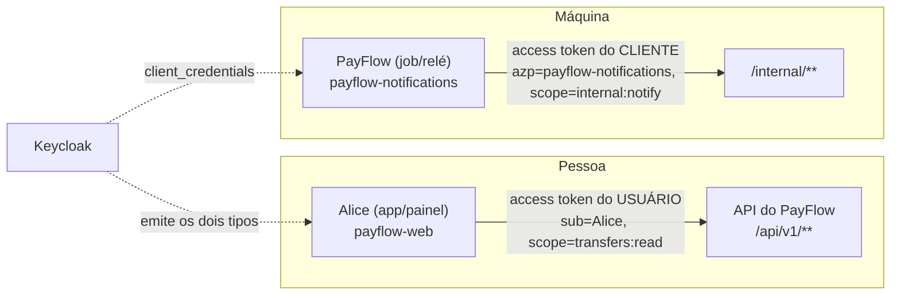

# P10.04 — Autenticação entre serviços

> ⏱️ ~1h30 · 🔵 Pleno · Pré-requisitos: P10.01 (fluxos e tokens), P10.02 (clientes confidenciais e escopos), P10.03 (Resource Server), P5.01–P5.05 (serviços, gateway e `/internal` nunca roteado), P9.02 (*task role*)

> ✅ **Validação final (2026-11-24):** módulo executado no PayFlow reconstruído; resultado e o que continua não executado no [README do módulo](README.md). Os avisos "não executado" / "por leitura" abaixo descrevem a escrita original.

> ⚠️ **Verificação:** o fluxo **Client Credentials** foi **executado de verdade**: o Keycloak 26.8.2 emitiu tokens de serviço, o **Spring Security 7.1.2** os pediu e os **reutilizou** como cliente (`RestClient` + `OAuth2ClientHttpRequestInterceptor`) e o **mesmo** laboratório os conferiu como servidor de recursos (`/internal/**`). **Limite honesto:** o laboratório é **uma aplicação só** que faz os **dois lados** (a "API de notificações" é um *endpoint* `/internal` dela própria); **não** há dois processos nem rede entre eles. **Não executado:** **mTLS**, **troca de token** (RFC 8693), autenticação do cliente por **JWT assinado** (`private_key_jwt`), rotação do segredo de cliente, autenticação nos *brokers* (Kafka/RabbitMQ) e o **PayFlow do aluno** (por leitura). Saídas em `lab/identity-lab/out-T04.txt` e `out-suite.txt`.

## 🎯 Objetivos
Ao final desta aula você consegue:
- **Escolher** entre rede confiável, chave de API, **token de cliente (OAuth)**, **mTLS** e **troca de token** para uma chamada entre serviços, **justificando** pelo que cada um prova.
- **Configurar** o Spring como **cliente** `client_credentials` (token obtido, **reutilizado** e renovado) e como **servidor** (escopo **e** cliente autorizado).
- **Explicar** por que **cada serviço tem o seu cliente** no Keycloak e por que **não** se reutiliza o token do usuário numa chamada de serviço.
- **Distinguir** uma chamada de **máquina** de uma de **usuário** olhando as *claims*.
- **Dizer** como o PayFlow se autentica **na AWS** (e por que **não** é com OAuth).

## 🤔 Por que isso importa
Depois da P5 o PayFlow **não é mais um processo só**: o monólito, o serviço de notificações e (um dia) o antifraude **se chamam**. O endereço `/internal/v1/**` é **nunca roteado** pelo gateway (decisão 127) — mas **estar numa rede privada não é identidade**: um contêiner comprometido, um *pod* vizinho ou uma VPN mal configurada **chegam** a esse endereço. A pergunta de segurança é **"quem está chamando?"**, e a resposta **não** pode ser "alguém dentro da rede".

No trabalho do pleno isso aparece como: "o job de relatórios usa o token de uma pessoa", "todos os serviços usam a **mesma** chave de API", "o parceiro tem acesso a **tudo**", "ninguém sabe qual serviço fez aquela chamada".

## 💡 Intuição (explicação simples)
Em um **prédio comercial**, o **funcionário** entra com o **crachá pessoal**; o **entregador do malote** entra com um **crachá de serviço**, que abre **só a sala de correspondência** e **tem o nome da empresa**. Se um dia o malote some, a portaria sabe **quem** passou. Usar o crachá **de um funcionário** para o malote é o erro clássico: quando ele pede demissão, **o malote para**; e a portaria acha que **uma pessoa** entrou na sala de correspondência às 3h da manhã.

## 🔬 Como funciona por dentro

### Cinco formas de um serviço provar quem é
| Forma | O que prova | Prós | Contras | No PayFlow |
|---|---|---|---|---|
| **Rede privada** ("está dentro da VPC") | **nada** sobre quem chama | zero código | **qualquer** coisa na rede chama; não há auditoria nem revogação | **insuficiente** (é só uma camada) |
| **Chave de API** compartilhada (cabeçalho) | quem **sabe a chave** | simples | **sem identidade por chamador**, sem expiração, sem escopo, **uma chave vazada = todos** | **não** |
| **Client Credentials** (token de cliente) | **qual cliente** (`azp`), com **quais permissões** (`scope`), **por quanto tempo** | padrão, revogável por cliente, **auditável**, expira | depende do Keycloak (cacheado: P10.03) e de um **segredo** do cliente | **adotado** |
| **mTLS** (certificado de cliente) | quem **tem a chave privada** do certificado, **na camada de transporte** | sem segredo trafegando; vale para qualquer protocolo | **emitir, distribuir e rotacionar certificados** (operação pesada; malha de serviço ajuda) | **S5** (apontado) |
| **Troca de token** (RFC 8693) | "este serviço age **em nome deste usuário**, com **menos** permissões" | preserva o **usuário** e **estreita** o escopo ao descer a cadeia | complexidade; o Keycloak anuncia o *grant* (medido na descoberta), **eu não o testei** | **só se um dia precisar** |

### Chamada **de máquina** × chamada **de usuário**

| | Token de **usuário** | Token de **cliente** (serviço) |
|---|---|---|
| Fluxo | Authorization Code + PKCE | **Client Credentials** |
| `sub` | a pessoa (`1111…`) | a **conta de serviço** do cliente |
| `azp` | `payflow-web` | `payflow-notifications` |
| `email`, `realm_access` | sim | **não** (medido) |
| *refresh token* | sim | **não**: a máquina pede outro |
| Escopo (exemplo) | `transfers:read` | `internal:notify` |

## 🛠️ Exemplo prático

### 1. O cliente do serviço no Keycloak (P10.02, executado)
Um cliente **confidencial** com *service account*, sem fluxo de navegador, com o escopo **opcional** `internal:notify`:
```
service claims={"iss":"http://127.0.0.1:8180/realms/payflow","aud":"payflow-api","sub":"f4ca3ca0-d53e-4410-ad9f-1317b7424f2c",
  "typ":"Bearer","azp":"payflow-notifications","scope":"internal:notify","clientHost":"172.17.0.1","clientAddress":"172.17.0.1","client_id":"payflow-notifications"}
service has refresh_token=false
reporting asks internal:notify -> 400 {"error":"invalid_scope","error_description":"Invalid scopes: internal:notify"}
wrong secret -> 401 {"error":"unauthorized_client","error_description":"Invalid client or Invalid client credentials"}
```
**Um cliente por serviço** (`payflow-notifications`, `payflow-reporting`): o `reporting` **não tem** o `internal:notify` e o Keycloak **recusa** que ele o peça. Se os dois dividissem **um** cliente, **comprometer o relatório** daria **acesso às notificações** — e o *log* não diria quem foi.

### 2. O Spring como **cliente** (`application.yml` + 3 beans)
```yaml
spring:
  security:
    oauth2:
      client:
        registration:
          notifications:
            provider: keycloak
            client-id: payflow-notifications
            client-secret: ${PAYFLOW_NOTIFICATIONS_CLIENT_SECRET}      # do cofre (P10.05), nunca do Git
            authorization-grant-type: client_credentials
            scope: internal:notify
        provider:
          keycloak:                    # endereço explícito (evita a consulta de descoberta na subida)
            token-uri: ${PAYFLOW_OIDC_ISSUER}/protocol/openid-connect/token
```
```java
@Configuration
public class ServiceClientConfig {
    @Bean OAuth2AuthorizedClientService authorizedClientService(ClientRegistrationRepository registrations) {
        return new InMemoryOAuth2AuthorizedClientService(registrations);
    }
    @Bean OAuth2AuthorizedClientManager serviceClientManager(ClientRegistrationRepository registrations, OAuth2AuthorizedClientService service) {
        var manager = new AuthorizedClientServiceOAuth2AuthorizedClientManager(registrations, service);   // funciona FORA de uma requisição web
        manager.setAuthorizedClientProvider(new ClientCredentialsOAuth2AuthorizedClientProvider());
        return manager;
    }
    @Bean OAuth2ClientHttpRequestInterceptor serviceTokenInterceptor(OAuth2AuthorizedClientManager manager) {
        var interceptor = new OAuth2ClientHttpRequestInterceptor(manager);
        // o "principal" do token de máquina é o próprio serviço, nunca o usuário logado na requisição de entrada
        interceptor.setPrincipalResolver(request -> new AnonymousAuthenticationToken(
                "payflow-service", "payflow-service", AuthorityUtils.createAuthorityList("ROLE_SERVICE")));
        return interceptor;
    }
}
```
```java
@Component
public class InternalApiClient {
    private final RestClient client;
    public InternalApiClient(RestClient.Builder builder, OAuth2ClientHttpRequestInterceptor interceptor) {
        this.client = builder.requestInterceptor(interceptor).build();
    }
    public ResponseEntity<Map<String, Object>> notifyTransfer(String baseUrl, String registrationId, Map<String, Object> event) {
        return client.post().uri(baseUrl + "/internal/notifications/transfers")
                .attributes(clientRegistrationId(registrationId))          // qual cliente OAuth usar nesta chamada
                .body(event).retrieve()
                .onStatus(status -> true, (request, response) -> { })      // quem chama decide o que fazer com 403/401
                .toEntity(new ParameterizedTypeReference<Map<String, Object>>() { });
    }
}
```
- **Por que o `AuthorizedClientServiceOAuth2AuthorizedClientManager`** e não o padrão baseado em requisição: o **relé do Outbox** e os *jobs* agendados (P3) **não têm requisição web**; o gerenciador "de serviço" **não depende** do contexto da requisição.
- **Por que o `principalResolver` fixo:** o padrão usa o **usuário autenticado no momento** como "principal"; numa requisição de **Alice** o token do serviço seria guardado **na entrada da Alice** — mistura de identidades. ⚠️ **Não** reproduzi o comportamento do padrão: é leitura da documentação do Spring ([cliente OAuth2](https://docs.spring.io/spring-security/reference/servlet/oauth2/client/index.html)); a correção acima é **o que eu usaria**.
- `RestClient.Builder` **precisa** de `spring-boot-starter-restclient` no Boot 4 (sem ele o contexto **não sobe**: medido — `UnsatisfiedDependencyException` ao criar o `InternalApiClient`, que pede esse *bean*).
- O **endereço do token** é explícito (`token-uri`): com `issuer-uri` no *provider* o Boot consulta o Keycloak **na subida** (⚠️ comportamento conhecido da configuração por *issuer*; **não medi** aqui), ao contrário do Resource Server, que é preguiçoso (P10.03, medido). Por isso o laboratório usa `token-uri`.

### 3. O resultado (executado: `ResourceServerKeycloakIT`)
```
first=202 ACCEPTED second=202 ACCEPTED same jti (token reused)=true
reporting client -> 403 FORBIDDEN WWW-Authenticate=Bearer error="insufficient_scope", error_description="The request requires higher privileges than provided by the access token.", error_uri="https://tools.ietf.org/html/rfc6750#section-3.1"
```
- Duas chamadas seguidas usaram **o mesmo token** (`jti` igual): **uma** ida ao Keycloak a cada ~5 minutos, **não uma por chamada**. Isso também dá **resiliência**: com o token em cache, a queda do Keycloak **não** para as chamadas até ele vencer (para a API, ver o `outage.sh` da P10.03; **para o cliente**, ⚠️ não medi a queda do *token endpoint* durante a renovação).
- O cliente `reporting` **obteve um token válido** — e a API **recusou** (`403 insufficient_scope`): **autenticado, sem permissão**.

### 4. O Spring como **servidor** do `/internal`: escopo **e** cliente
```java
@Bean @Order(1)
SecurityFilterChain internalChain(HttpSecurity http, JwtAuthenticationConverter converter, SecurityProperties props) throws Exception {
    String scope = "SCOPE_" + props.internal().requiredScope();          // internal:notify
    Set<String> allowed = props.internal().allowedClients();             // {payflow-notifications}
    http.securityMatcher("/internal/**")
        .authorizeHttpRequests(auth -> auth.anyRequest().access((authentication, context) ->
                new AuthorizationDecision(isAllowedService(authentication.get(), scope, allowed))))
        .sessionManagement(s -> s.sessionCreationPolicy(SessionCreationPolicy.STATELESS))
        .csrf(AbstractHttpConfigurer::disable)
        .oauth2ResourceServer(oauth -> oauth.jwt(jwt -> jwt.jwtAuthenticationConverter(converter))
            .authenticationEntryPoint(new BearerTokenAuthenticationEntryPoint())
            .accessDeniedHandler(new BearerTokenAccessDeniedHandler()));
    return http.build();
}

static boolean isAllowedService(Authentication authentication, String requiredAuthority, Set<String> allowedClients) {
    if (!(authentication.getPrincipal() instanceof Jwt jwt)) return false;
    boolean hasScope = authentication.getAuthorities().stream().anyMatch(a -> a.getAuthority().equals(requiredAuthority));
    boolean knownClient = allowedClients.contains(jwt.getClaimAsString("azp"));
    return hasScope && knownClient;
}
```
**Por que as duas conferências** (`scope` e `azp`), se o Keycloak já controla quem pode pedir o escopo? **Defesa em profundidade**: um erro de configuração no realm (alguém dá `internal:notify` a outro cliente) **não** abre o `/internal` — a API **também** só aceita os clientes **nomeados**. O **mutante M5** (tirar a lista de `azp`) **reprovou** o teste `internal_aKnownClientWithoutTheScope_is403_andAnUnknownClientWithTheScope_is403`: o cenário "cliente **desconhecido** com o **escopo certo**" é **barrado só pela lista**.

Os cinco testes (`ResourceServerTest`, sem Keycloak, todos verdes) cobrem: cliente certo com escopo → `202`; **outro serviço sem o escopo** → `403`; **cliente conhecido sem o escopo** → `403`; **cliente desconhecido com o escopo** → `403`; **token de usuário** → `403`; **sem token** → `401`.

### 5. E para a **AWS**? Outra identidade, outro mecanismo
O PayFlow chamar o **SNS/SQS/Secrets Manager** (P9) **não usa OAuth**: usa a **identidade da AWS** — a ***task role*** do ECS entrega credenciais **temporárias** ao SDK (P9.02). A tabela:

| Quem chama quem | Mecanismo | Onde está a política |
|---|---|---|
| **Pessoa → API do PayFlow** | OAuth2/OIDC (token de usuário) | escopo/papel/dono (P10.03) |
| **Serviço → serviço do PayFlow** | OAuth2 *client credentials* | escopo + `azp` (esta aula) |
| **PayFlow → serviço da AWS** | **IAM** (*task role*, credenciais temporárias) | política IAM (1 tópico, 2 filas: P9.02) |
| **Pipeline → AWS** | OIDC do GitHub → papel (J10.06) | política do papel |
| **Serviço → *broker* (Kafka/RabbitMQ)** | autenticação do *broker* (SASL/SCRAM, mTLS) — ⚠️ **não executado** | ACL do *broker* |

**Mensagens** (eventos do Outbox): **não carregam token do usuário** — carregam **ids** (decisão 104: o saldo nunca vai por mensageria); quem consome **se autentica no *broker*** e confere o que precisa **no banco**.

## 🏗️ Estudo de caso: o relatório que parou no domingo
**Situação.** Um *job* semanal de relatórios chamava a API com o **refresh token de uma pessoa do time** (criado "para destravar", no ano passado). A pessoa **mudou de empresa** e o RH desativou o usuário. No domingo o *job* passou a receber `invalid_grant` e **ninguém sabia por que** — o *log* só dizia `401`. Na sexta, o auditor perguntou **"quem chamou a API 4.000 vezes na madrugada de quinta?"** e a resposta era "**uma pessoa**, que não trabalha mais aqui".

**Diagnóstico.** O *job* tinha **identidade humana**; sem **identidade de serviço**, não há quem **revogar**, **auditar** ou **limitar**.

**Opções.** (A) manter o token pessoal e **trocar de dono** (a mesma bomba); (B) **chave de API** compartilhada (anonimato + vazamento total); (C) **cliente `client_credentials` por serviço**, com **escopo mínimo**; (D) **mTLS** (certificado por serviço).

**Decisão (ADR 0022).** **C** agora (**um cliente por serviço**; segredo no cofre; `azp` e escopo conferidos **no servidor**); **D** quando houver malha de serviço (S5). **Sem tokens pessoais em *jobs*, nunca.** **Consequência:** o *log* da API mostra `azp=payflow-reporting` e **a revogação é desabilitar um cliente**, sem afetar pessoas.

## ⚖️ Trade-offs e quando NÃO usar
- **`client_credentials` introduz um segredo** (`client_secret`) que **precisa ser guardado e rotacionado** (P10.05); **mTLS** ou **JWT assinado** (`private_key_jwt`, ⚠️ não testado) trocam esse segredo por **uma chave privada que nunca trafega**.
- **Escopo por cliente** dá granularidade, mas **mais configuração**: **dez serviços × cinco escopos** pedem **configuração como código** (P10.02).
- **Token de cliente de longa duração** seria mais simples **e** mais perigoso; o padrão de **5 minutos** com **renovação automática** equilibra.
- **Troca de token** vale quando o **usuário precisa ser preservado** na cadeia (auditoria "em nome de", escopo reduzido); **para uma chamada que é do serviço, não do usuário**, é **complexidade a mais**.
- **Quando NÃO usar OAuth entre serviços:** dentro de **um só processo** (módulos do monólito: chamada de método, sem rede); e para serviços **da própria AWS** (use IAM).

## ⚠️ Erros comuns e boas práticas de produção
- **Reusar o token do usuário** numa chamada de serviço (o "usuário" passa a ter permissões do serviço, ou o contrário) ou **repassar o token de entrada** sem **estreitar** o escopo (*confused deputy*).
- **Um único cliente para todos os serviços:** revogação e auditoria impossíveis.
- **`client_secret` no Git, no `compose.yaml` ou na imagem** (J8.07); aqui só existe como valor de laboratório marcado `lab-only`.
- **Autorizar só por `azp`** (sem escopo) ou **só por escopo** (sem lista): perde a defesa em profundidade.
- **Não definir `timeout`** na chamada de serviço e no pedido de token (P5.06): a dependência do Keycloak vira **latência** de tudo.
- **Esquecer que o `/internal` precisa de autenticação** "porque o gateway não o roteia": o **gateway é uma camada**, a identidade é **outra** (um *pod* vizinho chega lá).
- Mensagens reais: `{"error":"unauthorized_client","error_description":"Invalid client or Invalid client credentials"}` (segredo errado); `{"error":"invalid_scope","error_description":"Invalid scopes: internal:notify"}` (escopo que o cliente não tem).

## 🧩 Exercícios
1. **Fixação.** (a) Por que o `reporting` consegue um token e mesmo assim leva `403`? (b) Por que as **duas** conferências (`scope` e `azp`) no `/internal`? (c) Por que a *task role* da AWS **não** é um token OAuth?
2. **Aplicação no PayFlow.** Em `docs/service-auth.md`, escreva **a matriz de chamadas** do PayFlow (quem chama quem, por qual mecanismo, com qual escopo) e **crie** `payflow-antifraud` (P10.02). Critérios de pronto:
   - [ ] **um cliente por serviço**, cada um com **só** o escopo de que precisa;
   - [ ] o `/internal` exige **escopo e `azp`** (um teste para cada combinação: escopo certo/errado × cliente certo/errado);
   - [ ] o relé do Outbox usa o gerenciador **de serviço** (sem requisição web);
   - [ ] nenhum `client_secret` no repositório; a coluna "onde mora o segredo" da matriz aponta para o cofre (P10.05).
3. **Desafio.** **Meça** quantas vezes o Keycloak foi chamado para **1.000** chamadas de serviço em sequência (dica: conte `jti` distintos no `/internal`) e **explique** o que muda se você apontar o `principalResolver` padrão (usuário da requisição) em vez do fixo.

<details><summary>Soluções de referência</summary>

**1.** O token é **válido** (autenticado: `azp=payflow-reporting`), mas **não tem** `internal:notify` — a API distingue **quem é** (401) de **o que pode** (403). **(b)** O realm pode ser mal configurado; a API **nomeia** quem aceita: se o realm der o escopo a outro cliente, o `/internal` **continua fechado**. **(c)** Porque quem decide é o **IAM da AWS** (que **não** conhece o Keycloak): a *task role* dá **credenciais temporárias** assinadas pela AWS, conferidas **pela AWS**.

**3.** Esperado: **1** `jti` distinto (o token é reaproveitado até **perto** de expirar; depois **1** novo). Com o `principalResolver` padrão (a pessoa logada), o Spring guarda o token **por principal**: numa API com 1.000 usuários, **1.000 tokens de serviço** (um por usuário) — ⚠️ leitura da documentação, **não** medido.
</details>

## 🎤 Na entrevista
- **"Como um serviço se autentica em outro?"** — **Client Credentials** do OAuth 2.0: o serviço (cliente confidencial) troca `client_id` + `client_secret` por um **token curto** com **escopo mínimo**, e o outro serviço confere assinatura, `aud`, `scope` e **qual cliente** chamou (`azp`). Alternativas: **mTLS** (certificado, sem segredo trafegando) e, para preservar o usuário, **troca de token**.
- **"Por que não usar uma chave de API compartilhada?"** — **Sem identidade por chamador**, **sem expiração**, **sem escopo**, **um vazamento compromete tudo**, e **não dá para auditar nem revogar um só serviço**.
- **"O gateway já barra `/internal`. Preciso autenticar?"** — **Sim**: rede/gateway é **uma camada**; qualquer coisa **dentro** da rede chega lá. **Zero trust**: toda chamada se identifica.
- **"Como o serviço chama o SQS na AWS?"** — Com a **identidade do IAM** (a *task role*), **não** com OAuth: credenciais **temporárias**, política de **menor privilégio** (1 tópico, 2 filas), **nenhum segredo** no código.

## 📚 Para ir além
- 📄 [Spring Security — Cliente OAuth2](https://docs.spring.io/spring-security/reference/servlet/oauth2/client/index.html), [Authorized Clients](https://docs.spring.io/spring-security/reference/servlet/oauth2/client/authorized-clients.html) e [Authorization Grants](https://docs.spring.io/spring-security/reference/servlet/oauth2/client/authorization-grants.html): `OAuth2AuthorizedClientManager`, `client_credentials`, o gerenciador de serviço.
- 📄 [RFC 6749 §4.4 — Client Credentials Grant](https://www.rfc-editor.org/rfc/rfc6749) (seção 4.4 do documento).
- 📄 [RFC 8693 — OAuth 2.0 Token Exchange](https://www.rfc-editor.org/rfc/rfc8693) e a página [Keycloak — Token exchange](https://www.keycloak.org/securing-apps/token-exchange): o "em nome de" (⚠️ **não executado**).
- 📄 [OWASP — OAuth 2.0 Cheat Sheet](https://cheatsheetseries.owasp.org/cheatsheets/OAuth2_Cheat_Sheet.html): inclui o fluxo de credenciais do cliente.
- 📑 Livro (⚠️ de memória): *Building Microservices* (Sam Newman), capítulo sobre segurança; *Spring Security in Action* (Laurențiu Spilcă).
- 🎥 Nenhum vídeo verificado nesta aula.
- 💻 `lab/identity-lab/src/main/java/com/payflow/client/` e `.../security/SecurityConfig.java` (cadeia `/internal`).

## ✅ Checklist da aula
- [ ] Sei **por que** rede privada e chave de API compartilhada **não** são identidade de serviço.
- [ ] Configurei o Spring como **cliente** (`client_credentials`) com **gerenciador de serviço** e **principal fixo**.
- [ ] O servidor confere **escopo e `azp`**, cada um com **teste e mutante**.
- [ ] Cada serviço tem **o seu cliente**, com o **menor escopo**; nenhum *job* usa token pessoal.
- [ ] Sei por que o PayFlow chama a **AWS por IAM** e **não por OAuth**.
- [ ] Sei dizer o que **não** testei: mTLS, troca de token, rotação do segredo do cliente, *brokers*.
