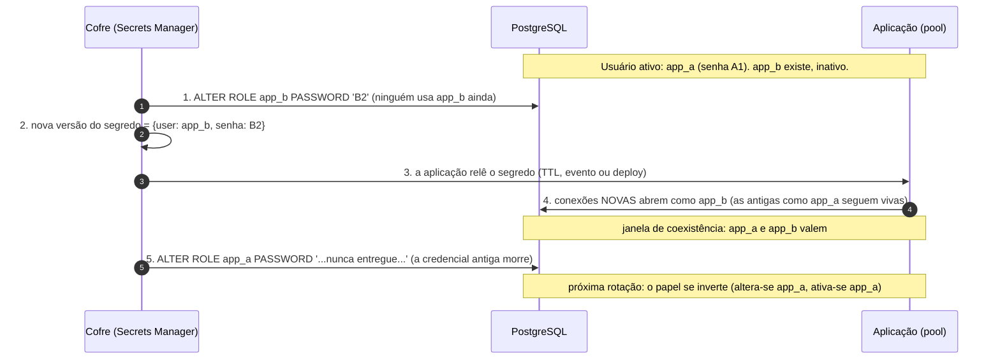

# P10.05 — Gestão e rotação de segredos

> ⏱️ ~1h30 · 🔵 Pleno · Pré-requisitos: P9.06 (Secrets Manager, injeção só na partida, `CachedSecret`, a dívida da conta mestra), P2.06 (pool HikariCP), J8.07 (segredos no Git), P10.04 (segredo do cliente OAuth), P8.07 (política em código)

> ⚠️ **Verificação:** a rotação de credenciais do banco foi **executada de verdade** contra um **PostgreSQL 18** em contêiner, com o **HikariCP** (versão do Spring Boot 4.1.2) e o **driver JDBC** do Boot: o experimento do **usuário único** (que quebra), os **dois usuários alternados** (que não quebram), a **ordem errada** (que quebra), o **menor privilégio** do papel da aplicação e o **verificador SCRAM**. As saídas são **as reais** (`lab/identity-lab/out-T07.txt`, `SecretRotationIT`, 5 testes). **Não executado:** o **Secrets Manager com Lambda de rotação**, o **ECS** relendo o segredo, o **RDS** (a rotação gerenciada da senha mestra), o **KMS** (chaves próprias; o Terraform abaixo é **leitura**), o **Keycloak** rotacionando o segredo de um cliente e o **PayFlow do aluno**. O experimento mostra **o mecanismo do banco e do pool** — **não** o comportamento da AWS.

## 🎯 Objetivos
Ao final desta aula você consegue:
- **Inventariar** os segredos do PayFlow (onde moram, quem lê, o que acontece se vazar) e **separar** segredo de configuração.
- **Explicar** por que **rotacionar** a senha de um usuário **único** derruba a aplicação **depois** da troca (e **medir** isso).
- **Executar** a rotação por **dois usuários alternados**, na **ordem certa**, com **zero consultas falhas**, e **explicar** a janela de coexistência.
- **Aplicar** menor privilégio ao banco: **conta da aplicação ≠ conta de migração ≠ conta mestra**.
- **Responder** a um segredo vazado (revogar primeiro) e **escolher** entre rotacionar, **encurtar a vida** e **eliminar** o segredo.

## 🤔 Por que isso importa
A P9.06 deixou **duas dívidas** documentadas: (1) a aplicação ainda usa **a conta mestra** do banco (a senha que o RDS rotaciona a cada 7 dias) e (2) a chave JWT entra **por variável de ambiente** no ECS (a exceção da decisão 169). A P10.03 **elimina** a segunda (não há mais segredo JWT: a API só tem chaves **públicas**). Esta aula **paga a primeira**.

O que um pleno enfrenta: "o auditor pediu rotação trimestral", "um desenvolvedor colou a senha no chat", "a rotação de domingo derrubou o checkout". A lição central é **contraintuitiva**: **o difícil de rotacionar um segredo não é gerar o novo** — é **trocar o que está em uso sem quebrar quem ainda tem o antigo** (um *pool* de conexões, uma tarefa que injetou o valor na partida, um cache).

## 💡 Intuição (explicação simples)
Trocar a **fechadura** de uma casa **com gente dentro**. Se você troca a fechadura e entrega as chaves novas **depois**, quem saiu para comprar pão **não consegue voltar**. O jeito certo: **instalar uma segunda fechadura** (outra porta, outra chave), **entregar as chaves novas**, esperar **todo mundo** usar a nova e **só então** lacrar a velha. Rotacionar é isso: **dois usuários alternados** são as duas fechaduras.

## 🔬 Como funciona por dentro

### O inventário dos segredos do PayFlow (depois da P10)
| Segredo | Onde mora | Quem lê | Se vazar | Rotação / destino |
|---|---|---|---|---|
| Senha do **usuário de aplicação** do banco | Secrets Manager | a tarefa da API | ler e **escrever** contas (não o DDL: menor privilégio) | **dois usuários alternados** (esta aula) |
| Senha da **conta de migração** (Flyway) | Secrets Manager | **só** a tarefa/job de migração | alterar o esquema | **rara e isolada** (só o pipeline de deploy a lê) |
| Senha **mestra** do RDS | gerenciada pelo RDS | **ninguém da aplicação** (P9.06) | controle total | o **RDS** rotaciona (P9.06); **a aplicação não a usa mais** |
| `client_secret` de cada cliente OAuth | Secrets Manager | o serviço dono | alguém **vira** aquele serviço (P10.04) | **por cliente**; trocar no Keycloak **e** no cofre |
| **Chaves de assinatura dos tokens** | **Keycloak** (privada) | só o Keycloak; a API tem a **pública** | forjar tokens | rotação **pelo Keycloak** + JWKS (P10.03: testado) |
| Administrador do Keycloak / senha do banco dele | cofre | quem opera | controle de **todas** as identidades | acesso mínimo, MFA, rotação |
| Chave de **assinatura de imagem** (P10.06) | cofre/KMS **ou nenhuma** (*keyless*) | o pipeline | publicar imagem "oficial" falsa | preferir **sem chave de longa vida** |
| ~~`PAYFLOW_SECURITY_JWT_SECRET`~~ | **deixa de existir** | — | — | **eliminado** (P10.03) |

### Segredo, configuração e o que **não precisa ser** segredo
- **Configuração** (URL do Keycloak, nome do realm, `audiences`, TTLs): **não é segredo** — vai no Parameter Store/Git.
- **Chave pública** (JWKS): **pública** por definição.
- **Segredo** é o que **dá poder** a quem o tem: senha, `client_secret`, chave privada.
- **O melhor segredo é o que não existe:** o JWT HS256 da J8 **sumiu** com o RS256; as credenciais da AWS **sumiram** com a *task role*; as do pipeline, com o OIDC (J10.06). **Eliminar > encurtar a vida > rotacionar.**

### Por que rotacionar é difícil: o consumidor guarda **cópias**
A senha do banco **só é conferida quando uma conexão nova abre** (o PostgreSQL confere no *handshake*). Um *pool* mantém conexões **abertas por minutos ou horas**; um contêiner ECS **leu o segredo na partida** (P9.06) e **não o relê**. Por isso, **trocar a senha no banco** não afeta ninguém **imediatamente** — e **quebra** quem precisar de **uma conexão nova** depois.


## 🛠️ Exemplo prático

### 1. O cenário-base (executado): papéis do banco
```sql
CREATE ROLE payflow_migrator LOGIN PASSWORD '…';      -- dono do esquema (Flyway)
CREATE ROLE payflow_app NOLOGIN;                       -- o GRUPO: as permissões moram aqui
CREATE ROLE app_a LOGIN PASSWORD '…' IN ROLE payflow_app;   -- os dois usuários que se alternam
CREATE ROLE app_b LOGIN PASSWORD '…' IN ROLE payflow_app;
-- menor privilégio: a aplicação lê e escreve contas, e só LÊ e INSERE lançamentos (regra 5: nunca alterados nem apagados)
GRANT SELECT, INSERT, UPDATE ON accounts TO payflow_app;
GRANT SELECT, INSERT ON ledger_entries TO payflow_app;
GRANT USAGE ON SEQUENCE ledger_entries_id_seq TO payflow_app;
```
As permissões estão no **grupo** (`payflow_app`, sem login); `app_a` e `app_b` **herdam**. Trocar de usuário **não** muda o que a aplicação pode fazer.

### 2. O jeito **ingênuo**: trocar a senha do único usuário (executado)
```
open connection after the change: single_app (still works)
first NEW connection with the old password failed after 1502 ms
```
Depois do `ALTER ROLE single_app PASSWORD 'single-v2'`: a conexão **aberta continua funcionando** (o banco não reconfere), e a **primeira conexão nova** com a senha velha **falha** — **depois** de `connectionTimeout` (1,5 s no laboratório; **30 s** no padrão do Hikari), porque o *pool* **tenta de novo** até estourar o prazo. Em produção isso acontece **horas depois** da rotação, quando o `max-lifetime` renova uma conexão — **e a causa já esfriou**. É a história da P9.06 (o RDS rotaciona a senha mestra e conexões novas das tarefas velhas falham), agora **medida no banco**.

### 3. O jeito **certo**: dois usuários alternados (executado)
```java
// 1) troca a senha do usuário INATIVO (B): ninguém o usa ainda
changePassword("app_b", "secret-B-v2");
// 2) o cofre aponta para B; a aplicação relê e o pool abre as conexões NOVAS como B
pool.getHikariConfigMXBean().setUsername("app_b");
pool.getHikariConfigMXBean().setPassword("secret-B-v2");
pool.getHikariPoolMXBean().softEvictConnections();     // o que o max-lifetime faria, mais cedo
// 3) fim da janela de coexistência: invalida a credencial ANTIGA (A)
changePassword("app_a", "secret-A-v2-never-handed-out");
```
```
after the switch, new connections run as: app_b
queries during the rotation: ok=194 failed=0
```
Com **uma carga de consultas rodando durante a rotação** (uma a cada ~5 ms), **194 consultas, 0 falhas**, e as **conexões novas passaram a ser do `app_b`**. E a **credencial antiga** (`app_a`/`secret-A-v1`, "vazada ontem") **não abre mais nada**: `password authentication failed`.

> 🔎 O `HikariConfigMXBean` aceita `setUsername`/`setPassword` **em tempo de execução** e vale **para as conexões novas** (as abertas seguem como estavam) — confirmado pelo teste. É por isso que **o pool não precisa ser recriado**.

### 4. A **ordem** importa: invalidar antes de trocar (executado)
O mesmo laço de carga, com os passos **invertidos** (`ALTER ROLE app_a` **antes** de apontar o pool para `app_b`):
```
WRONG order: ok=54 failed=1
```
Foi **1 falha em 55** — pouco, porque cada falha **espera** o `connectionTimeout` (1,5 s) e o laço é **sequencial**; mas **qualquer** falha é um cliente real com erro. **A contagem baixa não é consolo:** em produção, **dezenas de threads** esperam em paralelo. O teste existe **para provar que a medição enxerga falhas** (um teste que nunca falhou não prova nada: se a ordem certa mostra `failed=0` **e** a errada mostra `failed>0`, o `0` **significa** algo).

### 5. **Menor privilégio**: a conta da aplicação não faz DDL (executado)
```
as app_a: DROP TABLE accounts -> denied
as app_a: ALTER TABLE accounts ADD COLUMN x int -> denied
as app_a: CREATE TABLE evil (id int) -> denied
as app_a: DELETE FROM ledger_entries -> denied
as app_a: UPDATE ledger_entries SET amount = 0 -> denied
as app_a: TRUNCATE ledger_entries -> denied
```
**A regra 5 do PayFlow** ("lançamentos nunca são alterados nem apagados") **passa a ser imposta pelo banco**, não só pelo código: **mesmo uma aplicação comprometida** (injeção de SQL, J8.05) **não consegue** reescrever o livro-razão. A conta que roda as **migrações** é **outra** (`payflow_migrator`), usada **só pelo pipeline** (P9.02: migração acima de ~30 s vai para uma tarefa à parte). **Fecha a dívida da conta mestra:** a aplicação **não usa mais** o usuário mestre do RDS.

### 6. Como o banco guarda a senha (executado)
```
stored verifier starts with: SCRAM-SHA-256$
```
O PostgreSQL 18 guarda um **verificador SCRAM-SHA-256** (não a senha) e a **aplicação não consegue lê-lo** (`select rolpassword from pg_authid` → negado). Mesmo assim, **quem lê o disco do banco** vê o verificador: **o segredo do cofre continua sendo o que vale**.

### 7. A **janela de coexistência** (a conta que você faz)
A credencial velha só pode morrer **depois** que **todo mundo** passou a usar a nova:
```
janela ≥ (tempo até a aplicação reler o segredo) + (duração do deploy/rolling) + (max-lifetime do pool)
```
- **Quem relê:** o `CachedSecret` com TTL (P9.06) **ou** um `force-new-deployment` do ECS disparado pelo evento de rotação (a **injeção só vale na partida**, P9.06).
- **`max-lifetime` do pool** (decisão 98, abaixo de qualquer limite de proxy): uma conexão **velha** pode **continuar viva** até esse tempo — ela **segue funcionando** (o banco não reconfere), **mas** invalidar `app_a` **não a derruba**; só **novas** conexões falham. Se alguma tarefa **ainda não releu**, ela **quebra na próxima conexão nova**.
- **Procedimento de produção (por leitura, ⚠️ não executado):** (1) alterar a **senha do inativo**; (2) gravar a nova versão do segredo (`AWSCURRENT` → B); (3) disparar o *deploy* e **esperar `rolloutState = COMPLETED`**; (4) **esperar a janela**; (5) **invalidar** o antigo (`ALTER ROLE … PASSWORD` com um valor aleatório **nunca entregue**, ou `NOLOGIN`); (6) **verificar** que **nenhuma** conexão ativa usa o antigo (`SELECT usename, count(*) FROM pg_stat_activity GROUP BY 1`).

### 8. O Secrets Manager e a rotação gerenciada (leitura)
O Secrets Manager sabe **rotacionar sozinho** (uma função Lambda executa passos como `create`, `set`, `test` e `finish` — ⚠️ nomes de memória) e a documentação descreve **estratégias de rotação** (usuário único × **usuários alternados**) em [Rotação de segredos](https://docs.aws.amazon.com/secretsmanager/latest/userguide/rotating-secrets.html). ⚠️ **A página de estratégias é carregada por JavaScript e eu não consegui lê-la com `curl`:** o que digo sobre ela é **o que o experimento acima justifica** (usuários alternados evitam a falha do usuário único), **não** uma citação da AWS. **Nada disso foi executado:** o moto **não implementa** a rotação (P9.06).

### 9. KMS: chaves próprias (leitura, ⚠️ **não executado**) — uma dívida da P9
A P9 usou **chaves gerenciadas pela AWS** (SSE-SQS, o padrão). Uma **chave KMS gerenciada pelo cliente** dá **controle e auditoria** (quem usou a chave, quando) e permite **revogar** o acesso a dados cifrados **sem apagá-los**:
```hcl
resource "aws_kms_key" "payflow_secrets" {
  description             = "PayFlow: Secrets Manager e filas"
  enable_key_rotation     = true      # rotação automática do material da chave (⚠️ conferir o intervalo na documentação)
  deletion_window_in_days = 30        # janela para desfazer um agendamento de exclusão
  # policy: só a conta e os papéis que realmente precisam (execution role lê segredos; relé publica no SNS)
}
resource "aws_kms_alias" "payflow_secrets" { name = "alias/payflow-secrets"; target_key_id = aws_kms_key.payflow_secrets.key_id }
```
| Ganho | Custo / risco |
|---|---|
| **Auditoria** por chave; **revogação** de acesso; política por papel | **por chave e por requisição** (⚠️ conferir preços); a **política da chave** pode **trancar você para fora** |
| Rotação **automática** do material | a *execution role* e a *task role* **precisam** de `kms:Decrypt` (mais uma permissão por papel — e **mais um 403 para depurar**) |
| Exclusão com **janela** de segurança | excluir a chave = **dados irrecuperáveis** |
Documentação: [rotação de chaves do KMS](https://docs.aws.amazon.com/kms/latest/developerguide/rotate-keys.html) e o [recurso `aws_kms_key`](https://registry.terraform.io/providers/hashicorp/aws/latest/docs/resources/kms_key). **Decisão (ADR 0022):** **uma chave por domínio de dados** (segredos; filas) e **só onde a auditoria justifica o custo**; **ainda não aplicada**.

## 🏗️ Estudo de caso: a rotação de domingo que derrubou o checkout
**Situação.** Para cumprir a política trimestral, o time agenda a rotação da senha do usuário de aplicação (**um só**) para domingo, 3h, "baixa carga". A rotação roda **sem erro**. **Domingo, 9h40**: o *checkout* começa a retornar `500`. Os alertas: `HikariPool-1 - Connection is not available, request timed out after 30000ms`. Nada mudou no código desde sexta.

**Diagnóstico.** A rotação trocou a senha **no banco** às 3h; as tarefas **injetaram a senha antiga na partida** (P9.06) e as **conexões abertas continuaram funcionando**. Às 9h40 o **`max-lifetime`** renovou conexões e as **conexões novas falharam** com `FATAL: password authentication failed`; o *pool* esgotou. **A causa estava 6h40 atrás do sintoma** — e o experimento da seção 2 reproduz o mecanismo.

**Opções.** (A) **reiniciar tudo** a cada rotação (funciona, causa um *deploy* de emergência toda vez); (B) **dois usuários alternados** + *deploy* sincronizado com a rotação (esta aula); (C) **credenciais efêmeras** por conexão (o banco aceita um **token de vida curta** no lugar da senha: *IAM database authentication* no RDS — ⚠️ **não testado aqui**, o prazo é de memória e **o pool precisa renovar o token**); (D) **proxy de banco** que guarda as credenciais (RDS Proxy: decisão 171 adiou).

**Decisão (ADR 0022).** **B**: dois usuários alternados, **procedimento escrito** (seção 7) e **ensaiado em *staging***; **C** é a evolução se o orçamento de complexidade permitir. **Consequência:** a rotação passa a ser **um evento de *deploy*** (já era, desde a decisão 169), com **verificação** de que **ninguém** usa mais a credencial velha **antes** de invalidá-la.

## ⚖️ Trade-offs e quando NÃO usar
- **Rotacionar × encurtar a vida × eliminar:** rotação de credencial **estática** é **o mais fraco** dos três (a janela de exposição é de **meses**). **Credencial efêmera** (IAM, OIDC, tokens curtos) tem janela de **minutos**; **eliminar** o segredo não tem janela.
- **Dois usuários alternados:** **dobram** os papéis a gerenciar e as **permissões precisam ficar no grupo** (senão você corrige a permissão em um usuário e esquece o outro — o experimento usa um **grupo** por isso). Custo extra: **`pg_stat_activity` por usuário** nos *dashboards* (as consultas vêm de **dois** nomes).
- **Rotação automática pelo cofre** é ótima **se** a aplicação **relê** o segredo; se **não** relê, a rotação automática é **uma bomba-relógio** (o estudo de caso). Primeiro **prove** o consumidor; **depois** automatize.
- **Rotacionar com frequência demais** (diária) **sem** automação testada = **mais incidentes que vazamentos**.
- **KMS próprio** para tudo é **burocracia cara**; para **nada** é **ficar sem auditoria**. Ponha onde há **dado sensível** ou **exigência regulatória**.

## ⚠️ Erros comuns e boas práticas de produção
- **Trocar a senha do único usuário** (seção 2) — a falha **chega horas depois**, longe da causa.
- **Invalidar o antigo antes de a aplicação trocar** (seção 4).
- **Esquecer que a injeção do ECS só vale na partida** (P9.06): rotação sem *deploy* = quebra tardia.
- **Permissões em cada usuário** em vez de **no grupo**: um usuário "funciona" e o outro **não**, **só no dia da rotação**.
- **Segredo em log/`/actuator/env`/mensagem de erro** (J8.07, decisão 65); **`toString()` de configuração** que imprime a senha (o `record` imprime tudo: sobrescreva ou use um tipo próprio).
- **Segredo vazado:** **rotacione/revogue PRIMEIRO** (decisão 66), **depois** limpe o Git (`git filter-repo` não desfaz o vazamento: o segredo já foi lido). Procure **onde foi usado** (CloudTrail/logs do banco) e trate **como incidente**.
- **Segredo compartilhado entre ambientes** (o de *staging* abre a produção): **um conjunto por ambiente**.
- **Comparar senha com `equals`** em código de autenticação (tempo de resposta): use a comparação **de tempo constante** (já é o caso nos *encoders* do Spring).
- Mensagem real quando a credencial velha é usada: `FATAL: password authentication failed for user "app_a"` (`PSQLException`); e do *pool*: `HikariPool-1 - Connection is not available, request timed out after 1500ms`.

## 🧩 Exercícios
1. **Fixação.** (a) Por que a **conexão aberta continua funcionando** depois do `ALTER ROLE … PASSWORD`? (b) Por que as permissões ficam **no grupo** `payflow_app`? (c) Por que **eliminar** um segredo vence **rotacioná-lo**?
2. **Aplicação no PayFlow.** Escreva `docs/secrets.md` (atualize o da P9.06) e `scripts/ops/rotate-db-user.sh` (**roteiro**, ⚠️ para *staging*) com os 6 passos da seção 7. Critérios de pronto:
   - [ ] o **inventário** da seção "O inventário" está **completo**, com **quem lê** e **o que fazer se vazar**;
   - [ ] a **conta da aplicação** não tem DDL **nem** `UPDATE`/`DELETE`/`TRUNCATE` em `ledger_entries` (**um teste de integração** que **tenta e falha**, no estilo do `SecretRotationIT`);
   - [ ] um teste de **rotação com carga** (**0 falhas**) **e** o da **ordem errada** (**>0 falhas**);
   - [ ] a **janela de coexistência** está **calculada** com os valores reais do PayFlow (TTL do `CachedSecret`, duração do *deploy*, `max-lifetime`);
   - [ ] `PAYFLOW_SECURITY_JWT_SECRET` **removido** e a exceção da decisão 169 **riscada** em `docs/secrets.md`.
3. **Desafio.** Reproduza no laboratório o que o ECS faria: **sem** `setPassword` no MXBean, **recrie o `HikariDataSource`** com o segredo novo (um `RotatingDataSource` que troca o *pool* e **fecha o antigo** depois que as conexões em uso terminam). Quais **riscos** isso traz (transações em andamento, vazamento de conexões)?

<details><summary>Soluções de referência</summary>

**1.** O PostgreSQL só **autentica no *handshake***; uma conexão já estabelecida **não é reconferida** (só termina se alguém a encerrar ou a sessão cair). **(b)** Para que **ambos** os usuários tenham **exatamente** as mesmas permissões (herdadas), de modo que **trocar de usuário não mude o comportamento** da aplicação. **(c)** Um segredo que **não existe** não vaza, não precisa de cofre, de rotação nem de janela.

**3.** Riscos: **transações em andamento** no *pool* antigo (feche-o com *graceful*: deixe terminar); **dois pools** vivos ao mesmo tempo (**dobra** as conexões: a conta da P9.08, `tarefas × (maximum_percent/100) × pool ≤ max_connections`, **vale também aqui**); **vazamento** de conexões se o antigo nunca fecha. O MXBean evita tudo isso (as conexões **migram sozinhas**), **por isso o preferi**.
</details>

## 🎤 Na entrevista
- **"Como você rotaciona a senha do banco sem derrubar a aplicação?"** — **Dois usuários alternados**: altero a senha do **inativo**, faço a aplicação **passar a usá-lo** (*deploy* ou releitura), espero a **janela de coexistência** e **só então invalido o antigo**. Trocar a senha do **único** usuário quebra **as conexões novas**, **depois** da rotação (o banco só confere a senha no *handshake*).
- **"Um desenvolvedor commitou uma chave da AWS. O que você faz?"** — **Revogar/rotacionar primeiro** (a chave já foi lida), **depois** descobrir **o que ela fez** (CloudTrail), **depois** limpar o histórico do Git, e **só então** tratar a causa (pré-commit, *scanner*, **credenciais temporárias** em vez de chaves).
- **"Onde guardar segredos?"** — Num **cofre** (Secrets Manager/Vault), **nunca** no Git, na imagem ou em log; **um conjunto por ambiente**; **menor privilégio** de **leitura**; e **evitar** segredos de longa vida: **IAM/OIDC/tokens curtos**.
- **"O que é menor privilégio no banco?"** — A conta da aplicação só tem o **necessário** (`SELECT/INSERT/UPDATE` onde precisa), **sem DDL**; as **migrações** usam **outra** conta, e a **mestra** não é usada por ninguém no dia a dia. Medi que o `DELETE` no livro-razão é **negado** à aplicação.

## 📚 Para ir além
- 📄 [OWASP — Secrets Management Cheat Sheet](https://cheatsheetseries.owasp.org/cheatsheets/Secrets_Management_Cheat_Sheet.html): inventário, rotação, ciclo de vida.
- 📄 [PostgreSQL — `ALTER ROLE`](https://www.postgresql.org/docs/current/sql-alterrole.html), [Autenticação por senha (SCRAM)](https://www.postgresql.org/docs/current/auth-password.html) e [`GRANT`](https://www.postgresql.org/docs/current/sql-grant.html): o que o experimento usa.
- 📄 [HikariCP](https://github.com/brettwooldridge/HikariCP): `maxLifetime`, `connectionTimeout`, MXBeans.
- 📄 [AWS Secrets Manager — Rotação de segredos](https://docs.aws.amazon.com/secretsmanager/latest/userguide/rotating-secrets.html) e [estratégias de rotação](https://docs.aws.amazon.com/secretsmanager/latest/userguide/rotating-secrets_strategies.html) (⚠️ a segunda é carregada por JavaScript; não li o conteúdo).
- 📄 [AWS KMS — Rotação de chaves](https://docs.aws.amazon.com/kms/latest/developerguide/rotate-keys.html) e [`aws_kms_key` (Terraform)](https://registry.terraform.io/providers/hashicorp/aws/latest/docs/resources/kms_key).
- 📄 Equivalentes: [Azure Key Vault](https://learn.microsoft.com/en-us/azure/key-vault/general/overview) e [Google Secret Manager](https://cloud.google.com/secret-manager/docs).
- 🎥 Nenhum vídeo verificado nesta aula.
- 💻 `lab/identity-lab/src/test/java/com/payflow/secrets/SecretRotationIT.java` e `lab/secrets-lab/pg-up.sh`.

### Equivalência AWS ↔ Azure ↔ GCP (segredos e chaves)
| Papel | AWS | Azure | GCP |
|---|---|---|---|
| Cofre de segredos | Secrets Manager | Key Vault | Secret Manager |
| Chaves de criptografia gerenciadas | KMS | Key Vault (chaves) | Cloud KMS |
| Identidade da carga de trabalho (sem segredo) | *task role* / IAM | *managed identity* | *workload identity* / conta de serviço |

## ✅ Checklist da aula
- [ ] Tenho o **inventário** dos segredos e sei **separar** segredo de configuração.
- [ ] Sei **por que** a senha do usuário único quebra **depois** e **medi** isso.
- [ ] Rotacionei com **dois usuários alternados**, na **ordem certa**, com **carga** e **0 falhas**.
- [ ] A conta da aplicação **não** faz DDL nem altera o livro-razão (**testado** tentando).
- [ ] Sei **calcular a janela de coexistência** e **verificar** que o antigo não está em uso.
- [ ] Sei o que **não** foi executado: Secrets Manager/Lambda de rotação, ECS, RDS, KMS, rotação no Keycloak.
