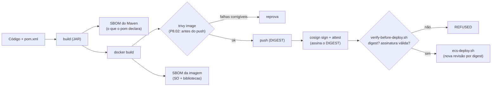

# P10.06 — Cadeia de suprimentos: SBOM e scan de imagens

> ⏱️ ~1h30 · 🔵 Pleno · Pré-requisitos: P8.02 (scan antes do *push*, digest, atestação de proveniência), J8.07 (dependências vulneráveis), J10.02 (pipeline seguro, ações por SHA, Dependabot), P9.02 (*deploy* por *digest*), P10.05 (chaves e segredos)

> ✅ **Validação final (2026-11-24):** módulo executado no PayFlow reconstruído; resultado e o que continua não executado no [README do módulo](README.md). Os avisos "não executado" / "por leitura" abaixo descrevem a escrita original.

> ⚠️ **Verificação:** **executados de verdade** (Docker 29.9.2, JDK 25.0.5): o **SBOM do Maven** (`cyclonedx-maven-plugin` 2.9.1, CycloneDX 1.6), o **Trivy 0.76.2** (banco de vulnerabilidades de **2026-11-14 13:05 UTC**) sobre esse SBOM, sobre um SBOM **com uma falha plantada** e sobre uma **imagem**, o **SBOM da imagem** (Trivy, CycloneDX 1.7), a **assinatura e a verificação com o cosign v3.1.4** num **registro local** (`registry:2`), a **atestação do SBOM** e um **portão de *deploy*** (`verify-before-deploy.sh`). As saídas são **as reais** (`lab/supply-chain-lab/out-*.txt`). **Não executado:** **assinatura sem chave** (*keyless*: Fulcio/Rekor, que exige internet e uma identidade OIDC), **verificação na AWS** (ECR, AWS Signer, ECS), **o GitHub Actions** (`actions/attest`, `dependency-review`), **SLSA** além da proveniência da P8.02, VEX e o **PayFlow do aluno**. A imagem do laboratório é o **JAR do `identity-lab`** sobre `eclipse-temurin:25-jre` — **não** a imagem do PayFlow.

## 🎯 Objetivos
Ao final desta aula você consegue:
- **Gerar** um **SBOM** pelo Maven e pela **imagem**, **consultá-lo com `jq`** ("estamos usando a biblioteca X?") e **dizer o que cada um enxerga**.
- **Provar** que o seu *scan* **enxerga** uma falha (plantando uma) e **interpretar** o resultado de um *scan* limpo.
- **Assinar** uma imagem **pelo digest**, **verificar** a assinatura e **explicar** o que acontece quando alguém troca o conteúdo de uma **tag**.
- **Escrever um portão** de *deploy* que só aceita imagem **assinada** e referenciada **por digest**.
- **Dizer** o que SBOM, assinatura e atestação **provam** — e o que **não** provam.

## 🤔 Por que isso importa
O PayFlow é **menos código seu do que parece**: o JAR do laboratório traz **64 bibliotecas**, a imagem, **177 componentes** (sistema operacional incluso). Cada um é **código de terceiros que roda com as permissões da sua aplicação**. Os grandes incidentes dos últimos anos **não** foram falhas no código das vítimas: foram **uma biblioteca vulnerável** (o **Log4Shell**, CVE-2021-44228, que a aula usa como **falha plantada**), **um mantenedor comprometido** (a **backdoor do xz-utils**, CVE-2024-3094), **uma ação de CI adulterada**, **uma tag que passou a apontar para outra imagem**.

A **cadeia de suprimentos** é tudo entre o **código-fonte** e o **processo em execução**: dependências, ferramentas de *build*, o CI, a imagem-base, o registro, o *deploy*. Um pleno é cobrado por quatro perguntas, e cada uma tem **uma ferramenta**:

| Pergunta | Ferramenta | Nesta aula |
|---|---|---|
| **O que tem dentro?** | **SBOM** (inventário) | Maven e imagem |
| **Tem alguma falha conhecida?** | ***Scan*** de vulnerabilidades | Trivy |
| **Quem fez e alguém mexeu?** | **Assinatura** e **atestação** | cosign |
| **O que está rodando é o que verifiquei?** | **Portão no *deploy*** (por digest + assinatura) | `verify-before-deploy.sh` |

## 💡 Intuição (explicação simples)
Um **medicamento**: a **bula** lista **cada componente** (o SBOM); a **análise do lote** diz se **algum componente** tem problema conhecido (o *scan*); o **lacre com o selo do laboratório** mostra **quem fabricou** e que **ninguém abriu** (a assinatura); e a **farmácia confere o lacre antes de entregar** (o portão). Um lacre **sem ninguém conferir** é decoração: o valor está em **recusar** o que não tem selo.

## 🔬 Como funciona por dentro

### Onde cada coisa se encaixa (P8.02 + P10.06)


### O que um **digest** e uma **assinatura** garantem
- Um **digest** (`sha256:…`) **é o hash do conteúdo**: identifica **exatamente** aquelas camadas. Uma **tag** é um **ponteiro mutável**: quem tem permissão de `push` a muda **sem aviso** (medimos abaixo).
- Uma **assinatura** liga **uma chave (ou identidade)** a **um digest**: "**quem tem esta chave** afirma que **este conteúdo** é legítimo". Ela **não** diz que a imagem é **segura**; diz **quem** a aprovou e que **não mudou desde então**.
- Uma **atestação** é uma **afirmação assinada sobre** um digest (por exemplo, "**este SBOM** descreve **esta imagem**" ou "**este *build* veio deste *commit***").

### SBOM do Maven × SBOM da imagem: enxergam coisas diferentes
| | SBOM do **Maven** | SBOM da **imagem** (Trivy) |
|---|---|---|
| Formato | CycloneDX **1.6** (JSON) | CycloneDX **1.7** (JSON) |
| Componentes (medido) | **64** bibliotecas Java (`scope: required`) | **177** = 175 *libraries* + o sistema operacional + a aplicação |
| Enxerga | o que o `pom.xml` **resolveu** | **tudo na imagem**: pacotes do SO (`libssl3t64 3.5.5-1ubuntu3.7`), **as bibliotecas dentro do JAR** (`nimbus-jose-jwt 10.9.1`) e binários |
| Não enxerga | o SO, a JVM, o que for copiado à mão | o que está **ofuscado/empacotado** de forma que o scanner não abre |

## 🛠️ Exemplo prático

### 1. O SBOM do Maven (executado)
```bash
mvn org.cyclonedx:cyclonedx-maven-plugin:2.9.1:makeAggregateBom     # grava target/sbom.json (outputName=sbom, json, 1.6)
```
```
CycloneDX 1.6: 64 components, 65 dependency entries

$ "estamos usando a nimbus-jose-jwt? em qual versão?" (sem reescanear nada)
com.nimbusds:nimbus-jose-jwt:10.9.1  pkg:maven/com.nimbusds/nimbus-jose-jwt@10.9.1?type=jar
```
```bash
jq -r '.components[] | select(.name=="nimbus-jose-jwt") | "\(.group):\(.name):\(.version)  \(.purl)"' target/sbom.json
```
O **`purl`** (*package URL*) é o **identificador universal** do componente: é por ele que os *scanners* casam o pacote com o banco de vulnerabilidades. A pergunta **"estamos afetados pelo CVE de hoje?"** vira uma **consulta no inventário guardado**, **sem reconstruir** nem reescanear — e **funciona para versões antigas** se você **arquivar o SBOM de cada release**.

### 2. O *scan* limpo... e a prova de que ele **enxerga** (executado)
```
$ trivy sbom sbom.json --severity HIGH,CRITICAL
Report Summary
│ Java   │ jar  │ 0 │
```
**Zero** achados de severidade alta ou crítica. **O que esse `0` significa:** "no banco de **2026-11-14 13:05 UTC**, **nenhuma** dessas 64 bibliotecas tem falha **conhecida** de severidade alta/crítica". **Não** significa "sem falhas": significa "**sem falhas publicadas hoje**".

Um `0` só vale se o *scanner* **consegue** dar `> 0`. **A prova:** acrescentei ao SBOM (por um *script* de 6 linhas) um componente **sabidamente vulnerável**, `log4j-core 2.14.1`:
```
$ trivy sbom sbom-planted.json --severity CRITICAL
Java (jar)
Total: 2 (CRITICAL: 2)
│ org.apache.logging.log4j:log4j-core │ CVE-2021-44228 │ CRITICAL │ fixed │ 2.14.1 │ 2.15.0, 2.3.1, 2.12.2 │ log4j-core: Remote code execution in Log4j 2.x when logs contain an attacker-controlled... │
│                                     │ CVE-2021-45046 │          │       │        │ 2.16.0, 2.12.2, 2.3.1 │ log4j-core: DoS in log4j 2.x with thread context message pattern and context...           │
exit=1
```
**2 críticos e `exit=1`**: o *gate* **reprovaria o pipeline**. Agora o `0` **significa** alguma coisa.

> 🔎 **Ruído medido:** o Trivy imprimiu **256 linhas** `WARN Unsupported hash algorithm` (SHA3-256, SHA3-512, SHA-384, SHA3-384) para o SBOM do plugin: **o plugin grava *hashes* que o Trivy ignora**. É **inofensivo** (o casamento é pelo `purl`), mas **filtre no CI** para que um aviso **novo** não se esconda no meio.

### 3. O SBOM e o *scan* da **imagem** (executado)
```
$ trivy image --input image.tar --severity HIGH,CRITICAL --ignore-unfixed
│ /work/image.tar (ubuntu 26.04) │ ubuntu │ 2 │
│ app/app.jar                    │ jar    │ 0 │
│ usr/bin/pebble                 │ gobinary │ 0 │

CycloneDX 1.7: 177 components in total
by type: application: 1 · library: 175 · operating-system: 1
$ "o libssl da imagem?"   →  libssl3t64 3.5.5-1ubuntu3.7
$ "a nimbus-jose-jwt dentro da imagem?"  →  nimbus-jose-jwt 10.9.1
```
- A **aplicação** (o JAR) está **limpa** (0); o **sistema operacional da base** (`eclipse-temurin:25-jre`, Ubuntu 26.04) tem **2 achados de severidade alta/crítica **com correção disponível**. ⚠️ **Não investiguei quais** (a imagem foi removida ao fim do *script*). **Pelas regras da P8.02** (`--ignore-unfixed` + `--exit-code 1`) **este *build* seria reprovado**: a ação é **atualizar a base** (`docker pull` da base e *rebuild*) ou, se for um falso positivo, uma **exceção com motivo e validade** (P8.02). **O ponto da aula:** a falha estava **no SO da imagem, que o SBOM do Maven nem lista**.
- O Trivy achou a `nimbus-jose-jwt` **dentro do JAR** (`app/app.jar`): o SBOM da imagem **abre** os JARs.

### 4. Assinar e verificar por **digest** (executado, cosign v3.1.4, registro local)
```bash
docker run -d --name lab-p10-registry -p 127.0.0.1:5001:5000 registry:2
docker tag lab-p10-identity:1 127.0.0.1:5001/payflow/identity-lab:1 && docker push 127.0.0.1:5001/payflow/identity-lab:1
cosign generate-key-pair                                    # cosign.key (privada, protegida por senha) e cosign.pub
cosign sign   --key cosign.key --use-signing-config=false --tlog-upload=false --yes  <repo>@sha256:683475d8…
cosign verify --key cosign.pub --insecure-ignore-tlog=true  <repo>@sha256:683475d8…
```
```
$ cosign verify --key cosign.pub <repo>@<digest>
Verification for 127.0.0.1:5001/payflow/identity-lab@sha256:683475d8…
  - The cosign claims were validated
  - The signatures were verified against the specified public key
exit=0
```
> ⚠️ **Isto é a versão "de laboratório" e é mais fraca que a de produção:** sem **registro de transparência** (`--tlog-upload=false` / `--insecure-ignore-tlog=true`), **chave local** em arquivo e **registro sem TLS** (loopback). Em produção: **registro de verdade com TLS** e **a chave num cofre/KMS** **ou** assinatura **sem chave** (abaixo).

> 🔎 **Três surpresas do cosign 3.x (medidas):**
> 1. **O `--tlog-upload=false` sozinho não funciona**: `Error: --tlog-upload=false is not supported with --signing-config or --use-signing-config`. É preciso **também** `--use-signing-config=false` (e ambas as *flags* aparecem como **obsoletas**: "um sinalizador *offline* será acrescentado no futuro"). **Scripts escritos para o cosign 2 quebram.**
> 2. **A mensagem de erro engana:** verificar com **outra** chave devolve `Error: no matching attestations: failed to verify signature: could not verify envelope: accepted signatures do not match threshold, Found: 0, Expected 1` — fala em **"attestations"** num comando `verify` de **assinatura**. O erro **é** "chave errada", só que **a redação não diz**.
> 3. **O contêiner do cosign roda como usuário sem privilégios** (`Error: open cosign.key: permission denied` ao gravar a chave num diretório do **meu** usuário): `--user "$(id -u):$(id -g)"`.
> 4. **A saída de uma verificação bem-sucedida diz** `Existence of the claims in the transparency log was verified offline` **mesmo com** `--insecure-ignore-tlog=true` **e sem nenhum registro de transparência**. **Não conclua** dessa linha que há registro: ela é **genérica**. (Por isso o trecho acima a omite.)

### 5. A tag trocada (executado): por que **verificar por digest**
```
tag :1 agora aponta para sha256:0e709d06…        # alguém reenviou OUTRA imagem para a MESMA tag
$ cosign verify --key cosign.pub <repo>:1        # verificando PELA TAG
Error: no signatures found
$ cosign verify --key cosign.pub <repo>@<digest ORIGINAL>
Verification for 127.0.0.1:5001/payflow/identity-lab@sha256:683475d8…     # continua válida para o conteúdo original
```
A **assinatura continua válida** para o **conteúdo original** e **não** vale para a imagem trocada: **o ataque foi detectado** porque a verificação é **pelo digest**. **Quem implantasse `:1` sem verificar** teria rodado a imagem **maliciosa** (era um `FROM alpine:3.17` com `RUN echo malicious`). Isso **fecha** o raciocínio da P8.02/P9.02 ("o que vai para o *deploy* é o digest"): **o digest + a assinatura** é o que **dá sentido** à regra.

### 6. O portão do *deploy* (executado): `verify-before-deploy.sh`
```bash
[[ "$IMAGE" == *@sha256:* ]] || { echo "REFUSED: '$IMAGE' is not a digest reference (tags are mutable)"; exit 2; }
if $COSIGN_RUN verify --key "/keys/$(basename "$PUBKEY")" --insecure-ignore-tlog=true "$IMAGE" >/dev/null 2>&1; then
  echo "OK: signature valid for ${IMAGE#*@}"
else
  echo "REFUSED: no valid signature for ${IMAGE#*@}"; exit 1
fi
```
```
$ verify-before-deploy.sh <repo>:1                                   # por tag
REFUSED: '127.0.0.1:5001/payflow/identity-lab:1' is not a digest reference (tags are mutable)     exit=2
$ verify-before-deploy.sh <repo>@<digest ORIGINAL, assinado>
OK: signature valid for sha256:683475d8…                                                          exit=0
$ verify-before-deploy.sh <repo>@<digest da imagem trocada, sem assinatura>
REFUSED: no valid signature for sha256:0e709d06…                                                  exit=1
```
**Três códigos de saída, três motivos**: `0` segue, `1` assinatura inválida, `2` **referência por tag** (recusada **antes** de gastar a verificação). É o que o `ecs-deploy.sh` da P9.02 chamaria **antes** de `register-task-definition` (**por leitura**, ⚠️ **não executado na AWS**).

### 7. A atestação do SBOM (executado)
```
$ cosign attest --predicate sbom.json --type cyclonedx <digest>      # o SBOM como afirmação assinada, presa ao digest
$ cosign verify-attestation --type cyclonedx --key cosign.pub <digest>
  - The signatures were verified against the specified public key
predicateType=https://cyclonedx.org/bom subject.digest=683475d8fad74e58… components=64
```
O SBOM **deixa de ser um arquivo solto** (que alguém pode trocar) e vira **uma afirmação assinada sobre aquele digest**: **o digest** `683475d8…` **tem** estes **64** componentes, **segundo quem assinou**. ⚠️ Note: o SBOM anexado foi o **do Maven** (64), **não** o da imagem (177). Em produção, **anexe o da imagem**.

### 8. **Builds reprodutíveis**: por que o digest mudou a cada execução (executado)
O digest da imagem mudou **a cada execução** do laboratório (`28e2dd56…`, `3cd73477…`, `5c4143ee…`, `683475d8…` — quatro corridas, quatro valores). A causa **mais comum** é o **JAR**:
```
sem project.build.outputTimestamp:      build 1: 2eabbd79f2660ecb   build 2: 18ff24936347ce6b     (diferentes)
com project.build.outputTimestamp:      build 1: d5f66fccc2ee397f   build 2: d5f66fccc2ee397f     (idênticos)
```
Com `<project.build.outputTimestamp>2026-11-14T00:00:00Z</project.build.outputTimestamp>` no `pom.xml`, **dois *builds* produzem o mesmo JAR** (mesma máquina e mesmo JDK). ⚠️ **Isto é só o JAR**: **não** testei a **imagem** (as camadas do `docker build` também carregam *timestamps*) **nem** outra máquina. **Por que importa:** com *build* reprodutível, **qualquer pessoa** reconstrói o código-fonte e **confere** que o artefato publicado é o **mesmo** — é o que a **proveniência** (SLSA) quer provar. **Sem** isso, a regra segura é a da P8.02: **escaneie e assine o artefato que você vai implantar, e implante o digest**.

### 9. Assinatura **sem chave** (*keyless*) — leitura, ⚠️ **não executado**
Chaves de assinatura são **segredos de longa vida** (P10.05: o pior tipo). O **Sigstore** propõe **assinar com a identidade do *workflow***: o GitHub Actions apresenta um **token OIDC**, a autoridade **Fulcio** emite um **certificado de vida curta** ligado àquela identidade (repositório, *workflow*, *commit*), a assinatura vai para o registro de transparência **Rekor**, e o **verificador** exige **"assinado pelo *workflow* X do repositório Y"** (não "por esta chave"). **Você não guarda chave nenhuma.** Documentação: [Sigstore](https://docs.sigstore.dev/) e [Cosign](https://docs.sigstore.dev/cosign/signing/overview/). **Custos:** depende de **serviços públicos** (ou de uma instalação própria do Sigstore) e a **política de verificação** (quais identidades aceitar) **precisa ser escrita e mantida**.

## 🏗️ Estudo de caso: a tag que passou a apontar para outra imagem
**Situação.** O *deploy* do PayFlow usa `payflow:1.8.3` (uma **tag de versão**, "imutável por convenção"). Uma credencial de CI vaza (a mesma classe do estudo da P10.05). Alguém com ela **reenvia** uma imagem para `1.8.3`; o próximo *deploy* **puxa a imagem do atacante**. O *scan* passou (era a imagem **original**, na hora do *build*), os testes passaram, **o log de *deploy* mostra "1.8.3"**.

**Diagnóstico.** A **tag** é um ponteiro; **nada** no pipeline ligava "o que foi escaneado" a "o que foi implantado". (A tag imutável do ECR da P8.05 **ajuda**: reenviar a mesma tag **falha** — **se** estiver ligada e **se** a credencial comprometida não puder desligá-la.)

**Opções.** (A) **depender da tag imutável** do registro; (B) **implantar por digest** (P9.02); (C) **B + assinatura verificada no portão** (esta aula); (D) C + **admissão no cluster** (Kubernetes: Kyverno/policy-controller — **EKS não adotado**, decisão 166).

**Decisão (ADR 0022).** **C**: o pipeline **assina o digest depois do *scan*** e o **`ecs-deploy.sh` verifica** antes de registrar a nova revisão; **só o papel do pipeline** pode implantar (P8.07), então **o portão não tem desvio**. **Consequência:** quem **comprometer o registro** consegue **trocar a tag**, **não consegue** fazer o PayFlow **rodar** a troca. **O que sobra:** quem **roubar a chave de assinatura** assina o que quiser — por isso a chave **não** deve ser um arquivo (cofre/KMS ou *keyless*).

## ⚖️ Trade-offs e quando NÃO usar
- **SBOM:** valor **só se alguém o consulta** (resposta rápida a "estamos afetados?", auditoria, licenças). **Gerar e nunca olhar é cerimônia.** Arquive **um por release**.
- ***Scan* de vulnerabilidades:** gera **ruído** (falsos positivos, achados **sem caminho de chamada**, severidades de banco genérico). **O *gate* precisa de política** (`--ignore-unfixed`, severidade, exceções **com validade**) **ou vira "ignore tudo"**.
- **Assinar sem verificar não protege nada.** O **portão** é a parte que importa; a assinatura é só o **insumo**.
- **Chave vs *keyless*:** a chave em arquivo é **simples e offline**, mas é **segredo de longa vida**; *keyless* **elimina o segredo** e **cria uma dependência de serviço** (e de política).
- **Quando NÃO vale o esforço completo:** um **protótipo** ou **ferramenta interna sem dado sensível**: **SBOM + *scan* no CI** já dão a maior parte do valor; **assinatura + portão** entram quando **alguém externo ou um incidente** justifica (dinheiro, dado pessoal, exigência regulatória).
- **SBOM não prova ausência de falhas**, e **uma assinatura não prova que o código é bom**: prova **quem** e **que não mudou**.

## ⚠️ Erros comuns e boas práticas de produção
- **Implantar por tag** (`latest`, `1.8.3`): o portão do laboratório **recusa** (`exit=2`).
- **Escanear uma imagem e implantar outra** (um segundo `docker build` com o mesmo `Dockerfile`: **digest diferente**, medido).
- **Escanear só as dependências Java** e esquecer **o SO da imagem** (o achado da seção 3 estava **lá**).
- **Fixar o Trivy/cosign por `latest`**: **a ferramenta de segurança é parte da cadeia** (P8.02: fixe por **digest**). **O laboratório usa `ghcr.io/sigstore/cosign/cosign:latest` e o Trivy por digest**: o cosign deveria estar fixado também (⚠️ **débito** do laboratório; o *script* usa `latest`, e a CLI **mudou** entre a 2 e a 3).
- **Chave de assinatura no repositório**, na imagem ou no *runner* sem proteção.
- **Verificar com `--insecure-ignore-tlog`** em produção: no laboratório foi **necessário** (sem registro de transparência); **em produção** você **quer** o registro.
- **Ignorar o `exit` do *scanner*** (`|| true`) "só por enquanto".
- **Dependência fantasma:** um pacote que **você** não declarou mas que entrou transitivamente (`mvn dependency:tree`); o **SBOM mostra**.
- **Confiança em *typosquatting*:** conferir o **`groupId`** de bibliotecas novas (`org.apache.logging.log4j`, não `org.apache.logging.log4j2`); ⚠️ **não** testei *dependency confusion* (um repositório interno **com prioridade** sobre o público é a defesa habitual).

## 🧩 Exercícios
1. **Fixação.** (a) O que **um SBOM prova** e o que **não prova**? (b) Por que a assinatura é **sobre o digest** e não sobre a tag? (c) Que `0` do *scan* você **aceitaria** e qual **não**?
2. **Aplicação no PayFlow.** Acrescente ao `release.yml` (P8.02) **por leitura**: (1) geração do SBOM **da imagem** e **arquivamento por release**; (2) `cosign sign` **do digest** depois do *scan*; (3) `cosign attest` do SBOM; (4) no `ecs-deploy.sh`, a chamada ao `verify-before-deploy.sh` **antes** de `register-task-definition`. Escreva `docs/supply-chain.md`. Critérios de pronto:
   - [ ] o *gate* **reprova** um SBOM com uma falha plantada (**teste de que o *scanner* enxerga**, como na seção 2);
   - [ ] o portão **recusa tag**, **recusa digest sem assinatura** e **aceita digest assinado** (**três casos**);
   - [ ] o **digest implantado** é **igual** ao **escaneado e assinado** (um *script* compara);
   - [ ] `project.build.outputTimestamp` está no `pom.xml` e **dois builds** dão o mesmo JAR;
   - [ ] a **chave de assinatura não está no repositório**; está dito **onde mora** (cofre/KMS) ou que se adota *keyless*.
3. **Desafio.** Escreva uma consulta `jq` que, dado um **diretório com os SBOMs de todas as releases**, liste **em quais releases** a biblioteca `log4j-core` na versão `2.14.1` **esteve presente**. Depois pense: **o que mudaria** se o SBOM fosse **assinado** (atestação)?

<details><summary>Soluções de referência</summary>

**1.** (a) **Prova** (com a confiança de quem o gerou) **o que está dentro**; **não prova** que o conteúdo é **seguro**, nem que **corresponde** à imagem em execução (a menos que seja **atestado** para aquele digest). (b) A **tag muda**, o **digest** é o hash do conteúdo: assinar a tag **não amarra** nada ao que será puxado. (c) Aceito o `0` de um *scanner* **que provei capaz de dar `> 0`** e com **banco atualizado** (a **data** do banco **registrada**); **não** aceito o `0` de um *scanner* **nunca testado** ou com banco de meses atrás.

**3.** `for f in sboms/*.json; do jq -e '.components[] | select(.name=="log4j-core" and .version=="2.14.1")' "$f" >/dev/null && echo "$f"; done`. Com **atestação**, o SBOM de cada release fica **preso ao digest** e **assinado**: dá para **confiar** que "esta release tinha esta lista" e **não** que alguém editou o arquivo **depois**.
</details>

## 🎤 Na entrevista
- **"O que é um SBOM e para que serve?"** — Um **inventário legível por máquina** (CycloneDX/SPDX) dos componentes de um artefato, com versão e `purl`. Serve para **responder "estamos afetados?"** sem reescanear, **auditoria** e **licenças**. **Não** prova que o artefato é seguro.
- **"Por que implantar por digest?"** — A **tag é mutável**; o **digest é o hash do conteúdo**. É o que **liga** "o que escaneei e assinei" a "o que roda". Medi uma tag sendo **trocada**: a **assinatura do original continuou válida** e a imagem trocada **não tinha nenhuma**.
- **"Como garantir que só imagens aprovadas rodam?"** — **Assinar** o digest depois do *scan* e **verificar a assinatura num portão** que o *deploy* **não consegue contornar** (só o papel do pipeline implanta). Em Kubernetes, **admissão** (Kyverno, etc.); em ECS, **o portão fica no pipeline/*script*** (⚠️ não verifiquei se o ECS tem verificação nativa).
- **"Assinatura com chave ou sem chave?"** — Chave: simples, **mas é um segredo de longa vida**. *Keyless* (Sigstore): identidade **OIDC** do *workflow* + certificado de vida curta + registro de transparência: **sem chave para vazar**, **com dependência** de serviço e de **política de verificação**.

## 📚 Para ir além
- 📄 [CycloneDX](https://cyclonedx.org/) (o formato usado) e [SPDX](https://spdx.dev/) (o outro padrão), e o [plugin Maven do CycloneDX](https://github.com/CycloneDX/cyclonedx-maven-plugin).
- 📄 [Trivy](https://trivy.dev/) e o [repositório](https://github.com/aquasecurity/trivy): `sbom`, `image`, formatos.
- 📄 [Sigstore](https://docs.sigstore.dev/) e [cosign — assinatura](https://docs.sigstore.dev/cosign/signing/overview/), [repositório do cosign](https://github.com/sigstore/cosign): chave, *keyless*, atestações.
- 📄 [SLSA](https://slsa.dev/): níveis de proveniência e *builds* reprodutíveis.
- 📄 [CISA — SBOM](https://www.cisa.gov/sbom) e [NIST SP 800-218 (SSDF)](https://csrc.nist.gov/pubs/sp/800/218/final): o enquadramento de políticas públicas e práticas de desenvolvimento seguro.
- 📄 [GitHub — atestações de artefato](https://docs.github.com/en/actions/security-for-github-actions/using-artifact-attestations/using-artifact-attestations-to-establish-provenance-for-builds): a proveniência da P8.02.
- 📄 [OWASP Dependency-Track](https://dependencytrack.org/): uma plataforma para **consumir** SBOMs e acompanhar vulnerabilidades ao longo do tempo (⚠️ não executei).
- 📄 Equivalente AWS: [AWS Signer](https://docs.aws.amazon.com/signer/latest/developerguide/Welcome.html) (⚠️ **não executado**).
- 🎥 Nenhum vídeo verificado nesta aula.
- 💻 `lab/supply-chain-lab/` (`run-supply-chain.sh`, `verify-before-deploy.sh`, `repro-check.sh`, `out-*.txt`).

## ✅ Checklist da aula
- [ ] Gero o SBOM do Maven **e** da imagem e sei **o que cada um enxerga**.
- [ ] **Provei** que meu *scan* dá `> 0` (plantei uma falha) antes de confiar no `0`.
- [ ] Assino o **digest** (não a tag) e **verifico** num portão que **recusa tag** e **recusa sem assinatura**.
- [ ] Sei por que o **digest muda** entre *builds* e o que `outputTimestamp` resolve (e **o que não testei**).
- [ ] Sei **onde a chave de assinatura mora** ou por que escolhi *keyless*.
- [ ] Sei dizer o que SBOM, assinatura e atestação **não provam**.
