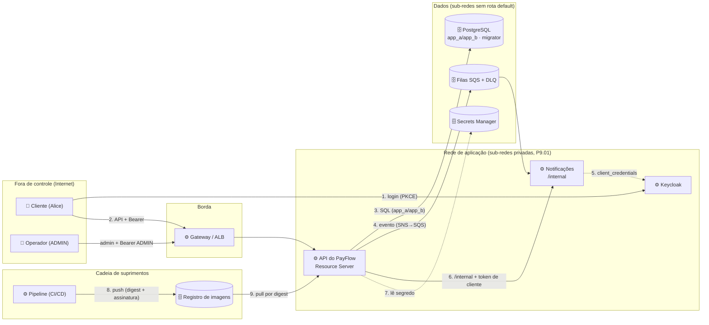

# P10.07 — Threat modeling com STRIDE

> ⏱️ ~1h30 · 🔵 Pleno · Pré-requisitos: P10.01–P10.06 (identidade, tokens, segredos, cadeia de suprimentos), J8.05–J8.06 (OWASP Top 10: injeção, XSS, CSRF, IDOR), P5.01 (fronteiras de serviço), P6.01 (logs e auditoria), P9.01 (rede em camadas)

> ⚠️ **Verificação:** o **modelo de ameaças do PayFlow** (`lab/threat-model/threats.csv`, **26 ameaças**) e o **verificador** (`check-threat-model.py`, Python 3 puro) foram **executados de verdade**; **22 das 26 ameaças apontam para uma evidência que o verificador conferiu** (um **teste** do laboratório que existe, um **arquivo** ou uma **saída** gravada) — **sem rodar os testes de novo**: o verificador **procura** o teste pelo nome, **não o executa**; a execução está na suíte das aulas anteriores (**54 testes verdes**, `out-suite.txt`). O **diagrama de fluxo de dados** e a classificação de cada ameaça (a **letra** do STRIDE, o **risco**) são **julgamento meu**, **não** medição. **Não executado:** uma sessão de *threat modeling* **com pessoas** (a parte que mais importa), o **PayFlow do aluno** (as ameaças de modelos como o *checkout*, o painel e o Outbox são **leitura**) e as ferramentas de desenho (OWASP Threat Dragon, Microsoft Threat Modeling Tool). O verificador **prova consistência** do modelo, **não** que **ele esteja completo**.

## 🎯 Objetivos
Ao final desta aula você consegue:
- **Desenhar** um **diagrama de fluxo de dados** (DFD) com **fronteiras de confiança** e **dizer** quais elementos importam para cada categoria do STRIDE.
- **Enumerar** ameaças com o **STRIDE** (por elemento) e **classificar** cada uma pela **propriedade de segurança** que viola.
- **Escolher** o tratamento de cada ameaça (**mitigar, aceitar, transferir, evitar**) e **registrar** a decisão com **dono e data**.
- **Ligar** cada ameaça mitigada a uma **evidência verificável** (um teste, um arquivo) e **detectar** quando a evidência some.
- **Reconhecer** as **lacunas** do próprio modelo.

## 🤔 Por que isso importa
Nas aulas anteriores você **construiu defesas**: PKCE, validação de token, escopo, `azp`, rotação, privilégio mínimo, assinatura de imagem. **Defesa sem modelo é palpite**: como saber se você defendeu **o que importa**? O *threat modeling* é a pergunta **anterior ao código**: **"o que pode dar errado aqui e o que vamos fazer a respeito?"** — feita **enquanto mudar o desenho ainda é barato**.

No trabalho do pleno ele aparece em **revisões de design** ("quais são as ameaças desta feature?"), em **auditorias** ("onde está o modelo de ameaças do sistema?") e na **decisão do que testar primeiro**. A diferença entre um modelo útil e um **documento de gaveta**: o útil **muda o código e os testes**, é **revisado** e **tem dono**.

## 💡 Intuição (explicação simples)
Antes de **trancar a casa**, você **caminha em volta pensando como ladrão**: "a janela do banheiro está aberta", "a cópia da chave está debaixo do vaso", "a vizinha tem a chave e **ela** não confere quem entra". O *threat modeling* é **essa caminhada, com método**: um **mapa da casa** (o diagrama), **seis perguntas padronizadas** para cada porta e janela (o STRIDE) e uma **lista do que fazer** — com **quem** faz e **para quando**.

## 🔬 Como funciona por dentro

### As quatro perguntas (o método inteiro)
| # | Pergunta | O que produz |
|---|---|---|
| 1 | **No que estamos trabalhando?** | o **diagrama** (DFD) e as **fronteiras de confiança** |
| 2 | **O que pode dar errado?** | a **lista de ameaças** (STRIDE) |
| 3 | **O que vamos fazer a respeito?** | **tratamento** (mitigar/aceitar/transferir/evitar) + **dono** |
| 4 | **Fizemos um bom trabalho?** | **evidência** (testes) e **revisão** |

São as perguntas do [Threat Modeling Manifesto](https://www.threatmodelingmanifesto.org/) e do trabalho de Adam Shostack (⚠️ atribuição de memória). O modelo **é uma atividade contínua**, não um documento único.

### STRIDE: seis categorias, seis propriedades violadas
| Letra | Ameaça | Propriedade violada | Pergunta-guia | Exemplo no PayFlow |
|---|---|---|---|---|
| **S** | *Spoofing* (falsificação de identidade) | **Autenticidade** | "alguém pode **se passar por** outro?" | token forjado, `azp` falso |
| **T** | *Tampering* (adulteração) | **Integridade** | "alguém pode **alterar** dado ou código?" | trocar o `sub`; reescrever o livro-razão; trocar a imagem |
| **R** | *Repudiation* (repúdio) | **Não repúdio** | "alguém pode **negar** que fez algo, e **não conseguimos provar**?" | ação de admin sem registro |
| **I** | *Information disclosure* (vazamento) | **Confidencialidade** | "alguém lê o que **não deveria**?" | IDOR; senha no log; segredo no *state* |
| **D** | *Denial of service* (negação de serviço) | **Disponibilidade** | "alguém **derruba** ou **trava** isto?" | força bruta; Keycloak fora do ar |
| **E** | *Elevation of privilege* (elevação) | **Autorização** | "alguém **ganha poderes** que não tem?" | usuário comum no endpoint de admin; ID token como acesso |

### STRIDE **por elemento**: nem toda letra se aplica a todo elemento
| Tipo de elemento (no DFD) | Letras que **se aplicam** | Por quê |
|---|---|---|
| **Entidade externa** (pessoa, sistema de fora) | **S**, **R** | você **não controla** o que ela faz: só **autentica** e **registra** |
| **Processo** (API, Keycloak, o pipeline) | **S T R I D E** | executa código com decisões: **todas** valem |
| **Armazenamento** (PostgreSQL, fila, cofre) | **T R I D** | guarda dados: **alterar**, **negar autoria**, **vazar**, **indisponibilizar** |
| **Fluxo de dados** (uma chamada, uma mensagem) | **T I D** | passa pela rede: **alterar**, **vazar**, **derrubar** |

### O diagrama do PayFlow (depois da P10)

**Cada seta que cruza uma fronteira** (Internet → Gateway, Gateway → rede de aplicação, aplicação → dados, pipeline → produção) **é onde as ameaças moram**. Dentro de uma fronteira você **confia mais**; ao atravessá-la, **pergunta quem chama, o que pode, o que pode ter sido alterado no caminho**.

## 🛠️ Exemplo prático

### 1. O modelo como **dado versionado** (`lab/threat-model/threats.csv`)
```csv
id,stride,where,threat,control,status,evidence,owner,review_by
T01,T,api,"Token forjado: payload trocado e assinatura mantida","Assinatura RS256 conferida contra o JWKS do Keycloak",mitigated,test:ResourceServerTest#tamperedPayload_is401,,
T07,S,api,"Token reaproveitado depois do logout","Prazo curto do access token (5 min); o refresh é revogado",accepted,test:ResourceServerKeycloakIT#logoutRevokesTheRefreshToken_butTheAccessTokenKeepsWorkingUntilItExpires,time-seguranca,2027-02-14
T09,T,database,"Aplicação comprometida apaga ou altera o livro-razão","Papel da aplicação sem UPDATE/DELETE/DDL em ledger_entries",mitigated,test:SecretRotationIT#theApplicationRoleHasLeastPrivilege_noDdl_noUpdateOrDeleteOfTheLedger,,
T10,T,supply-chain,"Imagem trocada na mesma tag","Deploy por digest + assinatura verificada",mitigated,grep:supply-chain-lab/out-cosign.txt::Error: no signatures found,,
T21,D,api,"Keycloak fora do ar: com o JWKS em cache a API segue (medido); sem cache o token vira 403 vazio e ERROR no log","Responder 503 e alarmar; Keycloak em alta disponibilidade (a fazer)",open,,time-plataforma,2026-12-15
```
- `stride` é a **letra**; `where` é o **elemento** do DFD; `status` é `mitigated`, `accepted` ou `open`.
- `evidence` tem **três formas**: `test:Classe#metodo` (o teste **existe**?), `file:caminho` (o arquivo existe?) e `grep:caminho::regex` (a **saída gravada** contém o texto?).
- `owner` e `review_by` são **obrigatórios** para o que **não** está mitigado.

### 2. O verificador (`check-threat-model.py`, executado)
Regras: (1) **mitigada** ⇒ a **evidência existe**; (2) **aceita** ou **aberta** ⇒ **dono** e **data de revisão**, e a data **não pode estar vencida**; (3) o **status** é um dos três; (4) cada elemento é conferido contra as letras que **se aplicam** ao seu tipo (a tabela acima).
```
  api           (process  ) analisou STRIDE ainda sem análise: -
  auth-code     (process  ) analisou STID   ainda sem análise: RE
  database      (datastore) analisou TIE    ainda sem análise: RD
  infra         (datastore) analisou I      ainda sem análise: TRD
  internal      (process  ) analisou SE     ainda sem análise: TRID
  supply-chain  (process  ) analisou T      ainda sem análise: SRIDE
  lacunas de análise (letra aplicável sem ameaça registrada): 16
ameaças: 26  {'mitigated': 22, 'accepted': 2, 'open': 2}
```
- **26 ameaças:** **22 mitigadas** (cada uma com evidência), **2 aceitas** (T07: o token vale até 5 min depois do logout; T20: corpo gigante, tratado na borda) e **2 abertas** (T13: eventos de administração do realm; **T21: o Keycloak fora do ar**, que a P10.03 **mediu**).
- **16 lacunas:** **o modelo está incompleto, e o verificador diz onde.** O elemento **`supply-chain` só tem 1 letra de 6** (T); o **`internal`**, 2 de 6; o **`infra`**, 1 de 3. **Isto é um *backlog* de análise, não uma falha do verificador**: letra "sem ameaça registrada" quer dizer **"ninguém perguntou"** — **não** "não há ameaça".

### 3. O verificador **precisa conseguir falhar** (`--self-test`, executado)
Um verificador que **nunca falhou não prova nada** (a lição das aulas anteriores). `--self-test` o põe à prova **duas vezes**:
```
self-test (teste renomeado): acusou ['T14: mitigada, mas a evidência não existe (test:ResourceServerTest#idor_bobCannotReadAlicesAccount_404)']
self-test (data futura): acusou ['T07: revisão vencida (2027-02-14)', 'T13: revisão vencida (2026-12-15)']
```
1. **Renomeia** o teste do IDOR numa cópia: a **T14** passa a **mentir** ("mitigada" sem prova) e o verificador **acusa**.
2. **Avança a data** para 2027-06-01: as ameaças **aceitas/abertas** com revisão **vencida** são **acusadas**.

> 🔎 **O que o verificador achou de verdade (durante a escrita):** dois caminhos relativos **errados** nos `file:` (T12, T18) — a ameaça estava marcada "mitigada" e a **evidência apontava para um arquivo que eu havia escrito errado**. **Foi a primeira função do verificador:** pegar **a mentira do próprio autor**. Também classifiquei a **T01** (token adulterado) como **S**, e o verificador mostrou o `api` sem nenhum **T**: era **T** (adulteração do conteúdo do token). **Reclassificar** é parte do trabalho.

### 4. Lendo o modelo (os **cinco** que mais ensinam)
| ID | Ameaça (STRIDE) | O que mostra |
|---|---|---|
| **T03** (S) | HS256 assinado com a **chave pública** | a **confusão de algoritmo** (P10.03): evidência = `hs256SignedWithThePublicKey_is401` |
| **T06** (S) | serviço ou usuário chamando `/internal` | **defesa em profundidade** do `azp` + escopo (P10.04); **M5** prova o teste |
| **T09** (T) | aplicação comprometida reescreve o **livro-razão** | **o banco** impõe a regra 5 (P10.05): `DELETE`/`UPDATE`/`TRUNCATE` negados |
| **T10** (T) | **tag trocada** no registro | **assinatura por digest** (P10.06): "no signatures found" |
| **T21** (D) | **Keycloak fora do ar** | **aberta**: a medição achou um `403` **vazio** onde deveria ser `503` (P10.03, seção 9) |

### 5. **Risco**: nem toda ameaça é igual (priorização)
O modelo lista; **você escolhe a ordem**. Um jeito **simples** (e honesto sobre a sua imprecisão): **probabilidade × impacto**, cada um em **1 a 3**:
| | Impacto 1 (incômodo) | Impacto 2 (dano limitado) | Impacto 3 (dinheiro, dados, reputação) |
|---|---|---|---|
| **Provável (3)** | 3 | 6 | **9** |
| **Possível (2)** | 2 | 4 | 6 |
| **Improvável (1)** | 1 | 2 | 3 |
Exemplos (**julgamento meu**, para discutir): **T21** (Keycloak fora): provável × dano médio-alto = **6–9**, e **aberta**: **primeira da fila**. **T07** (token pós-logout): possível × dano limitado = **4**, **aceita** (com prazo curto e data de revisão). **T13** (auditar mudanças no realm): possível × alto = **6**; **aberta com dono**. **Cuidado:** os números **disfarçam subjetividade**; o valor está na **conversa** que os produz.

## 🏗️ Estudo de caso: o novo endpoint de estorno
**Situação.** O produto pede `POST /api/v1/payment-requests/{id}/refund` (estornar um pagamento por QR). O time **escreve em duas horas** e **vai para a revisão**. A pergunta do revisor: **"quais são as ameaças?"**

**Modelando (STRIDE sobre o processo `POST /refund`).**
| Letra | Ameaça | Pergunta | Tratamento |
|---|---|---|---|
| **S** | quem pede o estorno **é** quem diz ser? | só o **token** autentica; o **`sub`** é o solicitante | validação do JWT (P10.03) |
| **T** | alterar o **valor** ou o **destino** | o corpo traz o valor? | **o valor vem do pagamento original**, nunca do corpo; **idempotência** (P3) |
| **R** | "eu não autorizei esse estorno" | quem aprovou? | registro de auditoria **com `sub`, `jti` e o id do pagamento** (decisão 65) |
| **I** | ver o estorno **de outro** usuário | IDOR | dono = `sub` (404 para o alheio, J8.06) |
| **D** | **milhares** de estornos | repetição, *replay* | limite por usuário/conta, **idempotência** (mesma chave = mesmo resultado) |
| **E** | usuário comum estornando **o que só o ADMIN** pode | papel e escopo | escopo `transfers:write` **e** regra "estorno acima de X exige `ADMIN`" |
**Resultado:** a **revisão** acrescenta duas coisas que **o código das duas horas não tinha**: **(1)** "o valor vem do pagamento original" e **(2)** o **registro de auditoria**. **Cada ameaça mitigada** vira **uma linha no CSV** com **um teste**. **Isto é o ganho:** ameaça **achada na revisão** custa **uma linha de código**; **achada em produção**, **um incidente**. (Este exemplo é **de desenho**: **não** implementei o endpoint.)

## ⚖️ Trade-offs e quando NÃO usar
- **Modelar tudo × o que muda:** modelar o sistema **inteiro** de uma vez **nunca termina**. **Modele a feature nova** (e **revise o modelo geral** quando a arquitetura mudar: nova fronteira, novo serviço, novo tipo de dado).
- **STRIDE × outros métodos:** o STRIDE é **simples e orientado a ameaças** (bom para começar); **árvores de ataque** aprofundam **um objetivo do atacante**; **LINDDUN** é para **privacidade**; **PASTA** é orientado a **risco de negócio** (⚠️ citados de memória; **não** os usei). **Para um serviço web, STRIDE por elemento basta** na maioria dos casos.
- **Documento × código:** um modelo em **planilha ou PDF** **envelhece**; em **dados versionados** com **verificador no CI** (esta aula) **se mantém** — mas é **mais trabalho inicial** e **só prova consistência**.
- **Ferramenta × conversa:** ferramentas (Threat Dragon, Threat Modeling Tool) **ajudam a desenhar**; **o valor está nas perguntas** e **nas pessoas certas** na sala (quem **escreveu** e quem **opera**).
- **Quando NÃO vale o esforço completo:** **protótipo descartável**, **script interno** sem dado sensível — **a lista de 4 perguntas na cabeça** já ajuda. **Vale muito** em **dinheiro, dado pessoal, autenticação e qualquer coisa exposta à Internet** (o PayFlow é tudo isso).
- **Quanto o modelo "cobre":** **não** confunda **"todas as ameaças têm linha"** com **"o sistema é seguro"**: o modelo só tem as ameaças **que alguém pensou**.

## ⚠️ Erros comuns e boas práticas de produção
- **Fazer o modelo uma vez e arquivar.** Atrele-o a **mudanças de arquitetura**, **novos endpoints sensíveis** e **incidentes** (cada incidente **deve** virar uma linha).
- **Modelar sozinho.** Quem **escreve**, quem **opera** e quem **pensa como atacante** enxergam **coisas diferentes**.
- **Ameaça sem dono e sem data** (a **aceita** é uma **decisão**, com prazo de revisão; senão é **esquecimento**).
- **"Mitigada" sem prova.** O verificador existe **para isso**: **toda mitigação aponta para algo verificável**.
- **Aceitar risco calado.** O **T07** (o token vale até 5 min depois do logout) está **registrado como aceito**, com **dono** e **revisão**: é **diferente** de **não saber**.
- **Esquecer as setas** (os fluxos): a maioria dos vazamentos acontece **no caminho**, não **no armazenamento**.
- **Confundir ameaça com vulnerabilidade:** ameaça = **o que pode acontecer**; vulnerabilidade = **a fraqueza que permite**; **controle** = **o que impede**.
- **Tratar o STRIDE como lista de verificação** em vez de **perguntas**: o objetivo **não** é preencher 6 colunas, é **descobrir o que ninguém pensou**.
- Mensagem real do verificador: `T14: mitigada, mas a evidência não existe (test:ResourceServerTest#idor_bobCannotReadAlicesAccount_404)`.

## 🧩 Exercícios
1. **Fixação.** (a) Que letras do STRIDE **se aplicam** a um **armazenamento de dados**? Por quê **não** o **S**? (b) Qual a diferença entre **aceitar** e **ignorar** um risco? (c) Por que "**22 mitigadas**" **não** significa "22 ameaças a menos"?
2. **Aplicação no PayFlow.** **Preencha as lacunas** do elemento **`supply-chain`** (S, R, I, D, E) e do **`internal`** (T, R, I, D) em `threats.csv`: para cada letra, **ou** uma ameaça (com tratamento, **evidência** e dono) **ou** uma linha **"não se aplica porque…"** (um `status` novo: `not_applicable`, com **motivo** obrigatório; **estenda o verificador**). Critérios de pronto:
   - [ ] **as lacunas caem de 16 para menos de 8**, sem **nenhuma** ameaça **inventada** só para tapar buraco;
   - [ ] **cada nova "mitigada"** tem **evidência que o verificador confere**;
   - [ ] o `--self-test` **continua acusando** o teste renomeado e a data vencida;
   - [ ] o verificador **roda no CI** e **falha o *build*** em caso de problema;
   - [ ] os **dois "abertos"** (T13, T21) têm **dono** e **data**; **escolha um e feche** (T21: o `503`).
3. **Desafio.** **Modele o fluxo de recuperação de senha** (e-mail com link): faça o DFD, o STRIDE **por elemento** e **três** ameaças **com tratamento**. Onde mora a **maior** ameaça? (Dica: a **fronteira** é o **e-mail**.)

<details><summary>Soluções de referência</summary>

**1.** **T, R, I, D**. O **S** (falsificação) é sobre **identidade de quem age**; um armazenamento **não age**: quem o acessa é um **processo** (que pode ser falsificado — e isso é **uma ameaça do processo/do fluxo**, não do armazenamento). **(b)** **Aceitar** é uma **decisão documentada**, com **dono, motivo e data de revisão** (T07); **ignorar** é **não saber**. **(c)** O modelo só tem as ameaças **registradas**: as **16 lacunas** mostram letras **sem análise**; "mitigada" quer dizer "**esta** ameaça tem controle e prova", **não** "**o sistema** está seguro".

**3.** A **maior** ameaça costuma ser o **canal do e-mail** (fora do seu controle: quem lê a caixa postal **vira** o dono da conta): **mitigação** = **token de uso único**, **curto**, **atrelado ao usuário**, **invalidado** ao usar; **não** revelar se o e-mail existe (**mesma** resposta, **como medi** no login); **limitar tentativas**; **MFA** na troca. No Keycloak, isso é **configuração do realm** (⚠️ não testei o fluxo de recuperação).
</details>

## 🎤 Na entrevista
- **"O que é *threat modeling* e quando você o faz?"** — **Pensar como atacante antes de construir**: desenhar o sistema (fluxos e **fronteiras de confiança**), **enumerar o que pode dar errado** (STRIDE), **decidir o tratamento** (mitigar, aceitar, transferir, evitar) com **dono**, e **verificar** com testes. **Quando:** desenho de feature nova, mudança de arquitetura/fronteira, depois de **incidente**.
- **"Explique o STRIDE."** — **S**poofing (autenticidade), **T**ampering (integridade), **R**epudiation (não repúdio), **I**nformation disclosure (confidencialidade), **D**enial of service (disponibilidade), **E**levation of privilege (autorização). **Por elemento:** processos recebem as seis; armazenamentos **TRID**; fluxos **TID**; entidades externas **SR**.
- **"Como você evita que o modelo de ameaças vire papel de gaveta?"** — **Dados versionados** no repositório, **cada mitigação ligada a um teste** que um **verificador confere no CI**, **dono e data de revisão** nas ameaças aceitas/abertas, e **revisão atrelada a mudanças de arquitetura**.
- **"Uma ameaça de baixo risco: você corrige?"** — **Depende do custo**: se **muito mais barato** corrigir do que **registrar e revisar**, corrijo; senão **aceito formalmente** (motivo, dono, data). O erro é **não decidir**.

## 📚 Para ir além
- 📄 [Threat Modeling Manifesto](https://www.threatmodelingmanifesto.org/): os **valores** e **princípios** (curto e útil).
- 📄 [OWASP — Threat Modeling Cheat Sheet](https://cheatsheetseries.owasp.org/cheatsheets/Threat_Modeling_Cheat_Sheet.html) e [OWASP Threat Dragon](https://owasp.org/www-project-threat-dragon/): método e ferramenta de desenho.
- 📄 [Microsoft — Threat Modeling Tool: ameaças (STRIDE)](https://learn.microsoft.com/en-us/azure/security/develop/threat-modeling-tool-threats): o catálogo **por categoria**.
- 📄 [OWASP Top 10](https://owasp.org/Top10/): as **vulnerabilidades** mais comuns (J8.05–J8.06); o STRIDE olha **o desenho**, o Top 10 olha **o código**.
- 📑 Livro (⚠️ de memória): *Threat Modeling: Designing for Security* (Adam Shostack); *Alice and Bob Learn Application Security* (Tanya Janca).
- 🎥 Nenhum vídeo verificado nesta aula.
- 💻 `lab/threat-model/` (`threats.csv`, `check-threat-model.py`, `out-threat-model.txt`).

## ✅ Checklist da aula
- [ ] Sei desenhar um **DFD** com **fronteiras de confiança** e identificar os **tipos de elemento**.
- [ ] Sei **quais letras do STRIDE** valem para cada tipo de elemento.
- [ ] Cada ameaça do meu modelo tem **tratamento, dono e (se aceita/aberta) data de revisão**.
- [ ] **Toda "mitigada" aponta para uma evidência** que um **verificador** confere — e **provei** que o verificador **falha** quando a evidência some.
- [ ] Sei **onde o meu modelo está incompleto** (as lacunas) e **qual vem primeiro**.
- [ ] Sei dizer **a diferença** entre **aceitar** e **ignorar** um risco.
