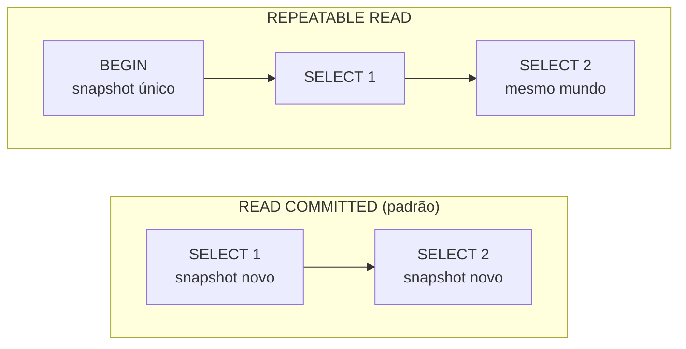

# P2.01 — Níveis de isolamento e anomalias (experimentos em duas sessões)

> ⏱️ ~1h30 · 🔵 Pleno · Pré-requisitos: J3.10 (ACID, MVCC, `READ COMMITTED`), J5.11 (`@Transactional`), P1.09 (*race condition*, *check-then-act*), P1.13 (invariantes do saldo)

> ✅ **Validação final (2026-11-24):** módulo executado no PayFlow reconstruído; resultado e o que continua não executado no [README do módulo](README.md). Os avisos "não executado" / "por leitura" abaixo descrevem a escrita original.

> ⚠️ **Verificação:** todos os experimentos desta aula foram **executados de verdade** em **PostgreSQL 18.6** (imagem `postgres:18`, Docker) com duas sessões `psql` (`lab/sql-lab/exp1-isolation.sh`, `exp1b-reconciliation.sh`) e, para o lado Spring, `lab/persistence-lab` (`IsolationIT`; Spring Boot 4.1.2, Hibernate 7.4.13, JDK 25.0.5). As saídas abaixo são **recortes** dessas execuções. **Não executado:** nada disso no repositório `payflow` do aluno (o `AccountOpeningService` é do laboratório, não do PayFlow).

## 🎯 Objetivos
Ao final desta aula você consegue:
- **Nomear** as anomalias de concorrência (leitura suja, leitura não repetível, fantasma, *lost update*, *write skew*) e **dizer em qual nível do PostgreSQL cada uma ainda é possível**.
- **Reproduzir** cada anomalia com **duas sessões** e **mostrar** o nível que a impede.
- **Explicar** como o MVCC dá *snapshot* por comando (`READ COMMITTED`) ou por transação (`REPEATABLE READ`) e o que o `SERIALIZABLE` acrescenta (e o que ele **cobra**: repetir a transação).
- **Escolher** o nível de isolamento de uma operação do PayFlow e **escrever** o `@Transactional` correspondente, com a repetição.

## 🤔 Por que isso importa
Na P1 você viu o dinheiro sumir **na memória** de uma JVM. O banco tem o mesmo problema em outra camada: duas transações simultâneas, cada uma correta sozinha, produzem um resultado que **nenhuma ordem de execução, uma depois da outra, produziria**. O `@Transactional` do PayFlow (J5.11) dá **atomicidade** (tudo ou nada), **não** dá "ninguém mais mexe nisso enquanto eu penso". Quem decide o que cada transação **enxerga das outras** é o **nível de isolamento**, e o padrão (`READ COMMITTED`) **deixa passar** o saque duplo, o limite de contas furado e o relatório de conciliação que não fecha. Esta aula é o mapa: **o que** pode dar errado em cada nível, com experimento, antes de a P2.02 ensinar a travar.

## 💡 Intuição (explicação simples)
Pense no livro-razão do banco como uma **pasta de folhas** e em cada transação como uma pessoa que trabalha com ela:
- **`READ COMMITTED`:** a cada pergunta ("quanto tem na conta?") a pessoa **pede uma foto nova** da pasta. Duas perguntas seguidas podem mostrar **mundos diferentes** (alguém arquivou uma folha no meio).
- **`REPEATABLE READ`:** a pessoa tira **uma foto ao começar** e trabalha só com ela até o fim. O mundo dela fica **estável**, mas pode estar **velho**: se ela decidir com base na foto, outra pessoa pode ter feito uma decisão incompatível com a mesma foto (*write skew*).
- **`SERIALIZABLE`:** além da foto, um **fiscal** observa quem **leu** o quê. Se duas pessoas tomaram decisões que **não fecham juntas**, ele manda **uma refazer** (`could not serialize access`). Você paga em **repetições**.

## 🔬 Como funciona por dentro

### 1. MVCC e *snapshots* (o que a J3.10 só mencionou)
O PostgreSQL guarda **várias versões** de cada linha (MVCC). Cada comando (ou transação, conforme o nível) enxerga o conjunto de versões **confirmadas até o instante do seu *snapshot***. Por isso **leitor não bloqueia escritor** e vice-versa; só **duas escritas na mesma linha** se enfileiram.



### 2. As anomalias (definições da documentação do PostgreSQL)
| Anomalia | O que acontece |
|---|---|
| **Leitura suja** (*dirty read*) | ler dado **não confirmado** de outra transação |
| **Leitura não repetível** | reler uma linha e vê-la **mudada** por uma transação que confirmou no meio |
| **Fantasma** (*phantom*) | repetir uma consulta e obter **outro conjunto de linhas** (alguém inseriu/apagou) |
| **Anomalia de serialização** | o resultado conjunto é **incompatível com qualquer ordem** de execução em série (inclui o ***write skew***) |
| ***Lost update*** | duas transações leem, calculam e gravam por cima uma da outra (P1.09, aqui no banco; tratado na P2.02) |

### 3. O que cada nível permite no PostgreSQL
(Tabela 13.1 da [documentação](https://www.postgresql.org/docs/18/transaction-iso.html); **medida** nos experimentos abaixo.)

| Nível | Leitura suja | Não repetível | Fantasma | Anomalia de serialização |
|---|---|---|---|---|
| `READ UNCOMMITTED` | **não** (**se comporta como** `READ COMMITTED`) | possível | possível | possível |
| `READ COMMITTED` (**padrão**) | não | **possível** | **possível** | **possível** |
| `REPEATABLE READ` | não | não | **não** (diferente do padrão SQL) | **possível** |
| `SERIALIZABLE` | não | não | não | **não** (cobra repetição) |

> O PostgreSQL implementa só **três** níveis distintos: pedir `READ UNCOMMITTED` dá `READ COMMITTED`. E o `REPEATABLE READ` dele é um **isolamento por *snapshot***: já impede fantasma, mas **ainda deixa** *write skew*.

### 4. O que cada nível faz quando duas transações **escrevem** a mesma linha
- `READ COMMITTED`: a segunda **espera** a primeira terminar e **reavalia** o `WHERE` sobre a versão nova da linha (por isso `UPDATE … WHERE balance >= ?` é seguro: P2.02).
- `REPEATABLE READ` e `SERIALIZABLE`: se a linha mudou **depois do meu *snapshot***, a segunda **falha** com `could not serialize access due to concurrent update` (SQLSTATE `40001`). **Quem usa esses níveis precisa repetir.**
- `SERIALIZABLE` (SSI): além disso, falha transações que formam um **ciclo perigoso de dependências de leitura/escrita**, mesmo sem tocar a mesma linha.

## 🛠️ Exemplo prático
> Pasta `lab/sql-lab/`. Esquema = as migrações V1–V4 da J3.12 (`00-schema.sql`), 4 contas de R$ 1 000,00 (`01-seed.sql`). `./exp1-isolation.sh` abre as sessões **A** e **B** em paralelo (`psql` em segundo plano + `pg_sleep`). ⚠️ O `reset` dos scripts **apaga e recria** o banco `payflow` do **container do laboratório** (`lab-p2-pg`); nunca aponte para o seu banco do PayFlow.

Suba o banco do laboratório (um container descartável, **não** o `payflow-pg` da J3):
```bash
docker run -d --name lab-p2-pg -e POSTGRES_PASSWORD=lab -e POSTGRES_DB=payflow \
  -p 127.0.0.1:55432:5432 -v lab-p2-pgdata:/var/lib/postgresql postgres:18 \
  -c deadlock_timeout=1s -c log_lock_waits=on
```
(no `postgres:18` o volume vai em `/var/lib/postgresql`, J3.03.)

### A. Leitura não repetível e fantasma: `READ COMMITTED` × `REPEATABLE READ`
A abre a transação e **lê duas vezes**, com 3 s no meio; B, no meio, **confirma** um depósito de 100 e um lançamento:
```sql
-- A (em cada nível)
BEGIN ISOLATION LEVEL READ COMMITTED;   -- ou REPEATABLE READ
SELECT balance, (SELECT count(*) FROM ledger_entries WHERE account_id = :acc) FROM accounts WHERE id = :acc;
SELECT pg_sleep(3);                      -- B confirma aqui: +100 no saldo e +1 lançamento
SELECT balance, (SELECT count(*) FROM ledger_entries WHERE account_id = :acc) FROM accounts WHERE id = :acc;
COMMIT;
```
```text
READ COMMITTED:   1ª leitura  1000.00 | 0 lançamentos      2ª leitura  1100.00 | 1 lançamento
REPEATABLE READ:  1ª leitura  1000.00 | 0 lançamentos      2ª leitura  1000.00 | 0 lançamentos
```
No `READ COMMITTED` a **mesma transação** viu o saldo **e** o conjunto de lançamentos mudarem (não repetível **e** fantasma). No `REPEATABLE READ` o mundo ficou **congelado**.

### B. `READ UNCOMMITTED` não existe de verdade
A faz `UPDATE … SET balance = 0` e **não confirma**; B abre `READ UNCOMMITTED` e lê:
```text
 transaction_isolation = read uncommitted      (B pediu e o SHOW confirma)
 B lê durante a tx de A | 1000.00               (continua 1000.00: sem leitura suja)
```

### C. Um relatório de conciliação que **não fecha** (regra 3 do PayFlow)
A regra 3 diz: **saldo = soma dos lançamentos**. Um relatório faz **dois comandos** (soma dos saldos, soma dos lançamentos), e um depósito de 100 **confirma entre os dois** (`exp1b-reconciliation.sh`; antes, todas as contas têm um lançamento de abertura que fecha com o saldo):
```text
READ COMMITTED:   soma dos saldos 4000.00 | soma dos lançamentos 4100.00     ← "R$ 100 de diferença" que não existe
REPEATABLE READ:  soma dos saldos 4000.00 | soma dos lançamentos 4000.00     ← fecha
```
O banco **não está errado**: cada comando viu um mundo consistente, **mas diferentes**. Um relatório que cruza duas consultas deve rodar em **uma transação `REPEATABLE READ` `READ ONLY`**.

### D. *Write skew*: o limite de contas por usuário
Regra de negócio inventada para o laboratório: **no máximo 3 contas por usuário**. O serviço **conta** e, se couber, **insere**. Ana já tem 2 contas; duas requisições chegam juntas (`pg_sleep(2)` entre o `count` e o `INSERT`):
```text
READ COMMITTED    → ambas contaram 2, ambas inseriram → contas de Ana no fim: 4   ← regra furada
REPEATABLE READ   → ambas contaram 2, ambas inseriram → contas de Ana no fim: 4   ← regra furada TAMBÉM
SERIALIZABLE      → ERROR: could not serialize access due to read/write dependencies among transactions
                    DETAIL:  Reason code: Canceled on identification as a pivot, during commit attempt.
                    HINT:    The transaction might succeed if retried.
                    → contas de Ana no fim: 3
```
Esta é a lição central: **`REPEATABLE READ` não salva** aqui (as duas transações **não escrevem a mesma linha**: inserem linhas **diferentes** com base numa leitura que a outra invalidou). **Só o `SERIALIZABLE`** (ou uma restrição/trava explícita, P2.02) detecta.

### E. O mesmo no Spring (`IsolationIT`)
```java
@Transactional                                                    // READ COMMITTED
public void openReadCommitted(UUID ownerId, long pauseMs) { open(ownerId, pauseMs); }

@Transactional(isolation = Isolation.SERIALIZABLE)
public void openSerializable(UUID ownerId, long pauseMs) { open(ownerId, pauseMs); }
```
```text
READ COMMITTED: resultados [ok, ok] -> contas de Ana: 4 (limite 3)
SERIALIZABLE: org.springframework.dao.CannotAcquireLockException
SERIALIZABLE: contas de Ana: 3 (limite 3)
```
**Surpresa registrada (não estava nas minhas anotações):** o `SQLSTATE 40001` **não** vira `CannotSerializeTransactionException`, e sim **`CannotAcquireLockException`** (via `LockAcquisitionException` do Hibernate). As duas são subclasses de **`PessimisticLockingFailureException`**: **repita (*retry*) capturando a superclasse**, não uma subclasse específica. (O mesmo tipo aparece em *deadlock* e `lock_timeout`: P2.02/P2.03.)

## 🧠 Pausa para lógica
**Enunciado:** o PayFlow tem a regra "**um usuário só pode ter uma conta `ACTIVE` por vez no plano gratuito**". Descreva (a) o *write skew*, (b) por que `UNIQUE (owner_id)` **não** serve se o usuário também pode ter contas `BLOCKED`/`CLOSED`, e (c) **duas** formas de impor a regra **sem** `SERIALIZABLE`.

<details><summary>Dica</summary>Existe um tipo de índice que só enxerga **algumas linhas**. E existe uma trava que serializa **por usuário**.</details>
<details><summary>Solução</summary>

(a) Duas requisições contam 0 contas ativas e ambas inserem uma. (b) `UNIQUE (owner_id)` proibiria também as contas encerradas. (c) **Índice único parcial**: `CREATE UNIQUE INDEX uk_accounts_one_active_per_owner ON accounts (owner_id) WHERE status = 'ACTIVE'` (o banco é o árbitro; a segunda inserção falha com violação de unicidade, `23505`; ver P2.05); **ou** travar a linha do **usuário** (`SELECT … FROM users WHERE id = ? FOR UPDATE`, P2.02) antes de contar, serializando as aberturas **do mesmo usuário** sem bloquear os outros. A restrição declarativa é a mais robusta: não depende de ninguém lembrar de travar.
</details>

## ⚖️ Trade-offs e quando NÃO usar
- **`READ COMMITTED` (padrão): quase sempre certo**, **desde que** cada operação crítica seja **atômica no banco** (`UPDATE … WHERE balance >= ?`), use **trava explícita** (`FOR UPDATE`, P2.02) ou seja protegida por **restrição** (`UNIQUE`, `CHECK`). É o que a maioria dos sistemas usa; é barato e sem repetições.
- **`REPEATABLE READ` para **leitura** consistente** (relatórios, conciliação, exportações): um *snapshot* estável sem travar ninguém. Para **escrita** que depende do que foi lido, **não basta** (seção D) e exige **repetir** em `40001`.
- **`SERIALIZABLE`:** o mais simples de **raciocinar** ("aja como se fosse em série") e o mais caro de **operar**: todo código que o usa **precisa** repetir em `40001`, sob carga a taxa de repetição sobe, e transações **longas** pioram tudo. Boa para **poucas** operações de regra complexa (abertura de conta com limite), **ruim** como padrão do sistema.
- **Não aumente o isolamento "por garantia"** nem o use para esconder um *race* que uma restrição resolveria melhor. E **não** misture: o nível vale **por transação**, escolhido onde a transação **começa** (`@Transactional` mais externo).

## ⚠️ Erros comuns e boas práticas de produção
- **Achar que `@Transactional` protege do *check-then-act*:** não protege (P1.09). Ele dá atomicidade; o isolamento dá o que você **enxerga**; **proteger a regra** é com restrição ou trava.
- **Usar `SERIALIZABLE`/`REPEATABLE READ` **sem repetir**:** `could not serialize access due to concurrent update` / `read/write dependencies` (SQLSTATE **40001**) é **esperado**, não é *bug*. Capture `PessimisticLockingFailureException` **fora** da transação (P2.02 mostra o `@Retryable` e a **ordem** dos proxies).
- **Dois comandos de leitura para uma conta que "tem que fechar":** em `READ COMMITTED` eles veem mundos diferentes (seção C). Faça **um** comando (um `JOIN`/CTE) ou **uma** transação `REPEATABLE READ READ ONLY`.
- **Transação longa:** segura *snapshot* velho, impede o `VACUUM` de limpar versões antigas e aumenta conflitos de serialização. Nada de chamada HTTP/e-mail **dentro** da transação (P1.10, P2.06).
- **Testar com um cliente só:** esses bugs só aparecem com **duas conexões** e o intervalo entre `SELECT` e `INSERT` alargado (aqui, `pg_sleep`). Em teste automatizado use `CountDownLatch`/barreira (P1.09) e **invariantes** (aqui: "≤ 3 contas").

## 🧩 Exercícios
1. **Fixação:** reproduza a seção A **três vezes**, trocando a ordem (B antes de A). Preencha a tabela da seção 3 só com o que **você observou**; marque o que você **não** conseguiu reproduzir (e por quê).
2. **Aplicação no PayFlow:**
   - [ ] No `docs/db-concurrency-notes.md` (novo), escreva uma tabela **operação × nível × proteção**: depósito, transferência, abertura de conta, extrato, conciliação (regra 3). Para cada uma, **uma frase** dizendo **qual anomalia** a ameaça e **o que a impede** (restrição, `UPDATE` condicional, trava, `REPEATABLE READ READ ONLY`).
   - [ ] Escreva a **consulta de conciliação** da regra 3 como **um único comando** (`SELECT a.id FROM accounts a LEFT JOIN … GROUP BY … HAVING a.balance <> coalesce(sum(…),0)`) e confirme com o aluno-par por leitura que ele **não** sofre a anomalia da seção C.
   - [ ] **Não** troque o nível padrão do PayFlow. Critério de pronto: o documento diz **por que** o padrão fica `READ COMMITTED` (ADR 0014, P2.11).
3. **Desafio (opcional):** reproduza o *write skew* da seção D com **duas transações em `REPEATABLE READ`** e depois **corrija com um índice único parcial** (pausa para lógica). Qual mensagem de erro o segundo `INSERT` recebe?

<details><summary>Solução de referência (exercício 2, consulta de conciliação)</summary>

```sql
SELECT a.id, a.balance, coalesce(sum(CASE l.type WHEN 'CREDIT' THEN l.amount ELSE -l.amount END), 0) AS ledger_sum
FROM accounts a LEFT JOIN ledger_entries l ON l.account_id = a.id
GROUP BY a.id, a.balance
HAVING a.balance <> coalesce(sum(CASE l.type WHEN 'CREDIT' THEN l.amount ELSE -l.amount END), 0);
```
Um **comando** só vê **um** *snapshot*; zero linhas = regra 3 respeitada. (Para o PayFlow **real**, os depósitos da J3 também geram lançamento `CREDIT` sem `transfer_id`, ADR 0001, então a soma bate; contas com saldo inicial sem lançamento de abertura aparecem como divergência: é do seed, não da consulta.)
</details>

## 🎤 Na entrevista
- **Qual o nível de isolamento padrão do PostgreSQL e o que ele permite?** `READ COMMITTED`: cada comando vê um *snapshot* novo, sem leitura suja, mas com leitura não repetível, fantasma e anomalias de serialização possíveis.
- **O `REPEATABLE READ` do PostgreSQL é igual ao do padrão SQL?** Não: ele é isolamento por *snapshot* e **já impede fantasma**; ainda permite *write skew*.
- **O que é *write skew*? Dê um exemplo.** Duas transações leem o mesmo estado, decidem com base nele e gravam em **linhas diferentes**, violando uma regra que envolve o conjunto (limite de contas, dois médicos de plantão). Só `SERIALIZABLE` (ou trava/restrição) previne.
- **O que você precisa fazer ao usar `SERIALIZABLE`?** Estar preparado para **repetir a transação** quando ela falhar com `40001`; sem isso o nível não é usável.
- **Por que dois `SELECT`s de um relatório podem não bater?** Em `READ COMMITTED` cada um tem seu *snapshot*; use um único comando ou `REPEATABLE READ READ ONLY`.

## 📚 Para ir além
- 📄 [PostgreSQL 18: Transaction Isolation](https://www.postgresql.org/docs/18/transaction-iso.html): definições, a Tabela 13.1 e a seção de `SERIALIZABLE`. Leia o trecho "must be prepared to retry".
- 📄 [PostgreSQL 18: Concurrency Control (MVCC)](https://www.postgresql.org/docs/18/mvcc.html): o capítulo inteiro.
- 📄 [`SET TRANSACTION`](https://www.postgresql.org/docs/18/sql-set-transaction.html): níveis, `READ ONLY`, `DEFERRABLE`.
- 📑 Livro: *Designing Data-Intensive Applications* (Kleppmann), cap. 7 (transações: *lost update*, *write skew*, fantasmas, SSI): é a base conceitual desta aula.
- 📑 [Use The Index, Luke](https://use-the-index-luke.com/): complemento para as aulas P2.04/P2.05.

## ✅ Checklist da aula
- [ ] Reproduzi leitura não repetível/fantasma e vi o `REPEATABLE READ` congelar o mundo.
- [ ] Vi o relatório de conciliação **não fechar** em `READ COMMITTED` e fechar em `REPEATABLE READ`.
- [ ] Provoquei o *write skew* e vi **só** o `SERIALIZABLE` impedi-lo (e o erro `40001`).
- [ ] Sei que o Spring traduz `40001` para `PessimisticLockingFailureException` e que isso pede *retry*.
- [ ] Escrevi a tabela operação × anomalia × proteção do PayFlow (por leitura).
