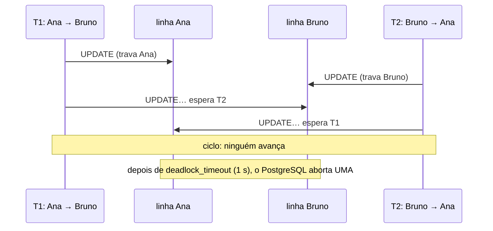

# P2.03 — *Deadlocks* no banco

> ⏱️ ~1h30 · 🔵 Pleno · Pré-requisitos: P1.09 (*deadlock* em memória, ordem global de locks), P2.01, P2.02 (travas de linha, `FOR UPDATE`), J5.11 (`@Transactional`)

> ⚠️ **Verificação:** **executado de verdade** em PostgreSQL **18.6** (Docker, duas sessões `psql`: `lab/sql-lab/exp3-deadlock.sh`) e com Spring Boot **4.1.2**/Hibernate **7.4.13**/JDK 25.0.5 (`lab/persistence-lab`, `ConcurrencyIT`). As saídas são recortes reais. **Não executado:** no repositório `payflow` do aluno.

## 🎯 Objetivos
Ao final desta aula você consegue:
- **Explicar** por que um *deadlock* **no banco** acontece mesmo sem nenhuma `synchronized` no seu código, e **reproduzi-lo** com duas sessões.
- **Ler** a mensagem `deadlock detected` e o **registro do servidor** para achar **as duas consultas** envolvidas.
- **Prevenir** com **ordem global de travas** (`SELECT … ORDER BY id FOR UPDATE`) e **tratar** o que sobrar com *retry*.
- **Diagnosticar** esperas por trava com `pg_blocking_pids` e `pg_stat_activity`, e **limitar** a espera (`lock_timeout`, `NOWAIT`).

## 🤔 Por que isso importa
Na P1.09 o *deadlock* era uma `ReentrantLock` por conta e você o via com `jcmd Thread.print`. **No banco é o mesmo problema, em outra camada, e a JVM não o enxerga:** as duas *threads* estão apenas "esperando o banco responder". Duas transferências **cruzadas** (Ana → Bruno e Bruno → Ana) basta para travar, e o `@Transactional` e o `@Version` **não ajudam**. O PostgreSQL detecta o ciclo e **mata uma das transações** com um erro; se o PayFlow não souber **tratar** esse erro, o cliente vê um `500` numa operação que é perfeitamente repetível.

## 💡 Intuição (explicação simples)
Dois motoristas entram **ao mesmo tempo** num cruzamento sem semáforo, cada um por um lado, e cada um **já ocupa meio cruzamento** esperando o outro sair. Ninguém sai. O fiscal do banco (o **detector de *deadlock***) olha de tempos em tempos, vê o ciclo e **manda um dos carros dar ré** (aborta uma transação): o outro passa. A correção definitiva é uma **regra de trânsito**: "todos passam pela via de **menor número** primeiro" (**ordem global**).

## 🔬 Como funciona por dentro

### 1. Como o ciclo se forma
No PostgreSQL, `UPDATE`/`DELETE`/`SELECT … FOR UPDATE` travam **cada linha tocada** até o fim da transação (`COMMIT` ou `ROLLBACK`). A transferência do PayFlow toca **duas** linhas de `accounts`. Se duas transações as tocam **em ordens opostas**:



### 2. Como o PostgreSQL resolve
Uma transação que espera uma trava por mais de **`deadlock_timeout`** (padrão **1 s**) **dispara a verificação de ciclo**. Se há ciclo, **uma** das transações é abortada com `ERROR: deadlock detected` (SQLSTATE **`40P01`**) e a outra segue. **Não é você quem escolhe a vítima**, e o aborto **só ocorre depois** de 1 s de espera: o ciclo **custa pelo menos 1 s** a quem o provoca.

### 3. *Deadlocks* que não parecem *deadlocks*
O ciclo não precisa ser dois `UPDATE` de saldo. Qualquer **recurso travável** serve: **linhas**, **entradas de índice único** (inserir a mesma chave duas vezes em ordens opostas) e **chaves estrangeiras** (o `INSERT` em `ledger_entries` trava a linha de `accounts` referenciada em modo compartilhado). A seção D mostra um **sem nenhum `UPDATE`**.

### 4. Ordem global, a regra de ouro (a mesma da P1.09)
Se **toda** transação trava as linhas **na mesma ordem** (por exemplo, **`id` crescente**), **não existe** ciclo. No banco isso vira **uma consulta que trava as duas linhas de uma vez, ordenadas**:
```sql
SELECT id FROM accounts WHERE id IN (:from, :to) ORDER BY id FOR UPDATE;
```
> ⚠️ **Detalhe do PostgreSQL (conferido com `EXPLAIN`):** com `ORDER BY … FOR UPDATE` o plano é `LockRows` **sobre** `Sort`: o banco **ordena primeiro e trava na ordem do resultado**. Por isso o `ORDER BY id` tem que estar **na mesma consulta** que o `FOR UPDATE` (duas consultas separadas, uma por conta, **não** garantem a ordem entre transações).

### 5. Os três remédios, do melhor ao pior
1. **Prevenir:** ordem global de travas (acima). Sem ciclo, sem repetição.
2. **Encurtar:** quanto **menos tempo** a transação segura travas, menor a chance de colisão (nada de rede dentro da transação: P2.06).
3. **Tolerar:** *retry* sobre o erro (seção E) para o que escapar (outras tabelas, código de terceiros, `lock_timeout`).

## 🛠️ Exemplo prático
> `lab/sql-lab/exp3-deadlock.sh` (⚠️ o `reset` do script recria o banco `payflow` do **container do laboratório**). Banco com `deadlock_timeout=1s` e `log_lock_waits=on`.

### A. Provocar o *deadlock* (cada transferência trava a **origem** primeiro)
```sql
-- A (Ana → Bruno)                                        -- B (Bruno → Ana), 0,3 s depois
BEGIN;                                                    BEGIN;
UPDATE accounts SET balance = balance - 10 WHERE id=ANA;  UPDATE accounts SET balance = balance - 20 WHERE id=BRUNO;
SELECT pg_sleep(1.5);                                     SELECT pg_sleep(1.5);
UPDATE accounts SET balance = balance + 10 WHERE id=BRUNO;  -- espera B       UPDATE accounts SET balance = balance + 20 WHERE id=ANA; -- espera A
COMMIT;                                                   COMMIT;
```
```text
[A] ERROR:  deadlock detected
[A] DETAIL:  Process 950 waits for ShareLock on transaction 1089; blocked by process 957.
[A] Process 957 waits for ShareLock on transaction 1088; blocked by process 950.
[A] HINT:  See server log for query details.
[A] CONTEXT:  while updating tuple (0,2) in relation "accounts"
saldos: 1020.00 / 980.00          ← só a transferência de B (Bruno → Ana, 20,00) valeu; a de A foi desfeita
```
O **registro do servidor** (`docker logs lab-p2-pg`) traz o que o cliente **não** recebe, **as duas consultas**:
```text
ERROR:  deadlock detected
DETAIL:  Process 950 waits for ShareLock on transaction 1089; blocked by process 957.
	Process 957 waits for ShareLock on transaction 1088; blocked by process 950.
	Process 950: UPDATE accounts SET balance = balance + 10 WHERE id='20000000-0000-0000-0000-000000000002';
	Process 957: UPDATE accounts SET balance = balance + 20 WHERE id='20000000-0000-0000-0000-000000000001';
```
Leia: **quem espera quem** (o ciclo) e **qual `UPDATE` de cada lado** estava esperando. O `CONTEXT` ("while updating tuple … in relation \"accounts\"") diz **onde**. O `HINT` manda olhar o log do servidor: em produção, **garanta que o log chegue a você** (RDS: *log exports* para o CloudWatch, P6).

### B. A correção: travar **as duas** em ordem de `id`
```sql
BEGIN;
SELECT id FROM accounts WHERE id IN (:from, :to) ORDER BY id FOR UPDATE;   -- trava Ana e Bruno, SEMPRE em ordem de id
SELECT pg_sleep(1.5);
UPDATE accounts SET balance = balance - :v WHERE id = :from;
UPDATE accounts SET balance = balance + :v WHERE id = :to;
COMMIT;
```
```text
[A] 2 linhas travadas (…001, …002)     [B] (espera A) … 2 linhas travadas (…001, …002)
saldos: 1010.00 / 990.00               ← AS DUAS transferências valeram (-10+20 e +10-20)
```
As duas transferências **completaram**; B só **esperou** A liberar a primeira linha. Sem ciclo, sem erro, sem repetição.

### C. Ver quem espera quem **ao vivo**
Com A segurando a linha e B esperando (`SELECT … FROM pg_stat_activity`):
```sql
SELECT pid, state, wait_event_type, wait_event, pg_blocking_pids(pid) AS bloqueado_por, left(query, 60) AS query
FROM pg_stat_activity WHERE datname = 'payflow' AND pid <> pg_backend_pid() AND state <> 'idle';
```
```text
 pid  | state  | wait_event_type | wait_event    | bloqueado_por | query
 1042 | active | Lock            | transactionid | {1035}        | UPDATE accounts SET balance = balance + 1 WHERE id='2000…
```
`wait_event_type = Lock` + `bloqueado_por` apontam o **culpado** (o `pid` 1035). Combine com `pg_stat_activity.xact_start` para saber **há quanto tempo** a transação dele está aberta. Esta consulta **vai para o seu *runbook***.

### D. *Deadlock* sem `UPDATE` de saldo: o índice único da chave de idempotência
Duas transações inserem **duas** `idempotency_key`s em **ordens opostas** (`k-1`, depois `k-2`, contra `k-2`, depois `k-1`):
```text
ERROR:  deadlock detected
DETAIL:  Process 1077 waits for ShareLock on transaction 1135; blocked by process 1084. …
CONTEXT:  while inserting index tuple (0,3) in relation "uk_transfers_idempotency_key"
```
O recurso disputado é a **entrada do índice único** (`uk_transfers_idempotency_key`, J3.12): a segunda inserção da **mesma chave** espera a primeira terminar para saber se há duplicata. **Mensagem de erro igual, causa diferente:** leia sempre o `CONTEXT`.

### E. No Spring: o erro, a hierarquia e o *retry*
Mesmo cenário (duas transferências cruzadas, travando na ordem dos argumentos com `@Lock(PESSIMISTIC_WRITE)`), `ConcurrencyIT`:
```text
WARN  org.hibernate.orm.jdbc.error : HHH000247: ErrorCode: 0, SQLState: 40P01
WARN  org.hibernate.orm.jdbc.error : ERROR: deadlock detected …
DEADLOCK -> org.springframework.dao.CannotAcquireLockException
  causa raiz: PSQLException: ERROR: deadlock detected
```
E com as quatro **ida** e as quatro **volta** cruzadas usando a consulta **ordenada** (`lockAllOrdered`, SQL real conferido: `… where a1_0.id in (?,?) order by a1_0.id for no key update of a1_0`): **0 falhas**.

**A hierarquia (conferida no JAR do Spring 7.0.10):**
```text
TransientDataAccessException
 └─ ConcurrencyFailureException
     ├─ OptimisticLockingFailureException → ObjectOptimisticLockingFailureException   (@Version)
     └─ PessimisticLockingFailureException
         ├─ CannotAcquireLockException          (deadlock 40P01, lock_timeout/NOWAIT 55P03, serialização 40001: o que vimos)
         ├─ CannotSerializeTransactionException
         └─ DeadlockLoserDataAccessException
```
Por isso o *retry* do PayFlow captura **`ConcurrencyFailureException`** (a superclasse), que cobre `@Version`, *deadlock*, serialização e `lock_timeout` de uma vez. Com o `@Retryable` nativo do Spring Framework 7 (P2.02), **o retry precisa ficar fora da transação**:
```java
@Retryable(includes = ConcurrencyFailureException.class, maxRetries = 6, delay = 20, jitter = 40, multiplier = 2.0, maxDelay = 400)
public Transfer transferUnorderedWithRetry(UUID from, UUID to, BigDecimal amount, String key, long pauseMs) {
    return service.transferPessimisticUnordered(from, to, amount, key, pauseMs);   // outro bean, @Transactional: transação NOVA por tentativa
}
```
Resultado com as **duas transferências cruzadas, SEM ordem** (propensas a *deadlock*): **0 falhas; 3 tentativas para 2 transferências** (uma delas colidiu, o PostgreSQL derrubou uma com `deadlock detected`, e **uma** repetição bastou; `ConcurrencyIT`). O *retry* **cura** o *deadlock*... **mas custa** pelo menos o `deadlock_timeout` (1 s) **por colisão** mais o *backoff*. **A ordem global não colide**, por isso é a correção; o *retry* é a **rede de segurança**.

## 🧠 Pausa para lógica
**Enunciado:** o PayFlow permite **transferência em lote** (um cliente empresarial manda 3 transferências numa única requisição: A→B, B→C, C→A, todas na **mesma** transação). Duas requisições em lote simultâneas, uma com `[A→B, B→C, C→A]` e outra com `[C→A, B→C, A→B]`, podem cair em *deadlock* **mesmo travando cada par em ordem de `id`**? Como garantir que não?

<details><summary>Dica</summary>"Ordem de `id` dentro de cada **par**" é o mesmo que "ordem global" para o **conjunto**?</details>
<details><summary>Solução</summary>

**Pode.** Cada par é travado em ordem, mas a **sequência de pares** difere entre as requisições: a primeira trava (A,B), depois (B,C); a segunda trava (A,C) e depois (B,C)… e os conjuntos de linhas travadas em cada instante formam um ciclo possível entre as duas. A regra tem que ser sobre o **conjunto inteiro**: **colete todas as contas do lote, ordene por `id`, trave todas de uma vez** (`SELECT … WHERE id IN (…) ORDER BY id FOR UPDATE`) **antes** de qualquer `UPDATE`. Aí o lote inteiro segue a ordem global.
</details>

## ⚖️ Trade-offs e quando NÃO usar
- **Pessimista ordenado (`FOR UPDATE`):** elimina colisões de *deadlock* e **não repete**, mas **bloqueia**: sob disputa pela **mesma** conta (a conta quente), as transferências **se enfileiram** (a vazão dessa conta vira "uma por vez"). Aceitável na maioria dos casos; para uma conta com milhares de operações por segundo, é outro problema (S1/S3).
- **`UPDATE … WHERE balance >= ?` na ordem de `id`** (P2.02 e a seção E do `ConcurrencyIT`) **também** trava as linhas e também precisa da ordem: *atomicidade* de uma linha **não** é ausência de *deadlock* **entre** linhas.
- **Aumentar `deadlock_timeout`** para "evitar falsos positivos": **não** é remédio (o ciclo existe de verdade); só atrasa o diagnóstico e a recuperação. Deixe o padrão.
- **Não "resolva" com `lock_timeout` curto no lugar da ordem:** o *timeout* **troca** *deadlock* por erro de *timeout*; você ainda precisa tratar. Ele serve para **limitar espera longa** (conta quente travada por uma transação lenta), não para prevenir ciclos.

## ⚠️ Erros comuns e boas práticas de produção
- **Travar na ordem dos argumentos** ("origem, depois destino"): é o bug da seção A. A ordem tem de ser **independente da direção**.
- **`save()` espalhado:** o `UPDATE` do Hibernate acontece no **`flush`** (J5.11), não onde você escreveu `setBalance`. Se o código atualiza A e B em **ordens que variam por caminho** (por exemplo, o fluxo "estorno" atualiza o destino primeiro), o ciclo volta. **Todo** código que toca `accounts` segue a **mesma** ordem: documente em `docs/db-concurrency-notes.md` (já prevista na P1: "contas por `id` crescente").
- **Ignorar o `CONTEXT`:** ele diz **qual** relação/índice. Um *deadlock* em `uk_transfers_idempotency_key` (seção D) pede outra correção que um em `accounts`.
- **Transação longa** segura travas por mais tempo e **multiplica** colisões: nada de HTTP/e-mail dentro da transação (P2.06), nada de `pg_sleep` fora de experimento.
- **Não repetir o *deadlock* com a mesma chave de idempotência:** o *retry* **deve** reenviar a mesma `idempotency_key` (ADR 0013); senão uma repetição "bem-sucedida" duplica a transferência.
- **Não ter o log do servidor:** sem ele você sabe que houve *deadlock*, mas **não quais consultas**. Ligue `log_lock_waits = on` (registra esperas acima de `deadlock_timeout`) e leve o log ao CloudWatch (P6).

## 🧩 Exercícios
1. **Fixação:** reproduza as seções A e B. Depois **mude** `pg_sleep(1.5)` para `pg_sleep(0)` e repita A **dez vezes**: o *deadlock* continua aparecendo? Por quê?
2. **Aplicação no PayFlow:**
   - [ ] Reescreva `TransferService.transfer` (J5.11) para travar as duas contas com **`accounts.lockAllOrdered(List.of(sourceId, targetId))`** (`@Lock(PESSIMISTIC_WRITE)` + `order by a.id`, como no laboratório), **antes** de `withdraw`/`deposit`, mantendo o `@Version` como rede de segurança (ADR 0013). Critério de pronto: o SQL do log tem `order by … for no key update`.
   - [ ] Escreva `DeadlockPreventionTest` (JUnit 6 + Testcontainers, `@SpringBootTest`): 8 transferências cruzadas (4 ida, 4 volta) com `CountDownLatch`; **asserte** zero falhas, total conservado e saldos finais. **Prove que o teste falha** se trocar `lockAllOrdered` por `findById` + `PESSIMISTIC_WRITE` na ordem dos argumentos.
   - [ ] Capture `ConcurrencyFailureException` no `@RestControllerAdvice` (J6.04) e devolva **`409`** (`urn:payflow:problem:concurrent-update`) **depois** de esgotar o *retry*; **não** devolva `500`.
   - [ ] Em `docs/db-concurrency-notes.md`, acrescente "como diagnosticar uma espera" com a consulta da seção C.
3. **Desafio (opcional):** reproduza o *deadlock* da seção D (índice único) e **corrija** inserindo as duas chaves **em ordem lexicográfica** (e explique por que isso é "ordem global" outra vez).

<details><summary>Solução de referência (exercício 1)</summary>

Com `pg_sleep(0)` a janela entre o primeiro e o segundo `UPDATE` encolhe para **microssegundos**: o *deadlock* **quase não aparece** (às vezes uma das dez), mas **continua possível**, é a mesma lição da P1.09: **menos chance de ver o bug não é correção**. Em produção, sob carga, a janela se alarga (latência, GC, rede) e o ciclo aparece.
</details>

## 🎤 Na entrevista
- **O que é um *deadlock* e como o PostgreSQL o resolve?** Um ciclo de espera entre transações (cada uma segura uma trava que a outra quer). Após `deadlock_timeout` (1 s) o PostgreSQL verifica o ciclo e **aborta uma** com `40P01`; a outra segue.
- **Como prevenir *deadlocks* em transferências entre contas?** Ordem global de travas: travar as duas linhas **sempre ordenadas** pelo `id` na mesma consulta (`ORDER BY id FOR UPDATE`), independente da direção.
- **Que exceção o Spring lança e como tratar?** `CannotAcquireLockException` (subclasse de `PessimisticLockingFailureException`/`ConcurrencyFailureException`); trate com *retry* **fora** da transação, com limite e *backoff*, reutilizando a chave de idempotência.
- **Como você investigaria uma transação "presa" em produção?** `pg_stat_activity` + `pg_blocking_pids`, `xact_start` para a idade da transação, e o log do servidor com `log_lock_waits`.
- **O `@Version` protege de *deadlock*?** Não: ele é **otimista** (não trava); o *deadlock* vem de travas **pessimistas** (`FOR UPDATE`, `UPDATE`) em ordens opostas.

## 📚 Para ir além
- 📄 [PostgreSQL 18: Explicit Locking](https://www.postgresql.org/docs/18/explicit-locking.html): travas de linha (`FOR UPDATE`, `FOR NO KEY UPDATE`), a seção **Deadlocks** e as dicas de prevenção (a documentação recomenda justamente a ordem consistente).
- 📄 [`SELECT` (`FOR UPDATE`, `NOWAIT`, `SKIP LOCKED`)](https://www.postgresql.org/docs/18/sql-select.html): a seção "The Locking Clause".
- 📄 [Lock Management (`deadlock_timeout`, `max_locks_per_transaction`)](https://www.postgresql.org/docs/18/runtime-config-locks.html).
- 📄 [`pg_locks`](https://www.postgresql.org/docs/18/view-pg-locks.html) e [`pg_blocking_pids`](https://www.postgresql.org/docs/18/functions-info.html): diagnóstico.
- 📄 [Códigos de erro do PostgreSQL (apêndice A)](https://www.postgresql.org/docs/18/errcodes-appendix.html): `40P01` *deadlock_detected*, `55P03` *lock_not_available*, `40001` *serialization_failure*.
- 📄 [Spring Framework: `@Retryable` e *resilience*](https://docs.spring.io/spring-framework/reference/core/resilience.html): `includes`, `maxRetries`, `delay`, `jitter`, `multiplier`.
- 📑 Livro: *Designing Data-Intensive Applications* (Kleppmann), cap. 7 (a parte de *deadlocks* em travas de duas fases).

## ✅ Checklist da aula
- [ ] Provoquei o *deadlock* com duas sessões e li as **duas consultas** no log do servidor.
- [ ] Corrigi com `SELECT … ORDER BY id FOR UPDATE` e vi as duas transferências completarem.
- [ ] Usei `pg_blocking_pids` para ver quem bloqueia quem.
- [ ] Sei a hierarquia de exceções do Spring e por que o *retry* captura `ConcurrencyFailureException`.
- [ ] Anotei `lockAllOrdered` no `TransferService` e o `DeadlockPreventionTest` (**por leitura**).
