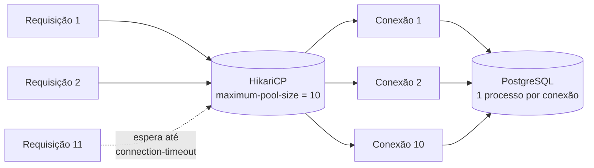

# P2.06 — Pool de conexões (HikariCP) e dimensionamento

> ⏱️ ~1h30 · 🔵 Pleno · Pré-requisitos: J5.02/J5.05 (`application.yml`, starters), J5.11 (`@Transactional`), P1.05 (pools de threads), P1.10 (threads virtuais e o recurso escasso), P2.02/P2.03 (travas seguram a conexão)

> ✅ **Validação final (2026-11-24):** módulo executado no PayFlow reconstruído; resultado e o que continua não executado no [README do módulo](README.md). Os avisos "não executado" / "por leitura" abaixo descrevem a escrita original.

> ⚠️ **Verificação:** **executado de verdade** (PostgreSQL 18.6 em Docker; HikariCP **7.0.2**, Spring Boot **4.1.2**, JDK 25.0.5; máquina de **12 núcleos compartilhada**): a curva de vazão × conexões com `pgbench` (`lab/sql-lab/exp7-pool.sh`, **duas amostras**: `out-exp7.txt` e `out-exp7b.txt`) e o esgotamento de pool com Spring (`lab/persistence-lab`, `PoolIT`). Os padrões do HikariCP foram **conferidos no README oficial** em 2026-11-13. **Não executado:** nada no `payflow` do aluno nem no RDS da J10. **Os números da curva dependem da máquina** (o `pgbench` roda **dentro** do container do banco e disputa a CPU com ele; um servidor de banco real tem outra relação CPU/disco): vale o **formato** da curva, não o valor absoluto.

## 🎯 Objetivos
Ao final desta aula você consegue:
- **Explicar** o que um *pool* de conexões resolve e **por que um pool grande piora** a vazão.
- **Configurar** o HikariCP no Spring Boot (`maximum-pool-size`, `connection-timeout`, `max-lifetime`, `keepalive-time`, `leak-detection-threshold`) conhecendo os **padrões**.
- **Diagnosticar** um esgotamento de pool (`Connection is not available, request timed out after …`) e **achar quem segura** a conexão.
- **Dimensionar** o pool com a regra "pequeno e saturado" e **conferir** a conta **réplicas × pool ≤ `max_connections`**.

## 🤔 Por que isso importa
No PayFlow, a primeira coisa que quebra sob carga **não** é a CPU da aplicação: é **a fila por uma conexão** de banco. Uma transferência lenta (a P1.13 mostrou) segura a conexão; com 10 conexões no pool e 11 requisições simultâneas, a 11ª **espera**, e se esperar mais que o *timeout* vira erro `500`. O reflexo comum é "aumenta o pool para 100". É **exatamente o oposto** do que o banco quer: cada conexão do PostgreSQL é **um processo do sistema operacional**, e muitos processos disputando poucos núcleos **reduzem** a vazão (a curva abaixo mostra). Esta aula ensina a olhar o pool como **gargalo deliberado**.

## 💡 Intuição (explicação simples)
O banco é uma **cozinha com 12 fogões**. O pool é a **fila de comandas** na porta da cozinha. Com **8 a 24 cozinheiros** trabalhando, a cozinha rende o máximo. Se você contrata **128 cozinheiros** para 12 fogões, eles passam o tempo se esbarrando e esperando um fogão livre: **sai menos comida e cada prato demora mais**. O gargalo certo é uma **fila curta na porta** (as requisições esperando no pool), não uma cozinha lotada. Só há exceção quando os cozinheiros **ficam parados esperando ingrediente de fora** (a transação espera uma chamada HTTP): aí mais cozinheiros ajudam, **mas o certo é não deixar o cozinheiro parado com o fogão ocupado**.

## 🔬 Como funciona por dentro

### 1. O que custa uma conexão
Abrir uma conexão com o PostgreSQL envolve TCP, (TLS), autenticação e **criar um processo servidor** (um por conexão). Por isso se **reutiliza**: o pool abre N conexões e as **empresta** a cada transação (`getConnection()` ao começar, `close()` devolve ao fim; o `close()` de uma conexão do pool **não** fecha a conexão real).



### 2. O que o Spring Boot liga por padrão
O Boot usa o **HikariCP** como pool padrão (versão **7.0.2** no BOM do Boot 4.1.2, a mesma do laboratório). As propriedades ficam em `spring.datasource.hikari.*`. **Padrões** conferidos no [README do HikariCP](https://github.com/brettwooldridge/HikariCP):

| Propriedade (`spring.datasource.hikari.…`) | Padrão | O que faz |
|---|---|---|
| `maximum-pool-size` | **10** | teto de conexões (ociosas + em uso) |
| `minimum-idle` | **= `maximum-pool-size`** | o HikariCP **recomenda não definir**: pool de tamanho fixo |
| `connection-timeout` | **30 000 ms** (mínimo 250) | quanto uma requisição **espera** por uma conexão antes de lançar `SQLException` |
| `idle-timeout` | 600 000 ms | só vale se `minimum-idle < maximum-pool-size` |
| `max-lifetime` | **1 800 000 ms (30 min)** | idade máxima de uma conexão (uma em uso nunca é aposentada à força) |
| `keepalive-time` | **120 000 ms (2 min)** | ping periódico para o firewall/NAT/banco não derrubar conexões ociosas (precisa ser **menor** que `max-lifetime`) |
| `leak-detection-threshold` | **0 (desligado)** | se uma conexão ficar **fora do pool** por mais que isso, o HikariCP **registra um aviso** com o *stack trace* de quem a pegou |

> ⚠️ **`max-lifetime` deve ser menor** que qualquer limite de tempo imposto por **fora** (banco, *proxy*, balanceador). O README recomenda **vários segundos a menos** que o limite da infraestrutura. Sem isso, a conexão é derrubada **por baixo** e a próxima requisição leva um erro de conexão fechada.

### 3. Dimensionamento: pequeno e saturado
A [página oficial "About Pool Sizing"](https://github.com/brettwooldridge/HikariCP/wiki/About-Pool-Sizing) dá um **ponto de partida** (não uma lei): `conexões = (núcleos × 2) + discos efetivos`, com **núcleos físicos** e "discos efetivos" ≈ 0 quando os dados cabem em memória. O axioma dela: *"você quer um pool pequeno, saturado de *threads* esperando por conexões"*. **E manda medir**: "teste a sua aplicação, simule a carga esperada e varie o tamanho em torno desse ponto de partida".

### 4. A conta que ninguém faz: **réplicas × pool**
O limite que importa é o do **banco**: `max_connections` (padrão do PostgreSQL: 100; **o do laboratório está em 200**). Cada **réplica** da aplicação abre **até** `maximum-pool-size`. Com `n` réplicas: **`n × maximum-pool-size + (conexões de manutenção, migrações, `psql`, monitoração) ≤ max_connections`**. No *rolling deploy* (P7) coexistem réplicas **velhas e novas**: conte as duas. Confira no banco real com `SHOW max_connections;` (no RDS, o valor depende da classe da instância: confira lá, não suponha).

## 🛠️ Exemplo prático

### A. A curva de vazão × conexões (`exp7-pool.sh`)
`pgbench` com um *script* que imita a transferência do PayFlow (`BEGIN`; dois `UPDATE accounts` na **ordem do id**, P2.03; dois `INSERT` em `ledger_entries`; `END`), sobre o volume de 20 000 contas e 5 milhões de lançamentos (`10-big-data.sql`), 8 s por ponto, 12 núcleos:

```text
amostra 1 (máquina ocupada, load ≈ 20)         amostra 2 (máquina quieta, load ≈ 2)
clientes   tps      latência média             clientes   tps      latência média
   1        1 108      0,90 ms                    1        1 460      0,69 ms
   4        5 201      0,77 ms                    4        5 634      0,71 ms
   8        8 415      0,95 ms                    8        6 982      1,15 ms
  16        8 626      1,86 ms                   16       12 187      1,31 ms
  32       10 880      2,94 ms                   32       11 382      2,81 ms
  64       10 488      6,10 ms                   64        6 319     10,13 ms
 128        7 981     16,04 ms                  128        5 052     25,33 ms
```
Leia: a vazão **sobe até 16–32 conexões** (12 núcleos, perto de `2 × núcleos`) e **cai** com 64 e 128, enquanto a **latência** de cada transação **multiplica por 10 a 30**. Mais conexões **não** deram mais trabalho: deram **mais fila e mais disputa**. As duas amostras discordam nos valores (a máquina é compartilhada), **concordam no formato**.

E o contrário, para entender a exceção: o mesmo *script* com **8 ms de espera** (`\sleep 4 ms` duas vezes) **dentro** da transação, imitando uma transação que **espera por algo de fora** com a conexão emprestada:
```text
(amostra 1)  clientes: 1 → 101 tps | 8 → 873 | 32 → 3 504 | 64 → 6 457 | 128 → 9 084 tps   (latência ≈ 9–14 ms)
(amostra 2)  clientes: 1 →  83 tps | 8 → 628 | 32 → 2 210 | 64 → 3 253 | 128 → 4 814 tps   (latência ≈ 12–27 ms)
```
Aqui a vazão **continua subindo** até 128, porque cada conexão passa **a maior parte do tempo parada** e a CPU do banco **sobra**. Mas repare no custo: para render **o mesmo** que 16 conexões "rápidas" você precisou de **centenas** de conexões **paradas**. **A solução certa não é um pool enorme: é não segurar a conexão enquanto espera** (nada de HTTP, e-mail, fila, `Thread.sleep` **dentro** da transação).

### B. Esgotar o pool de propósito (`PoolIT`)
Configuração do teste: pool de **2** conexões, `connection-timeout = 1000`, `leak-detection-threshold = 2000`, nome `payflow-pool`. **Quatro** transações, cada uma pega a conexão e a segura por **2,5 s**:
```java
new TransactionTemplate(tm).executeWithoutResult(s -> {
    jdbc.sql("SELECT 1").query(Integer.class).single();     // a conexão é emprestada AQUI...
    sleep(2500);                                              // ...e segurada durante o "trabalho lento"
});
```
```text
MXBean no meio da disputa: active=2 idle=0 total=2 threadsAwaiting=2
payflow-pool - Connection is not available, request timed out after 1000ms (total=2, active=2, idle=0, waiting=0)
resultado: CannotCreateTransactionException <- JDBCConnectionException <- SQLTransientConnectionException
           | payflow-pool - Connection is not available, request timed out after 1000ms (total=2, active=2, idle=0, waiting=0)
resultado: ok
resultado: ok
resultado: CannotCreateTransactionException <- JDBCConnectionException <- SQLTransientConnectionException | (a mesma mensagem)
WARN  ProxyLeakTask : Connection leak detection triggered for org.postgresql.jdbc.PgConnection@65a80fdb on thread pool-4-thread-2, stack trace follows
java.lang.Exception: Apparent connection leak detected
INFO  ProxyLeakTask : Previously reported leaked connection … on thread pool-4-thread-2 was returned to the pool (unleaked)
```
Três coisas para guardar:
1. **A mensagem completa** que você vai ver nos logs de produção: `HikariPool-1 - Connection is not available, request timed out after 30000ms (total=10, active=10, idle=0, waiting=…)`. Lê-se: **o pool está cheio e todas em uso** (`active = total`): quem segura as conexões?
2. **A cadeia de exceções no Spring:** `CannotCreateTransactionException` (do `@Transactional`) → `JDBCConnectionException` (Hibernate) → `SQLTransientConnectionException` (o JDBC/Hikari). Mapeie `CannotCreateTransactionException` para **503** (é **transitório**: tente de novo), não 500.
3. **`leak-detection-threshold` não distingue vazamento de "demora"**: aqui a conexão **não vazou**, só ficou presa 2,5 s; o aviso aponta **o código** que a segurava (o *stack trace* do `Exception: Apparent connection leak detected`) e depois diz `was returned to the pool (unleaked)`. É uma ferramenta de **diagnóstico**; valor típico: um pouco acima do pior caso legítimo (aqui 2 s para um teste; no PayFlow, algo como 5 s).

### C. Ver o pool em tempo de execução
O HikariCP expõe um `HikariPoolMXBean` (o teste usa `HikariDataSource.getHikariPoolMXBean()`: `getActiveConnections()`, `getIdleConnections()`, `getTotalConnections()`, `getThreadsAwaitingConnection()`). **`threadsAwaiting > 0` de forma sustentada = o pool é o gargalo.** A P6 expõe isso como métrica (Micrometer); do lado do banco, `SELECT state, count(*) FROM pg_stat_activity WHERE datname = 'payflow' GROUP BY 1` mostra quantas estão `active`, `idle` e, perigosíssimo, **`idle in transaction`** (alguém abriu a transação e **parou**).

### D. A configuração do PayFlow (por leitura)
```yaml
# application.yml (valores iniciais; MEDIR antes de mudar)
spring:
  datasource:
    hikari:
      maximum-pool-size: 10         # = padrão; 3 réplicas × 10 = 30 conexões no banco
      connection-timeout: 3000      # falha RÁPIDO (padrão 30 s): melhor 503 em 3 s que 30 s de fila
      max-lifetime: 1500000         # 25 min: abaixo de qualquer limite de proxy/RDS Proxy (conferir o seu)
      leak-detection-threshold: 5000   # só em dev/staging, para achar quem segura conexão
  jpa:
    open-in-view: false             # J5/ADR 0006: a conexão NÃO fica presa até o fim da renderização
```
`open-in-view: false` é a mesma decisão da J5/ADR 0006 (serviços transacionais, sem carga preguiçosa na camada web): com `true` (padrão do Boot) a conexão pode ficar emprestada **até o fim da resposta**.

## 🧠 Pausa para lógica
**Enunciado:** o PayFlow roda em **3 réplicas** (P7), cada uma com `maximum-pool-size = 30` ("para aguentar o pico"), contra um banco com `max_connections = 100` e **12 núcleos**. (a) Quantas conexões a aplicação **pode** abrir? (b) O que acontece num *rolling deploy* que sobe 1 réplica **nova** antes de derrubar a velha? (c) Qual seria um tamanho de pool defensável e **o que fazer** se o pico exigir mais *throughput*?

<details><summary>Dica</summary>Some: réplicas × pool, depois some as conexões de migração e monitoração. A curva da seção A tem um pico perto de 2 × núcleos.</details>
<details><summary>Solução</summary>

(a) 3 × 30 = **90** de 100: sobram 10 para migrações (Flyway), `psql`, monitoração, *backup*: **no limite**. (b) Durante o *deploy* coexistem **4** réplicas: 4 × 30 = **120 > 100**: as conexões novas recebem `FATAL: sorry, too many clients already` e a réplica nova pode nem ficar pronta (ou, pior, a **velha** perde conexão ao renovar). (c) Com 12 núcleos, o banco rende o máximo perto de **16 a 32** conexões **ativas no total**: algo como **8 a 10 por réplica** (24 a 30 no total) já satura. Se o pico exigir mais *throughput*, o caminho **não** é pool maior: é (1) **encurtar a transação** (nada de rede dentro dela), (2) **índices/consultas** melhores (P2.04/P2.05), (3) **cache** de leitura (P2.09), (4) **réplica de leitura** ou *pooler* externo (PgBouncer, RDS Proxy: multiplexa muitas conexões de aplicação em poucas do banco), (5) mais banco.
</details>

## ⚖️ Trade-offs e quando NÃO usar
- **Pool pequeno:** protege o banco e dá latência estável; exige **disciplina** (transação curta) e *timeouts* curtos (falhar rápido). Se a transação **é** longa por natureza (relatórios), **separe** em outro pool/*datasource* (e talvez em réplica de leitura) para não sufocar o transacional.
- **Pool grande** só "funciona" enquanto as conexões **ficam paradas** (seção A, segunda curva): é **mascarar** o problema e **gastar memória do banco** (cada conexão é um processo).
- **`connection-timeout` curto (3 s):** falha rápido, evita fila infinita de requisições empilhadas (e *threads* do Tomcat presas), mas devolve erro em picos curtos que um timeout de 30 s absorveria. Combine com **`503` + `Retry-After`** e *retry* do cliente (P5).
- **Threads virtuais (P1.10) não dissolvem o limite:** com `spring.threads.virtual.enabled=true`, mil requisições podem estar "em andamento" **todas esperando o mesmo pool de 10**. O recurso escasso continua sendo a conexão: **limite com o pool**/`Semaphore`, não com o número de *threads*. É a condição 1 da decisão 92.
- **Pooler externo (PgBouncer, RDS Proxy):** resolve "muitas réplicas × muitas conexões", mas **muda semântica** (o modo *transaction pooling* quebra `SET` de sessão, *prepared statements* de sessão e *advisory locks* de sessão: o Flyway/`SET LOCAL lock_timeout` precisam de cuidado). Só entra com motivo medido.

## ⚠️ Erros comuns e boas práticas de produção
- **Aumentar `maximum-pool-size` como primeira reação.** Meça `threadsAwaiting`, o tempo das transações e `idle in transaction` antes.
- **Segurar a conexão durante chamada externa.** O `ExchangeService` (P1.06) **busca o câmbio antes** de abrir a transação (ou fora dela). Procure no PayFlow qualquer `@Transactional` que chame `RestClient`: é bug de dimensionamento.
- **`@Transactional` no método do *controller*:** a transação (e a conexão) dura **a requisição inteira**, inclusive a serialização do JSON. Coloque a transação no **serviço**, o mais curta possível (J5.11).
- **Esquecer a conta réplicas × pool** e descobrir `FATAL: sorry, too many clients already` no primeiro *rolling deploy*.
- **`max-lifetime` maior que o limite da infraestrutura:** conexões derrubadas "por baixo" geram `This connection has been closed` esporádico.
- **Teste de carga com pool diferente do de produção:** os números não valem (P2.11).
- **Ligar `leak-detection-threshold` em produção com valor baixo:** o aviso não indica vazamento real (seção B3) e polui o log. Use em dev/staging ou com folga.

## 🧩 Exercícios
1. **Fixação:** rode `exp7-pool.sh` **duas vezes** e responda: em que número de clientes a sua vazão atingiu o pico? Quanto isso é de `2 × núcleos` (`nproc`)? Compare as duas curvas **com e sem** espera dentro da transação.
2. **Aplicação no PayFlow:**
   - [ ] Acrescente ao `application.yml` o bloco da seção D, **ajustando** `maximum-pool-size` à sua conta de réplicas (Compose: 1 réplica; EC2 da J10: 1) e registre a conta em `docs/db-concurrency-notes.md`.
   - [ ] Escreva **`PoolExhaustionTest`** (JUnit 6 + Testcontainers, J7.05): `@SpringBootTest(properties = {"spring.datasource.hikari.maximum-pool-size=2", "…connection-timeout=1000"})`, três transações que seguram a conexão e **assertam** `CannotCreateTransactionException` na terceira. Critério de pronto: o teste **falha** se você aumentar o pool para 5 (prove que ele testa o que diz).
   - [ ] Mapeie `CannotCreateTransactionException` e `PessimisticLockingFailureException` para **503** com `Retry-After: 1` no `@RestControllerAdvice` (Problem Details, J6.04), com teste de fatia (`@WebMvcTest`).
   - [ ] `grep -rn "RestClient" src/main` e confirme que **nenhum** método `@Transactional` o chama.
3. **Desafio (opcional):** suba um segundo `datasource` Hikari **só para relatórios** (pool de 2, `readOnly`) e mostre que um relatório lento **não** esgota o pool das transferências.

<details><summary>Solução de referência (exercício 1)</summary>

Em uma máquina de 12 núcleos o pico costuma ficar entre 16 e 32 clientes (nas duas amostras do laboratório: 32 e 16), ou seja, **entre 1,3× e 2,7× o número de núcleos**, na vizinhança de `2 × núcleos`. Com **espera dentro da transação** a curva **não** tem pico dentro de 128 clientes: ela mede **conexões paradas**, não trabalho do banco. A diferença entre as duas curvas **é** o argumento para "transação curta".
</details>

## 🎤 Na entrevista
- **Por que usar um pool de conexões e por que ele deve ser pequeno?** Abrir conexão é caro (TCP, autenticação, um processo no PostgreSQL); o pool as reutiliza. Pequeno porque o banco tem poucos núcleos: acima de ≈ `2 × núcleos` a vazão **cai** e a latência sobe; o certo é fila **no pool**, não no banco.
- **O que significa `Connection is not available, request timed out after 30000ms (total=10, active=10, idle=0)`?** Todas as conexões estão em uso e nenhuma ficou livre dentro do `connection-timeout`. Procure **quem segura** a conexão (transação longa, chamada externa dentro de `@Transactional`, `idle in transaction`), não aumente o pool às cegas.
- **Como dimensionar o pool de uma aplicação com várias réplicas?** `réplicas × maximum-pool-size` (contando o *rolling deploy*) mais as conexões de manutenção devem caber em `max_connections`; o tamanho por réplica vem de **medir**, com ponto de partida `2 × núcleos` do banco dividido entre as réplicas.
- **Threads virtuais resolvem o problema do pool?** Não: o recurso escasso é a conexão. Elas tornam **barato esperar**, então você precisa **limitar** a concorrência no recurso (pool/`Semaphore`).

## 📚 Para ir além
- 📄 [HikariCP (README)](https://github.com/brettwooldridge/HikariCP): todas as propriedades e padrões (conferidos aqui).
- 📄 [HikariCP: About Pool Sizing](https://github.com/brettwooldridge/HikariCP/wiki/About-Pool-Sizing): a fórmula, o axioma "pequeno e saturado" e o experimento citado.
- 📄 [PostgreSQL 18: `pgbench`](https://www.postgresql.org/docs/18/pgbench.html): scripts personalizados (`\set`, `\sleep`), `-c`, `-j`, `-T`.
- 📄 [PostgreSQL 18: Connections and Authentication (`max_connections`)](https://www.postgresql.org/docs/18/runtime-config-connection.html).
- 📄 [Spring Boot: Data (DataSource e pool)](https://docs.spring.io/spring-boot/reference/data/sql.html): como o Boot escolhe o pool e as propriedades `spring.datasource.hikari.*`.
- 📄 [Amazon RDS Proxy](https://docs.aws.amazon.com/AmazonRDS/latest/UserGuide/rds-proxy.html) e 📄 [PgBouncer](https://www.pgbouncer.org/): *poolers* externos (visão; só com motivo medido).
- 📑 Livro: *Release It!* (Nygard), padrões "Timeouts" e "Bulkheads": o pool e o `connection-timeout` são exatamente isso.

## ✅ Checklist da aula
- [ ] Rodei a curva e vi a vazão **cair** acima do pico.
- [ ] Esgotei um pool de propósito e li a mensagem e a cadeia de exceções.
- [ ] Fiz a conta réplicas × pool ≤ `max_connections` do PayFlow (inclusive no *rolling deploy*).
- [ ] Confirmei que nenhum `@Transactional` do PayFlow faz chamada de rede.
- [ ] Anotei `PoolExhaustionTest` e o mapeamento para `503` (**por leitura**; não executados no PayFlow).
