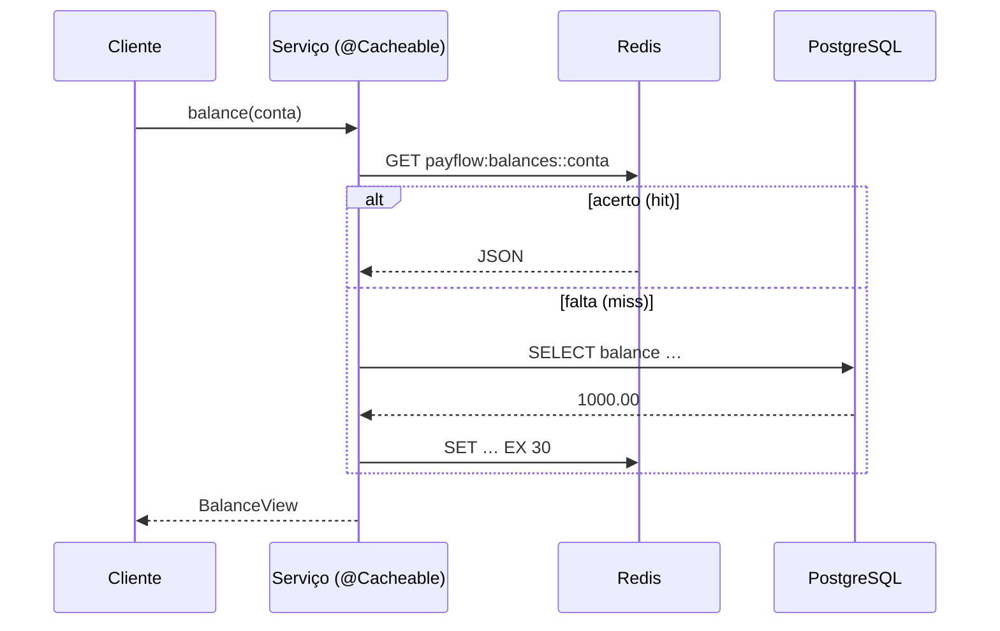

# P2.09 — Redis e `@Cacheable`: TTL, invalidação e *cache stampede*

> ⏱️ ~1h30 · 🔵 Pleno · Pré-requisitos: J5.03 (*beans*, *proxies*), J5.11 (`@Transactional`), J8.07 (LGPD: dado pessoal em cache), J9 (Compose, segredos), P1.07/P1.08 (concorrência, visibilidade), P2.04 (medir), P2.06 (pool)

> ⚠️ **Verificação:** **executado de verdade** em `lab/persistence-lab` (`CacheIT`, `CacheOutageStrictIT`, `CacheOutageTolerantIT`): **Redis 8.10.3** (`redis:8`, Docker), **Spring Data Redis 4.1.2** (Lettuce **7.5.2**), Spring Boot **4.1.2**, Jackson **3.1.7**, PostgreSQL **18.6**, JDK 25.0.5. O comportamento do `RedisCacheWriter` foi lido **no código-fonte** (`spring-data-redis-4.1.2-sources.jar`) e as propriedades, **na documentação** do Boot. **Não executado:** nada no `payflow` do aluno e o Redis **com senha/TLS/ElastiCache** (a configuração de Compose abaixo é **por leitura**). Os tempos de GET (`redis-benchmark`) e de `SELECT` por chave (`pgbench`) foram medidos **na mesma máquina, em `localhost`, com 1 cliente**: mostram uma **ordem de grandeza**, **não** o que você terá na AWS.

## 🎯 Objetivos
Ao final desta aula você consegue:
- **Implementar** *cache-aside* com `@Cacheable`/`@CacheEvict` sobre o Redis (TTL, serialização JSON **tipada**, prefixo de chave) e **inspecionar** o que ficou no Redis.
- **Decidir** **o que vale a pena cachear** (e o que **não**), **medindo** o custo da leitura **sem** cache.
- **Reproduzir** e **tratar** quatro falhas clássicas: **dado velho** (corrida leitor × escritor), **invalidação antes do *commit***, ***cache stampede*** e **penetração** (chave inexistente).
- **Projetar** o que acontece quando **o Redis cai** (o cache é **otimização**, não **dependência**).

## 🤔 Por que isso importa
"Põe um Redis na frente" é a resposta automática a "está lento". Para o PayFlow ela é **cara** se feita sem pensar: um cache em um sistema financeiro é uma **segunda cópia do dinheiro**, e a pergunta "**qual cópia está certa agora?**" não tem resposta barata. Esta aula mostra **como fazer direito** e **como medir se vale a pena**, incluindo o resultado **desconfortável** do laboratório: **cachear o saldo quase não ganha nada**.

## 💡 Intuição (explicação simples)
O **cache** é um **post-it na sua mesa** com o telefone do cliente: você olha o post-it em vez de ir ao arquivo. Funciona **se** (1) ir ao arquivo é **bem mais lento** que olhar o post-it, (2) o telefone **muda pouco**, e (3) você **troca o post-it** quando o cliente muda de número. Falha de três jeitos: o post-it **está velho** (ninguém trocou), **todos os colegas** vão ao arquivo ao **mesmo tempo** quando o post-it some (o *stampede*), ou o post-it **fica errado por um instante** porque alguém o trocou **antes** de o arquivo ser atualizado. E **se o seu armário de post-its pegar fogo**, o escritório **tem** que continuar funcionando indo ao arquivo.

## 🔬 Como funciona por dentro

### 1. *Cache-aside* (o padrão do `@Cacheable`)

O **Spring Cache** monta isso por **proxy** (como `@Transactional`): `@Cacheable` consulta o cache; **só se faltar** chama o método e **grava** o resultado; `@CacheEvict` **remove** a entrada. **Auto-chamada** (`this.balance(...)` dentro da própria classe) **não** passa pelo proxy e **não** usa o cache (a mesma armadilha da J5.11).

### 2. O que o Boot e o Spring Data Redis fazem por padrão (e **não** fazem)
- Com `spring-boot-starter-cache` + `spring-boot-starter-data-redis`, o Boot cria um **`RedisCacheManager`**. A propriedade `spring.cache.redis.time-to-live` tem padrão **"as entradas nunca expiram"** ([propriedades do Boot](https://docs.spring.io/spring-boot/appendix/application-properties/index.html)): **sem TTL**, um cache vira um **segundo banco de dados**, para sempre desatualizado. `spring.cache.redis.cache-null-values` vale `true` por padrão; `key-prefix` e `enable-statistics` (**falso**) também existem.
- O Redis **não** tem limite de memória por padrão (`maxmemory 0`) e a política padrão é **`noeviction`** (**medido**: `CONFIG GET maxmemory-policy → noeviction`): quando (se) você configurar um teto, ele passa a **recusar escritas** em vez de descartar chaves. Para cache, a recomendação da [documentação](https://redis.io/docs/latest/develop/reference/eviction/) é `allkeys-lru` ("um bom padrão se você não tem motivo para outro").
- **As escritas do cache (`put`/`evict`) são assíncronas/adiadas por padrão** com o Lettuce (seção 3 do exemplo): é **documentado no Javadoc** de `RedisCacheWriter` ("a remoção real pode ocorrer de forma assíncrona ou adiada, com leituras subsequentes ainda vendo a entrada").

## 🛠️ Exemplo prático

### A. Antes de cachear: **meça o custo sem cache**
Leitura do **saldo** (`SELECT balance FROM accounts WHERE id = ?`, chave primária, conta já em memória), 1 cliente, mesma máquina (`out-cache-vs-db.txt`):
```text
PostgreSQL, SELECT por chave primária (pgbench, protocolo simples):   0,017 ms
PostgreSQL, SELECT por chave primária (pgbench, -M prepared):         0,009 ms
Redis, GET de uma chave pequena (redis-benchmark -c 1):               ≈ 36 000 req/s → p50 0,023 ms
```
**Ler o saldo no PostgreSQL já custa o mesmo que (ou menos que) um `GET` no Redis.** Em `localhost` e em memória, o cache **não acelera nada**: ele apenas **troca** uma consulta barata por **outra** viagem de rede (mais a (de)serialização JSON, **que o PostgreSQL não faz**). Na AWS (J10), o RDS e o ElastiCache estarão na **mesma VPC**, com latências de rede **parecidas**: o mesmo raciocínio vale. **Cachear o saldo só se paga se:** (a) o **banco** estiver saturado por **leituras** (milhares de leituras por segundo da **mesma** chave), ou (b) o banco estiver **longe** (outra região), ou (c) o valor **custar caro** para calcular. Compare com o que **custa caro** no PayFlow (P2.04): o **resumo de 2 anos por mês** (**192 a 475 ms**). Este é o candidato **real** a cache (ou a um modelo de leitura, P2.11). **Lição de projeto: cache é para o que é caro, não para o que é frequente e barato.** O resto da aula usa o saldo porque o padrão é o mesmo e o experimento é limpo.

### B. A configuração (laboratório e PayFlow)
Dependências (Boot 4.1.2): `spring-boot-starter-data-redis`, `spring-boot-starter-cache` e **`spring-boot-starter-jackson`** (o starter de Redis **não** traz o Jackson 3 que o serializador JSON usa: sem ele, o primeiro erro é `cannot access tools.jackson.databind.cfg.MapperBuilder`; no PayFlow ele já chega pelo `webmvc`).
```java
@Configuration
public class CacheConfig {

    private static RedisCacheConfiguration config() {
        return RedisCacheConfiguration.defaultCacheConfig()
                .entryTtl(Duration.ofSeconds(30))                 // TTL: a rede de segurança contra dado velho
                .disableCachingNullValues()
                .prefixCacheNameWith("payflow:")
                .serializeValuesWith(SerializationPair.fromSerializer(new JacksonJsonRedisSerializer<>(BalanceView.class)));   // TIPADO
    }

    /** Escritas IMEDIATAS: o put/evict só retorna depois de aplicado (o padrão é assíncrono). */
    @Bean @Primary
    RedisCacheManager cacheManager(RedisConnectionFactory factory) {
        return RedisCacheManager.builder(RedisCacheWriter.create(factory, w -> w.immediateWrites()))
                .withCacheConfiguration("balances", config()).build();
    }
}
```
```java
public record BalanceView(UUID accountId, BigDecimal balance, Instant asOf) { }       // um DTO pequeno e imutável, NUNCA a entidade JPA

@Cacheable(cacheNames = "balances", key = "#accountId")
public BalanceView balance(UUID accountId) { /* lê do banco */ }

@CacheEvict(cacheNames = "balances", key = "#accountId")
public void deposit(UUID accountId, BigDecimal amount) { /* escreve no banco */ }
```
O que ficou no Redis (`CacheIT`):
```text
chave Redis: payflow:balances::20000000-0000-0000-0000-000000000001 | TTL(s): 30
valor: {"accountId":"20000000-0000-0000-0000-000000000001","balance":1000.00,"asOf":"2026-11-14T02:13:57.019968297Z"}
```
Três decisões **com motivo**:
1. **Serializador *tipado* (`JacksonJsonRedisSerializer<BalanceView>`), não o genérico.** O `GenericJacksonJsonRedisSerializer` **sem tipagem padrão** devolveu um **`LinkedHashMap`** (`ClassCastException: LinkedHashMap cannot be cast to BalanceView` no 2º acesso). O genérico **com** tipagem padrão grava o **nome da classe** no JSON (`@class`) e **desserializa tipos escolhidos pelo conteúdo do Redis**: quem escreve no Redis passa a **escolher classes** da sua aplicação (risco de segurança conhecido de *deserialization*). O **tipado por cache** não grava `@class` e só sabe produzir **um** tipo.
2. **DTO, não entidade:** entidade JPA tem proxies, coleções `LAZY`, `@Version`: **não** serialize.
3. **`balance` no JSON é um número `1000.00`**: o `BigDecimal` voltou com a **escala 2** (verificado no teste); para **valores monetários** que passarão por outras linguagens/JS, **prefira `String`** (decisão 11).

### C. As **escritas do cache são assíncronas por padrão**: o *flaky* que quase me escapou
O `hitMissTtlAndJsonInRedis` falhou em **cerca de 1/3** das execuções (2 de 6 execuções isoladas; e, nas rodadas completas, de vez em quando): a **2ª** chamada logo após a **1ª** **não via** o valor que a 1ª acabara de gravar (o `MONITOR` do Redis mostrou **dois `GET` antes do primeiro `SET`**). A causa, lida no código-fonte do Spring Data Redis 4.1.2: com o Lettuce (que implementa `ReactiveRedisConnectionFactory`), o `DefaultRedisCacheWriter` grava **de forma assíncrona** salvo se você pedir o contrário (`RedisCacheWriter.create(factory, w -> w.immediateWrites())`; o Javadoc: "*Enable immediate writes in case a particular cache requires stronger consistency (i.e. Cache writes must be visible immediately)*"). Com `immediateWrites()`: **0 falhas em 8 execuções isoladas** e **0** em 4 execuções completas da classe `CacheIT`. **No PayFlow:** use `immediateWrites()` em **todo** cache cujo `@CacheEvict` **precisa** valer antes de a requisição seguinte ler (o saldo!). É a mesma família da P1.08: **visibilidade não é garantida sem uma relação "acontece-antes"**, agora **entre sistemas**.

### D. **Dado velho**: o leitor lento × o escritor
Um leitor lê o saldo no banco (`1000.00`) e **demora** 400 ms para devolver (e gravar no cache); **no meio**, um depósito de 50 confirma (banco = `1050.00`) e faz `@CacheEvict` (**nada a remover ainda**); o leitor **então** grava `1000.00` no cache:
```text
banco = 1050.00 | cache = 1000.00 (leitor devolveu 1000.00)            ← o cache ficou ERRADO até o TTL (30 s)
```
Nenhum erro, nenhum aviso. **É inerente ao *cache-aside*:** a leitura ("ler o banco" → "gravar no cache") **não é atômica** com a escrita. Mitigações: (1) **TTL curto** (a rede de segurança: o dado velho dura **no máximo** o TTL); (2) **versão** no valor (`BalanceView.version`) e só sobrescrever se **maior** (exige comparação atômica: *script* Lua/`WATCH`); (3) **não cachear** o que não tolera nem 30 s de defasagem. **Regra do PayFlow:** o cache serve **exibição**; **nenhuma decisão financeira** (a transferência, o saque) lê o saldo do cache: a transferência lê **do banco, com trava** (P2.02).

### E. Invalidar **antes** do *commit*
```java
@Transactional                       // do CHAMADOR (ex.: TransferService)
void transferir(...) { balances.deposit(id, amount); ... }   // `deposit` tem @CacheEvict e roda DENTRO dessa transação
```
Se o `@CacheEvict` roda **antes** de a transação do chamador **confirmar**, um leitor que chegue **entre o *evict* e o *commit*** lê o saldo **antigo** do banco (ainda não confirmado) e o **grava de volta** no cache: dado velho (seção D) **por um erro de ordem**. Duas medições (`commit` forçado a demorar 400 ms; leitor lendo a cada 20 ms):
```text
advisors do proxy (mais externo primeiro): [BeanFactoryCacheOperationSourceAdvisor, BeanFactoryTransactionAttributeSourceAdvisor]

@CacheEvict e @Transactional NO MESMO método:       banco=1050.00 cache=1050.00      ← o cache (externo) faz o evict DEPOIS do commit
evict na transação do CHAMADOR (método do outro bean), comum:            banco=1050.00 cache=1000.00   ← DADO VELHO
evict na transação do CHAMADOR, com RedisCacheManager.transactionAware(): banco=1050.00 cache=1050.00   ← corrigido
```
Dois fatos conferidos: (1) na **ordem padrão** o proxy do cache fica **por fora** do proxy transacional, então `@Transactional @CacheEvict` **no mesmo método** invalida **depois** do *commit*: seguro; (2) **quando o `@CacheEvict` está num método de **outro** *bean* chamado **de dentro** da transação** (como o `TransferService`), o *evict* roda **antes** do *commit* da transação **externa**: **dado velho**. A correção é um gerenciador **ciente de transação** (`RedisCacheManager.builder(...).transactionAware()`), que **adia** `put`/`evict` até o *commit* da transação em andamento, ou um `@TransactionalEventListener(phase = AFTER_COMMIT)` que invalide (um *listener* do Spring que só roda **depois** do *commit*; não foi ensinado antes e **não** foi executado aqui). (Mudar a `order` de `@EnableCaching` ou de `@EnableTransactionManagement` **inverte** a regra (1): **teste** depois de mexer.)

### F. *Cache stampede*: vinte *threads* na chave fria
```text
sem sync:                                               20 threads → 20 consultas ao banco
@Cacheable(sync = true) com o escritor padrão:           20 threads → 20 consultas   ← sync NÃO protege aqui
@Cacheable(sync = true) com lockingRedisCacheWriter:     20 threads →  1 consulta
```
Quando uma chave **quente** expira (ou o Redis é reiniciado), **todas** as requisições faltam ao mesmo tempo e **todas** vão ao banco: o banco recebe o pico que o cache existia para **evitar**. O `sync = true` **sozinho não basta**: com o `RedisCacheManager` **padrão** (sem trava) o `get(key, loader)` **não** serializa as cargas (**20** consultas). Com o **escritor com trava** (`RedisCacheWriter.create(factory, w -> w.immediateWrites().cacheLocking(l -> l.enable()))`) vira **1**: a trava é uma **chave do Redis**, então vale **entre instâncias**. **O custo, dito na documentação:** "*Locking applies on the cache level, not per cache entry*": a trava é **do cache inteiro** (todas as chaves de `balances`), e "*leva a requisições adicionais e a possíveis esperas*". Mitigações complementares: **TTL com *jitter*** (`RedisCacheConfiguration.entryTtl(TtlFunction)`: não expirar tudo junto; **não executado**) e **aquecer** o cache dos itens quentes no *deploy*.

### G. Penetração: a chave que **nunca** existe
`disableCachingNullValues()` + um método que devolve `null` (conta inexistente):
```text
java.lang.IllegalArgumentException: Cache 'balances' does not allow 'null' values; Avoid storing null via '@Cacheable(unless="#result == null")' or configure RedisCache to allow 'null' via RedisCacheConfiguration
```
Com `unless = "#result == null"` o erro some, **mas** 5 consultas à mesma conta inexistente fizeram **5 idas ao banco**: **o cache não protege** de quem pergunta por contas que não existem (um *scan* de IDs: J8). O PayFlow **não** deve cachear "não existe" (a regra 404 já é barata e o ataque é tratado por **limitação de taxa**, J8.06); em outros sistemas, guarda-se um **valor sentinela** com TTL curto (5 s).

### H. Quando o Redis **cai** (`CacheOutageStrictIT` × `CacheOutageTolerantIT`)
```text
STRICT   (sem tratamento):  Redis fora -> EXCEÇÃO org.springframework.data.redis.RedisConnectionFailureException em 3 ms; consultas ao banco: 0
TOLERANT (CacheErrorHandler): CACHE INDISPONÍVEL (get): RedisConnectionFailureException -> seguindo para o banco
                              CACHE INDISPONÍVEL (put): RedisConnectionFailureException -> seguindo para o banco
                              Redis fora -> resposta BalanceView[…, balance=1000.00, …] em 222 ms; consultas ao banco: 1
```
**Sem tratamento, a queda do cache derruba o endpoint** (exceção que sobe ao cliente): **o cache virou dependência**. Com um `CacheErrorHandler` (via `CachingConfigurer`) que **registra e segue**, o endpoint **degrada** para o banco (aqui, com um `get` e um `put` falhando). **Cuidados de produção:** (1) **conexão recusada** falha rápido (3 ms); um Redis **inalcançável** (pacote perdido) espera o *timeout*: configure `spring.data.redis.connect-timeout` e `spring.data.redis.timeout` **curtos** (centenas de ms) e, para quedas longas, um **disjuntor** (P5, *Resilience4j*) para **parar de tentar**; (2) o `evict` que falhou deixa **dado velho** (seção D): o TTL é a rede de segurança; (3) **alerte** sobre o cache fora (P6), em vez de só registrar.

> ⚠️ **Armadilha achada na última rodada do laboratório:** para simular "Redis fora" eu declarei um *bean* `LettuceConnectionFactory` apontando para a porta 1. A autoconfiguração do Boot **recuou** (`@ConditionalOnMissingBean(RedisConnectionFactory.class)`) e **todo** o laboratório passou a usar o Redis morto: `RedisConnectionFailureException: Unable to connect to Redis` em **8 testes** de `CacheIT`, e os testes de queda "passaram" **pelo motivo errado**. Corrigi construindo a fábrica **dentro** do `RedisCacheManager` (sem expô-la como *bean*). **No PayFlow:** declarar um **segundo** `RedisConnectionFactory` (por exemplo, um Redis só para sessões) **desliga** o do Boot; use `@Qualifier`/`@Primary` e **teste** que o cache principal ainda aponta para o Redis certo.

### I. O Redis do PayFlow no Compose (por leitura)
```yaml
# compose.yaml (acréscimo)
  redis:
    image: redis:8
    command: ["sh", "-c", "exec redis-server --requirepass \"$(cat /run/secrets/redis_password)\" --maxmemory 128mb --maxmemory-policy allkeys-lru --save ''"]
    secrets: [redis_password]
    healthcheck:
      test: ["CMD-SHELL", "REDISCLI_AUTH=\"$(cat /run/secrets/redis_password)\" redis-cli ping | grep -q PONG"]
      interval: 5s
      timeout: 3s
      retries: 10
    # SEM "ports:": como o banco (J9), só a rede do Compose enxerga o Redis
```
e no `app`: `SPRING_DATA_REDIS_HOST: redis` e o segredo `spring.data.redis.password` em `secrets/` (o `configtree` da J9 lê o arquivo `/run/secrets/spring.data.redis.password`). `--save ''` desliga a persistência (é **cache**: perder tudo num reinício é aceitável; **nunca** guarde no Redis o que não pode ser perdido). **Não executado** (só o laboratório): confira o `healthcheck` e o `command` na sua máquina. Em produção (P9): ElastiCache **dentro da VPC**, TLS e autenticação (`spring.data.redis.ssl.enabled`, `spring.data.redis.password`).

## 🧠 Pausa para lógica
**Enunciado:** o PayFlow cacheia o `BalanceView` com TTL de 30 s e `@CacheEvict` (com `immediateWrites` e `transactionAware`) no depósito. Um cliente deposita R$ 100 e **imediatamente** abre o app. (a) Em que situação ele ainda vê o saldo **antigo**? (b) O que **não** pode usar o saldo do cache? (c) Se o Redis ficar **partido** da rede por 10 min, o que acontece com cada operação?

<details><summary>Dica</summary>O `@CacheEvict` e o `put` podem falhar; leitor lento (seção D); o cache é para exibição.</details>
<details><summary>Solução</summary>

(a) (1) Se o **`evict` falhou** (Redis indisponível naquele instante): o cache fica com o valor antigo **até o TTL (30 s)**; (2) se um **leitor lento** gravou o valor velho **depois** do *evict* (seção D). Nos dois casos o dado velho dura **no máximo 30 s**. (b) **Qualquer decisão financeira**: a transferência, o limite de saque, a conciliação: leem do **banco**, com trava (P2.02). O cache é só **exibição**. (c) Com o `CacheErrorHandler` (seção H) **leituras** degradam para o banco (mais lentas) e **escritas** continuam (o `evict` falha e é registrado: dado velho até o TTL, depois do Redis voltar); **sem** o tratador, **todos** os endpoints que usam `@Cacheable` retornam `500`. Por isso o TTL **curto** é parte do projeto, não um detalhe.
</details>

## ⚖️ Trade-offs e quando NÃO usar
- **Cache de dinheiro:** **evite** (seção A: o saldo é barato de ler; o risco é caro). Cache de **resultados caros** (resumos, relatórios, câmbio) é onde ele **paga**.
- **TTL × frescor:** TTL curto = menos dado velho e **mais** *misses*; longo = o inverso. 30 s é um ponto de partida **para exibição**; **meça** o *hit ratio* (`spring.cache.redis.enable-statistics` + métricas do Micrometer, prefixo `cache.`, P6).
- **`sync = true` com trava do Redis:** resolve o *stampede*, mas a trava é **por cache** (não por chave) e acrescenta idas ao Redis; para **um** cache com muitas chaves quentes pode **virar gargalo**. A alternativa é **TTL com *jitter*** e *warm-up*.
- **Redis × cache local (Caffeine):** o Caffeine é **mais rápido** (sem rede) e **local à instância** (cada réplica tem o seu e **não** são invalidados juntos). Redis é **compartilhado** (uma invalidação vale para todas as réplicas, P7), ao custo da rede e de **mais uma peça** para operar. Para **dado de referência** que muda **raramente**, Caffeine basta.
- **Redis como dependência:** é mais uma **peça de infraestrutura** (memória, rede, senha, TLS, monitoração, custo na AWS 💸 em P9). **Se o ganho medido for pequeno** (seção A), **não** adote.

## ⚠️ Erros comuns e boas práticas de produção
- **Sem TTL** (o padrão do Boot): cache que **nunca** se renova. **Sempre** defina `time-to-live`/`entryTtl`.
- **Cachear a entidade JPA**: proxy, `LAZY`, `@Version`; use **DTO**.
- **Serializador genérico sem tipagem** (devolve `LinkedHashMap`) **ou com tipagem padrão aberta** (risco de *deserialization*): use **tipado por cache**.
- **Esquecer `immediateWrites()`** e ter *evict* que "não valeu" às vezes (seção C).
- **`@CacheEvict` dentro de transação alheia** sem `transactionAware()` (seção E).
- **Sem `CacheErrorHandler`/*timeouts* curtos**: a queda do Redis derruba o sistema (seção H).
- **Autorização depois do cache:** a chave é `accountId`; se o `@Cacheable` fica **antes** da checagem de dono (IDOR, J8), **qualquer usuário** lê o saldo de **qualquer conta** em cache. A checagem de dono vem **antes**, no controller/serviço que chama o método cacheado.
- **Dado pessoal no cache** (nome, e-mail): LGPD (J8.07): o `BalanceView` só tem **id, saldo e instante**; **TTL curto**; Redis **autenticado e fora da internet**.
- **Chave sem prefixo/versão** e dois sistemas compartilhando o mesmo Redis: colisões. O prefixo `payflow:` e, se o formato do valor mudar, **mude o prefixo/versão** (`payflow:v2:`) para não desserializar o formato velho.
- **Não medir** (seção A).

## 🧩 Exercícios
1. **Fixação:** rode `CacheIT`. Para cada teste, escreva **uma frase** dizendo **qual falha** ele prova e **qual configuração** a corrige. Em seguida **tire** o `immediateWrites()` e rode `hitMissTtlAndJsonInRedis` **dez vezes**: quantas falham?
2. **Aplicação no PayFlow:**
   - [ ] Meça **antes de cachear**: `EXPLAIN (ANALYZE)` da leitura de saldo e do **resumo mensal** (P2.04) e registre em `docs/cache-notes.md` **qual** vale cachear (e por quê).
   - [ ] Adicione os *starters* (`data-redis`, `cache`), o `RedisCacheManager` da seção B (**`immediateWrites` + `transactionAware`**, serializador **tipado**, TTL 30 s para `balances`, **60 s** para `statement-summary`), `@EnableCaching` e o serviço de resumo/saldo com `@Cacheable`. **A checagem de dono (J8) fica antes** do método cacheado.
   - [ ] Evicte `balances` das **duas contas** da transferência **depois do *commit*** (`transactionAware` ou `@TransactionalEventListener(AFTER_COMMIT)`) e do depósito. Teste (Testcontainers com a imagem `redis:8`, J7.05): *commit* lento + leitor concorrente **não** deixa dado velho.
   - [ ] Implemente o `CacheErrorHandler` tolerante (seção H) com **teste** (Redis parado) e `spring.data.redis.connect-timeout`/`timeout` curtos; **alerta** na P6.
   - [ ] Acrescente o serviço `redis` ao `compose.yaml` (seção I; **sem porta publicada**, com senha por segredo) e confira `docker compose ps`. **Não executado** aqui.
3. **Desafio (opcional):** implemente o **TTL com *jitter*** (±20%) com `entryTtl(TtlFunction)` e reexecute o teste de *stampede* **com expiração simultânea de 100 chaves**: quantas consultas simultâneas o banco vê com e sem *jitter*?

<details><summary>Solução de referência (exercício 1)</summary>

`hitMissTtlAndJsonInRedis`: **hit/miss, TTL e JSON tipado** (corrige: `entryTtl` + serializador tipado + `immediateWrites`). `evictOnWrite_thenFreshValue`: **invalidação** simples (`@CacheEvict`). `slowReaderVersusWriter_…`: **dado velho** inerente ao *cache-aside* (corrige/limita: TTL curto e não decidir com cache). `evictInsideCallerTransaction_…` e `evictBeforeCommit_…`: **evict antes do commit** (corrige: `transactionAware()`/`AFTER_COMMIT`). `cacheStampede_…`: ***stampede*** (corrige: `sync = true` **com** `lockingRedisCacheWriter`). `unknownAccount_…`: **penetração/`null`**. `asyncWritesByDefault_…`: **escritas assíncronas** (`immediateWrites`). **Sem** `immediateWrites`, a falha foi de **~1 em 3** execuções isoladas no laboratório.
</details>

## 🎤 Na entrevista
- **O que é *cache-aside* e que problema de consistência ele tem?** A aplicação consulta o cache; se falta, lê o banco e grava no cache. Não é atômico com a escrita: um leitor lento pode gravar o valor **velho** depois de uma invalidação (dado velho até o TTL); mitiga-se com TTL, invalidação **depois do commit** e não decidindo com dado do cache.
- **O que é *cache stampede* e como evitar?** Muitas requisições faltam no cache ao mesmo tempo (expiração/reinício) e todas vão ao banco. Evita-se com "uma carga só" (`sync` com trava, que no Spring Data Redis exige o escritor com trava), TTL com *jitter* e aquecimento.
- **Por que invalidar o cache *depois* do *commit*?** Se invalida antes, um leitor entre o *evict* e o *commit* relê o valor antigo do banco e o recoloca no cache.
- **Quando cachear **não** compensa?** Quando ler o dado já é barato (uma chave primária em memória custa o mesmo que um `GET` do Redis), quando o dado muda o tempo todo, ou quando decisões críticas dependeriam do valor.
- **O que acontece com a aplicação se o Redis cair?** Sem tratamento, as chamadas cacheadas falham; com `CacheErrorHandler` e *timeouts* curtos, ela degrada para o banco (mais lenta, mas funcionando).

## 📚 Para ir além
- 📄 [Spring Data Redis: Redis Cache](https://docs.spring.io/spring-data/redis/reference/redis/redis-cache.html): TTL, `RedisCacheWriter` **com e sem trava** e o aviso de que a trava é **por cache**, prefixo, serialização.
- 📄 [Spring Framework: Cache Abstraction (`@Cacheable`, `sync`, `unless`)](https://docs.spring.io/spring-framework/reference/integration/cache/annotations.html) e 📄 [Spring Boot: Caching](https://docs.spring.io/spring-boot/reference/io/caching.html).
- 📄 [Spring Boot: Actuator Metrics (métricas de cache, Redis incluído)](https://docs.spring.io/spring-boot/reference/actuator/metrics.html).
- 📄 [Redis: eviction (`maxmemory`, `allkeys-lru`)](https://redis.io/docs/latest/develop/reference/eviction/), [`EXPIRE`](https://redis.io/docs/latest/commands/expire/), [`SET`](https://redis.io/docs/latest/commands/set/) e [padrão de *locks* distribuídos](https://redis.io/docs/latest/develop/use/patterns/distributed-locks/).
- 📑 [Martin Kleppmann: "How to do distributed locking"](https://martin.kleppmann.com/2016/02/08/how-to-do-distributed-locking.html): por que **trava em Redis não é garantia de correção** (leia antes de usar a trava para algo além de reduzir carga).
- 📑 Livro: *Designing Data-Intensive Applications* (Kleppmann), cap. 5 e 11 (consistência entre sistemas, *dual writes*).

## ✅ Checklist da aula
- [ ] Medi o custo da leitura **sem** cache antes de decidir (0,017 ms × `GET` 0,023 ms).
- [ ] Inspecionei a chave, o TTL e o JSON no Redis; usei serializador **tipado** e DTO.
- [ ] Reproduzi dado velho, *evict* antes do *commit*, *stampede* e penetração, e apliquei a correção de cada um.
- [ ] Liguei `immediateWrites()` e entendi **por que** (escritas assíncronas por padrão).
- [ ] Projetei a queda do Redis (`CacheErrorHandler`, *timeouts*) e a regra "cache é exibição, não decisão".
- [ ] Anotei o Redis no Compose e os testes (**por leitura**).
