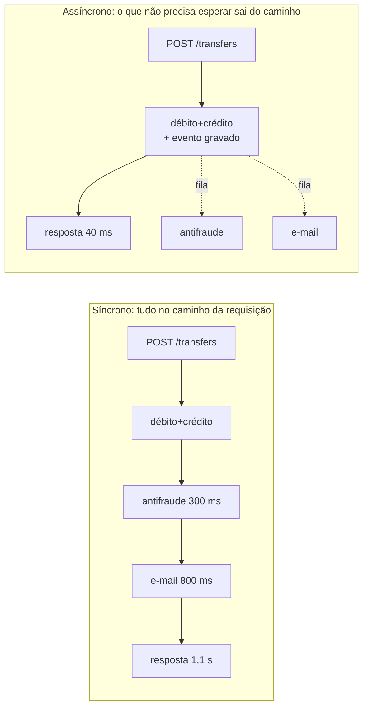

# P3.01 — Bloqueante × não bloqueante; I/O-bound × CPU-bound

> ⏱️ ~1h30 · 🔵 Pleno · Pré-requisitos: J2 (HTTP, `HttpClient`), J6.08 (`RestClient` e *timeouts*), P1.05 (threads e `ExecutorService`), P1.06 (`CompletableFuture`), P1.10 (*virtual threads*), P2.06 (pool de conexões)

> ⚠️ **Verificação:** os números desta aula foram **medidos de verdade** com `lab/io-lab/IoLab.java` (JDK **25.0.5**, Linux, **12 núcleos**, máquina compartilhada: repita e espere variações de alguns por cento). O código do PayFlow mostrado aqui é **revisado por leitura** (o repositório do aluno não foi compilado); os testes práticos ficam para o fim do treinamento.

## 🎯 Objetivos
Ao final desta aula você consegue:
- **Distinguir** quatro pares que se confundem: **síncrono × assíncrono** (o contrato entre quem pede e quem responde) e **bloqueante × não bloqueante** (o que a *thread* faz enquanto espera).
- **Classificar** uma tarefa como **I/O-bound** ou **CPU-bound** e **escolher o tamanho do *pool*** de acordo (e explicar por que mais *threads* **não** aceleram CPU).
- **Medir** (e não adivinhar) a vazão de um *pool* com tarefas de espera, e **evitar** a armadilha de comparar clientes com conexões já aquecidas.
- **Calcular** a concorrência de um serviço com a **Lei de Little** e a **disponibilidade composta** de uma cadeia síncrona.
- **Decidir** quais passos da transferência do PayFlow **saem do caminho da requisição** (notificação, antifraude) e quais **não podem sair** (débito e crédito).

## 🤔 Por que isso importa
Até aqui todo o PayFlow é **síncrono e bloqueante**: o `POST /api/v1/transfers` abre uma transação, grava, responde. Funciona porque tudo acontece dentro de **um banco** e **um processo**. O Pleno é o nível em que o sistema passa a falar com **outros** sistemas (e-mail, antifraude, PSP de pagamento, outro serviço), e cada chamada nova traz **espera**, **falha parcial** e **acoplamento no tempo**: se o antifraude demora 2 s, **a transferência demora 2 s**; se ele cai, **a transferência cai**.

Esta aula dá o vocabulário e as contas para decidir **o que esperar, o que não esperar e o que entregar para uma fila**. O resto do módulo (filas, Kafka, Outbox, webhooks) é a resposta a uma pergunta que nasce aqui: *"posso responder agora e fazer o resto depois, sem perder nada?"*

## 💡 Intuição (explicação simples)
Você pede um café.
- **Síncrono e bloqueante:** você fica **parado no balcão** até o café ficar pronto. Ninguém atrás de você é atendido por aquele atendente enquanto isso.
- **Síncrono e não bloqueante:** você **espera pelo resultado** (precisa do café para continuar), mas enquanto isso **olha o celular**: a *espera* é a mesma; o que muda é que você **não fica preso**. (Em código: `CompletableFuture.get()` depois de fazer outras coisas.)
- **Assíncrono (com fila):** o caixa dá uma **senha** e você senta; o café chega **quando chegar**, e alguém chama o seu número. Você **não sabe quando**; a padaria precisa **guardar o pedido** (a fila) para não perdê-lo se o barista trocar de turno.
- **CPU-bound** é o barista que **não para de moer grãos**: contratar mais pessoas do que máquinas de moer não acelera. **I/O-bound** é o barista que **espera a água ferver**: com **uma panela de cada vez**, ele fica parado; com **dez panelas**, atende dez pedidos no mesmo tempo.

## 🔬 Como funciona por dentro

### 1. Os dois eixos (não são a mesma coisa)
| Eixo | Pergunta | Exemplo no PayFlow |
|---|---|---|
| **Síncrono × assíncrono** | O chamador **precisa da resposta para continuar** (contrato)? | `POST /transfers` espera o débito (síncrono); "mandar e-mail" **não precisa** esperar (assíncrono) |
| **Bloqueante × não bloqueante** | A *thread* **fica parada** (`park`) até o resultado chegar? | `HttpClient.send` bloqueia; `sendAsync` devolve um `CompletableFuture` e a *thread* segue |

As combinações existem: *síncrono + não bloqueante* (esperar o `Future` de propósito); *assíncrono + bloqueante* (uma *thread* dedicada que **bloqueia** lendo a fila e processa em segundo plano, o caso do consumidor Kafka/RabbitMQ). **Assíncrono não significa mais rápido**: significa **desacoplado no tempo**.



### 2. O que uma *thread* bloqueada custa
Uma *thread* de plataforma é uma *thread* do sistema operacional: **pilha própria** (padrão de ≈ 1 MiB reservados no Linux x64, ajustável com `-Xss`), custo de troca de contexto e um **limite prático** (milhares). Enquanto ela espera o banco, **não faz mais nada** e **segura** a conexão, a memória e uma "vaga" do *pool* do Tomcat. Em *I/O-bound*, o **recurso escasso são as *threads***, não a CPU. Há três saídas: **(a)** mais *threads* de plataforma (caro), **(b)** *I/O* **não bloqueante** (um número pequeno de *threads* dirigindo muitas esperas; é o modelo do Netty/Reactor, P3.12), **(c)** ***threads* virtuais** (P1.10: bloquear fica **barato**, o código continua simples).

### 3. I/O-bound × CPU-bound
- **I/O-bound:** o tempo é **espera** (rede, disco, banco, fila). Mais concorrência ajuda **até** o limite do recurso esperado (conexões do banco, limite do parceiro).
- **CPU-bound:** o tempo é **cálculo** (hash, compressão, serialização grande, criptografia). Mais *threads* que **núcleos** só trocam contexto. A regra prática (de *Java Concurrency in Practice*, Goetz et al.; heurística, **meça**): CPU-bound ≈ **nº de núcleos** (+1); I/O-bound ≈ núcleos × (1 + **espera / cálculo**).

### 4. Duas contas que todo Pleno faz de cabeça
- **Lei de Little:** `L = λ × W`. Concorrência média (`L`) = taxa de chegada (`λ`, req/s) × tempo de cada uma (`W`, s). **200 req/s × 0,05 s = 10** requisições simultâneas. Se `W` sobe para 2 s (um parceiro lento), `L` vai para **400**: o *pool* de 200 *threads* do Tomcat **satura**, a fila cresce e o sistema **inteiro** parece fora do ar, embora só **um** parceiro esteja lento.
- **Disponibilidade composta:** em cadeia **síncrona**, as disponibilidades **se multiplicam** (se as falhas forem independentes): `0,999 × 0,999 × 0,999 ≈ 0,997` (**≈ 26 h** de indisponibilidade por ano, contra ≈ 8,8 h de um serviço único de 99,9%). Cada dependência **obrigatória** no caminho tira nove do seu orçamento de erro (S4).

## 🛠️ Exemplo prático

### A. Medindo *threads* e espera (`lab/io-lab/IoLab.java`)
Tarefa *I/O-bound* simulada (`Thread.sleep(100)`: a *thread* fica parada como se esperasse uma API). 200 tarefas:
```bash
cd lab/io-lab
JAVA_HOME=/usr/lib/jvm/java-25-openjdk-amd64
$JAVA_HOME/bin/java IoLab.java io
```
```text
JDK 25.0.5.0.3+1-1-26.04.1-Ubuntu | núcleos=12
== I/O-bound: 200 tarefas de 100 ms de espera ==
pool de   1 threads de plataforma:  20063 ms (ideal 20000 ms)
pool de   4 threads de plataforma:   5012 ms (ideal 5000 ms)
pool de  16 threads de plataforma:   1306 ms (ideal 1250 ms)
pool de  50 threads de plataforma:    402 ms (ideal 400 ms)
pool de 200 threads de plataforma:    110 ms (ideal 100 ms)
threads virtuais (uma por tarefa):     106 ms
threads virtuais, 10 000 tarefas:      125 ms
```
O tempo segue **`tarefas × 100 ms ÷ threads`**: com 1 *thread* são 20 s; com 200, 110 ms. As *threads* virtuais entregam o mesmo que o *pool* de 200 **sem dimensionar nada**, e 10 000 tarefas ainda cabem em ≈ 125 ms (não há 10 000 *threads* do sistema por trás).

Tarefa *CPU-bound* (300 000 `SHA-256` por tarefa, 48 tarefas, 12 núcleos):
```bash
$JAVA_HOME/bin/java IoLab.java cpu
```
```text
JDK 25.0.5.0.3+1-1-26.04.1-Ubuntu | núcleos=12
== CPU-bound: 48 tarefas (300 000 SHA-256 cada) ==
pool de   1 threads:    776 ms
pool de   6 threads:    177 ms
pool de  12 threads:    139 ms
pool de  48 threads:    154 ms
pool de 200 threads:    133 ms
threads virtuais:       126 ms
```
De 1 para 6 *threads* o tempo cai ≈ 4,4×; **de 12 para 48 ou 200 não melhora** (139 → 154 → 133 ms: ruído e troca de contexto). **Threads virtuais não aceleram CPU** (126 ms): elas ajudam a **esperar**, não a **calcular**.

### B. Cliente HTTP bloqueante × não bloqueante, e uma **armadilha de medição**
O laboratório sobe um servidor local que demora 100 ms e chama de quatro jeitos (cada variante com um **cliente novo**):
```bash
$JAVA_HOME/bin/java IoLab.java http
```
```text
JDK 25.0.5.0.3+1-1-26.04.1-Ubuntu | núcleos=12
HttpClient.Version = HTTP_1_1 (um cliente NOVO por variante: o pool de conexões não pode favorecer ninguém)
sequencial bloqueante, 20 chamadas:         2048 ms
bloqueante, pool de 10 threads, 200 chamadas:  2049 ms
não bloqueante (sendAsync), 200 chamadas:     1144 ms  (nenhuma thread esperando)
bloqueante em threads virtuais, 200 chamadas:  1107 ms  (código bloqueante simples)
```
- Sequencial: **20 chamadas = 2 s** (cada uma espera a anterior).
- *Pool* de 10 *threads* bloqueantes, 200 chamadas: **2 s** (200 ÷ 10 × 100 ms): o *pool* **limita** a concorrência.
- `sendAsync` e *threads* virtuais: **≈ 1,1 s** os dois, **empatados**. O piso de 1,1 s **não é** a espera de 100 ms: é o custo de **abrir 200 conexões novas** num servidor `com.sun.net.httpserver` com fila de conexões pendentes padrão.

> ⚠️ **Armadilha medida:** a primeira versão do laboratório rodava as variantes **no mesmo `HttpClient`**, e as *threads* virtuais, por último, **reutilizaram 200 conexões já abertas** e deram **114 ms**: parecia que as *threads* virtuais eram 10× mais rápidas que o `sendAsync`. **Não eram.** Comparação justa = **mesmas condições** (cliente novo, aquecimento igual, mesma pausa). Sempre pergunte: *o que está diferente além do que eu quero comparar?*

### C. O PayFlow: o que sai do caminho da requisição
Fluxo atual (J5/P2) da transferência e a classificação:
| Passo | Precisa esperar? | Por quê | Onde vai |
|---|---|---|---|
| Validar entrada, travar contas, débito+crédito, gravar lançamentos | **Sim** (síncrono) | regras 1–5 do projeto; o cliente precisa saber se deu certo | transação (P2.02) |
| **Antifraude** (pontuar a transferência) | **Depende** | se **bloqueia** a transferência, precisa esperar (e então vira dependência no caminho); se só **sinaliza para revisão**, pode ser depois | **assíncrono** (P3.04/P3.09): o PayFlow adota "sinalizar depois" |
| **Notificação** (e-mail/push) | **Não** | o cliente já viu o resultado na tela | **assíncrono** (RabbitMQ, P3.03) |
| **Atualizar resumo mensal / relatórios** | **Não** | já é um modelo de leitura defasado (P2.11) | **assíncrono/agendado** (P3.02) |
Regra: **nada que altere o dinheiro sai do caminho síncrono**; **tudo que reage** ao dinheiro pode sair.

## 🧠 Pausa para lógica
**Enunciado.** O PayFlow recebe **150 transferências/s** no pico. Cada uma ocupa uma *thread* do Tomcat por **40 ms** (banco) em condições normais. O Tomcat tem **200 *threads*** (padrão). (a) Quantas requisições simultâneas, em média? (b) O antifraude síncrono passa a custar **+800 ms** por chamada. Quantas simultâneas agora, e o que acontece? (c) Qual a **vazão máxima** do *pool* de 200 com `W = 0,84 s`?

<details><summary>Dica</summary>

Lei de Little: `L = λ × W`. A vazão máxima de um *pool* de `N` *threads* é `N ÷ W`.
</details>

<details><summary>Solução</summary>

(a) `L = 150 × 0,040 = 6` simultâneas: o *pool* de 200 está **3% ocupado**.
(b) `W = 0,040 + 0,800 = 0,84 s` → `L = 150 × 0,84 = 126`: **63%** do *pool*, e **uma** rajada ou uma lentidão a mais (`W = 1,4 s` → `L = 210`) **satura** o Tomcat: as requisições passam a esperar na fila do conector, **inclusive as que nem usam o antifraude** (consultar saldo).
(c) `200 ÷ 0,84 ≈ 238 req/s` (teto teórico): só **1,6×** acima do pico. Sem o antifraude no caminho, o teto seria `200 ÷ 0,04 = 5 000 req/s`.
**Variação mais difícil:** com *threads* virtuais no Tomcat (`spring.threads.virtual.enabled=true`), o teto deixa de ser o número de *threads*; qual **outro** recurso passa a ser o limite? (**O *pool* de conexões do banco**, P2.06: 10 conexões ÷ 40 ms = 250 transações/s. As conexões viram o gargalo, e é por isso que o dimensionamento da P2.06 continua valendo.)
</details>

## ⚖️ Trade-offs e quando NÃO usar
| Escolha | Ganho | Custo |
|---|---|---|
| Manter **síncrono** | simples de entender, de depurar e de testar; erro volta direto ao cliente | acoplamento no tempo e na disponibilidade; `W` do mais lento manda em tudo |
| **Assíncrono com fila** | desacopla tempo e disponibilidade; absorve picos; permite *retry* | **consistência eventual**, ordem e duplicatas, mais peças (broker), **observabilidade** mais difícil (P6), erros chegam **depois** |
| *I/O* não bloqueante (Reactor) | poucos *threads*, muita concorrência | modelo de programação diferente, *stack traces* ilegíveis, **um** bloqueio no lugar errado trava tudo (P3.12) |
| *Threads* virtuais | código bloqueante simples e barato | não aceleram CPU; o gargalo desloca para pool de conexões/parceiro; cuidado com *pinning* (P1.10) |
**Quando NÃO tornar assíncrono:** (1) o cliente **precisa** da resposta (saldo, resultado da transferência); (2) o passo **muda o dinheiro**; (3) o volume é baixo e a equipe pequena (**o broker custa mais do que ensina**: um `@Async` ou um *job* podem bastar, P3.02); (4) você **não sabe tratar duplicatas** (P3.07).

## ⚠️ Erros comuns e boas práticas de produção
- **`CompletableFuture.supplyAsync(() -> chamadaBloqueante())` sem *executor*:** roda no *common pool* (poucas *threads*, ≈ núcleos − 1) e **uma chamada lenta trava** todo o resto da JVM que o usa. Passe **seu** *executor* limitado (P1.05).
- **Chamada sem *timeout*:** o padrão de várias bibliotecas é **esperar para sempre**. Defina *timeouts* de conexão e de resposta em **toda** chamada externa (J6.08) e meça `W` (P6).
- **"Assíncrono" que só empurra para uma fila em memória** (`@Async` sem tratamento): se o processo cai, o trabalho **some** (P3.02). Para trabalho que **não pode ser perdido**: broker + Outbox (P3.09).
- **Esquecer a contrapressão:** produtor mais rápido que o consumidor enche a fila (e a memória). Filas **limitadas** e decisão explícita (rejeitar, descartar, desacelerar).
- **Resposta `200` para algo que ainda não aconteceu:** quando o trabalho vira assíncrono, a API deve devolver **`202 Accepted`** (com um endereço para consultar o estado) em vez de fingir que concluiu.

## 🧩 Exercícios
**1. Fixação.** (a) Dê um exemplo de **síncrono e não bloqueante** e outro de **assíncrono e bloqueante**. (b) Por que 200 *threads* virtuais **não** resolvem 200 tarefas de 100 ms de **CPU**? (c) Se `W` triplica, o que acontece com `L` (Little) a uma taxa fixa?

<details><summary>Solução</summary>

(a) Síncrono não bloqueante: `var f = client.sendAsync(...); fazOutraCoisa(); f.get();`. Assíncrono bloqueante: um consumidor de fila em uma *thread* própria que **bloqueia** em `poll()` e processa em segundo plano. (b) Cada tarefa **usa** a CPU o tempo todo; 12 núcleos fazem 12 por vez, o resto **espera um núcleo**, não uma E/S (o laboratório: 126 ms *virtual* × 139 ms com 12 *threads*, sem ganho). (c) `L` triplica (é proporcional a `W`).
</details>

**2. Aplicação no PayFlow (por leitura).** Faça `docs/async-boundaries.md`: uma tabela com **todos** os passos de "criar transferência", "depósito" e "criar solicitação de pagamento (QR)" classificando **síncrono obrigatório / pode ser assíncrono / por quê**, e a **conta de Little** para o pico que você estima.
- [ ] Nenhum passo que altera saldo ou lançamentos aparece como assíncrono.
- [ ] Cada passo assíncrono diz **o que acontece se falhar** e **quem fica sabendo**.
- [ ] A conta de Little usa `λ` e `W` **medidos** (P6) ou marcados como **estimativa**.

**3. Desafio.** Rode `IoLab http` com `-Dhttp.version=HTTP_2` e compare. Depois acrescente um servidor com **fila de conexões** maior (`HttpServer.create(addr, 1024)`) e veja se o piso de ≈ 1,1 s cai. Explique o resultado.

## 🎤 Na entrevista
**1. "Qual a diferença entre assíncrono e não bloqueante?"** *Resposta-modelo:* assíncrono é sobre o **contrato** (o chamador não espera o resultado para seguir, e o resultado chega depois, por callback, `Future` ou fila); não bloqueante é sobre o **mecanismo** (a *thread* não fica parada esperando a E/S). Dá para ter um sem o outro. O primeiro desacopla **tempo**; o segundo economiza **threads**.
**2. "O serviço ficou lento quando um parceiro ficou lento. Por quê, e como evitar?"** *Resposta-modelo:* a Lei de Little: `L = λ × W`; com `W` maior, as requisições **ocupam** *threads*/conexões por mais tempo e o *pool* **satura**, derrubando também as rotas que não usam o parceiro. Evitar: *timeouts* curtos, **isolar** o *pool* do parceiro (*bulkhead*, P5), *circuit breaker* (P5), tirar a chamada do caminho crítico (fila), e medir `W` por dependência.
**3. "Quantas threads eu preciso para tarefas CPU-bound? E I/O-bound?"** *Resposta-modelo:* CPU-bound ≈ nº de núcleos; I/O-bound ≈ núcleos × (1 + espera/cálculo), **limitado pelo recurso esperado** (conexões, quota do parceiro). Medir, não chutar; com *threads* virtuais a pergunta passa a ser "qual é o recurso limitado?".

## 📚 Para ir além
- 📄 [Lei de Little (Wikipédia)](https://en.wikipedia.org/wiki/Little%27s_law) — a fórmula e as hipóteses; ⚠️ link de enciclopédia (use para a definição, não como fonte de engenharia).
- 📄 [JEP 444 — Virtual Threads](https://openjdk.org/jeps/444) — o que as *threads* virtuais resolvem e o que **não** resolvem (CPU, *pinning*).
- 📄 [Spring Boot — Task Execution and Scheduling](https://docs.spring.io/spring-boot/reference/features/task-execution-and-scheduling.html) — o executor padrão e a propriedade `spring.threads.virtual.enabled`.
- 📑 [Amazon Builders' Library — Timeouts, retries and backoff with jitter](https://aws.amazon.com/builders-library/timeouts-retries-and-backoff-with-jitter/) — por que toda chamada precisa de *timeout* e como a espera se propaga.
- 📚 *Java Concurrency in Practice* (Goetz et al.), cap. 8 (dimensionamento de *pools*); 📚 *Release It!* (Nygard), padrões de estabilidade (*timeouts*, *bulkheads*). Capítulos de memória, **não conferidos** nesta geração.
- 💻 `lab/io-lab/IoLab.java` — reproduza e **mude os números**.

## ✅ Checklist da aula
- [ ] Sei dizer a diferença entre síncrono/assíncrono e bloqueante/não bloqueante.
- [ ] Rodei `IoLab io`, `cpu` e `http` e expliquei cada tabela.
- [ ] Sei por que *threads* virtuais não aceleram CPU e **qual recurso** vira o gargalo.
- [ ] Fiz a conta de Little e a de disponibilidade composta.
- [ ] Classifiquei os passos do PayFlow (`docs/async-boundaries.md`).
