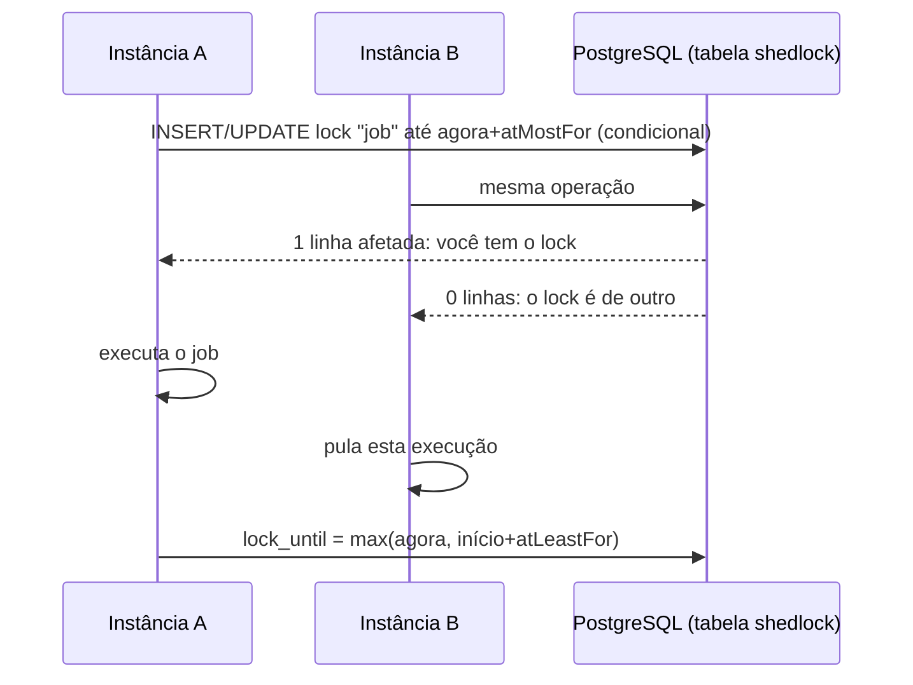

# P3.02 — `@Async`, `@Scheduled` e ShedLock

> ⏱️ ~1h30 · 🔵 Pleno · Pré-requisitos: J5.03 (*beans* e *proxies*), J5.11 (`@Transactional`), P1.05 (`ExecutorService`), P1.06 (`CompletableFuture`), P2.11 (o `@Scheduled` do resumo mensal), P3.01

> ⚠️ **Verificação:** **executado de verdade** em `lab/messaging-lab` (`AsyncSchedulerIT`, 5 testes verdes): Spring Boot **4.1.2** (Spring Framework 7.0.x), **ShedLock 7.11.0**, PostgreSQL **18** (`postgres:18`, Docker), JDK 25.0.5. As propriedades do Boot foram conferidas na [tabela oficial](https://docs.spring.io/spring-boot/appendix/application-properties/index.html). A aplicação ao **PayFlow** é **por leitura** (não compilada).

## 🎯 Objetivos
Ao final desta aula você consegue:
- **Executar** trabalho em outra *thread* com `@Async` (executor **limitado**, tratamento de exceção, propagação do `requestId`) e **explicar** por que a auto-chamada e o `void` são armadilhas.
- **Agendar** tarefas com `@Scheduled` (`fixedRate`, `fixedDelay`, `cron`) e **dizer** o que acontece com o *pool* padrão de **1** *thread*.
- **Provar**, com duas instâncias da aplicação, que um `@Scheduled` **roda em todas** e **corrigir** com **ShedLock** (`lockAtMostFor`, `lockAtLeastFor`).
- **Decidir** quando `@Async`/`@Scheduled` bastam e quando precisam virar **fila** (a resposta de P3.03 em diante).

## 🤔 Por que isso importa
`@Async` e `@Scheduled` são o **primeiro degrau da assincronia**: uma anotação e o trabalho sai da requisição. Por isso são usados demais, e dão dois problemas clássicos de produção: **(1)** o trabalho some quando o processo cai (não há onde guardá-lo) e **(2)** o *job* agendado roda **N vezes** quando a aplicação sobe em N réplicas (o `MonthlySummaryRefresher` da P2.11 "em **um** nó" é exatamente isso). Esta aula mostra os dois, mede e corrige.

## 💡 Intuição (explicação simples)
`@Async` é **passar uma tarefa para um colega** do escritório: você segue trabalhando, mas o colega tem **mesa limitada** (o *pool*), a tarefa **está só na cabeça dele** (se ele sair, perdeu) e **se ele errar, ninguém te conta** a menos que você combine um aviso.
`@Scheduled` é um **despertador**. Se a empresa tem **três filiais** com o mesmo despertador, **os três** tocam. **ShedLock** é um **quadro na porta**: quem chega primeiro pendura a placa "estou fazendo"; os outros veem a placa e voltam a dormir.

## 🔬 Como funciona por dentro

### 1. `@Async` é um *proxy* (de novo)
Como `@Transactional` (J5.11): o Spring cria um **proxy** que, ao ver `@Async`, **entrega a chamada a um `TaskExecutor`** e retorna **na hora**. Consequências, todas **testadas**:
- **Auto-chamada não é assíncrona** (`this.where()` não passa pelo proxy: o laboratório mostrou `thread=main`).
- **Tipos de retorno:** `void` (a exceção **não** chega ao chamador: vai para o `AsyncUncaughtExceptionHandler`) ou `CompletableFuture<T>` (a exceção vem **no** `Future`). Prefira `CompletableFuture`.
- **Outra *thread* = outro contexto:** **não** há transação do chamador, nem `SecurityContext`, nem **MDC** (o `requestId` do log da J5.14 **some**) a menos que você copie com um `TaskDecorator`.
- **O executor padrão** do Boot (`applicationTaskExecutor`): `spring.task.execution.pool.core-size` **8**, fila **ilimitada** (`queue-capacity` sem limite: "*uma capacidade ilimitada não aumenta o pool e ignora `max-size`*"), segundo a [tabela de propriedades](https://docs.spring.io/spring-boot/appendix/application-properties/index.html). **Fila ilimitada = a memória é o limite**: sob pico, o trabalho acumula até um `OutOfMemoryError`. Com `spring.threads.virtual.enabled=true` (padrão `false`) as propriedades de *pool* **não têm efeito**.

### 2. `@Scheduled`
- `fixedRate = 1000`: **dispara a cada 1 s** contados **do início** de cada execução; `fixedDelay`: espera 1 s **depois do fim** da anterior (nunca sobrepõe); `cron`: expressão de 6 campos (segundo, minuto, hora, dia, mês, dia da semana) com `zone` (use **`America/Sao_Paulo`** ou UTC **explícito**, nunca "o fuso da máquina").
- O agendador do Boot tem `spring.task.scheduling.pool.size` = **1**: **dois** *jobs* longos se **atrasam** um ao outro.
- O `@Scheduled` roda **em cada instância**. Não há coordenação.



### 3. ShedLock (`net.javacrumbs.shedlock`)
Uma **tabela** (`shedlock`: `name`, `lock_until`, `locked_at`, `locked_by`) e uma operação **atômica condicional** (`UPDATE … WHERE name = ? AND lock_until <= now`). Dois parâmetros:
- **`lockAtMostFor`** (rede de segurança): se o nó **morrer** com o *lock*, ele **expira** após esse tempo. Deve ser **maior que a duração normal** do *job*; se for **menor**, outro nó pode **começar enquanto o primeiro ainda roda**.
- **`lockAtLeastFor`**: o *lock* fica por **no mínimo** esse tempo mesmo que o *job* termine antes; protege contra **diferença de relógio** entre nós e contra o *job* rápido rodar de novo no outro nó.
- `usingDbTime()`: usa o **relógio do banco** (e não o da JVM) para `lock_until`: evita erros por relógios desalinhados.
ShedLock **não é fila nem garante exatamente uma execução**: é **exclusão mútua com tempo**. Se o nó travar além de `lockAtMostFor`, **duas** execuções podem coexistir; o *job* precisa ser **idempotente** (P3.07).

## 🛠️ Exemplo prático

### A. Executor limitado, exceção e MDC
```java
package com.payflow.lab;

import java.lang.reflect.Method;
import java.util.List;
import java.util.concurrent.CopyOnWriteArrayList;
import java.util.concurrent.Executor;
import org.slf4j.MDC;
import org.springframework.aop.interceptor.AsyncUncaughtExceptionHandler;
import org.springframework.context.annotation.Bean;
import org.springframework.context.annotation.Configuration;
import org.springframework.scheduling.annotation.AsyncConfigurer;
import org.springframework.scheduling.annotation.EnableAsync;
import org.springframework.scheduling.concurrent.ThreadPoolTaskExecutor;

/** P3.02: executor limitado, handler de exceção para métodos void e propagação do MDC. */
@Configuration
@EnableAsync
class AsyncConfig implements AsyncConfigurer {
    static final List<String> uncaught = new CopyOnWriteArrayList<>();

    @Bean("labExecutor")
    ThreadPoolTaskExecutor labExecutor() {
        var ex = new ThreadPoolTaskExecutor();
        ex.setCorePoolSize(2); ex.setMaxPoolSize(2); ex.setQueueCapacity(2);   // 2 rodando + 2 na fila; o resto é rejeitado
        ex.setThreadNamePrefix("lab-async-");
        ex.setTaskDecorator(r -> {                                             // copia o MDC (requestId) para a thread do @Async
            var ctx = MDC.getCopyOfContextMap();
            return () -> {
                if (ctx != null) MDC.setContextMap(ctx);
                try { r.run(); } finally { MDC.clear(); }
            };
        });
        ex.initialize();
        return ex;
    }

    @Override public Executor getAsyncExecutor() { return labExecutor(); }

    @Override public AsyncUncaughtExceptionHandler getAsyncUncaughtExceptionHandler() {
        return (Throwable ex, Method m, Object... args) -> uncaught.add(m.getName() + ": " + ex.getMessage());
    }
}
```
Pontos: **2 *threads* + fila de 2** (o que passar disso é **rejeitado**: `TaskRejectedException`, melhor que acumular sem fim), prefixo de nome (aparece no log e no `jstack`), `TaskDecorator` que copia o MDC e **limpa** no fim (senão o MDC **vaza** para a próxima tarefa na mesma *thread*), `AsyncUncaughtExceptionHandler` para `void`.

```java
package com.payflow.lab;

import java.util.concurrent.CompletableFuture;
import org.slf4j.MDC;
import org.springframework.scheduling.annotation.Async;
import org.springframework.stereotype.Service;

@Service
public class AsyncDemo {
    @Async
    public CompletableFuture<String> where() {
        return CompletableFuture.completedFuture(Thread.currentThread().getName() + " requestId=" + MDC.get("requestId"));
    }

    @Async
    public void fireAndForgetThatFails() { throw new IllegalStateException("falhou no @Async void"); }

    @Async
    public CompletableFuture<String> failsWithFuture() { throw new IllegalStateException("falhou no @Async com Future"); }

    @Async
    public void slow(long ms) {
        try { Thread.sleep(ms); } catch (InterruptedException e) { Thread.currentThread().interrupt(); }
    }

    /** Auto-chamada: NÃO passa pelo proxy, então roda na mesma thread. */
    public String callsAsyncOnSelf() {
        where();                       // ignorado pelo proxy
        return Thread.currentThread().getName();
    }
}
```

```java
@Test
void asyncRunsInAnotherThreadAndKeepsMdcViaTaskDecorator() throws Exception {
    MDC.put("requestId", "req-123");
    String r = demo.where().get(5, TimeUnit.SECONDS);
    MDC.clear();
    System.out.println("ASYNC_THREAD " + r + " (chamador: " + Thread.currentThread().getName() + ")");
    assertThat(r).startsWith("lab-async-").endsWith("requestId=req-123");
}

@Test
void selfInvocationIsNotAsync() {
    String thread = demo.callsAsyncOnSelf();
    System.out.println("AUTO_CHAMADA thread=" + thread);
    assertThat(thread).isEqualTo(Thread.currentThread().getName());
}

@Test
void exceptionsInVoidGoToTheHandlerAndFuturesCarryThem() {
    AsyncConfig.uncaught.clear();
    demo.fireAndForgetThatFails();
    await().atMost(Duration.ofSeconds(5)).until(() -> !AsyncConfig.uncaught.isEmpty());
    System.out.println("VOID_EXCECAO handler=" + AsyncConfig.uncaught);
    assertThatThrownBy(() -> demo.failsWithFuture().get(5, TimeUnit.SECONDS))
            .isInstanceOf(ExecutionException.class).hasRootCauseInstanceOf(IllegalStateException.class);
}

@Test
void boundedExecutorRejectsWhenSaturated() {
    int accepted = 0, rejected = 0;
    for (int i = 0; i < 10; i++) {
        try { demo.slow(800); accepted++; } catch (TaskRejectedException e) { rejected++; }
    }
    System.out.println("EXECUTOR_LIMITADO aceitas=" + accepted + " rejeitadas=" + rejected + " (2 threads + fila 2)");
    assertThat(accepted).isEqualTo(4);
    assertThat(rejected).isEqualTo(6);
}
```
Saída (do laboratório):
```text
ASYNC_THREAD lab-async-1 requestId=req-123 (chamador: main)
AUTO_CHAMADA thread=main
SHEDLOCK {job=locked, instance=A, c=3}
SHEDLOCK {job=locked, instance=B, c=2}
SHEDLOCK {job=unlocked, instance=A, c=10}
SHEDLOCK {job=unlocked, instance=B, c=9}
SHEDLOCK total_com_lock=5 total_sem_lock=19 (9 s, 2 instâncias, fixedRate 1 s, lockAtLeastFor 2 s)
EXECUTOR_LIMITADO aceitas=4 rejeitadas=6 (2 threads + fila 2)
VOID_EXCECAO handler=[fireAndForgetThatFails: falhou no @Async void]
```
(As linhas `ASYNC_THREAD`, `AUTO_CHAMADA`, `VOID_EXCECAO` e `EXECUTOR_LIMITADO` são as de `@Async`; as `SHEDLOCK` vêm da seção B.)

### B. Duas instâncias, com e sem ShedLock
Dependências (Boot 4.1.2; o ShedLock está **fora** do BOM, então leva `<version>`):
```xml
<dependency><groupId>net.javacrumbs.shedlock</groupId><artifactId>shedlock-spring</artifactId><version>7.11.0</version></dependency>
<dependency><groupId>net.javacrumbs.shedlock</groupId><artifactId>shedlock-provider-jdbc-template</artifactId><version>7.11.0</version></dependency>
```
Tabela (no PayFlow, uma migração Flyway; no laboratório, `schema.sql`):
```sql
create table shedlock (
  name       varchar(64)  primary key,
  lock_until timestamp(3) not null,
  locked_at  timestamp(3) not null,
  locked_by  varchar(255) not null);
```
A configuração (só liga com `lab.scheduling=true`) e dois *jobs* **idênticos**, um **sem** e outro **com** `@SchedulerLock`:
```java
package com.payflow.lab;

import javax.sql.DataSource;
import net.javacrumbs.shedlock.core.LockProvider;
import net.javacrumbs.shedlock.provider.jdbctemplate.JdbcTemplateLockProvider;
import net.javacrumbs.shedlock.spring.annotation.EnableSchedulerLock;
import net.javacrumbs.shedlock.spring.annotation.SchedulerLock;
import org.springframework.beans.factory.annotation.Value;
import org.springframework.boot.autoconfigure.condition.ConditionalOnProperty;
import org.springframework.context.annotation.Bean;
import org.springframework.context.annotation.Configuration;
import org.springframework.jdbc.core.JdbcTemplate;
import org.springframework.jdbc.core.simple.JdbcClient;
import org.springframework.scheduling.annotation.EnableScheduling;
import org.springframework.scheduling.annotation.Scheduled;
import org.springframework.stereotype.Component;

/** P3.02: @Scheduled em várias instâncias; com e sem ShedLock. Só liga com lab.scheduling=true. */
@Configuration
@EnableScheduling
@EnableSchedulerLock(defaultLockAtMostFor = "PT30S")
@ConditionalOnProperty("lab.scheduling")
class SchedulingConfig {
    @Bean
    LockProvider lockProvider(DataSource ds) {
        return new JdbcTemplateLockProvider(JdbcTemplateLockProvider.Configuration.builder()
                .withJdbcTemplate(new JdbcTemplate(ds)).usingDbTime().build());
    }

    @Component
    static class UnlockedJob {
        private final JdbcClient jdbc; private final String instance;
        UnlockedJob(JdbcClient jdbc, @Value("${lab.instance:?}") String instance) { this.jdbc = jdbc; this.instance = instance; }
        @Scheduled(fixedRate = 1000)
        void run() { jdbc.sql("insert into job_runs (job, instance) values ('unlocked', :i)").param("i", instance).update(); }
    }

    @Component
    static class LockedJob {
        private final JdbcClient jdbc; private final String instance;
        LockedJob(JdbcClient jdbc, @Value("${lab.instance:?}") String instance) { this.jdbc = jdbc; this.instance = instance; }
        @Scheduled(fixedRate = 1000)
        @SchedulerLock(name = "lab-locked-job", lockAtMostFor = "PT10S", lockAtLeastFor = "PT2S")
        void run() { jdbc.sql("insert into job_runs (job, instance) values ('locked', :i)").param("i", instance).update(); }
    }
}
```
O teste sobe **duas** aplicações Spring (instâncias A e B) no **mesmo banco**, deixa rodar 9 s e conta as linhas gravadas por cada *job*:
```java
@Test
void shedLockRunsTheJobOncePerTickAcrossTwoInstances() throws Exception {
    jdbc.sql("delete from job_runs").update();
    jdbc.sql("delete from shedlock").update();
    var props = new String[] {"lab.scheduling=true", "server.port=0", "spring.kafka.listener.auto-startup=false",
            "spring.rabbitmq.listener.simple.auto-startup=false"};
    try (var a = new SpringApplicationBuilder(LabApp.class).web(WebApplicationType.NONE).properties(props).properties("lab.instance=A").run();
         var b = new SpringApplicationBuilder(LabApp.class).web(WebApplicationType.NONE).properties(props).properties("lab.instance=B").run()) {
        Thread.sleep(9_000);
    }
    var rows = jdbc.sql("select job, instance, count(*) c from job_runs group by job, instance order by 1,2").query().listOfRows();
    rows.forEach(r -> System.out.println("SHEDLOCK " + r));
    int locked = jdbc.sql("select count(*) from job_runs where job='locked'").query(Integer.class).single();
    int unlocked = jdbc.sql("select count(*) from job_runs where job='unlocked'").query(Integer.class).single();
    System.out.println("SHEDLOCK total_com_lock=" + locked + " total_sem_lock=" + unlocked + " (9 s, 2 instâncias, fixedRate 1 s, lockAtLeastFor 2 s)");
    assertThat(unlocked).isGreaterThan(locked);
    assertThat(locked).isBetween(3, 6);
}
```
Resultado (linhas `SHEDLOCK` acima): **sem *lock*: 19 execuções** (≈ 2 por segundo: as duas instâncias, 10 + 9); **com *lock*: 5** (≈ 1 a cada 2 s, que é o `lockAtLeastFor`, **alternando** entre A e B conforme quem chega primeiro: 2 + 3 em uma rodada, 1 + 4 em outra). O *job* "com *lock*" roda **uma vez por janela**, em **qualquer** nó: **não** há "nó dono"; se precisa de um dono fixo, use **eleição de líder** (S1) ou um único *deployment* para os *jobs*.

### C. No PayFlow (por leitura)
O `MonthlySummaryRefresher` (P2.11) ganha o *lock* e deixa de depender de "só um nó":
```java
@Component
class MonthlySummaryRefresher {
    private final JdbcClient jdbc;
    MonthlySummaryRefresher(JdbcClient jdbc) { this.jdbc = jdbc; }

    @Scheduled(cron = "0 */15 * * * *", zone = "America/Sao_Paulo")
    @SchedulerLock(name = "monthly-summary-refresh", lockAtMostFor = "PT10M", lockAtLeastFor = "PT1M")
    void refresh() {
        jdbc.sql("refresh materialized view concurrently ledger_monthly").update();
    }
}
```
- `lockAtMostFor = 10 min` > duração medida do `REFRESH` (≈ 9 s com 5 milhões de linhas, P2.11) **com folga grande**; se um dia o *refresh* passar de 10 min, o *lock* expira **durante** a execução: o *job* é **idempotente** (recalcula tudo), então o pior caso é **trabalho repetido**, não dado errado.
- `lockAtLeastFor = 1 min` evita que o outro nó repita logo em seguida por diferença de relógio.
- Config: `@EnableScheduling` + `@EnableSchedulerLock(defaultLockAtMostFor = "PT30S")` e um *bean* `LockProvider` (`JdbcTemplateLockProvider` com `usingDbTime()`); a tabela `shedlock` entra em uma migração (`V9__shedlock.sql`, ou o próximo número livre).
- **Tarefas de limpeza** (apagar `outbox_events` publicados há mais de 7 dias, P3.09; expirar `payment_requests`, P3.10) seguem o mesmo molde.

## 🧠 Pausa para lógica
**Enunciado.** Um *job* `@Scheduled(fixedRate = 60_000)` leva **90 s** quando o banco está lento. (a) O que acontece com o `fixedRate` no agendador de **1** *thread*? (b) E com `fixedDelay`? (c) Com `@SchedulerLock(lockAtMostFor = "PT1M")`, o que pode dar errado quando o *job* leva 90 s?

<details><summary>Dica</summary>

Com 1 *thread* no agendador, execuções do **mesmo** *job* não se sobrepõem. Pense em `lock_until` expirando **no meio** da execução.
</details>

<details><summary>Solução</summary>

(a) `fixedRate` **não** sobrepõe no mesmo agendador de 1 *thread*: a próxima execução **atrasa** e começa **logo** que a anterior termina (uma **atrás da outra, sem pausa**); o intervalo efetivo vira 90 s (⚠️ comportamento do `ScheduledThreadPoolExecutor`/Spring **não medido** aqui; confira no seu ambiente). (b) `fixedDelay = 60 s`: a próxima começa **60 s depois do fim**: intervalo efetivo 150 s. (c) O *lock* expira com **60 s**; **aos 61 s** o outro nó vê o *lock* livre e **começa uma segunda execução** enquanto a primeira ainda roda: **duas** execuções simultâneas. Correção: `lockAtMostFor` **bem acima** do pior caso (aqui ≥ 5 min), **mais** idempotência (P3.07) e um alarme se `now() - locked_at > duração esperada`.
**Variação mais difícil:** 3 réplicas, `fixedRate = 10 s`, `lockAtLeastFor = 30 s`. Quantas execuções por minuto, no máximo? (**2**: uma a cada 30 s, vencendo a corrida em qualquer nó.)
</details>

## ⚖️ Trade-offs e quando NÃO usar
| Ferramenta | Boa para | Não use quando |
|---|---|---|
| `@Async` | tarefa **curta**, **perdível** (atualizar métrica, aquecer cache), mesma instância | o trabalho **não pode ser perdido**, precisa de *retry* durável, ordem ou **observabilidade** de fila → **broker** (P3.03+) |
| `@Scheduled` **sem** lock | **uma** instância, ou um *job* **local** de cada nó (limpar cache em memória) | a aplicação tem **N réplicas** e o *job* mexe em dado **compartilhado** |
| `@Scheduled` **com** ShedLock | *jobs* periódicos idempotentes com N réplicas, sem infraestrutura nova (usa o banco que você já tem) | *job* **muito frequente** (cada tick faz um `UPDATE` no banco), *job* **longo e pesado** (use **fila de trabalho**) ou precisa de **exatamente uma** execução garantida |
| Quartz, *Kubernetes CronJob*, *EventBridge* (P7, P9) | *jobs* com histórico, *retry* e **execução como processo separado** | só precisa "de vez em quando limpar uma tabela" |

## ⚠️ Erros comuns e boas práticas de produção
- **`@Async` sem `@EnableAsync`** (ou **auto-chamada**, ou método `private`/`final`): roda **síncrono**, sem erro nenhum. O teste `selfInvocationIsNotAsync` prova.
- **`void` que engole erro:** sem `AsyncUncaughtExceptionHandler`, o log só traz `Unexpected exception occurred invoking async method` sem contexto de negócio. Prefira `CompletableFuture` e trate com `.exceptionally(...)`/`.handle(...)`.
- **Fila ilimitada** no executor: o `OutOfMemoryError` chega **horas depois**, longe da causa. Limite e rejeite.
- **Transação:** o `@Async` roda **fora** da transação do chamador; se ele lê o que o chamador acabou de gravar **antes do *commit***, **não vê** (ou vê o dado velho). Enviar e-mail "depois do commit" é um problema de **ordem**: a solução de produção é a **Outbox** (P3.09); `@TransactionalEventListener(phase = AFTER_COMMIT)` é uma alternativa **dentro do mesmo processo** (⚠️ **não testada nesta aula**; confira a documentação do Spring antes de usar).
- **`cron` sem `zone`:** dispara no **fuso da máquina** (UTC no contêiner, São Paulo no seu notebook): o *job* "das 3h" roda 3 horas "errado" em produção.
- **ShedLock com `lockAtMostFor` menor que o *job***: duas execuções simultâneas (a pausa acima). **Sem `usingDbTime()`** e com relógios diferentes: o *lock* "expira" antes ou depois do esperado.
- **Parar o agendador no encerramento:** `spring.task.scheduling.shutdown.await-termination` tem padrão `false`; um *job* pode ser **cortado no meio** num deploy. Ative a espera (e `await-termination-period`) para *jobs* que precisam terminar.

## 🧩 Exercícios
**1. Fixação.** (a) Por que `@Async` em método chamado por **outro método da mesma classe** não roda em outra *thread*? (b) Qual a diferença entre `lockAtMostFor` e `lockAtLeastFor`? (c) Qual propriedade desliga o efeito de `core-size` do executor?

<details><summary>Solução</summary>

(a) O proxy só intercepta chamadas **vindas de fora**; `this.método()` vai direto ao objeto. (b) `AtMostFor` = **teto** (o *lock* expira sozinho se o nó morrer); `AtLeastFor` = **piso** (mesmo terminando antes, o *lock* fica). (c) `spring.threads.virtual.enabled=true`.
</details>

**2. Aplicação no PayFlow (por leitura).** (i) Adicione o ShedLock ao `MonthlySummaryRefresher` e a migração `shedlock`. (ii) Crie `OutboxCleanupJob` (apaga `outbox_events` com `published_at < now() - interval '7 days'`, em lotes de 1 000) com `@SchedulerLock`. (iii) Configure um executor **limitado** com `TaskDecorator` do MDC para os `@Async` do projeto.
- [ ] `lockAtMostFor` de cada *job* é **maior** que a duração medida/estimada, e o texto diz **como** foi estimada.
- [ ] O *job* de limpeza é **idempotente** e apaga **em lotes** (sem *lock* longo no banco).
- [ ] Um teste sobe **duas** instâncias (como `shedLockRunsTheJobOncePerTickAcrossTwoInstances`) e prova **uma** execução por janela.
- [ ] Nenhum `@Async` do projeto tem retorno `void` sem handler.

**3. Desafio.** Rode o teste **duas vezes** com `lockAtLeastFor = "PT0S"` e compare as contagens com `PT2S`. O resultado **se aproxima** das 19 execuções sem *lock*? Explique o que sobra de exclusão com `lockAtLeastFor = 0` (pense no que o *lock* protege **enquanto o *job* roda**, e em jobs de **1 ms**).

## 🎤 Na entrevista
**1. "Por que meu `@Scheduled` rodou duas vezes em produção?"** *Resposta-modelo:* o agendador é **local** a cada instância; com 2 réplicas, 2 execuções. Corrigir com **exclusão mútua** (ShedLock, Quartz em cluster, ou rodar o *job* como **CronJob** separado) e **tornar o *job* idempotente**, porque nenhuma delas dá **exatamente uma** execução garantida.
**2. "`@Async` é seguro para enviar e-mail depois da transferência?"** *Resposta-modelo:* **não é durável**: se a JVM cair entre o *commit* e o envio, o e-mail **se perde**; e se enviar **antes** do *commit*, pode avisar de uma transferência que **sofreu *rollback***. Para "tem que acontecer", grave a intenção **na mesma transação** (Outbox) e entregue por fila.
**3. "O que muda com `spring.threads.virtual.enabled=true`?"** *Resposta-modelo:* o executor e o agendador passam a usar *threads* virtuais; as propriedades de *pool* deixam de valer; o limite vira o **recurso esperado** (conexões, parceiro). Não aceleram CPU e não resolvem durabilidade.

## 📚 Para ir além
- 📄 [Spring Framework — Task Execution and Scheduling](https://docs.spring.io/spring-framework/reference/integration/scheduling.html) — `@Async`, `@Scheduled`, `TaskDecorator` e cron.
- 📄 [Spring Boot — Task Execution and Scheduling](https://docs.spring.io/spring-boot/reference/features/task-execution-and-scheduling.html) — o que o Boot configura e as propriedades `spring.task.*`.
- 💻 [ShedLock (GitHub)](https://github.com/lukas-krecan/ShedLock) — README com `lockAtMostFor`/`lockAtLeastFor`, provedores (JDBC, Redis, Mongo) e **avisos** sobre `lockAtMostFor`.
- 💻 `lab/messaging-lab/src/test/java/com/payflow/lab/AsyncSchedulerIT.java` — rode, quebre (`PT0S`) e explique.

## ✅ Checklist da aula
- [ ] Sei que o `@Async` é um *proxy* e quais construções o **desligam**.
- [ ] Meu executor é **limitado**, tem nome e copia o MDC.
- [ ] Sei o padrão (1 *thread*) do agendador e a diferença entre `fixedRate`, `fixedDelay` e `cron`.
- [ ] Provei com duas instâncias que o *job* sem *lock* roda em ambas.
- [ ] Escolhi `lockAtMostFor` **por medida**, não por palpite.
- [ ] Sei quando `@Async`/`@Scheduled` **não bastam** e preciso de uma fila.
