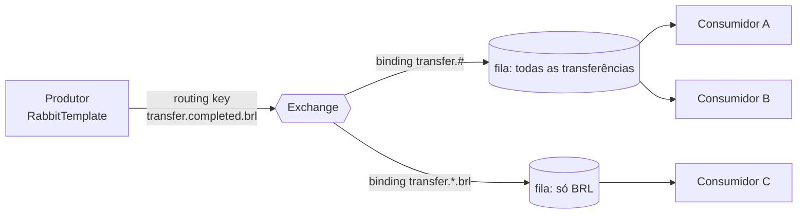

# P3.03 — Filas × tópicos e RabbitMQ com Spring AMQP

> ⏱️ ~1h30 · 🔵 Pleno · Pré-requisitos: P3.01, P3.02, J9 (Docker/Compose, segredos), J1.11 (`Queue`), P1.05

> ✅ **Validação final (2026-11-24):** módulo executado no PayFlow reconstruído; resultado e o que continua não executado no [README do módulo](README.md). Os avisos "não executado" / "por leitura" abaixo descrevem a escrita original.

> ⚠️ **Verificação:** **executado de verdade** em `lab/messaging-lab` (`RabbitBasicsIT` 5 testes + `RetryDltIT`): **RabbitMQ 4.4.0** (`rabbitmq:4-management-alpine`, Erlang/OTP 29), **Spring AMQP 4.1.2**, Spring Boot **4.1.2**, JDK 25.0.5. Confirmações do publicador (*publisher confirms*), filas *quorum* e TLS **não foram executados** (marcados). As páginas do RabbitMQ foram lidas por ferramenta de leitura de páginas (o `curl` recebe 403 do site). PayFlow: **por leitura**.

## 🎯 Objetivos
Ao final desta aula você consegue:
- **Diferenciar** **fila** (cada mensagem vai para **um** consumidor) de **tópico/publicação-assinatura** (cada interessado recebe **uma cópia**) e dizer quando usar cada um.
- **Modelar** produtor → *exchange* → *binding* → fila → consumidor no RabbitMQ (*direct*, *topic*, *fanout*) e **provar** o roteamento.
- **Usar** `RabbitTemplate` e `@RabbitListener` no Spring Boot e **explicar** `ack`, `nack`, `requeue`, *prefetch* e reentrega.
- **Montar** uma fila de trabalho com **dead-letter exchange** e **TTL** para as notificações do PayFlow.

## 🤔 Por que isso importa
A notificação ("você recebeu R$ 50") não precisa acontecer **dentro** da transferência (P3.01), mas **não pode se perder** (P3.02). Um *broker* é o "lugar durável no meio": o produtor entrega e segue; o consumidor processa **no ritmo dele**, e se ele cair a mensagem **espera**. É também a porta de entrada para o vocabulário que você vai ouvir em toda entrevista de Pleno: *ack*, *DLQ*, *prefetch*, *at-least-once*.

## 💡 Intuição (explicação simples)
RabbitMQ é uma **agência dos correios**: você entrega a carta (mensagem) no **balcão** (*exchange*), que **decide** em qual **caixa postal** (fila) ela cai conforme o endereço (*routing key*). O carteiro (consumidor) **leva a carta** e, só quando ela é **entregue de fato** (`ack`), a agência **a descarta**. Se o carteiro desaparece sem confirmar, a carta **volta** para a caixa. Uma **fila** é a **caixa de tarefas de uma equipe** (quem estiver livre pega; cada tarefa uma vez); um **tópico** é o **mural de avisos** (todos que assinaram leem).

## 🔬 Como funciona por dentro


- **O produtor nunca fala com a fila**: publica no ***exchange*** com uma ***routing key***. O *exchange* **roteia** conforme as *bindings*. Tipos: ***direct*** (chave igual), ***topic*** (padrão com `*` = uma palavra, `#` = zero ou mais), ***fanout*** (todas as filas ligadas, ignora a chave); `headers` (raro).
- **Fila** = onde a mensagem **espera**. Vários consumidores na **mesma fila** **competem** (*competing consumers*): cada mensagem vai para **um** (medido: 20 mensagens, 2 consumidores → **10 e 10**). Para **cada interessado receber uma cópia**, cada um tem **a sua fila** ligada ao mesmo *exchange* (*fanout*/*topic*).
- **Mensagem sem fila ligada é descartada em silêncio** (o `deposit.completed.brl` do teste: nenhum erro, nenhum rastro). Para detectar: `mandatory` + `publisher returns`, ou um *exchange* alternativo (⚠️ não executado).
- **Confirmação do consumidor:** `basic.ack` (concluí), `basic.nack`/`basic.reject` (falhei; `requeue=true` devolve à fila, `false` descarta ou **dead-letter**). Mensagens **não confirmadas voltam** à fila quando o canal/conexão fecha (medido: `redelivered=true`). Fonte: [Consumer Acknowledgements and Publisher Confirms](https://www.rabbitmq.com/docs/confirms): "*consumers must be prepared to handle redeliveries*" → **at-least-once** (P3.06) e **idempotência** (P3.07).
- ***Prefetch*:** quantas mensagens **não confirmadas** podem estar com um consumidor. O padrão do Spring AMQP é **250** (`DEFAULT_PREFETCH_COUNT`, lido no `javap`); o RabbitMQ sugere 100–300 para vazão. **Tarefa longa/pesada ⇒ prefetch baixo** (1–10), senão um consumidor **acumula** o trabalho enquanto outros ficam ociosos.
- ***Publisher confirms*:** o *broker* confirma ao produtor **depois** de aceitar (e, se persistente em fila durável, de gravar em disco). Sem isso, "enviei" **não quer dizer** "chegou" (`spring.rabbitmq.publisher-confirm-type`, ⚠️ não executado aqui).
- **DLX e TTL:** uma fila pode apontar uma ***dead-letter exchange***: mensagens **rejeitadas sem requeue**, **expiradas** (TTL) ou que estouram o limite vão para lá, com o cabeçalho `x-death` (motivo, fila de origem, contagem).
- **Filas duráveis e *quorum*:** em RabbitMQ **4.x**, o laboratório mostrou o *broker* **recusando** filas **não duráveis e não exclusivas** (`Feature transient_nonexcl_queues is deprecated`, conexão fechada com `541 INTERNAL_ERROR`): declare `durable=true`. Para fila **replicada e segura**, as filas *quorum* são, segundo a [documentação](https://www.rabbitmq.com/docs/quorum-queues), a "escolha padrão" para fila replicada e de alta disponibilidade (sempre duráveis). Em produção usaria `QueueBuilder.durable(...).quorum()` (⚠️ não executado).

### Fila × tópico (o vocabulário)
| | Fila (*point-to-point*) | Tópico (*pub/sub*) |
|---|---|---|
| Cada mensagem vai para… | **um** consumidor do grupo | **todos** os assinantes |
| No RabbitMQ | fila + consumidores competindo | *exchange* + **uma fila por assinante** |
| No Kafka (P3.04) | consumidores no **mesmo** *consumer group* | **grupos diferentes** leem o mesmo tópico |
| A mensagem depois de lida | **some** da fila (após `ack`) | no RabbitMQ some de cada fila; **no Kafka continua** no log |

## 🛠️ Exemplo prático

### A. Roteamento *topic* e *fanout*
Suba o RabbitMQ (laboratório, porta alta para não colidir; no PayFlow ele **não publica** porta, ver C):
```bash
docker run -d --name lab-p3-rabbit -p 55672:5672 -p 55673:15672 rabbitmq:4-management-alpine
```
```java
@Test
void directTopicAndFanout() {
    String s = id();
    var topic = new TopicExchange("lab.topic." + s, true, false);
    var fan = new FanoutExchange("lab.fan." + s, true, false);
    var qAll = new Queue("lab.q.all." + s, true, false, false);
    var qBr = new Queue("lab.q.br." + s, true, false, false);
    var qAudit = new Queue("lab.q.audit." + s, true, false, false);
    admin.declareExchange(topic); admin.declareExchange(fan);
    admin.declareQueue(qAll); admin.declareQueue(qBr); admin.declareQueue(qAudit);
    admin.declareBinding(BindingBuilder.bind(qAll).to(topic).with("transfer.#"));
    admin.declareBinding(BindingBuilder.bind(qBr).to(topic).with("transfer.*.brl"));
    admin.declareBinding(BindingBuilder.bind(qAudit).to(fan));
    rabbit.convertAndSend(topic.getName(), "transfer.completed.brl", "t1");
    rabbit.convertAndSend(topic.getName(), "transfer.failed.usd", "t2");
    rabbit.convertAndSend(topic.getName(), "deposit.completed.brl", "d1"); // ninguém recebe
    rabbit.convertAndSend(fan.getName(), "ignorada", "a1");
    var all = drain(qAll.getName()); var br = drain(qBr.getName()); var audit = drain(qAudit.getName());
    System.out.println("TOPIC transfer.# -> " + all + " | transfer.*.brl -> " + br + " | fanout -> " + audit);
    assertThat(all).containsExactlyInAnyOrder("t1", "t2");
    assertThat(br).containsExactly("t1");
    assertThat(audit).containsExactly("a1");
    // o deposit.completed.brl foi descartado silenciosamente (sem fila ligada): sem erro, sem rastro
}

List<String> drain(String q) {
    List<String> out = new ArrayList<>();
    Object o;
    while ((o = rabbit.receiveAndConvert(q, 500)) != null) out.add((String) o);
    return out;
}
```
```text
DLQ headers x-death=[{reason=rejected, count=1, exchange=, time=Sat Nov 14 01:45:51 GMT-03:00 2026, routing-keys=[lab.work.9e1acef7], queue=lab.work.9e1acef7}]
COMPETING {A=10, B=10}
REDELIVERED=true
TOPIC transfer.# -> [t1, t2] | transfer.*.brl -> [t1] | fanout -> [a1]
```
(A linha `TOPIC …` é esse teste; `COMPETING`, `DLQ` e `REDELIVERED` são os próximos.) `transfer.#` pegou as duas transferências, `transfer.*.brl` só a em BRL, o *fanout* ignorou a chave, e `deposit.completed.brl` **não foi para lugar nenhum**.

### B. Competição, *nack*, reentrega, DLQ e TTL
```java
@Test
void competingConsumersShareTheQueue() throws Exception {
    String q = "lab.work." + id();
    admin.declareQueue(new Queue(q, true, false, false));
    for (int i = 0; i < 20; i++) rabbit.convertAndSend("", q, "job-" + i);
    Map<String, Integer> byWorker = new ConcurrentHashMap<>();
    var pool = Executors.newFixedThreadPool(2);
    CountDownLatch done = new CountDownLatch(20);
    for (String w : List.of("A", "B")) pool.submit(() -> {
        // cada trabalhador usa a própria conexão/canal
        rabbit.execute(ch -> {
            while (true) {
                var r = ch.basicGet(q, true);
                if (r == null) { if (done.getCount() == 0) return null; Thread.sleep(20); continue; }
                byWorker.merge(w, 1, Integer::sum); done.countDown();
                Thread.sleep(10);
            }
        });
        return null;
    });
    assertThat(done.await(15, TimeUnit.SECONDS)).isTrue();
    pool.shutdownNow();
    System.out.println("COMPETING " + new TreeMap<>(byWorker));
    assertThat(byWorker.values().stream().mapToInt(Integer::intValue).sum()).isEqualTo(20);
}

@Test
void nackWithoutRequeueSendsToDeadLetterQueue() {
    String s = id();
    var dlx = new DirectExchange("lab.dlx." + s, true, false);
    var dlq = new Queue("lab.dlq." + s, true, false, false);
    var work = QueueBuilder.durable("lab.work." + s)
            .deadLetterExchange(dlx.getName()).deadLetterRoutingKey("dead")
            .ttl(60_000).build();
    admin.declareExchange(dlx); admin.declareQueue(dlq); admin.declareQueue(work);
    admin.declareBinding(BindingBuilder.bind(dlq).to(dlx).with("dead"));
    rabbit.convertAndSend("", work.getName(), "poison");
    rabbit.execute(ch -> {
        var r = ch.basicGet(work.getName(), false);
        ch.basicNack(r.getEnvelope().getDeliveryTag(), false, false); // requeue=false
        return null;
    });
    var dead = rabbit.receive(dlq.getName(), 2000);
    System.out.println("DLQ headers x-death=" + dead.getMessageProperties().getXDeathHeader());
    assertThat(new String(dead.getBody())).isEqualTo("poison");
    assertThat(dead.getMessageProperties().getXDeathHeader()).isNotEmpty();
}

@Test
void unackedMessageIsRedeliveredWhenConsumerDies() throws Exception {
    String q = "lab.redeliver." + id();
    admin.declareQueue(new Queue(q, true, false, false));
    rabbit.convertAndSend("", q, "pay-1");
    // consumidor 1 pega sem confirmar e "morre" (fecha o canal)
    rabbit.execute(ch -> { ch.basicGet(q, false); return null; });
    // o canal foi devolvido ao pool; forçamos fechar a conexão do template
    rabbit.getConnectionFactory().resetConnection();
    var r = rabbit.receive(q, 3000);
    assertThat(r).isNotNull();
    System.out.println("REDELIVERED=" + r.getMessageProperties().isRedelivered());
    assertThat(r.getMessageProperties().isRedelivered()).isTrue();
}

@Test
void ttlExpiresMessages() throws Exception {
    String q = "lab.ttl." + id();
    admin.declareQueue(QueueBuilder.durable(q).ttl(300).build());
    rabbit.convertAndSend("", q, "ephemeral");
    Thread.sleep(700);
    assertThat(rabbit.receive(q, 300)).isNull();
}
```
`nack` com `requeue=false` mandou `poison` para a DLQ com `x-death=[{reason=rejected, count=1, queue=…}]`; a mensagem **não confirmada** voltou com `redelivered=true`; a de TTL 300 ms **sumiu** (sem DLX configurada, **descartada**).

### C. Spring Boot: produtor e consumidor (PayFlow, por leitura)
```xml
<dependency><groupId>org.springframework.boot</groupId><artifactId>spring-boot-starter-amqp</artifactId></dependency>
```
```yaml
spring:
  rabbitmq:
    host: ${RABBIT_HOST:rabbitmq}
    username: payflow
    password: ${RABBIT_PASSWORD}        # por segredo/ambiente (J8/J9), nunca no Git
    listener.simple:
      prefetch: 10                      # tarefas curtas; o padrão do Spring AMQP é 250
      default-requeue-rejected: false   # falhou e esgotou? vai para a DLQ, não volta ao topo da fila
```
A topologia das notificações (declarada por *beans*; o `RabbitAdmin` cria na subida):
```java
@Configuration
class NotificationTopology {
    @Bean DirectExchange notificationDlx() { return new DirectExchange("notifications.dlx", true, false); }
    @Bean Queue notificationDlq() { return QueueBuilder.durable("notifications.email.dlq").build(); }
    @Bean Queue emailQueue() {
        return QueueBuilder.durable("notifications.email")
                .deadLetterExchange("notifications.dlx").deadLetterRoutingKey("email").build();
    }
    @Bean Binding dlqBinding() { return BindingBuilder.bind(notificationDlq()).to(notificationDlx()).with("email"); }
}

@Component
class EmailWorker {
    @RabbitListener(queues = "notifications.email")
    void send(EmailJob job) { /* idempotente: P3.07; falha -> retry/DLQ: P3.08 */ }
}
```
O conversor JSON do Spring AMQP 4 é o `JacksonJsonMessageConverter` (Jackson 3, `tools.jackson`; existe no JAR, conferido; o `Jackson2JsonMessageConverter` é a versão antiga). **Não** serialize entidades JPA nem dado pessoal além do necessário (J8.07): mande **ids** e deixe o consumidor buscar.

No `compose.yaml` (J9): serviço `rabbitmq` **sem `ports:`** (só a rede interna), senha por segredo, *healthcheck* com `rabbitmq-diagnostics -q ping` (⚠️ não executado), volume para os dados.

## 🧠 Pausa para lógica
**Enunciado.** Você tem 3 consumidores na mesma fila, **prefetch = 250** e **1 000** tarefas de **2 s** cada. O primeiro conectado recebe 250 antes dos outros conectarem. (a) Quanto tempo até terminar, no pior caso? (b) E com prefetch = 1? Ignore a rede.

<details><summary>Dica</summary>

Com prefetch alto, o 1º consumidor "reserva" 250 mensagens que os outros **não** podem pegar enquanto elas não forem confirmadas.
</details>

<details><summary>Solução</summary>

(a) O 1º consumidor processa suas 250 em 250 × 2 s = **500 s** (uma por vez) e **fica ocioso**; os outros dois dividem as 750 restantes: 375 cada × 2 s = **750 s**. Tempo total ≈ **750 s**. (b) Com prefetch 1 o trabalho se equilibra: 1 000 × 2 s ÷ 3 ≈ **667 s**. A diferença (≈ 83 s) é o preço do desbalanceamento; em tarefas **curtas** e uniformes o prefetch alto compensa pela vazão (menos viagens de rede).
**Variação:** que prefetch você usaria para tarefas de 5 ms? (Alto, 100–300: a viagem de rede dominaria.)
</details>

## ⚖️ Trade-offs e quando NÃO usar
| RabbitMQ é bom para | Pense duas vezes quando |
|---|---|
| **fila de trabalho** (e-mail, relatório, integração) com roteamento flexível, TTL, DLQ, prioridades | você precisa **reler** o histórico, reprocessar o passado ou vários consumidores independentes em **ritmos** diferentes (→ Kafka, P3.04) |
| latência baixa por mensagem e *ack* individual | a vazão é de **centenas de milhares/s** com ordenação por chave (→ Kafka) |
| equipe que quer **modelo simples** de "caixa de tarefas" | você já opera Kafka e **uma peça a menos** vale mais que a ergonomia (o PayFlow poderia usar só Kafka: ver ADR 0015) |
Fila **não** é banco: não consulte, não use como armazenamento; e **mais uma peça** significa operação, monitoramento (P6) e custo (P9: SQS/SNS são os equivalentes gerenciados na AWS; Azure Service Bus; Google Pub/Sub).

## ⚠️ Erros comuns e boas práticas de produção
- **Fila não durável em RabbitMQ 4:** `ShutdownSignalException: connection error; protocol method: #method<connection.close>(reply-code=541, reply-text=INTERNAL_ERROR - Feature `transient_nonexcl_queues` is deprecated…` (**erro real do laboratório**). Declare `durable=true`.
- **`requeue=true` em erro permanente:** a mensagem volta **para o topo** e é reprocessada **para sempre** (*poison message*, P3.08). Erro permanente → DLQ.
- **Sem `ack` por falha silenciosa:** `acknowledge-mode: manual` e esquecer o `basic.ack` **trava** o *prefetch* (a janela enche e o consumidor para de receber). Prefira o modo `AUTO` (ack ao retornar do método, nack se lançar exceção).
- **Mensagem sem fila ligada some:** valide a topologia em teste (como `directTopicAndFanout`).
- **Dado pessoal na mensagem** fica em disco e no console de administração: mande ids.
- **Mensagem grande:** guarde o arquivo no S3 (J10) e mande a **referência**.

## 🧩 Exercícios
**1. Fixação.** (a) Que *binding* faz uma fila receber `transfer.failed.usd` **e** `transfer.completed.brl` mas não `deposit.completed.brl`? (b) Por que `ack` **antes** de processar é perigoso? (c) Como dois serviços independentes recebem **cada um todas** as notificações?

<details><summary>Solução</summary>

(a) `transfer.#` (ou `transfer.*.*`). (b) Se o processo cair depois do `ack` e antes de concluir, a mensagem **foi apagada e o trabalho não aconteceu**: *at-most-once* (P3.06). (c) **Uma fila por serviço**, ambas ligadas ao mesmo *exchange* (*topic*/*fanout*); nunca os dois na **mesma** fila.
</details>

**2. Aplicação no PayFlow (por leitura).** Crie o *exchange* `payflow.notifications` (*topic*), as filas `notifications.email` e `notifications.push` (DLQ cada uma), o `NotificationPublisher` (chave `transfer.completed`) e o `EmailWorker`.
- [ ] Filas **duráveis**, mensagens **persistentes**, DLQ por fila.
- [ ] A mensagem leva **ids** (transferência, usuário), **nenhum e-mail nem valor em texto livre** além do necessário.
- [ ] `prefetch` justificado por escrito; `default-requeue-rejected: false`.
- [ ] Um teste (Testcontainers `rabbitmq`, artefato `org.testcontainers:testcontainers-rabbitmq`, existe no Maven Central para 2.0.5) prova o roteamento e a DLQ.

**3. Desafio.** Declare a fila de trabalho como ***quorum*** e repita `nackWithoutRequeue…`. O que muda no `x-death`? (Não executado aqui: registre o que observar.)

## 🎤 Na entrevista
**1. "Fila ou tópico?"** *Resposta-modelo:* fila = cada mensagem processada por **um** consumidor (distribuir trabalho); tópico = **cada assinante** recebe a sua cópia (notificar interessados). No RabbitMQ o tópico é um *exchange* com uma fila por assinante; no Kafka são grupos de consumidores distintos.
**2. "O que acontece se o consumidor cai no meio de uma mensagem?"** *Resposta-modelo:* sem `ack`, o *broker* **reentrega** (`redelivered=true`): garantia **at-least-once**, então o consumidor precisa ser **idempotente**. Com `ack` antes de processar seria *at-most-once* (perda).
**3. "Para que serve a DLX?"** *Resposta-modelo:* recolher mensagens **rejeitadas/expiradas** para análise e *reprocessamento*, em vez de perdê-las ou travar a fila com a mensagem venenosa; guarda o motivo em `x-death`.

## 📚 Para ir além
- 📄 [RabbitMQ — Consumer Acknowledgements and Publisher Confirms](https://www.rabbitmq.com/docs/confirms) — `ack`/`nack`, `requeue`, confirmações, *prefetch* sugerido.
- 📄 [RabbitMQ — Quorum Queues](https://www.rabbitmq.com/docs/quorum-queues) — a fila replicada recomendada.
- 📄 [Spring AMQP — referência](https://docs.spring.io/spring-amqp/reference/) — `RabbitTemplate`, `@RabbitListener`, `RabbitAdmin`.
- 📄 [Spring Boot — AMQP](https://docs.spring.io/spring-boot/reference/messaging/amqp.html) — propriedades `spring.rabbitmq.*`.
- 📄 [RabbitMQ Tutorials](https://www.rabbitmq.com/tutorials) — "Hello World" a RPC, em Java.
- 💻 `lab/messaging-lab/src/test/java/com/payflow/lab/RabbitBasicsIT.java`.

## ✅ Checklist da aula
- [ ] Desenhei produtor → *exchange* → fila → consumidor e expliquei cada seta.
- [ ] Provei *topic*, *fanout*, competição, `nack`→DLQ, reentrega e TTL.
- [ ] Sei por que o prefetch padrão (250) pode ser ruim para tarefas longas.
- [ ] Sei o erro do RabbitMQ 4 com fila não durável.
- [ ] Defini a topologia de notificações do PayFlow (por leitura).
