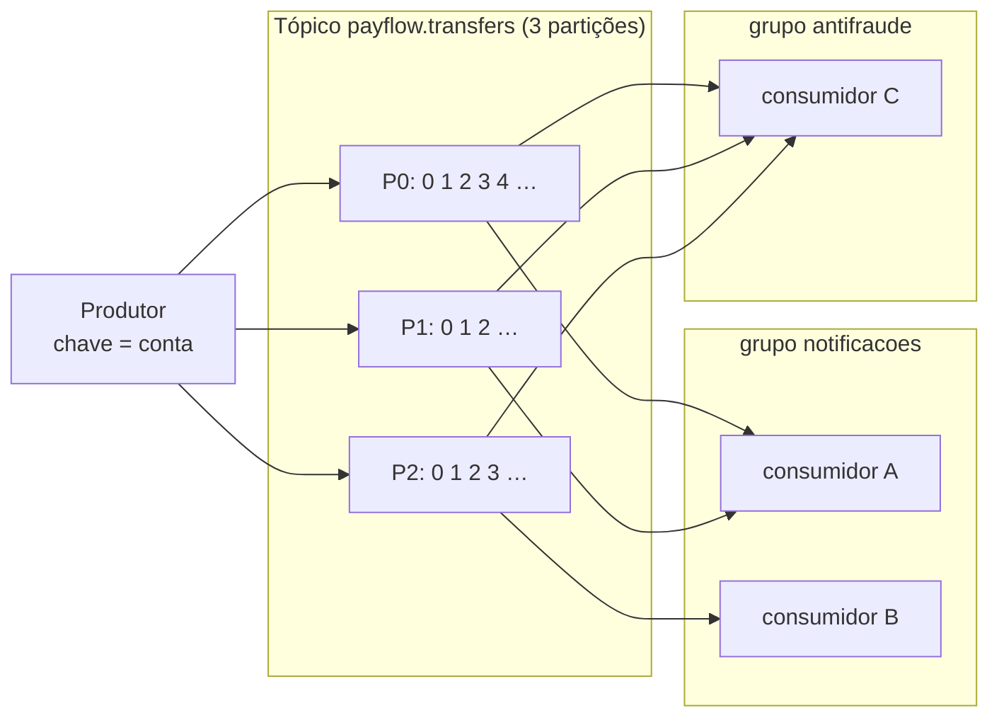

# P3.04 — Apache Kafka I: partições, *consumer groups* e *offsets*

> ⏱️ ~1h30 · 🔵 Pleno · Pré-requisitos: P3.01, P3.03 (fila × tópico, `ack`), P1.07 (ordem e concorrência), J9 (Docker)

> ⚠️ **Verificação:** **executado de verdade** em `lab/messaging-lab` (`KafkaBasicsIT` 4 testes, `KafkaDefaultsIT`) com o **cliente puro** `kafka-clients` **4.2.2** (versão do BOM do Boot 4.1.2) contra um **broker `apache/kafka:latest` = Kafka 4.3.1** (KRaft, 1 nó, Docker; lido dos JARs da imagem). `versoes.md` registrava 4.4.0 como a mais nova (fonte secundária); **não** usei a 4.4.0 no broker. **Um nó, fator de replicação 1: nada aqui prova replicação, `min.insync.replicas` ou eleição de líder** (explicados, não testados). PayFlow: **por leitura**.

## 🎯 Objetivos
Ao final desta aula você consegue:
- **Explicar** o Kafka como um **log distribuído particionado** e **diferenciar** tópico, partição, *offset*, *record* e *segment*.
- **Provar** que a **mesma chave** cai sempre na **mesma partição** (e por isso mantém a **ordem**), e que **chaves diferentes podem dividir** uma partição.
- **Demonstrar** um ***consumer group***: como as partições são divididas, o que acontece ao entrar o 2º, 3º e 4º consumidor.
- **Controlar** *offsets*: confirmar (*commit*), retomar do ponto certo, e **por que outro grupo começa do zero**.
- **Ler** os padrões do cliente (`acks`, `enable.idempotence`, `max.poll.interval.ms`…) e **explicar** a expulsão por processamento lento.

## 🤔 Por que isso importa
O RabbitMQ (P3.03) **entrega e esquece**. O Kafka **guarda** os eventos num **log** e cada interessado lê **no seu ritmo**, **de novo** se precisar. Para o PayFlow isso vale ouro: o **antifraude**, as **notificações** e (S1) o **extrato CQRS** consomem o **mesmo** fluxo de `TransferCompleted`, e um deles pode ser **reconstruído** relendo o passado. Em entrevista, "partição", "chave", "*consumer group*" e "*offset*" são perguntas eliminatórias.

## 💡 Intuição (explicação simples)
O Kafka é **um diário** que todos podem ler. O diário tem **vários cadernos** (partições); cada evento é escrito **no fim de um caderno** com um **número de página** (*offset*). Você decide em qual caderno escrever pela **etiqueta** (chave): "contas da Ana" **sempre** no caderno 2. Cada **leitor** (consumidor) marca **onde parou** com um marcador de página (*offset* confirmado); se ele sair e voltar, retoma dali. Um **grupo de leitores** divide os cadernos entre si (um caderno nunca é lido por dois do **mesmo** grupo); **outro grupo** lê os mesmos cadernos **do início**, com **marcadores próprios**. Ninguém "tira" a página do diário ao ler: ela some só quando a **política de retenção** a apaga (P3.05).

## 🔬 Como funciona por dentro


- **Tópico** = nome lógico; **partição** = um **log só de anexar** (*append-only*), ordenado, com **offsets** crescentes (0, 1, 2…) **por partição**. **A ordem só existe dentro de uma partição.** Não existe "ordem do tópico".
- **Produtor:** escolhe a partição pela **chave** (hash *murmur2* da chave módulo nº de partições, no particionador padrão) ⇒ **mesma chave, mesma partição, mesma ordem**. Sem chave, o particionador **espalha** (ver o experimento: não é uniforme).
- **Consumidor + grupo:** um **grupo** (`group.id`) divide as partições: **cada partição vai para no máximo um consumidor do grupo**. Logo, o **paralelismo máximo = nº de partições**: o 4º consumidor de um tópico de 3 partições **fica ocioso**. Grupos diferentes são independentes (cada um tem **seus** offsets).
- ***Offset* confirmado** (*committed*): o grupo grava, no tópico interno `__consumer_offsets`, "para a partição P, já li até aqui". **Confirmar não apaga nada**; só diz ao Kafka de onde **retomar**. Se o consumidor cai **antes** de confirmar, o próximo **relê** (*at-least-once*, P3.06).
- ***Rebalance*:** quando um consumidor **entra, sai ou é considerado morto**, as partições são **redistribuídas**. Durante ele, o consumo **pausa** (no protocolo clássico, com a estratégia padrão; o `CooperativeStickyAssignor` reduz a pausa).
- **Expulsão:** o consumidor precisa chamar `poll()` **dentro de `max.poll.interval.ms`** (padrão **300 000 ms = 5 min**, **medido** no cliente). Se o processamento passa disso, o grupo o **considera morto**, **reatribui** as partições e o **commit falha** (experimento abaixo).
- **Replicação** (não testada, 1 nó): cada partição tem **líder** e **réplicas**; `acks=all` espera as réplicas **em sincronia** (`min.insync.replicas`). Perder o líder sem réplica = perder dados.
- **Armazenamento:** cada partição é uma pasta de **segmentos** em disco; leitura e escrita **sequenciais** (a razão do desempenho). Tópicos **não** têm esquema: o Kafka guarda **bytes** (chave e valor); o formato (JSON, Avro) é com você (P5: compatibilidade).

## 🛠️ Exemplo prático
Broker de laboratório (porta 59092; **o mesmo número dentro e fora do contêiner**, senão o *broker* não consegue falar consigo mesmo pelo endereço anunciado: veja "Erros comuns"):
```bash
docker run -d --name lab-p3-kafka -p 59092:59092 \
  -e KAFKA_NODE_ID=1 -e KAFKA_PROCESS_ROLES=broker,controller \
  -e KAFKA_LISTENERS=PLAINTEXT://:59092,CONTROLLER://:9093 \
  -e KAFKA_ADVERTISED_LISTENERS=PLAINTEXT://localhost:59092 \
  -e KAFKA_CONTROLLER_LISTENER_NAMES=CONTROLLER \
  -e KAFKA_LISTENER_SECURITY_PROTOCOL_MAP=CONTROLLER:PLAINTEXT,PLAINTEXT:PLAINTEXT \
  -e KAFKA_CONTROLLER_QUORUM_VOTERS=1@localhost:9093 \
  -e KAFKA_OFFSETS_TOPIC_REPLICATION_FACTOR=1 -e KAFKA_TRANSACTION_STATE_LOG_REPLICATION_FACTOR=1 \
  -e KAFKA_TRANSACTION_STATE_LOG_MIN_ISR=1 -e KAFKA_GROUP_INITIAL_REBALANCE_DELAY_MS=0 \
  apache/kafka:latest
```
(KRaft: o próprio Kafka guarda os metadados; **sem ZooKeeper**.) Rodar os testes: `cd lab/messaging-lab && mvn test -Dtest=KafkaBasicsIT` (JDK 25).

### A. Chave → partição → ordem
```java
@Test
void sameKeyGoesToSamePartitionAndKeepsOrder() throws Exception {
    String topic = newTopic(3);
    Map<String, Set<Integer>> partitionsByKey = new TreeMap<>();
    try (var p = producer()) {
        for (int i = 0; i < 30; i++) {
            String key = "acc-" + (i % 3);
            var md = p.send(new ProducerRecord<>(topic, key, "seq-" + i)).get();
            partitionsByKey.computeIfAbsent(key, k -> new TreeSet<>()).add(md.partition());
        }
    }
    System.out.println("PARTICAO_POR_CHAVE " + partitionsByKey);
    partitionsByKey.values().forEach(s -> assertThat(s).hasSize(1));

    Map<String, List<Integer>> seqByKey = new TreeMap<>();
    try (var c = consumer("g-order-" + topic)) {
        c.subscribe(List.of(topic));
        int read = 0;
        long end = System.currentTimeMillis() + 15_000;
        while (read < 30 && System.currentTimeMillis() < end) {
            for (var r : c.poll(Duration.ofMillis(500))) {
                seqByKey.computeIfAbsent(r.key(), k -> new ArrayList<>()).add(Integer.parseInt(r.value().substring(4)));
                read++;
            }
        }
    }
    System.out.println("ORDEM_POR_CHAVE " + seqByKey);
    seqByKey.values().forEach(l -> assertThat(l).isSorted());
    assertThat(seqByKey.values().stream().mapToInt(List::size).sum()).isEqualTo(30);
}
```
```text
PARTICAO_POR_CHAVE {acc-0=[2], acc-1=[0], acc-2=[2]}
ORDEM_POR_CHAVE {acc-0=[0, 3, 6, 9, 12, 15, 18, 21, 24, 27], acc-1=[1, 4, 7, 10, 13, 16, 19, 22, 25, 28], acc-2=[2, 5, 8, 11, 14, 17, 20, 23, 26, 29]}
CFG retention.ms=604800000 (DEFAULT_CONFIG)
CFG retention.bytes=-1 (DEFAULT_CONFIG)
CFG cleanup.policy=delete (DEFAULT_CONFIG)
CFG segment.bytes=1073741824 (DEFAULT_CONFIG)
CFG min.insync.replicas=1 (DYNAMIC_DEFAULT_BROKER_CONFIG)
CFG max.message.bytes=1048588 (DEFAULT_CONFIG)
MESMO_GRUPO_RETOMA_EM=m5
OUTRO_GRUPO_COMECA_EM=m0
COMMITADO=5 FIM=10
CONSUMIDORES=1 ATRIBUICAO=[[0, 1, 2]]
CONSUMIDORES=2 ATRIBUICAO=[[0, 1], [2]]
CONSUMIDORES=3 ATRIBUICAO=[[0], [1], [2]]
CONSUMIDORES=4 ATRIBUICAO=[[0], [1], [2], []]
```
(Saída conjunta do arquivo; as duas primeiras linhas são deste teste.) Cada chave caiu em **uma** partição e a ordem por chave ficou **intacta** (`0,3,6,9…`). **Atenção ao detalhe:** `acc-0` e `acc-2` caíram **ambas na partição 2**: **a mesma chave vai para a mesma partição, mas partições não são exclusivas de chaves**. Mensagens de `acc-0` e `acc-2` aparecem **intercaladas** na partição 2: **não há ordem entre chaves diferentes**.

### B. *Consumer group*: dividindo partições
```java
@Test
void consumerGroupSplitsPartitions() throws Exception {
    String topic = newTopic(3);
    String group = "g-split-" + topic;
    List<KafkaConsumer<String, String>> cs = new ArrayList<>();
    for (int n = 1; n <= 4; n++) {
        var c = consumer(group);
        c.subscribe(List.of(topic));
        cs.add(c);
        final int count = n;
        long end = System.currentTimeMillis() + 20_000;
        // todos os consumidores precisam fazer poll para o rebalance terminar
        while (System.currentTimeMillis() < end) {
            cs.forEach(x -> x.poll(Duration.ofMillis(200)));
            if (cs.stream().mapToInt(x -> x.assignment().size()).sum() == 3
                    && cs.stream().allMatch(x -> count > 3 || !x.assignment().isEmpty())) break;
        }
        System.out.println("CONSUMIDORES=" + n + " ATRIBUICAO=" + cs.stream().map(x -> x.assignment().stream().map(TopicPartition::partition).sorted().toList()).toList());
    }
    assertThat(cs.stream().filter(x -> x.assignment().isEmpty()).count()).isEqualTo(1);
    cs.forEach(KafkaConsumer::close);
}
```
Resultado (linhas `CONSUMIDORES=`): 1 consumidor fica com `[0,1,2]`; 2 → `[0,1]` e `[2]`; 3 → `[0] [1] [2]`; **4 → `[0] [1] [2] []`: o quarto fica **sem partição**. Mais consumidores do que partições **não** aumenta a vazão. (É por isso que o nº de partições é decisão de **capacidade futura**: dá para **aumentar** depois, **mas** muda o mapeamento chave→partição e **quebra a ordem** de chaves já gravadas; não dá para diminuir.)

### C. *Offsets* e grupos
```java
@Test
void offsetsAreCommittedPerGroup() throws Exception {
    String topic = newTopic(1);
    try (var p = producer()) {
        for (int i = 0; i < 10; i++) p.send(new ProducerRecord<>(topic, "k", "m" + i)).get();
    }
    String group = "g-off-" + topic;
    try (var c = consumer(group)) {
        c.subscribe(List.of(topic));
        var got = new ArrayList<ConsumerRecord<String, String>>();
        while (got.size() < 5) c.poll(Duration.ofMillis(500)).forEach(got::add);
        // devolve o excedente: confirma só até a 5ª
        var tp = new TopicPartition(topic, 0);
        c.commitSync(Map.of(tp, new OffsetAndMetadata(5)));
    }
    try (var c = consumer(group)) {
        c.subscribe(List.of(topic));
        ConsumerRecords<String, String> r = ConsumerRecords.empty();
        long end = System.currentTimeMillis() + 15_000;
        while (r.isEmpty() && System.currentTimeMillis() < end) r = c.poll(Duration.ofMillis(500));
        String first = r.iterator().next().value();
        System.out.println("MESMO_GRUPO_RETOMA_EM=" + first);
        assertThat(first).isEqualTo("m5");
    }
    try (var c = consumer("g-other-" + topic)) {
        c.subscribe(List.of(topic));
        ConsumerRecords<String, String> r = ConsumerRecords.empty();
        long end = System.currentTimeMillis() + 15_000;
        while (r.isEmpty() && System.currentTimeMillis() < end) r = c.poll(Duration.ofMillis(500));
        String first = r.iterator().next().value();
        System.out.println("OUTRO_GRUPO_COMECA_EM=" + first);
        assertThat(first).isEqualTo("m0");
    }
    try (var admin = AdminClient.create(Map.of("bootstrap.servers", BOOT))) {
        var offs = admin.listConsumerGroupOffsets(group).partitionsToOffsetAndMetadata().get();
        var end = admin.listOffsets(Map.of(new TopicPartition(topic, 0), OffsetSpec.latest())).all().get();
        System.out.println("COMMITADO=" + offs.values().iterator().next().offset() + " FIM=" + end.values().iterator().next().offset());
    }
}
```
`MESMO_GRUPO_RETOMA_EM=m5` (depois de confirmar o *offset* 5, quem volta **retoma** da 6ª), `OUTRO_GRUPO_COMECA_EM=m0` (**grupo novo** começa do início porque o teste usa `auto.offset.reset=earliest`; **o padrão do cliente é `latest`**, medido: um grupo novo **só veria mensagens novas**, e é um clássico "meu consumidor não recebe nada"), `COMMITADO=5 FIM=10` (o *lag* do grupo é **FIM − COMMITADO = 5**; é **a** métrica de saúde de um consumidor, P6).

### D. Padrões do cliente (medidos no `ConfigDef`)
```text
PRODUCER_DEFAULT acks=all
PRODUCER_DEFAULT enable.idempotence=true
PRODUCER_DEFAULT retries=2147483647
PRODUCER_DEFAULT delivery.timeout.ms=120000
PRODUCER_DEFAULT linger.ms=5
PRODUCER_DEFAULT batch.size=16384
PRODUCER_DEFAULT max.in.flight.requests.per.connection=5
PRODUCER_DEFAULT compression.type=none
CONSUMER_DEFAULT enable.auto.commit=true
CONSUMER_DEFAULT auto.offset.reset=latest
CONSUMER_DEFAULT isolation.level=read_uncommitted
CONSUMER_DEFAULT max.poll.records=500
CONSUMER_DEFAULT max.poll.interval.ms=300000
CONSUMER_DEFAULT session.timeout.ms=45000
CONSUMER_DEFAULT heartbeat.interval.ms=3000
CONSUMER_DEFAULT group.protocol=classic
CONSUMER_DEFAULT partition.assignment.strategy=[class org.apache.kafka.clients.consumer.RangeAssignor, class org.apache.kafka.clients.consumer.CooperativeStickyAssignor]
LENTO recebeu 5 mensagens; vai 'processar' por 6 s (max.poll.interval.ms=3000)
LENTO commitSync falhou: CommitFailedException: Offset commit cannot be completed since the consumer is not part of an active group for auto partition assignm…
LENTO depois da expulsão, o grupo reentregou 5 mensagens (processamento duplicado)
CHAVE_NULA 300 mensagens por partição={1=300}
```
Leia com calma: **`acks=all`** e **`enable.idempotence=true`** já são o padrão do **produtor** (o produtor **não duplica** por *retry* de rede dentro de uma sessão); `retries` ≈ infinito limitado por `delivery.timeout.ms=120000`; `linger.ms=5`; no **consumidor**, **`enable.auto.commit=true`** (confirma **sozinho a cada 5 s**, mesmo sem você ter terminado de processar: fonte de perda silenciosa!), **`auto.offset.reset=latest`**, `isolation.level=read_uncommitted`, `max.poll.records=500`, `max.poll.interval.ms=300000`, `session.timeout.ms=45000`, `heartbeat.interval.ms=3000`.

### E. Chave nula e processamento lento
O mesmo arquivo (`KafkaDefaultsIT`) mostra duas armadilhas:
- **Chave nula:** 300 mensagens em 3 partições ficaram `{1=230, 2=70}` numa rodada e `{1=300}` (**tudo numa partição só**) em outra: o resultado **varia a cada execução** e **nunca** foi uniforme: o particionador padrão agrupa em lotes (*sticky*). (O arquivo `out-kafka-defaults.txt` mostra a última rodada.) Para ordenar ou balancear por entidade, **sempre use chave**.
- **Expulsão:** com `max.poll.interval.ms=3000` e 6 s de "processamento", o `commitSync` falhou com `CommitFailedException: … not part of an active group …`, e **outro consumidor do mesmo grupo recebeu as 5 mensagens de novo**: processamento **duplicado**. As linhas `LENTO …` estão em `out-kafka-defaults.txt` acima.

### F. O PayFlow (por leitura)
Tópico `payflow.transfers.v1`: **chave = `sourceAccountId`** (a ordem de **uma conta** é preservada: depósitos e transferências dela chegam em ordem), **3 partições** no início (espaço para 3 consumidores por grupo; reveja com a carga medida, P6/S2), grupos `notifications` e `antifraud` (cada um **sua** cópia do fluxo). A decisão completa está na ADR 0015.

## 🧠 Pausa para lógica
**Enunciado.** O tópico tem **6 partições** e o grupo `antifraud` tem **4 consumidores**. (a) Como ficam as partições (use a distribuição mais equilibrada)? (b) Qual o **maior** nº de consumidores úteis? (c) Se 1 consumidor cai, qual o **máximo de partições** por consumidor? (d) Duas contas com chaves `A` e `B` caem na **mesma** partição: o antifraude vê a ordem **entre** elas?

<details><summary>Dica</summary>

Cada partição vai a **um** consumidor; a ordem só vale **dentro** de uma partição.
</details>

<details><summary>Solução</summary>

(a) 6 ÷ 4: dois consumidores com **2** partições e dois com **1** (`2,2,1,1`). (b) **6** (o 7º ficaria ocioso). (c) Com 3 consumidores: `2,2,2` (máximo **2**). (d) **Sim, vê uma ordem** (a de gravação na partição), **mas ela não tem significado de negócio** entre contas diferentes; não dependa dela (um produtor diferente ou um *retry* pode reordenar). A garantia útil é **por chave**.
**Variação:** a chave de `TransferCompleted` é `sourceAccountId`. Um **depósito** na conta de destino de uma transferência **de outra** conta é ordenado em relação a essa transferência? (**Não**: chaves/partições diferentes; para ordenar os dois, a chave teria de ser a conta **afetada**, e a transferência afeta **duas** contas: por isso o evento carrega **ambas** e o consumidor **não** deve assumir ordem entre contas.)
</details>

## ⚖️ Trade-offs e quando NÃO usar
| Kafka é bom para | Pense duas vezes quando |
|---|---|
| **fluxo de eventos** lido por **vários** consumidores, com **reprocessamento** (consertar um bug e reler) | só precisa de **uma fila de tarefas** simples com roteamento e DLQ (RabbitMQ/SQS) |
| **ordem por chave** e vazão alta | você precisa de **prioridade**, **atraso por mensagem** ou *ack* individual com reentrega fina: o modelo é **por offset**, não por mensagem |
| retenção como **buffer** (consumidor fora do ar por horas) | a equipe é pequena e **não tem quem opere** (replicação, partições, `min.insync.replicas`, atualizações): considere o serviço gerenciado (MSK/Confluent, P9) |
**Custo oculto:** **escolher o nº de partições**, a **chave** e o **formato do evento** são decisões **difíceis de desfazer**.

## ⚠️ Erros comuns e boas práticas de produção
- **`Connection to node 1 (localhost/127.0.0.1:59092) could not be established` nos logs do *broker*** e `NOT_ENOUGH_REPLICAS … Unable to verify the partition has been added to the transaction` no produtor transacional (**erro real do laboratório**): o *broker* usa o **endereço anunciado** para falar com **ele mesmo**; mapeando `-p 59092:9092` o endereço `localhost:59092` **não existe dentro** do contêiner. Solução: escutar na **mesma porta** dentro e fora (acima), ou um *listener* interno separado.
- **Grupo novo "não recebe nada":** `auto.offset.reset=latest` (padrão). Defina **`earliest`** se quer o histórico, e **decida** conscientemente.
- **`enable.auto.commit=true` + processamento assíncrono:** o *offset* é confirmado **antes** do fim do trabalho ⇒ perda silenciosa. O Spring Kafka já desliga (`enable.auto.commit=false` salvo configuração; confirmado na [documentação](https://docs.spring.io/spring-kafka/reference/kafka/receiving-messages/message-listener-container.html)).
- **Processamento lento ⇒ expulsão ⇒ duplicatas:** reduza `max.poll.records`, aumente `max.poll.interval.ms` **só se necessário**, ou tire o trabalho pesado do laço do consumidor.
- **Chave nula** onde ordem importa; **chave de alta cardinalidade ruim** (uma conta "quente" sobrecarrega uma partição: P2 já viu a conta quente no banco).
- **Mais consumidores que partições**: ociosos.
- **Poucas partições "por enquanto":** aumentar depois **muda** o mapeamento chave→partição.

## 🧩 Exercícios
**1. Fixação.** (a) Em que escopo vale a ordem no Kafka? (b) O que é o *lag* e como se calcula? (c) Por que `auto.commit` pode **perder** mensagens?

<details><summary>Solução</summary>

(a) Dentro de **uma partição** (portanto **por chave**). (b) `offset do fim − offset confirmado` por partição (`COMMITADO=5 FIM=10` ⇒ 5). (c) Ele confirma por **tempo** (a cada 5 s), não por **conclusão**: se confirma e o processo cai antes de terminar, o trabalho **não é refeito**.
</details>

**2. Aplicação no PayFlow (por leitura).** Escreva `docs/kafka-topics.md`: tópico `payflow.transfers.v1` (chave, nº de partições, **por quê**), grupos `notifications`/`antifraud`, `auto.offset.reset`, retenção (P3.05) e o formato do evento (campos, `eventId`, versão).
- [ ] A chave está justificada pela **ordem que o negócio precisa**.
- [ ] O nº de partições vem de uma **conta** (consumidores desejados × margem), não de "3 por padrão".
- [ ] O evento tem `eventId` (UUID), `occurredAt` (UTC), `schemaVersion` e **não** tem dado pessoal além de ids.
- [ ] O documento diz o que fazer ao **aumentar** partições.

**3. Desafio.** Rode `consumerGroupSplitsPartitions` com `partition.assignment.strategy=CooperativeStickyAssignor` **somente** e observe se algum consumidor **perde** partições ao entrar o seguinte. (Não executado aqui; registre.)

## 🎤 Na entrevista
**1. "Como o Kafka garante ordem?"** *Resposta-modelo:* só **por partição**: o produtor usa a chave para mandar eventos da mesma entidade à mesma partição, e **um** consumidor do grupo lê cada partição em ordem. Entre partições **não** há ordem. Reordenações vêm de *retries* sem idempotência (o padrão atual **tem** idempotência) e de **mudar o nº de partições**.
**2. "O que é um *consumer group* e qual o limite de paralelismo?"** *Resposta-modelo:* conjunto de consumidores que **dividem** as partições de um tópico (cada partição a **um** membro); paralelismo máximo = nº de partições; grupos diferentes leem independentemente com offsets próprios.
**3. "Meu consumidor processou duas vezes. Por quê?"** *Resposta-modelo:* *rebalance* ou expulsão por `max.poll.interval.ms`, queda antes do commit, ou reentrega após falha: o Kafka garante **at-least-once** por padrão; o consumidor precisa ser **idempotente** (P3.07).

## 📚 Para ir além
- 📄 [Apache Kafka — Documentação](https://kafka.apache.org/documentation/) — *design*, *consumer configs*, *producer configs* (os padrões medidos acima).
- 📄 [Spring for Apache Kafka — referência](https://docs.spring.io/spring-kafka/reference/) — o que vem na P3.05.
- 📄 [Kafka — imagem Docker oficial `apache/kafka`](https://hub.docker.com/r/apache/kafka) — como subir o nó KRaft.
- 📑 *Kafka: The Definitive Guide* (Shapira et al.) — capítulos de produtores/consumidores/*rebalance*; de memória, **não conferido**.
- 📑 *Designing Data-Intensive Applications* (Kleppmann), cap. 11 (fluxos e *logs*); de memória, **não conferido**.
- 💻 `lab/messaging-lab/src/test/java/com/payflow/lab/KafkaBasicsIT.java` e `KafkaDefaultsIT.java`.

## ✅ Checklist da aula
- [ ] Sei desenhar tópico/partições/offsets e dizer **onde há ordem**.
- [ ] Provei chave→partição e vi que partições são **compartilhadas** por chaves.
- [ ] Vi o 4º consumidor ocioso e expliquei por quê.
- [ ] Sei por que um grupo novo "não recebe nada" (`latest`).
- [ ] Reproduzi/li a expulsão por `max.poll.interval.ms`.
- [ ] Defini tópico, chave e partições do PayFlow **com justificativa**.
