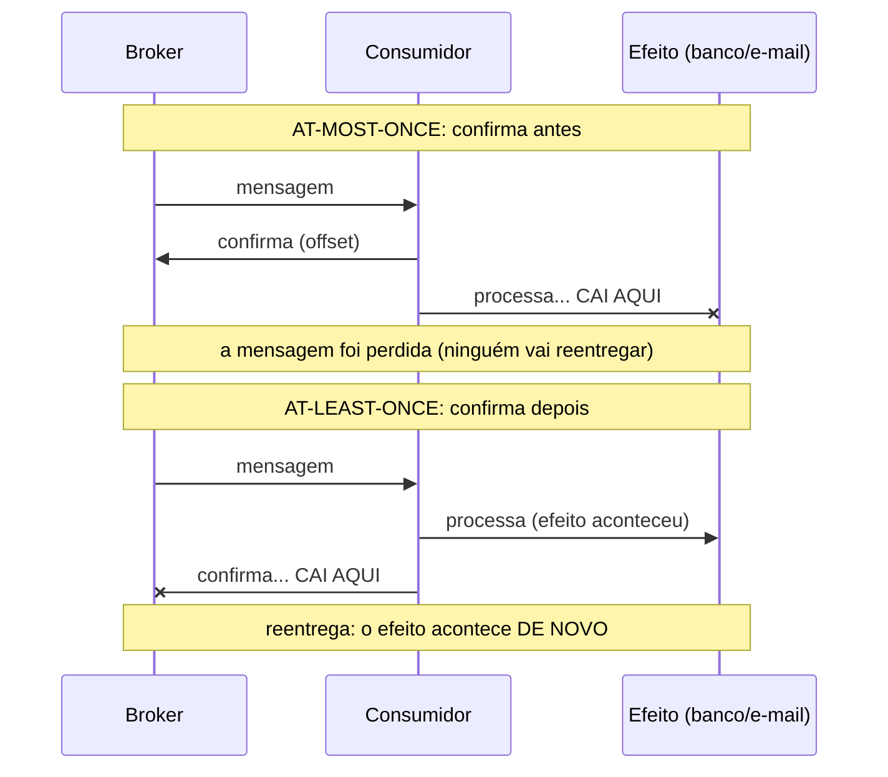

# P3.06 — Garantias de entrega e "*exactly-once*"

> ⏱️ ~1h30 · 🔵 Pleno · Pré-requisitos: P3.03 (`ack`, reentrega), P3.04 (*offsets*, *commit*), P3.05 (`AckMode`), P2.01 (transações)

> ✅ **Validação final (2026-11-24):** módulo executado no PayFlow reconstruído; resultado e o que continua não executado no [README do módulo](README.md). Os avisos "não executado" / "por leitura" abaixo descrevem a escrita original.

> ⚠️ **Verificação:** **executado de verdade** em `lab/messaging-lab` (`DeliveryAndIdempotencyIT`): `kafka-clients` 4.2.2, broker Kafka 4.3.1 (1 nó), JDK 25.0.5. **Não executado:** `sendOffsetsToTransaction` (consumir-transformar-produzir), múltiplos *brokers*, falha de rede real (as "quedas" são simuladas **fechando o consumidor sem confirmar**). A afirmação sobre o *scope* do *exactly-once* vem da documentação do Spring Kafka e do Kafka, citadas.

## 🎯 Objetivos
Ao final desta aula você consegue:
- **Definir** *at-most-once*, *at-least-once* e *exactly-once* e **mostrar**, com código, qual **ordem de operações** produz cada um (confirmar antes ou depois de processar).
- **Explicar** por que **não existe entrega "exatamente uma vez" ponta a ponta** em sistemas que falham, e o que existe de verdade: ***effectively-once*** = *at-least-once* + **idempotência**.
- **Demonstrar** as **transações do Kafka** (`read_committed`) e **delimitar** o que elas cobrem (só Kafka → Kafka) e o que **não** cobrem (banco, e-mail, HTTP).
- **Escolher** a garantia certa por fluxo do PayFlow.

## 🤔 Por que isso importa
"Esse sistema é *exactly-once*?" é pergunta de entrevista **e** de revisão de arquitetura. A resposta ingênua ("o Kafka garante") leva a **débitos duplicados** em produção (P3.13). A resposta madura é: *"a rede e os processos falham em qualquer ponto; escolhemos entre perder e repetir; **repetimos** e tornamos o efeito **idempotente**."*

## 💡 Intuição (explicação simples)
Você entrega uma encomenda e o cliente deve **assinar o recibo**. Se você **anota "entregue" antes** de entregar e o carro quebra: a encomenda **nunca chega** e ninguém sabe (**at-most-once**: no máximo uma, talvez nenhuma). Se **entrega e só depois anota**, e o carro quebra no meio: no dia seguinte você **entrega de novo** (**at-least-once**: pelo menos uma, talvez duas). "**Exatamente uma**" exigiria entregar **e** anotar num **único instante indivisível**, e entregar é no mundo físico e anotar é no seu caderno: **não existe**. O que o cliente esperto faz é **recusar a segunda caixa** (**idempotência**): ele reconhece "essa já recebi".

## 🔬 Como funciona por dentro

### 1. As três garantias = a **ordem** entre *trabalhar* e *confirmar*

- **At-most-once** (0 ou 1): confirmar **antes**. Aceitável para dado **descartável** (métrica, *heartbeat*). **Nunca** para dinheiro ou aviso obrigatório.
- **At-least-once** (1 ou mais): confirmar **depois**. **É o padrão** de Kafka/RabbitMQ para o consumidor, e o que se usa em sistemas financeiros, **com idempotência**.
- **Exactly-once** (exatamente 1): **no efeito**, é obtido **combinando** *at-least-once* com **deduplicação/idempotência** (o efeito **só vale uma vez**), ou **dentro** de um sistema que faz leitura+escrita **atomicamente** (transações do Kafka). **Entregar** a mensagem fisicamente uma vez **não** é possível quando processos e rede falham (é o problema dos dois generais, resultado clássico de sistemas distribuídos; sem link verificado nesta geração).

### 2. O que o Kafka chama de *exactly-once* (EOS)
Três peças, de baixo para cima:
1. **Produtor idempotente** (`enable.idempotence=true`, **padrão**, medido na P3.04): o *broker* descarta **duplicatas de *retry*** do mesmo produtor numa mesma sessão (número de sequência por partição). Resolve "o *retry* de rede duplicou a mensagem **no log**".
2. **Transações** (`transactional.id` + `initTransactions/beginTransaction/commitTransaction/abortTransaction`): gravar em **várias partições/tópicos** **atomicamente**; e **`sendOffsetsToTransaction`** inclui o **offset do consumidor** na mesma transação: o padrão **consumir → transformar → produzir** fica atômico **dentro do Kafka**.
3. **`isolation.level=read_committed`** no consumidor: ele **só vê** registros de transações **confirmadas** (o padrão é `read_uncommitted`, medido na P3.04).

Escopo (documentado): o [Spring Kafka](https://docs.spring.io/spring-kafka/reference/kafka/exactly-once.html) diz que a transação do Kafka garante *exactly-once* para **ler-processar-escrever no Kafka**, e que, para outros efeitos, "*the read and process have at least once semantics*". **Escrever no PostgreSQL ou enviar e-mail NÃO entra na transação do Kafka.** Não há 2PC entre os dois (S1 explica por que evitar).

## 🛠️ Exemplo prático

### A. *At-most-once* × *at-least-once* com o consumidor real
```java
@Test
void atMostOnceLosesAndAtLeastOnceDuplicates() throws Exception {
    String topic = KafkaBasicsIT.newTopic(1);
    try (var p = KafkaBasicsIT.producer()) {
        for (int i = 0; i < 10; i++) p.send(new ProducerRecord<>(topic, "k", "m" + i)).get();
    }
    // at-most-once: confirma o offset ANTES de processar e cai no meio
    List<String> done = new ArrayList<>();
    try (var c = KafkaBasicsIT.consumer("g-amo-" + topic)) {
        c.subscribe(List.of(topic));
        ConsumerRecords<String, String> recs = ConsumerRecords.empty();
        while (recs.isEmpty()) recs = c.poll(Duration.ofMillis(500));
        c.commitSync();                          // 1) confirma tudo que veio
        int k = 0;
        for (var r : recs) { if (k++ == 3) break; done.add(r.value()); } // 2) processa 3 e "cai"
    }
    List<String> after = new ArrayList<>();
    try (var c = KafkaBasicsIT.consumer("g-amo-" + topic)) {
        c.subscribe(List.of(topic));
        long end = System.currentTimeMillis() + 4000;
        while (System.currentTimeMillis() < end) c.poll(Duration.ofMillis(300)).forEach(r -> after.add(r.value()));
    }
    System.out.println("AT_MOST_ONCE processou=" + done + " depois_da_queda_recebeu=" + after + " (perdidas=7)");
    assertThat(after).isEmpty();

    // at-least-once: processa ANTES de confirmar e cai no meio
    String topic2 = KafkaBasicsIT.newTopic(1);
    try (var p = KafkaBasicsIT.producer()) {
        for (int i = 0; i < 10; i++) p.send(new ProducerRecord<>(topic2, "k", "m" + i)).get();
    }
    List<String> first = new ArrayList<>();
    try (var c = KafkaBasicsIT.consumer("g-alo-" + topic2)) {
        c.subscribe(List.of(topic2));
        ConsumerRecords<String, String> recs = ConsumerRecords.empty();
        while (recs.isEmpty()) recs = c.poll(Duration.ofMillis(500));
        int k = 0;
        for (var r : recs) { if (k++ == 6) break; first.add(r.value()); } // processa 6 e cai SEM confirmar
    }
    List<String> second = new ArrayList<>();
    try (var c = KafkaBasicsIT.consumer("g-alo-" + topic2)) {
        c.subscribe(List.of(topic2));
        long end = System.currentTimeMillis() + 5000;
        while (System.currentTimeMillis() < end && second.size() < 10) c.poll(Duration.ofMillis(300)).forEach(r -> second.add(r.value()));
    }
    System.out.println("AT_LEAST_ONCE antes_da_queda=" + first + " depois_recebeu=" + second);
    assertThat(second).hasSize(10);
}
```
```text
AT_MOST_ONCE processou=[m0, m1, m2] depois_da_queda_recebeu=[] (perdidas=7)
AT_LEAST_ONCE antes_da_queda=[m0, m1, m2, m3, m4, m5] depois_recebeu=[m0, m1, m2, m3, m4, m5, m6, m7, m8, m9]
TX_ABERTA read_uncommitted=[aborted-1, aborted-2] read_committed=[]
TX_FIM read_committed=[committed-1] read_uncommitted=[aborted-1, aborted-2, committed-1]
```
(As linhas `AT_*` são deste teste; `TX_*`, do próximo.)
- **At-most-once:** `commitSync()` **antes** de processar; processou 3 de 10 e "caiu": o consumidor que voltou **não recebeu nada** (`depois_da_queda_recebeu=[]`): **7 mensagens perdidas**, sem erro.
- **At-least-once:** processou 6 de 10 **sem confirmar** e "caiu": o novo consumidor recebeu **as 10 de novo** (as 6 já processadas **repetidas**).

### B. Transações e `read_committed`
```java
@Test
void transactionsHideAbortedRecordsFromReadCommitted() throws Exception {
    String topic = KafkaBasicsIT.newTopic(1);
    var props = new HashMap<String, Object>(Map.of("bootstrap.servers", KafkaBasicsIT.BOOT,
            "key.serializer", StringSerializer.class.getName(), "value.serializer", StringSerializer.class.getName(),
            "transactional.id", "tx-" + topic));
    try (var p = new KafkaProducer<String, String>(props)) {
        p.initTransactions();
        p.beginTransaction();
        p.send(new ProducerRecord<>(topic, "k", "aborted-1"));
        p.send(new ProducerRecord<>(topic, "k", "aborted-2"));
        p.flush();
        // lê com read_uncommitted e read_committed ENQUANTO a transação está aberta
        System.out.println("TX_ABERTA read_uncommitted=" + readAll(topic, "read_uncommitted") + " read_committed=" + readAll(topic, "read_committed"));
        p.abortTransaction();
        p.beginTransaction();
        p.send(new ProducerRecord<>(topic, "k", "committed-1"));
        p.commitTransaction();
    }
    var rc = readAll(topic, "read_committed");
    var ru = readAll(topic, "read_uncommitted");
    System.out.println("TX_FIM read_committed=" + rc + " read_uncommitted=" + ru);
    assertThat(rc).containsExactly("committed-1");
    assertThat(ru).contains("aborted-1", "aborted-2", "committed-1");
}

static List<String> readAll(String topic, String isolation) {
    var cfg = new HashMap<String, Object>(Map.of("bootstrap.servers", KafkaBasicsIT.BOOT, "group.id", "g-" + UUID.randomUUID(),
            "auto.offset.reset", "earliest", "isolation.level", isolation,
            "key.deserializer", org.apache.kafka.common.serialization.StringDeserializer.class.getName(),
            "value.deserializer", org.apache.kafka.common.serialization.StringDeserializer.class.getName()));
    List<String> out = new ArrayList<>();
    try (var c = new KafkaConsumer<String, String>(cfg)) {
        c.subscribe(List.of(topic));
        long end = System.currentTimeMillis() + 4000;
        while (System.currentTimeMillis() < end) c.poll(Duration.ofMillis(300)).forEach(r -> out.add(r.value()));
    }
    return out;
}
```
- Com a transação **aberta**: `read_uncommitted` vê `[aborted-1, aborted-2]`; **`read_committed` vê `[]`**.
- Depois de `abort` + nova transação com `commit`: `read_committed` vê **só** `committed-1`; `read_uncommitted` ainda vê as abortadas (**elas continuam no log**, marcadas como abortadas; só são **escondidas** de quem lê `read_committed`).
Quem lê com o **padrão** (`read_uncommitted`) **enxerga lixo transacional**: o consumo de tópicos com produtor transacional exige `isolation.level=read_committed` (no Spring Boot: `spring.kafka.consumer.isolation-level: read_committed`).

### C. Para onde isso leva o PayFlow
| Fluxo | Garantia | Como |
|---|---|---|
| Notificação por e-mail | **at-least-once + idempotência** (e-mail repetido é tolerável, mas **deduplique** pelo `eventId`) | P3.07 |
| Antifraude (sinalização) | **at-least-once + idempotência** | gravar a sinalização por `eventId` único |
| Crédito do **pagamento por QR** (webhook) | **effectively-once**: o efeito (crédito) por **`eventId` único** na **mesma transação** do banco | P3.07, P3.10 |
| Métrica de uso | pode ser **at-most-once** | descartável |
| Evento de transferência **para o Kafka** | **at-least-once** a partir do **Outbox** | P3.09 |
Nenhum fluxo do PayFlow usa transações do Kafka: o efeito de negócio é no **PostgreSQL**, que **não participa** da transação do Kafka; a solução é **idempotência no banco**.

## 🧠 Pausa para lógica
**Enunciado.** O consumidor faz: (1) lê a mensagem, (2) `UPDATE wallets` (debita), (3) confirma o *offset*. Em que passos uma queda causa **perda**? **Duplicata**? Reordene os passos para obter *at-most-once*. Depois: como obter o **mesmo débito uma só vez** mantendo a ordem 1-2-3?

<details><summary>Dica</summary>

Para cada ponto de queda (entre 1-2, 2-3, depois de 3) pergunte: a mensagem será reentregue? O débito aconteceu?
</details>

<details><summary>Solução</summary>

Queda entre **1 e 2**: nada debitado, mensagem **reentregue** ⇒ ok (sem perda). Entre **2 e 3**: **debitou e não confirmou** ⇒ reentrega ⇒ **débito duplicado** (**duplicata**). Depois de 3: ok. **Perda** não ocorre nessa ordem. *At-most-once*: ordem **1-3-2** (confirma antes de debitar; queda entre 3 e 2 = **débito perdido**). **Uma vez só mantendo 1-2-3:** na **mesma transação do banco** inserir `processed_messages(message_id)` (chave única) **e** debitar; na reentrega a inserção **conflita** e o débito **não** repete (P3.07).
**Variação:** e se o passo 2 for "enviar e-mail" (efeito **fora** do banco)? (Não dá para tornar atômico com o *offset*; use **idempotency key no provedor** de e-mail se existir, ou aceite a duplicata **e documente**.)
</details>

## ⚖️ Trade-offs e quando NÃO usar
- **EOS do Kafka (transações):** **custo** de latência/vazão, complexidade (`transactional.id` único por instância, *fencing* de "zumbis"), e **só** cobre Kafka→Kafka. Use para **pipelines de transformação** dentro do Kafka (ex.: agregações); **não** use esperando proteger o banco.
- **At-least-once + idempotência:** simples, **portátil** (vale em RabbitMQ, SQS, webhooks), exige disciplina de **chave única** e de **retenção** da tabela de deduplicação.
- **At-most-once:** só para dado que **tolera perda**.
Resumo: **na dúvida, at-least-once + idempotência no efeito.**

## ⚠️ Erros comuns e boas práticas de produção
- **"O Kafka é exactly-once, então não preciso de idempotência."** Falso para efeitos fora do Kafka (documentação acima).
- **`auto.commit=true`** produz um *at-most-once* acidental (confirma por tempo; P3.04/P3.05).
- **Consumir tópico transacional com `read_uncommitted`:** processa mensagens **abortadas**.
- **Idempotência só no produtor:** protege contra *retry de rede*, **não** contra **reprocessamento** do consumidor nem **reenvio** da aplicação (`kafka.send` chamado duas vezes cria duas mensagens **distintas**).
- **Chave de deduplicação "gerada no consumidor"** (um UUID novo a cada tentativa) **não deduplica nada**: a chave vem **do produtor** (o `eventId` do evento).
- **Confiar que "não vai cair no meio":** cai. O teste existe para provar.

## 🧩 Exercícios
**1. Fixação.** (a) Classifique: confirmar o *offset* e depois chamar o PSP; chamar o PSP e depois confirmar; `enable.auto.commit=true`. (b) O que o `read_committed` esconde? (c) Por que o produtor idempotente **não** impede duplicatas do consumidor?

<details><summary>Solução</summary>

(a) *At-most-once*; *at-least-once*; geralmente *at-most-once* **acidental** (confirma por tempo). (b) Registros de transações **abertas** e **abortadas**. (c) Ele só deduplica **retries do próprio produtor** na sessão; a duplicata do consumidor vem da **reentrega** da mesma mensagem.
</details>

**2. Aplicação no PayFlow (por leitura).** Escreva `docs/delivery-guarantees.md`: uma tabela **fluxo × garantia × como se obtém × o que acontece numa queda entre "efeito" e "confirmação"**, para: e-mail, antifraude, crédito por webhook, evento da transferência, métrica.
- [ ] Cada linha identifica **onde** está a chave de deduplicação (e quem a gera).
- [ ] Nenhuma linha diz "exactly-once" sem a condição (idempotência **ou** Kafka→Kafka).
- [ ] O documento cita o **teste** que prova cada afirmação (P3.07, P3.09, P3.10).
- [ ] `isolation.level` está decidido para cada consumidor.

**3. Desafio.** Implemente consumir→transformar→produzir com `sendOffsetsToTransaction` e prove, **matando o processo no meio** (`Runtime.halt`), que o tópico de saída não tem duplicatas **lido com `read_committed`**. (Não executado aqui.)

## 🎤 Na entrevista
**1. "O Kafka é exactly-once?"** *Resposta-modelo:* para **leitura-processamento-escrita dentro do Kafka**, com produtor idempotente, transações e `read_committed`, sim. Para efeitos **externos** (banco, e-mail, HTTP), não: a entrega é *at-least-once* e o efeito se torna *exactly-once* com **idempotência** (chave única na mesma transação do efeito).
**2. "Como evitar cobrar duas vezes quando a mensagem é reentregue?"** *Resposta-modelo:* chave de idempotência **vinda do produtor** (`eventId`), tabela de mensagens processadas com **restrição única**, inserida **na mesma transação** do débito; reentrega ⇒ conflito ⇒ ignora.
**3. "At-most-once ou at-least-once para notificações?"** *Resposta-modelo:* *at-least-once* com deduplicação; perder o aviso de uma transferência é pior que mandar duas vezes, mas o e-mail duplicado deve ser **raro** e **detectável**.

## 📚 Para ir além
- 📄 [Spring for Apache Kafka — Exactly Once Semantics](https://docs.spring.io/spring-kafka/reference/kafka/exactly-once.html) — o escopo e o `EOSMode.V2`.
- 📄 [Spring for Apache Kafka — Transactions](https://docs.spring.io/spring-kafka/reference/kafka/transactions.html) — `transactionIdPrefix` único por instância.
- 📄 [Apache Kafka — Documentação (Semantics)](https://kafka.apache.org/documentation/) — seção de semânticas de entrega.
- 📑 [KIP-98 — Exactly Once Delivery and Transactional Messaging](https://cwiki.apache.org/confluence/display/KAFKA/KIP-98+-+Exactly+Once+Delivery+and+Transactional+Messaging) — a proposta original.
- 📑 *Designing Data-Intensive Applications* (Kleppmann), cap. 11, "Fault tolerance"/"idempotence"; de memória, **não conferido**.
- 💻 `lab/messaging-lab/src/test/java/com/payflow/lab/DeliveryAndIdempotencyIT.java`.

## ✅ Checklist da aula
- [ ] Reproduzi *at-most-once* (perda) e *at-least-once* (duplicata).
- [ ] Vi o `read_committed` esconder registros abortados.
- [ ] Sei **por que** exactly-once ponta a ponta não existe e o que o substitui.
- [ ] Defini a garantia de cada fluxo do PayFlow.
