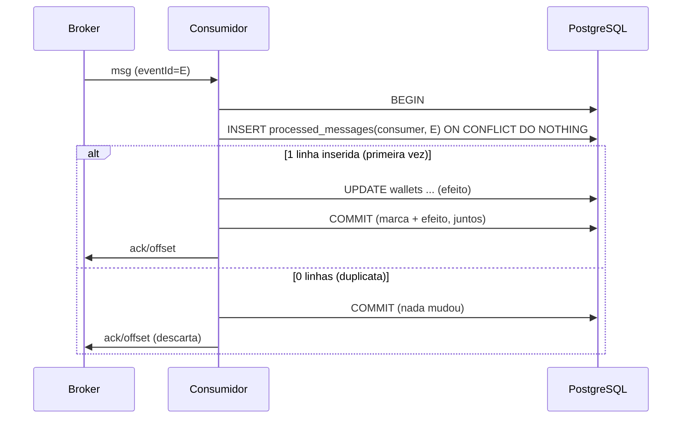

# P3.07 — Idempotência de consumidores

> ⏱️ ~1h30 · 🔵 Pleno · Pré-requisitos: P3.06, J6 (`Idempotency-Key`), J3.10/J5.11 (transação), P2.01/P2.02 (concorrência no banco), P1.09 (corrida *check-then-act*)

> ⚠️ **Verificação:** **executado de verdade** em `lab/messaging-lab` (`DeliveryAndIdempotencyIT`, 5 testes de idempotência): PostgreSQL **18** (Docker), Spring Boot **4.1.2** (`JdbcClient`), JDK 25.0.5. **Não** executado no PayFlow do aluno (por leitura).

## 🎯 Objetivos
Ao final desta aula você consegue:
- **Definir** idempotência de um **efeito** (não de uma mensagem) e **dizer** de onde vem a **chave** de deduplicação.
- **Implementar** um consumidor idempotente com **tabela de mensagens processadas** e `INSERT … ON CONFLICT DO NOTHING` **na mesma transação** do efeito.
- **Provar** que a versão "verifica e depois grava" (*check-then-act*) **falha sob concorrência**, e que a versão correta **não**.
- **Escolher** entre quatro técnicas (chave única, operação naturalmente idempotente, versão/estado, *upsert*) e **dimensionar a retenção** da tabela.

## 🤔 Por que isso importa
A P3.06 concluiu: a entrega é *at-least-once*. Logo **toda** mensagem pode chegar duas vezes (reentrega, *rebalance*, webhook reenviado, *retry* do Outbox). Em e-mail, o custo é um aviso repetido; **em pagamento, é dinheiro debitado duas vezes** (P3.13). Idempotência é a **segunda metade** da garantia: sem ela, *at-least-once* é um defeito.

## 💡 Intuição (explicação simples)
Apertar o botão do elevador **cinco vezes** não chama **cinco** elevadores: o chamado já está registrado. Idempotência é **"fazer de novo dá o mesmo resultado que fazer uma vez"**. Para o caixa do banco: você entrega o **número do cheque**; se o mesmo número aparecer duas vezes, o caixa responde "esse já foi compensado" **sem pagar de novo**. O número do cheque é a **chave de idempotência**, e o caderno de cheques compensados é a **tabela de mensagens processadas**. E o caixa só pode **anotar o cheque e pagar no mesmo ato**, senão sobra uma brecha.

## 🔬 Como funciona por dentro

### 1. O que é idempotente (e o que não é)
- **Naturalmente idempotente:** `UPDATE accounts SET status='BLOCKED' WHERE id=?` (fazer 2× = fazer 1×); `PUT` do mesmo recurso; "definir o saldo exibido = X".
- **Não idempotente:** `balance = balance - 100`; "inserir lançamento"; "enviar e-mail"; "criar transferência". Precisam de **deduplicação**.
- Idempotência é do **efeito**: o consumidor pode **receber** a mensagem 5 vezes; o importante é que o **dinheiro** mexa **uma**.

### 2. A chave
- Vem **do produtor** e é **estável** entre reentregas: o `eventId` (UUID gerado ao criar o evento, **gravado no Outbox**, P3.09), o `Idempotency-Key` do cliente (J6), o `eventId` do PSP (P3.10). **Nunca** gere a chave no consumidor (um UUID novo a cada tentativa não deduplica nada) e **cuidado** com chaves "naturais" ruins (`accountId + amount` repete legitimamente).
- **Escopo:** `(consumidor, messageId)`: dois consumidores **diferentes** podem processar a mesma mensagem (cada um com a sua marca).

### 3. O padrão correto: marca + efeito na **mesma transação**

- **Tudo ou nada:** se o efeito falha (exceção/*rollback*), a **marca também some** ⇒ a retentativa **processa de verdade** (medido).
- **Concorrência:** duas entregas **simultâneas** da mesma mensagem: o 2º `INSERT` **espera** o 1º terminar (a restrição única **serializa**) e então vê o conflito. A **unicidade no banco** é quem decide, não o `if` do Java.
- **A versão ingênua** ("`SELECT` se já existe → processa → `INSERT` a marca") tem a corrida *check-then-act* (a mesma da J8.06/P1.09): dois consumidores leem "não existe" e **ambos** processam.

### 4. Quatro técnicas
| Técnica | Quando | Custo |
|---|---|---|
| **Tabela de mensagens processadas** (chave única) | efeitos **não** idempotentes no **seu banco** | uma linha por mensagem; **limpeza** necessária |
| **Operação naturalmente idempotente / `UPSERT`** | "definir estado" | nenhum extra |
| **Versão/estado** (`WHERE status='PENDING'`) | máquina de estados (pagamento `PENDING→PAID`) | a condição vira a trava |
| **Chave do provedor** (idempotency key no PSP/e-mail) | efeito **externo** que você não controla | depende do provedor |

## 🛠️ Exemplo prático

### A. O consumidor (três versões, de propósito)
```java
package com.payflow.lab;

import java.math.BigDecimal;
import org.springframework.jdbc.core.simple.JdbcClient;
import org.springframework.stereotype.Service;
import org.springframework.transaction.annotation.Transactional;

/** P3.07: consumidor idempotente. A marca "já processei" e o efeito de negócio andam na MESMA transação. */
@Service
public class PaymentConsumer {
    private final JdbcClient jdbc;

    public PaymentConsumer(JdbcClient jdbc) { this.jdbc = jdbc; }

    /** Versão correta: INSERT ... ON CONFLICT DO NOTHING + efeito, atômicos. */
    @Transactional
    public boolean handleIdempotent(String messageId, String walletId, BigDecimal amount) {
        int inserted = jdbc.sql("insert into processed_messages (consumer, message_id) values ('payment', :id) on conflict do nothing")
                .param("id", messageId).update();
        if (inserted == 0) return false;               // duplicata: não faz nada
        debit(walletId, amount, messageId);
        return true;
    }

    /** Versão INGÊNUA (check-then-act): lê, processa, grava a marca depois. Tem corrida. */
    public boolean handleNaive(String messageId, String walletId, BigDecimal amount) {
        Integer seen = jdbc.sql("select count(*) from processed_messages where consumer='naive' and message_id=:id")
                .param("id", messageId).query(Integer.class).single();
        if (seen > 0) return false;
        debit(walletId, amount, messageId);
        jdbc.sql("insert into processed_messages (consumer, message_id) values ('naive', :id) on conflict do nothing")
                .param("id", messageId).update();
        return true;
    }

    /** Versão sem nenhuma proteção. */
    public void handleUnprotected(String walletId, BigDecimal amount) { debit(walletId, amount, null); }

    private void debit(String walletId, BigDecimal amount, String requestId) {
        jdbc.sql("update wallets set balance = balance - :a where id = :w").param("a", amount).param("w", walletId).update();
        jdbc.sql("insert into payments (request_id, wallet_id, amount) values (:r, :w, :a)")
                .param("r", requestId).param("w", walletId).param("a", amount).update();
    }
}
```
Tabela (`schema.sql` do laboratório; no PayFlow, migração):
```sql
create table processed_messages (
  consumer     text        not null,
  message_id   text        not null,
  processed_at timestamptz not null default now(),
  primary key (consumer, message_id));
```

### B. As provas
```java
@Test
void withoutProtectionDuplicatesDebitTwice() {
    for (int i = 0; i < 3; i++) consumer.handleUnprotected("ana", new BigDecimal("100.00")); // a mesma mensagem, 3 entregas
    System.out.println("SEM_PROTECAO saldo=" + balance() + " pagamentos=" + payments());
    assertThat(balance()).isEqualByComparingTo("700.00");
}

@Test
void idempotentConsumerDebitsOnce() {
    boolean[] r = new boolean[5];
    for (int i = 0; i < 5; i++) r[i] = consumer.handleIdempotent("msg-1", "ana", new BigDecimal("100.00"));
    System.out.println("IDEMPOTENTE_SEQUENCIAL resultados=" + Arrays.toString(r) + " saldo=" + balance() + " pagamentos=" + payments());
    assertThat(balance()).isEqualByComparingTo("900.00");
    assertThat(payments()).isEqualTo(1);
}

@Test
void idempotentConsumerSurvivesConcurrentDuplicates() throws Exception {
    runConcurrently(8, () -> consumer.handleIdempotent("msg-2", "ana", new BigDecimal("100.00")));
    System.out.println("IDEMPOTENTE_CONCORRENTE(8 threads) saldo=" + balance() + " pagamentos=" + payments());
    assertThat(balance()).isEqualByComparingTo("900.00");
}

@Test
void naiveCheckThenActHasARace() throws Exception {
    runConcurrently(8, () -> consumer.handleNaive("msg-3", "ana", new BigDecimal("100.00")));
    System.out.println("INGENUO_CONCORRENTE(8 threads) saldo=" + balance() + " pagamentos=" + payments());
    assertThat(payments()).isGreaterThan(1);   // a corrida acontece (não é determinístico, mas com 8 threads e a barreira é quase certo)
}

@Test
void failureRollsBackTheMarkSoRetryWorks() {
    // saldo insuficiente: o CHECK do banco falha DENTRO da transação -> a marca também volta atrás
    try { consumer.handleIdempotent("msg-4", "ana", new BigDecimal("5000.00")); } catch (Exception e) {
        System.out.println("FALHA " + e.getClass().getSimpleName());
    }
    int marks = jdbc.sql("select count(*) from processed_messages where message_id='msg-4'").query(Integer.class).single();
    assertThat(marks).isZero();                // a marca NÃO ficou: uma retentativa processa de verdade
    jdbc.sql("update wallets set balance = 6000 where id='ana'").update();
    assertThat(consumer.handleIdempotent("msg-4", "ana", new BigDecimal("5000.00"))).isTrue();
}

static void runConcurrently(int n, Callable<Object> task) throws Exception {
    var pool = Executors.newFixedThreadPool(n);
    var barrier = new CyclicBarrier(n);
    List<Future<Object>> fs = new ArrayList<>();
    for (int i = 0; i < n; i++) fs.add(pool.submit(() -> { barrier.await(10, TimeUnit.SECONDS); return task.call(); }));
    for (var f : fs) f.get(30, TimeUnit.SECONDS);
    pool.shutdownNow();
}
```
```text
IDEMPOTENTE_SEQUENCIAL resultados=[true, false, false, false, false] saldo=900.00 pagamentos=1
SEM_PROTECAO saldo=700.00 pagamentos=3
IDEMPOTENTE_CONCORRENTE(8 threads) saldo=900.00 pagamentos=1
INGENUO_CONCORRENTE(8 threads) saldo=200.00 pagamentos=8
FALHA DataIntegrityViolationException
```
Leitura (saldo inicial R$ 1000, débito de R$ 100 por mensagem):
- **Sem proteção:** 3 entregas ⇒ saldo **700** (3 débitos).
- **Idempotente, sequencial:** 5 entregas ⇒ resultados `[true,false,false,false,false]`, saldo **900**, **1** pagamento.
- **Idempotente, 8 *threads* simultâneas** (mesma mensagem): saldo **900**, **1** pagamento: a restrição única serializou.
- **Ingênuo, 8 *threads*:** saldo **200**, **8** pagamentos: **8 débitos da mesma mensagem**. A corrida é real e **grande** (o teste usa uma barreira para sincronizar as *threads*; na prática ela aparece quando a reentrega coincide com o processamento, ex.: *rebalance*).
- **Falha dentro da transação** (`DataIntegrityViolationException`: o `CHECK (balance >= 0)` recusou um débito de 5000): a marca **não ficou** (`message_id='msg-4'` ausente), e a retentativa, depois de repor saldo, **processou** (`true`).

### C. Retenção da tabela
`processed_messages` cresce **sem fim**. A janela de deduplicação precisa **cobrir** o maior tempo em que uma duplicata pode chegar (retenção do tópico: 14 dias, P3.05; reenvio de webhook do PSP: dias). Regra: **retenção da marca ≥ retenção do tópico + folga**. Limpe em lotes por um *job* com ShedLock (P3.02), sobre `processed_at`; e **particione por data** quando a tabela for grande (S3). ⚠️ O tamanho/custo desta tabela **não foi medido**.

### D. No PayFlow (por leitura)
- `NotificationConsumer` (e-mail): `handleIdempotent("notifications", eventId)` antes de chamar o provedor; se o provedor tiver **idempotency key**, mande o `eventId` também (a marca no banco **não** protege contra "enviou e caiu antes do commit": a duplicata do e-mail é possível; documente).
- `FraudFlagConsumer`: `INSERT INTO fraud_flags (event_id, …) ON CONFLICT (event_id) DO NOTHING` (a **própria** tabela de efeito tem a chave única: dispensa `processed_messages`).
- O **crédito do QR** (P3.10) usa marca `webhook` + máquina de estados `PENDING→PAID` (duas proteções).

## 🧠 Pausa para lógica
**Enunciado.** Um consumidor faz: `if (!seen(id)) { debit(); markSeen(id); }`, com `seen` e `markSeen` em **transações separadas** do `debit`. Mostre **dois** cenários de falha (um por concorrência, outro por queda) e corrija com **uma** mudança.

<details><summary>Dica</summary>

Pense em duas *threads* entre o `seen` e o `markSeen`, e em uma queda entre `debit` e `markSeen`.
</details>

<details><summary>Solução</summary>

(1) **Concorrência:** duas entregas simultâneas: ambas veem `seen=false`, ambas debitam (**2 débitos**). (2) **Queda:** cai depois do `debit` e antes do `markSeen`: na reentrega `seen=false` ⇒ **novo débito**. **Correção:** uma **única transação** com `INSERT … ON CONFLICT DO NOTHING` **primeiro** e o débito **só se inseriu 1 linha** (a unicidade decide; marca e efeito atômicos).
**Variação:** e se o efeito for uma chamada HTTP ao PSP (não transacional com o banco)? (Reserve a marca como `IN_PROGRESS`, chame o PSP com **a mesma chave de idempotência**, marque `DONE`; uma queda no meio deixa `IN_PROGRESS` e a retentativa **repete a chamada com a mesma chave**: o PSP deduplica. É o padrão do `Idempotency-Key` da J6 invertido.)
</details>

## ⚖️ Trade-offs e quando NÃO usar
- A tabela de marcas adiciona **uma escrita** por mensagem e **um ponto de contenção** (o índice único). Para volumes enormes, **particione** e **expire**.
- **Marca + efeito na mesma transação só funciona se o efeito está no mesmo banco.** Efeito **externo** (e-mail, PSP) pede **chave no provedor** ou aceitar a duplicata.
- Para **eventos naturalmente idempotentes** (definir o status), a tabela é desperdício: use o próprio estado.
- Idempotência **não** resolve **ordem**: duas mensagens **diferentes** fora de ordem (desbloquear antes de bloquear) são problema de **versão/ordem** (P3.04/P3.05; S1).

## ⚠️ Erros comuns e boas práticas de produção
- **Chave gerada no consumidor**, ou **derivada de dados não únicos**.
- **Marca fora da transação do efeito** (ingênuo): corrida **e** buraco de queda.
- **Capturar a exceção do efeito e seguir** (a marca fica e o efeito não aconteceu: **perda**). Deixe a exceção **propagar** para dar *rollback* (e acionar *retry*/DLQ, P3.08).
- **Esquecer a retenção** (a tabela vira o maior objeto do banco) **ou deixá-la menor que a janela de duplicatas**.
- **`ON CONFLICT DO NOTHING` sem checar a contagem de linhas:** você precisa do `inserted == 0` para **pular** o efeito (o código acima faz).
- **Responder erro ao produtor numa duplicata:** duplicata não é erro: responda **sucesso** (`200`, no webhook) para ele **parar de reenviar**.

## 🧩 Exercícios
**1. Fixação.** (a) Idempotente ou não: `INSERT INTO ledger_entries`, `UPDATE accounts SET status='BLOCKED'`, `balance = balance + :x`? (b) Por que a marca precisa estar na **mesma transação** do efeito? (c) Quem gera o `eventId`?

<details><summary>Solução</summary>

(a) Não; sim; não. (b) Se estiverem separadas, uma queda entre as duas deixa **efeito sem marca** (duplica) ou **marca sem efeito** (perde). (c) O **produtor**, ao criar o evento (gravado no Outbox), e viaja com ele.
</details>

**2. Aplicação no PayFlow (por leitura).** Crie a migração `V10__processed_messages.sql` (ou o próximo número livre), o `IdempotentHandler` (um método `runOnce(consumer, messageId, Runnable effect)` com a transação e o `ON CONFLICT`) e o `ProcessedMessagesCleanupJob` (ShedLock, lotes).
- [ ] O `effect` roda **só** se o `INSERT` afetou 1 linha, **na mesma transação**.
- [ ] Teste com **8 *threads*** e a mesma mensagem: **1** efeito (como `idempotentConsumerSurvivesConcurrentDuplicates`).
- [ ] Teste que **falha** na versão ingênua e **passa** na correta (comprove que o teste **detecta** o erro: rode-o contra a versão ingênua).
- [ ] Retenção documentada, **maior** que a do tópico.

**3. Desafio.** Troque o `PRIMARY KEY (consumer, message_id)` por um `SELECT … FOR UPDATE` numa linha de controle e meça a diferença de vazão com 8 *threads*. Qual a **vantagem** da restrição única?

## 🎤 Na entrevista
**1. "Como você faz um consumidor idempotente?"** *Resposta-modelo:* chave do **produtor** estável; tabela de marcas com **restrição única**; `INSERT … ON CONFLICT DO NOTHING` **na mesma transação** do efeito e conferir quantas linhas entraram; duplicata ⇒ ignora e confirma; falha ⇒ *rollback* leva a marca junto.
**2. "Por que `if (!existe) { processa; grava }` não funciona?"** *Resposta-modelo:* *check-then-act* não é atômico: duas entregas concorrentes passam no `if`; e uma queda entre processar e gravar a marca duplica na reentrega. A decisão precisa vir de uma **restrição de unicidade** do banco.
**3. "E se o efeito é um e-mail?"** *Resposta-modelo:* a transação do banco não cobre o provedor. Use a **idempotency key do provedor**, ou aceite a possibilidade rara de duplicata e **registre** o risco; reduza a janela marcando `IN_PROGRESS`/`DONE`.

## 📚 Para ir além
- 📄 [PostgreSQL — `INSERT … ON CONFLICT`](https://www.postgresql.org/docs/18/sql-insert.html) — `DO NOTHING`, contagem de linhas, semântica sob concorrência.
- 📄 [IETF — The Idempotency-Key HTTP Header Field (rascunho)](https://datatracker.ietf.org/doc/draft-ietf-httpapi-idempotency-key-header/) — o mesmo problema na borda HTTP (J6).
- 📄 [Stripe — Idempotent requests](https://docs.stripe.com/api/idempotent_requests) — um provedor real documentando a chave de idempotência.
- 📑 *Designing Data-Intensive Applications* (Kleppmann), cap. 11; de memória, **não conferido**.
- 💻 `lab/messaging-lab/src/main/java/com/payflow/lab/PaymentConsumer.java` e o teste acima.

## ✅ Checklist da aula
- [ ] Rodei os cinco testes e expliquei os cinco resultados (700, 900, 900, 200, rollback da marca).
- [ ] Sei de onde vem a chave e por que não pode nascer no consumidor.
- [ ] Sei por que marca e efeito andam na mesma transação.
- [ ] Defini a retenção da tabela.
- [ ] Apliquei ao e-mail, ao antifraude e ao crédito por QR (por leitura).
