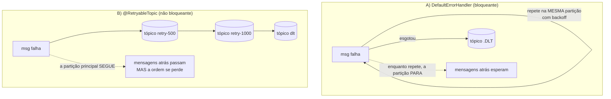

# P3.08 — Retentativas com *backoff* e *dead-letter queues*

> ⏱️ ~1h30 · 🔵 Pleno · Pré-requisitos: P3.03 (DLX), P3.05 (`DefaultErrorHandler`), P3.06, P3.07, P2.02 (`@Retryable`)

> ⚠️ **Verificação:** **executado de verdade** em `lab/messaging-lab` (`RetryDltIT`, 3 testes): Spring for Apache Kafka **4.1.2**, Spring AMQP **4.1.2**, Spring Boot **4.1.2**, Kafka 4.3.1, RabbitMQ 4.4.0, JDK 25.0.5. Os tempos são **da máquina do laboratório** (compartilhada). Reprocessamento da DLQ e alertas **não executados** (descritos). PayFlow: **por leitura**.

## 🎯 Objetivos
Ao final desta aula você consegue:
- **Classificar** falhas em **transitórias** (vale repetir) e **permanentes** (repetir só piora) e **configurar** cada tipo de forma diferente.
- **Configurar** retentativas com ***backoff* exponencial** no Kafka (`DefaultErrorHandler` + `DeadLetterPublishingRecoverer`, e `@RetryableTopic`) e no RabbitMQ (retry do listener + DLX).
- **Ler** um registro de ***dead-letter*** (de onde veio, por que falhou) e **desenhar** o processo de **reprocessar**.
- **Prever** o efeito colateral de cada estratégia: **bloquear a partição** ou **perder a ordem**.

## 🤔 Por que isso importa
Em produção, algo **sempre** falha: o provedor de e-mail oscila (transitório) ou a mensagem tem um campo inválido (permanente). Sem política, os dois viram o mesmo desastre: **uma mensagem venenosa trava a fila** para sempre, ou é **descartada em silêncio**. Esta aula é o *"o que fazer quando dá errado"* do consumidor, e fecha o triângulo: *at-least-once* (P3.06) + idempotência (P3.07) + **retry e DLQ**.

## 💡 Intuição (explicação simples)
Um carteiro encontra a porta **trancada**. **Transitório:** o morador pode estar só no banho; ele volta **daqui a 1 min, depois 2, depois 4** (*backoff exponencial*: esperar cada vez mais, para não incomodar). **Permanente:** o endereço **não existe**; voltar 10 vezes é inútil: ele leva a carta ao **setor de cartas não entregues** (a ***dead-letter queue***), onde um humano investiga. E **nunca** pare **toda a rota** porque **uma** carta não entrega.

## 🔬 Como funciona por dentro

### 1. Transitório × permanente
| Tipo | Exemplos | O que fazer |
|---|---|---|
| **Transitório** | timeout, 503 do provedor, *deadlock*/serialização no banco (`40P01`/`40001`, P2), indisponibilidade breve | **repetir** com *backoff* e **limite** |
| **Permanente** | JSON inválido, campo obrigatório ausente, regra de negócio violada (conta inexistente), erro de código (`NullPointerException`) | **não repetir**: DLQ **na hora** |
| **Ambíguo** | `500` sem detalhe | repetir **pouco**, depois DLQ |
O Spring Kafka permite declarar **exceções não retentáveis** (`addNotRetryableExceptions`, usado no laboratório): `IllegalArgumentException` foi para o DLT **na 1ª tentativa** (medido: `bad-data-1` = 1 tentativa).

### 2. *Backoff*, *jitter* e limite
Repetir imediatamente **martela** um serviço que já está mal. *Backoff* exponencial espalha as tentativas (`200 ms → 400 → 800…`); **jitter** (aleatoriedade) evita que **todos** os consumidores repitam **juntos** (*thundering herd*); o **limite** (tentativas ou tempo total) evita retentar para sempre. [Amazon Builders' Library](https://aws.amazon.com/builders-library/timeouts-retries-and-backoff-with-jitter/) detalha. Cuidado: **retries se multiplicam** em cadeias (3 camadas × 3 tentativas = 27 chamadas).

### 3. Kafka: três estratégias, três efeitos colaterais

- **A) `DefaultErrorHandler` + `DeadLetterPublishingRecoverer`:** repete **a mesma mensagem, na mesma partição**, com `BackOff`; **bloqueia** as mensagens seguintes **daquela partição** durante as tentativas (preserva **ordem**), e ao esgotar publica no **DLT**. Medido: `poison-1` teve **5 tentativas** com `ExponentialBackOff(200, 2.0)` e `maxElapsedTime=1500 ms` (o **tempo máximo** manda, não "N tentativas"); o lote inteiro levou ≈ **5,3 s** (com `ok-2` **esperando** atrás do `poison-1`).
- **B) `@RetryableTopic`:** a falha vai para **tópicos de retry** (um por intervalo) e depois ao DLT; a partição principal **não para**, mas **a mensagem 2 pode ser processada antes da 1**: **ordem perdida** (P3.05). Nomes medidos (Spring Kafka 4.1.2, `backOff` com atrasos diferentes): `lab.rt`, **`lab.rt-retry-500`**, **`lab.rt-retry-1000`**, **`lab.rt-dlt`** (o sufixo é o **valor do atraso**; a [documentação](https://docs.spring.io/spring-kafka/reference/retrytopic.html) trata das estratégias de sufixo).
- **O DLT padrão** do `DeadLetterPublishingRecoverer` é `<tópico>-dlt` e **mesma partição** (documentação); o laboratório usou um *resolver* próprio (`<tópico>.DLT`). O DLT precisa ter **partições suficientes** para a partição do original.
- **Cabeçalhos do DLT** (medidos): `kafka_dlt-original-topic`, `-original-partition`, `-original-offset`, `-original-consumer-group`, `-exception-fqcn`, `-exception-cause-fqcn` (`IllegalArgumentException`), `-exception-message`, `-exception-stacktrace`. **Sem esses cabeçalhos você não reprocessa nem diagnostica.**

### 4. RabbitMQ
O retry do **listener** (Boot) repete **dentro** do consumidor com *backoff* (`initial-interval`, `multiplier`, `max-retries`) e, **esgotado**, **rejeita sem reenfileirar** (`default-requeue-rejected: false`), e a fila com **DLX** (P3.03) manda a mensagem para a DLQ. Medido: `max-retries: 2` ⇒ **3 entregas** (1 + 2) e depois DLQ com `x-death=[{reason=rejected,…}]`.
> ⚠️ **Armadilha medida (Boot 4.x):** a propriedade se chama **`spring.rabbitmq.listener.simple.retry.max-retries`** ([tabela](https://docs.spring.io/spring-boot/appendix/application-properties/index.html), padrão **3**). Com o nome antigo **`max-attempts: 3`** o laboratório fez **4** entregas (1 + 3 do **padrão**): o nome antigo **não tem efeito** e **nenhum erro avisa**.

## 🛠️ Exemplo prático

### A. Configuração (Kafka, bloqueante, com DLT)
```java
package com.payflow.lab;

import org.apache.kafka.common.TopicPartition;
import org.springframework.context.annotation.Bean;
import org.springframework.context.annotation.Configuration;
import org.springframework.kafka.core.KafkaTemplate;
import org.springframework.kafka.listener.DeadLetterPublishingRecoverer;
import org.springframework.kafka.listener.DefaultErrorHandler;
import org.springframework.util.backoff.ExponentialBackOff;

/** P3.08: retentativas com backoff exponencial e envio para o tópico .DLT. */
@Configuration
class KafkaErrorConfig {
    @Bean
    DefaultErrorHandler kafkaErrorHandler(KafkaTemplate<String, String> template) {
        // mesma partição do original, tópico "<origem>.DLT"
        var recoverer = new DeadLetterPublishingRecoverer(template,
                (rec, ex) -> new TopicPartition(rec.topic() + ".DLT", rec.partition()));
        var backoff = new ExponentialBackOff(200, 2.0);
        backoff.setMaxElapsedTime(1_500);  // 200 + 400 + 800 ms ≈ 3 retentativas
        var handler = new DefaultErrorHandler(recoverer, backoff);
        handler.addNotRetryableExceptions(IllegalArgumentException.class); // erro de dado: não adianta repetir
        return handler;
    }
}
```
O Boot injeta esse `CommonErrorHandler` no contêiner padrão (conferido: o comportamento mudou; sem ele, o padrão é só *log e pula*).

### B. Os ouvintes de demonstração
```java
package com.payflow.lab;

import java.util.List;
import java.util.Map;
import java.util.concurrent.ConcurrentHashMap;
import java.util.concurrent.CopyOnWriteArrayList;
import java.util.concurrent.atomic.AtomicInteger;
import org.apache.kafka.clients.consumer.ConsumerRecord;
import org.springframework.amqp.rabbit.annotation.RabbitListener;
import org.springframework.kafka.annotation.DltHandler;
import org.springframework.kafka.annotation.KafkaListener;
import org.springframework.kafka.annotation.RetryableTopic;
import org.springframework.kafka.support.KafkaHeaders;
import org.springframework.messaging.handler.annotation.Header;
import org.springframework.stereotype.Component;

/** Ouvintes de demonstração de retentativa/DLT. Os resultados ficam em memória para os testes lerem. */
@Component
public class RetryDemoListeners {
    public final Map<String, AtomicInteger> attempts = new ConcurrentHashMap<>();
    public final List<String> processed = new CopyOnWriteArrayList<>();
    public final List<ConsumerRecord<String, String>> dead = new CopyOnWriteArrayList<>();
    public final List<String> rtProcessed = new CopyOnWriteArrayList<>();
    public final List<String> rtDead = new CopyOnWriteArrayList<>();
    public final List<String> rabbitProcessed = new CopyOnWriteArrayList<>();

    @KafkaListener(topics = "lab.retry", groupId = "lab-retry")
    void onMessage(ConsumerRecord<String, String> rec) {
        int n = attempts.computeIfAbsent(rec.value(), k -> new AtomicInteger()).incrementAndGet();
        System.out.printf("[kafka] %s tentativa %d%n", rec.value(), n);
        if (rec.value().startsWith("bad-data")) throw new IllegalArgumentException("dado inválido: " + rec.value());
        if (rec.value().startsWith("poison")) throw new IllegalStateException("sempre falha: " + rec.value());
        if (rec.value().startsWith("flaky") && n < 3) throw new IllegalStateException("falha transitória " + n);
        processed.add(rec.value());
    }

    @KafkaListener(topics = "lab.retry.DLT", groupId = "lab-retry-dlt")
    void onDead(ConsumerRecord<String, String> rec) {
        dead.add(rec);
    }

    // Tópicos de retry separados (não bloqueiam a partição principal)
    @RetryableTopic(attempts = "3", backOff = @org.springframework.kafka.annotation.BackOff(delay = 500, multiplier = 2.0),
            include = IllegalStateException.class)
    @KafkaListener(topics = "lab.rt", groupId = "lab-rt")
    void onRt(String value) {
        int n = attempts.computeIfAbsent("rt:" + value, k -> new AtomicInteger()).incrementAndGet();
        System.out.printf("[kafka-rt] %s tentativa %d%n", value, n);
        if (value.startsWith("poison")) throw new IllegalStateException("sempre falha");
        rtProcessed.add(value);
    }

    @DltHandler
    void onRtDlt(String value, @Header(KafkaHeaders.RECEIVED_TOPIC) String topic) {
        rtDead.add(topic + ":" + value);
    }

    // RabbitMQ: o retry está no application.yml; esgotado, vai para a DLQ (fila declarada no teste)
    @RabbitListener(queues = "lab.retry.work")
    void onRabbit(String body) {
        int n = attempts.computeIfAbsent("rb:" + body, k -> new AtomicInteger()).incrementAndGet();
        System.out.printf("[rabbit] %s tentativa %d%n", body, n);
        if (body.startsWith("poison")) throw new IllegalStateException("sempre falha");
        rabbitProcessed.add(body);
    }
}
```

### C. Resultado
```java
@Test
void errorHandlerRetriesThenDeadLetters() throws Exception {
    long t0 = System.currentTimeMillis();
    kafka.send("lab.retry", "k", "ok-1").get();
    kafka.send("lab.retry", "k", "flaky-1").get();
    kafka.send("lab.retry", "k", "bad-data-1").get();
    kafka.send("lab.retry", "k", "poison-1").get();
    kafka.send("lab.retry", "k", "ok-2").get();
    await().atMost(Duration.ofSeconds(30)).until(() -> l.dead.size() == 2 && l.processed.size() == 3);
    System.out.println("TEMPO_TOTAL_MS=" + (System.currentTimeMillis() - t0));
    System.out.println("PROCESSADAS=" + l.processed);
    System.out.println("TENTATIVAS=" + new java.util.TreeMap<>(l.attempts));
    for (var d : l.dead) {
        System.out.println("DLT valor=" + d.value() + " particao=" + d.partition());
        d.headers().forEach(h -> {
            if (h.key().startsWith("kafka_dlt-")) {
                String v = new String(h.value());
                System.out.println("   " + h.key() + "=" + (v.length() > 80 ? v.substring(0, 80) + "…" : v));
            }
        });
    }
    assertThat(l.processed).containsExactly("ok-1", "flaky-1", "ok-2");
    assertThat(l.attempts.get("flaky-1").get()).isEqualTo(3);
    assertThat(l.attempts.get("bad-data-1").get()).isEqualTo(1);   // não retentável: 1 tentativa
    assertThat(l.attempts.get("poison-1").get()).isGreaterThan(2);  // retentável: várias
}

@Test
void retryableTopicUsesSeparateTopics() throws Exception {
    kafka.send("lab.rt", "k", "poison-rt").get();
    kafka.send("lab.rt", "k", "ok-rt").get();
    await().atMost(Duration.ofSeconds(30)).until(() -> !l.rtDead.isEmpty() && l.rtProcessed.contains("ok-rt"));
    System.out.println("RT_DLT=" + l.rtDead);
    try (var admin = AdminClient.create(Map.of("bootstrap.servers", "localhost:59092"))) {
        var names = admin.listTopics().names().get().stream().filter(n -> n.startsWith("lab.rt")).sorted().toList();
        System.out.println("RT_TOPICOS=" + names);
        assertThat(names).contains("lab.rt-retry-500", "lab.rt-retry-1000", "lab.rt-dlt");
    }
}

@Test
void rabbitRetriesThenDeadLetters() throws Exception {
    rabbit.convertAndSend("", "lab.retry.work", "poison-r1");
    rabbit.convertAndSend("", "lab.retry.work", "ok-r1");
    var dead = rabbit.receive("lab.retry.dlq", 15_000);
    assertThat(dead).isNotNull();
    System.out.println("RABBIT_DLQ corpo=" + new String(dead.getBody()) + " x-death=" + dead.getMessageProperties().getXDeathHeader());
    // max-retries: 2 = 1 entrega + 2 retentativas = 3 entregas
    assertThat(l.attempts.get("rb:poison-r1").get()).isEqualTo(3);
    await().atMost(Duration.ofSeconds(5)).until(() -> l.rabbitProcessed.contains("ok-r1"));
}
```
```text
[kafka] ok-1 tentativa 1
[kafka] flaky-1 tentativa 1
[kafka] flaky-1 tentativa 2
[kafka] flaky-1 tentativa 3
[kafka] bad-data-1 tentativa 1
[kafka] poison-1 tentativa 1
[kafka] poison-1 tentativa 2
[kafka] poison-1 tentativa 3
[kafka] poison-1 tentativa 4
[kafka] poison-1 tentativa 5
[kafka] ok-2 tentativa 1
TEMPO_TOTAL_MS=5261
PROCESSADAS=[ok-1, flaky-1, ok-2]
TENTATIVAS={bad-data-1=1, flaky-1=3, ok-1=1, ok-2=1, poison-1=5}
DLT valor=bad-data-1 particao=0
   kafka_dlt-exception-cause-fqcn=java.lang.IllegalArgumentException
   kafka_dlt-original-topic=lab.retry
   kafka_dlt-original-consumer-group=lab-retry
DLT valor=poison-1 particao=0
   kafka_dlt-exception-cause-fqcn=java.lang.IllegalStateException
   kafka_dlt-original-topic=lab.retry
   kafka_dlt-original-consumer-group=lab-retry
[kafka-rt] poison-rt tentativa 1
[kafka-rt] ok-rt tentativa 1
[kafka-rt] poison-rt tentativa 2
[kafka-rt] poison-rt tentativa 3
RT_DLT=[lab.rt-dlt:poison-rt]
RT_TOPICOS=[lab.rt, lab.rt-dlt, lab.rt-retry-1000, lab.rt-retry-500]
[rabbit] poison-r1 tentativa 1
[rabbit] poison-r1 tentativa 2
[rabbit] poison-r1 tentativa 3
[rabbit] ok-r1 tentativa 1
RABBIT_DLQ corpo=poison-r1 x-death=[{reason=rejected, count=1, exchange=, time=Sat Nov 14 01:45:50 GMT-03:00 2026, routing-keys=[lab.retry.work], queue=lab.retry.work}]
```
Leia: `flaky-1` falhou duas vezes e **passou na 3ª** (processada **uma vez**, na ordem); `bad-data-1` foi ao DLT com **1** tentativa (`IllegalArgumentException`, não retentável); `poison-1` esgotou (**5** tentativas) e foi ao DLT; **`ok-2` só foi processada depois** do `poison-1` (a partição ficou **bloqueada** ≈ 1,5 s: o custo da estratégia A). No `@RetryableTopic`, `poison-rt` foi retentada em tópicos próprios e `ok-rt` **passou na frente** (ordem perdida), terminando em `lab.rt-dlt`. No RabbitMQ, 3 entregas e a **DLQ** com `x-death`.

### D. O processo de **reprocessar** (o que ninguém escreve)
A DLQ **não é lixeira**: é **fila de trabalho humano**. Defina **antes**:
1. **Alerta** quando o DLT/DLQ **não está vazio** (profundidade > 0, ou idade da mais antiga, P6).
2. **Triagem:** ler os cabeçalhos (`original-topic/offset`, exceção) e classificar: **bug** (corrigir e reprocessar), **dado ruim** (descartar com registro) ou **transitório** que esgotou (reprocessar).
3. **Reprocessar** = **republicar** no tópico original (ou fila de trabalho) por **uma ferramenta/endpoint administrativo**, **com a mesma chave de idempotência** (o `eventId` **não muda**: P3.07 garante que reprocessar não duplica).
4. **Dado pessoal na DLQ** é dado retido: aplique a mesma retenção e controle de acesso (J8.07).

### E. No PayFlow (por leitura)
- Notificações (RabbitMQ): fila `notifications.email` com DLQ; **retry** de 3 tentativas com *backoff* de 5 s, 30 s, 2 min (transitório do provedor) e depois DLQ; erro de dado (`IllegalArgumentException`) → DLQ direta.
- Antifraude (Kafka, ordem por conta importa): `DefaultErrorHandler` **bloqueante** (A), 4 tentativas, `.dlt`; **não** `@RetryableTopic` (para não perder a ordem por conta).
- `docs/runbook-dlq.md`: alerta, triagem, reprocesso, quem decide descartar.

## 🧠 Pausa para lógica
**Enunciado.** *Backoff* inicial de 1 s, multiplicador 2, **6 tentativas** de retry (esperas 1, 2, 4, 8, 16, 32 s). (a) Quanto tempo no total antes do DLT? (b) Uma partição Kafka com `DefaultErrorHandler` bloqueante recebe 1 mensagem venenosa a cada 10 s: ela anda? (c) Com **jitter** de ±50% no pior caso, qual o intervalo de tempo total?

<details><summary>Dica</summary>

Some a progressão geométrica; compare com o intervalo entre venenosas.
</details>

<details><summary>Solução</summary>

(a) 1+2+4+8+16+32 = **63 s** (mais o tempo das próprias execuções). (b) Cada venenosa **bloqueia a partição por 63 s**, e chega outra a cada **10 s**: a fila **nunca esvazia**: a partição **inteira** vive em *retry*. **Backoff longo + bloqueante** não combinam com **taxa de venenosas**; use **tópicos de retry** (B) (aceitando perder a ordem) ou limite o tempo total (poucos segundos) e vá ao DLT. (c) Com ±50%: de **31,5 s** a **94,5 s**.
**Variação:** 3 camadas de serviço, cada uma com 3 tentativas, chamam-se em cascata. Quantas chamadas ao serviço final no pior caso? (**27**: 3×3×3.)
</details>

## ⚖️ Trade-offs e quando NÃO usar
| Estratégia | Preserva ordem? | Bloqueia? | Complexidade |
|---|---|---|---|
| **A) bloqueante** (`DefaultErrorHandler`) | **Sim** | **Sim** (a partição, durante o retry) | baixa |
| **B) `@RetryableTopic`** | **Não** | Não | média (mais tópicos, mais DLTs) |
| **RabbitMQ retry + DLX** | por fila (competição já não garante ordem) | bloqueia **aquele consumidor** durante o retry | baixa |
| **Retry no produtor/Outbox** | n/a | n/a | veja P3.09 |
**Quando NÃO repetir:** erro permanente; efeito **não idempotente** (P3.07 antes!); quando o parceiro está **fora do ar** por muito tempo (*circuit breaker*, P5, para **parar de martelar**); quando repetir **piora** a causa (banco saturado).

## ⚠️ Erros comuns e boas práticas de produção
- **Sem DLT:** o `DefaultErrorHandler` **registra e descarta** a mensagem esgotada.
- **`max-attempts` em vez de `max-retries`** (acima).
- **Retry infinito** (`requeue=true` em erro permanente): *poison message loop* e CPU a 100%.
- **Retry sem idempotência:** cada tentativa **repete o efeito** (P3.13).
- **DLQ sem alerta:** vira cemitério; **o dado some do radar** por meses.
- **Reprocessar mudando o `eventId`:** perde a deduplicação.
- **DLT com menos partições** que o tópico original: o *recoverer* tenta publicar numa partição que **não existe** (falha de publicação).
- **Retry e *timeout* do `max.poll.interval.ms`:** retries **longos e bloqueantes** podem estourar o intervalo e causar *rebalance* (P3.04).

## 🧩 Exercícios
**1. Fixação.** (a) Cite 2 falhas transitórias e 2 permanentes do PayFlow. (b) Por que *backoff* sem *jitter* pode derrubar um serviço? (c) Qual estratégia Kafka preserva a ordem?

<details><summary>Solução</summary>

(a) Transitórias: timeout do provedor de e-mail; `40001` ao gravar no banco. Permanentes: JSON inválido; conta inexistente. (b) Muitos consumidores repetem **no mesmo instante** (*thundering herd*) e re-derrubam o serviço que estava se recuperando. (c) A **bloqueante** (A).
</details>

**2. Aplicação no PayFlow (por leitura).** Configure o tratamento de erro de `notifications` (RabbitMQ: `max-retries`, *backoff*, DLQ) e de `antifraud` (Kafka: `DefaultErrorHandler` + `DeadLetterPublishingRecoverer`, exceções não retentáveis) e escreva `docs/runbook-dlq.md`.
- [ ] Erros de dado vão **direto** à DLQ/DLT (teste com um evento inválido).
- [ ] O *backoff* tem **limite de tempo** menor que `max.poll.interval.ms`.
- [ ] Há alerta (descrito) para DLT/DLQ **não vazio** e para a **idade** da mais antiga.
- [ ] O reprocesso **preserva o `eventId`**; um teste reprocessa 2× e o efeito acontece 1×.

**3. Desafio.** Implemente o **reprocessador**: um `@Service` que lê o `.dlt`, republica no tópico original **com os mesmos cabeçalhos/`eventId`** e **registra** quem reprocessou. Prove, com o `PaymentConsumer` da P3.07, que reprocessar duas vezes debita uma.

## 🎤 Na entrevista
**1. "O que é uma *dead-letter queue* e quando usar?"** *Resposta-modelo:* destino das mensagens que **não puderam ser processadas** após as tentativas (ou que são permanentemente inválidas), para **não travar** o fluxo nem se perder; exige **alerta, triagem e reprocesso** com a mesma chave de idempotência.
**2. "Bloqueante ou tópicos de retry?"** *Resposta-modelo:* bloqueante preserva a **ordem** mas **para a partição** durante o retry; tópicos de retry não bloqueiam e **perdem a ordem**. Escolho pelo requisito de ordem por chave e pela taxa de falhas.
**3. "O que é *poison message*?"** *Resposta-modelo:* mensagem que **sempre** falha; com `requeue` infinito, **trava** o consumidor repetindo para sempre; trate com limite de tentativas, classificação de exceções e DLQ.

## 📚 Para ir além
- 📄 [Spring Kafka — Handling exceptions](https://docs.spring.io/spring-kafka/reference/kafka/annotation-error-handling.html) — `DefaultErrorHandler`, DLT e *recoverers*.
- 📄 [Spring Kafka — Non-Blocking Retries](https://docs.spring.io/spring-kafka/reference/retrytopic.html) — `@RetryableTopic`, sufixos e estratégias de DLT.
- 📄 [Spring Boot — propriedades](https://docs.spring.io/spring-boot/appendix/application-properties/index.html) — `spring.rabbitmq.listener.simple.retry.*`.
- 📑 [Amazon Builders' Library — Timeouts, retries and backoff with jitter](https://aws.amazon.com/builders-library/timeouts-retries-and-backoff-with-jitter/) — *backoff* e *jitter*.
- 📄 [RabbitMQ — Consumer Acknowledgements](https://www.rabbitmq.com/docs/confirms) — `nack`/`requeue`.
- 💻 `lab/messaging-lab/src/test/java/com/payflow/lab/RetryDltIT.java`.

## ✅ Checklist da aula
- [ ] Classifiquei falhas em transitórias e permanentes.
- [ ] Vi, no laboratório, `bad-data` (1 tentativa) × `poison` (5) × `flaky` (3, sucesso).
- [ ] Sei o custo de cada estratégia (bloqueia × perde ordem).
- [ ] Conheço a armadilha `max-attempts`/`max-retries`.
- [ ] Tenho runbook e alerta de DLQ para o PayFlow.
