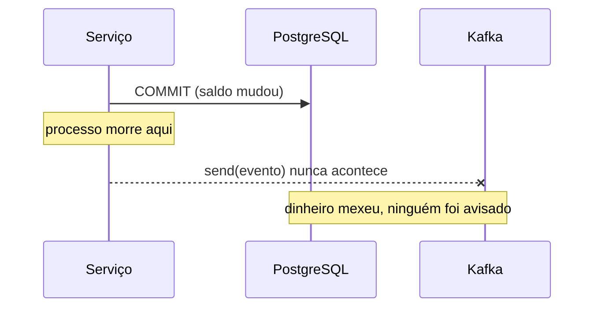
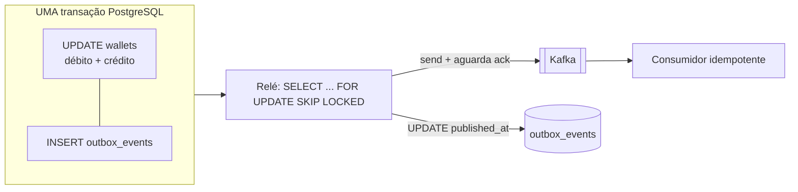

# P3.09 — Padrão Outbox

> ⏱️ ~1h30 · 🔵 Pleno · Pré-requisitos: P3.05 (Kafka no Spring), P3.06, P3.07, P3.08, P2.02 (`FOR UPDATE`, `SKIP LOCKED`), P3.02 (ShedLock)

> ⚠️ **Verificação:** **executado de verdade** em `lab/messaging-lab` (`OutboxIT`, 4 testes): PostgreSQL **18** (`uuidv7()`), Kafka 4.3.1 (1 nó), Spring Boot **4.1.2** (`JdbcClient`, `TransactionTemplate`), JDK 25.0.5. O relé do laboratório é **uma classe simples com consulta periódica**; **CDC/Debezium não foi executado** (descrito). PayFlow: **por leitura**.

## 🎯 Objetivos
Ao final desta aula você consegue:
- **Explicar** o problema da **escrita dupla** (banco + broker) e **mostrar** como ele **perde** eventos.
- **Implementar** o padrão **Outbox**: o evento é gravado **na mesma transação** da mudança de negócio e **publicado depois** por um relé.
- **Usar** `FOR UPDATE SKIP LOCKED` para vários relés **sem publicar duas vezes** e **provar**.
- **Declarar** as garantias reais do Outbox (*at-least-once*, ordem por agregado) e **o que o consumidor precisa fazer**.

## 🤔 Por que isso importa
A transferência precisa fazer **duas coisas**: gravar no PostgreSQL **e** avisar o Kafka. **Não existe transação entre os dois.** Se o processo morre entre eles, o dinheiro **mexeu e ninguém foi avisado** (antifraude cego, cliente sem notificação), ou o aviso saiu **e o banco deu *rollback*** (aviso de uma transferência que **não existiu**). O Outbox é a resposta padrão da indústria e **a** pergunta de design do Pleno.

## 💡 Intuição (explicação simples)
Você escreve uma carta e precisa **atualizar o livro-caixa** e **avisar o cliente**. Se anotar no livro e **depois** for ao correio, pode **morrer no caminho**. A solução: na **mesma anotação** do livro-caixa você escreve **"enviar carta ao cliente"** numa **caixa de saída** (*outbox*). Um **mensageiro** esvazia a caixa de saída no correio: se ele cair, **a caixa continua lá**, e ele entrega depois (**talvez duas vezes**, se caiu antes de riscar; por isso o cliente reconhece cartas repetidas, P3.07).

## 🔬 Como funciona por dentro

### 1. O problema (a escrita dupla)

Trocar a ordem (enviar e depois gravar) tem o problema oposto. **Não** existe ordem segura: precisa de **atomicidade entre dois sistemas**, que o 2PC daria, mas é inviável/frágil (S1).

### 2. A solução: gravar o evento **no mesmo banco**

- **Atomicidade grátis:** o evento e a mudança de negócio **commitam juntos** ou **nenhum** (ACID do banco que você já tem).
- **O relé** (um *job*/serviço) lê eventos **não publicados**, publica no Kafka, **espera o *ack*** do *broker* e **só então** marca `published_at`.
- **Garantia resultante:** **at-least-once** (cai depois do envio e **antes** de marcar ⇒ publica **de novo**: medido). **Nunca perde** (o evento está no banco) e **pode duplicar** ⇒ o consumidor é **idempotente** pelo `eventId` (P3.07). Ordem: **por agregado**, usando a **chave** da mensagem = `aggregate_id` (mesma partição, P3.04) e lendo `ORDER BY created_at, id`; **vários relés** em paralelo ⚠️ podem publicar eventos do **mesmo** agregado em **ordem trocada** (um relé lento): para ordem estrita, particione os relés **por agregado** ou use um só.
- **`FOR UPDATE SKIP LOCKED`** ([PostgreSQL](https://www.postgresql.org/docs/18/sql-select.html)): cada relé trava as linhas que pegou e **ignora** as que outro já travou ⇒ **sem espera** e **sem pegar a mesma linha** (é a "ponte" anunciada na P2.02).
- **Alternativa: CDC** (*Change Data Capture*, ex.: [Debezium](https://debezium.io/documentation/reference/stable/transformations/outbox-event-router.html)): um conector lê o **log de transações** (WAL) do PostgreSQL e publica as linhas da tabela `outbox_events`; **sem consulta periódica**, menor latência, **mais uma peça** para operar (S3). Aqui usamos o **relé por consulta** (simples, suficiente).

## 🛠️ Exemplo prático

### A. Tabela e escrita transacional
```sql
create table outbox_events (
  id           uuid primary key default uuidv7(),   -- = eventId (chave de idempotência do consumidor)
  aggregate_id text not null,                        -- vira a CHAVE do Kafka (ordem por conta)
  type         text not null,
  payload      text not null,
  created_at   timestamptz not null default now(),
  published_at timestamptz,
  attempts     int not null default 0);
create index idx_outbox_pending on outbox_events (created_at) where published_at is null;   -- índice PARCIAL (P2.05)
```
O **índice parcial** só tem as linhas **pendentes**: mesmo com milhões de publicadas, o relé lê um índice minúsculo (técnica da P2.05).
```java
package com.payflow.lab;

import java.math.BigDecimal;
import org.springframework.jdbc.core.simple.JdbcClient;
import org.springframework.stereotype.Service;
import org.springframework.transaction.annotation.Transactional;

/** P3.09: escrever o fato de negócio e o evento na MESMA transação. */
@Service
public class OutboxService {
    private final JdbcClient jdbc;

    public OutboxService(JdbcClient jdbc) { this.jdbc = jdbc; }

    @Transactional
    public void transferWithOutbox(String from, String to, BigDecimal amount, String transferId) {
        jdbc.sql("update wallets set balance = balance - :a where id = :w").param("a", amount).param("w", from).update();
        jdbc.sql("update wallets set balance = balance + :a where id = :w").param("a", amount).param("w", to).update();
        jdbc.sql("insert into outbox_events (aggregate_id, type, payload) values (:agg, 'TransferCompleted', :p)")
                .param("agg", from).param("p", "{\"transferId\":\"" + transferId + "\",\"amount\":\"" + amount + "\"}").update();
    }
}
```

### B. O relé
```java
package com.payflow.lab;

import java.util.List;
import java.util.UUID;
import java.util.concurrent.TimeUnit;
import org.springframework.jdbc.core.simple.JdbcClient;
import org.springframework.kafka.core.KafkaTemplate;
import org.springframework.stereotype.Component;
import org.springframework.transaction.support.TransactionTemplate;

/** P3.09: lê o outbox com FOR UPDATE SKIP LOCKED, publica no Kafka, espera o ack e marca como publicado. */
@Component
public class OutboxRelay {
    public interface CrashPoint { void check(String where); }

    private final JdbcClient jdbc;
    private final KafkaTemplate<String, String> kafka;
    private final TransactionTemplate tx;

    public OutboxRelay(JdbcClient jdbc, KafkaTemplate<String, String> kafka, TransactionTemplate tx) {
        this.jdbc = jdbc; this.kafka = kafka; this.tx = tx;
    }

    record Row(UUID id, String aggregateId, String type, String payload) {}

    /** Publica até {@code batch} eventos pendentes. Devolve quantos publicou. */
    public int pollOnce(String topic, int batch, CrashPoint crash) {
        Integer n = tx.execute(status -> {
            List<Row> rows = jdbc.sql("""
                    select id, aggregate_id, type, payload from outbox_events
                    where published_at is null order by created_at, id
                    limit :n for update skip locked""").param("n", batch)
                    .query((rs, i) -> new Row(rs.getObject("id", UUID.class), rs.getString("aggregate_id"),
                            rs.getString("type"), rs.getString("payload"))).list();
            for (Row r : rows) {
                try {
                    // a chave = agregado: eventos da mesma conta ficam na mesma partição, em ordem
                    var rec = new org.apache.kafka.clients.producer.ProducerRecord<>(topic, r.aggregateId(), r.payload());
                    rec.headers().add("event-id", r.id().toString().getBytes());
                    rec.headers().add("event-type", r.type().getBytes());
                    kafka.send(rec).get(10, TimeUnit.SECONDS);       // espera o ack do broker (acks=all)
                } catch (Exception e) {
                    throw new IllegalStateException("falha ao publicar " + r.id(), e);
                }
                crash.check("depois-do-envio-antes-de-marcar");
                jdbc.sql("update outbox_events set published_at = now(), attempts = attempts + 1 where id = :id")
                        .param("id", r.id()).update();
            }
            return rows.size();
        });
        return n == null ? 0 : n;
    }
}
```
Pontos: `FOR UPDATE SKIP LOCKED` dentro da **transação**; `kafka.send(...).get(10, SECONDS)` **espera o ack** (com `acks=all` padrão) **antes** de marcar; `event-id` como **cabeçalho**; o parâmetro `CrashPoint` existe **só** para o teste injetar uma queda no pior momento.

> ✅ **Validação final (2026-11-24, no PayFlow reconstruído, PostgreSQL 18 por Testcontainers):** a tabela e o relé desta aula funcionam no PayFlow com um `Publisher` no lugar do `KafkaTemplate` (o Kafka já foi provado pelo laboratório: 47/47). Quatro testes (`OutboxTest`): o evento **commita com a transferência** e uma transferência recusada (`InsufficientFundsException`) **não deixa evento**; o relé publica **uma vez** e marca; **queda depois do envio e antes de marcar** → o mesmo `eventId` sai **duas vezes** (at-least-once); **dois relés** com 30 eventos: 15 + 15, **30 `eventId` distintos**. Três ajustes que a aula não dizia: (1) no PayFlow a migração é a **`V7__outbox_events.sql`** (a aula e o checkpoint a chamam de `V11`; os números são **rótulos de plano**, decisão 287); (2) o `OutboxWriter` usa `@Transactional(propagation = MANDATORY)`: sem transação aberta ele **falha** em vez de gravar um evento solto; (3) o construtor do `TransferService` ganhou o `OutboxWriter`, então o `TransferServiceUnitTest` (J7.02, que monta o serviço à mão) **para de compilar** até receber o dublê: é o aviso que o próprio teste já dava. ⚠️ **Nome do teste:** o Surefire só roda classes `*Test`; a primeira versão chamada `OutboxIT` **ficou fora do `mvn verify`** (a contagem não mudou de 259: nenhum teste novo rodava). O laboratório usa `*IT` com `-Dtest='*IT'`; no PayFlow, use `*Test`.

### C. As quatro provas
```java
@Test
void dualWriteLosesTheEventWhenTheProcessDiesBetweenCommitAndSend() {
    // escrita dupla ingênua: commit no banco, depois envia ao Kafka
    tx.executeWithoutResult(s -> {
        jdbc.sql("update wallets set balance = balance - 100 where id='ana'").update();
        jdbc.sql("update wallets set balance = balance + 100 where id='bruno'").update();
    });
    try { throw new IllegalStateException("processo morreu antes do kafka.send"); } catch (IllegalStateException ignored) { }
    System.out.println("ESCRITA_DUPLA saldo_ana=" + bal("ana") + " eventos_no_kafka=" + KafkaReader.count(topic));
    assertThat(bal("ana")).isEqualByComparingTo("900.00");
    assertThat(KafkaReader.count(topic)).isZero();   // dinheiro mexeu, ninguém foi avisado
}

@Test
void outboxKeepsTheEventAndTheRelayPublishesIt() {
    service.transferWithOutbox("ana", "bruno", new BigDecimal("100.00"), "t-1");
    int pending = jdbc.sql("select count(*) from outbox_events where published_at is null").query(Integer.class).single();
    assertThat(pending).isEqualTo(1);
    int n = relay.pollOnce(topic, 100, w -> { });
    System.out.println("OUTBOX publicados=" + n + " no_kafka=" + KafkaReader.count(topic));
    assertThat(n).isEqualTo(1);
    assertThat(KafkaReader.count(topic)).isEqualTo(1);
    assertThat(relay.pollOnce(topic, 100, w -> { })).isZero();
}

@Test
void crashAfterSendBeforeMarkingCausesDuplicate_atLeastOnce() {
    service.transferWithOutbox("ana", "bruno", new BigDecimal("100.00"), "t-2");
    try {
        relay.pollOnce(topic, 100, w -> { throw new IllegalStateException("crash " + w); });
    } catch (IllegalStateException e) {
        System.out.println("CRASH_SIMULADO " + e.getMessage());
    }
    // o envio aconteceu, mas a marca "published_at" foi desfeita (rollback): na próxima rodada sai de novo
    relay.pollOnce(topic, 100, w -> { });
    int total = KafkaReader.count(topic);
    System.out.println("AT_LEAST_ONCE mensagens_no_topico=" + total + " (mesmo event-id duas vezes)");
    assertThat(total).isEqualTo(2);
    var ids = KafkaReader.eventIds(topic);
    assertThat(new HashSet<>(ids)).hasSize(1);       // mesmo event-id: o consumidor idempotente descarta a 2ª
}

@Test
void twoRelaysWithSkipLockedDoNotPublishTheSameEventTwice() throws Exception {
    for (int i = 0; i < 300; i++) service.transferWithOutbox("ana", "bruno", new BigDecimal("0.01"), "t-" + i);
    var pool = Executors.newFixedThreadPool(2);
    var published = new ConcurrentHashMap<String, Integer>();
    Callable<Integer> job = () -> {
        int total = 0, n;
        while ((n = relay.pollOnce(topic, 20, w -> { })) > 0) total += n;
        return total;
    };
    var f1 = pool.submit(job); var f2 = pool.submit(job);
    int a = f1.get(60, TimeUnit.SECONDS), b = f2.get(60, TimeUnit.SECONDS);
    pool.shutdown();
    System.out.println("DOIS_RELES relay1=" + a + " relay2=" + b + " soma=" + (a + b) + " no_kafka=" + KafkaReader.count(topic));
    assertThat(a + b).isEqualTo(300);
    assertThat(KafkaReader.count(topic)).isEqualTo(300);
    assertThat(new HashSet<>(KafkaReader.eventIds(topic))).hasSize(300);
}
```
```text
ESCRITA_DUPLA saldo_ana=900.00 eventos_no_kafka=0
OUTBOX publicados=1 no_kafka=1
DOIS_RELES relay1=160 relay2=140 soma=300 no_kafka=300
CRASH_SIMULADO crash depois-do-envio-antes-de-marcar
AT_LEAST_ONCE mensagens_no_topico=2 (mesmo event-id duas vezes)
AT_LEAST_ONCE antes_da_queda=[m0, m1, m2, m3, m4, m5] depois_recebeu=[m0, m1, m2, m3, m4, m5, m6, m7, m8, m9]
```
- **Escrita dupla:** saldo da Ana **900** e **0 eventos** no Kafka: dinheiro mexeu, ninguém sabe.
- **Outbox:** 1 evento **gravado junto**, **1 publicado**, e nada a publicar na rodada seguinte.
- **Queda depois do envio, antes de marcar:** o evento ficou **2 vezes** no tópico, com o **mesmo `event-id`**: *at-least-once*, exatamente como prometido: o consumidor deduplica.
- **Dois relés, 300 eventos:** `relay1=160 relay2=140`, soma **300**, **300** no Kafka e **300 `event-id` distintos** (nenhum duplicado): o `SKIP LOCKED` dividiu o trabalho sem conflito.

### D. Limpeza e monitoramento
`outbox_events` cresce: um *job* com ShedLock (P3.02) apaga as publicadas há mais de N dias, **em lotes**. **Monitore** `count(*) where published_at is null` (**profundidade**) e a **idade do mais antigo pendente** (se cresce, o relé ou o Kafka **parou**; P6). ⚠️ Vazão e latência do relé **não foram medidas** (laboratório pequeno).

### E. No PayFlow (por leitura)
- `TransferService.execute` grava `outbox_events` (`type = TransferCompleted`, `aggregate_id = sourceAccountId`, payload com **ids**, valor como **string com 2 casas** [decisão 11] e `schemaVersion`) **na mesma transação** das travas ordenadas (P2.02). Migração `V11__outbox_events.sql` (ou o próximo número livre). Entidade `OutboxEvent` (a do `projeto-central.md`), **sem** relações JPA.
- `OutboxRelay` agendado com ShedLock **ou** vários relés com `SKIP LOCKED` (o laboratório mostra o segundo).
- O consumidor (notificação, antifraude) é **idempotente por `eventId`** (P3.07).
- **Nunca** publicar no Kafka **dentro** do método transacional "para ganhar tempo".

## 🏗️ Estudo de caso (mini): "a notificação que não saiu"
**Sintoma:** clientes reclamam que transferiram e **não receberam aviso**; o saldo está certo. **Diagnóstico:** o código fazia `repository.save(...)` e **depois** `kafka.send(...)`; um *deploy* (SIGTERM) caiu entre os dois. **Opções:** (a) enviar **antes** do commit (avisa de transferência que pode ter dado *rollback*), (b) `@TransactionalEventListener(AFTER_COMMIT)` (mesma janela de queda), (c) **Outbox**, (d) CDC. **Decisão:** Outbox com relé por consulta, o mais simples que **não perde**; CDC fica para quando a latência ou o volume pedirem (S3). **Consequências:** (+) nenhum evento perdido; (−) *at-least-once* (consumidores idempotentes), (−) uma tabela e um relé para operar, (−) latência de **segundos** (o intervalo do relé).

## 🧠 Pausa para lógica
**Enunciado.** O relé lê **100 eventos**, publica os 100 e cai **depois de publicar 60**, antes do `COMMIT` (a transação inteira dá *rollback*). (a) Quantos eventos acabam **no Kafka**? (b) Quantos o consumidor processa, se ele é idempotente? (c) E se o relé marcasse `published_at` **antes** de publicar, e caísse no evento 60?

<details><summary>Dica</summary>

Os `send` já foram confirmados pelo *broker*; o `UPDATE published_at` está na transação que **não** foi confirmada.
</details>

<details><summary>Solução</summary>

(a) **60** no Kafka agora; na próxima rodada o relé publica **os 100** de novo: **160** mensagens no tópico, **60 duplicadas**. (b) **100** distintos (as 60 repetidas são descartadas pelo `eventId`). (c) Marcar **antes** de publicar é *at-most-once*: os eventos **61–100** estariam marcados como publicados e **nunca** sairiam: **perda** (e é por isso que a marca vem **depois** do *ack*).
**Variação:** reduzir a duplicação? Lotes menores (`batch=10`): no pior caso, só os 10 do lote. Custo: mais transações. Duplicata é **aceita**, perda não.
</details>

## ⚖️ Trade-offs e quando NÃO usar
| | Relé por consulta (esta aula) | CDC (Debezium) |
|---|---|---|
| Latência | segundos (intervalo de poll) | milissegundos |
| Carga no banco | consultas periódicas (índice parcial ajuda) | lê o WAL (replicação lógica) |
| Operação | **nenhuma peça nova** além do relé | Kafka Connect + conector + *slot* de replicação (pode **inchar o WAL** se parar) |
| Ordem | por agregado, com cuidado | pela ordem do log |
**Quando NÃO usar Outbox:** o evento é **descartável** (métrica) ou a mudança e o aviso podem ser **a mesma operação** no mesmo sistema; se você **só tem Kafka** (sem banco transacional) e o "estado" **é** o log (event sourcing, S1).

## ⚠️ Erros comuns e boas práticas de produção
- **Marcar como publicado antes do *ack*:** perda silenciosa.
- **Não esperar o *ack*** (`send` sem `.get()`/callback): o relé marca publicado **sem** o *broker* confirmar.
- **Relé sem `SKIP LOCKED`:** dois relés **duplicam tudo** ou **se bloqueiam**.
- **Sem índice parcial** nem limpeza: o relé fica lento com o tempo (`Seq Scan` na tabela inteira, P2.04).
- **Evento com dado pessoal ou entidade serializada:** vaza e **envelhece** (versione e mande ids).
- **Não monitorar a profundidade do outbox:** o relé morre e **ninguém vê** por dias.
- **Transação longa no relé:** segura as linhas travadas e o `xmin` (P2.03/P6): lotes **pequenos**.
- **Assumir ordem global.**

## 🧩 Exercícios
**1. Fixação.** (a) Por que o evento precisa ser gravado na **mesma transação**? (b) Qual a garantia de entrega do Outbox e o que isso exige do consumidor? (c) O que faz `SKIP LOCKED`?

<details><summary>Solução</summary>

(a) Para que **evento e mudança** sejam atômicos (ambos ou nenhum), sem 2PC. (b) *At-least-once*: **idempotência** no consumidor. (c) Pula as linhas já travadas por outra transação, permitindo **vários relés** sem espera nem duplicação.
</details>

**2. Aplicação no PayFlow (por leitura).** Implemente `OutboxEvent` + `V11`, a gravação em `TransferService`, o `OutboxRelay` (lotes de 100, ShedLock **ou** `SKIP LOCKED`), a limpeza e um teste de integração (Testcontainers `postgres` + `kafka`; artefato `org.testcontainers:testcontainers-kafka`, existe para 2.0.5) com os quatro cenários do laboratório.
- [ ] Uma transferência que dá **rollback** **não** deixa linha no outbox.
- [ ] O teste de **queda após o envio** prova **duplicata com o mesmo `eventId`** e o consumidor a descarta.
- [ ] Dois relés: soma = total e **nenhum** `eventId` repetido.
- [ ] Alerta (descrito) para profundidade e idade do pendente mais antigo.

**3. Desafio.** Meça a latência (tempo entre o `COMMIT` e a mensagem visível no Kafka) para intervalos de poll de 50 ms, 500 ms e 5 s, e a carga de consultas por segundo no banco. Qual o ponto de equilíbrio? (Não executado.)

## 🎤 Na entrevista
**1. "O que é o padrão Outbox e que problema resolve?"** *Resposta-modelo:* resolve a **escrita dupla** (banco + broker sem transação conjunta): grava o evento numa tabela **na mesma transação** da mudança de negócio, e um relé o publica **depois**, marcando como enviado **após o *ack***. Garante que **não se perde** evento; entrega *at-least-once*.
**2. "Então o consumidor recebe duplicatas?"** *Resposta-modelo:* pode (queda entre publicar e marcar). Por isso o consumidor é idempotente pelo `eventId` (chave única na mesma transação do efeito).
**3. "Outbox por consulta ou CDC?"** *Resposta-modelo:* consulta é simples e sem nova infraestrutura, com latência de segundos; CDC (Debezium) tem latência baixa e tira carga de consulta, mas exige Kafka Connect e cuidado com o *slot* de replicação. Começo pela consulta e migro se latência/volume exigirem.

## 📚 Para ir além
- 📄 [microservices.io — Transactional outbox](https://microservices.io/patterns/data/transactional-outbox.html) — o padrão, problema e solução.
- 📄 [Debezium — Outbox Event Router](https://debezium.io/documentation/reference/stable/transformations/outbox-event-router.html) — a versão por CDC.
- 📄 [PostgreSQL — The Locking Clause (`SKIP LOCKED`)](https://www.postgresql.org/docs/18/sql-select.html) — `FOR UPDATE SKIP LOCKED`.
- 📑 *Designing Data-Intensive Applications* (Kleppmann), cap. 11 ("keeping systems in sync"); de memória, **não conferido**.
- 💻 `lab/messaging-lab/src/main/java/com/payflow/lab/OutboxRelay.java`.

## ✅ Checklist da aula
- [ ] Reproduzi a **perda** da escrita dupla.
- [ ] Provei o Outbox, a **duplicata** (mesmo `event-id`) e os **dois relés**.
- [ ] Sei por que a marca vem **depois** do *ack*.
- [ ] Defini índice parcial, limpeza e monitoramento.
- [ ] Planejei o Outbox do PayFlow (por leitura).
