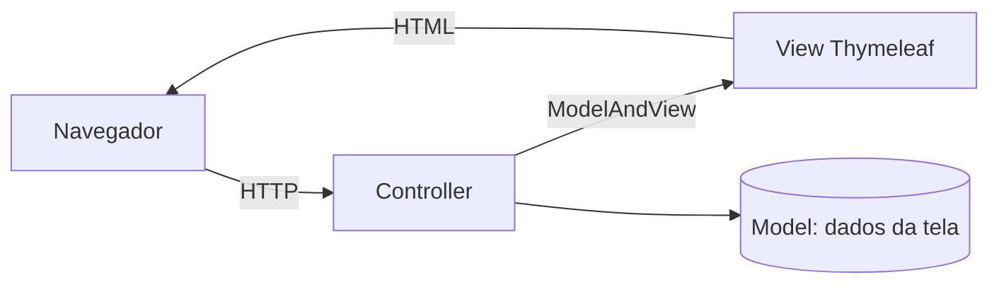
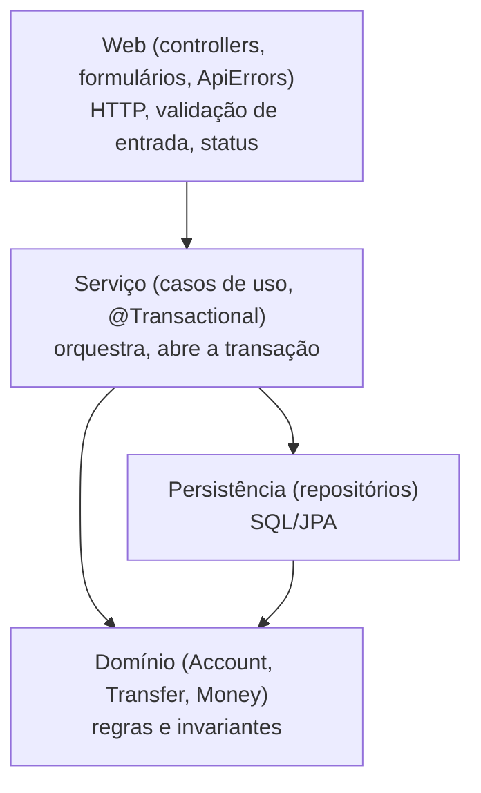

# P4.01 — Separação de responsabilidades: MVC vs camadas

> ⏱️ ~1h30 · 🔵 Pleno · Pré-requisitos: J5.04–J5.11 (Spring MVC, serviços, repositórios), J4.06 (Thymeleaf), P3.13 (o que acontece quando as responsabilidades se misturam)

> ✅ **Validação final (2026-11-24):** módulo executado no PayFlow reconstruído; resultado e o que continua não executado no [README do módulo](README.md). Os avisos "não executado" / "por leitura" abaixo descrevem a escrita original.

> ⚠️ **Verificação:** a regra de camadas (`layeredArchitecture`) foi **executada de verdade** em `lab/architecture-lab` (ArchUnit **1.4.2**, JDK 25.0.5; saída em `out-archunit-bad.txt`). O **mapa do PayFlow** (que classe vai para qual pacote) é **por leitura**: o repositório do aluno não foi compilado aqui; testes práticos no fim do treinamento.

## 🎯 Objetivos
Ao final desta aula você consegue:
- **Diferenciar** *MVC* (padrão da camada de **apresentação**) de **arquitetura em camadas** (organização da **aplicação inteira**).
- **Enunciar** a **regra de dependência** (setas só para baixo/para dentro) e **dizer onde** cada tipo de código do PayFlow mora.
- **Comparar** *pacote por camada* e *pacote por funcionalidade* e **escolher** com argumento.
- **Escrever** uma regra do ArchUnit que **falha** quando um controller pula o serviço e **ler** a mensagem.

## 🤔 Por que isso importa
Até o P3 o PayFlow cresceu **por acréscimo**: cada módulo anterior jogou classes em `web`, `service`, `repository`, `domain`. O resultado costuma ser o **pacote `service` com 40 classes** em que `TransferService`, `OutboxRelay` e `MonthlySummaryRefresher` convivem sem que ninguém saiba **de quem é** cada coisa. O custo aparece **no dia da mudança**: para alterar a regra de transferência você lê metade do projeto. Separar responsabilidades é **reduzir o que você precisa ler para mudar uma coisa com segurança**.

## 💡 Intuição (explicação simples)
Um **prédio de escritórios** pode ser organizado **por andar** (todos os contadores no 2º, todos os advogados no 3º) ou **por departamento** (o departamento de Cobrança tem contador, advogado e analista **juntos**). Por andar, cada projeto atravessa o prédio inteiro; por departamento, quase tudo acontece **numa porta só**. Em **ambos**, vale uma regra de **hierarquia**: quem atende o público **não** abre o cofre direto; pede a quem tem a chave.

## 🔬 Como funciona por dentro

### 1. MVC é sobre a **tela**; camadas são sobre a **aplicação**

- **MVC** (J5.06): o *controller* recebe a requisição, monta o *model* e escolhe a *view*. Ele resolve **uma pergunta**: "como esta requisição vira esta tela (ou JSON)?". **Não** diz onde fica a regra de transferir dinheiro.
- **Camadas** respondem à outra pergunta: "onde fica **cada tipo de responsabilidade** na aplicação?".

| Camada | Responsabilidade | **Não** faz |
|---|---|---|
| Web | traduzir HTTP ↔ chamada de caso de uso; validar **formato**; escolher o status | regra de negócio; SQL; transação |
| Serviço | um **caso de uso** por método; abrir/fechar a transação; coordenar | conhecer `HttpServletRequest`; montar JSON |
| Domínio | **invariantes** (saldo ≥ 0, valor positivo) | conhecer banco, HTTP ou fila |
| Persistência | ler/gravar | decidir regra de negócio |

### 2. A **regra de dependência**
> Cada camada só conhece a **de baixo**. **Nunca** o contrário e **nunca** pulando (o controller não chama o repositório).

Pular camada parece "economizar uma classe", mas **tira a transação do lugar** (o controller não tem `@Transactional`: decisão 35), **espalha a regra** (cada controller refaz a verificação) e **impede testar** a regra sem HTTP (J7).

### 3. Pacote **por camada** × pacote **por funcionalidade**
```text
POR CAMADA (o PayFlow até o P3)          POR FUNCIONALIDADE (o P4 propõe)
com.payflow                              com.payflow
├── web/        TransferController       ├── account/     AccountApi, domain, application, adapter
│               DepositController        ├── transfer/    TransferController, TransferService, Transfer
│               PaymentController        ├── payment/     ...
├── service/    TransferService          └── notification/ ...
│               NotificationService
│               OutboxRelay ...
├── repository/ ...
└── domain/     ...
```
| | Por camada | Por funcionalidade |
|---|---|---|
| Achar "tudo da transferência" | espalhado em 4 pacotes | **um** pacote |
| Esconder o que é interno | **impossível**: tudo precisa ser `public` para cruzar pacotes | **possível**: classes `package-private` dentro do módulo |
| Mudar uma regra | toca vários pacotes | toca um módulo |
| Pior risco | classes "de todo mundo" | módulos mal recortados (P4.08) |

A razão técnica decisiva é a **visibilidade**: em Java, só `public` atravessa pacotes. Pacote por camada obriga `TransferService` a ser `public` **para o controller enxergar**, e então **qualquer** classe do projeto pode usá-lo. Por funcionalidade, controller e serviço **moram juntos** e o serviço pode ser `package-private`: o compilador passa a **proteger** a fronteira. (Decisão 115.)

### 4. O que acontece quando a regra é violada (executado)
No laboratório há um controller **ruim de propósito** que usa o repositório direto (`fixtures/bad/web/BadController`). A regra:

```java
// src/test/java/com/payflow/lab/ArchitectureRulesTest.java
    static final ArchRule WEB_ONLY_THROUGH_SERVICES = Architectures.layeredArchitecture().consideringOnlyDependenciesInLayers()
            .layer("Web").definedBy("..web..")
            .layer("Service").definedBy("..application..")
            .layer("Persistence").definedBy("..repository..")
            .whereLayer("Web").mayNotBeAccessedByAnyLayer()
            .whereLayer("Service").mayOnlyBeAccessedByLayers("Web")
            .whereLayer("Persistence").mayOnlyBeAccessedByLayers("Service")
            .because("a tela chama o caso de uso; o caso de uso chama a persistência");
```

Saída **real**:

```text
LAYERED -> violations=4
   Constructor <com.payflow.fixtures.bad.web.BadController.<init>()> calls constructor <com.payflow.fixtures.bad.repository.BadRepository.<init>()>
   Field <com.payflow.fixtures.bad.web.BadController.repository> has type <com.payflow.fixtures.bad.repository.BadRepository>
   Layer 'Service' is empty
   Method <com.payflow.fixtures.bad.web.BadController.get()> calls method <com.payflow.fixtures.bad.repository.BadRepository.find()>
```

> 💡 Duas lições da saída: (1) as linhas "calls constructor/method/has type" mostram **todos os pontos** do código que violam, não só um; (2) a linha **`Layer 'Service' is empty`** é uma **armadilha**: por padrão o ArchUnit **reprova camada vazia** (um pacote com o nome errado faria a regra "passar" ou "falhar" por motivo errado). Quando a regra for de verdade, confira que **cada camada tem classes** (ou declare `withOptionalLayers(true)`).

## 🛠️ Exemplo prático

### Onde mora cada pedaço do PayFlow (mapa por leitura)
| Hoje (pacote por camada) | Responsabilidade | Camada |
|---|---|---|
| `web.TransferController`, `web.ApiErrors` | HTTP, status, Problem Details | Web |
| `service.TransferService`, `service.TransferRetryFacade` | caso de uso "transferir", transação, retentativa | Serviço |
| `domain.Account`, `domain.Transfer`, `domain.Amounts` | invariantes de dinheiro | Domínio |
| `repository.AccountRepository` | `lockAllOrdered` (P2.02) | Persistência |
| `service.OutboxRelay`, `service.IdempotentHandler` (P3) | infraestrutura de mensageria **dentro do pacote de negócio** | ⚠️ sem dono claro |

A última linha é o sintoma: o `OutboxRelay` **não é** serviço de negócio nem controller. O P4 vai dar a ele um **dono** (P4.09).

### Checklist de revisão de uma classe (use em toda PR)
1. **Qual a razão para ela mudar?** (se houver duas, ela tem duas responsabilidades)
2. Ela importa algo **de cima** (`jakarta.servlet`, `HttpStatus`) estando embaixo?
3. Um controller **chama um repositório**? (deve chamar um serviço)
4. Há `@Transactional` fora da camada de serviço?
5. Ela precisa ser `public`? (se só o vizinho do pacote usa, não)

## 🏗️ Pausa de design: onde fica a regra "limite diário de R$ 5.000"?
Quatro candidatos: (a) validação no controller; (b) `if` no `TransferService`; (c) método em `Account`; (d) *trigger* no banco.

<details><summary>Dica e solução</summary>

**Dica:** pergunte "se eu criar **outra porta de entrada** (webhook, job, fila), a regra continua valendo?" e "ela precisa do **histórico** do dia?".

**Solução:** (a) **não**: quem entra por outra porta contorna. (d) o banco guarda **invariantes de dados** (saldo ≥ 0, `UNIQUE`); um limite que depende de política muda toda hora. (c) é bom para o que **só depende da conta** (saldo), mas o limite diário depende do **histórico** de transferências. Logo: **(b)**, no caso de uso `transferir`, consultando o total do dia por uma **porta** e delegando a regra a um objeto pequeno (**Strategy**, P4.04): `DailyLimitPolicy`. O controller só valida o **formato** (`amount` positivo, 2 casas).
</details>

## ⚖️ Trade-offs e quando NÃO usar
- **Camadas rígidas** num projeto de 3 telas é cerimônia: um `CRUD` simples pode ir do controller ao Spring Data (a própria documentação do Spring faz isso em guias). A disciplina compensa onde há **regra de negócio e dinheiro**.
- **Pacote por funcionalidade** custa **duplicar nomes** (`TransferController` e `PaymentController` com métodos parecidos) e exige **decidir fronteiras**: um recorte errado é **pior** que nenhum (P4.08).
- **Camadas não evitam acoplamento horizontal**: `OrderService` chamando `InvoiceService` chamando `OrderService` continua um ciclo (P4.09/P4.10).
- **Modelo anêmico** ([Fowler](https://martinfowler.com/bliki/AnemicDomainModel.html)): se o domínio só tem *getters/setters* e **toda** regra vive no serviço, a "camada de domínio" é decoração. No PayFlow as regras ficam em `Account.deposit/withdraw` e `Amounts` (decisão 35): **mantenha assim**.

## ⚠️ Erros comuns e boas práticas de produção
- **Entidade JPA no JSON** (decisão 33): o controller devolve `Account` e uma coluna nova **vaza** sem querer. Use DTOs/`record`.
- **`@Transactional` no controller**: a transação **abre cedo** e fecha **depois da renderização** (e prende a conexão do *pool*: P2.06).
- **Regra no `if` do JavaScript**: a tela é **conforto**, o servidor **revalida** (decisão 25).
- **Pacote `util`/`common`/`helper`**: vira o depósito de tudo que ninguém soube nomear. Dê dono ou apague.
- Mensagem típica do ArchUnit quando a regra reprova (acima): leia **todas** as linhas; costuma haver mais de um ponto a corrigir.

## 🧩 Exercícios
1. **Fixação:** liste 3 **diferenças** entre MVC e arquitetura em camadas e dê um exemplo do PayFlow para cada.
2. **Aplicação no PayFlow** (por leitura; pode ser feito num *branch*):
   - [ ] Gere o **inventário**: para cada classe de `web`, `service`, `repository`, `domain`, escreva **a que funcionalidade pertence** (`account`, `transfer`, `payment`, `notification`, `antifraud`, `reporting`, `identity`, infraestrutura).
   - [ ] Marque as classes que **não têm dono** (candidatas a `outbox`/`shared`).
   - [ ] Procure `grep -rn "Repository" src/main/java/com/payflow/web` e confirme que **nenhum controller** usa repositório.
3. **Desafio:** escreva a regra ArchUnit "nenhuma classe de `..web..` usa `@Transactional`" e um **exemplo ruim** que a faz falhar.

<details><summary>Solução de referência (3)</summary>

```java
noClasses().that().resideInAPackage("..web..")
    .should().beAnnotatedWith(org.springframework.transaction.annotation.Transactional.class)
    .because("a transação pertence ao caso de uso (decisão 35)");
```
Prove que funciona criando, em `src/test`, um `BadController` anotado e conferindo `rule.evaluate(classes).hasViolation()`.
</details>

## 🎤 Na entrevista
1. **"Qual a diferença entre MVC e arquitetura em camadas?"** MVC organiza a **interação com o usuário** (controller recebe, model carrega dados, view mostra). Camadas organizam **a aplicação inteira** por responsabilidade (apresentação, serviço, domínio, persistência) com regra de dependência. Uma aplicação em camadas **tem** MVC na camada web.
2. **"Pacote por camada ou por funcionalidade?"** Por funcionalidade quando o projeto tem **vários contextos** e quero **esconder** o interno (visibilidade `package-private`); por camada serve a projetos pequenos e homogêneos. Em ambos, **a regra de dependência vale**.
3. **"Por que o controller não chama o repositório?"** Perde a transação do caso de uso, espalha a regra e impede testar a regra sem HTTP.

## 📚 Para ir além
- 📄 Martin Fowler, [*PresentationDomainDataLayering*](https://martinfowler.com/bliki/PresentationDomainDataLayering.html): as três camadas e por que **pacote por funcionalidade** ajuda.
- 📄 Martin Fowler, [*AnemicDomainModel*](https://martinfowler.com/bliki/AnemicDomainModel.html): o anti-padrão do domínio sem comportamento.
- 📄 [ArchUnit User Guide](https://www.archunit.org/userguide/html/000_Index.html): seção *Layered Architecture* e *Slices*.
- 📑 *Fundamentals of Software Architecture* (Richards, Ford): capítulos sobre arquitetura em camadas e particionamento técnico × de domínio (**de memória, capítulos não conferidos**).

## ✅ Checklist da aula
- [ ] Sei dizer em uma frase a diferença entre MVC e camadas.
- [ ] Sei por que "pacote por camada" **força** classes `public`.
- [ ] Entendo a mensagem `Layer 'Service' is empty`.
- [ ] Fiz o inventário das classes do PayFlow por funcionalidade.
