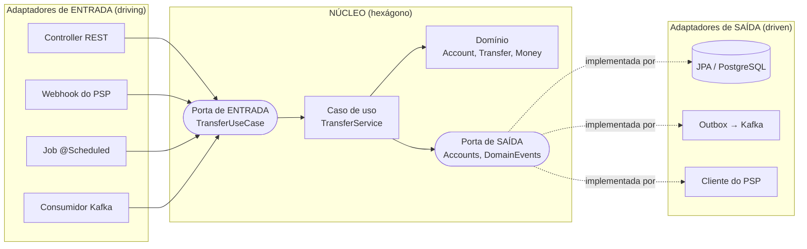

# P4.02 — Arquitetura hexagonal e Clean Architecture

> ⏱️ ~1h30 · 🔵 Pleno · Pré-requisitos: P4.01, J5.05 (injeção por construtor), P3.09 (Outbox) e P3.10 (webhook: o PSP é uma dependência de fora)

> ⚠️ **Verificação:** o módulo `account`/`transfer` do laboratório (`lab/architecture-lab`: Spring Boot **4.1.2**, JDK 25.0.5) **compilou e passou** (27 testes, `out-suite-resumo.txt`), com **domínio puro** e adaptador **em memória**. O **PayFlow real** (entidades JPA, Spring Data, `OutboxRelay`) segue **por leitura**; a decisão "hexagonal pragmático" para o PayFlow **não foi compilada** lá.

## 🎯 Objetivos
Ao final desta aula você consegue:
- **Desenhar** a arquitetura hexagonal (portas e adaptadores) e **dizer** quem depende de quem.
- **Distinguir** porta de **entrada** (*driving*) e de **saída** (*driven*) e **dar** exemplos do PayFlow.
- **Comparar** hexagonal, *onion* e **Clean Architecture** (mesma ideia, vocabulários diferentes).
- **Escrever** um caso de uso que só conhece **portas** e **testá-lo sem Spring**.
- **Decidir** com argumento quando o hexágono **vale** e quando é cerimônia.

## 🤔 Por que isso importa
O PayFlow depende de **coisas que mudam por razões que não são do negócio**: o banco (PostgreSQL hoje), o *broker* (Kafka/RabbitMQ), o PSP do QR code, o Redis. Na P3 o `TransferService` passou a conhecer `OutboxRepository`; amanhã ele conheceria o SDK do PSP. Se o **caso de uso** importa essas coisas, **trocar** ou **testar** qualquer uma exige mexer no coração do sistema. A hexagonal **inverte** a dependência: o **núcleo define o que precisa** (uma interface) e a infraestrutura **se encaixa**.

## 💡 Intuição (explicação simples)
Pense numa **TV com entradas padronizadas** (HDMI, USB). A TV (o núcleo) define as **tomadas**; cada aparelho (console, *pendrive*) tem um **adaptador** com o plugue certo. Trocar o console não mexe na TV. Se, em vez disso, a TV tivesse **o plugue do console soldado dentro**, trocar de console seria cirurgia.

## 🔬 Como funciona por dentro

### 1. O hexágono

- **Porta** = **interface** que pertence ao **núcleo**. De **entrada**: o que o mundo pode **pedir** (`TransferUseCase.transfer`). De **saída**: o que o núcleo **precisa** (`Accounts.debit`, `DomainEvents.publish`).
- **Adaptador** = classe de **fora** que **traduz**: o controller traduz HTTP→chamada; `AccountsAdapter` traduz `Accounts` → API de outro módulo; o repositório JPA traduz `AccountStore` → SQL.
- **Regra única:** as setas de dependência **apontam para o núcleo**. O núcleo **nunca** importa `jakarta.*`, `org.springframework.*` (nos tipos de negócio) nem adaptadores. (É a **inversão de dependência**, o "D" de SOLID, P4.03.)

> Mesma ideia com outros nomes: **Onion** (Palermo, 2008) e **Clean Architecture** ([Robert C. Martin, 2012](https://blog.cleancoder.com/uncle-bob/2012/08/13/the-clean-architecture.html)), que desenha círculos concêntricos (*entities* → *use cases* → *interface adapters* → *frameworks*) com **a mesma regra de dependência**. A fonte original da hexagonal é o [artigo de Alistair Cockburn](https://alistair.cockburn.us/hexagonal-architecture/). Diferença prática entre as três: **vocabulário** e **granularidade** do desenho, não o princípio.

### 2. O módulo `transfer` do laboratório, por dentro
```text
transfer/
├── TransferCompleted.java            ← API pública do módulo (evento)
├── domain/Transfer.java              ← regra, sem framework
├── application/
│   ├── TransferService.java          ← caso de uso (package-private)
│   └── port/
│       ├── in/TransferUseCase.java   ← porta de ENTRADA
│       └── out/Accounts.java         ← porta de SAÍDA (linguagem do transfer)
│       └── out/DomainEvents.java     ← porta de SAÍDA
└── adapter/
    ├── in/web/TransferController.java
    └── out/AccountsAdapter.java, SpringDomainEvents.java
```

**Porta de entrada** e **porta de saída** (linguagem do **transfer**, não do `account`):

```java
// src/main/java/com/payflow/lab/transfer/application/port/in/TransferUseCase.java
package com.payflow.lab.transfer.application.port.in;

import com.payflow.lab.shared.Money;
import java.util.UUID;

/** Porta de ENTRADA: o que o mundo de fora pode pedir ao módulo. */
public interface TransferUseCase {
    UUID transfer(UUID source, UUID target, Money amount);
}
```

```java
// src/main/java/com/payflow/lab/transfer/application/port/out/Accounts.java
package com.payflow.lab.transfer.application.port.out;

import com.payflow.lab.shared.Money;
import java.util.UUID;

/** Porta de saída com a LINGUAGEM do módulo transfer (anticorruption layer): ele não sabe o que é AccountApi. */
public interface Accounts {
    void debit(UUID account, Money amount);
    void credit(UUID account, Money amount);
}
```

**O caso de uso** só conhece portas; **a transação** e a **ordem** estão aqui:

```java
// src/main/java/com/payflow/lab/transfer/application/TransferService.java
package com.payflow.lab.transfer.application;

import com.payflow.lab.shared.Money;
import com.payflow.lab.transfer.TransferCompleted;
import com.payflow.lab.transfer.application.port.in.TransferUseCase;
import com.payflow.lab.transfer.application.port.out.Accounts;
import com.payflow.lab.transfer.application.port.out.DomainEvents;
import com.payflow.lab.transfer.domain.Transfer;
import java.util.UUID;
import org.springframework.stereotype.Service;
import org.springframework.transaction.annotation.Transactional;

@Service
class TransferService implements TransferUseCase {

    private final Accounts accounts;
    private final DomainEvents events;

    TransferService(Accounts accounts, DomainEvents events) {
        this.accounts = accounts;
        this.events = events;
    }

    @Override
    @Transactional
    public UUID transfer(UUID source, UUID target, Money amount) {
        var transfer = new Transfer(source, target, amount);
        accounts.debit(source, amount);
        accounts.credit(target, amount);
        transfer.complete();
        events.publish(new TransferCompleted(transfer.id(), source, target, amount));
        return transfer.id();
    }
}
```

**O adaptador** é o **único** lugar do módulo que sabe que existe um módulo `account`:

```java
// src/main/java/com/payflow/lab/transfer/adapter/out/AccountsAdapter.java
package com.payflow.lab.transfer.adapter.out;

import com.payflow.lab.account.AccountApi;
import com.payflow.lab.shared.Money;
import com.payflow.lab.transfer.application.port.out.Accounts;
import java.util.UUID;
import org.springframework.stereotype.Component;

/** Único lugar do módulo transfer que conhece o módulo account. */
@Component
class AccountsAdapter implements Accounts {

    private final AccountApi accountApi;

    AccountsAdapter(AccountApi accountApi) {
        this.accountApi = accountApi;
    }

    @Override
    public void debit(UUID account, Money amount) {
        accountApi.withdraw(account, amount);
    }

    @Override
    public void credit(UUID account, Money amount) {
        accountApi.deposit(account, amount);
    }
}
```

O **controller** só traduz HTTP para a porta de entrada:

```java
// src/main/java/com/payflow/lab/transfer/adapter/in/web/TransferController.java
package com.payflow.lab.transfer.adapter.in.web;

import com.payflow.lab.shared.Money;
import com.payflow.lab.transfer.application.port.in.TransferUseCase;
import java.util.Map;
import java.util.UUID;
import org.springframework.web.bind.annotation.PostMapping;
import org.springframework.web.bind.annotation.RequestBody;
import org.springframework.web.bind.annotation.RequestMapping;
import org.springframework.web.bind.annotation.RestController;

@RestController
@RequestMapping("/api/v1/transfers")
class TransferController {

    record TransferRequest(UUID source, UUID target, String amount) { }

    private final TransferUseCase useCase;

    TransferController(TransferUseCase useCase) {
        this.useCase = useCase;
    }

    @PostMapping
    Map<String, String> create(@RequestBody TransferRequest request) {
        var id = useCase.transfer(request.source(), request.target(), Money.of(request.amount()));
        return Map.of("id", id.toString());
    }
}
```

### 3. O que se ganha: o caso de uso roda **sem Spring** (executado)
```java
// src/test/java/com/payflow/lab/transfer/application/TransferServiceUnitTest.java
package com.payflow.lab.transfer.application;

import static org.assertj.core.api.Assertions.assertThat;
import static org.assertj.core.api.Assertions.assertThatThrownBy;

import com.payflow.lab.shared.Money;
import com.payflow.lab.transfer.TransferCompleted;
import com.payflow.lab.transfer.application.port.out.Accounts;
import java.util.ArrayList;
import java.util.List;
import java.util.UUID;
import org.junit.jupiter.api.Test;

/** O caso de uso sem Spring, sem banco, sem Docker: só as portas, trocadas por fakes. */
class TransferServiceUnitTest {

    static class FakeAccounts implements Accounts {
        final List<String> calls = new ArrayList<>();
        public void debit(UUID account, Money amount) { calls.add("debit " + amount); }
        public void credit(UUID account, Money amount) { calls.add("credit " + amount); }
    }

    @Test
    void debitsCreditsAndPublishesInThatOrder() {
        var accounts = new FakeAccounts();
        var events = new ArrayList<TransferCompleted>();
        var service = new TransferService(accounts, events::add);

        var id = service.transfer(UUID.randomUUID(), UUID.randomUUID(), Money.of("10.00"));

        assertThat(accounts.calls).containsExactly("debit 10.00", "credit 10.00");
        assertThat(events).singleElement().satisfies(e -> assertThat(e.transferId()).isEqualTo(id));
    }

    @Test
    void doesNotPublishWhenTheDebitFails() {
        var events = new ArrayList<TransferCompleted>();
        Accounts failing = new Accounts() {
            public void debit(UUID account, Money amount) { throw new IllegalStateException("insufficient"); }
            public void credit(UUID account, Money amount) { }
        };
        var service = new TransferService(failing, events::add);

        assertThatThrownBy(() -> service.transfer(UUID.randomUUID(), UUID.randomUUID(), Money.of("10.00")))
                .isInstanceOf(IllegalStateException.class);
        assertThat(events).isEmpty();
    }
}
```

> ℹ️ `TransferService` é **package-private**, então o teste unitário mora **no mesmo pacote** (`...transfer.application`). Foi **escolha** do desenho (a fronteira é a **porta**; a implementação fica escondida) e é o preço de esconder. `DomainEvents` tem **um** método, por isso `events::add` serve de implementação.

O teste de **módulo** do laboratório (`TransferModuleTest`) **substitui o módulo `account` inteiro por um *mock* da sua API** e prova que a transferência chama `withdraw` e `deposit` e publica o evento (P4.09).

### 4. As regras do hexágono, **executáveis** (ArchUnit)
```java
// src/test/java/com/payflow/lab/ArchitectureRulesTest.java
    static final ArchRule DOMAIN_IS_FRAMEWORK_FREE = noClasses().that().resideInAPackage("..domain..")
            .should().dependOnClassesThat().resideInAnyPackage(
                    "org.springframework..", "jakarta..", "..adapter..", "..application..")
            .because("o domínio é puro: regras de negócio não conhecem framework nem infraestrutura");

    static final ArchRule APPLICATION_DOES_NOT_KNOW_ADAPTERS = noClasses().that().resideInAPackage("..application..")
            .should().dependOnClassesThat().resideInAPackage("..adapter..")
            .because("casos de uso falam com PORTAS, nunca com adaptadores");

    static final ArchRule ADAPTERS_DO_NOT_TALK_TO_EACH_OTHER = noClasses().that().resideInAPackage("..adapter.in..")
            .should().dependOnClassesThat().resideInAPackage("..adapter.out..")
```

Essas regras **passam** no código real e **falham** no código ruim (`DOMAIN_IS_FRAMEWORK_FREE` achou 4 violações em `BadDomain`; saída na P4.10).

## 🛠️ Exemplo prático

### O hexágono do PayFlow: **pragmático**, não "puro"
O laboratório usa **domínio puro + adaptador em memória**. O PayFlow real tem **entidades JPA** (decisão 33: `@Entity`, `@Version`, `@ManyToOne(LAZY)`). Duas escolhas:

| | **Puro** (entidade de domínio ≠ entidade JPA) | **Pragmático** (a entidade JPA **é** o domínio) |
|---|---|---|
| Domínio importa `jakarta.persistence`? | não | **sim, só ele** |
| Classes extras | `AccountJpaEntity` + mapeador `Account ⇄ AccountJpaEntity` | nenhuma |
| `@Version`, `LAZY`, proxies do Hibernate | ficam **escondidos** no adaptador | aparecem na classe de domínio |
| Custo | **mapear** em toda leitura/escrita; dois modelos para manter | o domínio **sabe** que existe persistência |
| Quando compensa | regra rica, troca de banco plausível, vários adaptadores | regra simples, um banco (nosso caso) |

**Decisão 116 (ADR 0016):** PayFlow usa o hexágono **pragmático**: `domain` pode importar **apenas** `jakarta.persistence.*`; **nada** de `org.springframework.*`, `application` ou `adapter` (regra do ArchUnit ajustada: o laboratório proíbe `jakarta..` por inteiro porque ele é puro). Se um dia houver segundo banco ou regra que brigue com o Hibernate, **a separação vira refatoração local**, porque o domínio já fala por portas.

### Como cada coisa do PayFlow se encaixa (mapa por leitura)
| Peça | Papel | Onde |
|---|---|---|
| `TransferController`, `DepositController` | adaptador de **entrada** | `adapter.in.web` |
| `/webhooks/**` (HMAC) | adaptador de **entrada** | `payment.adapter.in.web` |
| `OutboxRelay` | adaptador de **saída** (publica no Kafka) | `outbox.adapter.out` |
| `AccountRepository` (Spring Data) | adaptador de **saída** atrás da porta `AccountStore` | `account.adapter.out.persistence` |
| `ExchangeService` + cliente HTTP do câmbio (P1) | porta `ExchangeRates` + adaptador | `reporting`/`account` |
| `MonthlySummaryRefresher` (`@Scheduled`) | adaptador de **entrada** (job) chamando um caso de uso | `reporting.adapter.in.job` |

## 🏗️ Pausa de design: "porta ou chamada direta?"
O `TransferService` precisa gravar no Outbox (P3.09). Alternativas: (a) injetar `JdbcClient` e fazer o `INSERT`; (b) porta `DomainEvents` + adaptador `OutboxEvents`.

<details><summary>Dica e solução</summary>

**Dica:** "em quantos lugares eu teria de mexer se o Outbox virasse CDC?" e "como testo o `TransferService` sem banco?".

**Solução:** (b). O caso de uso diz **o que** quer (`publish(TransferCompleted)`); *como* (linha em `outbox_events` na mesma transação, `FOR UPDATE SKIP LOCKED` no relé) é detalhe do adaptador. Com CDC, só o adaptador muda. **Atenção:** a porta **não** muda a regra de atomicidade: o adaptador **participa da transação** do caso de uso (mesmo `DataSource`), senão o Outbox perde a garantia (P3.09). Porta é **fronteira de código**, não de transação.
</details>

## ⚖️ Trade-offs e quando NÃO usar
- **Cerimônia:** cada porta é uma interface + um adaptador. Num CRUD de 3 telas, o hexágono **multiplica arquivos sem ganho**. Use onde há **regra de negócio** e **vários mundos de fora** (HTTP, fila, job, PSP).
- **"Interface para tudo"** é o vício comum: **uma porta existe porque há uma fronteira** (módulo, infraestrutura que pode mudar, ponto de teste), não porque toda classe merece uma interface. Uma interface com **uma** implementação **sem** fronteira por trás é ruído.
- **Mapeamentos** (DTO ↔ domínio ↔ entidade) custam código e bugs; o pragmático corta um nível.
- **Transação atravessa portas:** não há como "esconder" que o Outbox precisa do mesmo banco; **finja o contrário e perderá dinheiro**.
- **Teste:** com portas, os testes de caso de uso são **rápidos**; mas **teste de integração** do adaptador (SQL de verdade, Testcontainers: J7) continua **indispensável**: o *fake* não prova o SQL.

## ⚠️ Erros comuns e boas práticas de produção
- **Porta que vaza o adaptador:** `Accounts.debit(JpaAccount a)`: o núcleo passou a conhecer o JPA. A porta fala **tipos do núcleo**.
- **Caso de uso que devolve entidade** para o controller serializar (decisão 33): devolva `record`.
- **Anotação de framework no domínio** (`@Service` em `Account`): o ArchUnit acima **pega**.
- **Adaptador de entrada com regra:** o controller faz `if (amount > limite)`. Mover para o caso de uso/domínio.
- **Dependência cíclica porta↔adaptador** (a porta importando um tipo do adaptador): a regra `APPLICATION_DOES_NOT_KNOW_ADAPTERS` reprova.
- **Confundir hexagonal com microsserviço:** hexagonal é **organização de código dentro** de um deployável.

## 🧩 Exercícios
1. **Fixação:** classifique em **porta de entrada**, **porta de saída**, **adaptador de entrada** ou **adaptador de saída**: `PaymentRequestRepository`, `WebhookController`, `NotificationSender`, `@KafkaListener`, `TransferUseCase`.
2. **Aplicação no PayFlow** (por leitura; *branch* `p4-hexagonal`):
   - [ ] Para o caso de uso "transferir", escreva **no papel** as portas de entrada e de saída que o `TransferService` do P3 usa hoje (repositórios, Outbox, relógio, `Idempotency-Key`).
   - [ ] Crie a porta `AccountStore` (substitui o uso direto de `AccountRepository` no serviço); o Spring Data vira **adaptador** (`AccountStoreJpa implements AccountStore`).
   - [ ] Escreva `TransferServiceUnitTest` com **fakes** das portas (sem Spring) e **um** teste de integração do adaptador JPA (Testcontainers).
   - Pronto quando: `TransferService` **não importa** `org.springframework.data` nem `jakarta.persistence`.
3. **Desafio:** ajuste a regra do domínio para o **pragmático** (permitir só `jakarta.persistence..`) e prove que ela ainda reprova `org.springframework..`.

<details><summary>Solução de referência (1 e 3)</summary>

1. `PaymentRequestRepository` = **porta de saída** (a interface) e o Spring Data = **adaptador de saída**; `WebhookController` = adaptador de **entrada**; `NotificationSender` = **porta de saída**; `@KafkaListener` = adaptador de **entrada**; `TransferUseCase` = **porta de entrada**.
3.
```java
noClasses().that().resideInAPackage("..domain..")
    .should().dependOnClassesThat().resideInAnyPackage(
        "org.springframework..", "..adapter..", "..application..",
        "jakarta.servlet..", "jakarta.validation..")      // jakarta.persistence fica permitido
```
</details>

## 🎤 Na entrevista
1. **"O que é arquitetura hexagonal?"** O núcleo (domínio + casos de uso) define **portas** (interfaces) e a infraestrutura as implementa com **adaptadores**; as dependências apontam **para o núcleo**. Ganho: trocar/mocar infraestrutura e testar regras sem framework.
2. **"Hexagonal × Clean × Onion?"** Mesmo princípio (regra de dependência para dentro); mudam vocabulário e desenho (hexágono, círculos concêntricos, cebola).
3. **"Quando você **não** usaria?"** CRUD simples, protótipo, equipe pequena com domínio trivial: o custo de portas/mapeamentos supera o benefício.
4. **"O adaptador de saída participa da transação?"** Sim, quando o efeito precisa ser atômico (Outbox): a porta separa **código**, não **transação**.

## 📚 Para ir além
- 📄 [Hexagonal Architecture](https://alistair.cockburn.us/hexagonal-architecture/) (Alistair Cockburn): o texto original, curto.
- 📄 [The Clean Architecture](https://blog.cleancoder.com/uncle-bob/2012/08/13/the-clean-architecture.html) (Robert C. Martin): a "regra de dependência" em uma figura.
- 📑 *Get Your Hands Dirty on Clean Architecture* (Tom Hombergs): hexagonal com Spring, passo a passo (**de memória, não conferido**).
- 📑 *Clean Architecture* (Robert C. Martin) e *Fundamentals of Software Architecture* (**capítulos de memória, não conferidos**).

## ✅ Checklist da aula
- [ ] Sei desenhar o hexágono e dizer para onde **apontam** as setas.
- [ ] Sei dar 2 exemplos de porta de entrada e 2 de saída do PayFlow.
- [ ] Entendo por que a porta **não** isola a transação.
- [ ] Sei defender a escolha "pragmático" (JPA no domínio) e o preço dela.
