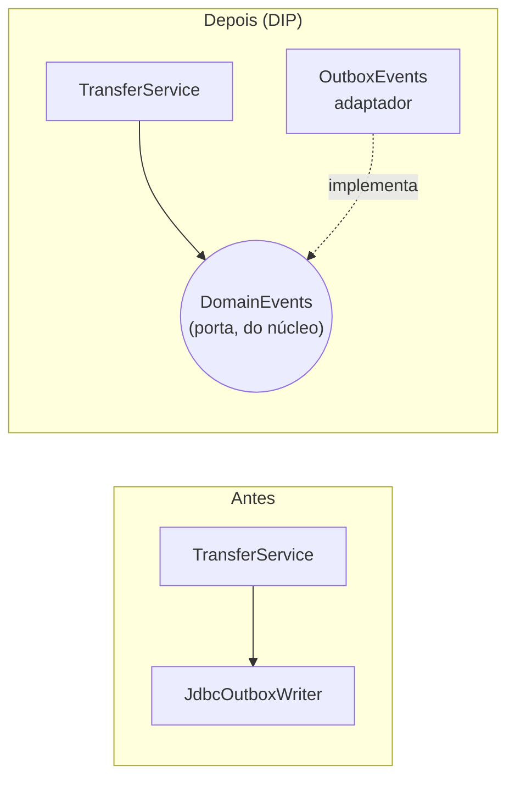

# P4.03 — SOLID com exemplos em Spring

> ⏱️ ~1h30 · 🔵 Pleno · Pré-requisitos: P4.01, P4.02, J5.05 (injeção por construtor), J7 (testes)

> ✅ **Validação final (2026-11-24):** módulo executado no PayFlow reconstruído; resultado e o que continua não executado no [README do módulo](README.md). Os avisos "não executado" / "por leitura" abaixo descrevem a escrita original.

> ⚠️ **Verificação:** `OpenClosedTest` (contêiner do Spring com `List<TransferPolicy>`) e `AccountStoreContractTest` (teste de contrato, **LSP**) foram **executados** em `lab/architecture-lab` (Spring Boot **4.1.2**, JDK 25.0.5; 33 testes verdes). Os trechos que citam classes do PayFlow real (`TransferService`, `OutboxRelay`...) são **por leitura**.

## 🎯 Objetivos
Ao final desta aula você consegue:
- **Explicar** cada princípio do **SOLID** com um exemplo **de Spring** e um **do PayFlow**.
- **Usar** SOLID como **diagnóstico** ("por que esta classe dói?"), não como lista de regras.
- **Provar** o **OCP** acrescentando uma regra sem editar a classe que a usa.
- **Escrever** um **teste de contrato** que dá substância ao **LSP**.
- **Reconhecer** o excesso: quando "aplicar SOLID" piora o código.

## 🤔 Por que isso importa
SOLID é **vocabulário de revisão de código** de Pleno: "essa classe tem duas razões para mudar", "isso viola a inversão de dependência". Usado sem critério vira **dogma** (interface para tudo, classes de 10 linhas espalhadas). Usado como **diagnóstico** diz **onde** dói: a classe que muda sempre que surge um limite novo; a implementação que "funciona" mas quebra quem a recebe.

## 💡 Intuição (explicação simples)
Uma **cozinha profissional**: cada estação faz **uma coisa** (S); o cardápio ganha um prato novo **sem reconstruir a cozinha** (O); qualquer cozinheiro de grelha pode **assumir a grelha** sem que o salão perceba (L); o garçom recebe **só a comanda do que ele serve**, não o livro inteiro de receitas (I); o chef pede "um molho", **não "o molho do fornecedor X"** (D).

## 🔬 Como funciona por dentro

### S — *Single Responsibility*: **uma razão para mudar**
Não é "a classe faz uma coisa" (frase vaga); é "**quem** pediria para mudá-la?".
| Classe | Quem pede mudança | Veredito |
|---|---|---|
| `TransferService` que valida limite, debita, grava Outbox **e** monta o e-mail | produto (limite), plataforma (Outbox), marketing (e-mail) | **3 razões**: separar |
| `Account` com `withdraw`/`deposit` e a invariante de saldo | contabilidade | **1 razão** |
| `TransferController` | contrato da API | **1 razão** |

Sinal prático: **a classe cresce em PRs de assuntos diferentes** (veja o histórico de `git log --follow`).

### O — *Open/Closed*: aberta para **extensão**, fechada para **modificação**
Acrescentar comportamento **sem editar** o código que já funciona. No Spring, o idioma é **injetar uma `List` de implementações**:

```java
// src/test/java/com/payflow/patterns/OpenClosedTest.java
    /** A abstração: cada política decide se recusa e devolve o motivo. */
    interface TransferPolicy {
        Optional<String> reject(BigDecimal amount);
    }

    /** NUNCA muda quando surge uma regra nova: está FECHADO para modificação. */
    static class TransferChecker {
        private final List<TransferPolicy> policies;

        TransferChecker(List<TransferPolicy> policies) {
            this.policies = policies;
        }

        void check(BigDecimal amount) {
            policies.stream().map(p -> p.reject(amount)).flatMap(Optional::stream).findFirst()
                    .ifPresent(reason -> { throw new IllegalArgumentException(reason); });
        }
    }

    static class MinimumPolicy implements TransferPolicy {
        public Optional<String> reject(BigDecimal amount) {
            return amount.compareTo(new BigDecimal("0.01")) < 0 ? Optional.of("below minimum") : Optional.empty();
        }
    }

    static class SingleLimitPolicy implements TransferPolicy {
        public Optional<String> reject(BigDecimal amount) {
            return amount.compareTo(new BigDecimal("5000.00")) > 0 ? Optional.of("above single limit") : Optional.empty();
        }
    }

    /** A regra nova: só este bean é acrescentado, nenhuma linha do TransferChecker muda. */
    static class NightLimitPolicy implements TransferPolicy {
        public Optional<String> reject(BigDecimal amount) {
            return amount.compareTo(new BigDecimal("1000.00")) > 0 ? Optional.of("above night limit") : Optional.empty();
        }
    }

    @Configuration
    static class BaseConfig {
        @Bean TransferPolicy minimum() { return new MinimumPolicy(); }
        @Bean TransferPolicy singleLimit() { return new SingleLimitPolicy(); }
        @Bean TransferChecker checker(List<TransferPolicy> policies) { return new TransferChecker(policies); }
    }

    @Configuration
    static class WithNightLimitConfig extends BaseConfig {
        @Bean TransferPolicy nightLimit() { return new NightLimitPolicy(); }
    }

    @Test
    void addingAPolicyDoesNotTouchTheChecker() {
        try (var base = new AnnotationConfigApplicationContext(BaseConfig.class)) {
            base.getBean(TransferChecker.class).check(new BigDecimal("2000.00"));        // passa
        }
        try (var extended = new AnnotationConfigApplicationContext(WithNightLimitConfig.class)) {
            assertThatThrownBy(() -> extended.getBean(TransferChecker.class).check(new BigDecimal("2000.00")))
                    .hasMessage("above night limit");                                      // mesma classe, regra nova
            assertThat(extended.getBeansOfType(TransferPolicy.class)).hasSize(3);
        }
    }
}
```

O teste prova o ponto (**executado**): com **duas** políticas, `2000.00` passa; com a **terceira** (`NightLimitPolicy`, **só um bean novo**) a mesma classe `TransferChecker`, **sem uma linha editada**, passa a recusar com `above night limit`.

> ℹ️ O padrão por trás é **Strategy** (P4.04). OCP é o **princípio**; Strategy é uma **técnica** para obtê-lo.

### L — *Liskov Substitution*: o substituto **cumpre o contrato**
Se `AccountStore` promete "id desconhecido → `Optional.empty()`", toda implementação deve cumprir, **inclusive uma que compila** mas devolve `null`. O compilador **não** vê isso; o **teste de contrato** vê: escreve-se **uma vez** e roda **contra cada implementação**:

```java
// src/test/java/com/payflow/lab/account/adapter/out/AccountStoreContractTest.java
package com.payflow.lab.account.adapter.out;

import static org.assertj.core.api.Assertions.assertThat;
import static org.assertj.core.api.Assertions.assertThatThrownBy;

import com.payflow.lab.account.application.port.out.AccountStore;
import com.payflow.lab.account.domain.Account;
import com.payflow.lab.shared.Money;
import java.util.Optional;
import java.util.UUID;
import org.junit.jupiter.api.Test;

/**
 * LSP na prática: o CONTRATO da porta, escrito uma vez, roda contra TODA implementação.
 * Quem não cumpre o contrato não é substituível, mesmo compilando.
 */
abstract class AccountStoreContract {

    abstract AccountStore store();

    void saveThenFindReturnsTheSameAccount() {
        var account = new Account(UUID.randomUUID(), "ana", Money.of("10.00"));
        store().save(account);
        assertThat(store().findById(account.id())).isPresent();
    }

    void unknownIdReturnsEmptyNotNull() {
        Optional<Account> found = store().findById(UUID.randomUUID());
        assertThat(found).isNotNull().isEmpty();
    }
}

class InMemoryAccountStoreContractTest extends AccountStoreContract {
    private final AccountStore store = new InMemoryAccountStore();

    @Override AccountStore store() { return store; }

    @Test void saveThenFind() { saveThenFindReturnsTheSameAccount(); }
    @Test void unknownId() { unknownIdReturnsEmptyNotNull(); }
}

class JdbcAccountStoreContractTest extends AccountStoreContract {
    private final AccountStore store;

    JdbcAccountStoreContractTest() {
        var db = new org.springframework.jdbc.datasource.embedded.EmbeddedDatabaseBuilder()
                .setType(org.springframework.jdbc.datasource.embedded.EmbeddedDatabaseType.H2)
                .setName("contract-" + UUID.randomUUID()).addScript("classpath:schema.sql").build();
        this.store = new JdbcAccountStore(org.springframework.jdbc.core.simple.JdbcClient.create(db));
    }

    @Override AccountStore store() { return store; }

    @Test void saveThenFind() { saveThenFindReturnsTheSameAccount(); }
    @Test void unknownId() { unknownIdReturnsEmptyNotNull(); }
}

/** Uma "implementação" que compila e quebra o contrato: devolve null onde a porta promete Optional. */
class BrokenAccountStoreContractTest extends AccountStoreContract {
    private final AccountStore store = new AccountStore() {
        public Account save(Account account) { return account; }
        public Optional<Account> findById(UUID id) { return null; }
    };

    @Override AccountStore store() { return store; }

    @Test
    void theContractCatchesTheViolation() {
        assertThatThrownBy(this::unknownIdReturnsEmptyNotNull).isInstanceOf(AssertionError.class);
    }
}
```

`BrokenAccountStoreContractTest` **provou** que o contrato detecta a violação (a implementação com `null` faz o `isNotNull()` falhar). No PayFlow: o contrato de `AccountStore` roda contra o adaptador **em memória** (testes rápidos) **e** o adaptador **JPA** (Testcontainers); se os dois passam, o serviço pode trocar um pelo outro. **Outros sinais de violação do LSP:** subclasse que lança `UnsupportedOperationException`, que **estreita** o que aceita ou **amplia** o que devolve.

### I — *Interface Segregation*: ninguém depende do que não usa
| Em vez de | prefira |
|---|---|
| `AccountApi` (open, balanceOf, withdraw, deposit) injetada em quem só **lê** o saldo | uma porta de **leitura** `BalanceQuery` + a de **comando** |
| porta `Accounts` do `transfer` (só `debit`/`credit`) | **já é** pequena: pertence ao **cliente** (o `transfer`), não ao fornecedor (o `account`) |

> A porta `Accounts` do laboratório mostra a regra de ouro: **a interface é do cliente**. O módulo `transfer` pede `debit`/`credit`; ele **não** recebe `open`/`balanceOf`/etc. Mudou `open`? O `transfer` nem recompila.

### D — *Dependency Inversion*: dependa de **abstrações**, e de quem **é dono** delas

A seta de **código-fonte** inverte: o detalhe (`OutboxEvents`) passa a **depender da abstração** que o núcleo define. **Injeção de dependência** (o Spring) é **como** se monta; **inversão** (DIP) é **quem define a interface**. Dá para ter DI sem DIP (injetar a classe concreta) e é o que acontece quando um serviço faz `@Autowired JdbcTemplate` (decisão 30: construtor; P4.02: portas).

## 🛠️ Exemplo prático

### Diagnóstico SOLID do `TransferService` do P3 (por leitura)
Imagine o método `execute` do P3 com todas as responsabilidades:
```text
1. valida valor e conta               ← Web? Domínio?
2. trava as contas em ordem (P2.02)    ← persistência
3. debita e credita                    ← domínio (Account)
4. grava lançamentos                   ← persistência
5. grava outbox_events                 ← mensageria
6. chama a retentativa (P2.03)         ← resiliência
```
| Princípio | Sintoma | Correção no P4 |
|---|---|---|
| **S** | 6 assuntos num método | casos de uso finos; regras no domínio; retentativa no *facade* (já existe) |
| **O** | cada limite novo = `if` novo | `List<TransferPolicy>` (P4.04) |
| **D** | importa repositório e writer concretos | portas `AccountStore`, `DomainEvents` (P4.02) |
| **L** | `AccountRepository` trocado por *fake* que não lança `OptimisticLock...` | **contrato** de `AccountStore` |
| **I** | injeta o repositório inteiro para usar 2 métodos | portas pequenas por caso de uso |

### Spring já aplica SOLID por você
- **D:** o contêiner **monta** as dependências; `@Configuration` + `@Bean` (J5.05) é a "raiz de composição".
- **O:** `List<HandlerInterceptor>`, `List<Converter>`, `HttpMessageConverter`: **acrescenta-se** um bean e o framework o usa.
- **L:** `DataSource` (Hikari, H2, Postgres): o resto do código **não distingue**.
- **I:** `ApplicationEventPublisher` (um método) em vez do `ApplicationContext` inteiro.

## 🏗️ Estudo de caso curto: a classe de 600 linhas
O `NotificationService` do PayFlow tem `sendEmail`, `sendPush`, `sendSms`, `renderTemplate`, `retry`, `audit`. Cada canal novo exige editar a classe e **todos os testes** quebram juntos.

<details><summary>Dica e solução</summary>

**Dica:** o que **varia** (canal) e o que é **estável** (a decisão "enviar a notificação X")?

**Solução:** `NotificationChannel` (porta, método `send(Notification)`), uma implementação por canal (**OCP**: canal novo = classe nova), `NotificationService` injeta `Map<String, NotificationChannel>` (nome do *bean* = canal) ou `List` com um `supports(Notification)`. `renderTemplate` vira colaborador; `audit` vira **Decorator** (P4.05). Teste de **contrato** da `NotificationChannel` para os adaptadores reais e o *fake* (**L**). **Cuidado:** se só existirem **e-mail e push** e nada indica um terceiro, **não crie** a hierarquia agora; extraia quando o **segundo** canal chegar (regra de três, abaixo).
</details>

## ⚖️ Trade-offs e quando NÃO usar
- **SOLID não é gratuito:** cada abstração custa **indireção** (ler "quem implementa isso?") e arquivos. Aplique quando a **dor é visível** (mudou 3 vezes pelo mesmo motivo), não por antecipação.
- **"Regra de três":** a 1ª vez, faça direto; a 2ª, duplique e observe; a 3ª, **extraia**. Abstrair cedo adivinha o eixo de variação **errado** (e abstração errada é mais cara que duplicação).
- **S levado ao extremo:** classes de 5 linhas, a lógica espalhada em 20 arquivos. Coesão **também** é qualidade.
- **I e D em excesso:** uma interface por classe (`FooService`/`FooServiceImpl`) sem fronteira por trás não ganha nada: o nome "Impl" é o **cheiro**.
- **OCP não vence o domínio estável:** não crie *plug-ins* para uma regra que nunca mudou.

## ⚠️ Erros comuns e boas práticas de produção
- **`@Autowired` em campo:** esconde dependências e impede `new` em teste; a regra `NO_FIELD_INJECTION` (P4.10) pega.
- **Interface "para poder mockar":** com `@MockitoBean`/Mockito você mocka **classe**; a interface se justifica por **fronteira**, não por mock.
- **`instanceof` em cascata** (`if (p instanceof Pix) ... else if (p instanceof Boleto)`): cheiro de **OCP/LSP**; use polimorfismo.
- **Subclasse que desliga comportamento** (`UnsupportedOperationException`): quebra o **L**.
- **`List<X>` injetada sem ordem:** se a ordem importa, use `@Order` (ou o contrato diz que **não** importa). Nas políticas acima, **a ordem não pode importar**.

## 🧩 Exercícios
1. **Fixação:** para cada item, diga **qual princípio** viola: (a) `if (type == "PIX") ... else if (type == "BOLETO")` em `PaymentService`; (b) `BalanceReader` que lança `UnsupportedOperationException` em `write`; (c) um serviço que cria `new RestTemplate()` dentro do método; (d) uma interface de 14 métodos injetada em quem usa 1.
2. **Aplicação no PayFlow** (por leitura):
   - [ ] Escolha **uma** classe do PayFlow com mais de 150 linhas e liste **quem pede mudança** nela; proponha como dividir.
   - [ ] Escreva o **contrato** da porta `AccountStore` (3 comportamentos: salvar/ler, id desconhecido, **atualização** substitui) e rode contra o adaptador em memória.
   - [ ] Troque o `if` de limite do `TransferService` por `List<TransferPolicy>` (P4.04) **sem** mudar o contrato HTTP.
3. **Desafio:** acrescente `TransferPolicy` de **limite diário** que precisa do total já transferido no dia: **como** a política obtém esse dado sem dependência circular com o serviço?

<details><summary>Solução de referência</summary>

1. (a) **O** (e **S**); (b) **L**; (c) **D**; (d) **I**.
3. A política recebe **uma porta de leitura** própria (`DailyTotals.totalFor(account, day)`), implementada por um adaptador sobre o repositório: depende de **abstração** (D) e **não** do `TransferService`. A porta fica no pacote da política.
</details>

## 🎤 Na entrevista
1. **"Explique o D de SOLID e a diferença para injeção de dependência."** DIP: módulos de alto nível **não** dependem dos de baixo; ambos dependem de abstrações, e a abstração pertence ao alto nível. DI é a **técnica** de entregar a dependência de fora; dá para usar DI e violar DIP (injetar classe concreta).
2. **"Dê um exemplo de violação do Liskov."** Subtipo que **estreita pré-condição** ou **quebra a pós-condição**: um `AccountStore` que devolve `null` onde a interface promete `Optional`; ou `ReadOnlyList.add` lançando exceção. Detecta-se com **teste de contrato**.
3. **"Como o Spring ajuda no OCP?"** Injetando `List<Interface>`/`Map<String, Interface>`: novo bean = novo comportamento, sem editar o consumidor.
4. **"Você aplica SOLID sempre?"** Não: aplico quando há **dor medida** (mudanças repetidas pelo mesmo motivo); abstrair cedo adivinha o eixo errado.

## 📚 Para ir além
- 📄 Robert C. Martin, [*The Open-Closed Principle*](https://blog.cleancoder.com/uncle-bob/2014/05/12/TheOpenClosedPrinciple.html): a formulação original, com humor.
- 📄 [Spring Framework: Dependency Injection](https://docs.spring.io/spring-framework/reference/core/beans/dependencies/factory-collaborators.html): injeção por construtor e coleções.
- 📑 *Clean Architecture* (Robert C. Martin), parte sobre princípios de design; *Effective Java* (Bloch), itens sobre composição e interfaces (**capítulos de memória, não conferidos**).

## ✅ Checklist da aula
- [ ] Explico cada letra com um exemplo do PayFlow.
- [ ] Sei a diferença entre DIP e DI.
- [ ] Rodei (ou li) o teste que prova o **OCP** e o **contrato** do **LSP**.
- [ ] Sei dizer quando **não** abstrair (regra de três).
