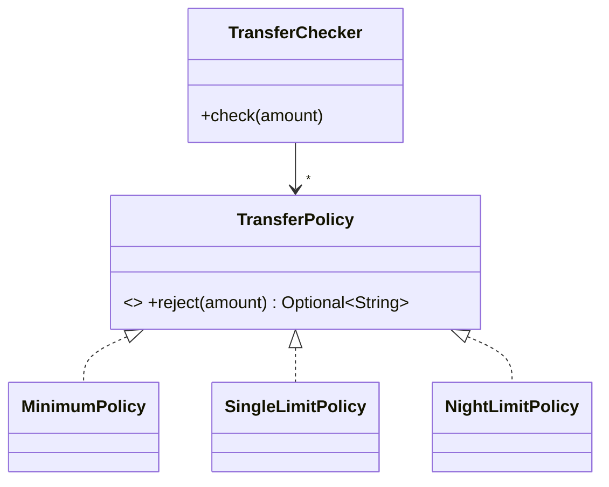

# P4.04 — Padrões GoF I: Strategy, Factory e Builder

> ⏱️ ~1h30 · 🔵 Pleno · Pré-requisitos: P4.03 (OCP, regra de três), J1 (`record`, interfaces), J5.05 (`@Bean`, injeção de coleções)

> ✅ **Validação final (2026-11-24):** módulo executado no PayFlow reconstruído; resultado e o que continua não executado no [README do módulo](README.md). Os avisos "não executado" / "por leitura" abaixo descrevem a escrita original.

> ⚠️ **Verificação:** os exemplos de `PatternsTest` e `OpenClosedTest` foram **executados** em `lab/architecture-lab` (JDK 25.0.5, Spring Boot **4.1.2**; 33 testes verdes). A aplicação ao **PayFlow real** (`TransferPolicy`, `PaymentRequest.builder()`) é **por leitura**.

## 🎯 Objetivos
Ao final desta aula você consegue:
- **Reconhecer** o problema que cada padrão resolve (e **não** decorar o diagrama).
- **Implementar** **Strategy** com a injeção de `List` do Spring e **provar** que regra nova não mexe no consumidor.
- **Escolher** entre **construtor**, **fábrica estática** e **Builder** para criar objetos do PayFlow.
- **Apontar** onde o próprio Spring usa cada um.
- **Dizer** quando o padrão é **exagero**.

## 🤔 Por que isso importa
Padrões de projeto são **vocabulário compartilhado**: "isso é um Strategy" resume uma conversa de 10 minutos. Os do GoF (*Design Patterns*, 1994) que aparecem **todo dia** num backend Spring são poucos; saber **o problema** de cada um evita tanto reinventá-los mal quanto aplicá-los por vaidade.

## 💡 Intuição (explicação simples)
- **Strategy** é o **GPS escolhendo a rota**: o objetivo (chegar) é o mesmo; o algoritmo (mais rápida, mais curta, sem pedágio) **troca**.
- **Factory** é **pedir "um café com leite" ao balcão**: você diz a **intenção**; como se prepara é com o balcão.
- **Builder** é **montar o pedido do lanche**: muitos itens opcionais, o resultado final é **um** lanche pronto e imutável.

## 🔬 Como funciona por dentro

### Strategy: o algoritmo que varia vira uma **interface**

- **Problema:** um `if/else` (ou `switch`) que **cresce** a cada regra e é **editado** em toda mudança (viola o **O**).
- **Solução:** cada variante vira **uma classe** que cumpre a **mesma interface**; o consumidor recebe **a(s) estratégia(s)** de fora.
- **No Spring:** injeção de `List<TransferPolicy>` (todas) ou `Map<String, X>` (escolher pelo nome do *bean*). O exemplo **executado** da P4.03 (`OpenClosedTest`) é exatamente isso: com 2 políticas `2000.00` passa; com a 3ª (**um bean novo**) passa a ser recusado, sem editar `TransferChecker`.

Uma versão **leve** com Java moderno: uma estratégia de **uma linha** é uma **lambda** (interface funcional):

```java
// src/test/java/com/payflow/patterns/PatternsTest.java
    // ---- Strategy: regra que varia, escolhida em tempo de execução
    interface FeePolicy { BigDecimal feeFor(BigDecimal amount); }
    static final FeePolicy FREE = amount -> BigDecimal.ZERO;
    static final FeePolicy ONE_PERCENT = amount -> amount.multiply(new BigDecimal("0.01")).setScale(2, java.math.RoundingMode.HALF_EVEN);
```

Teste (executado):

```java
// src/test/java/com/payflow/patterns/PatternsTest.java
    @Test
    void strategy() {
        assertThat(FREE.feeFor(new BigDecimal("100.00"))).isEqualByComparingTo("0");
        assertThat(ONE_PERCENT.feeFor(new BigDecimal("100.00"))).isEqualByComparingTo("1.00");
    }
```

> **Onde o Spring usa:** `HandlerMethodArgumentResolver`/`HttpMessageConverter` (escolhe qual aplica), `PasswordEncoder` (J8: o `DelegatingPasswordEncoder` escolhe a estratégia pelo prefixo `{bcrypt}`), `CacheManager`, `TransactionManager`.

### Factory: dar **nome** e **regra** à criação
Há três "fábricas" que a gente confunde:
| | O que é | Quando usar |
|---|---|---|
| **Fábrica estática** (*static factory method*) | método `static` com nome que diz a intenção (`Notification.email(...)`) | quase sempre: **nome**, valida invariantes, pode devolver subtipo/cache. Item 1 do *Effective Java*. |
| **Factory Method** (GoF) | método `criarX()` que **subclasses** sobrescrevem | raro hoje; Spring prefere `@Bean` |
| **Abstract Factory** (GoF) | uma interface que cria **famílias** de objetos | raro; no Spring o contêiner é a fábrica |

```java
// src/test/java/com/payflow/patterns/PatternsTest.java
    // ---- Factory: nome com intenção + invariantes num lugar só
    record Notification(String channel, String text) {
        static Notification email(String text) { return new Notification("EMAIL", text); }
        static Notification push(String text) {
            if (text.length() > 40) throw new IllegalArgumentException("push too long");
            return new Notification("PUSH", text);
        }
    }
```

```java
// src/test/java/com/payflow/patterns/PatternsTest.java
    @Test
    void factory() {
        assertThat(Notification.email("hi").channel()).isEqualTo("EMAIL");
        assertThatThrownBy(() -> Notification.push("x".repeat(41))).isInstanceOf(IllegalArgumentException.class);
    }
```

- **No Spring:** o **`@Bean`** é um *factory method* e o **`ApplicationContext`** é uma fábrica de objetos; `Optional.of`, `List.of`, `BigDecimal.valueOf`, `LocalDate.of`, `Money.of` do laboratório são **fábricas estáticas**.
- **No laboratório (e no PayFlow a partir da P4.06):** `Money.of("10.00")`: o `record Money` valida a escala e arredonda no **construtor compacto**; `Money.of(String)` só dá nome e conveniência.

### Builder: muitos campos, alguns opcionais, resultado imutável
```java
// src/test/java/com/payflow/patterns/PatternsTest.java
    // ---- Builder: muitos campos opcionais, objeto final imutável
    record PaymentRequest(String payee, BigDecimal amount, String description, int expiresInMinutes) {
        static Builder builder() { return new Builder(); }
        static final class Builder {
            private String payee; private BigDecimal amount; private String description = ""; private int expires = 30;
            Builder payee(String v) { payee = v; return this; }
            Builder amount(String v) { amount = new BigDecimal(v); return this; }
            Builder description(String v) { description = v; return this; }
            Builder expiresInMinutes(int v) { expires = v; return this; }
            PaymentRequest build() {
                if (payee == null || amount == null) throw new IllegalStateException("payee and amount are required");
                return new PaymentRequest(payee, amount, description, expires);
            }
        }
    }
```

```java
// src/test/java/com/payflow/patterns/PatternsTest.java
    @Test
    void builder() {
        var request = PaymentRequest.builder().payee("loja").amount("10.50").build();
        assertThat(request.expiresInMinutes()).isEqualTo(30);
        assertThatThrownBy(() -> PaymentRequest.builder().payee("loja").build()).isInstanceOf(IllegalStateException.class);
    }
```

- **Problema que resolve:** o **construtor telescópico** (`new PaymentRequest(a, b, null, null, 30)`: o que é cada `null`?) e objetos **meio construídos** (`setX` pelo caminho).
- **Quando vale:** **≥ 4 campos**, vários opcionais, ou **dados de teste** (`aTransfer().withAmount("10.00").build()`).
- **Quando não:** `record` com 2–3 campos obrigatórios (use o construtor), ou classe com **invariante complicada**: use **fábricas nomeadas** que cobrem os casos válidos.
- **Lombok `@Builder`** gera isso; **o treinamento escreve à mão** (o J1 decidiu não depender de Lombok); o princípio é o mesmo. `UriComponentsBuilder`, `MockMvcRequestBuilders`, `HttpSecurity` (J8) e `RestClient.builder()` são **Builders do Spring**.

## 🛠️ Exemplo prático

### 1. Regras de transferência do PayFlow como **Strategy** (aplicação)
```java
public interface TransferPolicy { Optional<String> reject(TransferContext ctx); }

@Component class MinimumAmountPolicy  implements TransferPolicy { ... }
@Component class SingleLimitPolicy    implements TransferPolicy { ... }
@Component class DailyLimitPolicy     implements TransferPolicy {          // precisa do total do dia
    private final DailyTotals totals;                                       // porta própria (P4.03, desafio)
    ...
}

@Service class TransferService {
    private final List<TransferPolicy> policies;                            // injeção de todas
    ...
    public UUID transfer(...) {
        policies.forEach(p -> p.reject(ctx).ifPresent(reason -> { throw new TransferRejectedException(reason); }));
        ...
    }
}
```
`TransferRejectedException` → **422** (decisão 12). **Ordem das políticas:** declare no contrato que **não importa** (todas são avaliadas e a primeira recusa vence); se importar, é sinal de que são **uma cadeia** (outro padrão).

### 2. Dados de teste com Builder
```java
Transfer t = aTransfer().from(ana).to(bia).amount("25.00").build();
```
Um `TransferBuilder` em `src/test` (um **Object Mother** com padrões sensatos) corta dezenas de linhas repetidas nos testes de J7 e P1–P3.

## 🏗️ Pausa de design: "Strategy, `switch` ou enum com comportamento?"
O PayFlow terá 3 formas de **taxa**: isento, 1% e tabela por faixa. Qual usar?

<details><summary>Dica e solução</summary>

**Dica:** quantas variantes? Vão crescer? Algum precisa de **dependência** (consultar banco)?

**Solução:** com **3 variantes estáveis e sem dependência**, um **`enum` com método abstrato** (`FeePolicy.ONE_PERCENT.feeFor(amount)`) é mais simples que `Strategy` com beans: tudo num arquivo, exaustivo no `switch`. **Strategy com beans** vale quando as variantes **têm dependências** (repositório, config) ou **chegam por módulos diferentes**. O padrão **serve ao problema**; se um `enum` resolve, ele **é** um Strategy.
</details>

## ⚖️ Trade-offs e quando NÃO usar
- **Strategy:** troca **um `if` legível** por **N classes + injeção**. Para 2 variantes estáveis, o `if` ganha. O ganho aparece quando as regras **crescem** ou **mudam por razões diferentes**.
- **Strategy por `List`:** a **ordem e o "quem decide"** ficam implícitos; documente o contrato (todas avaliam? a primeira que recusa vence?).
- **Factory:** esconder o `new` atrás de uma "fábrica" sem regra nenhuma (`ClassFactory.create()` que só chama o construtor) é **cerimônia**.
- **Builder:** mais código para manter (campos duplicados no builder); **IDE e `record`** já resolvem muito caso. Cuidado: o `build()` precisa **validar** (aqui lança `IllegalStateException` se faltar `payee`/`amount`).
- **Padrão ≠ meta:** "usamos 6 padrões" não é virtude; **menos** código que resolve o problema é.

## ⚠️ Erros comuns e boas práticas de produção
- **Strategy escolhida por `if` no consumidor** (`if (type.equals("A")) new A()`): moveu o `if`, não o resolveu. Escolha por **injeção/mapa**.
- **Estratégia com estado compartilhado** (campo mutável num bean *singleton*): concorrência (P1). Estratégias devem ser **sem estado** ou imutáveis.
- **Builder mutável reutilizado** entre testes: crie **um novo** por uso.
- **Builder sem validação:** objeto inválido nasce silencioso. Valide no `build()` **ou** no construtor do `record`.
- **Fábrica que devolve `null`** em vez de lançar ou usar `Optional`.

## 🧩 Exercícios
1. **Fixação:** identifique o padrão: (a) `PasswordEncoder` escolhido pelo prefixo `{bcrypt}`; (b) `List.of(1, 2)`; (c) `UriComponentsBuilder.fromUriString(...).queryParam(...).build()`; (d) `@Bean` em `@Configuration`.
2. **Aplicação no PayFlow** (por leitura):
   - [ ] Extraia a regra de valor mínimo e o limite por transferência do `TransferService` para `TransferPolicy` (**uma classe por regra**).
   - [ ] Escreva **um teste por política** e **um teste** em que acrescentar uma política nova **não altera** o `TransferService` (como o `OpenClosedTest`).
   - [ ] Crie `TransferBuilder` em `src/test` e substitua **3** montagens repetidas nos testes.
   - Pronto quando: `TransferService` **não tem** `if` de limite; contrato HTTP **inalterado** (422 para recusa).
3. **Desafio:** transforme `Notification.push` em uma fábrica que escolhe o **canal** pelo perfil do usuário (`Preferences`), sem `if` no chamador.

<details><summary>Solução de referência (1)</summary>

(a) **Strategy**; (b) **Factory estática**; (c) **Builder**; (d) **Factory Method** (o contêiner chama o método para criar o bean).
</details>

## 🎤 Na entrevista
1. **"Strategy × State?"** Estruturalmente parecidos (um objeto delega a uma interface). **Strategy**: o **cliente escolhe** o algoritmo; **State**: o **objeto muda sozinho** de estado e comportamento (a `PaymentRequest` `PENDING → PAID`).
2. **"Quando usar Builder?"** Muitos parâmetros, alguns opcionais, objeto imutável; ou dados de teste. Para 2–3 campos obrigatórios, construtor/`record`.
3. **"Onde o Spring usa Factory?"** `@Bean` (factory method), `FactoryBean`, `ApplicationContext`/`BeanFactory` como fábricas de beans; `RestClient.builder()` como Builder.
4. **"Padrões de projeto são sempre bons?"** São **soluções para problemas recorrentes**; aplicados sem o problema, viram complexidade.

## 📚 Para ir além
- 📄 [Refactoring Guru: Strategy](https://refactoring.guru/design-patterns/strategy): problema, estrutura e quando usar.
- 📄 [Spring Framework: Dependency Injection](https://docs.spring.io/spring-framework/reference/core/beans/dependencies/factory-collaborators.html): como o contêiner injeta coleções.
- 📑 *Design Patterns* (Gamma, Helm, Johnson, Vlissides) e *Effective Java* (Bloch), itens 1–2 (fábricas estáticas e Builder) (**de memória, não conferidos**).

## ✅ Checklist da aula
- [ ] Sei dizer o **problema** de Strategy, Factory e Builder sem olhar o diagrama.
- [ ] Sei por que "injetar `List<Interface>`" cumpre o OCP.
- [ ] Sei quando **não** usar cada um.
- [ ] Fiz (ou li) o refactor das `TransferPolicy`.
