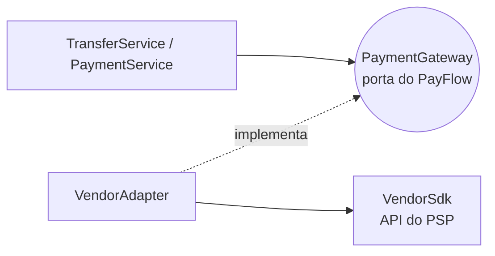

# P4.05 — Padrões GoF II: Adapter, Decorator, Observer e Template Method

> ⏱️ ~1h30 · 🔵 Pleno · Pré-requisitos: P4.02 (portas e adaptadores), P4.04, P3.10 (PSP), J5.11 (`@Transactional` por proxy), P3.02 (`@Async` por proxy)

> ✅ **Validação final (2026-11-24):** módulo executado no PayFlow reconstruído; resultado e o que continua não executado no [README do módulo](README.md). Os avisos "não executado" / "por leitura" abaixo descrevem a escrita original.

> ⚠️ **Verificação:** `PatternsTest` (Adapter, Decorator, Observer, Template Method) foi **executado** em `lab/architecture-lab` (JDK 25.0.5; 33 testes verdes); o `Observer` **com eventos do Spring** (`@ApplicationModuleListener`) foi executado no `EndToEndTest`. A aplicação ao **PayFlow real** (decorator de auditoria sobre o PSP, métricas) é **por leitura**.

## 🎯 Objetivos
Ao final desta aula você consegue:
- **Implementar** um **Adapter** que traduz o SDK de um PSP para a **porta** do PayFlow.
- **Compor** um **Decorator** (log/tempo/métrica) sem tocar na classe decorada **e** reconhecer que `@Transactional` é um.
- **Usar** **Observer** com eventos do Spring e **dizer** o que ele **esconde** (ordem, falha, transação).
- **Reconhecer** **Template Method** nos *templates* do Spring e **preferir** composição quando for código seu.

## 🤔 Por que isso importa
O PayFlow conversa com **mundos que não controla** (PSP, e-mail, câmbio). Isolá-los atrás de **adaptadores** é o que mantém o domínio limpo (P4.02). E o que **envolve** essas chamadas (log, tempo, métrica, retentativa) é **comportamento transversal**: se for copiado em cada método, vira ruído; se for um **decorator**, vira **uma classe testável**. Já o **Observer** é o que dá ao PayFlow o desacoplamento entre `transfer` e `notification` (P4.07).

## 💡 Intuição (explicação simples)
- **Adapter:** o **adaptador de tomada** de viagem: o aparelho e a parede continuam iguais; o adaptador **traduz** o formato.
- **Decorator:** **embalar um presente em camadas** (caixa, papel, laço): o presente é o mesmo; cada camada **acrescenta** algo e pode ser tirada.
- **Observer:** **assinar uma newsletter**: quem publica não sabe quem lê.
- **Template Method:** a **receita de bolo com uma etapa "decore a gosto"**: a ordem é fixa, um passo é seu.

## 🔬 Como funciona por dentro

### Adapter: traduzir a API de fora para a **sua** porta

```java
// src/test/java/com/payflow/patterns/PatternsTest.java
    // ---- Adapter: traduz a API de fora para a porta de dentro
    interface PaymentGateway { String charge(String payee, BigDecimal amount); }      // porta (linguagem do PayFlow)
    static class VendorSdk { String createCharge(Map<String, Object> body) { return "ch_" + body.get("to"); } }  // API do PSP
    static class VendorAdapter implements PaymentGateway {
        private final VendorSdk sdk;
        VendorAdapter(VendorSdk sdk) { this.sdk = sdk; }
        public String charge(String payee, BigDecimal amount) {
            return sdk.createCharge(Map.of("to", payee, "cents", amount.movePointRight(2).intValueExact()));
        }
    }
```

- A **porta** fala a língua do PayFlow (`charge(payee, amount)` com `BigDecimal`); o **adaptador** conhece o formato do PSP (`Map` com **centavos inteiros**, `intValueExact()` para **falhar alto** se houver fração).
- É o **anticorruption layer** do DDD (P4.08): a esquisitice do fornecedor **não vaza** para dentro. Se o PSP mudar o formato ou você trocar de fornecedor, **só o adaptador** muda.
- **No Spring:** `HandlerAdapter` (o `DispatcherServlet` adapta vários tipos de controller), `HttpMessageConverter`, `JdbcTemplate` (adapta a API JDBC).

### Decorator: **mesma interface**, comportamento a mais, por **composição**
```java
// src/test/java/com/payflow/patterns/PatternsTest.java
    // ---- Decorator: acrescenta comportamento sem tocar na classe (e sem herança)
    static class TimedGateway implements PaymentGateway {
        private final PaymentGateway delegate; final List<String> log = new ArrayList<>();
        TimedGateway(PaymentGateway delegate) { this.delegate = delegate; }
        public String charge(String payee, BigDecimal amount) {
            log.add("before " + payee);
            try { return delegate.charge(payee, amount); } finally { log.add("after " + payee); }
        }
    }
```

```java
// src/test/java/com/payflow/patterns/PatternsTest.java
    @Test
    void adapterAndDecorator() {
        PaymentGateway gateway = new TimedGateway(new VendorAdapter(new VendorSdk()));
        assertThat(gateway.charge("loja", new BigDecimal("10.50"))).isEqualTo("ch_loja");
        assertThat(((TimedGateway) gateway).log).containsExactly("before loja", "after loja");
    }
```

- O `TimedGateway` **é um** `PaymentGateway` e **tem um** `PaymentGateway`: pode-se empilhar (`new Retrying(new Timed(new VendorAdapter(...)))`). **Sem herança**, a ordem é **escolhida na montagem**.
- **`@Transactional`, `@Async`, `@Cacheable`, `@Retryable` e `@PreAuthorize` são decorators** (por **proxy** do Spring): o contêiner **embrulha** o seu bean num objeto que abre a transação antes e fecha depois. Daí a armadilha famosa: **auto-chamada** (`this.metodo()`) **não passa pelo proxy** (P3.02 mediu: não é assíncrono).
- **Decorator × Proxy:** a estrutura é igual; a **intenção** difere (decorator **acrescenta**; proxy **controla o acesso**). Na prática, no Spring, usa-se "proxy" para ambos.
- **No PayFlow:** `AuditedAccounts implements Accounts` embrulhando o `AccountsAdapter`; ou métricas (P6) por **Micrometer** `@Timed`/`Observation` em vez de decorator manual.

### Observer: publicar um fato, quem se interessar reage
```java
// src/test/java/com/payflow/patterns/PatternsTest.java
    // ---- Observer: quem publica não conhece quem escuta
    static class EventBus {
        private final List<Consumer<String>> listeners = new ArrayList<>();
        void subscribe(Consumer<String> l) { listeners.add(l); }
        void publish(String event) { listeners.forEach(l -> l.accept(event)); }
    }
```

```java
// src/test/java/com/payflow/patterns/PatternsTest.java
    @Test
    void observer() {
        var bus = new EventBus();
        var heard = new ArrayList<String>();
        bus.subscribe(heard::add);
        bus.subscribe(e -> heard.add("audit:" + e));
        bus.publish("TransferCompleted");
        assertThat(heard).containsExactly("TransferCompleted", "audit:TransferCompleted");
    }
```

Com o Spring, o "barramento" é o **`ApplicationEventPublisher`**; o **assinante** é `@EventListener`, `@TransactionalEventListener` ou, no Spring Modulith, **`@ApplicationModuleListener`** (assíncrono, depois do *commit*; P4.07/P4.09). O `EndToEndTest` do laboratório **executou** isso: a transferência retorna e, **depois**, `notification` e `antifraud` reagem.

O que o Observer **esconde** (e morde em produção):
| Pergunta | Resposta (depende do mecanismo) |
|---|---|
| **Em que ordem** os ouvintes rodam? | `@EventListener` síncrono: pela ordem (`@Order`); `@ApplicationModuleListener`: **concorrente** (assíncrono) |
| **Se um ouvinte falha?** | síncrono: a exceção **sobe** para quem publicou e pode **desfazer a transação**; assíncrono: o publicador **nunca saberá** |
| **Dentro ou fora da transação?** | `@EventListener`: **dentro**; `@TransactionalEventListener(AFTER_COMMIT)`: **depois**, e **se** a JVM cair entre o *commit* e o ouvinte, o evento **se perde** (por isso o **Outbox**, P3.09) |
| **Quem escuta?** | ninguém sabe olhando só o publicador (ferramenta do Modulith: `Documenter`) |

### Template Method: esqueleto fixo, passos variáveis (por **herança**)
```java
// src/test/java/com/payflow/patterns/PatternsTest.java
    // ---- Template Method: o esqueleto fixo, os passos variáveis
    abstract static class ImportJob {
        final List<String> steps = new ArrayList<>();
        final void run(String line) {           // o esqueleto NÃO muda
            steps.add("parse:" + parse(line));
            validate(line);
            steps.add("save");
        }
        abstract String parse(String line);      // o que varia
        void validate(String line) { if (line.isBlank()) throw new IllegalArgumentException("blank"); }
    }
```

```java
// src/test/java/com/payflow/patterns/PatternsTest.java
    @Test
    void templateMethod() {
        var job = new ImportJob() { String parse(String line) { return line.trim().toUpperCase(); } };
        job.run(" ana ");
        assertThat(job.steps).containsExactly("parse:ANA", "save");
        assertThatThrownBy(() -> job.run(" ")).isInstanceOf(IllegalArgumentException.class);
    }
```

- O método `run` é `final` (o esqueleto **não** pode ser alterado); `parse` é abstrato; `validate` é um **gancho** (*hook*) com padrão.
- **No Spring:** `JdbcTemplate`/`RestClient`/`TransactionTemplate`/`KafkaTemplate`: **abrem e fecham o recurso** e chamam o **seu** *callback* (`RowMapper`, `TransactionCallback`): o "template" é feito por **composição** (você passa uma função), não por herança. `AbstractRoutingDataSource` e `OncePerRequestFilter` (J8) são Template Method **clássico** (você sobrescreve `doFilterInternal`).
- **Hoje se prefere composição:** **Strategy/lambda** no lugar da herança (a herança acopla subclasse ao esqueleto e dificulta testar). Use Template Method quando **o framework já oferece** a classe base (`OncePerRequestFilter`), não para o seu domínio novo.

## 🛠️ Exemplo prático

### Decorator de **auditoria** sobre o PSP (PayFlow, por leitura)
```java
@Component
@Primary                                     // o que os outros injetam
class AuditedPaymentGateway implements PaymentGateway {
    private final PaymentGateway delegate;   // o adaptador de verdade
    private final AuditLog audit;
    AuditedPaymentGateway(@Qualifier("vendorAdapter") PaymentGateway delegate, AuditLog audit) { ... }

    public String charge(String payee, BigDecimal amount) {
        audit.record("charge.start", payee);     // ids, nunca dados pessoais (decisão 38)
        try { return delegate.charge(payee, amount); }
        finally { audit.record("charge.end", payee); }
    }
}
```
**Cuidado com a ordem:** `Retrying(Timed(Adapter))` mede **cada tentativa**; `Timed(Retrying(Adapter))` mede **o total**. A ordem de montagem é decisão de projeto: **documente**.

### Mapa dos 7 padrões no PayFlow
| Padrão | Onde aparece no PayFlow |
|---|---|
| Strategy | `TransferPolicy` (limites), `PasswordEncoder` |
| Factory | `Money.of`, `Notification.email`, `@Bean` |
| Builder | dados de teste, `RestClient.builder()` |
| Adapter | cliente do PSP, `AccountsAdapter`, repositórios JPA |
| Decorator | `@Transactional`, `@Cacheable`, auditoria do PSP |
| Observer | `TransferCompleted` → `notification`/`antifraud` |
| Template Method | `OncePerRequestFilter` (`RequestIdFilter`, J5.14), `JdbcTemplate` |

## 🏗️ Pausa de design: "decorator ou `@Aspect`?"
Quero medir o tempo de **todas** as portas de saída. Escrevo um decorator por porta ou um aspecto?

<details><summary>Dica e solução</summary>

**Dica:** quantas portas? O comportamento é **igual** em todas? Preciso do **nome do método**?

**Solução:** para **uma ou duas** portas com comportamento **específico** (retentativa só do PSP), **decorator explícito** (legível, testável sem Spring). Para **comportamento uniforme** em muitas (tempo, métrica), um **aspecto** ou o suporte de **Observabilidade do Micrometer** (P6) evita N classes iguais, ao custo de **magia** (onde está o código?). Regra: **explícito** para lógica de negócio/resiliência; **declarativo** para o que é infraestrutura uniforme.
</details>

## ⚖️ Trade-offs e quando NÃO usar
- **Adapter:** uma camada **a mais**; se o SDK é estável e só **um** módulo o usa, o adaptador pode ser **fino** (e não precisa de interface se a "porta" é o próprio SDK de um domínio acessório).
- **Decorator:** pilhas profundas dificultam **depurar** (qual camada falhou?) e a **ordem** importa; proxy do Spring tem limites (`final`, `private`, auto-chamada).
- **Observer:** o **fluxo some do código** (você não vê quem reage). Fica difícil responder "o que acontece quando uma transferência termina?". Mitigue: **eventos nomeados**, `Documenter` do Modulith, **testes** (`Scenario`) e logs com o `eventId`.
- **Observer assíncrono × transação:** **consistência eventual**; **não** use para o que precisa ser **atômico** (débito/crédito continuam **síncronos**, decisão 104).
- **Template Method:** **herança** acopla; prefira composição (lambda/Strategy) no código **seu**.

## ⚠️ Erros comuns e boas práticas de produção
- **Auto-chamada** ignora o proxy: `this.audited()` dentro da mesma classe **não** é decorada (`@Transactional`/`@Async`/`@Cacheable` somem).
- **Decorator que engole exceção** (`catch (Exception e) { log }`): o chamador acha que deu certo. Relance.
- **Listener que também publica** o mesmo evento: **laço infinito**.
- **Observer como "chamada com outro nome":** se o publicador **precisa** da resposta, é uma **chamada** (porta), não um evento.
- **Evento carregando entidade** (`TransferCompleted(Transfer t)`): o ouvinte assíncrono lê um objeto **fora da sessão** (`LazyInitializationException`) ou **mutável**. Eventos são `record`s **imutáveis** com **ids e valores** (P4.07).
- **`@TransactionalEventListener` sem transação ativa** simplesmente **não dispara** (a menos de `fallbackExecution = true`): teste.

## 🧩 Exercícios
1. **Fixação:** (a) por que `@Transactional` é um **Decorator**? (b) por que a auto-chamada o contorna? (c) diferencie **Adapter** de **Decorator** pela **interface**.
2. **Aplicação no PayFlow** (por leitura):
   - [ ] Crie a porta `PaymentGateway` (P3.10) e o `VendorAdapter` do simulador do PSP; **teste o adaptador** com o *fake* do PSP (valor com 3 casas **deve falhar**).
   - [ ] Escreva `AuditedPaymentGateway` (decorator) e um teste que prova a **ordem** `start → charge → end`, **inclusive quando o `charge` lança exceção**.
   - [ ] Faça o `TransferService` **publicar** `TransferCompleted` por `DomainEvents` (já na P4.02) e o `NotificationListener` reagir; garanta que **uma transferência que dá `rollback` não envia notificação** (o `EndToEndTest` do laboratório tem o teste `failedTransferPublishesNothing`).
3. **Desafio:** escreva um decorator `Retrying` (3 tentativas, *backoff* fixo) e mostre, com um *fake* que falha 2 vezes, que o **total de chamadas é 3**. Por que **não** se deve decorar com retry uma operação **não idempotente** (P3.07)?

<details><summary>Solução de referência (1)</summary>

(a) O Spring cria um **proxy** com a **mesma interface/classe** do bean que, **em volta** de cada chamada, abre/fecha a transação: acrescenta comportamento sem alterar a classe. (b) Quem chama `this.metodo()` chama o **objeto de verdade**, não o proxy. (c) **Adapter** **muda** a interface (traduz A→B); **Decorator** **mantém** a interface e acrescenta comportamento.
</details>

## 🎤 Na entrevista
1. **"Diferença entre Adapter e Decorator?"** Adapter **converte** uma interface em outra (SDK do PSP → `PaymentGateway`); Decorator **mantém** a interface e **acrescenta** comportamento (log, tempo, retry).
2. **"Como o Spring implementa `@Transactional`?"** Por **proxy** (decorator): intercepta a chamada, abre a transação, chama o método, `commit`/`rollback`. Daí a **auto-chamada** não funcionar.
3. **"Observer síncrono × assíncrono?"** Síncrono: roda na **mesma *thread* e transação** do publicador (falha sobe, acopla tempo); assíncrono: roda **depois**, o publicador não sabe do resultado (consistência eventual).
4. **"Por que preferir composição a Template Method?"** Herança acopla a subclasse ao esqueleto e complica testes; passar um comportamento (lambda/Strategy) é mais flexível.

## 📚 Para ir além
- 📄 [Spring Framework: Proxying Mechanisms](https://docs.spring.io/spring-framework/reference/core/aop/proxying.html): como o proxy funciona e as limitações (auto-chamada).
- 📄 [Spring Framework: Standard and Custom Events](https://docs.spring.io/spring-framework/reference/core/beans/context-introduction.html): `ApplicationEvent`/`@EventListener`.
- 📄 [Refactoring Guru: Decorator](https://refactoring.guru/design-patterns/decorator) e [Template Method](https://refactoring.guru/design-patterns/template-method).
- 📄 [Azure Architecture Center: Anti-corruption Layer](https://learn.microsoft.com/en-us/azure/architecture/patterns/anti-corruption-layer): o Adapter em escala de sistema.
- 📑 *Design Patterns* (GoF), capítulos de Adapter, Decorator, Observer, Template Method (**de memória, não conferidos**).

## ✅ Checklist da aula
- [ ] Sei dizer por que `@Transactional` é um decorator e por que a auto-chamada o ignora.
- [ ] Sei as 4 perguntas que o Observer **esconde** (ordem, falha, transação, quem escuta).
- [ ] Sei por que se prefere composição a Template Method no código novo.
- [ ] Escrevi (ou li) o adaptador do PSP e o decorator de auditoria.
