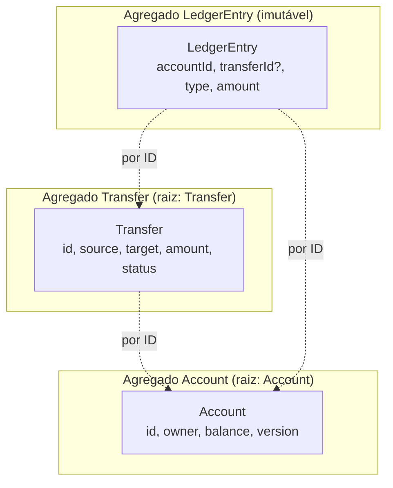

# P4.06 — DDD tático I: entidades, value objects e agregados

> ⏱️ ~1h30 · 🔵 Pleno · Pré-requisitos: P4.02 (domínio no centro), J5.07–J5.09 (entidades JPA, `@Version`), P2.02 (travas ordenadas), J1.14/P1.11 (`record`, `Money`)

> ✅ **Validação final (2026-11-24):** módulo executado no PayFlow reconstruído; resultado e o que continua não executado no [README do módulo](README.md). Os avisos "não executado" / "por leitura" abaixo descrevem a escrita original.

> ⚠️ **Verificação:** `Money`, `Account`, `Transfer` e os testes de domínio (`DomainTests`) foram **executados** em `lab/architecture-lab` (JDK 25.0.5, Spring Boot **4.1.2**; 37 testes verdes). A **introdução de `Money` no PayFlow** (mapeamento JPA do `BigDecimal` ↔ `Money`) é **por leitura**: o repositório do aluno não foi compilado aqui.

## 🎯 Objetivos
Ao final desta aula você consegue:
- **Distinguir** **entidade** (identidade) de **value object** (valor) e **escolher** para cada tipo do PayFlow.
- **Desenhar** um **agregado**: raiz, invariantes, fronteira de consistência e **referências por id**.
- **Aplicar** as quatro regras práticas de agregado e **justificar a exceção** da transferência.
- **Escrever** um *value object* imutável com `record` que **valida ao nascer**.
- **Perceber** quando "DDD" vira **modelo anêmico** com nome bonito.

## 🤔 Por que isso importa
No PayFlow, **o código mais caro de errar** é o de dinheiro. Se `balance` é um `BigDecimal` solto e qualquer classe faz `account.setBalance(...)`, **a regra "saldo nunca negativo" está em todo lugar e em lugar nenhum**: basta um `set` esquecido. DDD tático responde: **onde mora cada regra e quem pode mudar cada dado**. A resposta tem três peças: **value objects** (valores que se validam), **entidades** (coisas com identidade e ciclo de vida) e **agregados** (grupos que mudam **juntos, sob uma raiz**, em **uma** transação).

## 💡 Intuição (explicação simples)
- **Value object:** uma **nota de R$ 10**: o que importa é **o valor**; duas notas de R$ 10 são **intercambiáveis**; você não "altera" uma nota, troca por outra.
- **Entidade:** **você** (CPF): seu endereço, seu nome e seu saldo mudam, mas **continua sendo você** pela **identidade**.
- **Agregado:** a **ficha de uma conta no banco**: você não mexe numa folha solta; **tudo passa pelo gerente** (a raiz), que garante que a ficha continua coerente.

## 🔬 Como funciona por dentro

### 1. Value object: **valor**, imutável, valida ao nascer
Características: **sem identidade** (igualdade **por valor**), **imutável**, **valida no construtor**, **comportamento próprio** (`plus`, `minus`). Em Java moderno, é um `record`:

```java
// src/main/java/com/payflow/lab/shared/Money.java
package com.payflow.lab.shared;

import java.math.BigDecimal;
import java.math.RoundingMode;

/** Value object: imutável, sem identidade, igualdade por valor, valida ao nascer. */
public record Money(BigDecimal amount) {

    public static final Money ZERO = new Money(BigDecimal.ZERO);

    public Money {
        if (amount == null) {
            throw new IllegalArgumentException("amount is required");
        }
        if (amount.scale() > 2) {
            throw new IllegalArgumentException("scale greater than 2: " + amount);
        }
        amount = amount.setScale(2, RoundingMode.HALF_EVEN);
    }

    public static Money of(String value) {
        return new Money(new BigDecimal(value));
    }

    public Money plus(Money other) {
        return new Money(amount.add(other.amount));
    }

    public Money minus(Money other) {
        return new Money(amount.subtract(other.amount));
    }

    public boolean isPositive() {
        return amount.signum() > 0;
    }

    public boolean isLessThan(Money other) {
        return amount.compareTo(other.amount) < 0;
    }

    @Override
    public String toString() {
        return amount.toPlainString();
    }
}
```

- **Estado impossível não existe:** `Money` com 3 casas **não nasce** (a mesma regra do `Amounts.requireValid`, decisão 18, agora **no tipo**). `amount.setScale(2, HALF_EVEN)` normaliza `10` para `10.00`, então `Money.of("10")` **é igual** a `Money.of("10.00")` (testado).
- **Evita o "primitive obsession":** `transfer(UUID, UUID, BigDecimal, BigDecimal)` (qual é o valor? qual é a taxa?) vira `transfer(AccountId, AccountId, Money)`. **O compilador** impede trocar argumentos.
- **Outros candidatos a VO no PayFlow:** `AccountId`/`TransferId` (`record` de `UUID`), `EmailAddress` (valida formato), `IdempotencyKey` (tamanho, caracteres), `Percentage`.

### 2. Entidade: **identidade** e ciclo de vida
`Account` tem `id` (UUIDv7, decisão 14) e **muda ao longo do tempo** (saldo), mas **é a mesma conta**. Duas contas com o mesmo saldo **não são iguais**. `equals`/`hashCode` por **identidade** (o id), **nunca** por todos os campos (o saldo muda e o `HashSet` quebraria).

```java
// src/main/java/com/payflow/lab/account/domain/Account.java
package com.payflow.lab.account.domain;

import com.payflow.lab.shared.Money;
import java.util.UUID;

/** Entidade (raiz do agregado). A invariante "saldo nunca negativo" vive AQUI, não no serviço. */
public class Account {

    private final UUID id;
    private final String owner;
    private Money balance;

    public Account(UUID id, String owner, Money balance) {
        this.id = id;
        this.owner = owner;
        this.balance = balance;
    }

    public void withdraw(Money amount) {
        requirePositive(amount);
        if (balance.isLessThan(amount)) {
            throw new InsufficientFundsException(id, balance, amount);
        }
        balance = balance.minus(amount);
    }

    public void deposit(Money amount) {
        requirePositive(amount);
        balance = balance.plus(amount);
    }

    private static void requirePositive(Money amount) {
        if (!amount.isPositive()) {
            throw new IllegalArgumentException("amount must be positive: " + amount);
        }
    }

    public UUID id() { return id; }
    public String owner() { return owner; }
    public Money balance() { return balance; }
}
```

- **A invariante vive na entidade:** `withdraw` **recusa** se `balance < amount` (`InsufficientFundsException`). **Ninguém** tem `setBalance`: a única forma de mudar o saldo é por operações **com nome de negócio** (`withdraw`/`deposit`).
- **Testado sem Spring** (`DomainTests`, milissegundos):

```java
// src/test/java/com/payflow/lab/DomainTests.java
class DomainTests {

    @Test
    void accountNeverGoesNegative() {
        var account = new Account(UUID.randomUUID(), "ana", Money.of("10.00"));
        assertThatThrownBy(() -> account.withdraw(Money.of("10.01"))).isInstanceOf(InsufficientFundsException.class);
        assertThat(account.balance()).isEqualTo(Money.of("10.00"));
    }

    @Test
    void moneyIsComparedByValueAndRoundedHalfEven() {
        assertThat(Money.of("10")).isEqualTo(Money.of("10.00"));
        assertThatThrownBy(() -> Money.of("10.005")).isInstanceOf(IllegalArgumentException.class);
    }

    @Test
    void transferRejectsSameAccountAndNonPositiveAmount() {
        var id = UUID.randomUUID();
        assertThatThrownBy(() -> new Transfer(id, id, Money.of("1.00"))).isInstanceOf(IllegalArgumentException.class);
        assertThatThrownBy(() -> new Transfer(id, UUID.randomUUID(), Money.ZERO)).isInstanceOf(IllegalArgumentException.class);
    }
}
```

> 🧱 **Contra o "modelo anêmico"** ([Fowler](https://martinfowler.com/bliki/AnemicDomainModel.html)): se `Account` fosse só `getBalance/setBalance` e a regra morasse em `AccountService`, **todo** serviço novo poderia esquecê-la. A decisão 35 do PayFlow já pedia isso (regras em `Account.deposit/withdraw`); aqui ela ganha **nome e critério**.

### 3. Agregado: a **fronteira de consistência**
> **Agregado** = conjunto de objetos tratados como **uma unidade** para mudanças de dados; tem **uma raiz** (única porta de entrada) e **invariantes** que valem **dentro** dele, **sempre**, no fim de cada transação. ([Fowler](https://martinfowler.com/bliki/DDD_Aggregate.html))


**Quatro regras práticas** (Vernon, *Implementing DDD*, de memória):
1. **Modele invariantes verdadeiras dentro da fronteira**: "saldo ≥ 0" é de **uma** conta ⇒ dentro de `Account`.
2. **Agregados pequenos**: uma conta **não** carrega os 5 anos de lançamentos (seria uma lista de milhões; P2: paginação e índice). `LedgerEntry` é **outro** agregado (imutável, regra 5).
3. **Referencie outros agregados por **id**, não por objeto**: `Transfer` guarda `sourceAccountId`, não `Account`. (O `@ManyToOne(LAZY)` da decisão 33 é o **meio-termo pragmático** do JPA: continua referência por navegação, mas **nunca** carregue o grafo.)
4. **Uma transação, um agregado** (a regra *ideal*), com **consistência eventual** entre agregados.

### 4. A exceção que o PayFlow **assume**: a transferência toca **dois** `Account`
A regra 4 pede **uma transação por agregado**, mas a **regra de negócio 2** ("débito e crédito juntos ou nenhum") **proíbe** o meio-termo: dinheiro **não pode** estar só debitado por um instante. Logo:

| Opção | Consequência |
|---|---|
| **A.** Duas transações + evento ("saga" simples) | consistência eventual: durante segundos o dinheiro **sumiu** de uma conta e **não chegou** na outra; precisa de compensação |
| **B.** Uma transação, dois agregados | **consistência forte**; exige **travar as duas contas em ordem** (P2.02) para evitar *deadlock* |

**Decisão 119 (ADR 0016): B** para **dinheiro** (regras 1–3), **documentada como exceção**, com `TransferService` (caso de uso) coordenando e `Account` guardando cada invariante. O resto (notificação, antifraude) é **eventual** (evento, P4.07). **Quando a transferência cruzar bancos/serviços (Sênior, S1), a opção A (saga) deixa de ser escolha e vira obrigação.**

A **raiz** `Transfer` também tem regras próprias (origem ≠ destino, valor positivo) e uma **máquina de estados** (`PENDING → COMPLETED`):

```java
// src/main/java/com/payflow/lab/transfer/domain/Transfer.java
package com.payflow.lab.transfer.domain;

import com.payflow.lab.shared.Money;
import java.util.UUID;

public class Transfer {

    public enum Status { PENDING, COMPLETED }

    private final UUID id = UUID.randomUUID();
    private final UUID source;
    private final UUID target;
    private final Money amount;
    private Status status = Status.PENDING;

    public Transfer(UUID source, UUID target, Money amount) {
        if (source.equals(target)) {
            throw new IllegalArgumentException("source and target must differ");
        }
        if (!amount.isPositive()) {
            throw new IllegalArgumentException("amount must be positive");
        }
        this.source = source;
        this.target = target;
        this.amount = amount;
    }

    public void complete() {
        this.status = Status.COMPLETED;
    }

    public UUID id() { return id; }
    public UUID source() { return source; }
    public UUID target() { return target; }
    public Money amount() { return amount; }
    public Status status() { return status; }
}
```

## 🛠️ Exemplo prático

### Introduzindo `Money` no PayFlow (por leitura, **sem** mudar o esquema)
- **Banco:** a coluna **continua** `NUMERIC(19,2)`; **nenhuma migração** (decisão 18 intacta).
- **Domínio:** `Account.balance()` passa a devolver `Money`; o *getter* de persistência fica **interno**.
- **JPA pragmático:** o campo `BigDecimal balance` (mapeado) permanece **privado**; `Money balance()` o **embrulha**; `withdraw(Money)` valida e atualiza o `BigDecimal`. Alternativa: `AttributeConverter<Money, BigDecimal>` (testar com o Hibernate 7.4: **não verificado**).
- **Fronteiras:** DTOs REST continuam `String` com 2 casas (decisão 11); a conversão é `Money.of(string)` **no adaptador de entrada**.
- **Passo a passo seguro:** criar `Money` em `shared` → usar nos **novos** métodos → migrar uma assinatura por PR, com os testes de J5–P3 verdes.

### `equals`/`hashCode` da entidade
```java
@Override public boolean equals(Object o) { return o instanceof Account a && id.equals(a.id); }
@Override public int hashCode() { return id.hashCode(); }
```
Com o UUID **atribuído na construção** (decisão 14), a identidade existe **antes** do `INSERT`, o que torna isso seguro (a armadilha clássica de `equals` por `id` é quando o id só aparece depois do `save`).

## 🏗️ Pausa de design: onde fica "o saldo de hoje é só consultado, nunca alterado diretamente"?
O `BalanceView` do P2.09 (cache Redis) mostra o saldo. Ele é entidade, VO ou agregado?

<details><summary>Dica e solução</summary>

**Dica:** ele tem identidade? Ele **muda** por regra de negócio ou é uma **projeção** do que já aconteceu?

**Solução:** nem um nem outro: é um **modelo de leitura** (projeção), um **DTO**: **não** tem invariantes, **não** é alterado por comandos, pode **estar atrasado** (P2.09/P2.11). Misturá-lo com `Account` é o erro mais comum de "DDD demais": o agregado serve a **comandos** (mudar estado com regras), as projeções servem a **consultas** (CQRS, S1). Por isso o **cache** (P2.09) guarda `BalanceView`, **nunca** `Account`.
</details>

## ⚖️ Trade-offs e quando NÃO usar
- **DDD tático é caro** em modelo simples: num CRUD sem regra, entidades "ricas" são **cerimônia**. Vale onde há **invariantes que importam** (dinheiro!).
- **Value objects em JPA:** custo de mapeamento (`@Embeddable`, `AttributeConverter`, `Hibernate` e `record`: ⚠️ **não verificado** com o 7.4 no PayFlow). O ganho é **tipos que não deixam entrar valor inválido**.
- **Agregados grandes** (uma `Account` com todos os lançamentos) → *locks* longos, contenção (P2) e leituras pesadas. **Pequenos** custam **mais consultas** e consistência eventual.
- **Exceção de dois agregados** num caso de uso: aceita **porque** o dinheiro exige. Não vire regra: cada exceção **reduz** a independência dos agregados (e a chance de separá-los em serviços).
- **Equals por identidade × por valor** é decisão **por tipo**: errar mistura `HashSet`s e `Map`s.

## ⚠️ Erros comuns e boas práticas de produção
- **`setBalance` público**: a invariante some. Só métodos com **nome de negócio**.
- **`equals` com todos os campos em entidade** (inclui `balance`): a conta "some" do `HashSet` depois de um depósito.
- **`@Data` do Lombok em entidade**: gera `setX`, `equals` por todos os campos e `toString` que **dispara *lazy loading***. Evite (o treinamento não usa Lombok).
- **Value object mutável** (`setAmount`): quebra o "valor"; objetos compartilhados mudam por baixo. Use `record`.
- **Agregado que referencia outro por objeto e *cascade***: `CascadeType.ALL` de `Account` para lançamentos **apaga** histórico (regra 5). Decisão 33 já proíbe `cascade`.
- **Arredondar fora do `Money`**: cada chamador arredonda "do seu jeito" (`HALF_UP`): erro de centavo que **só aparece no fechamento**.

## 🧩 Exercícios
1. **Fixação:** classifique em **entidade**, **value object** ou **projeção**: `User`, `EmailAddress`, `Transfer`, `Money`, `BalanceView`, `LedgerEntry`, `IdempotencyKey`, `MonthlySummary`.
2. **Aplicação no PayFlow** (por leitura):
   - [ ] Crie `Money` (copie do laboratório) em `com.payflow.shared` e **escreva os testes** de arredondamento/escala (3 casas → exceção; `10` = `10.00`).
   - [ ] Troque **uma** assinatura (`Account.withdraw(BigDecimal)` → `withdraw(Money)`), mantendo o esquema e o contrato HTTP; rode a suíte de J5–P3.
   - [ ] Escreva `AccountTest` com 5 casos: saldo exato, saldo menos 1 centavo, valor zero, valor negativo, depósito.
   - Pronto quando: **nenhum** `setBalance` público; `equals`/`hashCode` por id.
3. **Desafio:** explique **por que `Transfer` e `Account` ficam em agregados separados** mesmo que a transferência sempre os toque, e descreva **o que mudaria** se a conta de destino estivesse em **outro banco**.

<details><summary>Solução de referência</summary>

1. Entidades: `User`, `Transfer`, `LedgerEntry` (entidade **imutável**); value objects: `EmailAddress`, `Money`, `IdempotencyKey`; projeções: `BalanceView`, `MonthlySummary`.
3. Têm **ciclos de vida e invariantes diferentes** (o saldo de uma conta existe sem transferência; a transferência registra um **fato** e tem estados). Separar mantém agregados **pequenos**. Com destino em outro banco, não há **uma** transação: vira **saga** (débito + evento + crédito/compensação), a consistência vira **eventual** e a regra 2 passa a ser garantida por **idempotência e compensação** (S1).
</details>

## 🎤 Na entrevista
1. **"Entidade × Value Object?"** Entidade tem **identidade** e ciclo de vida (igualdade pelo id); VO é **definido pelos valores**, imutável e intercambiável. `Money` é VO, `Account` é entidade.
2. **"O que é um agregado e por que importa?"** Um grupo de objetos com uma **raiz** que garante as **invariantes** e é a única porta de mudança; define a **fronteira da transação** e do *lock*.
3. **"Por que referenciar outro agregado por id?"** Mantém os agregados **pequenos e independentes** (carga, *lock*, possível separação em serviços) e evita carregar grafos inteiros.
4. **"Uma transação pode alterar dois agregados?"** A regra é uma por agregado; **exceção consciente** quando a regra de negócio exige atomicidade (transferência), com **travas ordenadas**, e **documentada**.

## 📚 Para ir além
- 📄 Martin Fowler, [*DDD_Aggregate*](https://martinfowler.com/bliki/DDD_Aggregate.html) e [*ValueObject*](https://martinfowler.com/bliki/ValueObject.html): definições curtas e precisas.
- 📄 [DDD Reference](https://www.domainlanguage.com/ddd/reference/) (Eric Evans): resumo oficial dos padrões do livro.
- 📑 *Domain-Driven Design* (Evans), partes II e III; *Implementing Domain-Driven Design* (Vernon), cap. "Aggregates" (**capítulos de memória, não conferidos**).

## ✅ Checklist da aula
- [ ] Sei por que `Money` é *record* imutável e por que `Account` não tem `setBalance`.
- [ ] Sei definir agregado e citar as 4 regras práticas.
- [ ] Sei **justificar** a transferência em 2 agregados numa transação (e quando isso acaba).
- [ ] Sei dizer o que **não** é agregado (projeção/`BalanceView`).
