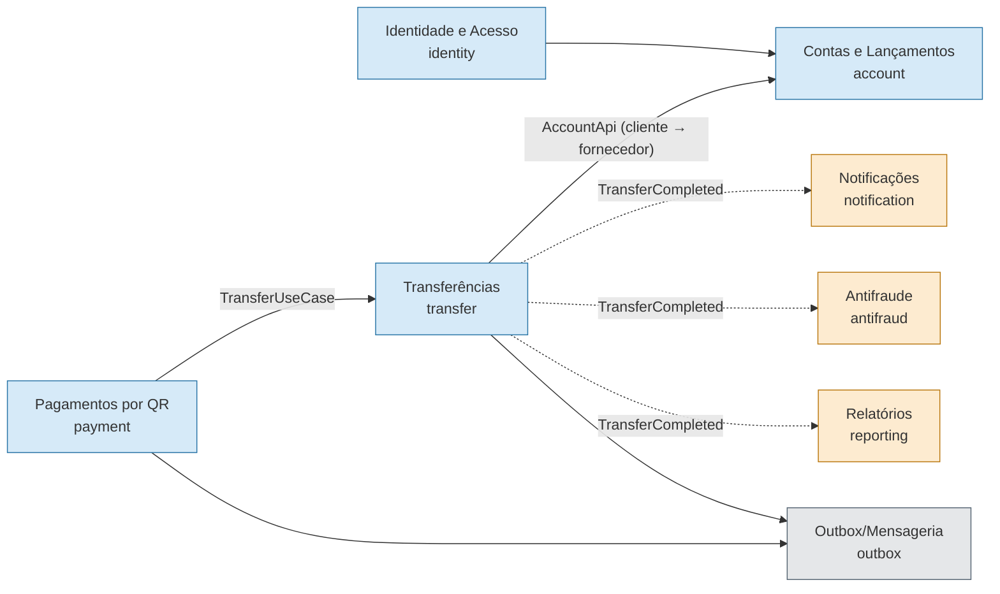
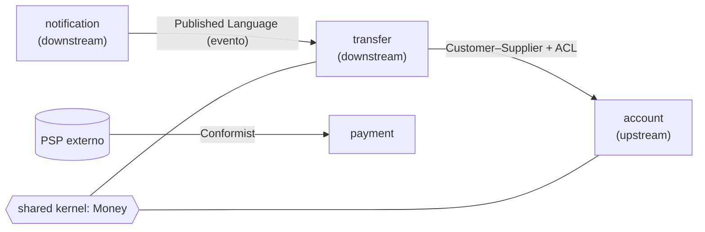

# P4.08 — DDD estratégico: bounded contexts e linguagem ubíqua

> ⏱️ ~1h30 · 🔵 Pleno · Pré-requisitos: P4.02, P4.05 (Adapter/ACL), P4.06, P4.07, `00-guia/projeto-central.md` e `00-guia/glossario.md`

> ✅ **Validação final (2026-11-24):** módulo executado no PayFlow reconstruído; resultado e o que continua não executado no [README do módulo](README.md). Os avisos "não executado" / "por leitura" abaixo descrevem a escrita original.

> ⚠️ **Verificação:** esta aula é de **modelagem** (recortar o domínio), com **pouco código executável**. O recorte foi **conferido contra o laboratório** (`lab/architecture-lab`: módulos `account`, `transfer`, `notification`, `antifraud`, `shared`; a saída do Modulith está em `out-module-model.txt` e `out-components.puml`). O **mapa completo do PayFlow** (7 contextos) é uma **proposta por leitura**, não compilada; é **decisão de projeto**, não fato verificável.

## 🎯 Objetivos
Ao final desta aula você consegue:
- **Definir** *bounded context* e **explicar** por que "um modelo único para tudo" falha.
- **Recortar** o PayFlow em contextos e **justificar** cada fronteira.
- **Desenhar** um **mapa de contexto** com as relações (cliente-fornecedor, ACL, *shared kernel*, *published language*, *conformist*).
- **Construir** uma **linguagem ubíqua** e **detectar** a mesma palavra com dois significados.
- **Usar** *Event Storming* de forma leve para achar fronteiras.

## 🤔 Por que isso importa
O erro de arquitetura mais caro não é técnico, é de **recorte**: cortar no lugar errado produz módulos que **só funcionam juntos** (o "monólito distribuído" se você os virar serviços, P5). O DDD **estratégico** é o que diz **onde** cortar **antes** de escrever pacote. No PayFlow, "conta" significa coisas diferentes para **quem faz login**, **quem guarda saldo** e **quem manda notificação**; um único `Account` que serve a todos vira a classe de 80 colunas que **ninguém pode mudar**.

## 💡 Intuição (explicação simples)
A palavra **"banco"** significa uma coisa para o **caixa** (o balcão), outra para o **geólogo** (margem do rio) e outra para a **praça** (assento). Em cada **conversa** o contexto resolve a ambiguidade. Um **bounded context** é **a fronteira dentro da qual uma palavra tem um significado só**, e o modelo (classes, tabelas) é coerente.

## 🔬 Como funciona por dentro

### 1. Bounded context = **fronteira de modelo e de linguagem**
> *Bounded context*: uma fronteira (de equipe, de código, de banco) dentro da qual **um modelo** é válido e **cada termo tem um significado**. ([Fowler](https://martinfowler.com/bliki/BoundedContext.html))

**Mesma palavra, modelos diferentes** (PayFlow):
| Termo | Identidade e acesso | Contas e lançamentos | Notificações | Antifraude |
|---|---|---|---|---|
| **Account** | credenciais, papéis, "titular" | `Account` com **saldo, `@Version`, status** | **destinatário** (e-mail, push) | **perfil de risco** |
| **User** | `User` (senha, `role`) | **titular** (`ownerId`) | **contato** | **sujeito** da análise |
| **Transfer** | — | **lançamentos** gerados | **fato** para avisar | **evento** a pontuar |

> Esse é o **sinal** do recorte: se cada área **precisa de atributos e regras diferentes** para o "mesmo" conceito, **não** force um modelo único; **cada contexto tem o seu**, ligados por **ids e eventos** (nunca por objeto compartilhado).

### 2. O recorte proposto para o PayFlow

| Contexto | Pacote | Tipo (*subdomínio*) | Dono dos dados |
|---|---|---|---|
| Identidade e Acesso | `identity` | **genérico** (login, senha, JWT: já resolvido por Spring Security) | `users`, sessões/tokens |
| Contas e Lançamentos | `account` | **núcleo** (o que faz o PayFlow valer) | `accounts`, `ledger_entries` |
| Transferências | `transfer` | **núcleo** | `transfers` |
| Pagamentos por QR | `payment` | **núcleo/suporte** (depende de PSP) | `payment_requests` |
| Notificações | `notification` | **suporte** | `processed_messages` (do consumidor) |
| Antifraude | `antifraud` | **suporte** (candidato a serviço em S) | regras/sinais |
| Relatórios | `reporting` | **suporte** | `ledger_monthly` (visão materializada) |
| Outbox | `outbox` | **genérico/infra** | `outbox_events` |

**Tipos de subdomínio** (Evans): **núcleo** = onde está a vantagem competitiva (gaste o melhor tempo e modelagem); **suporte** = necessário, específico, mas não diferencia; **genérico** = problema resolvido (compre ou use biblioteca: Spring Security, Keycloak em P10). Isso guia **onde investir** em DDD tático: **no núcleo**, não em `identity`.

### 3. Mapa de contexto: **como** os contextos se relacionam
| Relação | Significado | No PayFlow |
|---|---|---|
| **Cliente-Fornecedor** (*customer-supplier*) | o **fornecedor** (upstream) atende o **cliente** (downstream) e **negocia** a API | `transfer` (cliente) → `account` (fornecedor): `AccountApi` |
| **Published Language** | linguagem **documentada e estável** para integração | os **eventos** (`TransferCompleted`) e o contrato do Kafka (P5: versionamento) |
| **Anti-Corruption Layer** (ACL) | camada que **traduz** o modelo de fora, protegendo o seu | `VendorAdapter` do PSP (P4.05); `AccountsAdapter` do `transfer` |
| **Conformist** | o downstream **aceita** o modelo do upstream sem poder influenciar | o PayFlow diante do **PSP** (não negocia o formato; faz ACL para limitar o dano) |
| **Shared Kernel** | **pequeno** pedaço de modelo **compartilhado** e co-mantido | `shared.Money` (módulo **aberto**) |
| **Separate Ways** | contextos **sem integração** | `identity` ⇄ `reporting` (nada em comum) |


**Direção importa:** o **upstream** não conhece o downstream. `account` não importa `transfer`; `transfer` importa `account`. **Ciclo** entre dois contextos é sinal de recorte errado (o Modulith **reprova**: P4.09).

### 4. Linguagem ubíqua: **o mesmo vocabulário** da conversa ao código
> Se o suporte diz "**estorno**" e o código tem `rollbackTransfer`, há **tradução** na cabeça de todo mundo, e a tradução é onde nascem os bugs.

Como praticar:
1. **Glossário vivo** (`00-guia/glossario.md` já é o do PayFlow): termo, definição, **contexto**.
2. **Nome no código = nome da conversa** (em inglês, decisão 8: escolha **uma** tradução e fixe: `reversal` para "estorno", como na P3.13).
3. **Um termo, um significado por contexto**: se aparecer um segundo significado, **ou** renomeie **ou** ele pertence a **outro** contexto.
4. **Teste de linguagem:** um especialista de negócio consegue **ler** o nome dos seus casos de uso e testes? (`transferMoneyBetweenAccounts`, `rejectTransferAboveLimit`).

Exemplos do PayFlow (para o glossário, P4):
| Termo (PT) | Nome no código | Significado **neste** contexto |
|---|---|---|
| Transferência | `Transfer` | movimento de dinheiro **entre duas contas do PayFlow** (contexto `transfer`) |
| Pagamento | `PaymentRequest` | **cobrança** por QR code, que **gera** uma transferência quando paga (`payment`) |
| Lançamento | `LedgerEntry` | linha **imutável** do livro-razão (`account`) |
| Estorno | `reversal` | lançamento de **compensação** (P3.13), nunca `UPDATE/DELETE` |
| Titular | `owner` | quem é dono da conta (`account`); `User` é **outra** coisa (`identity`) |

> ⚠️ **Armadilha comum:** "transferência" e "pagamento" parecem sinônimos; no PayFlow **não são**: **pagamento** (QR) é um **pedido** com validade e PSP; **transferência** é a **execução** do movimento. Misturar gera uma tabela `payments` que serve a duas máquinas de estado diferentes.

### 5. *Event Storming* leve (para achar os contextos)
Numa parede (ou Miro), em **post-its laranja**, escreva os **eventos** do PayFlow **no passado** (ordem do tempo):
`AccountOpened` → `DepositReceived` → `TransferRequested` → `TransferCompleted` → `NotificationSent` → `FraudSuspected`...
Depois: **comandos** (azul), **atores**, **agregados** (amarelo) e, por fim, **onde o vocabulário muda** ou **quem decide diferente**: ali cai uma **fronteira**. Em 1–2 horas, com **quem conhece o negócio**, você obtém um recorte melhor do que com UML. ([eventstorming.com](https://www.eventstorming.com/), de Alberto Brandolini.)

## 🛠️ Exemplo prático

### Conferência do recorte contra o laboratório
O Modulith do laboratório (`ApplicationModules.of(Application.class)`) enxerga **os mesmos contextos** que desenhamos e as **relações** entre eles (saída **real**; trecho do `out-components.puml`):
```text
Rel(Transfer,     Account,  "uses")
Rel(Account,      Shared,   "depends on")
Rel(Antifraud,    Transfer, "listens to")
Rel(Notification, Transfer, "listens to")
Rel(Transfer,     Shared,   "depends on")
```
O Modulith **distingue** "uses" (dependência de tipo: `transfer` usa `AccountApi`) de "**listens to**" (ouvinte de evento): são **os dois tipos de arestas** do mapa de contexto.

### Exercício de recorte: onde fica o "limite diário"?
Dado "limite diário de R$ 5.000 por conta", em **qual contexto** mora a regra? E o **total transferido hoje**?

<details><summary>Dica e solução</summary>

**Dica:** quem **decide** o que é "limite"? Quem tem os **dados** do "total hoje"?

**Solução:** a **regra** (política de limite) é de `transfer` (decide se a transferência **pode** acontecer, `TransferPolicy`, P4.04). O **total do dia** é um **dado de transferências** (do `transfer`: ele é dono de `transfers`). **Não** pertence a `account` (saldo ≠ limite), e **não** deve ser calculado por `reporting` (atrasado: visão materializada). Se `antifraud` quiser **limites dinâmicos** por risco, ele **fornece** uma **política** (porta/evento), **não** edita a tabela de transferências.
</details>

## 🏗️ Estudo de caso curto: o `User` que sabia demais
Alguém acrescenta `phone`, `notificationPreferences`, `riskScore` e `dailyLimit` à entidade `User`. Em 6 meses, `identity` é o módulo que **todos** alteram.

<details><summary>Diagnóstico</summary>

Cada atributo pertence a **outro contexto**: `phone`/`preferences` → `notification` (que guarda **sua cópia**, alimentada por evento `UserRegistered`/`ContactChanged`); `riskScore` → `antifraud`; `dailyLimit` → `transfer` (política). `identity` mantém **credenciais e papéis**. É o que o DDD chama de **modelo canônico único** (e o que o DDD estratégico **evita**).
</details>

## ⚖️ Trade-offs e quando NÃO usar
- **Mais contextos = mais fronteiras para manter**: tradução, eventos, cópias de dados. Para um sistema **pequeno**, 2–3 contextos bastam; cada fronteira a mais **tem de pagar o aluguel**.
- **Recorte errado custa caro** (ciclos, "módulos que mudam juntos"): **comece grosso** e **divida quando a dor aparecer** (ver *MonolithFirst*, [Fowler](https://martinfowler.com/bliki/MonolithFirst.html)). Num monólito modular, **mover uma fronteira é refatoração**; em microsserviços, é **projeto**.
- **Linguagem ubíqua** exige **acesso ao especialista de negócio**; no treinamento, o glossário faz esse papel. Sem especialista, vira **jargão técnico** com nome de negócio.
- **Duplicação de dado** entre contextos (a "cópia" de `notification`) é **o preço** da independência; precisa de **sincronização** (eventos) e aceita **atraso**.
- **Event Storming** consome tempo de **várias pessoas**; para um projeto solo, uma **lista de eventos** escrita já ajuda.

## ⚠️ Erros comuns e boas práticas de produção
- **Contexto = tabela** ("`ledger` é um contexto porque tem uma tabela"): contexto é **modelo + linguagem + regra**, não só dados.
- **Contexto técnico** (`service`, `repository`, `util`): **não** é bounded context; é camada (P4.01).
- **Shared kernel que cresce**: `shared` vira lixeira. Regra do PayFlow: **só value objects imutáveis** (`Money`, ids).
- **Compartilhar entidade entre contextos** (importar `Account` de `account` em `notification`): acopla modelo; use **id + evento** ou DTO próprio.
- **Relação upstream/downstream invertida**: o fornecedor passa a **depender** do cliente (ciclo).
- **Nome em português e inglês misturados**: fixe um (decisão 8) e registre no glossário.

## 🧩 Exercícios
1. **Fixação:** diga o tipo de subdomínio (núcleo/suporte/genérico) de: login, transferência, envio de e-mail, simulador do PSP, resumo mensal; e a relação do mapa de contexto entre `payment` e o PSP.
2. **Aplicação no PayFlow** (por escrito, em `docs/context-map.md` do repositório):
   - [ ] Desenhe o **mapa de contexto** do PayFlow (Mermaid) com **tipos de relação** nas arestas.
   - [ ] Para **cada tabela** existente, escreva **qual contexto é o dono** (uma só!); registre as que **não têm dono claro**.
   - [ ] Acrescente **10 termos** ao glossário com o **contexto** e o **nome no código**; ache **1 termo** com dois significados e resolva.
   - Pronto quando: **toda tabela tem exatamente um dono** e nenhuma seta aponta do **upstream** para o **downstream**.
3. **Desafio:** faça um *Event Storming* (post-its) do **fluxo de pagamento por QR code** (P3.10) e marque onde **muda o vocabulário** ("cobrança" → "transferência").

<details><summary>Solução de referência (1)</summary>

Login = **genérico**; transferência = **núcleo**; e-mail = **suporte** (ou genérico se usar um provedor); simulador do PSP = **suporte** (na prática é um *stub*); resumo mensal = **suporte**. `payment` × PSP = **Conformist** com **ACL**.
</details>

## 🎤 Na entrevista
1. **"O que é um *bounded context*?"** A fronteira dentro da qual um **modelo** é consistente e cada termo da **linguagem** tem **um** significado; contextos conversam por **contratos** (API/eventos), não por objetos compartilhados.
2. **"Como você achou as fronteiras do seu sistema?"** Procurando onde **o vocabulário muda**, onde **equipes/regras diferem** e onde os dados têm **donos distintos** (Event Storming, glossário, tabelas e seus donos).
3. **"Núcleo, suporte e genérico?"** Onde está o **diferencial** (investir), o **necessário e específico** (manter simples) e o **resolvido** (comprar/biblioteca).
4. **"O que é anticorruption layer?"** Camada que **traduz** o modelo externo para o seu, para a esquisitice do outro lado **não vazar**.

## 📚 Para ir além
- 📄 Martin Fowler, [*BoundedContext*](https://martinfowler.com/bliki/BoundedContext.html) e [*MonolithFirst*](https://martinfowler.com/bliki/MonolithFirst.html).
- 📄 [DDD Reference](https://www.domainlanguage.com/ddd/reference/) (Eric Evans): *Context Map* e *Anticorruption Layer* em poucas linhas.
- 📄 [Azure Architecture Center: Anti-corruption Layer](https://learn.microsoft.com/en-us/azure/architecture/patterns/anti-corruption-layer).
- 📄 [Event Storming](https://www.eventstorming.com/): a página do método (Alberto Brandolini).
- 📑 *Domain-Driven Design* (Evans) partes IV; *Learning Domain-Driven Design* (Khononov) (**de memória, não conferidos**).

## ✅ Checklist da aula
- [ ] Sei dar um exemplo de **mesma palavra, dois modelos** no PayFlow.
- [ ] Sei desenhar o mapa de contexto e nomear 4 tipos de relação.
- [ ] Sei dizer **onde investir** DDD tático (núcleo) e **onde não** (genérico).
- [ ] Sei por que **cada tabela tem um dono**.
