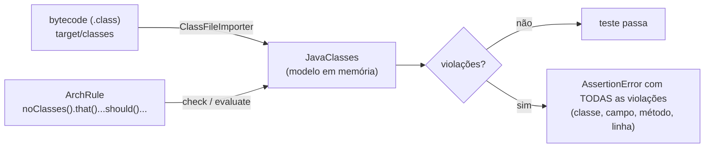

# P4.10 — ArchUnit: testes de arquitetura

> ⏱️ ~1h30 · 🔵 Pleno · Pré-requisitos: P4.01 (camadas), P4.02 (hexágono), P4.03 (injeção por construtor), P4.09 (Modulith), J7 (JUnit)

> ✅ **Validação final (2026-11-24):** módulo executado no PayFlow reconstruído; resultado e o que continua não executado no [README do módulo](README.md). Os avisos "não executado" / "por leitura" abaixo descrevem a escrita original.

> ⚠️ **Verificação:** **executado de verdade** em `lab/architecture-lab` (ArchUnit **1.4.2**, JDK 25.0.5, Spring Boot **4.1.2**; 38 testes verdes; saídas em `out-archunit-bad.txt`): 5 regras de convenção, regra de **camadas**, regra de **SQL só em adaptador**, regra de **ciclos** (`slices()`), e a **prova** de que cada regra **falha** no código ruim. **Não executado:** a **integração `archunit-junit5`** (`@AnalyzeClasses`/`@ArchTest`), `onionArchitecture()`, `FreezingArchRule`, e as regras **no PayFlow real** (por leitura).

## 🎯 Objetivos
Ao final desta aula você consegue:
- **Escrever** regras de arquitetura como **testes** (`noClasses()...should()...`) e **lê-las** como frases.
- **Provar** que uma regra **funciona** (vê-la **falhar** num exemplo ruim): "um teste que nunca falhou não prova nada".
- **Montar** o **catálogo de regras** do PayFlow (hexágono, módulos, injeção, transação, SQL).
- **Dizer** o que o ArchUnit cobre que o Modulith **não** cobre, e vice-versa.
- **Evitar** as armadilhas: camada vazia, importação que exclui testes, regra tão ampla que vira ruído.

## 🤔 Por que isso importa
Decisões de arquitetura **escritas num documento** são esquecidas na 3ª sprint. Decisões **escritas num teste** **barram o merge**. Na P4 você já tomou decisões como "domínio sem framework", "injeção só por construtor", "SQL só no adaptador do dono". O ArchUnit as torna **executáveis**: qualquer pessoa nova no time **descobre a regra quebrando o build**, não numa revisão de código meses depois.

## 💡 Intuição (explicação simples)
É o **guarda de trânsito automático**: o código de trânsito (arquitetura) existe no papel, mas só é **cumprido** onde há **radar** (teste). O radar **mede cada carro** (cada classe) e **multa** o infrator com a **placa** (o nome da classe e a linha).

## 🔬 Como funciona por dentro

### 1. Como o ArchUnit trabalha

- Lê o **bytecode**: não precisa **subir o Spring** (milissegundos a poucos segundos). Importe **uma vez** (`static final JavaClasses`) e rode todas as regras sobre o mesmo modelo.
- **`ImportOption.Predefined.DO_NOT_INCLUDE_TESTS`** ignora `src/test` (senão suas fixtures ruins contaminam as regras do código real).
- Uma regra é **uma frase**: `noClasses().that().resideInAPackage("..domain..").should().dependOnClassesThat().resideInAnyPackage("org.springframework..")`.
- **Dois jeitos de rodar:** `rule.check(classes)` (lança `AssertionError`) e `rule.evaluate(classes)` (devolve o resultado **sem lançar**, o que permite **provar** que a regra falha, como abaixo). A integração com JUnit (`@AnalyzeClasses` + `@ArchTest`, módulo `archunit-junit5`) é um **açúcar** equivalente (⚠️ não executado).

### 2. O catálogo de regras (as que valem para o PayFlow)

```java
// src/test/java/com/payflow/lab/ArchitectureRulesTest.java
    static final JavaClasses APP = new ClassFileImporter()
            .withImportOption(ImportOption.Predefined.DO_NOT_INCLUDE_TESTS)
            .importPackages("com.payflow.lab");

    static final JavaClasses BAD = new ClassFileImporter().importPackages("com.payflow.fixtures.bad");

    // ---------- as regras (as mesmas valem para o código real e para o código "ruim")

    static final ArchRule DOMAIN_IS_FRAMEWORK_FREE = noClasses().that().resideInAPackage("..domain..")
            .should().dependOnClassesThat().resideInAnyPackage(
                    "org.springframework..", "jakarta..", "..adapter..", "..application..")
            .because("o domínio é puro: regras de negócio não conhecem framework nem infraestrutura");

    static final ArchRule APPLICATION_DOES_NOT_KNOW_ADAPTERS = noClasses().that().resideInAPackage("..application..")
            .should().dependOnClassesThat().resideInAPackage("..adapter..")
            .because("casos de uso falam com PORTAS, nunca com adaptadores");

    static final ArchRule ADAPTERS_DO_NOT_TALK_TO_EACH_OTHER = noClasses().that().resideInAPackage("..adapter.in..")
            .should().dependOnClassesThat().resideInAPackage("..adapter.out..")
            .because("um controller chama um caso de uso (porta de entrada), não um repositório");

    static final ArchRule NO_FIELD_INJECTION = noFields().should().beAnnotatedWith(Autowired.class)
            .because("injeção só por construtor (decisão 30)");

    static final ArchRule SERVICES_ARE_NOT_PUBLIC = classes().that().areAnnotatedWith(Service.class)
            .should().notBePublic()
            .because("quem está fora do módulo usa a interface, não a implementação");

    static final JavaClasses BAD_SQL = new ClassFileImporter().importPackages("com.payflow.fixtures.badsql");

    static final ArchRule SQL_ONLY_IN_PERSISTENCE_ADAPTERS = noClasses().that().resideOutsideOfPackage("..adapter.out..")
            .should().dependOnClassesThat().haveFullyQualifiedName("org.springframework.jdbc.core.simple.JdbcClient")
            .because("SQL é detalhe de persistência: só um adaptador de saída o escreve (e só do PRÓPRIO módulo)");

    static final ArchRule WEB_ONLY_THROUGH_SERVICES = Architectures.layeredArchitecture().consideringOnlyDependenciesInLayers()
            .layer("Web").definedBy("..web..")
            .layer("Service").definedBy("..application..")
            .layer("Persistence").definedBy("..repository..")
            .whereLayer("Web").mayNotBeAccessedByAnyLayer()
            .whereLayer("Service").mayOnlyBeAccessedByLayers("Web")
            .whereLayer("Persistence").mayOnlyBeAccessedByLayers("Service")
            .because("a tela chama o caso de uso; o caso de uso chama a persistência");

    // ---------- o código real obedece

    @Test
    void domainIsFrameworkFree() { DOMAIN_IS_FRAMEWORK_FREE.check(APP); }

    @Test
    void applicationDoesNotKnowAdapters() { APPLICATION_DOES_NOT_KNOW_ADAPTERS.check(APP); }

    @Test
    void adaptersDoNotTalkToEachOther() { ADAPTERS_DO_NOT_TALK_TO_EACH_OTHER.check(APP); }

    @Test
    void noFieldInjection() { NO_FIELD_INJECTION.check(APP); }

    @Test
    void servicesAreNotPublic() { SERVICES_ARE_NOT_PUBLIC.check(APP); }

    @Test
    void sqlOnlyInPersistenceAdapters() { SQL_ONLY_IN_PERSISTENCE_ADAPTERS.check(APP); }

    @Test
    void modulesAreFreeOfCycles() {
        slices().matching("com.payflow.lab.(*)..").should().beFreeOfCycles().check(APP);
    }
```

Cada regra carrega um **`.because(...)`**: a mensagem de falha **explica o porquê**, e quem quebra a regra aprende a decisão (**ponha sempre**).

| Regra | Decisão que protege |
|---|---|
| `DOMAIN_IS_FRAMEWORK_FREE` | domínio puro (P4.02; **no PayFlow**: só `jakarta.persistence` permitido, decisão 116) |
| `APPLICATION_DOES_NOT_KNOW_ADAPTERS` | casos de uso falam com **portas** (P4.02) |
| `ADAPTERS_DO_NOT_TALK_TO_EACH_OTHER` | controller → caso de uso, **nunca** → repositório (P4.01) |
| `NO_FIELD_INJECTION` | injeção **só por construtor** (decisão 30) |
| `SERVICES_ARE_NOT_PUBLIC` | quem está fora usa a **interface** (P4.09) |
| `SQL_ONLY_IN_PERSISTENCE_ADAPTERS` | SQL só em `adapter.out` (P4.11) |
| `WEB_ONLY_THROUGH_SERVICES` (camadas) | tela → serviço → persistência (P4.01) |
| `slices()...beFreeOfCycles()` | sem **ciclos** entre módulos (P4.09) |

### 3. A prova: o código **ruim** faz as regras **falharem**
> 🧪 **"Teste que nunca falhou não prova nada."** Uma regra que **não casa com nenhuma classe** (um *typo* no pacote, `..doman..`) poderia **passar para sempre** e dar **falsa segurança**. **Boa notícia, executada:** no ArchUnit **1.4.2** o padrão é `archRule.failOnEmptyShould = true`, e a regra com *typo* **falha** com `failed to check any classes` (linha `TYPO RULE` na saída abaixo). **Mas** (a) quem desliga a opção globalmente (ou usa `allowEmptyShould(true)`) volta ao risco, e (b) uma regra que casa com **algumas** classes e não com as que importam (pacote renomeado pela metade) **continua passando**. Por isso o laboratório também tem **fixtures ruins** (`src/test/java/com/payflow/fixtures/bad/...`) e um teste que **exige** que as regras os reprovem:

```java
// src/test/java/com/payflow/lab/ArchitectureRulesTest.java
    // ---------- PROVA de que as regras funcionam: contra o código ruim, elas FALHAM

    @Test
    void theRulesFailOnBadCode() {
        for (var rule : new ArchRule[] { DOMAIN_IS_FRAMEWORK_FREE, NO_FIELD_INJECTION, SERVICES_ARE_NOT_PUBLIC }) {
            var result = rule.evaluate(BAD);
            System.out.println("RULE '" + rule.getDescription() + "' -> violations=" + result.getFailureReport().getDetails().size());
            result.getFailureReport().getDetails().forEach(d -> System.out.println("   " + d));
            assertThat(result.hasViolation()).as(rule.getDescription()).isTrue();
        }
    }

    @Test
    void layeredRuleCatchesControllerThatSkipsTheService() {
        var result = WEB_ONLY_THROUGH_SERVICES.evaluate(BAD);
        System.out.println("LAYERED -> violations=" + result.getFailureReport().getDetails().size());
        result.getFailureReport().getDetails().forEach(d -> System.out.println("   " + d));
        assertThat(result.hasViolation()).isTrue();
    }

    @Test
    void modulithDoesNotSeeSqlCouplingButArchUnitDoes() {
        // 1) o Modulith aprova: não há dependência de TIPO entre os módulos
        org.springframework.modulith.core.ApplicationModules.of("com.payflow.fixtures.badsql", location -> true).verify();
        // 2) a regra de ArchUnit reprova
        var result = SQL_ONLY_IN_PERSISTENCE_ADAPTERS.evaluate(BAD_SQL);
        System.out.println("SQL RULE -> modulith.verify() PASSOU; archunit violations=" + result.getFailureReport().getDetails().size());
        assertThat(result.hasViolation()).isTrue();
    }

    @Test
    void aRuleWithATypoInThePackageFailsInsteadOfPassingSilently() {
        var typo = noClasses().that().resideInAPackage("..doman..")      // "doman": nada casa
                .should().dependOnClassesThat().resideInAPackage("org.springframework..");
        var thrown = org.junit.jupiter.api.Assertions.assertThrows(AssertionError.class, () -> typo.check(APP));
        System.out.println("TYPO RULE -> " + thrown.getMessage().lines().findFirst().orElse(""));
        // com a opção desligada, a regra com typo PASSARIA para sempre (falsa segurança):
        // arquivo archunit.properties: archRule.failOnEmptyShould=false
    }
}
```

Saída **real** (violações achadas no código ruim):

```text
RULE 'no classes that reside in a package '..domain..' should depend on classes that reside in any package ['org.springframework..', 'jakarta..', '..adapter..', '..application..'], because o domínio é puro: regras de negócio não conhecem framework nem infraestrutura' -> violations=4
   Class <com.payflow.fixtures.bad.domain.BadDomain> is annotated with <org.springframework.stereotype.Service>
   Field <com.payflow.fixtures.bad.domain.BadDomain.adapter> has type <com.payflow.fixtures.bad.adapter.BadAdapter>
   Field <com.payflow.fixtures.bad.domain.BadDomain.adapter> is annotated with <org.springframework.beans.factory.annotation.Autowired>
   Method <com.payflow.fixtures.bad.domain.BadDomain.run()> calls method <com.payflow.fixtures.bad.adapter.BadAdapter.doIt()>
RULE 'no fields should be annotated with @Autowired, because injeção só por construtor (decisão 30)' -> violations=1
   Field <com.payflow.fixtures.bad.domain.BadDomain.adapter> is annotated with @Autowired
RULE 'classes that are annotated with @Service should not be public, because quem está fora do módulo usa a interface, não a implementação' -> violations=1
   Class <com.payflow.fixtures.bad.domain.BadDomain> has modifier PUBLIC
LAYERED -> violations=4
   Constructor <com.payflow.fixtures.bad.web.BadController.<init>()> calls constructor <com.payflow.fixtures.bad.repository.BadRepository.<init>()>
   Field <com.payflow.fixtures.bad.web.BadController.repository> has type <com.payflow.fixtures.bad.repository.BadRepository>
   Layer 'Service' is empty
   Method <com.payflow.fixtures.bad.web.BadController.get()> calls method <com.payflow.fixtures.bad.repository.BadRepository.find()>
SQL RULE -> modulith.verify() PASSOU; archunit violations=3
TYPO RULE -> Rule 'no classes that reside in a package '..doman..' should depend on classes that reside in a package 'org.springframework..'' failed to check any classes. This means either that no classes have been passed to the rule at all, or that no classes passed to the rule matched the `that()` clause. To allow rules being evaluated without checking any classes you can either use `ArchRule.allowEmptyShould(true)` on a single rule or set the configuration property `archRule.failOnEmptyShould = false` to change the behavior globally.
```

Lendo a saída: **uma única classe** (`BadDomain`) violou **três regras** de uma vez (`@Service` no domínio, dependência de adaptador, campo `@Autowired`, classe `public`), e **cada violação diz onde** (campo, método, tipo). Essa é a diferença entre "a arquitetura está errada" e "**corrija esta linha**".

### 4. ArchUnit × Spring Modulith: **complementares**
| | **Modulith `verify()`** | **ArchUnit** |
|---|---|---|
| Foco | **módulos** (API × interno, ciclos, `allowedDependencies`) | **qualquer** regra sobre classes, pacotes, anotações, camadas |
| Regra pronta | sim (por convenção de pacote) | você **escreve** (flexível) |
| Camadas dentro do módulo (hexágono) | **não** | **sim** |
| Convenções (`@Autowired` em campo, `public`, nomes) | não | **sim** |
| Base técnica | **usa** ArchUnit por baixo (o `.pom` do `spring-modulith-core` depende do `archunit 1.4.2`) | direto |

No PayFlow os **dois rodam no CI** (J10): `ModularityTests.verify()` **e** `ArchitectureRulesTest`.

## 🛠️ Exemplo prático

### 1. Dependência (Maven)
```xml
<dependency>
  <groupId>com.tngtech.archunit</groupId>
  <artifactId>archunit</artifactId>
  <version>1.4.2</version>   <!-- a MESMA que o Spring Modulith 2.1.2 usa -->
  <scope>test</scope>
</dependency>
```
(Usar uma versão **diferente** da do Modulith deixa **duas** no classpath ou força uma delas; alinhe.)

### 2. Importar o código **real** (uma vez)
```java
static final JavaClasses APP = new ClassFileImporter()
        .withImportOption(ImportOption.Predefined.DO_NOT_INCLUDE_TESTS)
        .importPackages("com.payflow");
```

### 3. Regras extras úteis para o PayFlow (por leitura; teste-as antes de confiar)
```java
// transação só no caso de uso (decisão 35)
noClasses().that().resideOutsideOfPackage("..application..")
    .should().beAnnotatedWith(Transactional.class)
    .because("a transação pertence ao caso de uso");

// regras PRONTAS da biblioteca (conferidas com javap no archunit 1.4.2):
//   GeneralCodingRules.NO_CLASSES_SHOULD_ACCESS_STANDARD_STREAMS   (sem System.out/err: use SLF4J, decisão 38)
//   GeneralCodingRules.NO_CLASSES_SHOULD_USE_JAVA_UTIL_LOGGING
//   GeneralCodingRules.NO_CLASSES_SHOULD_USE_FIELD_INJECTION       (equivale ao nosso NO_FIELD_INJECTION)
GeneralCodingRules.NO_CLASSES_SHOULD_ACCESS_STANDARD_STREAMS.check(APP);

// controladores terminam com Controller e ficam em adapter.in.web
classes().that().areAnnotatedWith(RestController.class)
    .should().haveSimpleNameEndingWith("Controller").andShould().resideInAPackage("..adapter.in.web..");

// o domínio não lança exceção genérica
noClasses().that().resideInAPackage("..domain..").should().dependOnClassesThat().haveFullyQualifiedName("java.lang.Exception");
```
> ℹ️ A biblioteca traz **regras prontas** em `com.tngtech.archunit.library.GeneralCodingRules` (os três nomes acima existem no **1.4.2**: conferidos com `javap`; **não** foram executados contra o PayFlow). Os exemplos desta seção são **por leitura**.

## 🏗️ Pausa de design: a regra que **todo mundo** quebra
Você escreveu "nenhum controller usa `ApplicationContext`" e **12 classes** violam hoje. O que fazer?

<details><summary>Dica e solução</summary>

**Dica:** apagar a regra? Corrigir as 12 num PR? Ignorar?

**Solução:** **não** apague (a regra está certa) e **não** tente corrigir **tudo** de uma vez. Opções: (a) **corrigir** por módulo, em PRs pequenos (a lista de violações **é** a dívida); (b) `FreezingArchRule.freeze(rule)` (⚠️ **não executado**): **congela** as violações **existentes** num arquivo e **só falha para as novas**, permitindo **estancar a sangria** hoje e **pagar** aos poucos; (c) em último caso, **exceção documentada** (`.andShould()...` ou `.ignoreDependency(...)`), **com** o motivo no `.because`. Sem isso, a regra vira ruído e é desligada.
</details>

## ⚖️ Trade-offs e quando NÃO usar
- **Regra demais** = build lento de mudar e time **contornando**: regras valem pelas **decisões importantes** (fronteiras, injeção, SQL), não por estilo (para estilo há Checkstyle, J7.08).
- **Regra por nome de pacote** é **frágil**: renomear `adapter` → `infra` **quebra silenciosamente** (a regra passa porque nada casa). Mitigue com **testes que provam** (o código ruim) e **mantenha** o padrão `archRule.failOnEmptyShould = true` (a regra com *typo* **falha** em vez de passar: executado).
- **Custo de manutenção:** a arquitetura **evolui**; as regras acompanham (PR da arquitetura **inclui** a regra).
- **Falsos positivos:** classes geradas (MapStruct, QueryDSL, `*_` do Hibernate) podem violar; **exclua** por padrão de nome/anotação.
- **Não substitui revisão humana**: ArchUnit vê **dependências de tipo**, não **intenção** (SQL em `String`: P4.11).

## ⚠️ Erros comuns e boas práticas de produção
- **`Layer 'Service' is empty`** (visto na P4.01): por padrão, camada **sem classes** reprova. Confira o nome do pacote ou use `.withOptionalLayers(true)` **conscientemente**.
- **Importar testes junto** (`importPackages` sem `DO_NOT_INCLUDE_TESTS`): as fixtures ruins **reprovam o build**.
- **Regra que casa com poucas classes** (ou `allowEmptyShould(true)`): passa **sem proteger nada**. Confirme com um **exemplo ruim** (seção 3) ou `assertThat(classes.that(...)).isNotEmpty()`. Com zero classes, o padrão da 1.4.2 já **falha** (executado).
- **Regra sem `.because`**: ninguém sabe **por que** quebrou.
- **Importar em cada teste** (lento): importe **uma vez**, `static final`.
- **Pacotes com `..` demais**: `..web..` casa **qualquer** pacote com `web` no caminho (`com.payflow.webhook`? **não** casa, mas `com.payflow.web.x` e `x.web.y` sim). Ancore em `com.payflow.(*)..` quando precisar.
- **Pacote de teste** de ArchUnit **dentro** de um módulo do Modulith pode ser **escaneado** como código de aplicação: mantenha-o na **raiz** de testes.

## 🧩 Exercícios
1. **Fixação:** escreva em português a regra `noClasses().that().resideInAPackage("..domain..").should().dependOnClassesThat().resideInAnyPackage("..adapter..")` e diga **qual decisão** do PayFlow ela protege.
2. **Aplicação no PayFlow** (por leitura; *branch* `p4-archunit`):
   - [ ] Adicione o `archunit` **1.4.2** (`test`) e `ArchitectureRulesTest` com as 6 regras da seção 2 (ajustando o `DOMAIN_IS_FRAMEWORK_FREE` para **permitir** `jakarta.persistence`).
   - [ ] Para **cada** regra, crie **um exemplo ruim** em `src/test/.../fixtures` e **prove** que ela falha (`evaluate(...).hasViolation()`).
   - [ ] Rode contra o PayFlow: **liste** as violações; escolha entre **corrigir** e `FreezingArchRule`.
   - [ ] Acrescente a regra "**`@Transactional` só em `..application..`**".
   - Pronto quando: o **CI falha** ao se acrescentar um `@Autowired` em campo.
3. **Desafio:** escreva uma regra que **proíba** `payment` de depender de `account` **diretamente** (só via `transfer`) e **prove** com um exemplo.

<details><summary>Solução de referência (1 e 3)</summary>

1. "Nenhuma classe de domínio depende de adaptadores": protege a **hexagonal** (decisão 116): o núcleo não conhece infraestrutura.
3.
```java
noClasses().that().resideInAPackage("com.payflow.payment..")
    .should().dependOnClassesThat().resideInAPackage("com.payflow.account..")
    .because("payment fala com transfer; só transfer conhece account");
```
(O Modulith com `allowedDependencies = {"transfer", "shared"}` em `payment` expressa a mesma regra **e** a documenta no diagrama.)
</details>

## 🎤 Na entrevista
1. **"Como você garante que a arquitetura não degrada?"** Regras **executáveis** no CI (ArchUnit/Modulith `verify`), com `.because` que explica a decisão, e **prova** (exemplo ruim) de que cada regra falha.
2. **"O que é ArchUnit?"** Biblioteca que importa o **bytecode** e permite escrever **regras sobre dependências, camadas, ciclos, anotações e nomes** como testes JUnit.
3. **"Como introduzir regras num projeto legado cheio de violações?"** **Congelar** as existentes (`FreezingArchRule`) para só barrar as **novas**, e pagar a dívida por módulo.
4. **"O que o ArchUnit não pega?"** Acoplamento **por dado** (SQL em `String`, contrato implícito de JSON) e **intenção**; para isso, regras específicas, contratos (P5) e revisão.

## 📚 Para ir além
- 📄 [ArchUnit User Guide](https://www.archunit.org/userguide/html/000_Index.html): *Writing Architecture Tests*, *Layered Architecture*, *Slices* e *Freezing Arch Rules*.
- 💻 [github.com/TNG/ArchUnit](https://github.com/TNG/ArchUnit): código e exemplos (`ArchUnit-Examples`).
- 📄 [Spring Modulith: Verification](https://docs.spring.io/spring-modulith/reference/verification.html): a verificação que usa ArchUnit por baixo.
- 📑 *Building Evolutionary Architectures* (Ford, Parsons, Kua): **fitness functions**, a ideia por trás de testes de arquitetura (**de memória, não conferido**).

## ✅ Checklist da aula
- [ ] Sei por que "um teste que nunca falhou não prova nada" e fiz **cada regra falhar** num exemplo.
- [ ] Sei a diferença entre ArchUnit e Modulith `verify()`.
- [ ] Conheço as armadilhas: camada vazia, regra que não casa nada, importar testes.
- [ ] Sei como introduzir regras num código legado (`FreezingArchRule`).
