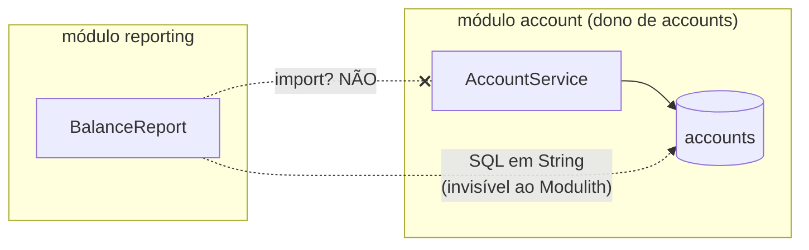

# P4.11 — 🏗️ Estudo de caso: o módulo que sabia demais

> ⏱️ ~1h30 · 🔵 Pleno · Pré-requisitos: P4.06–P4.10, P3.13 (formato de postmortem), P2.11 (visão materializada `ledger_monthly`), J3 (migrações)

> ✅ **Validação final (2026-11-24):** módulo executado no PayFlow reconstruído; resultado e o que continua não executado no [README do módulo](README.md). Os avisos "não executado" / "por leitura" abaixo descrevem a escrita original.

> ⚠️ **Verificação:** o **incidente** é **fictício** (narrativa), mas a **mecânica** foi **reproduzida de verdade** em `lab/architecture-lab` (Spring Boot **4.1.2**, Spring Modulith **2.1.2**, ArchUnit **1.4.2**, H2 só como banco de laboratório, JDK 25.0.5; **40 testes verdes**): o `verify()` **aprova** um módulo que lê a tabela de outro por SQL; uma regra de ArchUnit o **reprova**; uma migração legítima do dono da tabela **quebra** o outro módulo **só em tempo de execução**. **Não executado:** o PayFlow real, PostgreSQL e o `ledger_monthly` de verdade (a aula usa o modelo do laboratório). Os **tempos e valores** da narrativa são **ilustrativos**, **não medidos**.

## 🎯 Objetivos
Ao final desta aula você consegue:
- **Diagnosticar** um acoplamento **por dado** (SQL em tabela alheia) que as ferramentas de **tipos** não veem.
- **Explicar** por que o Spring Modulith `verify()` **passa** e **o que** pega o problema.
- **Corrigir** de **três** formas (API, evento carregando o dado, cópia própria) e **escolher** pelo critério certo.
- **Impor** a regra "**cada tabela tem um dono**" no CI.
- **Escrever** um postmortem **sem culpa** com ação corretiva **mecânica**.

## 🤔 Por que isso importa
Você acabou de migrar o PayFlow para módulos, o `verify()` está **verde** no CI, e o time se sente **seguro**. Esse é o momento mais perigoso: a **verificação por tipos** só vê `import`. O jeito mais comum de o acoplamento **voltar** é **pelo banco**, onde todos os módulos **compartilham o mesmo schema** e o compilador **não enxerga** o que está dentro de uma `String`.

## 💡 Intuição (explicação simples)
Uma casa com **cada morador num quarto com tranca** (módulos). O síndico confere **as trancas** (verify). Mas todos os quartos têm uma **janela para a mesma despensa** (o banco) e um morador **reorganiza a despensa** sem avisar: o outro **passa fome** só na hora do jantar. Tranca na porta **não protege** a despensa.

## 🔬 Como funciona por dentro

### O incidente (narrativa)
> **Contexto.** O PayFlow já é modular (P4.09). O time de **Relatórios** precisa do **saldo atual** de cada conta para um painel. A API do `account` (`AccountApi.balanceOf`) faz **uma consulta por conta**; o painel lista **2.000 contas**. Alguém, com pressa e boa intenção, escreve no `reporting`:
> ```java
> jdbc.sql("select balance from accounts where id = ?")...
> ```
> **Por que passou:** nenhum `import` de `account`; o `verify()` ficou **verde**; o *code review* olhou o **diff**, não o **schema**.
>
> **Semana 6.** O time de `account` renomeia `balance` → `current_balance` para deixar claro que existe `available_balance` (migração **Flyway** limpa, **todos os testes do `account` verdes**, deploy às 16h).
>
> **Sintoma.** 16h20: o painel de Relatórios responde **500** para **todas** as contas. Nenhum teste do repositório falhou **antes** do deploy.

### 1. A **prova** (executada): `verify()` aprova, ArchUnit reprova
O módulo ruim (`fixtures/badsql`): **sem nenhum import** do outro módulo, o acoplamento está **na `String`**:

```java
// src/test/java/com/payflow/fixtures/badsql/reports/BalanceReport.java
package com.payflow.fixtures.badsql.reports;

import org.springframework.jdbc.core.simple.JdbcClient;

/** Nenhum import de outro módulo: o acoplamento está na STRING do SQL, que nenhuma ferramenta de tipos enxerga. */
public class BalanceReport {
    private final JdbcClient jdbc;

    public BalanceReport(JdbcClient jdbc) {
        this.jdbc = jdbc;
    }

    public String balance(String id) {
        return jdbc.sql("select balance from accounts where id = ?").param(id).query(String.class).single();
    }
}
```

O teste (`modulithDoesNotSeeSqlCouplingButArchUnitDoes`) roda **as duas ferramentas** sobre o mesmo código:

```java
// src/test/java/com/payflow/lab/ArchitectureRulesTest.java
    @Test
    void modulithDoesNotSeeSqlCouplingButArchUnitDoes() {
        // 1) o Modulith aprova: não há dependência de TIPO entre os módulos
        org.springframework.modulith.core.ApplicationModules.of("com.payflow.fixtures.badsql", location -> true).verify();
        // 2) a regra de ArchUnit reprova
        var result = SQL_ONLY_IN_PERSISTENCE_ADAPTERS.evaluate(BAD_SQL);
        System.out.println("SQL RULE -> modulith.verify() PASSOU; archunit violations=" + result.getFailureReport().getDetails().size());
        assertThat(result.hasViolation()).isTrue();
    }
```

Saída **real**: `SQL RULE -> modulith.verify() PASSOU; archunit violations=3` (ver `out-archunit-bad.txt`). O `verify()` passou **porque não há dependência de tipo**; a regra `SQL_ONLY_IN_PERSISTENCE_ADAPTERS` (P4.10) reprova **o uso de `JdbcClient` fora de `adapter.out`**.

### 2. A **reprodução** do incidente (executada)
```java
// src/test/java/com/payflow/lab/SqlCouplingIncidentTest.java
class SqlCouplingIncidentTest {

    @Test
    void renamingAColumnBreaksTheOtherModuleAtRuntime() {
        var db = new EmbeddedDatabaseBuilder().setType(EmbeddedDatabaseType.H2)
                .setName("incident-" + UUID.randomUUID()).addScript("classpath:schema.sql").build();
        var jdbc = JdbcClient.create(db);
        var id = UUID.randomUUID();
        jdbc.sql("insert into accounts (id, owner, balance) values (?, 'ana', 10.00)").param(id).update();
        var report = new BalanceReport(jdbc);

        assertThat(report.balance(id.toString())).isEqualTo("10.00");          // hoje funciona

        // o dono da tabela faz uma migração legítima (e os testes DELE continuam verdes)
        jdbc.sql("alter table accounts alter column balance rename to current_balance").update();

        assertThatThrownBy(() -> report.balance(id.toString())).satisfies(e ->
                System.out.println("INCIDENT -> " + e.getClass().getSimpleName() + ": " + e.getMessage().lines().findFirst().orElse("")));
    }
}
```

Saída **real**:

```text
INCIDENT -> BadSqlGrammarException: PreparedStatementCallback; bad SQL grammar [select balance from accounts where id = ?]
```

O relatório funciona **hoje**; depois do `alter table ... rename`, ele **quebra em tempo de execução** com `BadSqlGrammarException`. **Nenhum** teste do módulo dono precisa falhar (o `account` está **correto**), e **nenhum** teste de arquitetura de tipos acusa. Esse é o ponto cego.

### 3. Por que acontece (a mecânica)

- O **schema é uma API**: nome de tabela e de coluna são **contrato** com **todo** mundo que lê. Se o schema é **compartilhado**, **todo mundo** é cliente e **ninguém sabe**.
- Essa dependência é **pior** que um `import`: não há erro de compilação, não aparece no diagrama (`Documenter`), não há *deprecation*.
- É o primeiro passo para o **"banco compartilhado" entre serviços** (P5): quem fatiar esse monólito **herda** o acoplamento (e agora com **rede** no meio).

### 4. As **três correções** (e como escolher)
| | **A. Chamar a API** | **B. Evento carrega o dado** | **C. Cópia própria (leitura)** |
|---|---|---|---|
| Como | `AccountApi.balanceOf(id)` / `balances(ids)` | `TransferCompleted` traz `newBalance` | `reporting` mantém `account_balances` alimentada por evento |
| Frescor | **atual** | atual **até o último evento** | **eventual** |
| Custo | **uma chamada por conta** (N+1: P2.07) → exige método em **lote** | zero consulta | espaço + sincronização + **backfill** |
| Acoplamento | **à interface** (estável) | **ao evento** (contrato publicado) | **ao evento** |
| Quando | poucas contas, dado **fresco** | o ouvinte só precisa do que o evento já carrega | **muita** leitura, relatórios, dado **atrasado é aceitável** |

No PayFlow: **A** com um método **em lote** (`Map<AccountId, Money> balancesOf(Collection<AccountId>)`: **uma** consulta com `IN`, no adaptador **do dono**) para o painel; **C** (`ledger_monthly`, já existe desde P2.11) para o histórico. **Nunca** o `select` direto na tabela alheia.

### 5. A **regra** e o **mecanismo** (decisão 124)
> **Cada tabela tem exatamente um módulo dono.** **Só** o dono escreve **e lê** a tabela, **só** em seus adaptadores de saída (`adapter.out`). Quem precisa do dado **pede por API**, **recebe no evento** ou **mantém cópia** feita a partir de evento.

Como **impor** (o que o laboratório **executou** + o que é **proposta**):
1. **ArchUnit:** SQL (`JdbcClient`/`JdbcTemplate`/`@Query`) **só** em `..adapter.out..` (a regra do laboratório, **executada**).
2. **Convenção de nome:** prefixo do módulo nas tabelas (`account_*`, `transfer_*`) **ou** um `schema` por módulo no PostgreSQL com **permissão** (o usuário do `reporting` **não tem** `SELECT` em `account.*`: o **banco** barra; ⚠️ **proposta, não executada**).
3. **Revisão de PR:** pergunta fixa **"de quem é essa tabela?"** no *template* de PR (J10).
4. **Teste de migração:** a PR que altera a tabela roda os **testes de integração de todos os módulos** (o `EndToEndTest` detectaria, **se** cobrisse o relatório).

> ⚠️ **Limite honesto:** a regra de ArchUnit vê o **uso de `JdbcClient` fora do adaptador**, não **qual tabela** a `String` cita. Um adaptador de `reporting` com SQL em `accounts` **passa**. O que **fecha** a brecha é **permissão no banco** (schema por módulo) ou **revisão**. Cada camada pega **parte**.

## 🛠️ Exemplo prático

### Postmortem (sem culpa), no formato do P3.13
| Campo | Conteúdo |
|---|---|
| **Impacto** | painel de Relatórios fora por 40 min (**ilustrativo**); sem perda de dinheiro |
| **Causa raiz** | `reporting` lia a tabela `accounts` por SQL; o dono a migrou |
| **Fatores contribuintes** | `verify()` não enxerga SQL; revisão olhou o *diff* mas não o **schema**; nenhum teste de `reporting` rodava contra o schema novo |
| **Detecção** | alerta de **500** (P6) em 4 min |
| **O que funcionou** | rollback da migração (expand/contract: S3 explica o jeito certo); o `account` estava correto |
| **Ações** | (1) regra de ArchUnit `SQL_ONLY_IN_PERSISTENCE_ADAPTERS` no CI; (2) `AccountApi.balancesOf` em lote; (3) **schema por módulo** e permissões; (4) *template* de PR com "de quem é essa tabela?"; (5) teste de contrato do painel |
| **Lição** | **verificação de tipos não cobre acoplamento por dado** |

### Ação corretiva mecânica (o que muda no PayFlow)
```java
// account (API pública, raiz do módulo): em lote, UMA consulta no adaptador do dono
public interface AccountApi {
    Map<UUID, Money> balancesOf(Collection<UUID> accountIds);
}
```
```java
// reporting: depende da interface, nunca da tabela
var balances = accounts.balancesOf(ids);          // 1 consulta com "where id = any(?)", no adaptador de account
```

## 🏗️ Pausa de design: o `notification` precisa do **nome do destinatário**
O push diz "Ana, você recebeu R$ 100". O nome está em `users` (`identity`). Qual das três correções?

<details><summary>Dica e solução</summary>

**Dica:** o nome **muda** com frequência? Em **tempo real**? O `notification` precisa dele em **todas** as notificações?

**Solução:** **C** (cópia própria): `notification` mantém `recipients(account_id, display_name, channel)` alimentada pelo evento `UserRegistered`/`ContactChanged` (**published language** de `identity`). Não precisa chamar `identity` a cada notificação (**disponibilidade composta**, P3.01) nem ler `users`. Aceita o **atraso** (uma mudança de nome leva segundos para refletir) e o **backfill** inicial. **B** (nome no `TransferCompleted`) também serve se o evento **já** carregar `targetDisplayName`: mas isso **acopla o evento** (de `transfer`) a um dado de `identity`; prefira **C**.
</details>

## ⚖️ Trade-offs e quando NÃO usar
- **"Um dono por tabela" não é de graça:** consultas que **juntam** tabelas de dois contextos (um `JOIN` num relatório) **deixam de existir**: viram **cópia**, **API em lote** ou **modelo de leitura** (CQRS, S1). Se o relatório precisa de `JOIN` rápido, uma **visão de leitura** dedicada, alimentada por evento, é **mais simples** que respeitar tudo à risca.
- **Cópia própria = consistência eventual** e **dado duplicado**; exige idempotência (P3.07) e *backfill*.
- **Schema por módulo + permissão** é **forte** e **caro de operar**; para um time pequeno, **regra no CI + revisão** pode bastar. Escolha **o nível de proteção ao tamanho do risco**.
- **API em lote** pode virar um "SQL genérico" disfarçado (`query(filter)`): mantenha métodos **com nome de negócio**.
- **Pragmatismo:** a **leitura** de uma tabela alheia **em modo somente leitura** é o desvio **menos grave** (e o mais comum). Se for **inevitável**, **registre como dívida** com **dono e prazo**, **não** esconda.

## ⚠️ Erros comuns e boas práticas de produção
- **`JdbcTemplate` injetado em qualquer bean**: abre a porta. Restrinja por regra de ArchUnit (`adapter.out`).
- **`@Query` nativa com nome de tabela de outro módulo** num repositório Spring Data do módulo errado.
- **`JOIN` entre `accounts` e `users`** num relatório: acopla **dois** módulos de uma vez.
- **View/Materialized view lendo tabelas de vários módulos** sem dono: dê **um dono** (o `reporting`) e **documente** quais tabelas ela consome.
- **Migrar o schema sem rodar os testes dos consumidores**: sem **expand/contract** (S3), quebra de coluna é **incidente garantido**.
- **Erro típico do log** quando isso acontece (reproduzido): `BadSqlGrammarException: PreparedStatementCallback; bad SQL grammar [select balance from accounts where id = ?]` (no PostgreSQL: `ERROR: column "balance" does not exist`).

## 🧩 Exercícios
1. **Fixação:** por que o `verify()` do Modulith passou? Que **tipo** de acoplamento ele não vê? Dê **dois** outros exemplos (contrato JSON implícito, *topic* Kafka compartilhado).
2. **Aplicação no PayFlow** (por leitura):
   - [ ] **Inventário:** `grep -rn "JdbcTemplate\|JdbcClient\|nativeQuery" src/main/java` e para cada ocorrência diga **de qual módulo é a tabela** consultada.
   - [ ] Adicione `SQL_ONLY_IN_PERSISTENCE_ADAPTERS` ao `ArchitectureRulesTest` e **prove** que falha num exemplo ruim.
   - [ ] Crie `AccountApi.balancesOf(Collection<UUID>)` e use no `reporting`; escreva o **teste do adaptador** com **uma** consulta (conte as `PreparedStatement`, como na P2.07/P2.08).
   - [ ] Escreva o **postmortem** (acima) para o **seu** repositório, com **uma** ação mecânica.
   - Pronto quando: **nenhum** SQL fora de `adapter.out` e **nenhuma** tabela citada por dois módulos.
3. **Desafio:** projete a política de **permissões do PostgreSQL** (um *schema* e um *role* por módulo) e escreva os `GRANT`s mínimos para que `reporting` leia **só** `reporting.*` e o **`ledger_monthly`** (⚠️ não execute em produção; teste num contêiner descartável).

<details><summary>Solução de referência (1)</summary>

O `verify()` analisa **dependências de tipo Java** (imports, campos, chamadas de método); a **tabela** aparece só dentro de uma `String` de SQL, que ele **não interpreta**. Outros acoplamentos invisíveis: **contrato JSON implícito** (um módulo lê o campo `balance` do JSON do outro sem DTO compartilhado), **tópico Kafka** consumido por quem não foi combinado, **arquivo/cache** com chave conhecida por dois módulos.
</details>

## 🎤 Na entrevista
1. **"Como você evita que módulos se acoplem pelo banco?"** **Um dono por tabela**: só o dono acessa, via adaptador; os outros usam **API**, **eventos** ou **cópia própria**; reforço com **regra de arquitetura no CI** e, se o risco justificar, **schema/permissões** por módulo.
2. **"O que o Spring Modulith não detecta?"** Acoplamento **que não é dependência de tipo Java**: SQL em `String`, contratos de mensagem implícitos, dados compartilhados.
3. **"Por que banco compartilhado entre serviços é um problema?"** O schema vira **API oculta**; qualquer mudança quebra consumidores desconhecidos; os serviços **deixam de ser** independentes (acoplamento + rede = **monólito distribuído**).
4. **"Como mudar o nome de uma coluna com segurança?"** **Expand/contract**: acrescentar a coluna nova, **duplicar** a escrita, migrar leitores, **depois** remover a antiga (S3).

## 📚 Para ir além
- 📄 [Spring Modulith: Verification](https://docs.spring.io/spring-modulith/reference/verification.html): o que é e o que **não** é verificado.
- 📄 [ArchUnit User Guide](https://www.archunit.org/userguide/html/000_Index.html): regras sobre dependências de classes (a base da regra de SQL).
- 📄 Martin Fowler, [*Microservices*](https://martinfowler.com/articles/microservices.html): a seção "Decentralized Data Management" (cada serviço com o **seu** dado).
- 📑 *Building Microservices* (Newman): capítulo sobre **bancos compartilhados** e *database as API* (**de memória, não conferido**).

## ✅ Checklist da aula
- [ ] Sei explicar por que `verify()` passou e **o que** reprovou o problema.
- [ ] Sei as 3 correções e **quando** cada uma serve.
- [ ] Sei o **limite** da regra de ArchUnit (não sabe **qual** tabela) e o que fecha a brecha.
- [ ] Escrevi o postmortem com **ação mecânica**.
