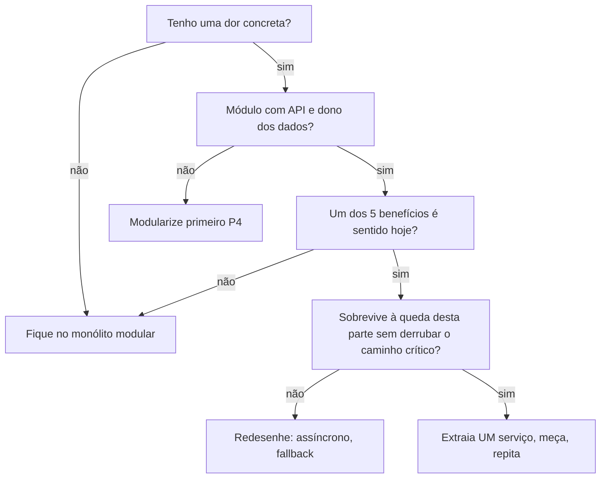
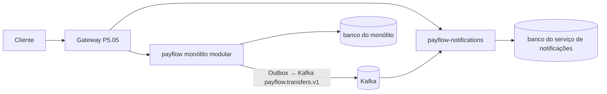

# P5.01 — Monólito vs microsserviços: quando dividir e quando NÃO

> ⏱️ ~1h30 · 🔵 Pleno · Pré-requisitos: P4.08 (*bounded contexts*), P4.09 (monólito modular), P3.01 (síncrono × assíncrono, disponibilidade que se multiplica), J9 (container)

> ⚠️ **Verificação:** aula **conceitual**: **nada foi executado** aqui. A aritmética de disponibilidade foi **calculada** (Python) e as duas únicas "provas" do módulo que sustentam o argumento (um serviço lento derruba o chamador; proteção o mantém de pé) estão na [P5.10](P5.10-estudo-de-caso-o-servico-de-notificacoes-que-derrubou-o-checkout.md), com laboratório executado. Os textos de terceiros (Fowler, Segment, Microsoft) foram **lidos como referência de opinião**, não como dados: cada empresa tem um contexto.

## 🎯 Objetivos
Ao final desta aula você consegue:
- **Listar** o que um microsserviço **cobra** (a "taxa") e o que **entrega**.
- **Aplicar** um critério em 5 perguntas para decidir **dividir ou não**.
- **Reconhecer** um **monólito distribuído** e explicar por que é o pior dos dois mundos.
- **Decidir**, para o PayFlow, **qual** parte sair do monólito **e por que só ela**.
- **Defender** "continuar no monólito modular" numa entrevista **sem** parecer atrasado.

## 🤔 Por que isso importa
"Vamos migrar para microsserviços" é uma frase que **custa meses** e que, mal decidida, deixa o time com **mais** problemas (rede, consistência, deploy, depuração) e **os mesmos** (código acoplado). Um pleno é cobrado para **dizer não** com argumentos, e para **dizer sim** na hora certa e pela razão certa.

Na P4 você deixou o PayFlow como **monólito modular**: módulos com fronteira **verificada** (`verify()`, ArchUnit). Isso já dá **a maior parte** do benefício organizacional dos microsserviços **sem pagar a taxa da rede**. A pergunta desta aula é: **que benefício a mais** justificaria pagar a taxa?

## 💡 Intuição (explicação simples)
Um **restaurante** com **uma cozinha** (monólito): o chef-geral coordena tudo; se o forno quebra, **todos** sofrem, mas **conversar** com a confeitaria é gritar do outro lado do balcão.

Uma **praça de alimentação** (microsserviços): cada barraca tem **dono, estoque e horário** próprios; uma barraca pode **fechar** sem fechar as outras e **crescer** sozinha. Em troca, para montar **um prato** que usa três barracas você precisa de **mensageiros** (a rede), de **comandas** que fecham juntas (consistência), de **um gerente** que entenda o fluxo (observabilidade) e de **regras de convivência** (contratos). Se as barracas **dependem** umas das outras para abrir, você construiu **a mesma cozinha com paredes no meio**: o **monólito distribuído**.

## 🔬 Como funciona por dentro

### 1. A taxa dos microsserviços (o que você passa a pagar)
| Custo | O que muda | Onde o módulo ensina a lidar |
|---|---|---|
| **Rede** | chamada **local** vira chamada **remota**: latência, timeout, **falha parcial** | P5.07, P5.08 |
| **Disponibilidade** | numa cadeia **síncrona** as disponibilidades **se multiplicam** (abaixo) | P5.08, S4 |
| **Dados** | **cada serviço com seu banco**: sem `JOIN` nem transação ACID entre eles; consistência **eventual** | P5.02, S1 (sagas) |
| **Contratos** | a API/evento vira **contrato público**; mudar **quebra** quem consome | P5.03, P5.04, P5.09 |
| **Operação** | N pipelines, N imagens, N configurações, N *dashboards* | P6, P7, P8 |
| **Testes** | o teste "de ponta a ponta" atravessa processos; ambientes são caros | P5.09 |
| **Depuração** | uma requisição passa por vários processos: logs e *traces* **distribuídos** | P6 |

**Disponibilidade em cadeia** (aritmética, não medição): se cada serviço tem **99,9%** e **todos** precisam responder, a disponibilidade da cadeia é o **produto**:

| Serviços na cadeia síncrona | Disponibilidade |
|---|---|
| 1 | 99,9000% |
| 5 | 99,5010% |
| 10 | 99,0045% |
| 20 | 98,0189% |

Vinte serviços "excelentes" entregam menos de **99%**: 1 − 0,980189 = 0,019811, e 0,019811 × 730 h ≈ **14,5 horas** de indisponibilidade por mês (um mês tem ~730 h). **Use a conta, não o número de cabeça**: é por isso que o caminho crítico deve ter **poucos** saltos síncronos (decisão 104). *Limite da conta:* ela supõe falhas **independentes**; falhas **correlacionadas** (mesmo banco, mesma zona) mudam o resultado.

### 2. O que eles entregam (quando valem a pena)
| Benefício | Só vale se... |
|---|---|
| **Implantação independente** | partes mudam em **ritmos** muito diferentes e o *deploy* único é o gargalo |
| **Escala independente** | uma parte tem **perfil de carga** diferente (e escalar o monólito inteiro é caro) |
| **Isolamento de falha** | uma parte é **instável ou opcional** e **não pode** derrubar o resto |
| **Autonomia de times** | há **vários times** que se pisam no mesmo repositório (Lei de Conway) |
| **Isolamento técnico/regulatório** | uma parte precisa de **outra tecnologia** ou de **perímetro** próprio (ex.: dados de cartão, PCI) |

Se **nenhum** desses benefícios é **sentido hoje**, você está pagando a taxa por **nada**.

### 3. As 5 perguntas antes de dividir
1. **Qual dor** concreta vamos resolver? (medida: tempo de *deploy*, conflitos de *merge*, custo de escala, incidentes)
2. A **fronteira** já existe **no código** (módulo com API, portas, **dono dos dados**) e é **verificada** (P4.09/P4.10)? Se não, **modularize antes**.
3. O que **acontece com o resto** se essa parte **cair**? (se "tudo para", a divisão **não** isolou nada)
4. Quem **opera** e **responde** por ela? (time, *on-call*, orçamento)
5. Qual é o **menor passo reversível**? (extrair **um** serviço, **medir**, e só então pensar no próximo)

### 4. O monólito distribuído (o anti-resultado)
Sintomas (qualquer um basta):
- Para implantar o serviço A é preciso implantar **B e C juntos**.
- Dois serviços **leem/escrevem as mesmas tabelas**.
- A resposta de A **depende de uma chamada síncrona** a B para **qualquer** requisição.
- Uma mudança de campo exige **PRs coordenados** em 4 repositórios.

É o pior dos mundos: **toda** a taxa da rede, **nenhum** benefício de independência. O teste mais honesto é perguntar: **"posso implantar este serviço hoje, sozinho, sem avisar ninguém, e ele continua correto se os vizinhos caírem?"** Se a resposta é não, as paredes estão no lugar errado.

## 🛠️ Exemplo prático: a decisão do PayFlow

### Candidatos (módulos da P4.08) × critérios
| Módulo | Dor sentida hoje? | Escala diferente? | Falha tolerável? | Acoplamento de dados | Veredito |
|---|---|---|---|---|---|
| `account` / `transfer` | não | não | **não** (é o **dinheiro**) | alto entre si (saldo, lançamentos) | **fica** no monólito (transação ACID, decisão 104) |
| `payment` (QR/webhook) | pouca | pouca | não | alto com `account` | **fica** |
| `antifraud` | média (CPU) | **sim**, no futuro | **parcial** (pode degradar para "revisar") | médio (lê `transfer`) | **fica agora**; candidato a **S1** |
| `reporting` | leituras pesadas competem com escrita | **sim** | **sim** (relatório pode atrasar) | alto (lê tudo) | **fica**; resolver com **réplica de leitura/CDC** (S3), não com serviço |
| **`notification`** | **sim**: picos de e-mail/push, falhas do provedor externo, ciclo de mudança diferente | **sim** | **sim**: a notificação **pode atrasar** sem corromper nada | **baixo**: só **reage a eventos** (P3, P4.07) | **sai** |
| `identity` | não | não | não (tudo depende dele) | alto | **fica** |

**Decisão (126):** o PayFlow extrai **apenas** `notification` para um serviço próprio. Os motivos são **isolamento de falha** (o provedor de e-mail instável **não pode** atrasar transferência), **escala independente** (picos) e **baixo acoplamento de dados** (já era assíncrono por eventos desde a P3). **Nenhum** outro módulo sai nesta fase.

### O que **não** muda no monólito
Ele continua com **uma transação** para dinheiro (decisão 104), `payflow.transfers.v1` no Kafka via Outbox (decisão 109) e o contrato HTTP `/api/v1` (ADR 0008). O serviço novo **só consome**.

## 🧠 Pausa para lógica: o orçamento de disponibilidade
Seu SLO de **transferência** é **99,95%** ao mês. O fluxo hoje chama o banco (**99,99%**) e o Kafka via Outbox (fora do caminho síncrono). Alguém propõe acrescentar **duas chamadas síncronas**: `notifications` (**99,9%**) e `antifraud` (**99,9%**). O SLO se mantém?

Dica e solução

**Dica:** o produto das disponibilidades dos componentes **no caminho síncrono**.

**Solução:** 0,9999 × 0,999 × 0,999 = **0,9979** (≈ **99,79%**) < 99,95%. O SLO **estoura sem nenhum bug**. Saídas: (1) tirar `notifications` do caminho (evento, como já é); (2) `antifraud` com **fallback** ("revisar") para que a queda dele **não** derrube a transferência (então a disponibilidade da transferência **não** depende dele); (3) renegociar o SLO. **Variação:** com *retry* de 1 tentativa extra e falhas **independentes**, a indisponibilidade de cada dependência cai de 0,1% para ~0,0001% (0,001²) — mas só se a falha for **transitória** e a operação **idempotente** (P5.07).

## ⚖️ Trade-offs e quando NÃO usar
- **Não divida** por moda, por "currículo", por "a Netflix faz" ou porque o código está **bagunçado** (bagunça vira **bagunça distribuída**; corrija com módulos, P4).
- **Não divida** com **um** time pequeno e **um** ciclo de *deploy*: a taxa de operação consome a equipe.
- **Não divida** o que **precisa de transação ACID** entre as partes (conta e lançamentos): sagas **funcionam**, mas custam caro e são assunto de S1.
- **Divida** quando houver **dor medida** + **fronteira verificada** + **independência real** (5 perguntas).
- **Reversão existe:** várias empresas **voltaram** a monólitos ou a poucos serviços maiores (relatos como o do Segment); trate-os como **contexto**, não como regra.

## ⚠️ Erros comuns e boas práticas de produção
- **"Um serviço por entidade"** (`UserService`, `AccountService`…): *entity services* geram **chamadas em cascata** para montar uma tela.
- **Banco compartilhado** "só por enquanto": é o acoplamento mais difícil de desfazer (P4.11).
- **Começar pelo gateway e pela malha de serviço** antes de ter **o** serviço: infraestrutura sem problema.
- **Extrair o que o negócio não separa:** se produto, time e *deploy* são **um só**, o serviço é cerimônia.
- **Sem dono:** serviço sem *on-call* vira **órfão** em seis meses.

## 🧩 Exercícios
1. **Fixação:** classifique cada item como **benefício** ou **custo** dos microsserviços: (a) deploy independente; (b) consistência eventual; (c) falha parcial; (d) times autônomos; (e) *tracing* obrigatório.
2. **Aplicação no PayFlow** (por leitura):
   - [ ] Escreva `docs/adr/0017-extracao-do-servico-de-notificacoes.md` (rascunho) com **contexto, opções** (ficar; extrair `notification`; extrair `antifraud`), **decisão** e **consequências** (use o ADR 0017 do treinamento como modelo).
   - [ ] Preencha a tabela de candidatos com **números do seu time** (frequência de *deploy*, incidentes).
   - Pronto quando: o ADR **explica por que `account`/`transfer` ficam** e **o que fará você reverter**.
3. **Desafio:** liste **3 sinais** que, daqui a um ano, indicariam que `antifraud` deve sair também, **com métrica** (ex.: p95 de CPU, tempo de fila de *deploy*).

Solução de referência (1)

(a) benefício; (b) custo; (c) custo; (d) benefício (se há vários times); (e) custo (precisa de instrumentação para depurar).

## 🎤 Na entrevista
1. **"Monólito ou microsserviços?"** "**Depende da dor.** Começo por um **monólito modular** com fronteiras verificadas; extraio **um** serviço quando há **benefício sentido** (isolamento de falha, escala, autonomia) e a fronteira **já existe**. Microsserviços trocam complexidade de **código** por complexidade de **operação e de dados**."
2. **"O que é um monólito distribuído?"** Serviços que **não** se implantam nem funcionam **independentemente** (banco compartilhado, chamadas síncronas em cadeia, deploys coordenados): **todo o custo, nenhum benefício**.
3. **"Como a disponibilidade muda numa cadeia síncrona?"** **Multiplica**: 5 serviços de 99,9% → ~99,5%. Mitigo com **assíncrono**, **fallback** e **menos saltos** no caminho crítico.
4. **"Por que o PayFlow extraiu só notificações?"** Baixo acoplamento de dados (reage a eventos), falha **tolerável**, escala diferente e provedor externo instável; dinheiro fica na **mesma transação**.

## 📚 Para ir além
- 📄 [Martin Fowler: Microservices](https://martinfowler.com/articles/microservices.html): a definição clássica e as características.
- 📄 [Martin Fowler: MonolithFirst](https://martinfowler.com/bliki/MonolithFirst.html): por que começar monolítico.
- 📄 [Martin Fowler: Microservice Prerequisites](https://martinfowler.com/bliki/MicroservicePrerequisites.html): o que o time precisa **antes** (deploy rápido, monitoramento, provisionamento).
- 📄 [Martin Fowler: Microservice Premium](https://martinfowler.com/bliki/MicroservicePremium.html): o "prêmio" (custo) e quando compensa.
- 📄 [Martin Fowler: Conway's Law](https://martinfowler.com/bliki/ConwaysLaw.html): a estrutura do sistema espelha a da organização.
- 📄 [microservices.io: padrão Microservice Architecture](https://microservices.io/patterns/microservices.html): prós, contras e **problemas resultantes**.
- 📄 [Microsoft: Microservices architecture style](https://learn.microsoft.com/en-us/azure/architecture/guide/architecture-styles/microservices): desafios e quando **não** usar.
- 📄 [Segment: "Goodbye Microservices"](https://segment.com/blog/goodbye-microservices/): relato de volta a um monólito (**opinião de uma empresa**, leia com contexto).
- 📑 *Building Microservices* (Sam Newman), caps. sobre "quando **não** usar" e *Fundamentals of Software Architecture* (Richards e Ford) (**de memória, não conferidos**).

## ✅ Checklist da aula
- [ ] Sei listar a **taxa** e os **benefícios** dos microsserviços.
- [ ] Sei aplicar as **5 perguntas** e o teste do **monólito distribuído**.
- [ ] Sei **calcular** a disponibilidade de uma cadeia síncrona.
- [ ] Sei **por que** só `notification` sai do PayFlow.
